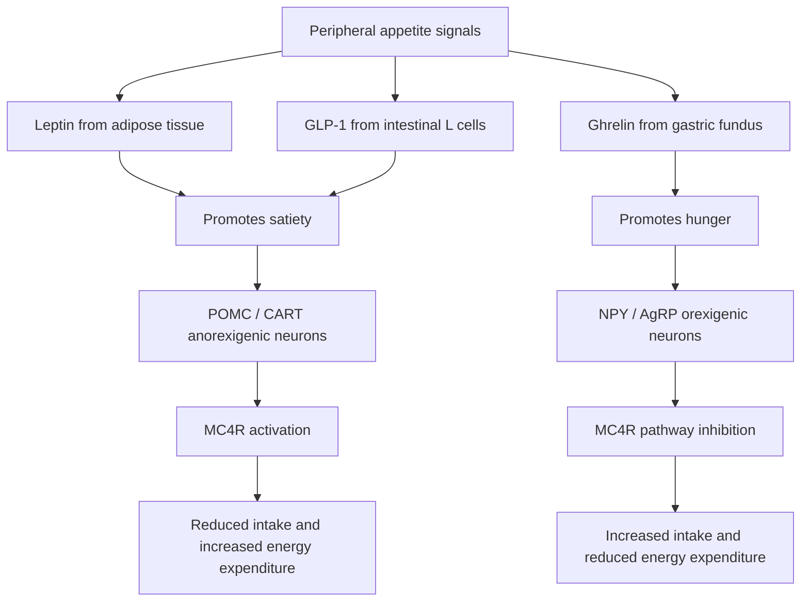

# Chapter 20: Obesity, Metabolism & Bariatric Endocrine Care

## 20.1 Central Regulation of Appetite & Energy Balance

Energy homeostasis is governed by the arcuate nucleus (ARC) of the hypothalamus, which integrates peripheral metabolic signals from adipocytes and the gastrointestinal tract.

### Key Peripheral Neuroendocrine Signals
1. **Leptin**: Peptide hormone secreted by white adipocytes in proportion to fat mass. Binds to LEPR ($G_{\alpha i}$ / JAK-STAT) in the arcuate nucleus, stimulating **POMC/CART neurons** (satiety) and inhibiting **NPY/AgRP neurons** (hunger). Common obesity is characterized by **Leptin Resistance** (elevated circulating leptin with impaired central signaling).
2. **Ghrelin**: Peptide hormone secreted by gastric fundal oxyntic cells during fasting. The only circulating **orexigenic (hunger-stimulating) hormone**. Binds to GHSR on NPY/AgRP neurons to trigger food intake. Levels drop rapidly after food ingestion and are permanently blunted following sleeve gastrectomy.
3. **GLP-1 & PYY**: Secreted by distal ileal and colonic L-cells in response to nutrient arrival. Enhances glucose-dependent insulin secretion, slows gastric emptying, and activates central POMC satiety circuits.

---

## 20.2 Medical Management & Pharmacotherapy of Obesity

Obesity is classified by Body Mass Index (BMI): Overweight ($25\text{--}29.9$), Class I ($30\text{--}34.9$), Class II ($35\text{--}39.9$), and Class III ($\ge 40\text{ kg/m}^2$).

### Anti-Obesity Pharmacotherapy Comparison Matrix

| Drug Class & Name | Mechanism of Action | Mean Weight Loss | Major Side Effects & Contraindications |
| :--- | :--- | :--- | :--- |
| **Tirzepatide** | Dual **GLP-1 & GIP Receptor Agonist** | **$20\text{--}22.5\%$** | Nausea, vomiting, diarrhea, pancreatitis risk. Contraindicated in Medullary Thyroid Carcinoma (MTC) and MEN 2. |
| **Semaglutide 2.4 mg** | **GLP-1 Receptor Agonist** | **$15\text{--}17\%$** | Nausea, constipation, delayed gastric emptying. MTC / MEN 2 contraindication. |
| **Phentermine-Topiramate** | Sympathomimetic + GABA modulator / Carbonic anhydrase inhibitor | $8\text{--}10\%$ | Paresthesias, insomnia, tachycardia, cognitive slowing. Teratogenic (cleft palate; requires REMS). |
| **Bupropion-Naltrexone** | Dopamine/Norepinephrine reuptake inhibitor + Opioid antagonist | $5\text{--}6\%$ | Nausea, headache, insomnia, elevated BP. Contraindicated in uncontrolled HTN, seizure disorders, chronic opioid use. |
| **Orlistat** | Pancreatic & Gastric Lipase inhibitor (blocks fat absorption) | $5\%$ | Steatorrhea, fecal urgency, fat-soluble vitamin deficiency (A, D, E, K). |

---

## 20.3 Bariatric & Metabolic Surgery

Bariatric surgery is the most effective long-term intervention for severe obesity, producing profound weight loss and rapid, weight-independent remission of Type 2 Diabetes.

| Procedure | Core anatomical approach | Physiological / metabolic effects described in the source |
| --- | --- | --- |
| Sleeve gastrectomy (SG) | Restrictive procedure; approximately 80% of the stomach, including much of the fundus, is removed | Reduced ghrelin production; early increases in GLP-1 and PYY |
| Roux-en-Y gastric bypass (RYGB) | Small gastric pouch with gastrojejunostomy; bypasses the distal stomach, duodenum and proximal jejunum | Increased GLP-1 response; altered nutrient absorption and gut-hormone signalling |

### Indications (ASMBS / IFSO 2022 Guidelines)
* $\text{BMI} \ge 35\text{ kg/m}^2$ regardless of comorbidities.
* $\text{BMI } 30\text{--}34.9\text{ kg/m}^2$ with metabolic disease (T2DM, hypertension, OSAS, MASH).

### Endocrine & Complication Management
1. **Early Post-Bariatric Hypoglycemia / Dumping Syndrome**:
   * *Early Dumping* (15–30 min post-prandial): Rapid hyperosmolar chyme entry into jejunum $\rightarrow$ fluid shift $\rightarrow$ abdominal pain, tachycardia, diaphoresis.
   * *Late Dumping / Hyperinsulinemic Hypoglycemia* (1–3 hours post-prandial): Rapid glucose absorption triggers a massive **exaggerated GLP-1 surge** $\rightarrow$ hyperinsulinemic hypoglycemia. Managed with low-glycemic, frequent meals, Acarbose, or Octreotide.
2. **Nutritional & Bone Monitoring**:
   * Mandatory lifelong supplementation of Vitamin $\text{B}_{12}$, iron, elemental calcium (Calcium Citrate preferred due to reduced gastric acid), Vitamin D, and fat-soluble vitamins.

---

## 20.4 Summary Checklist & Corrections

### Index Subsections Covered
- [x] 20.1 Central Regulation of Appetite & Leptin/Ghrelin
- [x] 20.2 Medical Management & GLP-1/GIP Pharmacotherapy
- [x] 20.3 Bariatric Surgical Procedures & Endocrine Adaptations
- [x] 20.4 Post-Bariatric Hypoglycemia & Dumping Syndrome

### Index Corrections & Clarifications
* **Update**: Incorporated Tirzepatide (dual GIP/GLP-1 RA) as the current benchmark agent for medical weight loss based on STEP/SURMOUNT trial data.
