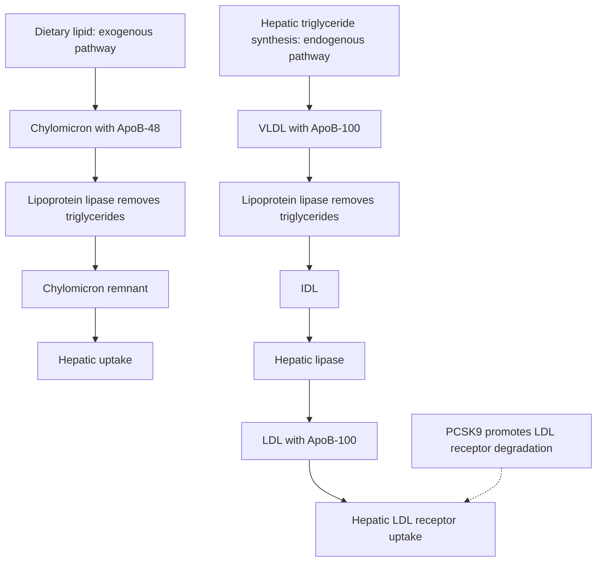
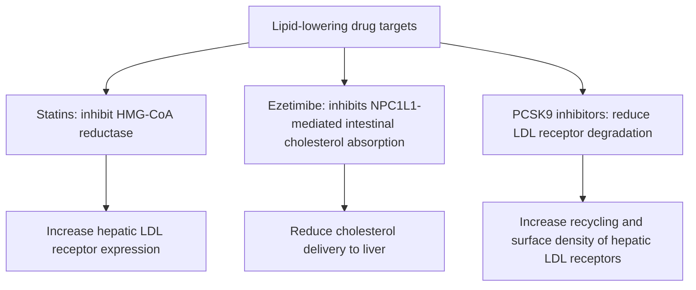

# Chapter 21: Dyslipidemias & Cardiovascular Risk Management

## 21.1 Lipoprotein Metabolism Pathways

Lipoproteins transport hydrophobic lipids (cholesteryl esters and triglycerides) through the aqueous bloodstream using an amphipathic phospholipid monolayer stabilized by **Apoproteins**.

### Major Apoproteins & Functions
* **ApoB-100**: Structural protein for liver-derived lipoproteins (VLDL, IDL, LDL). Acts as the primary ligand for the hepatic **LDL Receptor (LDLR)**.
* **ApoB-48**: Structural protein synthesized exclusively in the intestine for **Chylomicrons** (lacks the LDLR binding domain).
* **ApoA-1**: Primary apoprotein for **HDL**; activates **LCAT** (Lecithin-Cholesterol Acyltransferase) to esterify cholesterol during reverse cholesterol transport.
* **ApoC-II**: Essential cofactor that activates **Lipoprotein Lipase (LPL)** on capillary endothelial surfaces to hydrolyze core triglycerides.
* **ApoE**: Ligand for chylomicron remnant and IDL clearing via hepatic ApoE/LDLR receptors.

---

## 21.2 Primary & Secondary Dyslipidemias

### 1. Familial Hypercholesterolemia (FH)
* **Genetics**: Autosomal dominant condition caused by loss-of-function mutations in **_LDLR_ ($90\%$)**, *APOB*, or gain-of-function mutations in **_PCSK9_**.
* **Pathophysiology**: Defective hepatic clearance of circulating LDL $\rightarrow$ severe lifetime elevation of plasma LDL-C.
* **Clinical Spectrum**:
  * *Heterozygous FH* ($1 \text{ in } 250$): LDL-C typically $190\text{--}400\text{ mg/dL}$. Onset of CAD in 30s–40s.
  * *Homozygous FH* ($1 \text{ in } 1,000,000$): LDL-C $> 500\text{ mg/dL}$. Severe aortic root stenosis and fatal CAD before age 20.
* **Physical Landmarks**:
  * **Tendon Xanthomas** (firm nodules on Achilles tendon or extensor hand tendons; pathognomonic).
  * **Xanthelasma** (palpebral lipid deposits) and **Corneal Arcus** before age 45.

### 2. Familial Chylomicronemia Syndrome (FCS)
* **Genetics**: Autosomal recessive deficiency of **Lipoprotein Lipase (LPL)** or its cofactor **ApoC-II**.
* **Clinical Presentation**: Massive elevation of chylomicrons and severe hypertriglyceridemia ($> 1000\text{--}2000\text{ mg/dL}$).
* **Complications**: High risk of **Acute Recurrent Pancreatitis**, eruptive cutaneous xanthomas, and lipemia retinalis. LDL-C is normal/low.

### Common Secondary Causes of Dyslipidemia

| Lipid Pattern | Primary Secondary Etiologies | Mechanism |
| :--- | :--- | :--- |
| **Elevated LDL-C** | **Hypothyroidism**, Nephrotic Syndrome, Cholestasis | Reduced hepatic LDLR expression; impaired biliary cholesterol excretion. |
| **Elevated Triglycerides** | Uncontrolled Diabetes, Alcohol abuse, Thiazides, $\beta$-blockers, Estrogen therapy | Increased hepatic VLDL secretion; impaired LPL-mediated clearance. |
| **Low HDL-C** | Cigarette smoking, Obesity, Metabolic Syndrome, Anabolic steroids | Accelerated HDL catabolism; hepatic lipase upregulation. |

---

## 21.3 Lipid-Lowering Pharmacotherapy

### Drug Class Summary Matrix

| Class & Representative Drugs | Primary Lipid Effect | Mechanism of Action | Key Clinical Indications & Adverse Effects |
| :--- | :--- | :--- | :--- |
| **Statins** (Atorvastatin, Rosuvastatin) | **LDL-C $\downarrow 30\text{--}60\%$** TG $\downarrow 15\text{--}30\%$ | Competitive inhibition of **HMG-CoA Reductase** $\rightarrow$ depletes intracellular cholesterol $\rightarrow$ upregulates hepatic LDLR density. | First-line for ASCVD prevention. Side effects: Statin-associated muscle symptoms (SAMS / Myalgia), myopathy, rhabdomyolysis, new-onset diabetes. |
| **Ezetimibe** | **LDL-C $\downarrow 15\text{--}20\%$** | Selective inhibitor of **NPC1L1** transporter at the enterocyte brush border, blocking intestinal cholesterol absorption. | Second-line added to statins. Highly tolerable, minimal side effects. |
| **PCSK9 Inhibitors** (Evolocumab, Alirocumab, Inclisiran) | **LDL-C $\downarrow 50\text{--}70\%$** | Monoclonal antibodies (or siRNA) blocking PCSK9-mediated lysosomal degradation of hepatic LDLR $\rightarrow$ recycling LDLR to membrane. | High-risk ASCVD or FH failing max statin/ezetimibe. Administered SC every 2–4 weeks (or 6-monthly for Inclisiran). |
| **Fibrates** (Fenofibrate, Gemfibrozil) | **TG $\downarrow 30\text{--}50\%$** HDL-C $\uparrow 10\text{--}20\%$ | Activates **PPAR-$\alpha$** $\rightarrow$ upregulates LPL activity and ApoA-1 synthesis while downregulating ApoC-III. | First-line for severe hypertriglyceridemia ($> 500\text{ mg/dL}$) to prevent **Acute Pancreatitis**. Fenofibrate preferred with statins (less myopathy than Gemfibrozil). |

---

## 21.4 Summary Checklist & Corrections

### Index Subsections Covered
- [x] 21.1 Lipoprotein Metabolism & Apoprotein Physiology
- [x] 21.2 Familial Hypercholesterolemia & Secondary Dyslipidemias
- [x] 21.3 Lipid-Lowering Therapeutics (Statins, Ezetimibe, PCSK9 Inhibitors, Fibrates)

### Index Corrections & Clarifications
* **Clarification**: Highlighted that Fenofibrate is the preferred fibrate co-prescribed with statins due to lower risk of inhibiting statin glucuronidosis compared to Gemfibrozil.
