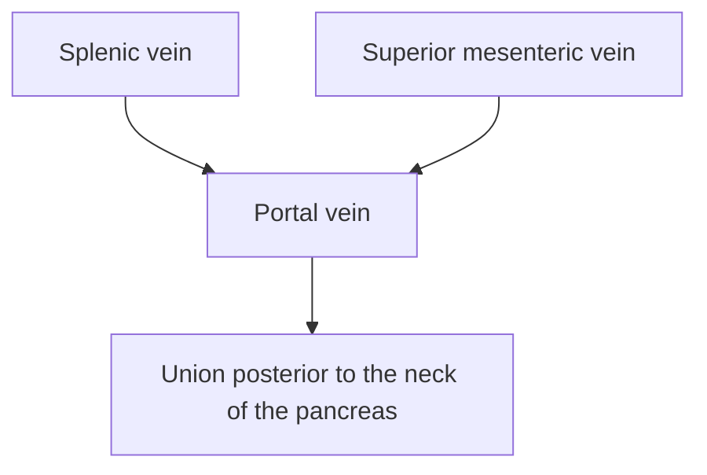

# Chapter 4: Gross Anatomy of Hepatobiliary System, Pancreas, Spleen & Peritoneum

## 4.1 Liver

The liver is the largest visceral organ in the body, located in the right hypochondrium, epigastrium, and left hypochondrium.

### Anatomical vs. Couinaud Surgical Segmentation
* **Anatomical Lobes**: Divided into Right, Left, Caudate, and Quadrate lobes by surface landmarks (falciform ligament anteriorly; ligamentum venosum and ligamentum teres on visceral surface).
* **Couinaud Functional Segmentation**: Divides the liver into **8 functional segments**, each operating as an independent unit with its own vascular inflow (portal vein branch and hepatic artery branch), biliary drainage, and central hepatic venous outflow [21, 55, 56].
  * **Cantlie's Line (Cholecystocaval Line)**: An imaginary line drawn from the gallbladder fossa to the IVC (corresponds to the middle hepatic vein) [21, 56]. Divides the liver into functional Right and Left Hemilivers [21, 56].

| Hemiliver / segment | Couinaud segments |
| --- | --- |
| Right anterior sector | V and VIII |
| Right posterior sector | VI and VII |
| Left medial sector | IVa and IVb |
| Left lateral sector | II and III |
| Caudate lobe | I; functionally independent with direct venous drainage to the IVC |

**Surgical anatomy differs from surface anatomy**
- **Cantlie line / principal plane:** a plane from the **gallbladder fossa to the inferior vena cava** that approximates the course of the **middle hepatic vein** and divides the functional right and left liver.
- **Dual blood supply:** portal vein supplies most hepatic blood flow; hepatic artery supplies oxygenated arterial blood. Both branch within the **portal triad**, together with a bile duct.
- **Hepatic veins:** right, middle and left hepatic veins drain to IVC; their planes divide sectors; the portal veins provide an approximate transverse division into superior/inferior segments.
- **Caudate lobe (segment I)** is functionally relatively independent and drains directly into the IVC; it may enlarge in hepatic venous outflow obstruction (**Budd–Chiari**).
- **Portal pedicle on ultrasound:** the familiar **Mickey Mouse sign** in the transverse porta-hepatis view represents the portal vein with adjacent hepatic artery and bile duct.

**Couinaud segmental anatomy**
| Segment | Surgical location | Important correlation |
|---|---|---|
| **I** | Caudate lobe | Independent venous drainage to IVC; hypertrophy in Budd–Chiari |
| **II** | Left lateral superior | Part of left lateral section; common living-donor pediatric graft |
| **III** | Left lateral inferior | With II forms left lateral section |
| **IVa** | Left medial superior | Left hemiliver |
| **IVb** | Left medial inferior | **Gallbladder bed** (together with V); relevant in radical GB-cancer surgery |
| **V** | Right anterior inferior | Gallbladder bed; right anterior section |
| **VI** | Right posterior inferior | Right posterior section |
| **VII** | Right posterior superior | Subdiaphragmatic/right posterior location; WOR highlights amoebic liver abscess |
| **VIII** | Right anterior superior | Right anterior section |

| Brisbane 2000 operation | Resected segments | Rationale / typical situation |
|---|---|---|
| **Left hepatectomy / left hemihepatectomy** | II, III, IV | Left-sided lesion |
| **Right hepatectomy / right hemihepatectomy** | V, VI, VII, VIII | Right-sided lesion |
| **Left lateral sectionectomy** | II, III | Localized left-lateral lesion; pediatric donor graft |
| **Extended left hepatectomy / left trisectionectomy** | II, III, IV, V, VIII | Additional right anterior section |
| **Extended right hepatectomy / right trisectionectomy** | IV, V, VI, VII, VIII | Additional left medial segment |
| **Central hepatectomy (“Taj Mahal”)** | Central segments including IVb, V and often VIII, depending on exact operation | Selected centrally placed disease |
| **Radical gallbladder cancer resection** | Gallbladder with liver bed, classically IVb and V, plus lymphadenectomy | Selected T1b/T2 and other resectable lesions |

> [!tip] Exam mechanism
> The **portal inflow anatomy makes segmental resections possible**. Hepatic veins mark intersectoral boundaries. Always distinguish **anatomic lobe** from **functional hemiliver**.

### Surfaces & Peritoneal Relations
* **Bare Area of the Liver**: Triangular area on the posterior surface lacking visceral peritoneum; bounded by the upper and lower layers of the coronary ligament. Direct contact with diaphragm.
* **Visceral Impressions**: Gastric, duodenal, renal (right kidney), suprarenal, and colic (hepatic flexure) impressions.

### Porta Hepatis Arrangement
The porta hepatis is the deep transverse fissure on the visceral surface of the liver. The arrangement of structures from **anterior to posterior** is [2, 51]:
1. **Bile Duct** (right anterior) [2, 51].
2. **Proper Hepatic Artery** (left anterior) [2, 51].
3. **Portal Vein** (posterior) [2, 51].

| Porta hepatis structure | Relative position |
| --- | --- |
| Proper hepatic artery | Anterior-left |
| Common hepatic duct / bile duct | Anterior-right |
| Portal vein | Posterior |

**Surgical pedicle and Pringle maneuver**
- **Pringle maneuver:** temporarily occludes vascular inflow by compressing/clamping the hepatoduodenal ligament at the free margin near the foramen of Winslow.
- **Interpretation:** hepatic bleeding that decreases suggests an **inflow-source** (hepatic artery/portal vein); persistent major hemorrhage raises concern for **hepatic venous/retrohepatic IVC** injury or another source.
- **Use in trauma/hepatectomy:** a temporizing hemostatic maneuver; control, ischemic tolerance, and definitive vascular techniques require specialist judgment.

---

## 4.2 Biliary Apparatus

The extrahepatic biliary apparatus consists of the right and left hepatic ducts, common hepatic duct, gallbladder, cystic duct, and common bile duct.

### Gallbladder Anatomy
Pea-shaped sac (~7–10 cm long) sitting in the gallbladder fossa between segments IVB and V on the visceral liver surface [56].
* Subdivided into **Fundus** (projects beyond inferior liver margin at the 9th costal cartilage), **Body**, and **Neck** [5, 58].
* **Hartmann's Pouch**: Outpouching at the neck/cystic duct junction; common site for gallstone impaction.

### Triangle of Calot (Hepatobiliary Triangle)
Crucial anatomical space dissected during cholecystectomy [58]:

| Boundary / Content | Anatomical Structure |
| :--- | :--- |
| **Superior Boundary** | Inferior surface of the liver (or Cystic Artery in strict Calot's triangle) [58] |
| **Medial Boundary** | **Common Hepatic Duct (CHD)** [58] |
| **Inferior / Lateral Boundary** | **Cystic Duct** [58] |
| **Primary Content** | **Cystic Artery** (branch of right hepatic artery) [58], Lund's node |

| Hepatobiliary triangle (Calot / hepatocystic triangle) | Boundary / content |
| --- | --- |
| Superior | Inferior surface of the liver |
| Medial | Common hepatic duct |
| Inferolateral | Cystic duct |
| Important content | Cystic artery; cystic (Lund) lymph node may be present |

* **Moynihan's Hump**: Tortuous "caterpillar turn" of the right hepatic artery within Calot's triangle, vulnerable to accidental ligation during cholecystectomy [19].

**Hepatocystic vs classical Calot triangle**
|---|---|---|
| **Hepatocystic triangle** | **CHD medially + cystic duct inferiorly/laterally + inferior liver edge superiorly** | Cystic artery, nodes and variable ducts; field for safe dissection |
| **Original Calot triangle** | **CHD + cystic duct + cystic artery** | Different superior boundary; sources distinguish both |

**Named anatomical clues**
- **Moynihan hump/caterpillar turn:** tortuous right hepatic artery near Calot region; falsely identified as cystic artery → hemorrhage/ductal injury.
- **Rouvière sulcus:** groove on lower right liver indicating right posterior pedicle plane; valuable **landmark for staying above/before unsafe ductal structures**.
- **R4U line (WOR):** connecting Rouvière sulcus–segment IVb–umbilical fissure; a spatial safety reference for cholecystectomy.
- **Cystic plate:** fibrous liver-bed plate beneath GB; correct dissection plane limits liver bleeding and biliary injury.
- **Phrygian cap:** fold of gallbladder fundus; common benign anatomical variation **not itself an indication for surgery**.
- **Ducts of Luschka:** small subvesical/accessory bile ducts near gallbladder bed; injury causes postoperative bile leak.

### Common Bile Duct (CBD) & Sphincter of Oddi
CBD (~8 cm long) descends in the free margin of the lesser omentum [2], passes posterior to the 1st part of the duodenum, traverses the head of the pancreas, and joins the main pancreatic duct at the **Ampulla of Vater** [24, 42].
* **Sphincter of Oddi Complex**: Smooth muscle sphincters surrounding the terminal CBD, pancreatic duct, and ampulla [19]. Resting pressure $13–120\text{ mmHg}$; relaxes in response to **CCK** [19].

**Ductal anatomy**
- CHD + **cystic duct** → **common bile duct (CBD)**. CBD commonly joins the **main pancreatic duct (Wirsung)** near the ampulla of Vater before entering **second part of duodenum**.
- **Cystic duct:** spiral mucosal folds known as **valves of Heister**; can complicate cannulation.
- **Sphincter of Oddi complex** controls flow at distal CBD/pancreatic duct/ampulla and relaxes with appropriate postprandial signals.
- **CCK:** duodenal response to fat → **gallbladder contraction**, sphincter relaxation and bile delivery to digest fat.
- **Gallbladder:** fundus, body, infundibulum/Hartmann pouch and neck; lies adjacent to liver segments **IVb and V**.
- **Cystic artery** usually arises from **right hepatic artery**; many vascular/biliary variants create injury risk.

---

## 4.3 Pancreas

The pancreas is an elongated, secondary retroperitoneal organ ($L_1–L_2$ level) spanning the posterior abdominal wall [31, 32].

### Subdivisions & Retroperitoneal Relations
1. **Head**: Nestled in the C-loop of the duodenum; anterior to IVC and left renal vein [4].
2. **Uncinate Process**: Hook-like projection from lower head; passes **posterior to SMA and SMV** [24, 31, 33].
3. **Neck**: Anterior to the portal vein formation [24].
   * **Tunnel of Love**: Retro-pancreatic space behind the neck where the **Superior Mesenteric Vein (SMV)** joins the **Splenic Vein** to form the **Portal Vein** [24].
4. **Body**: Crosses aorta, $L_1$ vertebra, and left kidney.
5. **Tail**: Mobile terminal portion passing within the **splenorenal ligament** to reach the splenic hilum [3, 20, 51].

**Normal anatomy**
- **Main duct (Wirsung)** commonly joins distal CBD at ampulla of Vater; accessory duct (**Santorini**) may drain through **minor duodenal papilla**.
- **Pancreatic head** shares blood supply and lymphatic relationships with duodenum, explaining why **pancreaticoduodenectomy** removes both together.
- **Splenic artery/vein** run along pancreas toward hilum; pancreatic surgery can damage splenic vessels, produce splenic vein thrombosis or result in **left-sided portal hypertension**.
- Surgical relevance: major peripancreatic vessel relationships—**SMA, SMV, portal vein, celiac axis, common hepatic artery**—largely determine tumor resectability.

---

## 4.4 Spleen

The spleen is a wedge-shaped lymphoid organ situated in the left hypochondrium.

### Topography & Anatomical Relations
* **Rib Relations**: Lies under cover of the **9th, 10th, and 11th ribs** on the left side (long axis along 10th rib).
* **Phrenicocolic Ligament**: Peritoneal fold connecting diaphragm to splenic flexure; supports the spleen ("sustentaculum lienis") [52].

### Splenic Pedicle & Microarchitecture
* **Splenic Hilum**: Entry point for splenic artery and exit for splenic vein.
* **Ligamentous Attachments**:
  * **Gastrosplenic Ligament**: Short gastric and left gastroepiploic vessels [3, 35, 51].
  * **Splenorenal Ligament**: Splenic vessels and **tail of the pancreas** [3, 35, 51]. Ligation of splenic vessels within $1\text{ cm}$ of hilum risks pancreatic fistula [20].
* **Red vs. White Pulp**:
  * **White Pulp**: Lymphatic tissue forming Periarteriolar Lymphoid Sheaths (PALS - T-cells) and lymphoid follicles (B-cells) surrounding central arterioles [20, 49].
  * **Red Pulp**: Splenic cords (cords of Billroth) and venous sinusoids; filters senescent erythrocytes and encapsulates bacteria [20, 49].

- **Largest lymphoid organ**, under left diaphragm, usually opposite ribs **9–11**, with long axis approximating **10th rib** (Doctut).
- Embryology: develops from **dorsal mesogastrium**.
- Relationships: stomach, left kidney, splenic flexure, diaphragm and pancreatic tail.

| Peritoneal attachment | Main contents/clinical point |
|---|---|
| **Splenorenal (lienorenal) ligament** | **Splenic artery/vein and tail of pancreas**; pancreatic tail injury risk |
| **Splenocolic ligament** | Attachment near splenic flexure; risk to colon during mobilization |
| **Splenophrenic ligament** | Splenic attachment to diaphragm |

---

## 4.5 Peritoneum & Abdominal Spaces

### Peritoneal Subdivisions
* **Greater Sac**: Main systemic peritoneal cavity extending from diaphragm to pelvis.
* **Lesser Sac (Omental Bursa)**: Diverticulum behind the stomach and lesser omentum [2, 3].

### Epiploic Foramen of Winslow
The unique anatomical communication between the Greater Sac and Lesser Sac [2, 3, 50].

| Boundary of the epiploic foramen | Structure |
| --- | --- |
| Anterior | Hepatoduodenal ligament containing the portal triad |
| Posterior | Inferior vena cava |
| Superior | Caudate lobe of the liver |
| Inferior | First part of the duodenum |

### Retroperitoneal Classification (SAD PUCKER Mnemonic)
Structures situated posterior to the parietal peritoneum [32]:

| Letter | Retroperitoneal Structure |
| :--- | :--- |
| **S** | **S**uprarenal (Adrenal) Glands [32] |
| **A** | **A**orta and IVC [32] |
| **D** | **D**uodenum (2nd, 3rd, 4th parts) [32] |
| **P** | **P**ancreas (Head, Neck, Body - except Tail) [32] |
| **U** | **U**reters [32] |
| **C** | **C**olon (Ascending and Descending) [32] |
| **K** | **K**idneys [32] |
| **E** | **E**sophagus (Thoracic/Abdominal segment) [32] |
| **R** | **R**ectum (Middle and lower $1/3$) [32] |

### Dependent Peritoneal Recesses & Fluid Dynamics
* **Morison's Pouch (Hepatorenal Recess)**: Potential space between the liver and right kidney [3, 19, 52]. **Most dependent space in the peritoneal cavity when supine**; primary site for pus/blood accumulation [3, 19, 52].
* **Rectouterine Pouch (Pouch of Douglas)**: Most dependent space in females when sitting/standing [3, 52].
* **Rectovesical Pouch**: Most dependent space in males when sitting/standing [52].

---

## Index Coverage Checklist & Quality Self-Audit

### Original Index Subsections Covered
- [x] 4.1 Liver (Anatomical vs Couinaud 8 segments, Cantlie's line, Surfaces/impressions, Porta hepatis VAT arrangement)
- [x] 4.2 Biliary Apparatus (Gallbladder regions, Triangle of Calot boundaries & contents, Moynihan's hump, CBD & Sphincter of Oddi)
- [x] 4.3 Pancreas (Head/uncinate/neck/body/tail, Uncinate relation to SMA, Tunnel of Love & portal vein formation)
- [x] 4.4 Spleen (Ribs 9–11 alignment, Phrenicocolic ligament, Gastrosplenic & Splenorenal ligaments, Red vs White pulp microanatomy)
- [x] 4.5 Peritoneum & Abdominal Spaces (Greater vs Lesser sac, Foramen of Winslow boundaries, SAD PUCKER retroperitoneal organs, Morison's pouch & pelvic pouches)

### Index Corrections Made
* Verified porta hepatis alignment anteroposteriorly: Bile Duct (Ant-Right), Proper Hepatic Artery (Ant-Left), Portal Vein (Posterior).
* Corrected the floor of the Foramen of Winslow: 1st part of duodenum (not pylorus).

### Source Coverage Statement
All topics under Chapter 4 were fully substantiated using notebook source files (`Anatomy atf.pdf`, `anatomy.pdf`, `First Aid for the USMLE Step 1`, `Surgery atf Part1.pdf`, `Surgery atf Part 2.pdf`). No information was missing.
