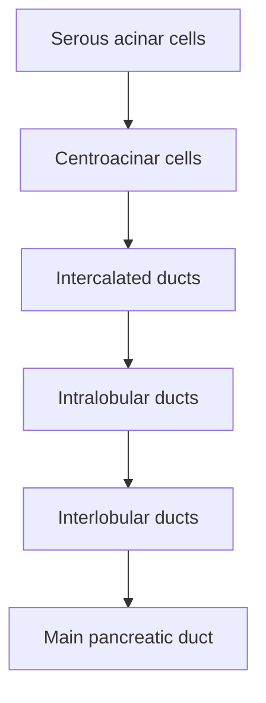

# Chapter 5: Histology and Microanatomy of the Digestive System

## 5.1 Microscopic Architecture of the GI Tract Wall

The alimentary canal exhibits a generalized four-layered histological organization from the mid-esophagus through the anal canal. Each layer displays specialized structural adaptations tailored to regional mechanical, secretomotor, and absorptive demands.

**Four layers of the gastrointestinal tract wall**

1. **Mucosa**
   - Epithelium: stratified squamous or simple columnar, depending on region.
   - Lamina propria: loose connective tissue, blood and lymphatic capillaries, MALT/GALT.
   - Muscularis mucosae: smooth muscle producing local mucosal movement.
2. **Submucosa**
   - Dense irregular connective tissue, larger blood vessels and lymphatics.
   - Meissner (submucosal) plexus regulates secretion and local blood flow.
   - Brunner glands are present in the duodenum.
3. **Muscularis externa**
   - Inner circular smooth muscle and outer longitudinal smooth muscle.
   - Auerbach (myenteric) plexus lies between the two muscle layers and regulates motility.
4. **Serosa or adventitia**
   - Serosa: mesothelium plus connective tissue on intraperitoneal surfaces.
   - Adventitia: connective tissue anchoring structures to surrounding tissues.

### 1. Mucosa (Mucous Membrane)
* **Epithelium**: 
  * *Stratified Squamous Non-Keratinized*: Provides protective armor against mechanical abrasion in the oral cavity, pharynx, esophagus, and lower anal canal.
  * *Simple Columnar Epithelium*: Specialized for secretion and absorption from the stomach to the rectum. Features tight junctions (*zonula occludens*) establishing a selective mucosal barrier.
* **Lamina Propria**: Loose, vascularized connective tissue containing fenestrated capillaries, central lacteals (in small intestinal villi), and diffuse **Mucosa-Associated Lymphoid Tissue (MALT)** / **Gut-Associated Lymphoid Tissue (GALT)** including IgA-secreting plasma cells, macrophages, and dendritic cells.
* **Muscularis Mucosae**: Thin double layer of smooth muscle (inner circular, outer longitudinal). Its independent tonic contraction maintains mucosal folds (rugae/plicae circulares) and facilitates movement of luminal contents into contact with absorptive surfaces without altering the overall luminal diameter.

### 2. Submucosa
A thick vascular layer of dense irregular connective tissue providing elasticity and structural integrity.
* Contains larger arterioles, venules, lymphatic trunks, and submucosal glands (e.g., **Brunner glands** in the duodenal submucosa).
* Houses the **Submucosal (Meissner) Plexus**, an autonomic enteric network primarily controlling glandular secretion, mucosal blood flow, and muscularis mucosae tone.

### 3. Muscularis Externa
Consists of two robust smooth muscle layers responsible for peristalsis and segmentation:
* **Inner Circular Layer**: Constricts luminal diameter. Thickened at specific anatomical junctions to form functional and anatomical sphincters (e.g., Upper Esophageal Sphincter [UES], Lower Esophageal Sphincter [LES], Pyloric Sphincter, Ileocecal Valve, Internal Anal Sphincter).
* **Outer Longitudinal Layer**: Shortens the tube length along the gut axis.
* **Myenteric (Auerbach) Plexus**: Situated in the intermuscular connective tissue plane between the inner circular and outer longitudinal layers. Controls overall GI tract motility rate and velocity of wave propagation.

### 4. Serosa vs. Adventitia
* **Serosa**: Thin visceral peritoneal layer comprising a simple squamous mesothelium supported by submesothelial connective tissue. Present on intraperitoneal organ segments.
* **Adventitia**: Coarse fibrous connective tissue blending directly into surrounding retroperitoneal or mediastinal structures (e.g., thoracic esophagus, ascending/descending colon, middle/lower rectum).

---

## 5.2 Histology of the Esophagus and Stomach

### 1. Esophageal Microanatomy
* **Epithelium**: Thick non-keratinized stratified squamous epithelium. At the gastroesophageal junction (Z-line), it transitions abruptly to simple columnar gastric mucosa.
* **Submucosal Glands**: Tuboalveolar **esophageal glands proper** secrete acidic mucin to lubricate the mucosal surface.
* **Muscularis Externa Composition**:
  * *Upper 1/3*: 100% Striated (Skeletal) Muscle (under somatic motor control via the vagus nerve).
  * *Middle 1/3*: Mixed Striated and Smooth Muscle (~50% each).
  * *Lower 1/3*: 100% Smooth Muscle (under autonomic control via the enteric nervous system).
* **Adventitia**: Covers the thoracic esophagus; a short abdominal segment below the diaphragm is covered by serosa.

| Feature | Esophagus | Stomach (oxyntic mucosa) |
| --- | --- | --- |
| Surface epithelium | Non-keratinized stratified squamous | Simple columnar foveolar cells |
| Glands | Esophageal submucosal glands | Gastric pits opening into oxyntic glands |
| Muscle layers | Upper third skeletal, middle mixed, lower third smooth | Smooth muscle in muscularis externa |

### 2. Gastric Histology & Oxyntic Gland Architecture
The stomach mucosa is thrown into temporary longitudinal folds called **rugae**, which flatten during gastric distension. The mucosal surface is indented by millions of microscopic **gastric pits (foveolae)**, which lead into tubular **gastric glands**.

#### Regional Histological Variations
* **Cardiac Glands**: Predominantly mucous-secreting tubular glands; shallow pits.
* **Fundic / Body (Oxyntic) Glands**: Straight tubular glands occupying ~85% of the stomach; shallow pits leading into deep glands containing parietal, chief, and ECL cells.
* **Pyloric Glands**: Deep gastric pits (occupying ~50% of mucosal thickness) leading into short, branched coiled glands rich in G cells and mucous cells.

#### Cytology of the Oxyntic Gland
1. **Surface Mucous (Foveolar) Cells**: Line the luminal surface and pits. Secretes an insoluble, gel-like **neutral mucus** rich in bicarbonate ($\text{HCO}_3^-$), forming a 0.2 mm protective **mucus-bicarbonate barrier** that maintains an apical surface pH of ~7.0 despite a luminal stomach pH of 1.0–2.0.
2. **Mucous Neck Cells**: Located in the gland neck. Secrete a soluble, acidic mucin during active digestion.
3. **Parietal (Oxyntic) Cells**:
   * *Appearance*: Large, pyramidal, highly eosinophilic cells (due to abundant mitochondria occupying 40% of cell volume).
   * *Location*: Predominantly in the neck and upper body of fundic glands.
   * *Ultrastructure*: Contains an extensive intracellular **canaliculi** network lined with microvilli. Upon stimulation, tubulovesicular membranes fuse with the canalicular membrane, expanding the surface area 50-fold for active proton pumping.
   * *Secretions*: **Hydrochloric Acid (HCl)** (via apical $\text{H}^+/\text{K}^+$-ATPase) and **Intrinsic Factor** (a 45 kDa glycoprotein essential for vitamin $\text{B}_{12}$ absorption in the terminal ileum).
4. **Chief (Zymogenic) Cells**:
   * *Appearance*: Basophilic cytoplasm (dense rough endoplasmic reticulum) with dark apical zymogen granules.
   * *Location*: Base of fundic glands.
   * *Secretions*: **Pepsinogen I and II** (proenzymes activated by low pH to active Pepsin) and **Gastric Lipase**.
5. **Enterochromaffin-Like (ECL) Cells**: Neuroendocrine cells located near chief cells at the gland base. Secrete **Histamine**, which acts locally via paracrine diffusion to stimulate parietal cell $\text{H}_2$ receptors.
6. **Enteroendocrine G Cells**: Located in pyloric antral glands. Secrete **Gastrin** directly into blood capillaries.
7. **D Cells**: Distributed throughout antrum and body. Secrete **Somatostatin** in response to luminal acidity, exerting inhibitory paracrine control over G cells and parietal cells.

---

## 5.3 Histology of the Small and Large Intestines

### 1. Structural Adaptations for Surface Area Expansion
The small intestine possesses three specialized modifications that expand its absorptive surface area ~600-fold to roughly $200\text{ m}^2$:
1. **Plicae Circulares (Valves of Kerckring)**: Permanent circular mucosal/submucosal folds rising 8–10 mm into the lumen. Increase surface area 3-fold. Most prominent in the distal duodenum and jejunum; disappear in the distal ileum.
2. **Intestinal Villi**: Finger-like mucosal projections (0.5–1.5 mm long) composed of an epithelial covering over a core of lamina propria containing a fenestrated capillary loop and a central lymphatic capillary (**lacteal**). Increase surface area 10-fold.
3. **Microvilli (Brush Border)**: Cytoplasmic projections ($1\ \mu\text{m}$ long) on the apical surface of enterocytes, anchored to an actin terminal web. Increase surface area 20-fold. Embedded with glycocalyx containing membrane-bound digestive enzymes (lactase, sucrase-isomaltase, peptidases, enterokinase).

**Small-intestinal villus and crypt architecture**

- **Villus surface:** Enterocytes with an apical brush border, interspersed with goblet cells.
- **Lamina propria core:** Contains capillary loops and a central lymphatic lacteal.
- **Crypts of Lieberkühn:** Invaginations between villi; stem cells and transit-amplifying cells occupy the proliferative zone.
- **Crypt base:** Paneth cells contain eosinophilic granules and secrete antimicrobial products, including lysozyme and defensins.

### 2. Crypts of Lieberkühn (Intestinal Glands)
Simple tubular invaginations extending from the intervillus spaces down to the muscularis mucosae.

#### Epithelial Cell Population
* **Absorptive Enterocytes**: Tall columnar cells with a prominent brush border and basal oval nuclei. Specialized for nutrient uptake and transepithelial transport.
* **Goblet Cells**: Mucus-secreting cells interspersed between enterocytes. Mucin granules expand apically giving a "goblet" appearance. Density increases progressively from duodenum to rectum.
* **Paneth Cells**:
  * *Location*: Exclusively at the base of the Crypts of Lieberkühn.
  * *Appearance*: Pyramid-shaped cells with prominent, intensely refractile, eosinophilic apical granules.
  * *Function*: Primary innate immune defense cells of the gut. Secrete **$\alpha$-defensins (cryptdins)**, **lysozyme**, and **phospholipase $\text{A}_2$**, which solubilize bacterial cell walls and maintain luminal microbial homeostasis.
* **Stem Cells**: Located at the lower third of the crypt (just above Paneth cells). Divide continuously to generate transit-amplifying cells that migrate up the villus and differentiate into enterocytes, goblet, and enteroendocrine cells, completely renewing the intestinal epithelium every 3–5 days.
* **Microfold (M) Cells**: Specialized antigen-sampling cells located in the follicle-associated epithelium overlying Peyer's patches. Feature apical microfolds instead of microvilli and deep basolateral pockets containing lymphocytes and dendritic cells. Endocytose luminal macromolecular antigens and deliver them intact to underlying APCs to initiate intestinal immune responses.

### 3. Regional Microscopic Differences

| Regional Feature | Duodenum | Jejunum | Ileum | Large Intestine |
| :--- | :--- | :--- | :--- | :--- |
| **Villi Shape** | Broad, leaf-like | Tall, finger-like | Short, club-like | **Absent** (smooth mucosa) |
| **Plicae Circulares** | Present in distal part | Well-developed, tall, crowded | Sparse, absent in distal end | **Absent** |
| **Submucosal Features** | **Brunner Glands** (branched tubuloalveolar; alkaline mucus) | No Brunner glands, no large lymphoid aggregates | No Brunner glands; rich in **Peyer's Patches** | Absence of specialized glands; thick collagen layer |
| **Goblet Cell Density** | Low (~10%) | Intermediate (~15%) | High (~20%) | **Highest** (~25–30%) |
| **Muscularis Externa** | Standard inner circular, outer longitudinal | Standard | Standard | Outer longitudinal condensed into 3 bands (**Teniae Coli**) |

### 4. Microanatomy of the Large Intestine
* **Mucosa**: Lacks villi and plicae circulares. Intestinal crypts (Crypts of Lieberkühn) are deeper, straight, and densely packed with goblet cells and absorptive colonocytes (specialized for water/electrolyte uptake).
* **Paneth Cells**: Absent in the normal left/distal colon (may appear in right colon or under conditions of chronic inflammation via metaplasia).
* **Muscularis Externa**: The outer longitudinal smooth muscle layer is not continuous; it condenses into three equidistant, parallel longitudinal ribbons termed **Teniae Coli** (Tenia libera, Tenia omentalis, Tenia mesocolica). Tonic contraction of teniae coli gathers the colon into sacculations called **Haustra**.
* **Serosa**: Contains pouch-like peritoneal projections filled with fat called **Appendices Epiploicae** (Epiploic Appendages).

---

## 5.4 Liver Microarchitecture

### 1. Functional Concepts of Hepatic Lobulation
The hepatic parenchyma is organized into three distinct microanatomical units based on structural, vascular, and metabolic criteria:

| Structural model | Main orientation / feature | Functional emphasis |
| --- | --- | --- |
| Classical hepatic lobule | Hexagonal unit centred on a central vein, with portal tracts at the periphery | Structural organisation and blood flow toward the central vein |
| Portal lobule | Triangular unit centred on a portal tract, with three surrounding central veins | Bile secretion toward a bile duct in the portal tract |
| Hepatic acinus (Rappaport) | Diamond-shaped unit between terminal portal venules and central veins | Perfusion and metabolic zonation (zones 1–3) |

1. **Classical Hepatic Lobule**:
   * *Structure*: Hexagonal prism centered around a **Central Vein (Terminal Hepatic Venule)**, bounded at its corners by **Portal Triads (Portal Canals)**.
   * *Concept*: Emphasizes the endocrine flow of blood from peripheral portal triads through hepatic sinusoids toward the central vein.
2. **Portal Lobule**:
   * *Structure*: Triangular unit centered around a **Portal Triad**, with its three apexes defined by surrounding Central Veins.
   * *Concept*: Emphasizes the exocrine drainage of bile from hepatocytes radially outward toward the central interlobular bile duct.
3. **Hepatic Acinus of Rappaport**:
   * *Structure*: Diamond-shaped unit spanned between two adjacent Central Veins (short axis) and supplied by terminal vascular branches extending between two Portal Triads (long axis).
   * *Concept*: Emphasizes microvascular perfusion and metabolic zonation:
     * **Zone 1 (Periportal)**: Closest to incoming terminal hepatic arterioles and portal venules. Receives highest oxygen, nutrient, and toxin concentrations. High rate of oxidative metabolism, gluconeogenesis, fatty acid oxidation, and urea synthesis. Most resistant to circulatory hypoxia; most susceptible to direct toxic insult (e.g., phosphorus, cocaine).
     * **Zone 2 (Intermediate)**: Transitional metabolic characteristics.
     * **Zone 3 (Centrilobular / Perivenous)**: Surrounds the central vein. Lowest oxygenation tension (physiologic hypoxia). High expression of **Cytochrome P450 enzymes** (drug detoxification). Primary site of glycolysis, lipogenesis, and drug metabolism. **Most susceptible to ischemic injury / anoxic necrosis** (e.g., "shock liver", congestive heart failure) and toxic injury from bioactivated metabolites (e.g., **Paracetamol / Acetaminophen toxicity**).

### 2. Sinusoidal Microcirculation & The Space of Disse

**Hepatic sinusoid and space of Disse**

- Blood flows through fenestrated sinusoidal endothelium toward the central vein.
- The **space of Disse** lies between sinusoidal endothelium and hepatocytes; hepatocyte microvilli project into this space.
- **Hepatic stellate (Ito) cells** in the space of Disse store vitamin A and can become collagen-producing myofibroblasts during chronic injury.
- **Kupffer cells** are resident macrophages associated with the sinusoidal lumen.

* **Sinusoidal Endothelial Cells**: Discontinuous, highly fenestrated simple squamous endothelium lacking a continuous basal lamina. Fenestrations ("sieve plates", 100–150 nm diameter) allow free filtration of blood plasma (excluding blood cells and chylomicrons) into the Space of Disse.
* **Kupffer Cells**: Resident mononuclear phagocytes anchored to the endothelial surface inside the sinusoidal lumen. Part of the reticuloendothelial system; phagocytose aged erythrocytes, circulating immune complexes, debris, and gut-derived bacterial endotoxins.
* **Space of Disse (Perisinusoidal Space)**:
  * Narrow space situated between the basolateral domain of hepatocytes and the sinusoidal endothelial lining.
  * Lined by hepatocyte microvilli, facilitating rapid metabolic exchange of solutes between plasma and hepatocytes.
  * Contains hepatocytes, reticular fiber network, and **Hepatic Stellate Cells (Ito Cells)**.
* **Hepatic Stellate Cells (Ito Cells / Pericytes)**:
  * *Quiescent State*: Located within the Space of Disse. Primary storage site for body **Vitamin A (retinyl esters)** inside cytoplasmic lipid droplets.
  * *Activated State*: In response to chronic liver injury (mediated by TGF-$\beta_1$ released from damaged hepatocytes and activated Kupffer cells), Ito cells transdifferentiate into contractile, proliferative **myofibroblasts**. They lose Vitamin A droplets and synthesize massive amounts of **Type I and Type III collagen**, depositing ECM into the Space of Disse (capillarization of sinusoids), driving **hepatic fibrosis and cirrhosis**.

---

## 5.5 Microanatomy of the Biliary Tree and Exocrine Pancreas

### 1. Biliary Tree Histology
* **Bile Canaliculi**: Intercellular luminal channels formed by localized invaginations of adjacent hepatocyte plasma membranes, sealed by tight junctions (*zonula occludens*). They carry bile in a direction counter-current to sinusoidal blood flow (centrifugal: central vein $\rightarrow$ portal triad).
* **Canals of Hering (Biliary Ductules)**: Short transit conduits lined partially by hepatocytes and partially by simple cuboidal **cholangiocytes**. Contains resident liver progenitor cells (oval cells).
* **Interlobular & Hepatic Bile Ducts**: Lined by simple cuboidal to columnar cholangiocytes with apical microvilli and a primary cilium sensing bile flow and composition.
* **Gallbladder Microstructure**:
  * *Mucosa*: Highly folded into temporary rugae lined by tall simple columnar cells with apical microvilli (absorb $\text{Na}^+$, $\text{Cl}^-$, and water to concentrate bile 10-fold). **Lacks a submucosa and muscularis mucosae**.
  * *Rokitansky-Aschoff Sinuses*: Deep mucosal herniations extending into the muscularis layer; prominent in chronic cholecystitis.
  * *Muscularis*: Randomly oriented smooth muscle bundles responsive to CCK.

### 2. Exocrine Pancreas Microanatomy
The exocrine pancreas is a compound tubuloacinar gland organized into lobules separated by delicate connective tissue septa.

* **Pancreatic Acini**:
  * Purely **serous** acini.
  * *Acinar Cells*: Pyramidal cells with intensely basophilic basal cytoplasm (dense rER) and prominent eosinophilic apical **zymogen granules** containing digestive proenzymes (trypsinogen, chymotrypsinogen, procarboxypeptidase, proelastase) and active enzymes (pancreatic amylase, lipase, ribonuclease).
* **Ductal System Architecture**:
  * **Centroacinar Cells**: Pale, flattened cells located inside the lumen of the acinus itself; represent the terminal origin of the intercalated duct system. A unique histological hallmark of the pancreas.
  * **Intercalated Ducts**: Lined by low cuboidal epithelium expressing high levels of **Carbonic Anhydrase** and the **CFTR (Cystic Fibrosis Transmembrane Conductance Regulator)** anion channel. Secrete a copious, enzyme-poor, highly alkaline fluid rich in bicarbonate ($\text{HCO}_3^-$) to neutralize duodenal acidity.
  * **Intralobular & Interlobular Ducts**: Formed by coalescing intercalated ducts. Lead into the main and accessory pancreatic ducts. The pancreas **lacks striated salivary-type ducts**.

---

## Quality Checklist

- [x] **5.1 Microscopic Architecture of the GI Tract Wall**
- [x] **5.2 Histology of the Esophagus and Stomach**
- [x] **5.3 Histology of the Small and Large Intestines**
- [x] **5.4 Liver Microarchitecture**
- [x] **5.5 Microanatomy of the Biliary Tree and Exocrine Pancreas**

### Index Corrections Made
* Clarified that Paneth cells are restricted to the crypt bases in the small intestine and normally absent in the left colon (metaplasia can occur in chronic IBD).
* Standardized liver zonation according to Rappaport's microvascular acinus concept (Zone 1 periportal, Zone 3 centrilobular).

### Topics Pending Source Expansion
* None.
