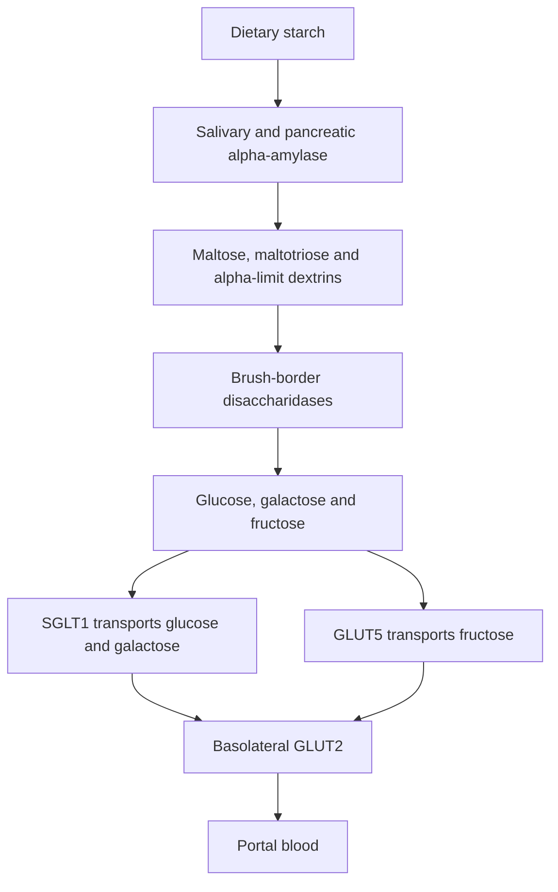
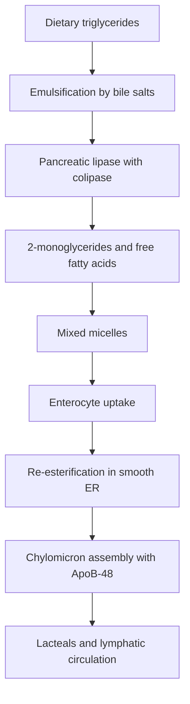
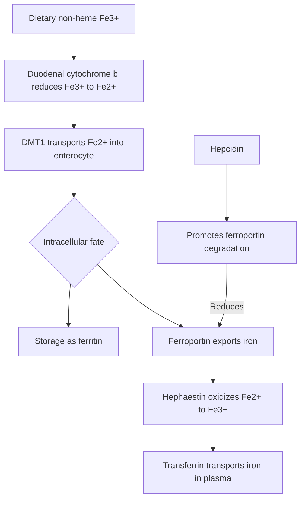

# Chapter 8: Digestion, Absorption & Nutritional Biochemistry

## 8.1 Carbohydrate Digestion and Absorption

Dietary carbohydrates consist primarily of starches (amylose and amylopectin, ~50%), disaccharides (sucrose, lactose, ~40%), and monosaccharides (glucose, fructose). Fiber (cellulose, hemicellulose) contains $\beta-1,4$ glycosidic linkages that human digestive enzymes cannot hydrolyze.

### 1. Enzymatic Breakdown
* **Luminal Digestion**:
  * *Salivary $\alpha$-Amylase*: Initiates starch breakdown in the mouth; inactivated by gastric acid.
  * *Pancreatic $\alpha$-Amylase*: Hydrolyzes internal $\alpha-1,4$ glucosidic bonds of starch in the small intestine. End products: **Maltose** (disaccharide), **Maltotriose** (trisaccharide), and **$\alpha$-Limit Dextrins** (branched oligosaccharides containing $\alpha-1,6$ bonds). It cannot hydrolyze $\alpha-1,6$ branch linkages or terminal $\alpha-1,4$ bonds.
* **Membrane (Brush Border) Digestion**:
  * *Lactase (Lactase-Phlorizin Hydrolase)*: Cleaves lactose into **Glucose + Galactose**.
  * *Sucrase-Isomaltase*: Dual enzyme complex; sucrase cleaves sucrose into **Glucose + Fructose**; isomaltase cleaves the $\alpha-1,6$ branch points of $\alpha$-limit dextrins.
  * *Maltase (Glucoamylase)*: Cleaves maltose and maltotriose into individual glucose units.

### 2. Intestinal Transporters
* **Apical SGLT-1 (Sodium-Glucose Cotransporter 1)**:
  * Transports **Glucose** and **Galactose** across the apical brush border membrane.
  * Secondary active transport coupled to $\text{Na}^+$ influx down its electrochemical gradient (maintained by basolateral $\text{Na}^+/\text{K}^+$-ATPase). Stoichiometry: $2\text{ Na}^+ : 1\text{ Glucose}$.
  * *Clinical Application (Oral Rehydration Therapy - ORT)*: Coupled $\text{Na}^+$-glucose transport via SGLT-1 remains intact during *Vibrio cholerae* infection. Equimolar administration of glucose and $\text{NaCl}$ in water drives rapid fluid and electrolyte absorption, saving millions of lives from secretory dehydration.
* **Apical GLUT-5**: Facilitated diffusion transporter specific for **Fructose**.
* **Basolateral GLUT-2**: High-capacity, low-affinity facilitated diffusion transporter that moves all three monosaccharides (Glucose, Galactose, Fructose) across the basolateral membrane into interstitial fluid and portal capillaries.

---

## 8.2 Protein Digestion and Absorption

Dietary protein (~70–100 g/day) plus endogenous protein (digestive enzymes and desquamated enterocytes, ~30–50 g/day) is efficiently digested and absorbed with $>95\%$ efficiency in the small intestine.

| Site / enzyme | Substrate / action | Main products |
| --- | --- | --- |
| Gastric pepsin | Denatures and cleaves dietary proteins in acidic conditions | Large peptides |
| Pancreatic endopeptidases (trypsin, chymotrypsin, elastase) | Cleave internal peptide bonds | Smaller oligopeptides |
| Pancreatic exopeptidases (carboxypeptidases A and B) | Remove terminal amino acids | Free amino acids and small peptides |
| Brush-border and intracellular peptidases | Complete peptide hydrolysis | Amino acids |

### 1. Gastric Phase
Hydrochloric acid (pH 1.5–2.5) denatures tertiary protein structures, exposing peptide bonds. Acid activates **Pepsinogen I/II** (released by chief cells) to active **Pepsin**. Pepsin is an endopeptidase targeting aromatic amino acid residues (phenylalanine, tyrosine, tryptophan). Accounts for 10–15% of total protein digestion.

### 2. Pancreatic Luminal Phase
Neutralization of chyme by duodenal $\text{HCO}_3^-$ inactivates pepsin. Pancreatic endo- and exopeptidases take over:
* **Endopeptidases** (cleave internal peptide bonds):
  * *Trypsin*: Cleaves basic amino acids (Arginine, Lysine).
  * *Chymotrypsin*: Cleaves aromatic amino acids (Phenylalanine, Tyrosine, Tryptophan).
  * *Elastase*: Cleaves small neutral amino acids (Alanine, Glycine, Serine).
* **Exopeptidases** (cleave terminal amino acids from the C-terminus):
  * *Carboxypeptidase A*: Cleaves C-terminal aromatic and neutral amino acids.
  * *Carboxypeptidase B*: Cleaves C-terminal basic amino acids (Lysine, Arginine).

### 3. Transepithelial Transport
Protein is absorbed across the apical membrane in two forms:
1. **Free Amino Acids**: Transported via multiple gene families of $\text{Na}^+$-dependent secondary active cotransporters (e.g., System B for neutral amino acids).
2. **Di- and Tri-peptides (PEPT1 Transporter)**:
  * **PEPT1** is a tertiary active cotransporter driven by an apical $\text{H}^+$ gradient (maintained by the apical $\text{Na}^+/\text{H}^+$ exchanger NHE3).
  * **PEPT1 is quantitatively the dominant mechanism for protein absorption**; di- and tri-peptides are absorbed faster than equivalent free amino acids.
  * Inside enterocytes, cytosolic peptidases hydrolyze virtually all di- and tri-peptides into free amino acids before basolateral exit via facilitated diffusion into portal blood.

---

## 8.3 Lipid Digestion and Absorption

Dietary lipids consist of Triacylglycerols (TAG, ~90%), Cholesterol Esters (~5%), Phospholipids (~5%), and fat-soluble vitamins. Because lipids are insoluble in water, their processing requires emulsification and micellar transport.

### 1. Digestion Phases
* **Emulsification**: Biliary bile salts and phospholipids coat lipid droplets. Mechanical churning in stomach and duodenum breaks large fat globules into micro-emulsion droplets, increasing surface area for enzymatic attack.
* **Enzymatic Hydrolysis**:
  * *Pancreatic Lipase*: Anchors to emulsion droplets via **Colipase** (which prevents displacement by bile salts). Hydrolyzes TAG at the 1 and 3 positions to yield **2-Monoacylglycerol (2-MAG)** and **two Free Fatty Acids (FFAs)**.
  * *Cholesterol Ester Hydrolase*: Hydrolyzes cholesterol esters to free cholesterol and FFA.
  * *Phospholipase $\text{A}_2$*: Hydrolyzes phospholipids to lysophospholipids and FFA.

### 2. Mixed Micelle Formation
Bile salts, 2-MAG, FFAs, free cholesterol, and fat-soluble vitamins aggregate to form **Mixed Micelles** (3–10 nm cylinders). Micelles carry hydrophobic lipids across the hydrophilic **unstirred water layer** to the enterocyte apical microvilli. At the acidic microclimate near the enterocyte surface, fatty acids protonate and dissociate from micelles, entering enterocytes via passive diffusion and protein-mediated transport (**FAT/CD36**).

### 3. Re-Esterification & Chylomicron Synthesis
1. Inside the enterocyte Smooth Endoplasmic Reticulum (SER), 2-MAG and FFAs are re-esterified back into Triacylglycerols (TAGs).
2. In the Rough Endoplasmic Reticulum (rER), **Apolipoprotein B-48 (ApoB-48)** is synthesized (unique to enterocytes; generated by mRNA editing of the *APOB* gene via $C\rightarrow U$ RNA editing by APOBEC-1 introducing a stop codon).
3. **Microsomal Triglyceride Transfer Protein (MTP)** packages TAGs, cholesterol esters, and ApoB-48 into **Chylomicrons**.
   * *Clinical Correlation (Abetalipoproteinemia)*: Autosomal recessive mutation in the *MTTP* gene encoding MTP $\rightarrow$ Failure to assemble and secrete chylomicrons and VLDL $\rightarrow$ Severe fat and fat-soluble vitamin malabsorption, lipid-laden enterocytes on biopsy, acanthocytosis (spur cells), ataxia, and retinitis pigmentosa.
4. Nascent chylomicrons are secreted via exocytosis across the basolateral membrane into central **lacteals** (intestinal lymphatic capillaries), bypassing the portal circulation and entering systemic blood via the thoracic duct.

---

## 8.4 Micronutrient Absorption & Biochemistry

### 1. Fat-Soluble Vitamin Handling (A, D, E, K)
Fat-soluble vitamins depend entirely on mixed micellar solubilization for intestinal absorption. They enter enterocytes via passive diffusion and are packaged directly into chylomicrons. Any disease causing fat malabsorption (e.g., chronic pancreatitis, celiac disease, cholestasis) leads to fat-soluble vitamin deficiencies:
* **Vitamin A**: Night blindness, xerophthalmia, keratomalacia, follicular hyperkeratosis.
* **Vitamin D**: Rickets (children), Osteomalacia (adults), hypocalcemia.
* **Vitamin E**: Spinocerebellar ataxia, hemolytic anemia, loss of proprioception/vibration sense.
* **Vitamin K**: Coagulopathy with elevated PT/INR and bleeding (impaired $\gamma$-carboxylation of factors II, VII, IX, X, Protein C/S).

### 2. Water-Soluble Vitamin & Mineral Mechanisms

#### Vitamin $\text{B}_{12}$ (Cobalamin) Absorption Cascade
**Vitamin B12 absorption: sequence**

1. Gastric acid and pepsin release cobalamin from dietary proteins.
2. Cobalamin initially binds haptocorrin (R-binder).
3. Pancreatic proteases digest haptocorrin in the duodenum, allowing cobalamin to bind intrinsic factor.
4. The intrinsic factor–cobalamin complex reaches the terminal ileum and binds the cubilin–amnionless (Cubam) receptor.
5. Receptor-mediated uptake is followed by transport in blood bound to transcobalamin II.

#### Iron Absorption & Regulation

* **Absorption Site**: Exclusively in the **Duodenum** and proximal jejunum.
* **Forms**:
  * *Heme Iron* (organ meats): Absorbed directly via Heme Carrier Protein 1 (HCP-1); highly bioavailable.
  * *Non-Heme Iron* (plants): Exists as insoluble Ferric ($\text{Fe}^{3+}$). Reduced to soluble Ferrous ($\text{Fe}^{2+}$) by luminal **Duodenal Cytochrome B (DCYTB)** reductase before transport across the apical membrane via **Divalent Metal Transporter 1 (DMT-1)** (driven by $\text{H}^+$ co-transport).
* **Basolateral Exit**: $\text{Fe}^{2+}$ is exported into capillaries via **Ferroportin**. It is oxidized back to $\text{Fe}^{3+}$ by the membrane-bound ferroxidase **Hephaestin** to enable binding to plasma **Transferrin**.
* **Systemic Regulation by Hepcidin**:
  * **Hepcidin** is a 25-amino-acid peptide hormone synthesized by hepatocytes in response to high iron stores and inflammation (IL-6).
  * Hepcidin binds basolateral **Ferroportin**, inducing its endocytosis and lysosomal degradation. This locks iron inside enterocytes and macrophages, decreasing systemic iron levels (**Anemia of Chronic Disease**).

---

## Quality Checklist

- [x] **8.1 Carbohydrate Digestion and Absorption**
- [x] **8.2 Protein Digestion and Absorption**
- [x] **8.3 Lipid Digestion and Absorption**
- [x] **8.4 Micronutrient Absorption & Biochemistry**

### Index Corrections Made
* Verified SGLT-1 stoichiometry ($2\text{ Na}^+ : 1\text{ Glucose}$).
* Explicitly defined the molecular defect in Abetalipoproteinemia (MTP mutation) and Cystic Fibrosis (CFTR mutation).

### Topics Pending Source Expansion
* None.
