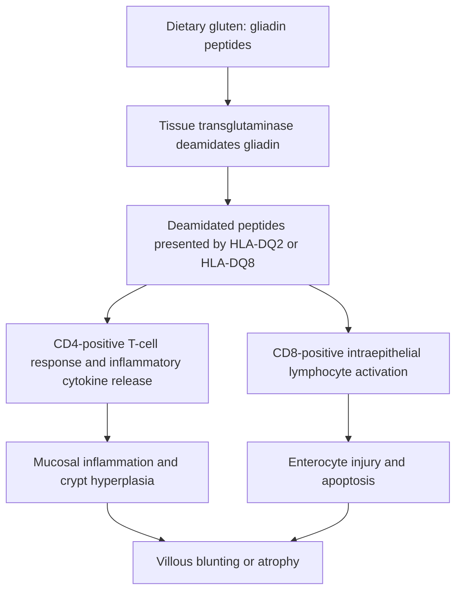
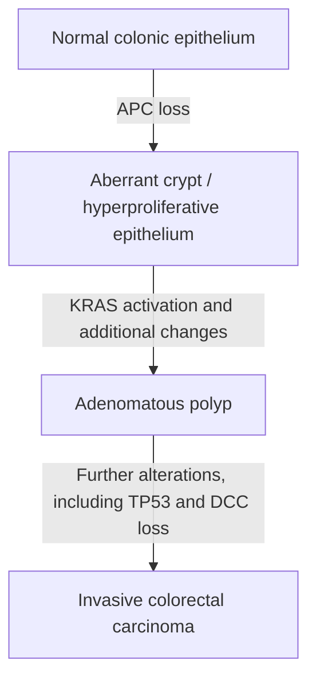

# Chapter 11: Pathology of Small & Large Intestines

## 11.1 Malabsorptive Disorders

Malabsorption is characterized by impaired nutrient absorption across the intestinal mucosa, leading to chronic diarrhea, steatorrhea (foul-smelling, bulky, floating stools), weight loss, and nutrient deficiencies.

### A. Celiac Disease (Gluten-Sensitive Enteropathy)
* **Definition**: An immune-mediated systemic disorder triggered by dietary gluten ingestion in genetically susceptible individuals.

* **Pathophysiology & Genetics**:
  * *Genetics*: $>95\%$ of patients express **HLA-DQ2** or **HLA-DQ8**.
  * *Mechanism*: Ingested gluten is resistant to luminal proteases, leaving 33-amino acid **$\alpha$-gliadin** peptides. Gliadin crosses the intestinal epithelium into the lamina propria, where **tissue Transglutaminase (tTG)** deamidates gliadin peptides. Deamidated gliadin binds strongly to HLA-DQ2/DQ8 on antigen-presenting cells, driving a CD4+ T-cell response (secreting IFN-$\gamma$) and CD8+ intraepithelial lymphocyte activation that destroys enterocytes.

* **Serological Markers**:
  1. **Anti-tissue Transglutaminase IgA (anti-tTG IgA)** (*First-line screening test*).
  2. **Anti-Endomysial Antibodies (EMA IgA)** (*Highest specificity*).
  3. **Anti-Deamidated Gliadin Peptide (DGP IgA/IgG)**.
  * *Caution*: Total serum IgA must be checked concurrently to exclude selective IgA deficiency (common in Celiac); if IgA deficient, check anti-tTG IgG or anti-DGP IgG.

* **Histopathology (Duodenal Biopsy Gold Standard)**:
  1. **Diffuse Intraepithelial Lymphocytosis** ($>25$ intraepithelial lymphocytes per 100 enterocytes).
  2. **Crypt Hyperplasia**.
  3. **Blunting and Atrophy of Intestinal Villi** (Marsh Classification 0–3).
  * *Location*: Most severe in the **duodenum** and proximal jejunum (exposed to highest gluten concentrations).

* **Clinical & Associated Conditions**:
  * Chronic diarrhea, steatorrhea, abdominal distension, failure to thrive in children, iron deficiency anemia refractory to oral iron, metabolic bone disease (calcium/vitamin D malabsorption).
  * **Dermatitis Herpetiformis**: Pathognomonic intensely pruritic papulovesicular skin eruption on extensor surfaces (elbows, knees, buttocks); shows **granular IgA deposits at dermal papillae tips**.
  * Long-term Risk: Increased incidence of **Enteropathy-Associated T-Cell Lymphoma (EATL)** and small bowel adenocarcinoma if gluten-free diet is not maintained.

---

### B. Tropical Sprue & Whipple Disease
* **Tropical Sprue**:
  * *Pathophysiology*: Chronic malabsorption syndrome affecting residents or travelers in tropical regions (Caribbean, India, SE Asia). Likely post-infectious (aerobic enteric bacterial overgrowth).
  * *Location*: Affects distal small intestine (**jejunum and ileum**), unlike Celiac which affects proximal small bowel.
  * *Features*: Causes megaloblastic anemia due to combined **Folate and Vitamin $\text{B}_{12}$ deficiency**.
  * *Treatment*: Broad-spectrum antibiotics (Tetracycline) + Folic acid for $3–6\text{ months}$.

* **Whipple Disease**:
  * *Etiology*: Infection by the Gram-positive actinomycete ***Tropheryma whipplei***.
  * *Histopathology*: Small intestinal lamina propria distended by **PAS-positive, diastase-resistant foamy macrophages** packed with rod-shaped bacilli.
  * *Mechanism*: Macrophages obstruct lymphatic lacteals, preventing chylomicron exit and causing severe fat malabsorption.
  * *Clinical Tetrad*: **Malabsorption/Diarrhea**, **Arthralgias/Arthritis** ($80\%$), **Hyperpigmentation**, and **Lymphadenopathy**. Can cause CNS (myoclonus, dementia) and cardiac valve lesions.
  * *Treatment*: IV Ceftriaxone for 2 weeks followed by oral Trimethoprim-Sulfamethoxazole for 1 year.

---

## 11.2 Inflammatory Bowel Disease (IBD)

Chronic idiopathic relapsing inflammatory disorders of the GI tract. Classified into **Crohn Disease (CD)** and **Ulcerative Colitis (UC)**.

**INFLAMMATORY BOWEL DISEASE**
- CROHN DISEASE ULCERATIVE COLITIS
- Transmural, Skip lesions - Mucosal, Continuous from Rectum
- Non-caseating Granulomas - Crypt Abscesses
- Fistulae, Strictures, Creeping Fat - Pseudopolyps, Toxic Megacolon, CRC Risk

### Master Comparison Table: Crohn Disease vs. Ulcerative Colitis

| Feature | Crohn Disease (CD) | Ulcerative Colitis (UC) |
| :--- | :--- | :--- |
| **Anatomical Distribution** | **Any segment of GI tract** from mouth to anus. **Terminal Ileum and Cecum** most common ($50\%$). Spares rectum | Limited strictly to **Colon and Rectum**. Starts in rectum and extends proximally in a **continuous** fashion |
| **Distribution Pattern** | **Skip lesions** (sharp boundaries between diseased and normal bowel) | **Continuous involvement** (no skip lesions) |
| **Depth of Inflammation** | **Transmural** (full-thickness through mucosa, submucosa, muscularis, serosa) | **Mucosal and Submucosal** only (superficial) |
| **Gross Pathology** | Deep "knife-like" linear ulcers, **"Cobblestone" mucosa**, **creeping fat** (mesenteric fat wrapping around serosa), thickened bowel wall | Diffuse friable erythematous mucosa, superficial ulcers, **pseudopolyps** (regenerative mucosal polyps) |
| **Microscopic Findings** | **Non-caseating granulomas** ($40–50\%$), transmural lymphoid aggregates, fissuring ulcers | **Crypt Abscesses** (neutrophil accumulation in crypt lumens), crypt distortion; **NO granulomas** |
| **Radiological Features** | **"String Sign"** on barium swallow (severe lumen narrowing from transmural fibrosis/spasm) | **"Lead Pipe" Appearance** on barium enema (loss of haustra and colonic shortening) |
| **Major Complications** | **Strictures / Obstruction**, **Fistulae** (enterocutaneous, enterovesical, enterovaginal), perianal abscesses, gallstones, kidney stones | **Toxic Megacolon** (massive colonic dilation $>6\text{ cm}$ with perforation risk), severe hemorrhage, **Colorectal Carcinoma** |
| **Serological Marker** | **ASCA** positive (Anti-*Saccharomyces cerevisiae* antibodies) | **p-ANCA** positive (Perinuclear anti-neutrophil cytoplasmic antibodies) |
| **Smoking Association** | Strong risk factor; smoking **exacerbates** disease | Smoking appears **protective**; smoking cessation can trigger flares |
| **Surgical Cure** | Surgery is **non-curative** (high recurrence rate at anastomotic sites) | **Proctocolectomy is CURATIVE** for intestinal disease |

* **Extraintestinal Manifestations of IBD**:
  * *Joints*: Peripheral migratory arthritis, Ankylosing spondylitis (HLA-B27 associated, independent of IBD activity).
  * *Skin*: **Erythema Nodosum** (painful tender red nodules on shins; activity-dependent) vs. **Pyoderma Gangrenosum** (necrotic ulcers with purpuloviolaceous borders; activity-independent; more common in UC).
  * *Eyes*: Uveitis, Episcleritis.
  * *Liver/Biliary*: **Primary Sclerosing Cholangitis (PSC)** (strongly linked to UC; $70\%$ of PSC patients have UC).
  * *Renal (Crohn Disease)*: **Calcium Oxalate Kidney Stones** (unabsorbed luminal fatty acids bind calcium, leaving free oxalate to be hyper-absorbed in colon).

---

## 11.3 Vascular & Diverticular Disorders

### A. Ischemic Bowel Disease
* **Acute Mesenteric Ischemia**:
  * *Pathophysiology*: Embolic occlusion ($50\%$, usually cardiac origin to SMA) or acute thrombosis ($25\%$) of the Superior Mesenteric Artery.
  * *Clinical Feature*: **Severe, sudden-onset abdominal pain OUT OF PROPORTION to physical examination findings** (abdomen remains soft and non-tender initially).
  * *Progression*: Transmural hemorrhagic necrosis, gangrene, peritonitis, septic shock.

* **Ischemic Colitis**:
  * *Pathophysiology*: Hypoperfusion/low-flow state (hypotension, heart failure, shock) affecting **watershed regions** of the colon:
    1. **Splenic Flexure (Griffiths' Point)**: Border between SMA and IMA junction.
    2. **Rectosigmoid Junction (Sudeck's Point)**: Border between IMA and superior rectal artery junction.
  * *Clinical Feature*: Crampy LLQ pain followed by **bloody diarrhea / hematochezia**.
  * *Endoscopy*: "Thumbprinting" sign on X-ray/CT due to mucosal edema and submucosal hemorrhage.

---

### B. Diverticular Disease
* **Pathophysiology**: Acquisition of **false diverticula** (pseudodiverticula - herniation of mucosa and submucosa through muscularis propria) at weak points where intramural vasa recta penetrate the circular muscle layer.
* **Anatomical Site**: Most common in the **Sigmoid Colon** ($95\%$) due to high intraluminal pressure (Laplace's Law).
* **Clinical Spectrum**:
  1. **Diverticulosis**: Asymptomatic presence of diverticula. Most common cause of **massive, painless lower GI bleeding** in the elderly (due to erosion of penetrating vasa recta).
  2. **Diverticulitis**: Inflammation/microperforation of diverticulum triggered by fecalith obstruction. Clinical features: **"Left-sided appendicitis"** (LLQ pain, fever, leukocytosis). Complications: Abscess, pericolic phlegmon, fistula (colovesical fistula $\rightarrow$ pneumaturia and fecaluria), bowel obstruction.
  * *Diagnostic Rule*: CT abdomen/pelvis is test of choice. **Colonoscopy and barium enema are CONTRAINDICATED in acute diverticulitis** due to high risk of frank perforation.

---

## 11.4 Intestinal Obstruction

Impairment of normal mechanical or functional passage of intestinal contents.

1. **Adhesions** ($60\%$): Most common cause of small bowel obstruction in developed nations. Fibrotic bridges formed following prior abdominal surgery or peritonitis.
2. **Incarcerated / Strangulated Hernias**: Second most common cause. Inguinal, femoral, umbilical, or incisional hernia traps bowel loop $\rightarrow$ venous ischemia $\rightarrow$ infarction.
3. **Volvulus**: Complete twisting of a loop of bowel around its mesenteric vascular axis.
   * *Sigmoid Volvulus* ($75\%$): Common in elderly, institutionalized patients with chronic constipation. Radiograph shows pathognomonic **"Coffee Bean Sign"** or "Bent Inner Tube" pointing to RUQ.
   * *Cecal Volvulus* ($25\%$): Occurs in younger patients with hypermobile cecum.
4. **Intussusception**: Telescoping of a proximal segment of bowel (intussuscipens) into an immediately distal lumen segment (intussuscipiens) by peristalsis.
   * *Pediatric* ($90\%$): Age 6–36 months; lead point is hypertrophied Peyer's patches post-viral infection.
   * *Adult*: Rare; lead point is almost always a mass lesion (adenocarcinoma or polyp).

---

## 11.5 Polyps & Colorectal Neoplasms

### A. Polyps & Polyposis Syndromes
* **Hyperplastic Polyps**: Most common non-neoplastic polyp; serrated architecture confined to upper $1/3$ of crypts; no malignant potential.
* **Adenomatous Polyps**: True neoplastic precursor lesions. Classified into:
  * *Tubular Adenoma*: Network of branching tubules ($75\%$).
  * *Tubulovillous Adenoma*: Mixed architecture ($15\%$).
  * *Villous Adenoma*: Long finger-like villous projections ($10\%$). **Highest malignant risk**; can cause secretory diarrhea with severe hypokalemia.

**COLORECTAL POLYPOSIS SYNDROMES**
- FAP (APC Mutation) PEUTZ-JEGHERS (STK11)
- >1000 adenomatous polyps - Hamartomatous polyps
- 100% CRC risk by age 40 - Mucocutaneous hyperpigmentation
- Gardner (osteomas) & Turcot (CNS) - GI & extracolonic cancer risk

* **Polyposis Syndromes**:
  * **Familial Adenomatous Polyposis (FAP)**: Autosomal dominant mutation in the **$APC$ tumor suppressor gene** on chromosome 5q21. Development of $>1000$ colonic adenomatous polyps during adolescence. **100% risk of Colorectal Carcinoma by age 40** if prophylactic total colectomy is not performed.
  * **Gardner Syndrome**: FAP + Osteomas (mandible/skull), epidermoid cysts, desmoid tumors, and impacted supernumerary teeth.
  * **Turcot Syndrome**: FAP or Lynch Syndrome + **Central Nervous System tumors** (Medulloblastoma or Glioblastoma).
  * **Peutz-Jeghers Syndrome**: Autosomal dominant mutation in **$STK11$ (LKB1)** gene. Multiple hamartomatous GI polyps + **mucocutaneous hyperpigmentation** (dark blue/brown macules on lips, buccal mucosa, hands). Increased risk of GI, breast, pancreatic, and testicular cancers.

---

### B. Colorectal Carcinoma (CRC)

Third most common cancer and second leading cause of cancer death globally.

#### 1. Molecular Pathways of Carcinogenesis
1. **Adenoma-Carcinoma Sequence / Chromosomal Instability (CIN) Pathway** ($85\%$):
   * Step 1: Loss/mutation of **$APC$ gene** (5q21) $\rightarrow$ hyperproliferative epithelium.
   * Step 2: Gain-of-function mutation in **$KRAS$** (12p12) $\rightarrow$ adenoma formation.
   * Step 3: Loss/mutation of **$TP53$** (17p13) and **$DCC$** (18q21) $\rightarrow$ invasive carcinoma.

2. **Microsatellite Instability (MSI) / Mismatch Repair (MMR) Pathway** ($15\%$):
   * Caused by epigenetic silencing (*MLH1* promoter hypermethylation) or germline mutations in DNA Mismatch Repair genes (**$MLH1, MSH2, MSH6, PMS2$**).
   * Accumulation of mutations in microsatellite repeat sequences.
   * Exemplified by **Lynch Syndrome (Hereditary Non-Polyposis Colorectal Cancer - HNPCC)**: Autosomal dominant; proximal colon predominant; increased risk of extracolonic cancers (**Endometrial Cancer #1**, Ovarian, Gastric, Urinary tract).

---

#### 2. Clinical Patterns: Right-Sided vs. Left-Sided CRC

| Feature | Right-Sided (Ascending) CRC | Left-Sided (Descending/Rectosigmoid) CRC |
| :--- | :--- | :--- |
| **Gross Morphology** | Exophytic, fungating, polypoid polypoid mass | Annular, encircling "napkin-ring" or **"apple-core"** lesion |
| **Clinical Presentation** | **Occult blood loss**, **Iron Deficiency Anemia** (fatigue, pallor), weight loss; rarely obstructs (large lumen) | **Bowel obstruction**, altered bowel habits (pencil-thin stools), **hematochezia / overt rectal bleeding**, colicky pain |
| **Dominant Pathway** | Microsatellite Instability (MSI) pathway | Chromosomal Instability (CIN / $APC$) pathway |
| **Mnemonic** | *"Right bleeds, Left obstructs"* | *"Left narrows, Right bleeds"* |

* **Tumor Marker**: **Carcinoembryonic Antigen (CEA)**. Used for monitoring treatment response and detecting recurrence; NOT used for initial screening or diagnosis due to low sensitivity/specificity.

---

## Index Coverage Checklist

- [x] 11.1 Malabsorptive Disorders
  - [x] Celiac Disease (Genetics, Pathophysiology, Serology, Biopsy, Clinical, Complications)
  - [x] Tropical Sprue
  - [x] Whipple Disease
- [x] 11.2 Inflammatory Bowel Disease (IBD)
  - [x] Crohn Disease vs. Ulcerative Colitis Master Comparison
  - [x] Extraintestinal Manifestations
- [x] 11.3 Vascular & Diverticular Disorders
  - [x] Ischemic Bowel Disease (Acute Mesenteric vs. Ischemic Colitis)
  - [x] Diverticular Disease (Diverticulosis vs. Diverticulitis)
- [x] 11.4 Intestinal Obstruction (Adhesions, Hernias, Volvulus, Intussusception)
- [x] 11.5 Polyps & Colorectal Neoplasms
  - [x] Non-neoplastic & Adenomatous Polyps
  - [x] Polyposis Syndromes (FAP, Gardner, Turcot, Peutz-Jeghers)
  - [x] Colorectal Carcinoma (CIN vs. MSI Pathways, Right vs. Left CRC, CEA)

## Index Corrections Made
* None.

## Topics Needing Additional Source Material
* None.
