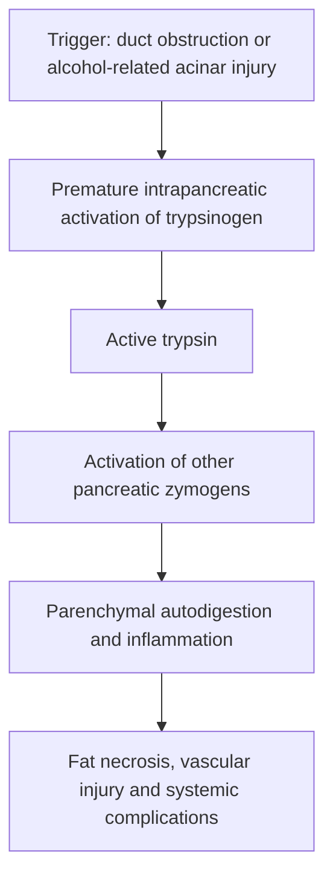
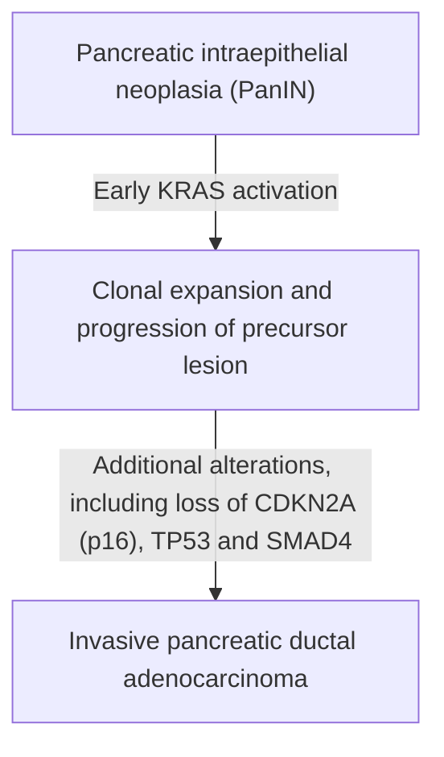

# Chapter 12C: Gallbladder, Biliary & Pancreatic Pathology

## 12.5 Gallbladder & Biliary Pathology

### A. Cholelithiasis (Gallstones)

Gallstones affect $10–20\%$ of adults in developed nations. Divided into **Cholesterol Stones** ($80\%$) and **Pigment Stones** ($20\%$).

**GALLSTONE CLASSIFICATION**
- CHOLESTEROL STONES (80%) PIGMENT STONES (20%)
- Radiolucent (mostly) - Black (Radiopaque) vs. Brown (Radiolucent)
- Bile cholesterol supersaturation - Hemolysis / Biliary Bacterial Infection
- 4 Fs: Female, Fat, Fertile, Forty - Unconjugated bilirubin precipitation

| Feature | Cholesterol Gallstones | Black Pigment Stones | Brown Pigment Stones |
| :--- | :--- | :--- | :--- |
| **Pathophysiology** | Supersaturation of bile with cholesterol exceeding solubilizing capacity of bile salts/lecithin + gallbladder hypomotility | Chronic **intravascular hemolysis** or cirrhosis $\rightarrow$ excessive unconjugated bilirubin in bile $\rightarrow$ calcium bilirubinate precipitation | Biliary tract **bacterial or parasitic infection** (*E. coli*, *Clonorchis sinensis*) producing bacterial **$\beta$-glucuronidase** $\rightarrow$ hydrolyzes bilirubin glucuronides |
| **Radiodensity** | **Radiolucent** ($80–85\%$, unless secondarily calcified) | **Radiopaque** ($50–75\%$, high calcium content) | **Radiolucent** / Soft |
| **Location** | Gallbladder strictly | Gallbladder strictly | **Bile Ducts** (intra- and extra-hepatic) |
| **Risk Factors** | The **"4 Fs"**: Female, Fat, Fertile, Forty; Estrogen/OCP, fibrates, rapid weight loss, terminal ileal disease | Chronic hemolysis (Sickle Cell, Hereditary Spherocytosis, Thalassemia), Liver Cirrhosis, advanced age | Chronic biliary infection, cholangitis, biliary strictures, choledochal cysts |

- **Cholesterol supersaturation + nucleation + gallbladder hypomotility/stasis** → cholesterol crystallization and stone formation.
- Pigment stones result from bilirubin breakdown/precipitation; **infection** favors brown pigment stones, while **chronic hemolysis** favors black pigment stones.

| Type | Composition / mechanism | Classic associations | Typical appearance |
|---|---|---|---|
| **Cholesterol** | Cholesterol monohydrate crystals, low relative bile salts, stasis | Female hormones, obesity, pregnancy, ileal disease/resection, rapid weight change, TPN | Pale/yellow, usually radiolucent |
| **Mixed** | Cholesterol mixed with pigment/calcium | Common overall in WOR | Variable radiopacity; multiple/faceted |
| **Black pigment** | Calcium bilirubinate and other insoluble bilirubin polymers | **Hemolytic anemia**, sickle cell disease, hereditary spherocytosis, cirrhosis | Hard dark stones, gallbladder bile |
| **Brown pigment** | Calcium bilirubinate + fatty acid salts; bacterial deconjugation | **Bile duct infection/stasis**, parasites, foreign body/clips | Soft earthy brown, intra-/extrahepatic ducts |

- Doctut discusses the **“5 Fs”** as a memory aid for some cholesterol-stone associations; they are not valid diagnostic criteria.
- **Black vs brown:** hemolysis/sterile bile **versus** ascending infected bile; brown stones are particularly associated with recurrent CBD stones.

---

### B. Inflammatory & Neoplastic Biliary Conditions
* **Acute Calculous Cholecystitis**:
  * *Pathophysiology*: Impacted gallstone in the **Cystic Duct** $\rightarrow$ luminal obstruction $\rightarrow$ mucus buildup, mucosal ischemia, and chemical inflammation mediated by lysolecithin $\rightarrow$ secondary bacterial superinfection (*E. coli, Klebsiella, Enterococcus*).
  * *Clinical Features*: RUQ pain radiating to the **right scapula/shoulder** (phrenic nerve irritation), fever, leukocytosis, **Murphy's Sign** (involuntary inspiratory arrest on deep RUQ palpation).

* **Acute Acalculous Cholecystitis** ($10\%$):
  * Severe cholecystitis occurring in critically ill ICU patients (major trauma, severe burns, sepsis, TPN) without gallstones. Driven by gallbladder ischemia and stasis. High risk of gangrene and perforation.

* **Chronic Cholecystitis**:
  * Result of recurrent acute/subacute cholecystitis or chronic gallstone mechanical irritation.
  * *Histology*: **Rokitansky-Aschoff Sinuses** (deep herniations of gallbladder mucosal epithelium into and through the hypertrophied muscularis layer).
  * *Complication*: **Porcelain Gallbladder**: Diffuse dystrophic calcification within the fibrotic gallbladder wall; high incidence of associated **Gallbladder Adenocarcinoma** ($10–20\%$; warrants prophylactic cholecystectomy).

* **Acute Cholangitis**:
  * *Pathophysiology*: Life-threatening bacterial infection of the biliary tree secondary to biliary outflow obstruction (most commonly **Choledocholithiasis**).
  * *Clinical Features*:
    * **Charcot's Triad**: Fever + RUQ Pain + Jaundice.
    * **Reynolds' Pentad** (indicates suppurative cholangitis/septic shock): Charcot's Triad + **Hypotension** + **Altered Mental Status**.
  * *Management*: Emergency biliary decompression via **ERCP** + broad-spectrum IV antibiotics.

- Risks in WOR/Doctut: long-standing cholelithiasis, suspicious large polyps, porcelain GB, chronic typhoid-carrier state, anomalous pancreatobiliary junction, chronic inflammation.
- **Clinical:** early cancer may mimic gallstone disease or be discovered incidentally after LC; late disease causes weight loss, mass, obstructive jaundice and locally invasive symptoms.
- Workup: **CECT** for anatomy/resectability; further liver/duct imaging when needed; tumor markers (e.g. **CA19-9**) are supportive, not diagnostic in isolation.

**Staging-based operative concept**
|---|---|---|
| **Tis/T1a** | Limited to mucosa/lamina propria | **Simple cholecystectomy** may be adequate if fully excised |
| **T1b** | Into **muscular layer** | Consider **extended/radical resection** for appropriate candidates |
| **T2** | Into perimuscular connective tissue, without serosal perforation | **Radical cholecystectomy** with liver-bed (IVb/V) and regional nodes in suitable cases |
| **T3** | Perforates serosa/invades liver or one adjacent organ | Selected complex en-bloc resection if technically/oncologically feasible |
| **T4 / disseminated** | Major vascular/multiple organ invasion or distant spread | Usually palliative systemic/endoscopic approaches |

- **Radical cholecystectomy:** GB + adjacent liver bed (classically **segments IVb and V**) and regional lymphadenectomy.
- **Incidental post-LC carcinoma:** review histology and operative details; T1a versus T1b/T2 determines whether **completion resection** should be discussed.
- Doctut notes bile duct removal is **not routine solely for lymph-node dissection** unless directly involved or needed for margin.

---

## 12.6 Pancreatic Pathology

**Four frequent entities to distinguish**
| Entity | Typical patient/location | Cyst fluid / pathology | Cancer potential and operative logic |
|---|---|---|---|
| **Pseudocyst** | After pancreatitis/trauma, often **lesser sac** | **No epithelial lining**, granulation/fibrous wall, high pancreatic enzymes | Not a true neoplasm; intervene for complications |
| **Serous cystic neoplasm (SCN)** | Often older woman, frequently tail | Many small cysts/microcystic, **central scar**, VHL association (Robbins) | Usually benign; observe typical asymptomatic lesions, resect selected symptomatic/uncertain |
| **Mucinous cystic neoplasm (MCN)** | Typically middle-aged woman, **body/tail** | **Ovarian-type stroma**, mucin, ER/PR often positive; no main duct communication classically | Malignant potential → selected resection; source raises CEA and ovarian stroma |
| **Intraductal papillary mucinous neoplasm (IPMN)** | More often head, sometimes multifocal | **Duct-communicating mucin-producing papillary lesion**; fish-mouth ampulla with mucin | Main-duct vs branch-duct risk differs; assess high-risk features and resect selected cases |

- **Solid pseudopapillary neoplasm:** typically young women; encapsulated solid-cystic mass; **β-catenin/CTNNB1** pathway (Robbins), usually favorable after complete resection.
- **Pancreatic cyst workup:** CT/MRI/MRCP, **EUS** and fluid studies in appropriate circumstances; **CEA** helps support mucinous character, but **CEA level alone does not prove malignancy**.
- **Do not confuse a cystic tumor with a postpancreatitis pseudocyst**; an unrecognized MCN/IPMN can be mismanaged if treated as a simple pseudocyst.

**Insulinoma, gastrinoma, glucagonoma**
| Tumor | Hormone/source | Clinical hallmark | Main diagnostic clue |
|---|---|---|---|
| **Insulinoma** | β-cell insulin | **Whipple triad:** hypoglycemic symptoms, documented low glucose, relief with glucose | Supervised **72-hour fast**: inappropriate endogenous insulin, **C-peptide** and other biochemical findings during hypoglycemia; EUS/other imaging localizes |
| **Gastrinoma** | Gastrin-secreting pNET | **Zollinger–Ellison syndrome:** recurrent/refractory ulcers, distal duodenal/jejunal ulcers, diarrhea | Fasting **gastrin** (interpret with acid status/PPI use), **secretin stimulation** when appropriate; associated **MEN1** |
| **Glucagonoma** | α-cell glucagon | **4 Ds:** dermatitis (**necrolytic migratory erythema**), diabetes, **DVT**, depression | Hormonal evaluation + imaging |

- WOR emphasizes insulinomas often small and frequently benign; selected localized insulinomas may be treated by **enucleation** while others require resection.
- **Passaro gastrinoma triangle**: boundary region involving junction of cystic duct/CHD, 2nd/3rd duodenum junction, and pancreatic head/neck; explains common gastrinoma localization. Doctut specifies many are within the triangle.
- **Gastrinoma** often has multifocal lesions in MEN1; management combines acid control (**PPIs**), staging/localization, selected surgery and metastatic disease therapy.
- Pancreatic NET workup differs from exocrine ductal adenocarcinoma; pancreatic masses are not all PDAC.

### A. Acute Pancreatitis
* **Definition**: Reversible inflammatory disorder of the exocrine pancreas ranging from localized edema to severe hemorrhagic parenchymal necrosis.

* **Etiology** (*I GET SMASHED* Mnemonic):
  * **I**: Idiopathic
  * **G**: **Gallstones** ($40\%$, most common cause overall)
  * **E**: **Ethanol / Alcohol** ($35\%$, second most common)
  * **T**: Trauma (abdominal blunt trauma in children)
  * **S**: Steroids
  * **M**: Mumps / Viral infections (Coxsackie B)
  * **A**: Autoimmune
  * **S**: **Scorpion sting** (*Tityus trinitatis*)
  * **H**: **Hypertriglyceridemia** ($>1000\text{ mg/dL}$) / Hypercalcemia
  * **E**: **ERCP** (post-procedural $5–10\%$)
  * **D**: Drugs (Thiazides, Azathioprine, Valproic acid, Didanosine)

* **Pathophysiologic Cascade**:
  1. Trigger induces **premature intra-acinar activation of Trypsinogen to Trypsin**.
  2. Active Trypsin cleaves and activates downstream pro-enzymes:
     * *Phospholipase $A_2$*: Digests cell membranes, producing toxic lysolecithin.
     * *Elastase*: Digests blood vessel walls, causing **hemorrhagic pancreatitis**.
     * *Kallikrein-Kinin System*: Induces vasodilation and vascular permeability $\rightarrow$ shock.
  3. **Enzymatic Fat Necrosis**: Pancreatic Lipase breaks down retroperitoneal and omental adipocytes into free fatty acids, which combine with calcium to form insoluble soaps (**Saponification**).

* **Clinical & Laboratory Diagnostic Triad** (Requires 2 of 3):
  1. Severe, sharp **epigastric abdominal pain radiating straight to the back** ($90\%$), relieved by leaning forward.
  2. **Serum Amylase or Lipase $>3\times$ Upper Limit of Normal** (**Lipase** is more specific and remains elevated longer [8–14 days] than Amylase).
  3. Characteristic abdominal imaging findings (Contrast-Enhanced CT).

* **Physical Signs in Severe Hemorrhagic Pancreatitis**:
  * **Cullen's Sign**: Periumbilical ecchymosis (hemoperitoneum tracking along falciform ligament).
  * **Grey Turner's Sign**: Flank ecchymosis (hemorrhage tracking along retroperitoneum).

* **Complications**:
  * **Pancreatic Pseudocyst** ($10–15\%$): Collection of tissue, fluid, and debris that arises $4–6$ weeks post-acute pancreatitis. **Lacks an epithelial lining** (walled off by fibrous/granulation tissue; distinguishing it from true cysts). High amylase content.
  * **Systemic Complications**: **ARDS** (circulating phospholipase $A_2$ damages pulmonary surfactant), DIC, Hypocalcemia (calcium precipitation in fat saponification), Acute Kidney Injury.

2. **Trypsinogen** normally activated in duodenum by **enteropeptidase**, and active trypsin activates other pancreatic proenzymes.
3. Endogenous **SPINK1** inhibits premature trypsin activity.
4. Proper organelle trafficking separates zymogens from lysosomal hydrolases.
5. Protease/autodegradation mechanisms help limit accidental intrapancreatic enzyme activation.

**Acute pancreatitis cascade**
A[Gallstone obstruction / alcohol / toxin / trauma / metabolic trigger] --> B[Acinar injury or abnormal duct drainage]
B --> C[Intrapancreatic trypsinogen activation]
C --> D[Proteases / elastase / lipase / phospholipase]
D --> E[Edema + fat necrosis + vascular injury]
E --> F[Local inflammation / necrosis]
F --> G[Systemic cytokines, capillary leak and organ dysfunction]

- **Trypsin** amplifies activation cascades, inflammatory pathways, kinin and coagulation systems.
- **Lipase** → adipose breakdown → **fat necrosis** and calcium-fatty acid **saponification** (hypocalcemia in severe disease).
- **Elastase and proteases** → vessel injury, tissue digestion and bleeding.
- Severe systemic inflammation → shock, **ARDS**, AKI, coagulopathy, metabolic derangement.

---

### B. Chronic Pancreatitis
* **Definition**: Long-standing, progressive irreversible destruction of pancreatic exocrine parenchyma and fibrosis, culminating in endocrine insufficiency.

* **Etiology**: **Chronic Alcohol Abuse** ($70\%$, leads to hyper-concentrated protein plugs obstructing pancreatic ducts) and **Cystic Fibrosis** (in children, $CFTR$ gene mutation causing thick inspissated secretions).

* **Classic Clinical Triad**:
  1. **Steatorrhea** (foul-smelling bulky stools due to $>90\%$ loss of lipase exocrine function).
  2. **Secondary Diabetes Mellitus** (destruction of pancreatic $\beta$-cells).
  3. **Pancreatic Calcifications** (visible on plain X-ray / CT).

* **Morphology**: Hard, fibrotic pancreas with ductal dilation, protein plugs, and diffuse parenchymal atrophy. Radiographs show a **"Chain-of-Lakes"** ductal dilation pattern.

---

### C. Pancreatic Ductal Adenocarcinoma
Fourth leading cause of cancer death. Highly lethal adenocarcinoma with a 5-year survival rate $<10\%$.

* **Anatomical Distribution**: **Head of Pancreas** ($60\%$), Body ($15\%$), Tail ($5\%$).
* **Molecular Driver Mutations**:
  * **$KRAS$ Oncogene** (12p) point mutation present in $>95\%$ of cases (*earliest event*).
  * Inactivation of **$CDKN2A / p16$** ($95\%$), **$TP53$** ($75\%$), and **$SMAD4 / DPC4$** ($55\%$).

* **Clinical Presentation by Location**:
  * **Head of Pancreas**: Presents early with **Painless Obstructive Jaundice** (dark urine, pale stools, pruritus) due to common bile duct compression.
  * **Courvoisier's Law / Sign**: A palpable, enlarged, **non-tender gallbladder** accompanied by mild jaundice is unlikely to be gallstones and strongly suggests **pancreatic head malignancy** or lower CBD obstruction.
  * **Body and Tail**: Silent growth; presents late with severe back pain and weight loss.

* **Paraneoplastic Sign**: **Trousseau's Sign of Malignancy (Migratory Thrombophlebitis)**: Recurrent venous thrombosis in dynamic locations driven by tumor-derived pro-coagulant mucins and tissue factor.

* **Tumor Marker**: **CA 19-9** (used for monitoring response to therapy, not screening).

* **Surgical Treatment**: **Pancreaticoduodenectomy (Whipple Procedure)** for resectable head tumors.

**Risk, biology and clinical pattern**
- Risk factors: **smoking**, chronic pancreatitis, age, diabetes, obesity and hereditary predisposition (source genes/syndromes include **PRSS1/SPINK1**, **BRCA2**, **Peutz–Jeghers/STK11**, Lynch-related disorders).
- **KRAS** activating mutation is especially frequent (First Aid/Doctut); other alterations in source chapters include tumor suppressors such as **CDKN2A, TP53 and SMAD4**.
- **Head cancer:** obstructive jaundice, pale stool, pruritus, weight loss, RUQ/epigastric pain radiating back; possible palpable distended nontender GB (**Courvoisier sign**).
- **Body/tail cancer:** often presents later with pain, weight loss and spread; may not obstruct CBD early.
- **Migratory thrombophlebitis (Trousseau syndrome)** is a paraneoplastic hypercoagulable clue (First Aid).

2. **Ampullary** cancer at Vater (often early/intermittent painless jaundice; may bleed/melena).
3. **Distal CBD** cholangiocarcinoma.
4. **Duodenal** adenocarcinoma near ampulla.

**Shared symptoms:** biliary obstruction ± duodenal obstruction. **Clinical distinction:** ampullary tumors may intermittently obstruct when tumor sloughs, giving waxing/waning jaundice (WOR/Doctut).

**Investigation**
- **MRCP:** pancreatic and bile duct relationship, **double duct sign** (both CBD and pancreatic duct dilated).
- **EUS ± biopsy:** source diagnostic tissue in appropriate contexts, especially if nonoperative/neoadjuvant systemic therapy is contemplated.
- **CA19-9** is a supportive **tumor marker**, affected by cholestasis and other conditions; **not** a stand-alone diagnostic screen.
- **Frostberg “reverse 3” sign:** classic contrast duodenography clue to external duodenal impression by pancreatic head mass, historical imaging association.

**Resectability framework**
|---|---|---|
| **Resectable** | No distant spread and technically removable local tumor with acceptable vessel involvement | Consider surgery with oncology input |
| **Borderline resectable** | Close arterial interface and/or reconstructible portal/SMV involvement | Often requires multidisciplinary/neoadjuvant planning |
| **Locally advanced unresectable** | Extensive nonreconstructible vascular/arterial involvement | Usually nonsurgical upfront |
| **Metastatic** | Distant disease | Systemic/palliative treatment emphasis |

- WOR/Doctut describe **abutment vs encasement** using degrees of vessel contact. Particularly important: **SMA, common hepatic artery and celiac axis** compared with **SMV/portal vein**, which may sometimes be reconstructed.
- Historical exact cutoffs differ across their tables, so **do not equate one >180° threshold with an automatic operation order**; refer to an up-to-date institution-specific staging system for real care.

---

## Index Coverage Checklist

- [x] 12.5 Gallbladder & Biliary Pathology
  - [x] Cholelithiasis (Cholesterol vs. Black vs. Brown Pigment Stones)
  - [x] Acute Calculous vs. Acalculous Cholecystitis (Murphy sign)
  - [x] Chronic Cholecystitis (Rokitansky-Aschoff sinuses, Porcelain gallbladder)
  - [x] Acute Cholangitis (Charcot triad, Reynolds pentad)
- [x] 12.6 Pancreatic Pathology
  - [x] Acute Pancreatitis (Etiology I GET SMASHED, Trypsinogen cascade, Fat necrosis saponification, Amylase/Lipase, Cullen/Grey Turner signs, Pseudocysts)
  - [x] Chronic Pancreatitis (Alcohol, CF, Triad: Steatorrhea, Diabetes, Calcifications, Chain-of-Lakes)
  - [x] Pancreatic Ductal Adenocarcinoma (KRAS, p16, TP53, SMAD4, Head vs. Body/Tail, Courvoisier sign, Trousseau sign, CA 19-9, Whipple procedure)

## Index Corrections Made
* None.

## Topics Needing Additional Source Material
* None.
