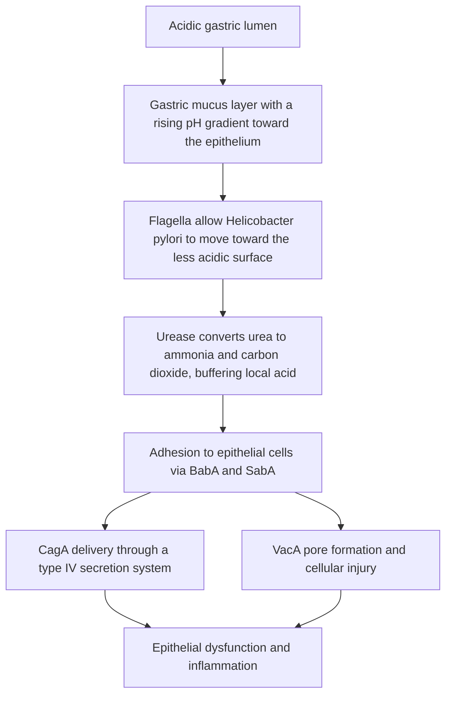

# Chapter 13: Bacterial GI Infections & Intoxications

## 13.1 Helicobacter pylori

### Microbiology & Morphology
* **Organism Characteristics**: *Helicobacter pylori* is a Gram-negative, microaerophilic, spiral/curved S-shaped bacillus possessing 4 to 6 lophotrichous coated flagella at one pole, enabling high-motility burrowing through the viscous gastric mucus layer.
* **Niche & Colonization**: Exclusively colonizes the non-acid-secreting gastric mucosa (or gastric metaplasia in the duodenum). It resides within the juxta-mucosal mucus layer adjacent to epithelial cells, avoiding the highly acidic luminal environment (pH < 2.0).



### Virulence Factors & Pathophysiology
1. **Urease Enzyme**: Abundant surface-associated metalloenzyme containing nickel. Hydrolyzes luminal urea into ammonia ($\text{NH}_3$) and carbon dioxide ($\text{CO}_2$). The generated ammonia buffers gastric acid, forming a protective alkaline cloud ($\text{NH}_4^+$ halo) surrounding the bacterium. Ammonia also exerts direct cytotoxic damage to gastric epithelial cells.
2. **Flagella**: Enables rapid motility in viscous mucus towards neutral pH zones near the epithelial surface.
3. **Adhesins**: Blood group antigen-binding adhesin (**BabA**) binds to Lewis b ($\text{Le}^b$) blood group antigens on surface mucous cells; Sialic acid-binding adhesin (**SabA**) mediates adherence to inflamed mucosa.
4. **CagA (Cytotoxin-Associated Gene A)**: Encoded on the Cag Pathogenicity Island (PAI). Injected directly into host epithelial cells via a **Type IV Secretion System (T4SS)**. Once inside, CagA is phosphorylated by host Src/Abl kinases, interacting with SHP-2 phosphatase to alter cell shape, disrupt tight junctions, and trigger pro-inflammatory IL-8 release. Associated with high-risk ulcer disease and **Gastric Adenocarcinoma**.
5. **VacA (Vacuolating Cytotoxin A)**: Forms hexameric anion-selective membrane pores in host epithelial cell membranes, endosomes, and mitochondria, causing cell vacuolation, cytochrome c release, and apoptosis.

### Pathological Spectrum & Clinical Diseases
* **Antral-Predominant Gastritis**: High acid output driven by G-cell hyperstimulation and D-cell somatostatin suppression. Leads to **Duodenal Ulcer Disease** (90–95% linked to *H. pylori*).
* **Pangastritis / Corpus-Predominant Gastritis**: Multifocal atrophic gastritis, loss of parietal cells (hypochlorhydria), intestinal metaplasia, and heightened risk of **Gastric Adenocarcinoma** (WHO Class I Carcinogen).
* **Gastric MALT Lymphoma**: Chronic antigenic stimulation drives monoclonal marginal zone B-cell proliferation. Early-stage MALToma achieves complete remissions following *H. pylori* antibiotic eradication therapy alone.

### Diagnostic Testing
| Test Category | Diagnostic Test | Sensitivity / Specificity | Clinical Indications & Limitations |
| :--- | :--- | :--- | :--- |
| **Non-Invasive** | **Urea Breath Test (UBT)** ($^{13}\text{C}$ or $^{14}\text{C}$) | Sensitivity >95%<br>Specificity >95% | **Gold standard non-invasive test** for active infection and verifying post-treatment eradication. False negatives with PPIs (stop 2 wks prior), antibiotics/bismuth (stop 4 wks prior). |
| **Non-Invasive** | **Stool Antigen Test (SAT)** | Sensitivity >90%<br>Specificity >90% | Excellent for initial diagnosis and post-eradication confirmation. Monoclonal ELISA superior to polyclonal. Affected by PPI/antibiotic suppression. |
| **Non-Invasive** | **Serology (IgG ELISA)** | High sensitivity<br>Moderate specificity | Detects past exposure. **Cannot distinguish active infection from past resolved infection**; useless for verifying eradication. |
| **Invasive (EGD)** | **Rapid Urease Test (CLO Test)** | Sensitivity >90%<br>Specificity >95% | Gastric biopsy placed in urea broth with pH indicator (phenol red). Color shift yellow $\rightarrow$ magenta within 1–24 hours confirms urease activity. |
| **Invasive (EGD)** | **Histopathology** | Sensitivity >95%<br>Specificity >95% | Biopsy from antrum and corpus. Visualized using **Giemsa**, **Warthin-Starry silver stain**, or immunohistochemistry. |
| **Invasive (EGD)** | **Culture** | Low sensitivity<br>High specificity (100%) | Technically challenging; reserved for antibiotic resistance profiling in refractory cases. |

---

## 13.2 Enteric Bacterial Pathogens & Food Poisoning

### Classification Framework
Enteric bacterial infections are classified based on pathogenic mechanisms into **Invasive / Inflammatory Dysentery**, **Secretory / Watery Diarrhea**, and **Pre-Formed Bacterial Intoxications**.

| Pathogenic pattern | Typical clinical picture | Representative organisms |
| :--- | :--- | :--- |
| **Invasive / inflammatory diarrhea (dysentery)** | Fever, abdominal pain, blood and/or mucus in stool; inflammatory cells may be present | *Shigella* spp., *Salmonella* spp., *Campylobacter jejuni*, EHEC/STEC, *Entamoeba histolytica* |
| **Secretory / watery diarrhea** | High-volume watery stools; blood is usually absent | *Vibrio cholerae*, ETEC, *Clostridioides difficile* (which causes inflammatory colitis rather than a purely secretory syndrome) |
| **Pre-formed or food-associated intoxication** | Often rapid onset after ingestion; vomiting or watery diarrhea depends on the organism and toxin | *Staphylococcus aureus*, *Bacillus cereus*, *Clostridium perfringens* |

EPEC and EAEC are additional diarrheagenic *E. coli* pathotypes; they are generally associated with non-bloody diarrhea and should not be grouped with invasive dysentery pathogens.

---

### A. Invasive & Inflammatory Pathogens (Dysentery)

#### 1. *Shigella* spp. (*S. dysenteriae*, *S. flexneri*, *S. sonnei*)
* **Microbiology**: Gram-negative, non-motile, non-lactose fermenting, $\text{H}_2\text{S}$-negative bacilli.
* **Low Infectious Dose**: Highly infectious (10 to 100 organisms resist gastric acid barrier).
* **Pathogenesis**: Translocates across M cells in Peyer's patches $\rightarrow$ escapes phagosome $\rightarrow$ utilizes host cell actin polymerization (IgcA) for intracellular and cell-to-cell spread.
* **Shiga Toxin**: Produced by *S. dysenteriae* Type 1. An $\text{AB}_5$ toxin whose B subunit binds $\text{Gb}_3$ glycolipid receptors; A subunit cleaves adenine from $28\text{S}$ rRNA of the $60\text{S}$ ribosomal subunit, irreversibly inhibiting host protein synthesis.
* **Clinical Features**: High fever, abdominal cramps, tenesmus, bloody diarrhea containing leukocytes and mucus. Complications include **Hemolytic Uremic Syndrome (HUS)** and toxic megacolon.

#### 2. *Salmonella enterica* (*S. Enteritidis*, *S. Typhimurium*, *S. Typhi*, *S. Paratyphi*)
* **Microbiology**: Gram-negative, motile (peritrichous flagella), non-lactose fermenting, $\text{H}_2\text{S}$-producing bacilli. High infectious dose ($10^5$ organisms).
* **Non-Typhoidal *Salmonella* (*S. Enteritidis*, *S. Typhimurium*)**: Zoonotic (poultry, eggs, reptiles). Invades enterocytes $\rightarrow$ localized inflammatory response $\rightarrow$ self-limiting gastroenteritis (fever, watery/bloody diarrhea). Antibiotics usually withheld to avoid prolonging fecal carrier state unless bacteremic/immunocompromised.
* **Typhoidal *Salmonella* (*S. Typhi*, *S. Paratyphi*)**: Human host restriction.
  * **Pathogenesis**: Invades M cells $\rightarrow$ survives inside macrophages via Type III Secretion Systems (SPI-1/SPI-2) $\rightarrow$ disseminates via lymphatics to reticuloendothelial system (liver, spleen, bone marrow) during 1–2 week asymptomatic incubation period $\rightarrow$ secondary bacteremia with gallbladder colonization (chronic carriage in gallstones).
  * **Clinical Features (Enteric/Typhoid Fever)**: Step-ladder rising fever, relative bradycardia (**Faget sign**), abdominal pain, transient blanching erythematous macules on trunk (**Rose spots**), hepatosplenomegaly, and "pea-soup" diarrhea or constipation.
  * **Complications**: Ulceration and necrosis of hyperplastic Peyer's patches in the terminal ileum leading to **Intestinal Perforation** (typically in week 3) and severe GI hemorrhage.
  * **Diagnosis**: Culture sequence—**BASO** (Blood culture (+) Week 1; Agglutination/Widal (+) Week 2; Stool culture (+) Week 3; Urine culture (+) Week 4). First-line treatment: Ceftriaxone or Azithromycin (due to widespread fluoroquinolone resistance).

#### 3. *Campylobacter jejuni*
* **Microbiology**: Gram-negative, comma/seagull-shaped, microaerophilic, thermophilic (grows optimally at $42^\circ\text{C}$), darting motility via single polar flagellum.
* **Source**: Undercooked poultry, unpasteurized milk, contaminated water.
* **Pathogenesis**: Invasive epithelial damage with Cytolethal Distending Toxin (CDT) activity.
* **Clinical Features**: Prodromal fever, severe right lower quadrant abdominal pain mimicking acute appendicitis (pseudoappendicitis), bloody diarrhea.
* **Post-Infectious Complications**:
  1. **Guillain-Barré Syndrome (GBS)**: Molecular mimicry between *C. jejuni* lipooligosaccharide (LOS) ganglioside-like structures and human peripheral nerve myelin gangliosides ($\text{GM}_1/\text{GD}_{1\text{a}}$) $\rightarrow$ acute inflammatory demyelinating polyneuropathy.
  2. **Reactive Arthritis** (HLA-B27 associated).
* **Treatment**: Azithromycin for severe or prolonged illness.

#### 4. Enterohemorrhagic *E. coli* (EHEC / STEC - e.g., O157:H7)
* **Microbiology**: Gram-negative rod. Distinguished from other *E. coli* by **inability to ferment sorbitol** on Sorbitol MacConkey (SMAC) agar within 24 hours and lack of $\beta$-glucuronidase.
* **Transmission**: Undercooked ground beef, unpasteurized fruit juice, petting zoos.
* **Pathogenesis**: Produces **Shiga-like Toxins 1 and 2 (Stx1, Stx2)**, encoded by lysogenic lambdoid bacteriophages. Stx2 targets endothelial cells expressing $\text{Gb}_3$ receptors in glomerular and intestinal microvasculature.
* **Clinical Features**: Severe afebrile hemorrhagic colitis with painful abdominal cramps.
* **Hemolytic Uremic Syndrome (HUS) Triad**:
  1. **Microangiopathic Hemolytic Anemia (MAHA)** (schistocytes, elevated LDH, negative Coombs test).
  2. **Thrombocytopenia** (platelet consumption in microthrombi).
  3. **Acute Kidney Injury (AKI)** (glomerular microthrombosis).
* **CRITICAL CONTRAINDICATION**: **Antibiotic administration is strictly contraindicated** in EHEC infection because antibiotic-induced bacterial lysis surges Stx2 expression, dramatically elevating HUS risk.

---

### B. Secretory & Watery Diarrheal Pathogens

#### 1. *Vibrio cholerae* (Serogroups O1 and O139)
* **Microbiology**: Gram-negative, comma-shaped rod, oxidase-positive, highly motile via single polar flagellum. Grows in alkaline media; isolated on **TCBS (Thiosulfate-Citrate-Bile Salts-Sucrose)** agar forming yellow sucrose-fermenting colonies.
* **Pathogenesis & Cholera Toxin Mechanism**:
  ```mermaid
  flowchart TD
      A["Vibrio cholerae attaches to enterocytes via toxin-coregulated pili"] --> B["Cholera toxin AB5 is released"]
      B --> C["B subunit binds GM1 ganglioside"]
      C --> D["A subunit enters the cell and reaches the cytosol"]
      D --> E["ADP-ribosylation locks Gs-alpha in its active state"]
      E --> F["Adenylyl cyclase remains activated"]
      F --> G["Intracellular cAMP increases"]
      G --> H["PKA activates CFTR-mediated chloride secretion"]
      H --> I["Sodium and water follow into the intestinal lumen"]
      I --> J["Profuse watery diarrhoea"]
  ```
* **Clinical Presentation**: Sudden onset of massive, painless, non-offensive, translucent gray watery diarrhea containing flecks of mucus and epithelial cells (**"Rice-Water" Stools**). Stool output up to $1\text{ L/hour}$, rapidly leading to severe isotonic dehydration, hypovolemic shock, hypokalemia, and metabolic acidosis.
* **Management**: Immediate aggressive **Oral Rehydration Salts (ORS)** (utilizes intestinal $\text{Na}^+/\text{Glucose}$ SGLT-1 co-transporter which remains intact). IV Ringer's Lactate for severe shock. Doxycycline or Azithromycin reduces stool duration and volume.

#### 2. Enterotoxigenic *E. coli* (ETEC)
* **Epidemiology**: Principal cause of **Traveler's Diarrhea** and infantile diarrhea in developing nations.
* **Toxin Mechanisms**:
  * **Heat-Labile Toxin (LT)**: Similar to cholera toxin; ADP-ribosylates $G_{s\alpha} \rightarrow \uparrow \text{cAMP} \rightarrow$ luminal $\text{Cl}^-$ and water secretion.
  * **Heat-Stable Toxin (ST)**: Binds and activates apical **Guanylyl Cyclase C** $\rightarrow \uparrow \text{cGMP} \rightarrow$ inhibition of $\text{Na}^+$ reabsorption and stimulation of fluid secretion.
* **Clinical Presentation**: Self-limiting watery diarrhea, abdominal cramps, nausea, low-grade fever. Treated with fluid replacement; Azithromycin or Ciprofloxacin if severe.

#### 3. *Clostridioides difficile* (formerly *Clostridium difficile*)
* **Microbiology**: Gram-positive, anaerobic, spore-forming, rod-shaped bacterium.
* **Etiology**: Disruption of normal colonic microbiota by broad-spectrum antibiotic therapy (most commonly **Clindamycin**, **Fluoroquinolones**, **Cephalosporins**, and **Broad-spectrum Penicillins**/Carbapenems).
* **Pathophysiological Toxins**:
  * **Toxin A (Enterotoxin)**: Neutrophil chemoattractant; disrupts mucosal tight junctions, inducing intestinal fluid secretion and mucosal inflammation.
  * **Toxin B (Cytotoxin)**: Powerful actin depolymerizing agent; glycosylates Rho family GTPases, destroying enterocyte cytoskeletal integrity, causing cell death and pseudomembrane formation.
* **Clinical Presentation**: Watery diarrhea ($\ge 3$ loose stools in 24 hrs), fever, leukocytosis (WBC $>15,000/\mu\text{L}$), abdominal tenderness. Severe cases present with ileus, toxic megacolon, and colonic perforation.
* **Histopathology**: **Pseudomembranous Colitis**—volcano-like mucosal eruptions consisting of fibrin, mucin, necrotic epithelial cells, and dense neutrophilic infiltrates overlying intact mucosa.
* **Diagnostic Workup**: Stool PCR for toxin genes ($tcdB$) or Enzyme Immunoassay (EIA) for Toxin A/B and Glutamate Dehydrogenase (GDH) antigen.
* **Treatment Guidelines**:
  * First-line: Oral **Fidaxomicin** ($200\text{ mg}$ BID for 10 days) or Oral **Vancomycin** ($125\text{ mg}$ QID for 10 days). (IV Vancomycin is ineffective as it is not excreted into the colonic lumen).
  * Fulminant Disease: High-dose oral Vancomycin + IV Metronidazole.
  * Recurrent Disease: Fecal Microbiota Transplantation (FMT) or Bezlotoxumab (monoclonal anti-Toxin B antibody).

---

### C. Pre-Formed Bacterial Food Intoxications

| Organism | Common Food Vehicles | Incubation Period | Toxin Mechanism & Pathophysiology | Key Clinical Characteristics |
| :--- | :--- | :--- | :--- | :--- |
| ***Staphylococcus aureus*** | Mayonnaise, custards, processed meats, potato salad left at room temp. | **1 to 6 hours** (Rapid) | Ingestion of **pre-formed heat-stable Enterotoxins** (A–E). Superantigen activity resists boiling ($100^\circ\text{C}$ for 30 min) and gastric proteases. Stimulates vagal afferents in gut. | Sudden severe nausea, explosive vomiting, abdominal cramps. **Fever is typically absent**. Self-limiting within 24 hours. |
| ***Bacillus cereus*** (Emetic Form) | Fried rice, reheated cooked rice left sitting. | **1 to 5 hours** | Ingestion of **pre-formed heat-stable toxin (Cereulide)** produced in food during slow cooling of cooked rice. Resists reheating. | Dominant violent **nausea and vomiting**. Minimal diarrhea. |
| ***Bacillus cereus*** (Diarrheal Form) | Meats, vegetables, dried soups. | **8 to 16 hours** | Spores survive cooking $\rightarrow$ germinate in gut $\rightarrow$ produce **heat-labile enterotoxin** *in vivo* (stimulates adenylyl cyclase). | Dominant **watery diarrhea** and abdominal cramps. Vomiting is rare. |
| ***Clostridium perfringens*** (Type A) | Reheated meat dishes, poultry, gravies stored at $20–50^\circ\text{C}$. | **8 to 16 hours** | Ingestion of large vegetative cell burden $\rightarrow$ sporulation in alkaline small intestine $\rightarrow$ releases heat-labile ***C. perfringens* Enterotoxin (CPE)** *in vivo*. CPE inserts into enterocyte tight junctions (claudins), altering membrane permeability. | Profuse **watery diarrhea** and severe abdominal cramps. Vomiting and fever are rare. |
| ***Clostridium botulinum*** | Home-canned vegetables, honey (infant botulism). | **12 to 36 hours** | Ingestion of **pre-formed heat-labile Botulinum Neurotoxin** (A, B, E). Cleaves SNARE proteins (synaptobrevin/SNAP-25) at neuromuscular junctions. | Symmetrical **descending flaccid paralysis**, diplopia, dysphagia, dysarthria, dry mouth, constipation. No fever. |

---

### Coverage & Verification Checklist
1. **Subsection Checklist**:
   - [x] 13.1 *Helicobacter pylori* (Morphology, virulence CagA/VacA/urease, gastritis/PUD/cancer spectrum, diagnostic testing)
   - [x] 13.2 Enteric Bacterial Pathogens & Food Poisoning (Dysentery: *Shigella*, *Salmonella*, *Campylobacter*, EHEC/STEC O157:H7; Secretory: *V. cholerae*, ETEC, *C. difficile*; Pre-formed intoxications: *S. aureus*, *B. cereus*, *C. perfringens*, *C. botulinum*)
2. **Corrections Made**: Verified that antibiotic contraindications in EHEC/STEC are clearly stated based on HUS risk; updated *C. difficile* first-line treatment to oral Fidaxomicin/Vancomycin per current IDSA guidelines.
3. **Source Limitations**: None; comprehensive medical microbiology content provided.
