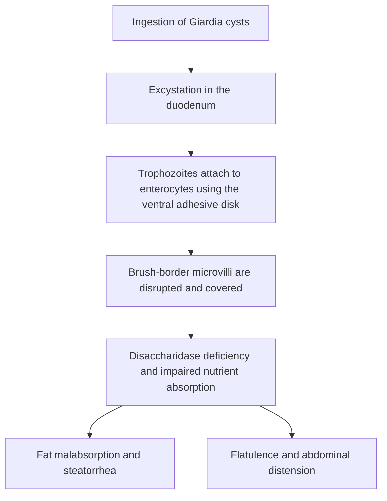

# Chapter 14: Viral & Parasitic GI Infections

## 14.1 Viral Gastroenteritis

### 1. Rotavirus
* **Microbiology**: Member of the *Reoviridae* family. Non-enveloped, double-layered icosahedral capsid enclosing an **11-segment double-stranded RNA (dsRNA)** genome. Wheel-like morphologic appearance under electron microscopy.
* **Epidemiology**: Historically the single leading cause of severe, dehydrating diarrhea in infants and young children worldwide ($<5$ years of age) prior to global immunization programs. Winter seasonality in temperate zones.
* **Pathophysiology**:
  1. Rotavirus selectively infects and destroys mature enterocytes on the villi of the small intestine, sparing crypt cells.
  2. Loss of villous absorptive surface area leads to brush border disaccharidase (lactase) deficiency and osmotic diarrhea.
  3. **NSP4 Enterotoxin**: Non-structural protein 4 acts as a viral enterotoxin, mobilizing intracellular $\text{Ca}^{2+}$, triggering age-dependent $\text{Cl}^-$ secretion via calcium-activated chloride channels and activating the enteric nervous system.
* **Clinical Presentation**: Incubation period 1–3 days. Abrupt onset of vomiting followed by profuse watery, non-bloody diarrhea, low-grade fever, and rapid isotonic dehydration.
* **Prevention**: Live-attenuated oral rotavirus vaccines (**Rotarix** [monovalent], **Rotateq** [pentavalent human-bovine reassortant]). Administered in early infancy; slight transient increase in intussusception risk.

### 2. Norovirus (Norwalk Virus)
* **Microbiology**: Member of the *Caliciviridae* family. Non-enveloped, positive-sense single-stranded RNA (+ssRNA) virus with a cup-shaped capsid morphology. Extremely low infectious dose ($<18$ viral particles). High environmental stability (resists freezing, heating to $60^\circ\text{C}$, and alcohol-based hand sanitizers).
* **Epidemiology**: The **leading cause of epidemic gastroenteritis outbreaks** across all age groups worldwide, and the primary cause of foodborne gastroenteritis outbreaks. Classic settings: Cruise ships, nursing homes, schools, hospitals, and military barracks.
* **Pathophysiology**: Binds histo-blood group antigens (HBGAs) on intestinal epithelial cells, causing mucosal blunting in the proximal small intestine with spared colonic architecture.
* **Clinical Features**: Sudden onset after short incubation (12–48 hours). Characterized by **predominant violent watery vomiting**, watery diarrhea, abdominal cramps, and low-grade fever lasting 24–72 hours.
* **Infection Control**: Requires handwashing with soap and water (alcohol rubs ineffective) and environmental surface disinfection using sodium hypochlorite (bleach).

---

## 14.2 Viral Hepatitis

### Comprehensive Comparative Master Matrix

| Feature | Hepatitis A (HAV) | Hepatitis B (HBV) | Hepatitis C (HCV) | Hepatitis D (HDV) | Hepatitis E (HEV) |
| :--- | :--- | :--- | :--- | :--- | :--- |
| **Family & Genome** | *Picornaviridae* (+) ssRNA, Non-enveloped | *Hepadnaviridae* Partially dsDNA (RT) | *Flaviviridae* (+) ssRNA, Enveloped | *Deltaviridae* Circular (-) ssRNA (Defective) | *Hepeviridae* (+) ssRNA, Non-enveloped |
| **Transmission** | Fecal-Oral (Shellfish, contaminated water) | Parenteral, Sexual, Perinatal (Vertical) | Parenteral (IVDU, transfusions), Sexual (low) | Parenteral, Sexual (Requires HBsAg) | Fecal-Oral (Waterborne; swine reservoir) |
| **Incubation** | 2 to 6 weeks | 1 to 6 months | 2 to 26 weeks | 3 to 7 weeks | 2 to 6 weeks |
| **Chronicity Rate** | **0%** (Never chronic) | Neonatal: 90% Adults: <5% | **75% to 85%** (High) | Co-infection: <5% Superinfection: >80% | **0%** (Except organ transplants) |
| **Fulminant Hepatic Failure** | Rare (<0.5%) | 1% | Rare | High (10–20% in Superinfection) | **20% mortality in Pregnant Women** |
| **HCC Association** | No | Yes (Direct DNA integration + Cirrhosis) | Yes (Indirect via Chronic Inflammation/Cirrhosis) | Yes (Heightened risk with HBV) | No |
| **Key Diagnostics** | Anti-HAV IgM (Active) Anti-HAV IgG (Immune) | HBsAg, Anti-HBs, Anti-HBc (IgM/IgG), HBeAg, HBV DNA | Anti-HCV Antibody, HCV RNA PCR (Confirms active) | Anti-HDV IgM/IgG, HDV RNA PCR | Anti-HEV IgM, HEV RNA PCR |
| **Prevention / Tx** | Inactivated Vaccine; Post-exposure IG | Recombinant HBsAg Vaccine; Tenofovir / Entecavir | Direct-Acting Antivirals (DAAs - Cure >95%) | HBV Vaccination (prevents HDV co-infection) | Vaccine in China; supportive care |

---

### Detailed Analysis of Hepatitis B & C

#### Hepatitis B Serological Markers & Interpretive Profiles
* **HBsAg (Surface Antigen)**: First marker to appear. Indicates **active infection** (acute or chronic if present $>6$ months).
* **Anti-HBs (Surface Antibody)**: Indicates **immunity** (due to resolved infection or vaccination).
* **Anti-HBc IgM**: Core antibody of IgM class. Indicates **acute infection**. Marker during the **"Window Period"** when HBsAg has fallen but Anti-HBs is not yet detectable.
* **Anti-HBc IgG**: Indicates **past exposure** (persists for life in both resolved infection and chronic disease). *Absent in vaccinated individuals.*
* **HBeAg (Envelope Antigen)**: Marker of **active viral replication** and high infectivity.
* **HBV DNA**: Quantitative viral load measurement; guides antiviral initiation and monitors resistance.

**HEPATITIS B SEROLOGICAL PROFILE INTERPRETATION**
- HBsAg POSITIVE HBsAg NEGATIVE
- Anti-HBc IgM (+) Anti-HBc IgG (+) Anti-HBs (+) Anti-HBs (-)
- Acute Infection Chronic Infection
- Anti-HBc(+) Anti-HBc(-) Anti-HBc(+) Anti-HBc(-)
- HBeAg (+) HBeAg (-) Resolved Vaccinated Window Period Susceptible
- High Replic Low Replic/Pre-core Infection Immunity (Anti-HBc IgM+)

#### Hepatitis C & Direct-Acting Antivirals (DAAs)
* **Pathogenesis**: HCV does not integrate into host genome (cytoplasmic replication). Chronic infection drives continuous necroinflammation, stellate cell activation, cirrhosis, and Hepatocellular Carcinoma (HCC).
* **Treatment Revolution**: Pangenotypic **Direct-Acting Antivirals (DAAs)** achieve Sustained Virologic Response (SVR12 - undetectable HCV RNA 12 weeks post-therapy) in $>95\%$ of patients.
  * **NS3/4A Protease Inhibitors** (*-previr*): Glecaprevir, Voxilaprevir.
  * **NS5A Replication Complex Inhibitors** (*-asvir*): Ledipasvir, Velpatasvir, Pibrentasvir.
  * **NS5B Polymerase Inhibitors** (*-buvir*): Sofosbuvir (nucleoside), Dasabuvir (non-nucleoside).

---

## 14.3 Parasitic GI Infections

### 1. *Giardia lamblia* (also *G. duodenalis* / *G. intestinalis*)
* **Morphology**:
  * **Trophozoite**: Pear-shaped, binucleated with two central nuclei ("monkey-face" / "owl-eye" appearance), 4 pairs of flagella, and a large **ventral adhesive disk**.
  * **Cyst**: Oval-shaped, 4 nuclei, thick chitin wall; resistant to standard water chlorination.
* **Transmission**: Ingestion of cysts from fecally contaminated mountain stream water ("Backpacker's diarrhea"), daycare centers, or oral-anal contact.
* **Pathophysiology**: Trophozoites excyst in duodenum and attach to enterocyte brush border via the ventral adhesive disk. They **do not invade mucosal tissue** or cause hematogenous spread. Attachment produces mechanical coverage and mucosal inflammation, destroying brush border microvilli and causing functional **disaccharidase (lactase) deficiency** and **fat malabsorption**.
* **Clinical Presentation**: Incubation 1–3 weeks. Foul-smelling, greasy, frothy, floating diarrhea (steatorrhea) accompanied by flatulence, abdominal distension, and weight loss. Absence of blood or pus in stool.
* **Diagnosis**: Stool Antigen ELISA (high sensitivity); microscopic stool examination for cysts/trophozoites (classic "falling-leaf" motility); duodenal aspirate/string test (Entero-test).
* **Treatment**: First-line: **Metronidazole** ($250\text{ mg}$ TID for 5–7 days) or **Tinidazole** / **Nitazoxanide**.

### 2. *Cryptosporidium parvum* & *Cryptosporidium hominis*
* **Microbiology**: Intracellular obligate apicomplexan protozoan.
* **Transmission**: Ingestion of environmentally resistant **oocysts** from contaminated water supplies (chlorination resistant; requires filtration or boiling).
* **Pathophysiology**: Oocysts release sporozoites in small intestine, which attach to enterocyte apical membrane and become enclosed within a host-derived **extracytoplasmic vacuole** (epicellular location). Induces enterocyte apoptosis and severe chloride secretion.
* **Clinical Presentation**:
  * **Immunocompetent**: Self-limiting watery diarrhea with abdominal cramps lasting 1–2 weeks.
  * **Immunocompromised (AIDS with CD4 < 100/$\mu\text{L}$)**: Profuse, intractable, life-threatening cholera-like watery diarrhea (up to $10\text{ L/day}$), leading to extreme volume depletion, electrolyte wasting, and sclerosing cholangitis.
* **Diagnosis**: Stool examination using **Modified Kinyoun Acid-Fast Stain** showing bright red/pink round oocysts ($4\text{ to }6\ \mu\text{m}$) against a blue background. Direct fluorescent antibody (DFA) testing.
* **Treatment**: Nitazoxanide in immunocompetent. In HIV/AIDS patients, the definitive treatment is **Antiretroviral Therapy (ART)** to restore CD4 count above $100/\mu\text{L}$.

### 3. *Entamoeba histolytica*
* **Morphology**:
  * **Trophozoite**: Single nucleus with central punctate karyosome and fine peripheral chromatin; pathognomonic **ingested red blood cells (erythrophagocytosis)** within cytoplasm.
  * **Cyst**: Spherical with 1 to 4 nuclei and elongated chromatoid bodies.
* **Pathogenesis**: Trophozoites produce **galactose/N-acetylgalactosamine (Gal/GalNAc) lectin** for enterocyte adhesion, **amoebapores** for target cell lysis, and **cysteine proteinases** for extracellular matrix degradation.
* **Histopathology**: Penetrates colonic mucosa and muscularis mucosae, expanding laterally in submucosa to form classic **Flask-Shaped Mucosal Ulcers** with narrow necks and broad bases.
* **Clinical Spectrum**:
  1. **Amoebic Dysentery**: Gradual onset of bloody, mucous diarrhea, abdominal pain, and tenesmus, typically without high fever.
  2. **Amoebic Liver Abscess**: Hematogenous spread via portal circulation to liver (Right lobe most common). Anchovy-sauce colored fluid (necrotic hepatocytes). Presenting with fever, RUQ pain, and point tenderness over intercostal spaces.
* **Diagnosis**: Stool PCR or Antigen detection (distinguishes *E. histolytica* from non-pathogenic *E. dispar*); Serology (ELISA) positive in liver abscess; Stool microscopy (erythrophagocytosis).
* **Treatment**:
  * Tissue Amoebicide (kills invasive trophozoites): **Metronidazole** ($750\text{ mg}$ TID for 7–10 days) or **Tinidazole**.
  * Luminal Amoebicide (MANDATORY following tissue therapy to clear intestinal cysts and prevent relapse): **Paromomycin** or **Iodoquinol**.

---

### Coverage & Verification Checklist
1. **Subsection Checklist**:
   - [x] 14.1 Viral Gastroenteritis (Rotavirus dsRNA/NSP4 enterotoxin/vaccine; Norovirus +ssRNA/epidemic outbreaks)
   - [x] 14.2 Viral Hepatitis (HAV, HBV, HCV, HDV, HEV master comparative matrix; HBV serology & window period; HCV DAAs)
   - [x] 14.3 Parasitic Infections (*Giardia lamblia* ventral disk/steatorrhea/metronidazole; *Cryptosporidium* acid-fast oocysts/AIDS; *Entamoeba histolytica* flask ulcers/erythrophagocytosis/liver abscess)
2. **Corrections Made**: Clarified that HDV requires active HBsAg coat for virion assembly; confirmed Paromomycin/Iodoquinol luminal eradication mandate following Metronidazole in *E. histolytica*.
3. **Source Limitations**: None; comprehensive medical virology and parasitology content provided.
