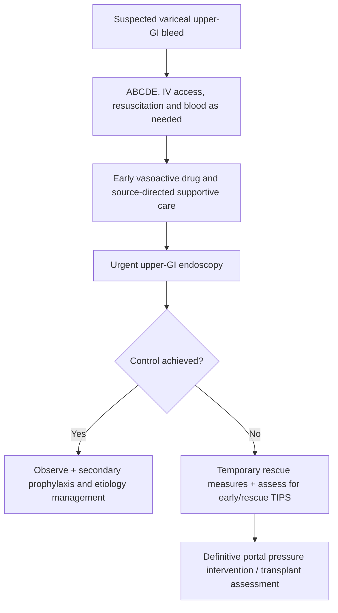
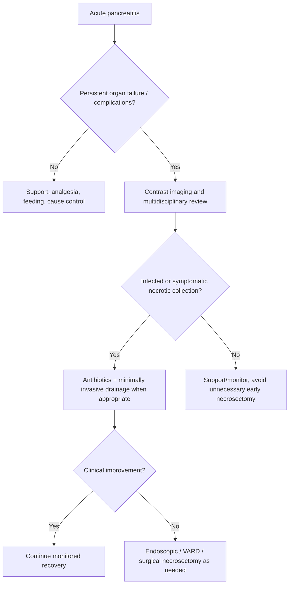
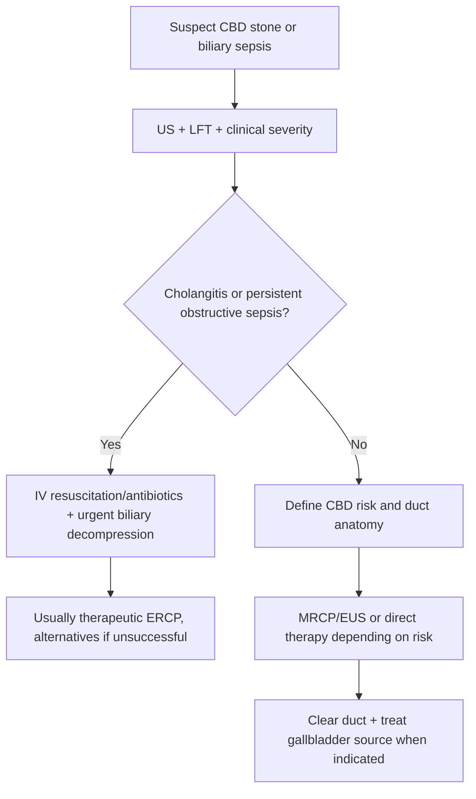

# Chapter 20: Hepatic, Biliary & Pancreatic Diseases

## 20.1 Acute Liver Failure (ALF)

Acute Liver Failure (ALF) is a catastrophic syndrome defined as the sudden onset of severe liver injury characterized by **coagulopathy ($\text{INR} \ge 1.5$)** and **hepatic encephalopathy** in a patient **without pre-existing cirrhosis** or underlying chronic liver disease, developing within **26 weeks** of initial symptoms.

### A. Classification & Subcategories
ALF is subclassified based on the time interval between the onset of jaundice and the appearance of encephalopathy:
1. **Hyperacute Liver Failure** ($<7\text{ days}$): Characterized by severe coagulopathy, dramatic transaminase surges, mild jaundice, high incidence of cerebral edema, but relatively favorable spontaneous survival. Typical cause: Paracetamol (Acetaminophen) toxicity, Hepatitis A/E.
2. **Acute Liver Failure** ($8–28\text{ days}$): Moderate jaundice and cerebral edema risk. Typical cause: Acute Hepatitis B.
3. **Subacute Liver Failure** ($4–26\text{ weeks}$): Severe jaundice, mild transaminase elevation, low incidence of cerebral edema, but **poor spontaneous survival** without liver transplantation. Typical cause: Idiosyncratic Drug-Induced Liver Injury (DILI), Autoimmune Hepatitis.

---

### B. Etiology & Pathophysiology
* **Paracetamol (Acetaminophen) Overdose**: Most common cause in Western countries. Metabolism shifts from glucuronidation/sulfation to cytochrome P450 (CYP2E1), generating **NAPQI** ($N$-acetyl-$p$-benzoquinone imine). NAPQI depletes hepatic glutathione stores, inducing massive centrilobular (Zone 3) necrosis. Treated with **$N$-Acetylcysteine (NAC)** to restore glutathione.
* **Viral Hepatitis**: Hepatitis B (often reactivation or co-infection with HDV), Hepatitis E (particularly high mortality in pregnant females: up to $20–25\%$), Hepatitis A.
* **Idiosyncratic Drug Reactions**: Halothane, Isoniazid, Rifampicin, Phenytoin, Valproate.
* **Other Causes**: Wilson disease (Coombs-negative hemolytic anemia + low ALP:Bilirubin ratio $<2.0$), Autoimmune hepatitis, Budd-Chiari syndrome, Pregnancy-related (AFLP, HELLP syndrome), Amanita phalloides mushroom poisoning.

---

### C. Major Complications & ICU Management Protocols

**CRITICAL COMPLICATIONS IN ALF**
- CEREBRAL EDEMA & ICP SEPSIS & INFECTION COAGULOPATHY & BLEEDING HEPATORENAL SYNDROME
- Target Na 145-150 mEq/L - Functional immune - Defective clotting - Severe splanchnic
- Hypertonic Saline 3% paralysis factors II, V, VII, X vasodilation
- Mannitol boluses - Empiric antibiotics - Transfuse ONLY if - Terlipressin
- Head elevation 30 deg - Avoid fever active bleed / procedure Albumin

1. **Cerebral Edema & Intracranial Hypertension**:
  * **Pathophysiology**: Hyperammonemia leads to astrocyte accumulation of **glutamine** (via glutamine synthetase), inducing astrocyte swelling, cerebral hyperperfusion, cytotoxic edema, and brainstem herniation (leading cause of death in ALF).
  * **Management**: Prophylactic **Hypertonic Saline ($3\%\text{ NaCl}$)** to maintain serum sodium between **$145–150\text{ mEq/L}$**; elevate head of bed to $30^\circ$; IV **Mannitol ($0.5–1.0\text{ g/kg}$)** for acute surges in ICP; therapeutic hypothermia ($34–35^\circ\text{C}$) or continuous venovenous hemofiltration (CVVH) in refractory cases.
2. **Coagulopathy**:
  * Defective hepatic synthesis of factors II, V, VII, IX, and X.
  * **Management Rule**: Do **not** routinely correct abnormal INR with fresh frozen plasma (FFP) in the absence of active bleeding or invasive procedures, as INR is the single most vital prognostic indicator.
3. **Infection & Sepsis**: Sepsis accounts for major mortality due to immune paralysis. Prophylactic broad-spectrum antibiotics and antifungals are initiated upon early clinical deterioration.

---

### D. King's College Criteria for Liver Transplantation
The validated clinical criteria used to select patients with ALF for emergency liver transplantation:

**KING'S COLLEGE CRITERIA FOR LIVER TRANSPLANT IN ALF**
- PARACETAMOL-INDUCED ALF NON-PARACETAMOL ALF
- Arterial pH < 7.30 (post-fluid) Prothrombin Time > 100 sec (INR > 6.5)
- OR OR
- ALL THREE of the following: ANY THREE of the following:
- INR > 6.5 (PT > 100 sec) - Age < 10 or > 40 years
- Serum Creatinine > 3.4 mg/dL - Etiology: DILI, Non-A/Non-B hepatitis
- Grade III/IV Encephalopathy - Jaundice-to-encephalopathy time > 7 days
- Serum Bilirubin > 17.5 mg/dL (300 umol/L)
- Prothrombin Time > 50 sec (INR > 3.5)

---

## 20.2 Chronic Liver Disease & Cirrhosis

Cirrhosis is the end-stage histological outcome of chronic liver disease, defined by **diffuse hepatic fibrosis** and **nodular regenerative hepatocyte transformation**, leading to portal hypertension and progressive liver failure.

### A. Clinical Prognostic Scoring Systems

#### 1. Child-Turcotte-Pugh (CTP) Score

| Clinical / Laboratory Variable | 1 Point | 2 Points | 3 Points |
| :--- | :--- | :--- | :--- |
| **Total Bilirubin (mg/dL)** | $< 2.0$ | $2.0–3.0$ | $> 3.0$ |
| **Serum Albumin (g/dL)** | $> 3.5$ | $2.8–3.5$ | $< 2.8$ |
| **INR** | $< 1.7$ | $1.7–2.3$ | $> 2.3$ |
| **Ascites** | None | Mild / Controlled | Moderate / Refractory |
| **Hepatic Encephalopathy** | None | Grade I–II | Grade III–IV |

* **Child-Pugh Class A** (5–6 points): Well-compensated; 1-year survival $100\%$.
* **Child-Pugh Class B** (7–9 points): Significant functional compromise; 1-year survival $80\%$.
* **Child-Pugh Class C** (10–15 points): Decompensated; 1-year survival $45\%$.

#### 2. MELD Score (Model for End-Stage Liver Disease)
Objective mathematical formula based on **Serum Bilirubin**, **Serum Creatinine**, **INR**, and **Serum Sodium** (MELD-Na). Used universally for organ allocation in liver transplantation.

---

### B. Comprehensive Management of Decompensation Complications

#### 1. Ascites
* **Pathophysiology**: Sinusoidal portal hypertension drives splanchnic vasodilation $\rightarrow$ arterial underfilling $\rightarrow$ activation of RAAS and SNS $\rightarrow$ renal sodium and water retention.
* **Diagnosis**: Paracentesis evaluating Serum-Ascites Albumin Gradient (**SAAG**):
  $$\text{SAAG} = \text{Serum Albumin} - \text{Asitic Fluid Albumin}$$
  * **SAAG $\ge 1.1\text{ g/dL}$**: Indicates **Portal Hypertension** (Cirrhosis, Heart failure, Budd-Chiari).
  * **SAAG $< 1.1\text{ g/dL}$**: Indicates **Non-Portal Hypertension** (Peritoneal carcinomatosis, Tuberculous peritonitis, Nephrotic syndrome).
* **Treatment**:
  * Dietary sodium restriction ($<2.0\text{ g/day}$).
  * Dual Diuretic Protocol: **Spironolactone** (aldosterone antagonist) + **Furosemide** (loop diuretic) maintained in a strict **100 mg : 40 mg ratio** (up to max $400\text{ mg}:160\text{ mg}$) to maintain normokalemia.
  * **Large-Volume Paracentesis (LVP $>5\text{ L}$)**: Must be accompanied by IV infusion of **Albumin ($6–8\text{ g per Liter}$ of fluid removed)** to prevent Paracentesis-Induced Circulatory Dysfunction (PICD) and acute renal failure.

#### 2. Spontaneous Bacterial Peritonitis (SBP)
* **Pathophysiology**: Translocation of enteric Gram-negative bacteria across permeable intestinal mucosa into ascitic fluid in immune-compromised cirrhotics.
* **Diagnostic Criteria**: Ascitic fluid **Polymorphonuclear (PMN) leukocyte count $\ge 250/\mu\text{L}$** ($\ge 0.25 \times 10^9/\text{L}$). Cultured most commonly: *E. coli*, *Klebsiella pneumoniae*, *Pneumococci*.
* **Treatment**:
  * Empiric IV 3rd generation cephalosporin (**Ceftriaxone 2 g/day** or Cefotaxime) for 5–7 days.
  * **IV Albumin**: Administered at $1.5\text{ g/kg}$ on Day 1 and $1.0\text{ g/kg}$ on Day 3 reduces mortality and renal failure by $66\%$.
  * **Secondary Prophylaxis**: Daily oral **Norfloxacin 400 mg** or Bactrim long-term.

#### 3. Hepatorenal Syndrome (HRS-AKI)
* **Pathophysiology**: Severe functional renal vasoconstriction secondary to extreme splanchnic arterial vasodilation and reduced Effective Arterial Blood Volume (EABV).
* **Diagnostic Criteria**:
  1. Diagnosis of Cirrhosis with ascites.
  2. Diagnosis of Acute Kidney Injury (AKI) according to KDIGO criteria.
  3. **No response after at least 2 consecutive days of diuretic withdrawal and IV Albumin resuscitation ($1\text{ g/kg/day}$)**.
  4. Absence of hypovolemic shock, ongoing nephrotoxic drug exposure, or parenchymal kidney disease (proteinuria $<500\text{ mg/day}$, microhematuria $<50$ RBCs/HPF).
* **Treatment**: Combination of **Splanchnic Vasoconstrictors** (**Terlipressin** $0.5–2.0\text{ mg}$ IV Q6H or continuous infusion; or Noradrenaline) PLUS **IV Albumin ($20–40\text{ g/day}$)**. Definitive treatment is **Liver Transplantation**.

#### 4. Hepatic Encephalopathy (HE)
* **Pathophysiology**: Impaired hepatic clearance and portosystemic shunting of gut-derived nitrogenous toxins, primarily **Ammonia ($\text{NH}_3$)**, which crosses the blood-brain barrier and is converted to **Glutamine** by astrocytes, causing astrocyte swelling and neuroinhibition.
* **Staging**: West Haven Criteria (Grades I to IV: from mild euphoria/anxiety and asterixis to frank coma).
* **Treatment**:
  * **First-line**: **Lactulose** (synthetic non-absorbable disaccharide). Colonic bacteria ferment lactulose to lactic and acetic acid $\rightarrow$ lowers luminal $\text{pH} \rightarrow$ converts non-ionic ammonia ($\text{NH}_3$) to non-absorbable ammonium ($\text{NH}_4^+$) trapping it in stool ("cathartic ammonium trapping"). Titrated to $2–3$ soft bowel movements daily.
  * **Second-line / Add-on**: **Rifaximin** (550 mg PO BID). Non-absorbable oral antibiotic that eliminates urease-producing enteric flora, significantly reducing ammonia production and preventing encephalopathy recurrences.

---

<!-- SURGERY_GI_ZIP_CONTENT_START:20-20-2 -->

### Additional surgical details integrated from the Surgery notes

> [!info] Provenance and scope
> Content below was transferred from the supplied Surgery ZIP, placed under this pre-existing GIT topic, and reformatted only at heading level. Existing canonical text remains intact. Source caveats should be interpreted as presented in those notes.

#### 2. Liver function and surgical assessment

> **Source:** Surgery ZIP — 16_Liver_and_Portal_Hypertension.md

##### Laboratory pattern| Investigation | Interpretation and limits |
|---|---|
| **ALT/AST** | Hepatocyte injury; do **not** directly measure remaining liver synthetic function |
| **ALP, GGT** | Cholestatic/biliary obstruction pattern; GGT supports hepatic source of ALP |
| **Direct bilirubin** | Can increase in cholestasis/obstruction; a purely “direct = surgical, indirect = medical” rule is oversimplified |
| **Albumin** | Chronic synthetic function but also affected by inflammation, nutrition and other losses |
| **PT/INR** | Reflect synthesis of vitamin-K-dependent coagulation factors and anticoagulant use; central in CTP/MELD |
| **Creatinine/Na** | Severity of decompensation, renal and circulatory compromise; used in MELD-based prioritization |

##### Child–Turcotte–Pugh (CTP) scoreFive domains are assigned 1–3 points each; **total 5–15**.

| Parameter | 1 point | 2 points | 3 points |
|---|---|---|---|
| **Ascites** | None | Mild / controlled | Moderate–severe / refractory |
| **Encephalopathy** | None | Grade I–II | Grade III–IV |
| **Bilirubin, mg/dL** | <2 | 2–3 | >3 |
| **Albumin, g/dL** | >3.5 | 2.8–3.5 | <2.8 |
| **INR** | <1.7 | 1.7–2.3 | >2.3 |

- **Class A:** 5–6; **B:** 7–9; **C:** 10–15.
- Used as a measure of **cirrhotic hepatic functional reserve** and to contextualize surgical and HCC treatment decisions.
- Doctut has several transcription errors for the score (such as maximum “25” and “Child C 20–25”); WOR explicitly supplies the internally consistent **5–15** range.

##### MELD and PELD- **MELD (Model for End-stage Liver Disease):** the uploaded older score uses **bilirubin, INR, creatinine**; a revision includes **sodium**. Used to estimate severity/prioritize transplantation.
- **PELD:** pediatric version adds **albumin, total bilirubin, INR, age and growth failure**.
- **King’s College criteria:** source tables distinguish acetaminophen-induced vs nonacetaminophen acute liver failure and use **pH, PT/INR, creatinine, encephalopathy, age, bilirubin and jaundice-to-encephalopathy interval** to assess urgency of transplantation.
- Do **not** treat a single MELD or CTP cutoff in the review sources as an absolute operative permission/prohibition.

#### 8. Portal hypertension — essential hemodynamics

> **Source:** Surgery ZIP — 16_Liver_and_Portal_Hypertension.md

##### Definition and measurements- **Portal pressure reflects blood flow × resistance.** Portal hypertension can result from **increased resistance**, increased splanchnic flow, or both.
- **Hepatic venous pressure gradient (HVPG) = wedged hepatic venous pressure − free hepatic venous pressure.**
- **WOR GI teaching levels:** **1–5 mmHg normal; 6–9 subclinical increase; ≥10 clinically significant portal hypertension; ≥12 increased variceal bleeding risk**. HVPG particularly reflects **sinusoidal** portal hypertension; presinusoidal disease can yield misleadingly low HVPG.
- Cirrhosis → distortion by fibrosis/regenerative nodules + endothelial changes; systemic vasodilation and neurohormonal sodium/water retention then promote ascites.

##### Classification by site of resistance
| Level | Examples | Main physiologic pattern |
|---|---|---|
| **Prehepatic** | Extrahepatic portal vein obstruction/thrombosis; **isolated splenic vein thrombosis** | Obstruction before hepatic sinusoids |
| **Intrahepatic, presinusoidal** | **Schistosomiasis**, noncirrhotic portal fibrosis, some biliary/granulomatous disease | High portal pressure with relatively preserved hepatocellular function in some patients |
| **Intrahepatic, sinusoidal** | **Cirrhosis (most common)**, infiltration/fibrosis | Impaired sinusoidal flow; hepatic dysfunction often accompanies |
| **Intrahepatic, postsinusoidal** | Sinusoidal obstruction syndrome/veno-occlusive disease | Outflow restriction in small hepatic venules |
| **Posthepatic** | **Budd–Chiari**, IVC obstruction, right heart failure, constrictive pericarditis | Hepatic venous drainage impeded |

##### Portosystemic collateral sites
| Portal-side vessel | Systemic-side connection | Clinical sign |
|---|---|---|
| Left gastric/short gastric veins | Esophageal/submucosal veins → azygos system | **Esophageal/gastric varices** |
| Paraumbilical veins | Superficial abdominal wall veins | **Caput medusae** |
| Superior rectal veins | Middle/inferior rectal veins | Rectal varices (not identical to ordinary hemorrhoids) |
| Retroperitoneal veins | Systemic posterior abdominal veins | Retroperitoneal collaterals |
| Bare area of liver | Diaphragmatic/systemic channels | Less visible collaterals |

##### Major consequences- **Variceal hemorrhage** (massive hematemesis/melena).
- **Ascites** due to portal/splanchnic pressures, lymph overflow, sodium retention and hypoalbuminemia.
- **Congestive splenomegaly → hypersplenism**, thrombocytopenia/pancytopenia.
- **Hepatic encephalopathy** from reduced detoxification and shunting of gut-derived substances.
- **Hepatopulmonary syndrome (HPS)** and **portopulmonary hypertension (PoPH)**; renal dysfunction, infections and decompensated cirrhosis.

##### Ascites: SAAG- **SAAG = serum albumin − ascitic albumin**, measured in matching samples.
- **≥1.1 g/dL** supports portal-hypertensive physiology; **<1.1** suggests many nonportal causes (peritoneal malignancy, TB, pancreatitis etc.).
- Interpret together with **total ascitic protein** and clinical context; Doctut explicitly compares portal-hypertensive versus nonportal ascites.

#### 9. Portal-hypertensive bleeding: source-based management

> **Source:** Surgery ZIP — 16_Liver_and_Portal_Hypertension.md



##### Specific methods- **Airway and circulation first:** large-volume hematemesis risks aspiration and hemorrhagic shock. Correct ongoing bleeding, check blood counts/coagulation and recognize liver dysfunction.
- **Vasoactive treatment:** sources discuss **terlipressin** and **octreotide** to reduce portal/splanchnic inflow while preparing for endoscopic source control.
- **Endoscopic variceal ligation (banding):** most common definitive endoscopic therapy for esophageal varices in WOR; sclerotherapy is an alternative in some settings.
- **Gastric varices:** cyanoacrylate/glue methods discussed in Doctut.
- **Balloon tamponade:** **Sengstaken–Blakemore** (3 lumens, gastric and esophageal balloons), **Minnesota** (4 lumens, 2 balloons), **Linton** (one balloon, 3 lumens); **temporary bridge only** with major aspiration/ulceration/perforation risk.
- **TIPS:** transjugular intrahepatic portosystemic shunt creates a tract between **portal and hepatic venous systems**, often using a covered stent. Used for refractory/recurrent variceal bleed or selected refractory ascites, frequently as a bridge to transplant.
- **TIPS risks:** hepatic encephalopathy (blood bypasses liver), stent dysfunction/thrombosis/stenosis, hepatic decompensation, procedural bleeding.
- **TIPS cautions in Doctut:** right-heart failure, severe cardiopulmonary disease and selected liver tumors/ductal anatomy, among others; formal contraindications require individualized evaluation.
- **Nonselective beta-blocker** prophylaxis (e.g., propranolol) is a **prevention strategy** for appropriate patients, **not an acute hemorrhage resuscitation drug**.

##### Named surgical portal decompression procedures
| Procedure | Connection/operation | Characteristic distinction |
|---|---|---|
| **Eck portocaval shunt** | End-to-end portal vein → IVC | **Nonselective**; diverts portal inflow |
| **Side-to-side portocaval** | Portal vein ↔ IVC | Nonselective decompression |
| **Proximal splenorenal / Linton** | Splenectomy with proximal splenic vein → left renal vein | Decompresses portal bed; historical option |
| **Distal splenorenal / Warren** | Distal splenic vein → left renal vein, spleen preserved | **Selective** decompression of gastroesophageal variceal bed |
| **Inokuchi shunt** | Left gastric vein–systemic outflow anastomosis | Selective approach in older surgical teaching |
| **Sugiura procedure** | Esophagogastric devascularization ± transection and splenectomy | **Devascularization** rather than direct portosystemic shunting |
| **Rex shunt (meso-Rex bypass)** | Reconnects SMV flow to left intrahepatic portal vein | **Physiologic restoration** in selected pediatric EHPVO |

**Why less common now:** modern endoscopy, radiologic shunts and transplantation have changed indications for classical open shunts; learn the **anatomical distinctions** for NEET-PG/INI-CET.

#### 10. Special portal hypertension syndromes

> **Source:** Surgery ZIP — 16_Liver_and_Portal_Hypertension.md

##### Sinistral (left-sided) portal hypertension- Usually **splenic vein thrombosis**, classically due to **pancreatitis/pancreatic disease**.
- Portal vein and liver may be otherwise preserved; blood diverts through **short gastric veins** → **isolated gastric varices** and splenomegaly.
- **Splenectomy** or other specialist vascular management may be considered depending on bleeding and pancreatic cause.

##### EHPVO vs NCPF| Feature | **Extrahepatic portal vein obstruction** | **Noncirrhotic portal fibrosis** |
|---|---|---|
| Lesion | Main portal vein/major extrahepatic branches, often thrombosis/cavernoma | Intrahepatic presinusoidal portal resistance |
| Typical source patient | Children/adolescents, historical umbilical sepsis | Young adults in affected regions |
| Liver function | Often preserved relative to cirrhosis | Often preserved |
| Signs | Massive splenomegaly, variceal bleed ± growth impairment | Splenomegaly, variceal bleed |
| Possible intervention | Endoscopic control, **Rex shunt** in selected children, shunts | Endoscopy/shunt choice by anatomy |

##### Budd–Chiari syndrome- **Hepatic vein outflow obstruction**, from thrombosis or IVC venous webs.
- Associated with myeloproliferative disease (e.g., **polycythemia vera**) and prothrombotic states; Doctut emphasizes Indian venous-web presentations.
- **Pain, hepatomegaly, ascites**; chronic abdominal-wall collateral veins may ascend from below (source **Harvey sign**).
- **Caudate lobe hypertrophy** from direct IVC drainage is a classic anatomical clue.
- Doppler/CT/MR venography and specialist hepatic venography define obstruction; interventions depend on thrombus, webs, liver reserve and transplant requirement.

##### Sinusoidal obstruction syndrome (veno-occlusive disease)- Damage/obstruction in small hepatic venules, particularly after hematopoietic stem-cell transplantation or toxic exposure.
- Hepatomegaly, weight gain/fluid retention, jaundice and ascites may occur; Doctut highlights **defibrotide** in selected cases.

##### HPS vs PoPH| Feature | Hepatopulmonary syndrome | Portopulmonary hypertension |
|---|---|---|
| Central mechanism | **Intrapulmonary vascular dilatation**, impaired oxygenation | **Pulmonary arterial vascular resistance/pressure increase** |
| Typical clue | Hypoxemia, **platypnea/orthodeoxia** | Dyspnea, raised pulmonary arterial pressure, right-heart burden |
| Source investigation | Contrast echocardiography and oxygenation | Echo and hemodynamic evaluation |
| Transplant issue | Can improve after transplant in selected patients | Severe uncontrolled pulmonary hypertension increases transplant risk |

<!-- SURGERY_GI_ZIP_CONTENT_END:20-20-2 -->
## 20.3 Pancreatitis Clinical Protocols

### A. Acute Pancreatitis Diagnostic & Severity Protocols

#### 1. Diagnostic Criteria (Revised Atlanta Classification)
Requires at least **two** of the following three criteria:
1. Acute-onset, severe, persistent epigastric pain frequently radiating straight through to the back.
2. Serum **Lipase** or **Amylase** elevation **$> 3 \times$ the Upper Limit of Normal (ULN)** (Lipase is more specific and remains elevated longer [8–14 days] than amylase).
3. Characteristic cross-sectional imaging findings (CECT, MRI, or Transabdominal USG) consistent with acute pancreatitis.

#### 2. Risk Stratification & Scoring Systems
* **BISAP Score** (Bedside Index for Severity in Acute Pancreatitis): Calculated within 24 hours of admission (1 point each for: **B**UN $>25\text{ mg/dL}$, **I**mpaired mental status [GCS $<15$], **S**IRS, **A**ge $>60$ years, **P**leural effusion). Score $\ge 3$ indicates high mortality risk.
* **CT Severity Index (CTSI / Balthazar Score)**: Combines pancreatic inflammation/fluid collection grades with percentage of pancreatic parenchymal necrosis.

---

### B. Evidence-Based Management Protocols

**ACUTE PANCREATITIS MANAGEMENT PROTOCOL**
- GOAL-DIRECTED RESUSCITATION NUTRITIONAL STRATEGY
- Ringer's Lactate (5-10 mL/kg/h) - Early oral feeding in mild (24-48h)
- Target urine output >0.5 mL/kg/h - Enteral nutrition (nasojejunal)
- Avoid fluid overload / abdominal if oral intake not tolerated
- compartment syndrome - Avoid parenteral nutrition (TPN)
- MANAGEMENT OF NECROSIS
- STERILE NECROSIS INFECTED NECROSIS
- Conservative management - Step-Up Approach:
- NO prophylactic antibiotics 1. Broad-spectrum antibiotics (Carbapenems)
2. Percutaneous / Endoscopic drainage
3. Minimally invasive necrosectomy

1. **Fluid Resuscitation**:
   * Goal-directed hydration using **Ringer's Lactate** ($5–10\text{ mL/kg/hour}$) in the first 24 hours. Ringer's lactate reduces systemic inflammation compared to normal saline (which causes hyperchloremic metabolic acidosis).
2. **Analgesia**: Multimodal pain control using IV opioids (Hydromorphone, Fentanyl) or NSAIDs. (Historical teaching that morphine is contraindicated due to Sphincter of Oddi spasm has been disproven).
3. **Nutritional Support**:
   * Mild Pancreatitis: Early oral refeeding with a low-fat solid or liquid diet as soon as abdominal pain improves and ileus resolves (within $24–48\text{ hours}$).
   * Severe Pancreatitis: **Enteral nutrition** via nasogastric or nasojejunal tube is mandatory if oral feeding is tolerated poorly. Enteral nutrition preserves gut mucosal barrier integrity, preventing bacterial translocation. Total Parenteral Nutrition (TPN) is strictly avoided unless enteral access fails.
4. **Role of Antibiotics & Management of Necrosis**:
   * **Prophylactic antibiotics are strictly NOT recommended** in sterile acute pancreatitis or sterile necrosis.
   * **Infected Pancreatic Necrosis**: Suspected upon clinical deterioration post-week 2 (fever, leukocytosis, gas bubbles on CT). Diagnosed by CT-guided fine-needle aspiration (FNA) or gas configuration. Treated with broad-spectrum penetrating antibiotics (**Carbapenems** - Meropenem) and a delayed **Step-Up Approach** (Catheter drainage $\rightarrow$ Endoscopic or retroperitoneal minimally invasive necrosectomy, delayed ideally to $>4\text{ weeks}$ to allow necrosis encapsulation).

---

<!-- SURGERY_GI_ZIP_NEW_SECTION_START:newsection-20-20-4 -->
<!-- SURGERY_GI_ZIP_CONTENT_START:20-20-3 -->

### Additional surgical details integrated from the Surgery notes

> [!info] Provenance and scope
> Content below was transferred from the supplied Surgery ZIP, placed under this pre-existing GIT topic, and reformatted only at heading level. Existing canonical text remains intact. Source caveats should be interpreted as presented in those notes.

#### 3. Acute pancreatitis: etiologies and diagnosis

> **Source:** Surgery ZIP — 18_Pancreatic_and_Splenic_Surgery.md

##### Etiologies| Category | Common examples mentioned across sources |
|---|---|
| Biliary | **Gallstones (most frequent overall)**, CBD/ampullary obstruction |
| Toxic | **Alcohol**, selected drugs (azathioprine, thiazides, antiretrovirals, chemotherapy), scorpion envenomation |
| Metabolic | **Hypertriglyceridemia** (First Aid highlights >1000 mg/dL), **hypercalcemia/hyperparathyroidism** |
| Mechanical | Trauma (important in children), ERCP, pancreas divisum, periampullary obstruction |
| Infectious | **Mumps** and some other infections |
| Genetic | **PRSS1**, **SPINK1**, CFTR-related susceptibility |
| Other | Autoimmune pancreatitis, ischemia/shock, idiopathic |

**First Aid mnemonic:** *I GET SMASHED*—Idiopathic, Gallstones, Ethanol, Trauma, Steroids, Mumps, Autoimmune, Scorpion sting, Hypercalcemia/hypertriglyceridemia, ERCP, Drugs. It is a memory aid, not a ranked epidemiologic list.

##### Diagnosis: two of three criteria (First Aid)- Typical **acute severe epigastric pain radiating to the back**;
- **Lipase or amylase ≥3 × upper limit of normal**;
- Compatible **cross-sectional imaging** if required.

**Important nuance:** an unequivocal case meeting pain + enzymes need not undergo early CT solely for confirmation. Imaging is valuable for uncertain diagnosis or complication assessment; source notes emphasize **delayed CT** for necrosis/severity assessment.

##### Clinical and lab features- Epigastric pain radiating to back, nausea/vomiting, abdominal tenderness/ileus, tachycardia.
- Severe hemorrhagic inflammation: **Cullen sign** (periumbilical ecchymosis) and **Grey Turner sign** (flank ecchymosis)—late, uncommon, not sensitive.
- **Serum lipase** more specific/longer-lasting than amylase in First Aid; amylase alone is not a reliable severity index.
- **Hypocalcemia**: calcium soaps in fat necrosis; metabolic acidosis/raised BUN/hemoconcentration can indicate worse illness.

##### Classical radiographic findings| Finding | Interpretation |
|---|---|
| **Sentinel loop** | Focal adynamic dilated proximal jejunal loop in upper abdomen |
| **Colon cut-off sign** | Colonic gas stops at splenic flexure from localized ileus/inflammation |
| **Gasless abdomen/ileus** | Diffuse bowel hypomotility in severe disease |
| **CECT** | Edema, collections, necrosis, vascular and other complications |

#### 4. Severity assessment: Ranson, BISAP and revised Atlanta

> **Source:** Surgery ZIP — 18_Pancreatic_and_Splenic_Surgery.md

##### Ranson criteria (source classical admission set)| Admission variable | Threshold |
|---|---|
| Age | **>55 years** |
| WBC | **>16,000/µL** |
| Glucose | **>200 mg/dL** |
| AST | **>250 IU/L** |
| LDH | **>350 IU/L** |

**At 48 h in WOR:** hematocrit fall >10%, BUN rise >5 mg/dL, serum calcium <8 mg/dL, PaO₂ <60 mmHg, base deficit >4 mEq/L and fluid sequestration >6 L (classic non-gallstone version). Higher score suggests worse course. Gallstone-specific variants exist; avoid rigidly mixing scores.

##### Other indices- **BISAP:** used for early bedside risk estimate; WOR uses **score ≥3** as a high-risk cue.
- **Glasgow-Imrie:** multi-factor severity scoring; **≥3** suggests severity in classic exam teaching.
- **Balthazar / CT severity index:** inflammation and necrosis grading; WOR lists **≥6** as important, but **organ failure duration** is central to revised Atlanta clinical severity.

##### Revised Atlanta clinical classification| Grade | Core definition |
|---|---|
| **Mild** | No organ failure, no major local/systemic complication |
| **Moderately severe** | Transient organ failure **<48 h**, local complications or exacerbation of coexisting disease |
| **Severe** | Persistent organ failure **>48 h** (one or multiple organs) |

- **Acute interstitial edematous pancreatitis** generally preserves parenchyma; **necrotizing pancreatitis** has parenchymal and/or peripancreatic necrosis.
- **Infected necrosis** is a major source of sepsis. Early mortality may come from organ failure; later from infected collections and complications.

#### 5. Local pancreatic collections — a very high-yield comparison

> **Source:** Surgery ZIP — 18_Pancreatic_and_Splenic_Surgery.md

| Collection | Usually before or after 4 weeks | Contents | Wall | Typical context |
|---|---|---|---|---|
| **Acute peripancreatic fluid collection (APFC)** | **<4 weeks** | Homogeneous fluid | No mature wall | **Interstitial** edematous pancreatitis |
| **Pancreatic pseudocyst** | **>4 weeks** | Mostly **fluid**, little/no solid necrosis | Well-demarcated fibrous/granulation wall | After interstitial pancreatitis/duct leak |
| **Acute necrotic collection (ANC)** | **<4 weeks** | **Fluid + necrotic debris**, heterogeneous | Immature wall | Necrotizing pancreatitis |
| **Walled-off necrosis (WON)** | **>4 weeks** | Encapsulated heterogeneous **necrotic** material | Mature inflammatory wall | Necrotizing pancreatitis |

**Pseudocyst = false cyst** because lining is **granulation/fibrous tissue, not epithelium** (Robbins). Its common location is **lesser sac** (WOR). Collections may resolve spontaneously or become infected, bleed, rupture, obstruct stomach/bile duct or cause pancreatic fistula.

##### d’Egidio pseudocyst classification (WOR)- **Type I:** after acute pancreatitis, generally no established chronic duct pathology.
- **Type II:** acute-on-chronic pancreatitis, duct communication variable.
- **Type III:** chronic pancreatitis-associated ductal change and established cyst–duct communication.

##### Indications to intervene- Do not intervene solely because a cyst exceeds a historical **6-cm / 6-week** rule. Those figures appear in WOR as exam cues, but the more useful considerations are **symptoms, infection, hemorrhage, obstruction, persistence/growth, suspected neoplasm, and ductal anatomy**.
- **Internal drainage:** endoscopic or operative **cystogastrostomy** / **cystojejunostomy** for appropriately mature symptomatic collections.
- **External drainage:** catheter for infected/inaccessible collections or selected emergencies, with caution when communicating with pancreatic duct because of **external pancreatic fistula** risk.
- **WON** may require necrosectomy, often after maturation when safe.

#### 6. Acute pancreatitis management principles

> **Source:** Surgery ZIP — 18_Pancreatic_and_Splenic_Surgery.md

##### Initial care1. Assess severity, fluid status, **oxygenation and organ function**; identify etiologic trigger.
2. Provide **analgesia**, careful IV fluid resuscitation and electrolyte monitoring; assess urine output, BUN/creatinine, calcium and respiratory status.
3. **Early enteral/oral nutrition when tolerated** rather than indefinite blanket NPO; use tube feeding if oral feeding not feasible and intestine usable.
4. Check biliary tree, triglycerides, calcium and medication triggers.
5. Antibiotics for **established/suspected infected necrosis or extrapancreatic infection**, not prophylactically for all sterile pancreatitis.

##### Gallstone pancreatitis and ERCP- For **concurrent cholangitis or significant ongoing biliary obstruction**, urgent biliary decompression/therapeutic **ERCP** may be required.
- When gallstone source is confirmed and patient recovers, **cholecystectomy** prevents recurrent attacks; timing varies with mild vs severe disease and local collections.
- A routine ERCP for every case of gallstone pancreatitis is **not** established by the sources.

##### Infected necrosis: step-up approach


- **Step-up** in Doctut: **percutaneous catheter drainage → VARD (video-assisted retroperitoneal debridement) or other minimally invasive necrosectomy → open surgery if needed**.
- **Timing matters:** whenever clinically safe, waiting for organization of necrosis facilitates safer debridement.
- Recognize complications: infected collections, **splenic vein thrombosis**, pseudoaneurysm/hemorrhage, pancreatic ascites, duct disruption and fistula, organ failure.

#### 7. Chronic pancreatitis

> **Source:** Surgery ZIP — 18_Pancreatic_and_Splenic_Surgery.md

##### Pathogenesis- **Irreversible acinar destruction and fibrosis** from recurrent or sustained pancreatic injury.
- Mechanistic sequence (Robbins): repeated injury → inflammatory mediators, **TGF-β and PDGF** → pancreatic stellate/myofibroblast activation → collagen deposition and ductal distortion.
- Later there is loss of **exocrine enzymes** and **endocrine islets**; calcifications and protein plugs occur, particularly with alcohol-associated disease.

##### TIGAR-O etiologic framework| Letter | Category | Source examples |
|---|---|---|
| **T** | Toxic-metabolic | Alcohol, diet/metabolic factors |
| **I** | Idiopathic | Including tropical calcific presentations |
| **G** | Genetic | **PRSS1**, SPINK1, CFTR-related |
| **A** | Autoimmune | **IgG4-related** autoimmune pancreatitis |
| **R** | Recurrent acute | Recurrent attacks, gallstone-related injury |
| **O** | Obstructive | Duct stones, strictures, pancreas divisum |

##### Clinical pattern and investigation- **Chronic pain** (upper abdomen radiating back) from obstruction/fibrosis and neural inflammation.
- **Steatorrhea, malabsorption and fat-soluble vitamin deficiency** after marked exocrine loss.
- **Pancreatogenic/type 3c diabetes** due to endocrine insufficiency.
- **CT:** gland atrophy, **calcifications, duct dilation** and associated complications.
- **MRCP (often with secretin in selected cases):** duct obstruction/dilatation/strictures; **“chain of lakes”** appearance.
- **EUS** can assess early parenchymal/ductal changes (Doctut mentions Rosemont criteria); ERCP is now primarily therapeutic rather than routine diagnostic.
- **Fecal elastase** supports exocrine deficiency evaluation; Doctut quotes <200 µg/g stool as abnormal. Direct/other function tests are available in source headings.

##### Management of pain, insufficiency and complications- Avoid etiologic triggers (including alcohol where relevant), use stepwise analgesia, pancreatic enzyme replacement with meals for malabsorption and appropriate diabetes care.
- **Duct decompression** improves pain in selected obstructed/dilated ducts; intraductal stones/strictures may be managed endoscopically or surgically.
- **Celiac plexus block** may be a temporary option for selected refractory pain but does not correct anatomy.

##### Named chronic pancreatitis operations| Procedure | Primary technique | Main logic |
|---|---|---|
| **Modified Puestow / Partington–Rochelle** | Longitudinal pancreatic duct opening with **side-to-side pancreaticojejunostomy** | Drain **dilated** main duct; source thresholds often **>6–7 mm** |
| **Frey procedure** | **Core out inflammatory pancreatic head** + longitudinal duct drainage to jejunum | Hybrid **resection + drainage** for enlarged head with ductal changes |
| **Beger** | **Duodenum-preserving pancreatic head resection** | Inflammatory pancreatic head with desire to preserve duodenum |
| **Berne modification** | Limited duodenum-preserving head excavation | Variant of Beger |
| **Izbicki / V-shaped excision** | V-shaped ventral pancreatic excision and drainage | Small or nondilated ducts in selected cases |
| **Child–Duval** | Historical distal duct resection/terminojejunal drainage | Named procedure in source comparisons; not default modern surgery |
| **Distal pancreatectomy ± splenectomy** | Resect diseased body/tail | Localized tail pathology or complication |
| **Whipple / pancreaticoduodenectomy** | Resect head/duodenum | Suspicion/confirmation of cancer or selected complex head disease |

> [!tip] Distinguish operations
> **Puestow = drainage**, **Frey = head coring + drainage**, **Beger = duodenum-preserving head resection**, **Whipple = pancreatic head + duodenum resection**.

<!-- SURGERY_GI_ZIP_CONTENT_END:20-20-3 -->
## 20.4 Other Hepatobiliary and Obstructive Diseases

<!-- SURGERY_GI_ZIP_NEW_SECTION_END:newsection-20-20-4 -->
<!-- SURGERY_GI_ZIP_NEW_SECTION_START:newsection-20-20-5 -->
<!-- SURGERY_GI_ZIP_CONTENT_START:20-20-4 -->

### Additional surgical details integrated from the Surgery notes

> [!info] Provenance and scope
> Content below was transferred from the supplied Surgery ZIP, placed under this pre-existing GIT topic, and reformatted only at heading level. Existing canonical text remains intact. Source caveats should be interpreted as presented in those notes.

#### 4. Liver abscesses

> **Source:** Surgery ZIP — 16_Liver_and_Portal_Hypertension.md

##### Amoebic versus pyogenic liver abscess
| Feature | **Amoebic** | **Pyogenic** |
|---|---|---|
| Agent | ***Entamoeba histolytica*** | Enteric Gram-negative bacteria (*E. coli*, *Klebsiella*) and mixed biliary organisms; hematogenous infections may involve *S. aureus* |
| Route | Bowel → **portal vein** → liver | **Biliary ascending infection** common; portal, arterial, direct or cryptogenic |
| Pattern | Classically **solitary**, right/posterosuperior liver; often segment VII in WOR | Single or **multiple**, especially with biliary spread |
| Clinical | RUQ pain, tender hepatomegaly, ± fever, history of dysentery may be absent | Fever/rigors, toxicity, RUQ pain, sepsis ± jaundice |
| Aspirate | Classically **anchovy-sauce** necrotic contents (not always diagnostic) | Frank pus; culture important |
| Bloodwork | May show ↑INR, inflammatory response | Leukocytosis/CRP, cholestatic LFT rise, cultures may be positive |
| Imaging | US/CECT shows abscess | US/CECT shows collection(s); CT maps extent and source |
| Specific studies | Serology/antigen evaluation when useful | Blood and/or drainage cultures; look for biliary source |
| First treatment concept | **Tissue amoebicide + luminal amoebicide** | **IV antibiotics + drainage/source control** when indicated |

##### Amoebic abscess: pathophysiology1. Ingested cysts → trophozoites invade colon.
2. Portal venous spread carries trophozoites to liver.
3. Hepatocyte necrosis produces liquefied, reddish-brown cavity contents.
4. Complications: rupture into **pleura/lung**, peritoneum or rarely pericardium; cholestasis; secondary infection.

**Management in uploaded notes:** metronidazole, then **diloxanide furoate** or another indicated luminal agent to eradicate intestinal colonization. Consider image-guided drainage for **nonresponse, diagnostic uncertainty, large/left-lobe, superficial or rupture-prone lesions**. WOR lists **>5 cm, left lobe, pregnancy, impending rupture**; Doctut also emphasizes response over 2–3 days. Exact courses/doses in these older sources are not universally prescriptive.

##### Pyogenic liver abscess- Ascending cholangitis, diabetes, impaired immune function, abdominal infection and portal pylephlebitis are important contexts.
- **CECT** clarifies multiplicity, liver location and associated biliary disease; US is useful for access and follow-up.
- **Treatment:** promptly treat sepsis, cover plausible biliary/enteric organisms with antibiotics and drain a significant accessible abscess using **percutaneous catheter** or selected operative drainage.
- **Special association from Doctut:** invasive *Klebsiella* abscess may be associated with **endophthalmitis** and distant metastatic infection.

##### Emergency differential- **Fever + RUQ pain + jaundice:** consider **ascending cholangitis, pyogenic abscess, cholecystitis and biliary obstruction**; evaluate urgently for sepsis and source control.

#### 3. Clinical spectrum of gallstone disease

> **Source:** Surgery ZIP — 17_Gallbladder_and_Biliary_Surgery.md

| Syndrome | What happens | Major presentation / diagnostic clue |
|---|---|---|
| **Asymptomatic cholelithiasis** | Stones in GB without symptoms | Incidentally found on US |
| **Biliary pain/colic** | Transient cystic duct obstruction during GB contraction | Episodic steady RUQ/epigastric pain often after food, without sustained systemic inflammation |
| **Acute calculous cholecystitis** | Persistent cystic duct obstruction → inflammation | **RUQ tenderness, Murphy sign, fever**, leukocytosis/CRP, US inflammatory features |
| **Chronic cholecystitis** | Recurrent irritation and fibrosis | Chronic pain/dyspepsia; thickened fibrotic GB |
| **Mucocele / hydrops** | Cystic duct obstruction, bile resorbed and mucous secretion retained | Distended mucus-filled GB |
| **Empyema** | Pus in obstructed GB | Sepsis, severe RUQ pain; drainage/source control needed |
| **Gangrene/perforation** | Ischemia of inflamed GB | Severe sepsis, peritonitis, abscess; urgent management |
| **Choledocholithiasis** | Stone in CBD | Obstructive jaundice, ↑ALP/γGT ± pancreatitis/cholangitis |
| **Acute cholangitis** | Infected obstructed biliary tree | **Charcot triad: fever + RUQ pain + jaundice** |
| **Gallstone pancreatitis** | Ampullary obstruction triggers pancreatic enzyme activation | Epigastric pain radiating to back, raised lipase |
| **Mirizzi syndrome** | Impacted neck/Hartmann/cystic duct stone compresses CHD/CBD | Obstructive jaundice, severe inflammation; possible fistula |
| **Gallstone ileus** | Cholecystoenteric fistula allows large stone into bowel | Mechanical SBO, **Rigler triad** |

##### First-line investigations- **USG abdomen:** mobile echogenic calculi with **posterior acoustic shadow**; may show thickened GB wall, pericholecystic fluid, distension, duct size and sonographic Murphy sign.
- **GB polyp:** attached/nonmobile intraluminal focus, often **no acoustic shadow**; size and other risk factors matter.
- **HIDA scan:** assesses cystic duct patency/function; **failure to visualize GB** supports acute cholecystitis in a fitting clinical setting. WOR/Doctut call it a “gold-standard” functional test; **US is first-line** in routine assessment.
- **MRCP:** noninvasive map of suspected CBD stones, stricture, cancer and variants.
- **ERCP:** endoscopic cholangiography with **therapeutic** capability: sphincterotomy, stone extraction, stent, brushings and treatment of selected leaks/strictures.
- **CECT:** complicated inflammation, gallstone ileus, suspected malignancy or differential diagnosis.

#### 4. Acute calculous cholecystitis (Tokyo grading in WOR)

> **Source:** Surgery ZIP — 17_Gallbladder_and_Biliary_Surgery.md

##### Mechanism1. Stone impacts neck/cystic duct.
2. GB distends → pressure rises, perfusion impaired and chemical inflammation develops.
3. Secondary infection may contribute; unchecked disease can cause **gangrene, emphysematous infection, empyema, perforation or pericholecystic abscess**.

**Diagnostic domains:** (A) local signs—RUQ pain/mass/Murphy; (B) systemic inflammation—fever, WBC/CRP; (C) compatible imaging; combination supports definitive diagnosis in source Tokyo classification.

| Grade | Description in WOR | Typical source management direction |
|---|---|---|
| **I — Mild** | No criteria for moderate/severe | Supportive care/antibiotics as appropriate and **early laparoscopic cholecystectomy** |
| **II — Moderate** | WBC >18,000/µL, tender RUQ mass, symptoms >72 h, or marked local inflammation | Early surgery by experienced team when feasible; may require drainage/bailout |
| **III — Severe** | **Organ dysfunction**—circulatory, respiratory, renal, neurologic etc. | Resuscitation/sepsis treatment; carefully select early surgery vs **percutaneous cholecystostomy** followed by definitive care |

**Exam:** A patient with acute cholecystitis + **shock/organ dysfunction = severe (Grade III)**, irrespective of merely a 72-hour duration.

##### Acute acalculous cholecystitis- GB inflammation **without stones**, associated in Doctut with **critical illness, burns, sepsis, trauma, surgery, TPN and systemic vascular compromise**.
- Hypoperfusion and bile stasis contribute; may progress rapidly and has a high complication burden.
- Diagnosis: clinical suspicion plus US/HIDA/CT as appropriate.
- **Treatment:** resuscitation, antibiotics when indicated, cholecystectomy in suitable patients or **percutaneous cholecystostomy** in unstable/unfit patients.

#### 6. Mirizzi syndrome, cholecystoenteric fistula and gallstone ileus

> **Source:** Surgery ZIP — 17_Gallbladder_and_Biliary_Surgery.md

##### Mirizzi syndrome- Large stone at **Hartmann pouch/cystic duct** compresses adjacent CHD/CBD → obstructive jaundice; chronic inflammation may erode a **cholecystocholedochal fistula**.
- **Csendes classification (Doctut):**
  - **I:** external bile duct compression only.
  - **II:** fistula erodes **<1/3** duct circumference.
  - **III:** erosion **up to ~2/3** circumference.
  - **IV:** near-complete destruction of bile duct wall.
- **MRCP** helps map duct before surgery. Subtotal cholecystectomy, fistula closure or biliary reconstruction may be needed; duct injury risk is especially high.

##### Cholecystoenteric fistula and gallstone ileus- Chronic GB inflammation erodes into **duodenum** (most common) or adjacent colon → large stone enters bowel.
- Often lodges near **terminal ileum** → intermittent/tumbling mechanical obstruction.
- **Rigler triad:** **small-bowel obstruction + pneumobilia + ectopic gallstone** (radiopaque stone may not be visible on plain film).
- **CT** best characterizes the pathology in the sources.
- **Bouveret syndrome:** a large gallstone obstructs **proximal duodenum/gastric outlet** through a cholecystoenteric fistula.
- Operative principles: remove obstructing stone via enterotomy; fistula/GB repair may be immediate or staged in selected stable patients (Doctut/WOR).

#### 7. Choledocholithiasis and acute cholangitis

> **Source:** Surgery ZIP — 17_Gallbladder_and_Biliary_Surgery.md

##### CBD stones- **Secondary:** migrate from gallbladder. **Primary:** develop in duct, often **brown pigment** stones with infection/stasis.
- Review convention: **<2 years** after cholecystectomy = retained/residual stone; **>2 years** = recurrent stone (a useful exam heuristic, not a biological absolute).
- Presentation: cholestatic LFTs, jaundice, biliary pain, fever when infected; may precipitate **pancreatitis**.

##### Cholangitis- Obstructed duct + bacterial growth and increased intrabiliary pressure → bacteremia/sepsis.
- **Charcot triad:** RUQ pain + fever + jaundice.
- **Reynolds pentad:** Charcot triad + **shock + altered mentation**.
- Management: **resuscitation, antibiotics, monitoring and urgent biliary drainage/source control** in significant or deteriorating infection, generally by **therapeutic ERCP** when feasible; alternate drainage/surgery if ERCP fails or inaccessible.



##### ERCP vs MRCP vs CBD exploration| Intervention | Main role | Important trade-off |
|---|---|---|
| **MRCP** | Noninvasive diagnostic duct mapping | No direct therapy |
| **Endoscopic ultrasound (EUS)** | Evaluates small/occult CBD stones where available | Diagnostic; selected therapeutic extensions not detailed in sources |
| **ERCP ± sphincterotomy/extraction** | **Therapeutic stone clearance**, stenting, leak treatment | Post-ERCP **pancreatitis**, bleeding, cholangitis, perforation |
| **Laparoscopic/open CBD exploration** | Operative removal of duct stones | Requires skill and selected anatomy |
| **T-tube (Kehr)** | Drains CBD after selected exploration, enables cholangiogram and tract access | Leakage/infection/retained stone; not mandatory after every CBD exploration |
| **Percutaneous transhepatic drainage** | Access/decompress biliary tree when endoscopy unsuitable/failed | Percutaneous bleeding/leak risk |

**Post-ERCP pancreatitis is the most emphasized complication in WOR/Doctut.** MRCP has displaced many purely diagnostic ERCP indications.

<!-- SURGERY_GI_ZIP_CONTENT_END:20-20-4 -->
## 20.5 Splenic Disorders and Postsplenectomy Care

<!-- SURGERY_GI_ZIP_NEW_SECTION_END:newsection-20-20-5 -->
<!-- SURGERY_GI_ZIP_CONTENT_START:20-20-5 -->

### Additional surgical details integrated from the Surgery notes

> [!info] Provenance and scope
> Content below was transferred from the supplied Surgery ZIP, placed under this pre-existing GIT topic, and reformatted only at heading level. Existing canonical text remains intact. Source caveats should be interpreted as presented in those notes.

#### 16. Other surgical spleen diseases

> **Source:** Surgery ZIP — 18_Pancreatic_and_Splenic_Surgery.md

##### Accessory spleen vs splenosis| Feature | Accessory spleen | Splenosis |
|---|---|---|
| Origin | Congenital persistent separate splenic primordium | Acquired implantation of splenic tissue after trauma/surgery |
| Common locations | **Splenic hilum**, pancreatic tail, splenic ligaments | Multiple serosal/peritoneal locations after rupture |
| Structure | Organized capsule and red/white pulp | Implants can function but vascular architecture differs |
| Why important | Failure of splenectomy for ITP if missed | Can simulate metastases or nodules on imaging |

##### Splenic abscess- Risk: bacteremia/endocarditis, immunosuppression, trauma/infarction, hemoglobinopathy and fungal disease in selected hosts.
- Symptoms: fever, LUQ pain, tender splenomegaly; US/CECT locate collections.
- **Antibiotics + percutaneous drainage** in appropriate solitary accessible collections; **splenectomy** for multiple, complex or failed drainage cases (Doctut).

##### Splenic cyst- **True/epidermoid cyst:** epithelial lining; may contain keratinous contents; often congenital.
- **Pseudocyst:** no epithelial lining, often posttraumatic.
- **Hydatid cyst:** parasitic, requires specific antihelminthic/procedural precautions.
- Surgical choices include **observation, fenestration or partial splenectomy**, aiming to preserve meaningful splenic tissue for suitable benign disease.

##### Wandering spleen- Lax/absent splenic suspensory ligaments → mobile spleen and long vascular pedicle → intermittent pain and **torsion**.
- **Whirl/whorled pedicle** on CT suggests torsion.
- **Splenopexy** if viable and preserveable; splenectomy if infarcted/nonviable.

##### Splenic artery aneurysm and pseudoaneurysm- True aneurysm can be associated with vascular/arteriosclerotic conditions and pregnancy; **rupture risk particularly important in pregnancy** in Doctut.
- **Pancreatitis** can erode splenic vessels to form **pseudoaneurysm** and cause catastrophic bleeding.
- Assess by arterial-phase CT/angiography; treatment options include embolization, ligation/resection, or splenectomy when required.
- Doctut gives variable older size thresholds (~1.5–2 cm); avoid a one-size-fits-all procedural rule.

##### Splenic neoplasms- **Lymphoma** commonly involves spleen; primary tumor types include **hemangioma** (benign) and rare vascular malignancy.
- Splenic **metastases are uncommon** compared with hepatic secondaries.
- Modern systemic therapy often reduces the role of staging/therapeutic splenectomy for many hematologic cancers (Doctut).

#### 17. Splenectomy complications and OPSI

> **Source:** Surgery ZIP — 18_Pancreatic_and_Splenic_Surgery.md

##### Immediate and delayed problems| Timing | Complication | Mechanism |
|---|---|---|
| Intraoperative/early | **Bleeding** | Splenic hilar or short gastric vessel injury |
| Early | **Pancreatic tail injury, fistula, pancreatitis** | Tail lies in splenorenal region near hilum |
| Early | Left basal atelectasis/pleural injury | Left subdiaphragmatic surgery |
| Early/intermediate | **Subphrenic abscess / infected collection** | Contamination or residual collection |
| Delayed | **Portal/splenic/mesenteric venous thrombosis** | Postsurgical vascular flow and thrombocytosis/underlying disease |
| Long term | **Overwhelming postsplenectomy infection (OPSI)** | Impaired clearance of encapsulated organisms |

##### OPSI: pathophysiology- Loss of splenic macrophage filtration, marginal-zone B-cell response and effective opsonization predisposes to **rapid invasive infection**.
- Principal source organisms: ***Streptococcus pneumoniae***, ***Neisseria meningitidis*** and ***Haemophilus influenzae* type b**; other infections (including certain parasites) may become more severe.
- **Can occur years after splenectomy**, not only during the first 2 years. Fever in an asplenic patient deserves prompt assessment because deterioration may be rapid.

##### Prevention strategy (source-derived principles)- Provide appropriate **pneumococcal, meningococcal and Hib vaccination** and standard additional recommended vaccines per clinical schedule.
- Ideally vaccinate **before elective splenectomy** when practical; emergency splenectomy requires later postoperative immunization planning.
- Educate patient to seek **immediate medical assessment for fever**, travel/bite-related risks and infection prevention; some patients need antibiotics according to risk profile.
- Document asplenia in medical record and follow up vaccine scheduling/boosters.
- Exact schedules and Doctut’s figures for mortality/timing are old and **not used as fixed current clinical advice** here.

#### 18. Integrated clinical approaches

> **Source:** Surgery ZIP — 18_Pancreatic_and_Splenic_Surgery.md

##### Pain + jaundice + pancreatic/liver lesion```mermaid
flowchart TD
A[Abdominal pain ± jaundice] --> B{Acute epigastric radiating back?}
B -->|Yes| C[Lipase and imaging/etiology evaluation]
C --> D{Gallstone/CBD obstruction or cholangitis?}
D -->|Yes| E[Resuscitate + selective urgent biliary drainage]
D -->|No| F[Pancreatitis supportive care + assess severity]
B -->|No| G{Obstructive painless jaundice, weight loss, GB palpable?}
G -->|Yes| H[Pancreas-protocol CT/MRCP + HPB staging]
G -->|No| I[Evaluate hepatobiliary and alternative causes]
```

##### Splenic injury decision concept```mermaid
flowchart TD
A[Suspected splenic injury] --> B{Hemodynamically stable?}
B -->|Yes| C[CECT and clinical monitoring]
C --> D{Vascular blush / high-risk lesion?}
D -->|Yes| E[Consider angioembolization / selected intervention]
D -->|No| F[Nonoperative care where suitable]
B -->|No| G[Immediate resuscitation and bleeding control]
G --> H[Surgery ± splenectomy if required]
```

#### 19. Rapid revision: pancreatic vs splenic magic words

> **Source:** Surgery ZIP — 18_Pancreatic_and_Splenic_Surgery.md

| Vignette clue | Most useful diagnosis/procedure |
|---|---|
| Recurrent pancreatitis + majority pancreatic juice through minor papilla | **Pancreas divisum** |
| Duodenal obstruction with ring of pancreas around D2 | **Annular pancreas** |
| Epigastric pain to back + lipase ≥3× ULN | **Acute pancreatitis** |
| Flank bruising in severe pancreatitis | **Grey Turner sign** |
| Periumbilical bruising in hemorrhagic pancreatitis | **Cullen sign** |
| Focal LUQ ileus on abdominal X-ray | **Sentinel loop** |
| Distended colon ending at splenic flexure | **Colon cut-off sign** |
| Fluid-only mature cyst after pancreatitis without epithelium | **Pseudocyst** |
| Mature encapsulated heterogeneous necrotic collection | **Walled-off necrosis** |
| Multiple pancreatic duct strictures/stones, “chain of lakes” | **Chronic pancreatitis** |
| Longitudinal pancreaticojejunostomy for dilated duct | **Modified Puestow** |
| Head excavation + longitudinal drainage | **Frey** |
| Duodenum-preserving head resection | **Beger** |
| Fasting hypoglycemia, glucose relief, endogenous insulin/C-peptide | **Insulinoma** |
| Refractory ulcers in atypical distal sites + diarrhea | **Gastrinoma** |
| Necrolytic migratory erythema + diabetes | **Glucagonoma** |
| Mucin from patulous fish-mouth ampulla | **IPMN** |
| Middle-aged woman, body/tail cyst with ovarian stroma | **MCN** |
| Young woman, solid-cystic neoplasm with β-catenin activation | **Solid pseudopapillary tumor** |
| Obstructive jaundice, double-duct sign, CA19-9 association | **PDAC head** |
| PJ + HJ + GJ reconstruction | **Whipple** |
| Left upper-quadrant trauma, stable CT splenic tear | **Nonoperative splenic injury management** |
| Spleen hilum/tail of pancreas nodule after splenectomy, recurrent ITP | **Accessory spleen** |
| Old splenic trauma + multiple implants | **Splenosis** |
| Sickle cell anemia or asplenia + Howell–Jolly bodies | **Hyposplenism** |
| Pancreatitis + isolated gastric varices | **Splenic vein thrombosis / sinistral portal HTN** |
| Fever years after splenectomy, rapidly ill | **OPSI** |

##### Chapter 18 source locations- **WOR Surgery—Hepatobiliary & Minimally Invasive Surgery:** *Pancreatic Malformations; Acute Pancreatitis; Pseudocyst; Chronic Pancreatitis; Endocrine Tumors of Pancreas; Pancreatic Ductal Adenocarcinoma; IPMN; Mucinous Neoplasm*.
- **WOR Surgery—Trauma:** *Splenic and Liver Trauma*; **WOR Specialty Surgery** for relevant transplant principles.
- **Doctut Merged:** *Pancreas Basics, Acute Pancreatitis, Chronic Pancreatitis, Pancreatic Tumors, Spleen, Splenectomy and its Complications*.
- **Robbins Pocket Companion 9e:** Ch. 19 printed pp. **883–897** (acute/chronic pancreatitis, cystic and solid neoplasms), and Ch. 13 *Spleen* pp. **623–625**.
- **First Aid 2025:** GI sections on acute and chronic pancreatitis and pancreatic adenocarcinoma (printed pp. **404–405**).

<!-- SURGERY_GI_ZIP_CONTENT_END:20-20-5 -->
## Index Coverage Checklist
- [x] 20.1 Acute Liver Failure (Classification, etiologies, acetaminophen/NAPQI, cerebral edema management, King's College criteria)
- [x] 20.2 Chronic Liver Disease & Cirrhosis (Child-Pugh, MELD, Ascites/SAAG, LVP albumin, SBP, HRS-AKI, Hepatic Encephalopathy)
- [x] 20.3 Pancreatitis Clinical Protocols (Atlanta criteria, BISAP score, Ringer's lactate resuscitation, early oral/enteral feeding, infected necrosis step-up approach)

## Index Corrections Made
* Disproven the historical myth that Morphine is strictly contraindicated in acute pancreatitis due to Sphincter of Oddi constriction; morphine is safe and effective.
* Replaced routine prophylactic antibiotic administration in sterile necrotizing pancreatitis with evidence-based restrictive use only for documented infected necrosis.

## Unaddressed Topics
* None; all subsections specified for Chapter 20 were fully addressed using standard medical literature.
