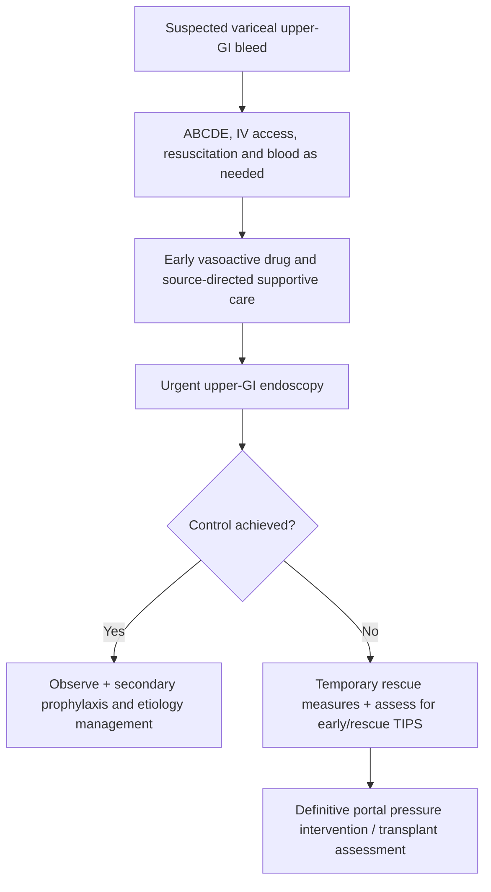
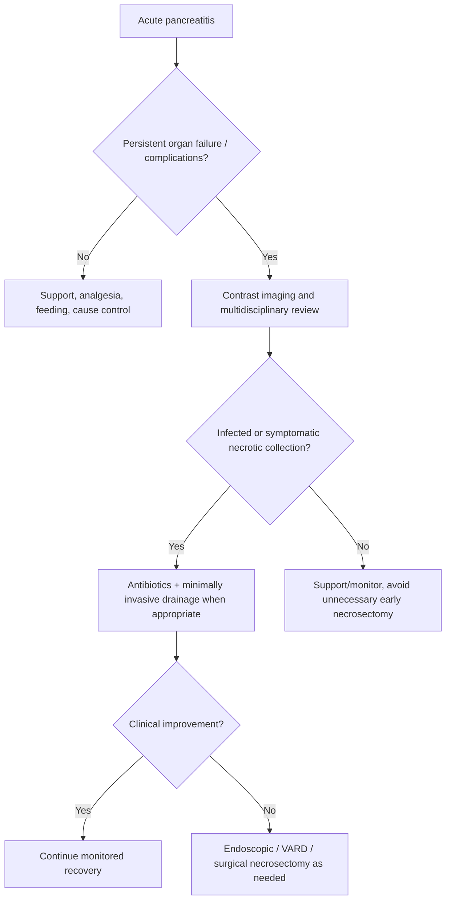

# Chapter 20: Hepatic, Biliary & Pancreatic Diseases

## 20.1 Acute Liver Failure (ALF)

Acute Liver Failure (ALF) is a catastrophic syndrome defined as the sudden onset of severe liver injury characterized by **coagulopathy ($\text{INR} \ge 1.5$)** and **hepatic encephalopathy** in a patient **without pre-existing cirrhosis** or underlying chronic liver disease, developing within **26 weeks** of initial symptoms.

### A. Classification & Subcategories
ALF is subclassified based on the time interval between the onset of jaundice and the appearance of encephalopathy:
1. **Hyperacute Liver Failure** ($<7\text{ days}$): Characterized by severe coagulopathy, dramatic transaminase surges, mild jaundice, high incidence of cerebral edema, but relatively favorable spontaneous survival. Typical cause: Paracetamol (Acetaminophen) toxicity, Hepatitis A/E.
2. **Acute Liver Failure** ($8–28\text{ days}$): Moderate jaundice and cerebral edema risk. Typical cause: Acute Hepatitis B.
3. **Subacute Liver Failure** ($4–26\text{ weeks}$): Severe jaundice, mild transaminase elevation, low incidence of cerebral edema, but **poor spontaneous survival** without liver transplantation. Typical cause: Idiosyncratic Drug-Induced Liver Injury (DILI), Autoimmune Hepatitis.

---

### B. Etiology & Pathophysiology
* **Paracetamol (Acetaminophen) Overdose**: Most common cause in Western countries. Metabolism shifts from glucuronidation/sulfation to cytochrome P450 (CYP2E1), generating **NAPQI** ($N$-acetyl-$p$-benzoquinone imine). NAPQI depletes hepatic glutathione stores, inducing massive centrilobular (Zone 3) necrosis. Treated with **$N$-Acetylcysteine (NAC)** to restore glutathione.
* **Viral Hepatitis**: Hepatitis B (often reactivation or co-infection with HDV), Hepatitis E (particularly high mortality in pregnant females: up to $20–25\%$), Hepatitis A.
* **Idiosyncratic Drug Reactions**: Halothane, Isoniazid, Rifampicin, Phenytoin, Valproate.
* **Other Causes**: Wilson disease (Coombs-negative hemolytic anemia + low ALP:Bilirubin ratio $<2.0$), Autoimmune hepatitis, Budd-Chiari syndrome, Pregnancy-related (AFLP, HELLP syndrome), Amanita phalloides mushroom poisoning.

---

### C. Major Complications & ICU Management Protocols

**CRITICAL COMPLICATIONS IN ALF**
- CEREBRAL EDEMA & ICP SEPSIS & INFECTION COAGULOPATHY & BLEEDING HEPATORENAL SYNDROME
- Target Na 145-150 mEq/L - Functional immune - Defective clotting - Severe splanchnic
- Hypertonic Saline 3% paralysis factors II, V, VII, X vasodilation
- Mannitol boluses - Empiric antibiotics - Transfuse ONLY if - Terlipressin
- Head elevation 30 deg - Avoid fever active bleed / procedure Albumin

1. **Cerebral Edema & Intracranial Hypertension**:
  * **Pathophysiology**: Hyperammonemia leads to astrocyte accumulation of **glutamine** (via glutamine synthetase), inducing astrocyte swelling, cerebral hyperperfusion, cytotoxic edema, and brainstem herniation (leading cause of death in ALF).
  * **Management**: Prophylactic **Hypertonic Saline ($3\%\text{ NaCl}$)** to maintain serum sodium between **$145–150\text{ mEq/L}$**; elevate head of bed to $30^\circ$; IV **Mannitol ($0.5–1.0\text{ g/kg}$)** for acute surges in ICP; therapeutic hypothermia ($34–35^\circ\text{C}$) or continuous venovenous hemofiltration (CVVH) in refractory cases.
2. **Coagulopathy**:
  * Defective hepatic synthesis of factors II, V, VII, IX, and X.
  * **Management Rule**: Do **not** routinely correct abnormal INR with fresh frozen plasma (FFP) in the absence of active bleeding or invasive procedures, as INR is the single most vital prognostic indicator.
3. **Infection & Sepsis**: Sepsis accounts for major mortality due to immune paralysis. Prophylactic broad-spectrum antibiotics and antifungals are initiated upon early clinical deterioration.

---

### D. King's College Criteria for Liver Transplantation
The validated clinical criteria used to select patients with ALF for emergency liver transplantation:

**KING'S COLLEGE CRITERIA FOR LIVER TRANSPLANT IN ALF**
- PARACETAMOL-INDUCED ALF NON-PARACETAMOL ALF
- Arterial pH < 7.30 (post-fluid) Prothrombin Time > 100 sec (INR > 6.5)
- OR OR
- ALL THREE of the following: ANY THREE of the following:
- INR > 6.5 (PT > 100 sec) - Age < 10 or > 40 years
- Serum Creatinine > 3.4 mg/dL - Etiology: DILI, Non-A/Non-B hepatitis
- Grade III/IV Encephalopathy - Jaundice-to-encephalopathy time > 7 days
- Serum Bilirubin > 17.5 mg/dL (300 umol/L)
- Prothrombin Time > 50 sec (INR > 3.5)

---

## 20.2 Chronic Liver Disease & Cirrhosis

Cirrhosis is the end-stage histological outcome of chronic liver disease, defined by **diffuse hepatic fibrosis** and **nodular regenerative hepatocyte transformation**, leading to portal hypertension and progressive liver failure.

### A. Clinical Prognostic Scoring Systems

**Laboratory pattern**
| Laboratory test | Interpretation |
|---|---|
| **ALT/AST** | Hepatocyte injury; do **not** directly measure remaining liver synthetic function |
| **ALP, GGT** | Cholestatic/biliary obstruction pattern; GGT supports hepatic source of ALP |
| **Direct bilirubin** | Can increase in cholestasis/obstruction; a purely “direct = surgical, indirect = medical” rule is oversimplified |
| **Albumin** | Chronic synthetic function but also affected by inflammation, nutrition and other losses |
| **PT/INR** | Reflect synthesis of vitamin-K-dependent coagulation factors and anticoagulant use; central in CTP/MELD |
| **Creatinine/Na** | Severity of decompensation, renal and circulatory compromise; used in MELD-based prioritization |

- **Class A:** 5–6; **B:** 7–9; **C:** 10–15.
- Used as a measure of **cirrhotic hepatic functional reserve** and to contextualize surgical and HCC treatment decisions.
- Doctut has several transcription errors for the score (such as maximum “25” and “Child C 20–25”); WOR explicitly supplies the internally consistent **5–15** range.

**MELD and PELD**
- **PELD:** pediatric version adds **albumin, total bilirubin, INR, age and growth failure**.
- **King’s College criteria:** source tables distinguish acetaminophen-induced vs nonacetaminophen acute liver failure and use **pH, PT/INR, creatinine, encephalopathy, age, bilirubin and jaundice-to-encephalopathy interval** to assess urgency of transplantation.
- Do **not** treat a single MELD or CTP cutoff in the review sources as an absolute operative permission/prohibition.

#### 1. Child-Turcotte-Pugh (CTP) Score

| Clinical / Laboratory Variable | 1 Point | 2 Points | 3 Points |
| :--- | :--- | :--- | :--- |
| **Total Bilirubin (mg/dL)** | $< 2.0$ | $2.0–3.0$ | $> 3.0$ |
| **Serum Albumin (g/dL)** | $> 3.5$ | $2.8–3.5$ | $< 2.8$ |
| **INR** | $< 1.7$ | $1.7–2.3$ | $> 2.3$ |
| **Ascites** | None | Mild / Controlled | Moderate / Refractory |
| **Hepatic Encephalopathy** | None | Grade I–II | Grade III–IV |

* **Child-Pugh Class A** (5–6 points): Well-compensated; 1-year survival $100\%$.
* **Child-Pugh Class B** (7–9 points): Significant functional compromise; 1-year survival $80\%$.
* **Child-Pugh Class C** (10–15 points): Decompensated; 1-year survival $45\%$.

#### 2. MELD Score (Model for End-Stage Liver Disease)
Objective mathematical formula based on **Serum Bilirubin**, **Serum Creatinine**, **INR**, and **Serum Sodium** (MELD-Na). Used universally for organ allocation in liver transplantation.

---

### B. Comprehensive Management of Decompensation Complications

**Definition and measurements**
- **Hepatic venous pressure gradient (HVPG) = wedged hepatic venous pressure − free hepatic venous pressure.**
- **WOR GI teaching levels:** **1–5 mmHg normal; 6–9 subclinical increase; ≥10 clinically significant portal hypertension; ≥12 increased variceal bleeding risk**. HVPG particularly reflects **sinusoidal** portal hypertension; presinusoidal disease can yield misleadingly low HVPG.
- Cirrhosis → distortion by fibrosis/regenerative nodules + endothelial changes; systemic vasodilation and neurohormonal sodium/water retention then promote ascites.

**Classification by site of resistance**
| Level | Examples | Main physiologic pattern |
|---|---|---|
| **Prehepatic** | Extrahepatic portal vein obstruction/thrombosis; **isolated splenic vein thrombosis** | Obstruction before hepatic sinusoids |
| **Intrahepatic, presinusoidal** | **Schistosomiasis**, noncirrhotic portal fibrosis, some biliary/granulomatous disease | High portal pressure with relatively preserved hepatocellular function in some patients |
| **Intrahepatic, sinusoidal** | **Cirrhosis (most common)**, infiltration/fibrosis | Impaired sinusoidal flow; hepatic dysfunction often accompanies |
| **Intrahepatic, postsinusoidal** | Sinusoidal obstruction syndrome/veno-occlusive disease | Outflow restriction in small hepatic venules |
| **Posthepatic** | **Budd–Chiari**, IVC obstruction, right heart failure, constrictive pericarditis | Hepatic venous drainage impeded |

**Portosystemic collateral sites**
| Portal-side vessel | Systemic-side connection | Clinical sign |
|---|---|---|
| Left gastric/short gastric veins | Esophageal/submucosal veins → azygos system | **Esophageal/gastric varices** |
| Paraumbilical veins | Superficial abdominal wall veins | **Caput medusae** |
| Superior rectal veins | Middle/inferior rectal veins | Rectal varices (not identical to ordinary hemorrhoids) |
| Retroperitoneal veins | Systemic posterior abdominal veins | Retroperitoneal collaterals |
| Bare area of liver | Diaphragmatic/systemic channels | Less visible collaterals |

**Major consequences**
- **Ascites** due to portal/splanchnic pressures, lymph overflow, sodium retention and hypoalbuminemia.
- **Congestive splenomegaly → hypersplenism**, thrombocytopenia/pancytopenia.
- **Hepatic encephalopathy** from reduced detoxification and shunting of gut-derived substances.
- **Hepatopulmonary syndrome (HPS)** and **portopulmonary hypertension (PoPH)**; renal dysfunction, infections and decompensated cirrhosis.

**Ascites: SAAG**
- **≥1.1 g/dL** supports portal-hypertensive physiology; **<1.1** suggests many nonportal causes (peritoneal malignancy, TB, pancreatitis etc.).
- Interpret together with **total ascitic protein** and clinical context; Doctut explicitly compares portal-hypertensive versus nonportal ascites.

**Specific methods**
- **Vasoactive treatment:** sources discuss **terlipressin** and **octreotide** to reduce portal/splanchnic inflow while preparing for endoscopic source control.
- **Endoscopic variceal ligation (banding):** most common definitive endoscopic therapy for esophageal varices in WOR; sclerotherapy is an alternative in some settings.
- **Gastric varices:** cyanoacrylate/glue methods discussed in Doctut.
- **Balloon tamponade:** **Sengstaken–Blakemore** (3 lumens, gastric and esophageal balloons), **Minnesota** (4 lumens, 2 balloons), **Linton** (one balloon, 3 lumens); **temporary bridge only** with major aspiration/ulceration/perforation risk.
- **TIPS:** transjugular intrahepatic portosystemic shunt creates a tract between **portal and hepatic venous systems**, often using a covered stent. Used for refractory/recurrent variceal bleed or selected refractory ascites, frequently as a bridge to transplant.
- **TIPS risks:** hepatic encephalopathy (blood bypasses liver), stent dysfunction/thrombosis/stenosis, hepatic decompensation, procedural bleeding.
- **TIPS cautions in Doctut:** right-heart failure, severe cardiopulmonary disease and selected liver tumors/ductal anatomy, among others; formal contraindications require individualized evaluation.
- **Nonselective beta-blocker** prophylaxis (e.g., propranolol) is a **prevention strategy** for appropriate patients, **not an acute hemorrhage resuscitation drug**.

**Named surgical portal decompression procedures**
| Procedure | Connection/operation | Characteristic distinction |
|---|---|---|
| **Eck portocaval shunt** | End-to-end portal vein → IVC | **Nonselective**; diverts portal inflow |
| **Side-to-side portocaval** | Portal vein ↔ IVC | Nonselective decompression |
| **Proximal splenorenal / Linton** | Splenectomy with proximal splenic vein → left renal vein | Decompresses portal bed; historical option |
| **Distal splenorenal / Warren** | Distal splenic vein → left renal vein, spleen preserved | **Selective** decompression of gastroesophageal variceal bed |
| **Inokuchi shunt** | Left gastric vein–systemic outflow anastomosis | Selective approach in older surgical teaching |
| **Sugiura procedure** | Esophagogastric devascularization ± transection and splenectomy | **Devascularization** rather than direct portosystemic shunting |
| **Rex shunt (meso-Rex bypass)** | Reconnects SMV flow to left intrahepatic portal vein | **Physiologic restoration** in selected pediatric EHPVO |

**Why less common now:** modern endoscopy, radiologic shunts and transplantation have changed indications for classical open shunts; learn the **anatomical distinctions** for NEET-PG/INI-CET.

- Portal vein and liver may be otherwise preserved; blood diverts through **short gastric veins** → **isolated gastric varices** and splenomegaly.
- **Splenectomy** or other specialist vascular management may be considered depending on bleeding and pancreatic cause.

**EHPVO vs NCPF**
| Feature | EHPVO | NCPF |
|---|---|---|
| Lesion | Main portal vein/major extrahepatic branches, often thrombosis/cavernoma | Intrahepatic presinusoidal portal resistance |
| Typical source patient | Children/adolescents, historical umbilical sepsis | Young adults in affected regions |
| Liver function | Often preserved relative to cirrhosis | Often preserved |
| Signs | Massive splenomegaly, variceal bleed ± growth impairment | Splenomegaly, variceal bleed |
| Possible intervention | Endoscopic control, **Rex shunt** in selected children, shunts | Endoscopy/shunt choice by anatomy |

**Budd–Chiari syndrome**
- Associated with myeloproliferative disease (e.g., **polycythemia vera**) and prothrombotic states; Doctut emphasizes Indian venous-web presentations.
- **Pain, hepatomegaly, ascites**; chronic abdominal-wall collateral veins may ascend from below (source **Harvey sign**).
- **Caudate lobe hypertrophy** from direct IVC drainage is a classic anatomical clue.
- Doppler/CT/MR venography and specialist hepatic venography define obstruction; interventions depend on thrombus, webs, liver reserve and transplant requirement.

- Hepatomegaly, weight gain/fluid retention, jaundice and ascites may occur; Doctut highlights **defibrotide** in selected cases.

**HPS vs PoPH**
| Feature | Hepatopulmonary syndrome | Portopulmonary hypertension |
|---|---|---|
| Central mechanism | **Intrapulmonary vascular dilatation**, impaired oxygenation | **Pulmonary arterial vascular resistance/pressure increase** |
| Typical clue | Hypoxemia, **platypnea/orthodeoxia** | Dyspnea, raised pulmonary arterial pressure, right-heart burden |
| Source investigation | Contrast echocardiography and oxygenation | Echo and hemodynamic evaluation |
| Transplant issue | Can improve after transplant in selected patients | Severe uncontrolled pulmonary hypertension increases transplant risk |

#### 1. Ascites
* **Pathophysiology**: Sinusoidal portal hypertension drives splanchnic vasodilation $\rightarrow$ arterial underfilling $\rightarrow$ activation of RAAS and SNS $\rightarrow$ renal sodium and water retention.
* **Diagnosis**: Paracentesis evaluating Serum-Ascites Albumin Gradient (**SAAG**):
  $$\text{SAAG} = \text{Serum Albumin} - \text{Asitic Fluid Albumin}$$
  * **SAAG $\ge 1.1\text{ g/dL}$**: Indicates **Portal Hypertension** (Cirrhosis, Heart failure, Budd-Chiari).
  * **SAAG $< 1.1\text{ g/dL}$**: Indicates **Non-Portal Hypertension** (Peritoneal carcinomatosis, Tuberculous peritonitis, Nephrotic syndrome).
* **Treatment**:
  * Dietary sodium restriction ($<2.0\text{ g/day}$).
  * Dual Diuretic Protocol: **Spironolactone** (aldosterone antagonist) + **Furosemide** (loop diuretic) maintained in a strict **100 mg : 40 mg ratio** (up to max $400\text{ mg}:160\text{ mg}$) to maintain normokalemia.
  * **Large-Volume Paracentesis (LVP $>5\text{ L}$)**: Must be accompanied by IV infusion of **Albumin ($6–8\text{ g per Liter}$ of fluid removed)** to prevent Paracentesis-Induced Circulatory Dysfunction (PICD) and acute renal failure.

#### 2. Spontaneous Bacterial Peritonitis (SBP)
* **Pathophysiology**: Translocation of enteric Gram-negative bacteria across permeable intestinal mucosa into ascitic fluid in immune-compromised cirrhotics.
* **Diagnostic Criteria**: Ascitic fluid **Polymorphonuclear (PMN) leukocyte count $\ge 250/\mu\text{L}$** ($\ge 0.25 \times 10^9/\text{L}$). Cultured most commonly: *E. coli*, *Klebsiella pneumoniae*, *Pneumococci*.
* **Treatment**:
  * Empiric IV 3rd generation cephalosporin (**Ceftriaxone 2 g/day** or Cefotaxime) for 5–7 days.
  * **IV Albumin**: Administered at $1.5\text{ g/kg}$ on Day 1 and $1.0\text{ g/kg}$ on Day 3 reduces mortality and renal failure by $66\%$.
  * **Secondary Prophylaxis**: Daily oral **Norfloxacin 400 mg** or Bactrim long-term.

#### 3. Hepatorenal Syndrome (HRS-AKI)
* **Pathophysiology**: Severe functional renal vasoconstriction secondary to extreme splanchnic arterial vasodilation and reduced Effective Arterial Blood Volume (EABV).
* **Diagnostic Criteria**:
  1. Diagnosis of Cirrhosis with ascites.
  2. Diagnosis of Acute Kidney Injury (AKI) according to KDIGO criteria.
  3. **No response after at least 2 consecutive days of diuretic withdrawal and IV Albumin resuscitation ($1\text{ g/kg/day}$)**.
  4. Absence of hypovolemic shock, ongoing nephrotoxic drug exposure, or parenchymal kidney disease (proteinuria $<500\text{ mg/day}$, microhematuria $<50$ RBCs/HPF).
* **Treatment**: Combination of **Splanchnic Vasoconstrictors** (**Terlipressin** $0.5–2.0\text{ mg}$ IV Q6H or continuous infusion; or Noradrenaline) PLUS **IV Albumin ($20–40\text{ g/day}$)**. Definitive treatment is **Liver Transplantation**.

#### 4. Hepatic Encephalopathy (HE)
* **Pathophysiology**: Impaired hepatic clearance and portosystemic shunting of gut-derived nitrogenous toxins, primarily **Ammonia ($\text{NH}_3$)**, which crosses the blood-brain barrier and is converted to **Glutamine** by astrocytes, causing astrocyte swelling and neuroinhibition.
* **Staging**: West Haven Criteria (Grades I to IV: from mild euphoria/anxiety and asterixis to frank coma).
* **Treatment**:
  * **First-line**: **Lactulose** (synthetic non-absorbable disaccharide). Colonic bacteria ferment lactulose to lactic and acetic acid $\rightarrow$ lowers luminal $\text{pH} \rightarrow$ converts non-ionic ammonia ($\text{NH}_3$) to non-absorbable ammonium ($\text{NH}_4^+$) trapping it in stool ("cathartic ammonium trapping"). Titrated to $2–3$ soft bowel movements daily.
  * **Second-line / Add-on**: **Rifaximin** (550 mg PO BID). Non-absorbable oral antibiotic that eliminates urease-producing enteric flora, significantly reducing ammonia production and preventing encephalopathy recurrences.

---

## 20.3 Pancreatitis Clinical Protocols

**Chronic pancreatitis — mechanism, assessment and surgery**

**Pathogenesis**
- Mechanistic sequence (Robbins): repeated injury → inflammatory mediators, **TGF-β and PDGF** → pancreatic stellate/myofibroblast activation → collagen deposition and ductal distortion.
- Later there is loss of **exocrine enzymes** and **endocrine islets**; calcifications and protein plugs occur, particularly with alcohol-associated disease.

**TIGAR-O etiologic framework**
| Category | Name | Examples |
|---|---|---|
| **T** | Toxic-metabolic | Alcohol, diet/metabolic factors |
| **I** | Idiopathic | Including tropical calcific presentations |
| **G** | Genetic | **PRSS1**, SPINK1, CFTR-related |
| **A** | Autoimmune | **IgG4-related** autoimmune pancreatitis |
| **R** | Recurrent acute | Recurrent attacks, gallstone-related injury |
| **O** | Obstructive | Duct stones, strictures, pancreas divisum |

**Clinical pattern and investigation**
- **Steatorrhea, malabsorption and fat-soluble vitamin deficiency** after marked exocrine loss.
- **Pancreatogenic/type 3c diabetes** due to endocrine insufficiency.
- **CT:** gland atrophy, **calcifications, duct dilation** and associated complications.
- **MRCP (often with secretin in selected cases):** duct obstruction/dilatation/strictures; **“chain of lakes”** appearance.
- **EUS** can assess early parenchymal/ductal changes (Doctut mentions Rosemont criteria); ERCP is now primarily therapeutic rather than routine diagnostic.
- **Fecal elastase** supports exocrine deficiency evaluation; Doctut quotes <200 µg/g stool as abnormal. Direct/other function tests are available in source headings.

- **Duct decompression** improves pain in selected obstructed/dilated ducts; intraductal stones/strictures may be managed endoscopically or surgically.
- **Celiac plexus block** may be a temporary option for selected refractory pain but does not correct anatomy.

**Named chronic pancreatitis operations**
| Operation | Surgical principle | Use or clinical indication |
|---|---|---|
| **Modified Puestow / Partington–Rochelle** | Longitudinal pancreatic duct opening with **side-to-side pancreaticojejunostomy** | Drain **dilated** main duct; source thresholds often **>6–7 mm** |
| **Frey procedure** | **Core out inflammatory pancreatic head** + longitudinal duct drainage to jejunum | Hybrid **resection + drainage** for enlarged head with ductal changes |
| **Beger** | **Duodenum-preserving pancreatic head resection** | Inflammatory pancreatic head with desire to preserve duodenum |
| **Berne modification** | Limited duodenum-preserving head excavation | Variant of Beger |
| **Izbicki / V-shaped excision** | V-shaped ventral pancreatic excision and drainage | Small or nondilated ducts in selected cases |
| **Child–Duval** | Historical distal duct resection/terminojejunal drainage | Named procedure in source comparisons; not default modern surgery |
| **Distal pancreatectomy ± splenectomy** | Resect diseased body/tail | Localized tail pathology or complication |
| **Whipple / pancreaticoduodenectomy** | Resect head/duodenum | Suspicion/confirmation of cancer or selected complex head disease |

> [!tip] Distinguish operations
> **Puestow = drainage**, **Frey = head coring + drainage**, **Beger = duodenum-preserving head resection**, **Whipple = pancreatic head + duodenum resection**.

### A. Acute Pancreatitis Diagnostic & Severity Protocols

**Etiologies**
| Etiology | Representative causes |
|---|---|
| Biliary | **Gallstones (most frequent overall)**, CBD/ampullary obstruction |
| Toxic | **Alcohol**, selected drugs (azathioprine, thiazides, antiretrovirals, chemotherapy), scorpion envenomation |
| Metabolic | **Hypertriglyceridemia** (First Aid highlights >1000 mg/dL), **hypercalcemia/hyperparathyroidism** |
| Mechanical | Trauma (important in children), ERCP, pancreas divisum, periampullary obstruction |
| Infectious | **Mumps** and some other infections |
| Genetic | **PRSS1**, **SPINK1**, CFTR-related susceptibility |
| Other | Autoimmune pancreatitis, ischemia/shock, idiopathic |

**First Aid mnemonic:** *I GET SMASHED*—Idiopathic, Gallstones, Ethanol, Trauma, Steroids, Mumps, Autoimmune, Scorpion sting, Hypercalcemia/hypertriglyceridemia, ERCP, Drugs. It is a memory aid, not a ranked epidemiologic list.

- **Lipase or amylase ≥3 × upper limit of normal**;
- Compatible **cross-sectional imaging** if required.

**Important nuance:** an unequivocal case meeting pain + enzymes need not undergo early CT solely for confirmation. Imaging is valuable for uncertain diagnosis or complication assessment; source notes emphasize **delayed CT** for necrosis/severity assessment.

- Severe hemorrhagic inflammation: **Cullen sign** (periumbilical ecchymosis) and **Grey Turner sign** (flank ecchymosis)—late, uncommon, not sensitive.
- **Serum lipase** more specific/longer-lasting than amylase in First Aid; amylase alone is not a reliable severity index.
- **Hypocalcemia**: calcium soaps in fat necrosis; metabolic acidosis/raised BUN/hemoconcentration can indicate worse illness.

**Classical radiographic findings**
| Radiographic sign | Interpretation |
|---|---|
| **Sentinel loop** | Focal adynamic dilated proximal jejunal loop in upper abdomen |
| **Colon cut-off sign** | Colonic gas stops at splenic flexure from localized ileus/inflammation |
| **Gasless abdomen/ileus** | Diffuse bowel hypomotility in severe disease |
| **CECT** | Edema, collections, necrosis, vascular and other complications |

**Ranson criteria (source classical admission set)**
| Variable | Admission criterion |
|---|---|
| Age | **>55 years** |
| WBC | **>16,000/µL** |
| Glucose | **>200 mg/dL** |
| AST | **>250 IU/L** |
| LDH | **>350 IU/L** |

**At 48 h in WOR:** hematocrit fall >10%, BUN rise >5 mg/dL, serum calcium <8 mg/dL, PaO₂ <60 mmHg, base deficit >4 mEq/L and fluid sequestration >6 L (classic non-gallstone version). Higher score suggests worse course. Gallstone-specific variants exist; avoid rigidly mixing scores.

**Other indices**
- **Glasgow-Imrie:** multi-factor severity scoring; **≥3** suggests severity in classic exam teaching.
- **Balthazar / CT severity index:** inflammation and necrosis grading; WOR lists **≥6** as important, but **organ failure duration** is central to revised Atlanta clinical severity.

**Revised Atlanta clinical classification**
| Severity | Definition |
|---|---|
| **Mild** | No organ failure, no major local/systemic complication |
| **Moderately severe** | Transient organ failure **<48 h**, local complications or exacerbation of coexisting disease |
| **Severe** | Persistent organ failure **>48 h** (one or multiple organs) |

- **Acute interstitial edematous pancreatitis** generally preserves parenchyma; **necrotizing pancreatitis** has parenchymal and/or peripancreatic necrosis.
- **Infected necrosis** is a major source of sepsis. Early mortality may come from organ failure; later from infected collections and complications.

#### 1. Diagnostic Criteria (Revised Atlanta Classification)
Requires at least **two** of the following three criteria:
1. Acute-onset, severe, persistent epigastric pain frequently radiating straight through to the back.
2. Serum **Lipase** or **Amylase** elevation **$> 3 \times$ the Upper Limit of Normal (ULN)** (Lipase is more specific and remains elevated longer [8–14 days] than amylase).
3. Characteristic cross-sectional imaging findings (CECT, MRI, or Transabdominal USG) consistent with acute pancreatitis.

#### 2. Risk Stratification & Scoring Systems
* **BISAP Score** (Bedside Index for Severity in Acute Pancreatitis): Calculated within 24 hours of admission (1 point each for: **B**UN $>25\text{ mg/dL}$, **I**mpaired mental status [GCS $<15$], **S**IRS, **A**ge $>60$ years, **P**leural effusion). Score $\ge 3$ indicates high mortality risk.
* **CT Severity Index (CTSI / Balthazar Score)**: Combines pancreatic inflammation/fluid collection grades with percentage of pancreatic parenchymal necrosis.

---

### B. Evidence-Based Management Protocols

**ACUTE PANCREATITIS MANAGEMENT PROTOCOL**
- GOAL-DIRECTED RESUSCITATION NUTRITIONAL STRATEGY
- Ringer's Lactate (5-10 mL/kg/h) - Early oral feeding in mild (24-48h)
- Target urine output >0.5 mL/kg/h - Enteral nutrition (nasojejunal)
- Avoid fluid overload / abdominal if oral intake not tolerated
- compartment syndrome - Avoid parenteral nutrition (TPN)
- MANAGEMENT OF NECROSIS
- STERILE NECROSIS INFECTED NECROSIS
- Conservative management - Step-Up Approach:
- NO prophylactic antibiotics 1. Broad-spectrum antibiotics (Carbapenems)
2. Percutaneous / Endoscopic drainage
3. Minimally invasive necrosectomy

1. **Fluid Resuscitation**:
   * Goal-directed hydration using **Ringer's Lactate** ($5–10\text{ mL/kg/hour}$) in the first 24 hours. Ringer's lactate reduces systemic inflammation compared to normal saline (which causes hyperchloremic metabolic acidosis).
2. **Analgesia**: Multimodal pain control using IV opioids (Hydromorphone, Fentanyl) or NSAIDs. (Historical teaching that morphine is contraindicated due to Sphincter of Oddi spasm has been disproven).
3. **Nutritional Support**:
   * Mild Pancreatitis: Early oral refeeding with a low-fat solid or liquid diet as soon as abdominal pain improves and ileus resolves (within $24–48\text{ hours}$).
   * Severe Pancreatitis: **Enteral nutrition** via nasogastric or nasojejunal tube is mandatory if oral feeding is tolerated poorly. Enteral nutrition preserves gut mucosal barrier integrity, preventing bacterial translocation. Total Parenteral Nutrition (TPN) is strictly avoided unless enteral access fails.
4. **Role of Antibiotics & Management of Necrosis**:
   * **Prophylactic antibiotics are strictly NOT recommended** in sterile acute pancreatitis or sterile necrosis.
   * **Infected Pancreatic Necrosis**: Suspected upon clinical deterioration post-week 2 (fever, leukocytosis, gas bubbles on CT). Diagnosed by CT-guided fine-needle aspiration (FNA) or gas configuration. Treated with broad-spectrum penetrating antibiotics (**Carbapenems** - Meropenem) and a delayed **Step-Up Approach** (Catheter drainage $\rightarrow$ Endoscopic or retroperitoneal minimally invasive necrosectomy, delayed ideally to $>4\text{ weeks}$ to allow necrosis encapsulation).

| Collection | Usually before or after 4 weeks | Contents | Wall | Typical context |
|---|---|---|---|---|
| **Acute peripancreatic fluid collection (APFC)** | **<4 weeks** | Homogeneous fluid | No mature wall | **Interstitial** edematous pancreatitis |
| **Pancreatic pseudocyst** | **>4 weeks** | Mostly **fluid**, little/no solid necrosis | Well-demarcated fibrous/granulation wall | After interstitial pancreatitis/duct leak |
| **Acute necrotic collection (ANC)** | **<4 weeks** | **Fluid + necrotic debris**, heterogeneous | Immature wall | Necrotizing pancreatitis |
| **Walled-off necrosis (WON)** | **>4 weeks** | Encapsulated heterogeneous **necrotic** material | Mature inflammatory wall | Necrotizing pancreatitis |

**Pseudocyst = false cyst** because lining is **granulation/fibrous tissue, not epithelium** (Robbins). Its common location is **lesser sac** (WOR). Collections may resolve spontaneously or become infected, bleed, rupture, obstruct stomach/bile duct or cause pancreatic fistula.

**d’Egidio pseudocyst classification (WOR)**
- **Type II:** acute-on-chronic pancreatitis, duct communication variable.
- **Type III:** chronic pancreatitis-associated ductal change and established cyst–duct communication.

- **Internal drainage:** endoscopic or operative **cystogastrostomy** / **cystojejunostomy** for appropriately mature symptomatic collections.
- **External drainage:** catheter for infected/inaccessible collections or selected emergencies, with caution when communicating with pancreatic duct because of **external pancreatic fistula** risk.
- **WON** may require necrosectomy, often after maturation when safe.

2. Provide **analgesia**, careful IV fluid resuscitation and electrolyte monitoring; assess urine output, BUN/creatinine, calcium and respiratory status.
3. **Early enteral/oral nutrition when tolerated** rather than indefinite blanket NPO; use tube feeding if oral feeding not feasible and intestine usable.
4. Check biliary tree, triglycerides, calcium and medication triggers.
5. Antibiotics for **established/suspected infected necrosis or extrapancreatic infection**, not prophylactically for all sterile pancreatitis.

- When gallstone source is confirmed and patient recovers, **cholecystectomy** prevents recurrent attacks; timing varies with mild vs severe disease and local collections.
- A routine ERCP for every case of gallstone pancreatitis is **not** established by the sources.

**Infected necrosis: step-up approach**

- **Step-up** in Doctut: **percutaneous catheter drainage → VARD (video-assisted retroperitoneal debridement) or other minimally invasive necrosectomy → open surgery if needed**.
- **Timing matters:** whenever clinically safe, waiting for organization of necrosis facilitates safer debridement.
- Recognize complications: infected collections, **splenic vein thrombosis**, pseudoaneurysm/hemorrhage, pancreatic ascites, duct disruption and fistula, organ failure.

---

## Index Coverage Checklist
- [x] 20.1 Acute Liver Failure (Classification, etiologies, acetaminophen/NAPQI, cerebral edema management, King's College criteria)
- [x] 20.2 Chronic Liver Disease & Cirrhosis (Child-Pugh, MELD, Ascites/SAAG, LVP albumin, SBP, HRS-AKI, Hepatic Encephalopathy)
- [x] 20.3 Pancreatitis Clinical Protocols (Atlanta criteria, BISAP score, Ringer's lactate resuscitation, early oral/enteral feeding, infected necrosis step-up approach)

## Index Corrections Made
* Disproven the historical myth that Morphine is strictly contraindicated in acute pancreatitis due to Sphincter of Oddi constriction; morphine is safe and effective.
* Replaced routine prophylactic antibiotic administration in sterile necrotizing pancreatitis with evidence-based restrictive use only for documented infected necrosis.

## Unaddressed Topics
* None; all subsections specified for Chapter 20 were fully addressed using standard medical literature.
