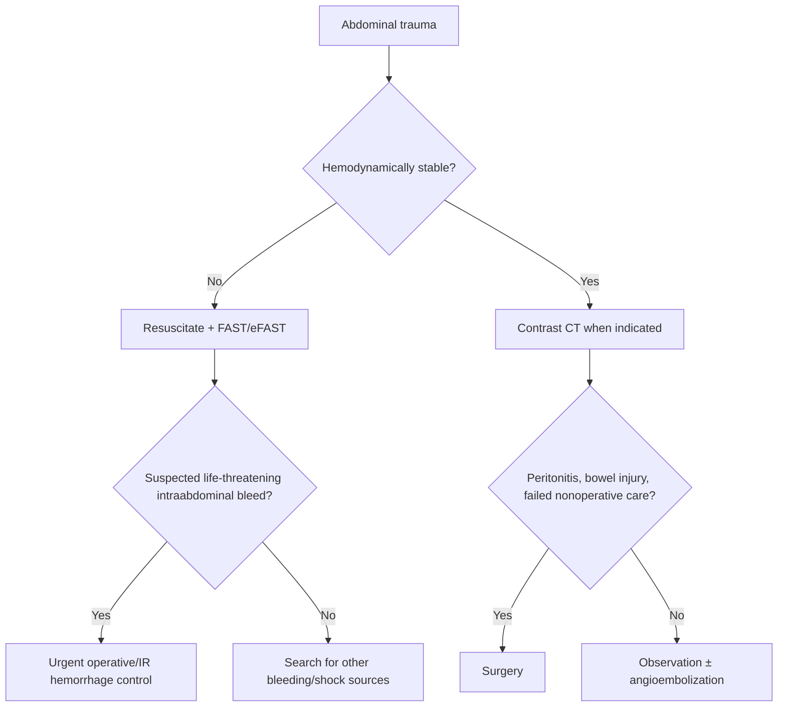

# Chapter 21: The Acute Abdomen & Emergency GI Surgery

## 21.1 Perforated Viscus & Acute Peritonitis

An acute perforated viscus represents a catastrophic surgical emergency resulting in the spillage of acidic, bilious, or fecal luminal contents into the peritoneal cavity, triggering acute septic or chemical **peritonitis**.

### A. Etiology & Clinical Presentation
* **Etiologies**: Perforated peptic ulcer (duodenal anterior wall #1), perforated acute diverticulitis, perforated acute appendicitis, typhoid ileal perforation, stercoral ulcer perforation, traumatic hollow viscus rupture.
* **Clinical Presentation**: Sudden, explosive onset of severe, generalized abdominal pain. Patients lie motionless because any abdominal movement exacerbates peritoneal irritation.
* **Physical Exam Landmarks**:
  * **"Board-like" abdominal rigidity**: Involuntary reflex spasm of abdominal wall musculature.
  * Generalized tenderness and **Rebound tenderness** (Blumberg sign).
  * Absence of bowel sounds (paralytic ileus).
  * Loss of liver dullness on percussion (**Jobert sign**) due to free air collecting anterior to the liver.

---

### B. Diagnostic & Surgical Management
* **Radiographic Landmark**: **Erect Chest X-ray** demonstrating **pneumoperitoneum** (free gas under the diaphragm) in $>75–80\%$ of visceral perforations. On supine abdominal films, free air manifests as **Rigler sign** (visualization of both inner and outer margins of the bowel wall).
* **Non-Contrast / Contrast CT Abdomen**: Gold standard when chest X-ray is negative but clinical suspicion remains high; localizes the exact site of perforation and identifies fluid collections.

**MANAGEMENT OF VISCERAL PERFORATION**
- HEMODYNAMIC RESUSCITATION EMERGENCY SURGERY
- Isotonic crystalloid fluid boluses - Exploratory Laparotomy / Laparoscopy
- Broad-spectrum IV antibiotics - Peritoneal lavage with warm saline
- Nasogastric tube decompression - Primary repair + Graham Omental Patch
- Urinary catheter monitoring (for perforated peptic ulcer)

* **Surgical Protocol**:
  1. Immediate aggressive fluid resuscitation and broad-spectrum IV antibiotics covering Gram-negative bacilli and anaerobes (e.g., Ceftriaxone + Metronidazole or Piperacillin-Tazobactam).
  2. Emergency Laparotomy or Laparoscopy.
  3. Thorough peritoneal debridement and copious warm saline lavage ($>6–10\text{ Liters}$).
  4. **Perforated Peptic Ulcer Repair**: Primary suture closure reinforced with a vascularized pedicled omental flap (**Cellan-Jones or Graham Omental Patch**).
  5. **Perforated Colonic / Diverticular Repair**: Primary resection with anastomosis or **Hartmann Procedure** (resection of diseased sigmoid colon, creation of a proximal end colostomy, and closure of the distal rectal stump).

---

<!-- SURGERY_GI_ZIP_CONTENT_START:21-21-1 -->

### Additional surgical details integrated from the Surgery notes

> [!info] Provenance and scope
> Content below was transferred from the supplied Surgery ZIP, placed under this pre-existing GIT topic, and reformatted only at heading level. Existing canonical text remains intact. Source caveats should be interpreted as presented in those notes.

#### 12.12 Esophageal Perforation

> **Source:** Surgery ZIP — 12_Esophageal_Surgery.md

##### Causes
- Instrumentation/endoscopy.
- Forceful vomiting.
- Foreign bodies.
- Corrosive injury.
- Penetrating trauma.

##### Boerhaave syndrome
**Definition:** spontaneous transmural esophageal rupture, classically following forceful vomiting.

- Usually distal esophagus.
- Often left posterolateral wall.
- Gastric/esophageal contents enter the mediastinum.
- Can cause mediastinitis, sepsis and pleural contamination.

**Mackler triad**
1. Vomiting or retching.
2. Chest pain.
3. Subcutaneous emphysema.

**Hamman sign:** mediastinal crunch synchronous with the heartbeat.

##### Boerhaave versus Mallory–Weiss
| Feature | Boerhaave | Mallory–Weiss |
|---|---|---|
| Injury | Transmural rupture | Mucosal tear |
| Predominant presentation | Severe chest pain, mediastinitis | Hematemesis |
| Mediastinal contamination | May occur | No |
| Management | Urgent specialist evaluation, source control | Usually endoscopic/conservative |

##### Investigations
- Chest X-ray: pneumomediastinum, pleural effusion.
- CT with suitable contrast assessment in stable patients.
- Water-soluble contrast swallow in selected circumstances.
- Endoscopy when appropriate after specialist assessment.

##### Treatment principles
- NPO, IV fluids and broad-spectrum antibiotics when perforation/mediastinal contamination is present.
- Drain contaminated spaces.
- Close or seal the perforation when appropriate.
- Provide enteral or parenteral nutritional support.
- Selected contained leaks may be treated nonoperatively.
- Larger or uncontrolled leaks may require operative repair, drainage or endoscopic stenting.

---

#### 13.4 Complications of Peptic Ulcer Disease / B. Perforation

> **Source:** Surgery ZIP — 13_Stomach_Duodenum_Bariatric_Surgery.md

**Classic:** anterior duodenal ulcer.

Clinical features:
- Sudden severe epigastric pain.
- Generalized tenderness and guarding.
- Board-like rigidity.
- Tachycardia, fever or shock.
- Absent bowel sounds with paralytic ileus.

Imaging:
- Free intraperitoneal air beneath diaphragm.
- Rigler sign on supine radiograph.
- CT is useful in suspected perforation.

###### Valentino syndrome
Perforated duodenal contents track toward the right iliac fossa and mimic acute appendicitis.

#### 13.4 Complications of Peptic Ulcer Disease / Perforated-ulcer surgical treatment

> **Source:** Surgery ZIP — 13_Stomach_Duodenum_Bariatric_Surgery.md

- Resuscitation and broad-spectrum antimicrobial therapy.
- Laparoscopy or laparotomy for source control when indicated.
- Primary closure with omental reinforcement in suitable ulcers.

**Graham/modified Graham omental patch**
- Omentum reinforces the site of ulcer perforation.
- Widely taught for uncomplicated perforated duodenal ulcer.

Large perforations, severe contamination, malignant gastric ulcers and unstable physiology may require alternative procedures.

#### 14.1 Acute Abdomen and Peritonitis

> **Source:** Surgery ZIP — 14_Small_Intestine_Appendix.md

##### Definition
Acute abdomen describes severe abdominal symptoms requiring prompt assessment for a potentially urgent intra-abdominal process.

##### Important surgical causes
- Perforated hollow viscus.
- Acute appendicitis.
- Intestinal obstruction.
- Strangulated hernia.
- Acute mesenteric ischemia.
- Bowel volvulus.
- Intra-abdominal abscess.

##### Clinical assessment
- History: onset, progression, site, migration and character of pain.
- Associated vomiting, distension, bowel habits and bleeding.
- Vital signs and hemodynamic status.
- Abdominal inspection, palpation, percussion and auscultation.
- Signs of peritoneal irritation or shock.

##### Peritonitis
**Localized:** inflammation confined near the pathological organ.

**Generalized:** widespread peritoneal contamination/inflammation.

Typical findings:
- Involuntary guarding and rigidity.
- Rebound tenderness.
- Pain aggravated by movement.
- Ileus and reduced bowel sounds.
- Fever, tachycardia or shock.

##### Pneumoperitoneum
Suggests hollow viscus perforation in an appropriate clinical context.

| Radiological finding | Meaning |
|---|---|
| Gas under diaphragm | Free intraperitoneal air |
| Rigler sign | Both sides of bowel wall visible due to intraluminal and extraluminal gas |
| Cupola sign | Free gas collecting under the central tendon of diaphragm |
| Football sign | Large-volume pneumoperitoneum |
| Falciform ligament sign | Free gas outlining the falciform ligament |

##### Management
- Resuscitation.
- NPO.
- Fluid/electrolyte correction.
- Antibiotics for suspected perforation or intra-abdominal infection.
- Decompression where indicated.
- Early surgical source control when required.

---

#### 3. Sepsis and septic shock

> **Source:** Surgery ZIP — 05_Shock_Sepsis_Transfusion.md

##### Pathophysiology: connect Robbins to bedside1. Microbial PAMPs/toxins and injured-tissue mediators activate innate immunity (e.g., pattern-recognition receptors).
2. Excessive cytokines (**TNF, IL-1, IL-6**) and endothelial activation → **vasodilation, capillary leak, microvascular maldistribution and coagulation activation**.
3. Endothelial dysfunction and leukocyte/platelet activation may promote microthrombi and **DIC**.
4. Tissue extraction/utilization of oxygen and mitochondrial function become impaired; lactate may rise.
5. Myocardial depression, AKI, ARDS, encephalopathy and MODS may develop.

##### Definition caveat: older SIRS vs contemporary terminology- WOR and Doctut include the older exam definition: **SIRS ≥2 criteria + infection = sepsis**; septic shock described as infection with fluid-refractory hypotension.
- SIRS criteria: temperature >38°C or <36°C; HR >90/min; RR >20/min or PaCO₂ <32 mmHg; WBC >12,000 or <4,000/µL or >10% immature forms.
- **Modern conceptual usage:** sepsis means **life-threatening organ dysfunction due to a dysregulated host response to infection**; it is not synonymous with any infection plus SIRS. This reflects the distinction needed to interpret the older source chart; specific current protocol details are not independently verified here.
- **qSOFA screen:** respiratory rate ≥22/min, SBP ≤100 mmHg, altered mentation; ≥2 raises concern for poor outcome, **but cannot alone rule out sepsis**.

##### Recognize the emergency- Suspected infection with hypotension, tachypnea, altered mental status, mottling/poor perfusion, oliguria or rising lactate.
- Consider common surgical sources: intra-abdominal perforation/abscess, anastomotic leak, biliary sepsis, necrotizing infection, infected line or urinary obstruction.

##### Sepsis management sequence1. **Early recognition and ABC assessment.**
2. Measure lactate and evaluate perfusion; obtain microbiological samples **without significantly delaying antibiotics**.
3. **Prompt IV broad-spectrum antibiotics** guided by likely source and local antibiogram; tailor when evidence arrives.
4. **IV crystalloid resuscitation** for shock/hypoperfusion with repeated assessment for fluid overload/response.
5. **Norepinephrine** is the typical first-line vasopressor for persistent vasodilatory hypotension; **MAP ~65 mmHg** is the common initial target in the sources, individualized to patient.
6. **Source control**: drain pus, remove infected device, decompress obstructed infected system, operate for perforation/necrotic tissue when indicated.
7. Monitor organ support (oxygen/ventilation, renal function, glucose, thromboprophylaxis/nutrition when safe).

##### Sepsis Six (revision mnemonic)- **Give:** oxygen when needed, IV fluids when indicated, IV antibiotics.
- **Take/measure:** blood cultures, serum lactate, accurate urine output.
- Historical early goal-directed therapy charts emphasize CVP/ScvO₂ as universal targets; **do not treat these invasive pressure/saturation numbers as mandatory endpoints in every patient**.

##### DIC in shock and sepsis- Systemic activation of coagulation → **microvascular fibrin deposition** + **consumption of platelets/factors** → simultaneous thrombosis/organ injury and bleeding.
- Lab pattern often includes falling platelets, prolonged PT/aPTT, high fibrin-degradation markers (D-dimer), and falling fibrinogen (may vary early).
- Manage precipitating cause; blood component replacement guided by clinical bleeding/procedural needs rather than laboratory abnormality alone.

<!-- SURGERY_GI_ZIP_CONTENT_END:21-21-1 -->
## 21.2 Acute Appendicitis

Acute appendicitis is the single most common cause of an acute surgical abdomen worldwide.

### A. Pathophysiology
Luminal obstruction (by a **fecalith / appendicolith** in adults, or lymphoid hyperplasia post-viral infection in children) $\rightarrow$ Continued mucosal fluid secretion behind the obstruction $\rightarrow \uparrow$ Intraluminal pressure $\rightarrow$ Venous and lymphatic congestion $\rightarrow$ Ischemic mucosal injury $\rightarrow$ Bacterial invasion of appendiceal wall $\rightarrow$ Gangrene and **transmural perforation** leading to localized peritonitis or generalized sepsis.

---

### B. Clinical Features & Exam Signs
* **Pain Migration**: Classic visceral periumbilical pain (referred along $T_{10}$ dermatome) migrating over $4–12\text{ hours}$ to the Right Lower Quadrant (RLQ) as local parietal peritoneal inflammation develops.
* **Associated Symptoms**: Anorexia ("hamburger sign"), nausea, vomiting, low-grade fever.
* **Pathognomonic Physical Exam Signs**:
  * **McBurney Point Tenderness**: Maximal tenderness at one-third the distance from the Right Anterior Superior Iliac Spine (ASIS) to the umbilicus.
  * **Rovsing Sign**: RLQ pain elicited upon deep palpation of the Left Lower Quadrant (indicates peritoneal irritation).
  * **Psoas Sign**: RLQ pain elicited by passive extension of the right hip (indicates a retrocecal appendix irritating the psoas muscle).
  * **Obturator Sign**: RLQ pain elicited by passive internal rotation of the flexed right hip (indicates a pelvic appendix irritating the internal obturator muscle).

---

### C. Risk Scoring & Diagnostic Workup

#### 1. Alvarado Score (MANTRELS)

| Parameter | Clinical Feature | Score |
| :--- | :--- | :--- |
| **M** | Migration of pain to RLQ | 1 |
| **A** | Anorexia | 1 |
| **N** | Nausea / Vomiting | 1 |
| **T** | **Tenderness in RLQ** | **2** |
| **R** | Rebound tenderness | 1 |
| **E** | Elevated temperature ($\ge 37.3^\circ\text{C}$) | 1 |
| **L** | **Leukocytosis ($>10,000/\mu\text{L}$)** | **2** |
| **S** | Shift of PMN leucocytes to the left ($>75\%$) | 1 |
| **Total** | | **10** |

* **Score $\le 4$**: Appendicitis unlikely; consider alternative diagnosis.
* **Score $5–6$**: Possible appendicitis; CT scan or USG evaluation recommended.
* **Score $\ge 7$**: High probability; surgical consultation for appendectomy.

#### 2. Diagnostic Imaging
* **Ultrasound Abdomen**: First-line choice in children and pregnant females. Positive findings: Non-compressible, blind-ending tubular structure in RLQ with outer diameter **$>6\text{ mm}$**, wall hyperemia (target sign), and appendicolith.
* **Contrast CT Abdomen**: Investigation of choice in non-pregnant adults ($>95\%$ sensitivity/specificity). Shows dilated appendix ($>6\text{ mm}$), periappendiceal fat stranding, appendicolith, and wall enhancement.

---

### D. Surgical Management
* **Laparoscopic Appendectomy**: Gold standard treatment. Associated with less post-operative pain, lower wound infection rates, shorter hospital stay, and faster recovery compared to open appendectomy.
* **Complicated Appendicitis (Phlegmon / Abscess)**: Non-operative management with IV antibiotics and ultrasound/CT-guided percutaneous drain placement is preferred initially, followed by interval appendectomy if symptoms recur.

---

<!-- SURGERY_GI_ZIP_CONTENT_START:21-21-2 -->

### Additional surgical details integrated from the Surgery notes

> [!info] Provenance and scope
> Content below was transferred from the supplied Surgery ZIP, placed under this pre-existing GIT topic, and reformatted only at heading level. Existing canonical text remains intact. Source caveats should be interpreted as presented in those notes.

#### 14.15 Acute Appendicitis

> **Source:** Surgery ZIP — 14_Small_Intestine_Appendix.md

##### Anatomy
- Appendix arises from posteromedial cecum.
- The **three taeniae coli converge at the appendicular base**.
- Appendicular artery arises from the ileocolic arterial system.

##### Positions
- Retrocecal: most frequent.
- Pelvic: next common.
- Preileal.
- Postileal.
- Paracecal.
- Subcecal.

##### Pathophysiology
Luminal obstruction → progressive secretion and distension → venous and lymphatic impairment → bacterial overgrowth → ischemia → gangrene/perforation.

Causes:
- Fecalith/appendicolith.
- Lymphoid hyperplasia.
- Parasites.
- Neoplasm in selected patients.

##### Classical presentation
- Initial visceral periumbilical pain.
- Pain migrates to right iliac fossa after parietal peritoneal involvement.
- Anorexia.
- Nausea/vomiting.
- Fever.

##### Important physical signs
| Sign | Finding |
|---|---|
| McBurney tenderness | Tenderness at lateral third/medial two-thirds junction of ASIS-to-umbilicus line |
| Rovsing sign | RIF pain during LIF palpation |
| Psoas sign | Pain with psoas stretch/contraction |
| Obturator sign | Pain with internal rotation of flexed hip |
| Blumberg sign | Rebound tenderness |
| Sherren triangle | Cutaneous hyperesthesia in RIF region in classic descriptions |

##### Modified Alvarado score
| Finding | Points |
|---|---:|
| Migratory pain | 1 |
| Anorexia | 1 |
| Nausea/vomiting | 1 |
| RIF tenderness | 2 |
| Rebound tenderness | 1 |
| Fever | 1 |
| Leukocytosis | 2 |
| Left shift | 1 |
| **Total** | **10** |

**Interpretation:** higher scores increase suspicion, but scores do not replace clinical assessment or appropriately chosen imaging.

> [!warning] Naming discrepancy carried forward from the earlier chat
> The table above totals 10 and includes a left shift, which corresponds to the original Alvarado score, although the preceding chat labelled it “modified Alvarado.” This discrepancy is disclosed rather than silently changing the earlier draft; the commonly used modified score omits left shift and totals 9.

##### Investigations
- CBC and inflammatory markers.
- Pregnancy test when relevant.
- Urinalysis for differential diagnosis.
- Ultrasound: especially useful in children and pregnancy.
- CT: particularly valuable in adults with uncertain diagnosis.
- MRI: selected pregnancy cases.

##### Ultrasound findings
- Blind-ending tubular structure.
- Noncompressible.
- Enlarged outer diameter, commonly above 6 mm.
- Surrounding inflammatory fat.
- Appendicolith may be visible.

##### Management
- Analgesia, fluids and appropriate antibiotics.
- Appendectomy is a standard definitive treatment.
- Selected uncomplicated patients may be considered for antibiotics-first pathways under suitable conditions.
- Complicated disease requires assessment for drainage and/or surgery.

---

#### 14.16 Appendectomy

> **Source:** Surgery ZIP — 14_Small_Intestine_Appendix.md

##### Incisions
| Incision | Characteristics |
|---|---|
| McBurney/gridiron | Oblique muscle-splitting incision |
| Lanz | Transverse skin-crease incision |
| Rutherford Morrison | Muscle-cutting extension |
| Midline laparotomy | For generalized peritonitis or broader exploration |

##### Laparoscopic appendectomy
- Usually performed through three ports.
- Identification and control of mesoappendix.
- Secure division of appendicular base.
- Removal in a suitable specimen bag.

##### Complications
- Surgical site infection.
- Intra-abdominal abscess.
- Hemorrhage.
- Stump appendicitis.
- Enterocutaneous fistula.
- Ileus or adhesive obstruction.

---

#### 14.17 Appendicular Lump and Abscess

> **Source:** Surgery ZIP — 14_Small_Intestine_Appendix.md

##### Appendicular phlegmon/lump
Localized inflammatory mass involving:
- Inflamed appendix.
- Omentum.
- Adjacent bowel.

##### Ochsner–Sherren regimen
- Observation.
- NPO initially when appropriate.
- IV fluids.
- Antibiotics.
- Analgesia.
- Serial examination.
- Monitoring vital signs and lump size.

##### Deterioration
Increasing pain, fever, tachycardia or expanding mass warrants reassessment for abscess or failure of conservative treatment.

##### Appendicular abscess
- Imaging identifies collection.
- Drainage when appropriate.
- Antibiotics.
- Selected patients require operative management.

**Interval appendectomy:** classically taught after several weeks; the source material differs on whether it should be routine or selective. This is flagged in the appendix.

---

#### 14.18 Appendicitis in Special Populations

> **Source:** Surgery ZIP — 14_Small_Intestine_Appendix.md

##### Pregnancy
- Important nonobstetric surgical emergency.
- Clinical signs may be atypical.
- Ultrasound/MRI commonly used.
- Appropriate surgical treatment may be required in any trimester.

##### Children
- Perforation risk can be higher because of delayed recognition.
- Ultrasound frequently preferred first.

##### Older patients
- Atypical presentation is possible.
- Neoplasm and other differential diagnoses warrant greater consideration.

##### Immunocompromised patients
- Symptoms and inflammatory response may be muted.
- Lower threshold for reassessment when deterioration is possible.

---

<!-- SURGERY_GI_ZIP_CONTENT_END:21-21-2 -->
## 21.3 Acute Mechanical Intestinal Obstruction

Intestinal obstruction occurs when the normal flow of luminal contents is mechanically impaired.

### A. Small Bowel Obstruction (SBO) vs. Large Bowel Obstruction (LBO)

| Feature | Small Bowel Obstruction (SBO) | Large Bowel Obstruction (LBO) |
| :--- | :--- | :--- |
| **Primary Etiologies** | 1. **Post-operative Adhesions (60–70%)** 2. Incarcerated Hernias (15–20%) 3. Crohn Disease / Tumors / Intussusception | 1. **Colorectal Carcinoma (60%)** 2. Volvulus (Sigmoid / Cecal) (15–20%) 3. Diverticulitis strictures |
| **Pain Pattern** | Rapidly onset, frequent, sharp colicky pain | Insidious onset, deep dull colicky pain |
| **Vomiting** | Early, prominent, bilious (high SBO) or feculent (low SBO) | Late or absent |
| **Abdominal Distension** | Minimal (proximal SBO) to moderate | **Severe, marked peripheral distension** |
| **Radiographic Appearance** | Dilated central loops ($>3\text{ cm}$), **valvulae conniventes** crossing full lumen width, multiple air-fluid levels | Dilated peripheral loops ($>6\text{ cm}$; cecum $>9\text{ cm}$), **haustra** partially crossing lumen |

**Key radiographic distinction:** In small-bowel obstruction, valvulae conniventes (plicae circulares) traverse the full width of the bowel lumen and the dilated loops are usually central. In large-bowel obstruction, haustra usually do not cross the entire lumen and the dilated colon is typically peripheral.

---

### B. Management Protocol
1. **Conservative Initial Therapy ("Drip and Suck")**:
   * Indicated in partial or uncomplicated non-strangulated SBO secondary to adhesions.
   * **NPO (Nil Per Os)** + Aggressive IV fluid resuscitation (isotonic crystalloids).
   * **Nasogastric Tube (NGT) Decompression** to relieve proximal luminal distension and prevent aspiration.
2. **Indications for Emergency Surgery**:
   * **Signs of Strangulation / Bowel Ischemia**: Unrelenting continuous pain, fever, tachycardia, leukocytosis, metabolic acidosis, localized peritonitis, or gas in bowel wall (**pneumatosis intestinalis**) on CT.
   * Irreducible incarcerated hernia.
   * Complete closed-loop obstruction (e.g., volvulus or competence of ileocecal valve preventing decompression).
   * Failure of conservative trial after 48–72 hours.

---

<!-- SURGERY_GI_ZIP_CONTENT_START:21-21-3 -->

### Additional surgical details integrated from the Surgery notes

> [!info] Provenance and scope
> Content below was transferred from the supplied Surgery ZIP, placed under this pre-existing GIT topic, and reformatted only at heading level. Existing canonical text remains intact. Source caveats should be interpreted as presented in those notes.

#### 13.9 Gastric Volvulus

> **Source:** Surgery ZIP — 13_Stomach_Duodenum_Bariatric_Surgery.md

##### Definition
Rotation of stomach causing obstruction and potentially vascular compromise.

##### Types
| Type | Axis |
|---|---|
| Organoaxial | Along longitudinal line between cardia and pylorus |
| Mesenteroaxial | Around transverse axis |

Organoaxial volvulus is classically associated with a diaphragmatic/paraesophageal hernia.

##### Borchardt triad
1. Severe epigastric pain/distension.
2. Unproductive retching.
3. Failure to pass a nasogastric tube.

##### Management
- Resuscitation and decompression.
- Urgent assessment for ischemia.
- Detorsion/reduction.
- Repair the associated anatomical defect.
- Gastropexy in appropriate cases.

---

#### 14.2 Intestinal Obstruction

> **Source:** Surgery ZIP — 14_Small_Intestine_Appendix.md

##### Definition
Failure of normal passage of intestinal contents, due either to mechanical blockage or functional impairment.

##### Classification
**Mechanical**
- Simple obstruction.
- Closed-loop obstruction.
- Strangulated obstruction.

**Functional**
- Paralytic ileus.
- Intestinal pseudo-obstruction.

**By location**
- Small bowel.
- Large bowel.

**By extent**
- Partial.
- Complete.

##### Pathophysiology
Mechanical blockage → bowel dilatation proximal to obstruction → increased intraluminal pressure → impaired venous and lymphatic drainage → bowel wall edema.

If vascular compromise progresses → arterial insufficiency → ischemia → necrosis → perforation → sepsis.

##### Simple versus strangulated obstruction
| Feature | Simple obstruction | Strangulated obstruction |
|---|---|---|
| Blood supply | Preserved | Compromised |
| Pain | Intermittent/colicky | May become continuous and severe |
| Peritonitis | Usually absent initially | May occur |
| Bowel wall | Viable | Ischemic or gangrenous |
| Management | Selected conservative treatment | Urgent operative assessment/source control |

##### Cardinal symptoms
1. Colicky abdominal pain.
2. Vomiting.
3. Abdominal distension.
4. Obstipation.

##### Small versus large bowel obstruction
| Feature | SBO | LBO |
|---|---|---|
| Common causes | Adhesions, hernias, Crohn stricture | Colorectal cancer, volvulus, diverticular stricture |
| Vomiting | Earlier | Later |
| Distension | Variable | Often marked |
| Bowel loops | Usually central | Usually peripheral |
| Radiographic folds | Valvulae conniventes cross entire lumen | Haustra do not cross entire lumen |
| Typical dilated diameter | Small bowel >3 cm | Colon >6 cm; cecum >9 cm |

##### Imaging
**Plain abdominal X-ray**
- Multiple air-fluid levels.
- Step-ladder pattern.
- Central dilated small bowel.
- Peripheral dilated colon.

**Contrast-enhanced CT**
- Identifies transition point and cause.
- Assesses bowel wall enhancement.
- Detects closed-loop obstruction and ischemic changes.
- May reveal pneumatosis or free fluid.

##### Initial management
- NPO.
- IV fluids.
- Correct electrolytes.
- NG decompression when indicated.
- Analgesia and antiemetics.
- Assess for strangulation and perforation.
- Treat the cause.

##### Indications for urgent surgery
- Peritonitis.
- Suspected bowel ischemia.
- Strangulation.
- Perforation.
- Unresolved complete or closed-loop obstruction.
- Clinical deterioration during conservative management.

---

#### 14.3 Adhesive Small Bowel Obstruction

> **Source:** Surgery ZIP — 14_Small_Intestine_Appendix.md

##### Etiology
Most frequently due to previous intra-abdominal surgery.

Other causes of adhesions:
- Previous peritonitis.
- Inflammatory bowel disease.
- Pelvic inflammatory disease.
- Abdominal tuberculosis.
- Endometriosis.

##### Mechanism
Fibrous bands tether bowel loops or create fixed points around which bowel can kink.

##### Management
**Stable uncomplicated cases**
- Conservative decompression and fluids.
- Serial clinical assessment.
- Selected water-soluble contrast protocols.

**Surgical treatment**
- Adhesiolysis.
- Bowel resection if nonviable.

A 48–72-hour conservative period appears in the revision material, but this should not override evidence of ischemia, peritonitis or deterioration.

---

#### 14.4 Volvulus

> **Source:** Surgery ZIP — 14_Small_Intestine_Appendix.md

##### Definition
Rotation of bowel around its mesenteric axis, producing obstruction and potentially vascular compromise.

##### Sigmoid volvulus
Risk factors:
- Redundant sigmoid colon.
- Long/narrow mesenteric attachment.
- Chronic constipation.
- Older or institutionalized patients.
- Conditions associated with reduced colonic motility.

##### Imaging signs
- Coffee-bean sign.
- Bent inner-tube appearance.
- Bird-beak narrowing on contrast study.

##### Management
**Without ischemia/peritonitis**
- Endoscopic detorsion/decompression when appropriate.
- Definitive sigmoid resection is commonly considered because of recurrence risk.

**With gangrene/peritonitis**
- Emergency resection.
- Hartmann procedure or other reconstruction according to physiology and bowel condition.

##### Cecal volvulus
- Frequently displaced toward left upper abdomen.
- May involve rotation or bascule configuration.
- Usually managed surgically because endoscopic reduction is less reliable.

##### Sigmoid versus cecal volvulus
| Feature | Sigmoid | Cecal |
|---|---|---|
| Predisposition | Redundant sigmoid | Mobile cecum |
| Classic X-ray | Coffee bean pointing upward/right | Dilated displaced cecum, often toward left |
| Endoscopic decompression | Often attempted if viable | Generally not preferred as definitive initial treatment |
| Definitive treatment | Sigmoid resection | Resection or selected fixation procedure |

---

#### 14.11 Paralytic Ileus

> **Source:** Surgery ZIP — 14_Small_Intestine_Appendix.md

##### Definition
Functional failure of intestinal propulsion without a mechanical obstruction.

##### Causes
- Postoperative intestinal inhibition.
- Peritonitis.
- Hypokalemia.
- Opioids and other drugs.
- Severe systemic illness.
- Electrolyte disturbances.

##### Clinical findings
- Abdominal distension.
- Nausea and vomiting.
- Reduced bowel sounds.
- Diffuse bowel dilatation without an obvious mechanical transition point.

##### Management
- Correct underlying cause.
- Minimize offending medications.
- Correct electrolyte abnormalities.
- NG decompression when necessary.
- Mobilization and supportive care.

---

#### 14.12 Mesenteric Cyst

> **Source:** Surgery ZIP — 14_Small_Intestine_Appendix.md

##### Clinical features
- Mobile abdominal swelling.
- May cause pain, obstruction or volvulus.
- Often discovered incidentally.

##### Tillaux triad
1. Periumbilical swelling.
2. Swelling mobile perpendicular to mesenteric root.
3. Band of resonance on percussion.

##### Types in revision notes
| Chylolymphatic | Enterogenous |
|---|---|
| Derived from lymphatic channels | Derived from intestinal elements |
| Thin cyst wall | Thicker wall |
| Independent blood supply possible | May share bowel blood supply |
| Enucleation may be possible | May require bowel resection and anastomosis |

Imaging: ultrasound and CT.

---

#### 14.20 Final High-Yield Table

> **Source:** Surgery ZIP — 14_Small_Intestine_Appendix.md

| Clue | Diagnosis |
|---|---|
| Multiple central small-bowel loops | SBO |
| Haustra not crossing full lumen | Colonic obstruction |
| Coffee-bean sign | Sigmoid volvulus |
| Target sign in child with episodic pain | Intussusception |
| Pain out of proportion to examination | Mesenteric ischemia |
| Bird-beak narrowing of sigmoid | Sigmoid volvulus |
| Painless rectal bleeding in young child | Meckel diverticulum |
| Tc-99m pertechnetate scan | Ectopic gastric mucosa in Meckel |
| Double-bubble sign in neonate | Duodenal atresia |
| Delayed meconium passage with transition zone | Hirschsprung disease |
| Rapid weight loss and D3 compression | SMA syndrome |
| Mobile periumbilical cyst at right angle to mesentery | Tillaux sign |
| Periumbilical-to-RIF migratory pain | Appendicitis |
| Tenderness with hip extension | Psoas sign |
| Tenderness with internal rotation of flexed hip | Obturator sign |
| Appendicular inflammatory mass | Ochsner–Sherren regimen |
| High-output fistula | Greater than 500 mL/day |
| Foreign body, radiation, infection, epithelialization, neoplasm, distal obstruction | FRIEND |

**Source basis:** *World of Revision* GI Surgery Parts 2–3; Doctut appendicitis and small-bowel surgery; Robbins small and large intestinal pathology; First Aid GI congenital diseases; Canonical GIT Chapters 11, 21, 23, 24 and 26.

> [!note] Study-source caveat
> This chapter reproduces the educational synthesis from this chat. See [[28 GI Surgical Source Concordance and Exam Cautions|source concordance]] for older or simplified source rules that require careful interpretation.

<!-- SURGERY_GI_ZIP_CONTENT_END:21-21-3 -->
## 21.4 Acute Mesenteric Ischemia

Acute Mesenteric Ischemia (AMI) is a life-threatening vascular emergency caused by sudden inadequacy of mesenteric blood flow, leading to bowel ischemia, transmural gangrene, and septic shock. Mortality remains $>60–80\%$.

### A. Classification & Pathophysiology

**ACUTE MESENTERIC ISCHEMIA (AMI)**
- SMA EMBOLISM (50%) SMA THROMBOSIS (25%) NOMI (20%) MVT (5%)
- Cardiac source - Pre-existing atherosclerosis - Non-Occlusive - Mesenteric Vein
- Embolus lodged - Acute clot at SMA origin Mesenteric Thrombosis
- distal to MCA - Severe systemic disease Ischemia - Hypercoagulability
- Vasospasm in shock

1. **Superior Mesenteric Artery (SMA) Embolism (50%)**: Cardiac embolus (atrial fibrillation, post-MI mural thrombus, infective endocarditis) lodging in the SMA, usually distal to the origin of the middle colic artery, sparing the proximal jejunum.
2. **SMA Thrombosis (25%)**: Acute thrombosis overlying chronic atherosclerotic plaque at the SMA origin (patients often give prior history of "intestinal angina").
3. **Non-Occlusive Mesenteric Ischemia (NOMI) (20%)**: Splanchnic vasoconstriction secondary to low cardiac output, septic shock, or vasopressor therapy without physical arterial occlusion.
4. **Mesenteric Venous Thrombosis (MVT) (5%)**: Venous outflow obstruction linked to hypercoagulable states (Prothrombin/Factor V Leiden mutations, malignancies, portal hypertension).

---

### B. Clinical Features & Diagnosis
* **Landmark Symptom**: **Severe, excruciating abdominal pain OUT OF PROPORTION to physical examination findings** in the early stage (abdomen remains soft and non-tender despite agonizing pain).
* **Late Signs**: Peritoneal signs (rigidity, guarding), hematochezia ("currant-jelly" stool), septic shock (indicates transmural bowel necrosis).
* **Diagnostic Investigation of Choice**: **CT Angiography (CTA) of the Abdomen**. Diagnostic features: Lack of arterial enhancement, SMA occlusion, bowel wall thickening, arterial/venous thrombus, pneumatosis intestinalis, or portal venous gas.

---

### C. Emergency Management
1. Immediate fluid resuscitation, broad-spectrum IV antibiotics, and IV unfractionated heparin infusion (to prevent clot propagation).
2. **Surgical Emergency Revascularization**:
   * SMA Embolism: Laparotomy + Open **SMA Embolectomy**.
   * SMA Thrombosis: Retrograde Open Mesenteric Stenting (ROMS) or Antegrade Bypass.
3. **Assessment of Bowel Viability**: Inspect color, peristalsis, and Doppler arterial signals.
4. Resection of non-viable, gangrenous bowel.
5. Mandatory **"Second-Look" Laparotomy** scheduled 24 hours later to re-evaluate questionable bowel segments.

---

<!-- SURGERY_GI_ZIP_NEW_SECTION_START:newsection-21-21-5 -->
<!-- SURGERY_GI_ZIP_CONTENT_START:21-21-4 -->

### Additional surgical details integrated from the Surgery notes

> [!info] Provenance and scope
> Content below was transferred from the supplied Surgery ZIP, placed under this pre-existing GIT topic, and reformatted only at heading level. Existing canonical text remains intact. Source caveats should be interpreted as presented in those notes.

#### 14.6 Mesenteric Ischemia

> **Source:** Surgery ZIP — 14_Small_Intestine_Appendix.md

##### Pathophysiology
Inadequate mesenteric perfusion → mucosal ischemia → transmural necrosis if prolonged.

##### Classification
| Type | Mechanism | Characteristic setting |
|---|---|---|
| Acute arterial embolism | Embolus lodges in SMA | Atrial fibrillation or cardiac embolic source |
| Acute arterial thrombosis | Thrombosis of diseased artery | Atherosclerosis |
| Nonocclusive ischemia | Severe splanchnic vasoconstriction | Shock/low-flow state |
| Mesenteric venous thrombosis | Impaired venous drainage | Hypercoagulable conditions |

##### Acute clinical features
- Sudden severe abdominal pain.
- Pain disproportionate to early abdominal findings.
- Vomiting/diarrhea.
- Bloody stool may occur later.
- Peritonitis indicates advanced injury.

##### Chronic mesenteric ischemia
- Postprandial abdominal pain (**intestinal angina**).
- Food avoidance.
- Weight loss.
- Commonly associated with atherosclerotic vascular disease.

##### Investigations
- CT angiography is the principal diagnostic imaging test.
- Lactate elevation may support advanced ischemia but is not a sensitive early exclusion test.
- CT can assess vessel occlusion and bowel viability.

##### Management
- Rapid stabilization.
- Antibiotics where bowel injury is suspected.
- Revascularization when feasible.
- Embolectomy, endovascular therapy or bypass depending on lesion.
- Resection of nonviable bowel.
- Second-look surgery in selected uncertain bowel viability.

---

<!-- SURGERY_GI_ZIP_CONTENT_END:21-21-4 -->
## 21.5 Abdominal, Hepatic and Splenic Trauma

<!-- SURGERY_GI_ZIP_NEW_SECTION_END:newsection-21-21-5 -->
<!-- SURGERY_GI_ZIP_CONTENT_START:21-21-5 -->

### Additional surgical details integrated from the Surgery notes

> [!info] Provenance and scope
> Content below was transferred from the supplied Surgery ZIP, placed under this pre-existing GIT topic, and reformatted only at heading level. Existing canonical text remains intact. Source caveats should be interpreted as presented in those notes.

#### 12. Liver trauma and damage-control hepatic surgery

> **Source:** Surgery ZIP — 16_Liver_and_Portal_Hypertension.md

| Patient status | Approach from WOR Trauma |
|---|---|
| **Stable** | Contrast CT to characterize injury; monitor/consider selective angioembolization or nonoperative management |
| **Unstable or uncontrolled hemorrhage** | **Immediate hemorrhage control** (operative/interventional as feasible) with damage-control resuscitation |

- AAST injury grades escalate from limited hematoma/laceration to major parenchymal disruption, venous injury or devascularization.
- **Packing** applies tamponade; **Pringle** tests/controls hepatic inflow. Liver venous and IVC injuries are harder to control by inflow clamp.
- Complications include **delayed hemorrhage, bile leak/biloma, abscess and vascular injury**.
- **Damage-control surgery:** pack/control bleeding and contamination, temporarily close, restore physiology in ICU, then return for definitive repair.

#### 12. Pancreatic trauma and selected complications

> **Source:** Surgery ZIP — 18_Pancreatic_and_Splenic_Surgery.md

- Pancreatic injury may be **retroperitoneal and initially occult**. Assess mechanism, CT findings and especially **main pancreatic duct** involvement.
- **Minor injuries:** observation/drainage in selected cases; **disrupted main duct** can need operative or endoscopic management.
- **Distal pancreatic injury with duct transection:** distal pancreatectomy ± splenectomy discussed in Doctut.
- Head injury frequently coexists with major duodenal/vascular trauma and needs complex decision-making; damage-control drainage may precede reconstruction.
- **Splenic vein thrombosis from pancreatitis** → isolated gastric varices/left portal hypertension, connecting pancreas to the splenic chapter.

---

#### 14. Splenic trauma

> **Source:** Surgery ZIP — 18_Pancreatic_and_Splenic_Surgery.md

##### Mechanisms and assessment- Spleen is the most commonly injured solid abdominal organ in blunt trauma in WOR; left lower rib fractures, deceleration and LUQ impact raise suspicion.
- Examine hemodynamics, abdomen and associated chest injuries; eFAST detects fluid but **does not exclude splenic injury**.
- **Hemodynamically stable:** **CECT** grades injury and identifies vascular blush/pseudoaneurysm; select **nonoperative care** and/or **splenic artery embolization**.
- **Unstable with ongoing intra-abdominal hemorrhage:** immediate hemorrhage control, often operative; definitive splenectomy when preservation unsafe.

##### AAST splenic injury grade: classical source framework| Grade | Major finding from WOR | Broad approach |
|---|---|---|
| **I** | Subcapsular hematoma <10% surface or laceration <1 cm | Usually nonoperative if stable |
| **II** | Subcapsular 10–50%, small intraparenchymal hematoma, laceration 1–3 cm | Usually nonoperative if stable |
| **III** | Subcapsular >50%, larger intraparenchymal hematoma or laceration >3 cm | Observation/embolization if stable; higher failure risk |
| **IV** | Segmental/hilar vascular injury with major devascularization | Embolization/surgery depending on physiology |
| **V** | Shattered spleen or hilar vascular injury with major devascularization | Often splenectomy if unstable |

**Modern AAST detail and management may differ from the simplified source table**; above is a classic exam-recognition framework. **Hemodynamic stability is more important than grade alone**.

##### Spleen-preserving methods- Observation, serial vitals/hemoglobin, close clinical review and appropriate CT follow-up.
- **Angioembolization** for stable patients with vascular injury/high-risk imaging findings.
- Selected operative **splenorrhaphy, topical hemostasis, partial splenectomy** if anatomy allows.
- **Damage-control splenectomy** may be necessary with massive uncontrolled bleeding.

#### 6. Abdominal trauma

> **Source:** Surgery ZIP — 06_Trauma_Surgery.md

##### Blunt vs penetrating- Blunt: road-traffic collisions, falls, deceleration/crush; may cause solid-organ injury, mesenteric tear or bowel injury.
- Penetrating: stab/gunshot; evaluate trajectory and peritoneal violation; **do not remove impaled object outside controlled operative conditions**.
- **Seat-belt sign:** mesenteric and hollow-viscus injury concern. **Deceleration** may damage fixed junctions, e.g., duodenojejunal flexure.

##### Decision framework

##### Organ-specific patterns
| Organ | Clue | Management concept |
|---|---|---|
| **Spleen** | Common solid-organ injury in blunt trauma; LUQ pain, left lower ribs | Stable: observation/embolization in selected cases. Unstable hemorrhage: urgent hemostasis/splenectomy when required |
| **Liver** | RUQ trauma, severe bleeding/bile leak | Packing, vascular control, angioembolization, selective repair; unstable injury → surgery |
| **Mesentery** | Seatbelt/deceleration, bowel ischemia | Repair if viable blood supply; resection if devascularized bowel |
| **Bowel** | Peritonitis, free air, hollow-viscus fluid/trauma | Source control, primary repair/resection or diversion as dictated by physiology |
| **Pancreas/duodenum** | Retroperitoneal injury; can initially be occult | Assess duct involvement, CT/adjuncts; specialist management |
| **Kidney/ureter** | Flank trauma/hematuria | Stable: contrast CT to grade; selective intervention |
| **Pelvis** | Fractured pelvic ring with concealed hemorrhage | Binder at trochanters, blood products, packing/angioembolization as appropriate |

**Splenic grades (AAST concepts in WOR):** subcapsular hematoma/laceration ranges from minor superficial injury to hilar vascular injury/shattered spleen. **Hemodynamic stability overrides grade alone** when choosing observation versus intervention.

##### Pringle maneuver- Compresses **hepatoduodenal ligament (portal triad)** to limit hepatic artery and portal vein inflow.
- If bleeding significantly decreases, source is likely inflow-related; if persistent, consider **hepatic veins/retrohepatic IVC or noninflow sources**.
- Principle is temporary vascular control, not prolonged indiscriminate clamping.

##### Retroperitoneal hematoma zones
| Zone | Anatomy | Key consideration |
|---|---|---|
| **I (central)** | Aorta, IVC, major central vessels | Major vascular bleeding; often requires urgent exploration depending on mechanism |
| **II (flank)** | Kidneys and renal vessels | Selective evaluation; stable blunt hematomas often observed |
| **III (pelvis)** | Pelvic vessels/plexus | Binder/packing/embolization strategy; **avoid opening a contained hematoma casually** |

##### Post-splenectomy consequences- Loss of splenic filtering → risk of **overwhelming post-splenectomy infection (OPSI)**, especially encapsulated organisms: *S. pneumoniae, N. meningitidis, H. influenzae*.
- Peripheral smear may show **Howell–Jolly bodies** (nuclear remnants).
- Prevention: indicated vaccinations, infection education and urgent evaluation of fever; timing around elective/emergency splenectomy follows protocol.

#### 10. Damage-control resuscitation and surgery

> **Source:** Surgery ZIP — 06_Trauma_Surgery.md

##### Lethal triad / triad of death1. **Hypothermia** → impaired platelet/coagulation enzymatic function.
2. **Acidosis** → myocardial and coagulation dysfunction.
3. **Coagulopathy** → hemorrhage → further hypoperfusion/hypothermia.

A feedback loop develops: hemorrhage → hypoperfusion → acidosis; transfusion/dilution and exposure → hypothermia and coagulopathy → more bleeding.

##### DCR principles- Early hemorrhage control, **balanced blood products**, selected TXA, normothermia, ionized calcium and coagulation management.
- Restrict unnecessary crystalloid and avoid inappropriate elevation of BP before hemostasis when permissive hypotension applies.
- **Do not use permissive hypotension in a way that jeopardizes cerebral perfusion in TBI.**

##### Damage-control surgery (DCS)
| Stage | Where | Goal |
|---|---|---|
| **Selection / phase 0** | Emergency room | Identify physiological exhaustion and need for abbreviated surgery |
| **Phase I** | Operating theatre | **Control bleeding + limit contamination** (packing, temporary vascular/shunt control, bowel ends closed/diverted), temporary abdominal closure |
| **Phase II** | ICU | Restore temperature, coagulation, acid–base balance and organ perfusion |
| **Phase III** | OT | Planned re-exploration, definitive repair/anastomosis where safe, closure |

- WOR gives **hypothermia <34°C, pH <7.2, lactate >5 mmol/L, profound hypotension, very high transfusion need and ISS >36** as examples of red flags for DCS. **These are not obligatory checklist thresholds; clinical physiology and injury pattern govern selection.**
- Temporary abdominal closure may use negative-pressure/open-abdomen systems; **not** tight closure under dangerous edema (abdominal compartment syndrome risk).

##### Chapter 06 — exam recognition matrix- **Primary survey = immediate life threats; secondary survey = full examination after stabilization.**
- **Tension pneumothorax = hypotension + absent breath sounds + hyperresonance → decompress now.**
- **Hemothorax = dullness; tamponade = raised JVP + muffled sounds + shock.**
- **Stable abdominal trauma → CECT; unstable with bleed → resuscitation and source control.**
- **FAST looks for fluid; negative FAST cannot exclude bowel/retroperitoneal injury.**
- **Pringle = compress hepatic inflow.**
- **EDH lens; SDH crescent; DAI MRI.**
- **DCS = stop blood/contamination → ICU physiology → definitive anatomy.**

**Sources:** [WOR—Trauma and Burns pp. 158–174]; [Doctut—Trauma chapters]; [Bootcamp—Shock]; [Robbins—Shock].

<!-- SURGERY_GI_ZIP_CONTENT_END:21-21-5 -->
## Index Coverage Checklist
- [x] 21.1 Perforated Viscus & Acute Peritonitis (Etiologies, pneumoperitoneum, Rigler sign, Graham omental patch, Hartmann procedure)
- [x] 21.2 Acute Appendicitis (Pathophysiology, pain migration, exam signs, Alvarado score, USG/CT findings, appendectomy)
- [x] 21.3 Acute Mechanical Intestinal Obstruction (SBO vs. LBO comparison, valvulae conniventes vs haustra, conservative management, surgical indications)
- [x] 21.4 Acute Mesenteric Ischemia (Subtypes, pain out of proportion, CT angiography, SMA embolectomy, second-look laparotomy)

## Index Corrections Made
* Emphasized that CT Angiography (CTA) is the primary non-invasive diagnostic modality of choice for Acute Mesenteric Ischemia, replacing invasive digital subtraction angiography as the initial test.

## Unaddressed Topics
* None; all subsections specified for Chapter 21 were fully addressed using standard evidence-based medical literature.
