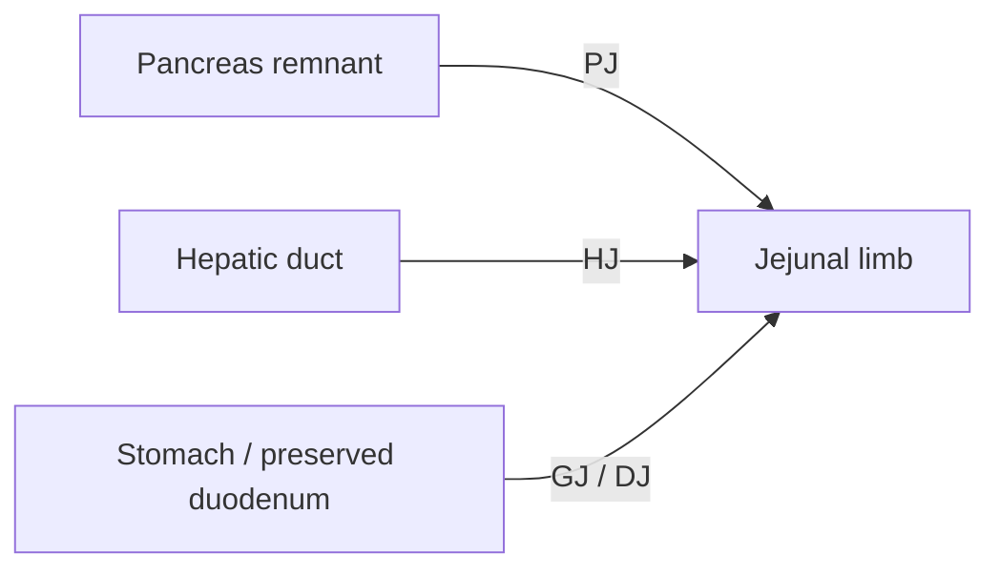

# Chapter 22: Elective GI & Hepatobiliary Surgery

## 22.1 Esophageal & Gastric Surgery

### A. Surgical Management of Achalasia Cardia
* **Laparoscopic Heller Myotomy (LHM)**:
  * *Procedure*: Longitudinal division of the anterior circular and longitudinal smooth muscle fibers of the distal esophagus ($2–3\text{ cm}$ proximal to GE junction) extending onto the gastric cardia ($2\text{ cm}$ distal to GE junction) to disrupt the hypertonic LES.
  * *Adjunctive Antireflux Procedure*: Because myotomy destroys the native antireflux barrier, LHM is routinely combined with a partial fundoplication (**Dor anterior $180^\circ$** or **Toupet posterior $270^\circ$** fundoplication). Total Nissen ($360^\circ$) fundoplication is strictly avoided as it induces severe post-operative dysphagia.
* **Peroral Endoscopic Myotomy (POEM)**: Endoscopic submucosal tunnel creation to perform myotomy of the inner circular muscle layer. Highly effective, particularly for Type III (spastic) achalasia.

**Definition**
Esophageal motility disorder characterized by:
1. Failure of LES relaxation.
2. Absent normal esophageal peristalsis.
3. Functional obstruction at the gastroesophageal junction.

**Pathophysiology**
Destruction of inhibitory ganglion cells in the **myenteric plexus**.

Reduced NO/VIP-mediated inhibition leads to persistent LES tone and failure of relaxation.

**Etiology**
- Primary idiopathic achalasia.
- Chagas disease.
- Pseudoachalasia due to malignant GE-junction infiltration.
- Triple-A/Allgrove syndrome:
  - Alacrimia.
  - Achalasia.
  - ACTH-resistant adrenal insufficiency.

**Clinical features**
- Dysphagia to solids and liquids.
- Regurgitation of retained, undigested food.
- Weight loss.
- Retrosternal pain.
- Nocturnal aspiration or cough.

**Investigations**
- **High-resolution manometry:** reference diagnostic test.
- Barium swallow: **bird-beak tapering** with proximal dilation.
- Endoscopy: excludes pseudoachalasia and other mechanical obstruction.

**Chicago classification**
| Type | Key manometric feature |
|---|---|
| I — Classic | Failed peristalsis without significant panesophageal pressurization |
| II | Failed peristalsis with panesophageal pressurization |
| III — Spastic | Failed normal peristalsis with spastic/premature contractions |

**Eckardt score**
Assesses:
- Dysphagia.
- Regurgitation.
- Chest pain.
- Weight loss.

Used to quantify symptom burden and treatment response.

**Treatment**
| Procedure | Mechanism | Important feature |
|---|---|---|
| Pneumatic dilation | Balloon-mediated disruption of LES muscle | Particularly effective in selected type I/II cases |
| Laparoscopic Heller myotomy | Division of LES muscle | Frequently combined with partial fundoplication |
| POEM | Endoscopic submucosal tunnel and myotomy | Particularly useful in type III/spastic disease |
| Botulinum toxin | Temporarily blocks cholinergic stimulation | Higher recurrence; useful when definitive procedures unsuitable |

**Heller myotomy:** extends across the distal esophagus and onto the gastric cardia.

**Why add Dor/Toupet fundoplication?** Myotomy relieves the obstruction but weakens the reflux barrier.

**Important:** GERD is a major complication following myotomy, particularly POEM without an antireflux wrap.

---

### B. Surgical Management of GERD
* **Laparoscopic Nissen Fundoplication**:
  * Indicated for refractory GERD, severe erosive esophagitis, or large hiatal hernias.
  * *Procedure*: Mobilization of the gastric fundus and creation of a complete **$360^\circ$ floppy wrap** around the distal $3–4\text{ cm}$ of the intra-abdominal esophagus over a large bougie ($50–60\text{ Fr}$).

**Pathophysiology**
GERD reflects failure of the antireflux barrier and/or impaired esophageal clearance.

Main mechanisms:
1. Transient LES relaxations.
2. Reduced resting LES pressure.
3. Shortened intra-abdominal esophagus.
4. Hiatal hernia with separation of LES and diaphragmatic crura.
5. Impaired clearance and delayed gastric emptying.

**Antireflux barrier**
- Intrinsic LES.
- Intra-abdominal esophageal segment.
- Right diaphragmatic crus.
- Angle of His.
- Gastric mucosal folds.

**Clinical features**
**Typical:** heartburn, sour regurgitation, water brash.

**Extraesophageal:** chronic cough, laryngitis, hoarseness, asthma-like symptoms and dental erosions.

**Investigations**
| Investigation | Role |
|---|---|
| Upper GI endoscopy | Detects esophagitis, stricture, Barrett changes |
| Ambulatory esophageal pH monitoring | Objective measurement of pathological acid exposure |
| Impedance-pH monitoring | Evaluates acid and non-acid reflux |
| Esophageal manometry | Assesses motility, especially before antireflux surgery |
| Barium swallow | Evaluates structural anatomy and selected hiatal hernias |

**Surgical indications**
- Objectively confirmed GERD with persistent symptoms despite appropriate therapy.
- Relevant complications.
- Significant reflux with a surgically relevant hiatal hernia.
- Selected patients preferring a definitive procedural approach after appropriate evaluation.

**Fundoplication**
**Principle:** wrap the gastric fundus around the distal esophagus to reinforce the antireflux barrier.

| Procedure | Wrap |
|---|---|
| Nissen | 360° complete |
| Dor | Anterior partial wrap, approximately 180° |
| Toupet | Posterior partial wrap, approximately 270° |
| Belsey Mark IV | Partial transthoracic fundoplication |

**Nissen fundoplication**
- Most commonly discussed complete fundoplication.
- A floppy wrap aims to prevent excessive postoperative obstruction.
- Potential complications:
  - Gas-bloat syndrome.
  - Dysphagia.
  - Inability to belch or vomit normally.
  - Wrap migration or disruption.
  - Recurrent reflux.

**Other procedures**
- **Collis gastroplasty:** lengthening procedure for selected shortened esophagus cases.
- **Magnetic sphincter augmentation (LINX):** selected patients with appropriate anatomy and confirmed reflux.

---

### C. Surgical Management of Gastric Cancer
Surgical resection with negative margins ($D_2$ lymphadenectomy) is the only curative modality for resectable gastric adenocarcinoma.

**GASTRIC CANCER RESECTION STRATEGY**
- DISTAL ANTRAL TUMORS PROXIMAL / DIFFUSE TUMORS
- Subtotal Gastrectomy - Total Gastrectomy
- 5 cm proximal margin - Resection from esophagus to duodenum
- Roux-en-Y Gastrojejunostomy - Roux-en-Y Esophagojejunostomy
- D2 LYMPHADENECTOMY
- (Resection of perigastric nodes [D1] PLUS
- celiac, left gastric, hepatic, splenic nodes [D2])

1. **Subtotal Gastrectomy**: Indicated for distal (antral/pyloric) tumors. Achieves a $5\text{ cm}$ proximal clear margin. Reconstruction via **Roux-en-Y Gastrojejunostomy** (preferred over Billroth I or II to prevent severe alkaline reflux gastritis).
2. **Total Gastrectomy**: Indicated for proximal (cardiac/body) tumors or Diffuse-type (Linitis Plastica) adenocarcinomas. Reconstruction via **Roux-en-Y Esophagojejunostomy** with a $40–50\text{ cm}$ Roux limb.
3. **$D_2$ Lymphadenectomy**: Standard surgical requirement. Resects perigastric lymph nodes (Nodal stations 1–6 = $D_1$) PLUS nodes along the left gastric, common hepatic, celiac, and splenic arteries (Nodal stations 7–11 = $D_2$). Resection of at least **16 lymph nodes** is required for accurate staging.

**Comparison**
| Procedure | Anastomosis |
|---|---|
| Billroth I | Gastroduodenostomy |
| Billroth II | Gastrojejunostomy |
| Roux-en-Y gastrojejunostomy | Gastric remnant joined to Roux limb with downstream jejunojejunostomy |
| Roux-en-Y esophagojejunostomy | Esophagus joined to Roux limb after total gastrectomy |

**Post-gastrectomy syndromes**
**A. Early dumping syndrome**
- Occurs soon after meals.
- Hyperosmolar chyme rapidly enters small bowel.
- Fluid shifts into bowel lumen.
- Symptoms: abdominal cramps, diarrhea, palpitations, sweating, dizziness.

**B. Late dumping syndrome**
- Postprandial exaggerated insulin response.
- Reactive hypoglycemia.
- Symptoms: sweating, tremor, weakness, palpitations and hunger.

| Feature | Early dumping | Late dumping |
|---|---|---|
| Main mechanism | Osmotic fluid shift | Reactive hypoglycemia |
| Dominant symptoms | GI and vasomotor | Hypoglycemic |
| Dietary approach | Small meals, reduced rapidly absorbed carbohydrate | Similar preventive dietary strategy |

Management:
- Small, frequent meals.
- Reduce concentrated/simple sugars.
- Adjust fluid timing around meals.
- Selected resistant cases: octreotide.

**C. Afferent loop syndrome**
- Obstruction of the afferent biliopancreatic limb after reconstruction.
- Causes abdominal pain, distension and bilious vomiting.
- Severe obstruction risks pancreatitis, cholangitis or perforation.
- Requires assessment for endoscopic or surgical correction.

**D. Efferent loop obstruction**
- Impedes gastric emptying.
- Vomiting may contain food and bile.
- Management depends on cause and severity.

**E. Internal hernia**
- **Petersen hernia:** through mesenteric space posterior to the Roux limb.
- Mesocolic defects may cause herniation in retrocolic reconstructions.
- Can produce closed-loop obstruction and ischemia.

**F. Nutritional consequences**
- Iron deficiency.
- Vitamin B12 deficiency.
- Calcium/vitamin D deficiency.
- Protein-energy malnutrition in selected patients.

**Risk factors**
- *H. pylori*-associated chronic gastritis.
- Intestinal metaplasia.
- Dietary salt/preserved foods.
- Tobacco exposure.
- Certain gastric polyps and premalignant conditions.
- Prior gastric surgery.
- Familial/genetic predisposition.

**Lauren classification**
| Feature | Intestinal type | Diffuse type |
|---|---|---|
| Histology | Gland-forming malignant epithelium | Discohesive cells, often signet-ring |
| Molecular association | Multistep intestinal-type pathway | E-cadherin/CDH1 alterations |
| Background | Atrophic gastritis and metaplasia | May occur without classic metaplastic sequence |
| Morphology | Mass or ulcerating lesion | Diffuse infiltrative thickening |
| Classical appearance | Gland-forming tumor | Linitis plastica |

**Linitis plastica**
- Diffuse infiltration of the gastric wall.
- Fibrotic, rigid, poorly distensible stomach.
- Described as **leather-bottle stomach**.

**Early versus advanced gastric cancer**
- **Early gastric cancer:** limited to mucosa or submucosa, regardless of lymph node involvement.
- **Advanced gastric cancer:** invades muscularis propria or deeper.
- Early lesions can be assessed with endoscopic classifications and selected lesions treated by endoscopic resection.

**Borrmann classification: advanced gastric carcinoma**
- I: Polypoid/fungating mass.
- II: Ulcerated with raised, well-defined margins.
- III: Ulceroinfiltrative.
- IV: Diffusely infiltrative.

**Classical metastatic manifestations**
| Sign | Description |
|---|---|
| Virchow node / Troisier sign | Left supraclavicular metastatic lymphadenopathy |
| Sister Mary Joseph nodule | Umbilical metastasis |
| Krukenberg tumor | Ovarian metastasis, classically signet-ring adenocarcinoma |
| Blumer shelf | Metastatic deposits in rectovesical/rectouterine pouch |
| Irish node | Left axillary metastatic node |
| Leser–Trélat sign | Sudden eruption of multiple seborrheic keratoses associated with malignancy |
| Tripe palms | Velvety hyperkeratosis of palms associated with internal malignancy |

**Investigations**
1. Upper GI endoscopy with multiple biopsies.
2. Contrast-enhanced CT for staging.
3. EUS for selected local staging.
4. PET-CT in selected cases rather than as a universal replacement for CT.
5. Staging laparoscopy in appropriate potentially resectable advanced disease to identify occult peritoneal spread.

**Surgical treatment**
**Distal gastric cancer**
- Subtotal/distal gastrectomy when adequate clearance achievable.
- Reconstruction according to surgical anatomy.

**Proximal/diffuse gastric cancer**
- Total gastrectomy may be required.
- Roux-en-Y esophagojejunostomy.

**Lymphadenectomy**
- **D1:** perigastric lymphatic dissection.
- **D2:** extended regional lymphadenectomy along major gastric arterial drainage territories.
- At least **16 examined lymph nodes** is a commonly taught minimum for adequate pathological staging.

Modern multimodal treatment also incorporates systemic therapy according to resectability and oncological stage.

**Surgical complications**
- Anastomotic leak.
- Hemorrhage.
- Intra-abdominal abscess.
- Pancreatic injury.
- Delayed gastric emptying.
- Dumping syndrome.
- Malnutrition.
- Vitamin B12 deficiency after total gastrectomy.

---

## 22.2 Hepatobiliary & Pancreatic Surgery

### A. Cholecystectomy & Critical View of Safety
* **Laparoscopic Cholecystectomy**: Gold standard treatment for symptomatic gallstones and acute cholecystitis.
* **Critical View of Safety (CVS) of Strasberg**: Mandatory anatomical landmark identification protocol prior to clipping or dividing any structure to prevent catastrophic iatrogenic Bile Duct Injury (BDI):
  1. The **Hepatocystic Triangle** (bounded by cystic duct, common hepatic duct, and inferior liver margin) is completely cleared of fat and fibrous tissue.
  2. The lower $1/3$ of the gallbladder is dissected off the liver bed (cystic plate).
  3. **Only two structures** (Cystic Duct and Cystic Artery) are seen entering the gallbladder.

**CRITICAL VIEW OF SAFETY (STRASBERG)**
1. Hepatocystic triangle clear
2. Cystic plate exposed
3. ONLY TWO structures enter
- gallbladder (Duct & Artery)

- **Symptomatic stones** and gallstone complications are major indications.
- **Asymptomatic** gallstones: source lists mention some selected high-risk contexts (large stone, porcelain GB, suspicious **polyp >1 cm**, particular hemolytic/immune/typhoid-carrier circumstances), but routine prophylactic cholecystectomy is **not automatic** for all asymptomatic stones.
- **Older review conflict:** WOR/Doctut sometimes list **diabetes alone** as prophylactic indication; both also list stone-size thresholds (2 cm vs 2.5 cm) and differing absolute risk values. These require modern individualized decision-making; do not memorize them as universal current surgical orders.
- **GB polyps:** consider malignancy risk when **≥10 mm**, enlarging, associated with other imaging/risk features; most small cholesterol polyps are benign.
- **Porcelain GB:** wall calcification is a risk marker, but source statements about a fixed 10% cancer risk should not be generalized to all calcification patterns.

2. Expose GB neck/cystic plate and identify stable landmarks.
3. Obtain **Critical View of Safety (CVS)** before dividing structures.
4. Control **cystic duct and cystic artery**; remove gallbladder from liver bed.
5. Inspect for bleeding and bile leak; recover specimen.

**Critical View of Safety (Strasberg)All three are required**
- Separate **lower third of GB** from liver so cystic plate is visible.

> [!warning] Bile duct safety
> If anatomy remains uncertain, **do not clip or divide an unidentified “duct.”** Bailout options in WOR include **subtotal cholecystectomy, fundus-first dissection, conversion, cholecystostomy or abort/refer** depending on circumstances. Conversion does not by itself guarantee safety without anatomic clarity.

- **Fundus-first** and **subtotal** approaches are potential bailout techniques in severely inflamed Calot anatomy.
- During pregnancy, older WOR trimester-by-trimester blanket prohibitions reflect simplified source teaching; operative timing is a specialist risk-benefit decision.

**Mechanisms and recognition**
- **Early:** bile in operative field/drain, bilious collection, abdominal pain, fever, peritonitis and sepsis.
- **Late:** duct stricture → obstructive jaundice, recurrent cholangitis and secondary biliary cirrhosis.
- **Investigations:** US/CT for biloma, **MRCP** for duct mapping, **ERCP** for selected communicating leaks/stenting, and percutaneous cholangiography for proximally disconnected ducts when indicated.

**Strasberg and Bismuth classifications**
|---|---|---|
| **A** | Leak from **cystic duct stump** or small gallbladder-bed duct | Not primarily a major CHD transection |
| **B** | Occluded anomalous/aberrant right sectoral duct | — |
| **C** | Transection/leak of aberrant right sectoral duct | — |
| **D** | **Lateral** injury to major bile duct | — |
| **E1** | Main duct stricture/injury >2 cm below confluence | **Bismuth I** |
| **E2** | Main duct injury ≤2 cm below confluence | **Bismuth II** |
| **E3** | Hilar injury, confluence preserved | **Bismuth III** |
| **E4** | Hilar confluence disrupted | **Bismuth IV** |
| **E5** | Main duct injury plus aberrant right sectoral duct | **Bismuth V** |

**Hannover classification** (WOR) can incorporate concomitant vascular injury.

**Management principles**
- **Postoperative stable leak:** drain biloma, treat infection; **ERCP sphincterotomy/stenting** for many type-A or communicating leaks where indicated.
- **Major duct injury/transection:** specialist reconstruction, commonly **Roux-en-Y hepaticojejunostomy**, after stabilization, source control and full delineation. Timing is individualized, not a universal “24–48 h vs after 48 h” rule.
- **Doctut caution:** inexperienced teams should **drain and refer** rather than attempt uncertain complex repair.

---

### B. Pancreaticoduodenectomy (Whipple Procedure)
Indicated for resectable malignant lesions of the pancreatic head, uncinate process, or periampullary region (distal CBD, ampulla of Vater, duodenum).

**WHIPPLE PROCEDURE (RESECTION)**
- PANCREATIC HEAD DUODENUM (1st-4th) GALLBLADDER & DISTAL CBD ANTRUM / PYLORUS
- (And uncinate process) And proximal jejunum (Resected at CHD level) (Classic Whipple; spared
- in Pylorus-Preserving)
- WHIPPLE PROCEDURE (RECONSTRUCTION)
- PANCREATICOJEJUNOSTOMY HEPATICOJEJUNOSTOMY GASTROJEJUNOSTOMY
- (Proximal anastomosis; (Middle anastomosis; (Distal anastomosis;
- prevents pancreatic fistula) prevents biliary leak) restores GI continuity)

1. **Resection Components**: Pancreatic head and uncinate process, entire Duodenum ($1\text{st}–4\text{th}$ parts), proximal $15\text{ cm}$ of Jejunum, Gallbladder and Common Bile Duct, and Antrum of stomach (Classic Whipple) or preserved pylorus (Pylorus-Preserving Pancreaticoduodenectomy [PPPD]).
2. **Reconstruction Sequence (Proximal to Distal on Roux Limb)**:
   * **Pancreaticojejunostomy** (or Pancreaticogastrostomy): Most critical anastomosis; pancreatic leak/fistula is the primary cause of post-operative mortality.
   * **Hepaticojejunostomy**: Biliary-enteric anastomosis.
   * **Gastrojejunostomy** (or Duodenojejunostomy): Restores enteric continuity.

**Classical structures removed:** pancreatic **head + duodenum + distal stomach** (with pylorus-preserving modification where appropriate), **distal bile duct + gallbladder** and regional lymphatic tissue.

**Main reconstruction:**
1. **Pancreaticojejunostomy (PJ)** for pancreatic secretions.
2. **Hepaticojejunostomy (HJ)** for bile drainage.
3. **Gastrojejunostomy (GJ)** or **duodenojejunostomy** in pylorus-preserving operation.

**Complications:**
- **Postoperative pancreatic fistula / PJ anastomotic leak**—leakage of enzyme-rich juice, sepsis, hemorrhage; major concern in WOR.
- **Delayed gastric emptying**—very common functional complication emphasized in Doctut.
- Intra-abdominal abscess, hemorrhage, wound infection, biliary leak/stricture and endocrine/exocrine insufficiency.

**Head vs tail operation:** head → pancreaticoduodenectomy; body/tail → **distal pancreatectomy**, often with splenectomy when cancer/vascular anatomy requires, but spleen-preserving approaches may be considered in selected benign disease.

**Palliative treatment for unresectable obstructing PDAC**
- **Duodenal stent/gastrojejunostomy** for gastric outlet obstruction.
- **Pain management** including selected celiac plexus procedures.
- **Systemic chemotherapy:** WOR mentions **FOLFIRINOX**; regimen depends on fitness, tumor extent and oncology assessment.
- Historical “triple bypass” includes biliary and gastric bypass procedures when endoscopic management unsuitable; not default for every patient.

---

## 22.3 Colorectal & Anorectal Surgery

### A. Colorectal Cancer Surgical Principles

**COLORECTAL RESECTION SELECTION**
- RIGHT HEMICOLECTOMY LEFT HEMICOLECTOMY LOW ANTERIOR RESECTION ABDOMINOPERINEAL
- Cecum / Ascending - Descending colon (LAR + TME) RESECTION (APR)
- Resects ileocolic, - Resects left colic - Rectal cancer > 5 cm - Low Rectal cancer
- right colic, branch artery from anal verge < 5 cm / sphincter inv
- of middle colic - Sphincter-sparing - Permanent end colostomy

1. **Right Hemicolectomy**: Indicated for cecal and ascending colon carcinomas. Resects terminal $10–15\text{ cm}$ of ileum, cecum, ascending colon, and hepatic flexure. Vascular ligation: Ileocolic, Right Colic, and right branch of Middle Colic arteries.
2. **Low Anterior Resection (LAR)**: Indicated for rectal cancers located in the middle and upper rectum ($>5\text{ cm}$ from the anal verge). Performed with **Total Mesorectal Excision (TME)** (sharp dissection along the mesorectal fascia plane to resect the entire mesorectal fatty envelope containing regional lymph nodes). Restores bowel continuity via a stapled coloanal or colorectal anastomosis (**Sphincter-Sparing**).
3. **Abdominoperineal Resection (APR)**: Indicated for low rectal cancers ($<5\text{ cm}$ from anal verge) that invade the levator ani or anal sphincter complex. Resects the distal sigmoid, rectum, anal canal, and sphincter apparatus. Leaves the patient with a **permanent left lower quadrant end colostomy**.

**Risk factors**
- Age.
- Adenomatous and serrated precursor lesions.
- Family history.
- Hereditary syndromes.
- Longstanding inflammatory bowel disease.
- Environmental and lifestyle risk factors.

**Right-sided versus left-sided colorectal cancer**
| Feature | Right-sided | Left-sided |
|---|---|---|
| Growth | Often exophytic | Often annular/constrictive |
| Typical presentation | Occult bleeding, iron-deficiency anemia | Altered bowel habits, obstructive symptoms |
| Stool caliber change | Less prominent | More prominent |
| Obstruction | Less common initially | More common |
| Classic contrast sign | Filling defect | Apple-core/napkin-ring lesion |

**Screening**
Relevant methods:
- Colonoscopy.
- FIT.
- Fecal occult blood testing.
- FIT-DNA.
- CT colonography.
- Flexible sigmoidoscopy.

The 2025 *First Aid* source states an **average-risk screening starting age of 45 years**; older revision notes state 50 years. Local recommendations and individual risk affect actual screening schedules.

**Investigations**
**Diagnosis**
- Colonoscopy and biopsy.

**Staging**
- CT chest/abdomen/pelvis.
- Dedicated pelvic MRI for rectal cancer.
- EUS in selected early rectal tumors.
- PET-CT in selected situations.

**Tumor marker**
- CEA supports postoperative monitoring; not suitable as a standalone screening test.

**Dukes staging**
| Stage | Basic description |
|---|---|
| A | Tumor limited to bowel wall superficial layers |
| B | Greater depth of bowel-wall invasion without regional nodal spread |
| C | Regional lymph-node involvement |
| D | Distant metastasis |

Current oncological staging is based on TNM; Dukes remains exam-relevant.

**Pathways of spread**
- Direct extension.
- Regional lymphatics.
- Hematogenous spread, especially liver via portal circulation.
- Peritoneal dissemination.

**Surgical oncological principles**
- Resect involved bowel with adequate margins.
- Remove appropriate draining mesentery/lymph nodes.
- Preserve perfusion and bowel function.
- Achieve an R0 resection where possible.
- Adequate nodal assessment is essential for staging.

**Colectomy procedures**
| Operation | Principal tumor location |
|---|---|
| Right hemicolectomy | Cecum/ascending colon |
| Extended right hemicolectomy | Hepatic flexure/proximal transverse colon, selected lesions |
| Left hemicolectomy | Descending colon/splenic flexure, depending on extent |
| Sigmoid colectomy | Sigmoid colon |
| Anterior resection | Rectosigmoid/rectal lesions |
| Abdominoperineal resection | Selected low rectal lesions requiring sphincter removal |

**Right hemicolectomy**
Resects:
- Terminal ileum segment.
- Cecum.
- Ascending colon.
- Appropriate transverse colon segment.

Vascular pedicles may include:
- Ileocolic.
- Right colic when present.
- Appropriate middle colic branch.

**Rectal cancer surgery**
- Removes rectal tumor with appropriate mesorectal dissection.
- Preserves sphincter apparatus when feasible.
- Restores bowel continuity via colorectal or coloanal anastomosis.

- Removes distal rectum and anal sphincter complex.
- Permanent end colostomy required.

- En bloc excision of rectum and mesorectum within fascial plane.
- Removes lymphovascular tissue surrounding rectum.
- Important for local oncological control.

**LAR versus APR**
Decision is based on:
- Tumor relationship to anal sphincters/levator complex.
- Ability to achieve negative margins.
- Baseline sphincter function.
- Pelvic anatomy and oncological factors.

A rigid 5-cm distance-only rule is an oversimplification of the revision material.

**Nerve injuries during rectal surgery**
| Structure | Possible complication |
|---|---|
| Superior hypogastric plexus | Ejaculatory dysfunction |
| Pelvic autonomic plexus | Bladder and erectile dysfunction |
| Periprostatic autonomic nerves | Sexual/urinary dysfunction |

**Complications of colorectal resection**
- Anastomotic leak.
- Pelvic sepsis.
- Bleeding.
- Ileus.
- Wound infection.
- Urinary and sexual dysfunction.
- Stoma-related complications.

**Comparison**
| Feature | Ileostomy | Colostomy |
|---|---|---|
| Typical output | Liquid/semi-liquid | More formed |
| Electrolyte losses | Often greater | Usually lower |
| Skin excoriation | Greater risk | Lower risk |
| Configuration | Usually spouted | May be flush or raised |

**Types**
- End stoma.
- Loop stoma.
- Double-barrel stoma.

**Common indications**
- Diversion from distal anastomosis.
- Obstructing or perforated colorectal pathology.
- Emergency colectomy.
- Definitive end stoma after APR.
- Temporary protection of low pelvic anastomosis.

**Early complications**
- Ischemia/necrosis.
- Retraction.
- Edema.
- High output.
- Skin irritation.
- Obstruction.

**Late complications**
- Parastomal hernia.
- Prolapse.
- Stenosis.
- Retraction.
- Persistent skin complications.

**High-output ileostomy**
Risks:
- Dehydration.
- Sodium depletion.
- Kidney injury.
- Electrolyte imbalance.

Management prioritizes fluid/electrolyte assessment, suitable oral rehydration strategies, dietary evaluation and medications when appropriate.

---

### B. Surgical Management of Anorectal Disorders

#### 1. Hemorrhoids
* **Grade I–II**: Conservative medical management (high-fiber diet, stool softeners, flavonoids) or office-based **Rubber Band Ligation (RBL)** (applied above the dentate line in insensate mucosa).
* **Grade III–IV / Mixed Hemorrhoids**: **Excisional Hemorrhoidectomy** (**Milligan-Morgan** open technique or **Ferguson** closed technique) or **Stapled Hemorrhoidopexy** (PPH procedure).

**Pathophysiology**
Enlargement and distal displacement of normal anal vascular cushions.

**Types**
- Internal: above dentate line.
- External: below dentate line.
- Mixed.

**Classical primary cushion positions**
- 3 o'clock.
- 7 o'clock.
- 11 o'clock.

**Grading of internal hemorrhoids**
| Grade | Prolapse |
|---|---|
| I | No prolapse |
| II | Prolapses but reduces spontaneously |
| III | Requires manual reduction |
| IV | Irreducible prolapse |

**Clinical features**
- Painless bright-red bleeding from internal hemorrhoids.
- Prolapse.
- Mucus discharge.
- Pruritus or hygiene difficulty.
- Acute thrombosis can cause severe pain.

**Treatment**
**Conservative**
- Fiber.
- Hydration.
- Avoid prolonged straining.
- Treat constipation.

**Office procedures**
- Rubber-band ligation.
- Sclerotherapy.
- Other selected procedures.

**Surgery**
- Milligan–Morgan open hemorrhoidectomy.
- Ferguson closed hemorrhoidectomy.
- Stapled hemorrhoidopexy in selected patients.
- Doppler-guided hemorrhoidal artery ligation in appropriate cases.

**Operative complications**
- Urinary retention.
- Bleeding.
- Severe pain.
- Anal stenosis.
- Incontinence.
- Recurrence.

**Thrombosed external hemorrhoid**
- Acute painful perianal lump.
- Treatment depends on symptom duration/severity and patient preference.
- Selected cases benefit from early excision.

#### 2. Chronic Anal Fissure
* Fissures refractory to medical therapy (topical $0.2\%$ Glyceryl Trinitrate [GTN], $2\%$ Diltiazem, or Botox injections).
* **Gold Standard Surgery**: **Lateral Internal Sphincterotomy (LIS)**. Partial division of the lower $1/3$ of the internal anal sphincter muscle to reduce resting anal canal hypertonia, relieve sphincter spasm, restore mucosal perfusion, and promote permanent fissure healing ($>95\%$ cure rate).

**Definition**
Linear tear in anoderm, usually distal to dentate line.

**Classical location**
Posterior midline is most common.

**Pathophysiology**
Hard stool/trauma → anodermal tear → internal sphincter spasm → reduced perfusion → delayed healing.

**Clinical features**
- Severe pain during and after defecation.
- Bright-red bleeding.
- Constipation and avoidance of defecation.
- Chronic fissure may show:
  - Sentinel skin tag.
  - Hypertrophied anal papilla.
  - Exposed internal sphincter fibers.

**Examination**
- Gentle external inspection.
- Painful digital examination may be deferred in acute fissure.

**Treatment**
1. Fiber and adequate fluids.
2. Stool-softening measures.
3. Sitz baths.
4. Topical sphincter-relaxing therapy:
   - Diltiazem.
   - Nifedipine.
   - Glyceryl trinitrate.
5. Botulinum toxin in selected cases.
6. Lateral internal sphincterotomy for refractory chronic fissure.

**Lateral internal sphincterotomy**
- Partial division of internal sphincter.
- Reduces resting pressure.
- Improves anodermal blood flow.
- Principal risk: disturbance of continence.

#### 3. Fistula-in-Ano & Goodsall's Rule
Anatomy and track direction are predicted by **Goodsall's Rule**:

**GOODSALL'S RULE**
- Transverse Line Across Midpoint of Anal Verge
- ANTERIOR FISTULA TRACKS POSTERIOR FISTULA TRACKS
- Open anteriorly - Open posteriorly
- Follow a STRAIGHT RADIAL track - Follow a CURVED track opening
- directly into the anal canal into the POSTERIOR MIDLINE
- (6 o'clock position)

* **Low Fistulae (Inter-sphincteric or Low Trans-sphincteric)**: **Fistulotomy** (laying open the fistula tract) or **Fistulectomy**.
* **High / Complex Fistulae (High Trans-sphincteric or Suprasphincteric)**: Fistulotomy is strictly contraindicated due to high risk of fecal incontinence. Managed using **Seton placement** (cutting seton for gradual division or non-cutting seton for chronic drainage) or **Ligation of Intersphincteric Fistula Tract (LIFT)**.

**Definition**
Abnormal tract connecting anal canal/rectum to external perianal skin.

**Clinical features**
- Recurrent purulent discharge.
- Intermittent perianal swelling or abscess.
- External opening near anal verge.
- Sometimes pain.

**Goodsall rule**
| External opening | Expected tract |
|---|---|
| Anterior to transverse anal line | Usually radial/straight |
| Posterior to line | Usually curves toward posterior midline |

Goodsall rule is a predictive clinical rule, not a substitute for anatomical evaluation.

**Parks classification**
| Type | Tract relation |
|---|---|
| Intersphincteric | Between internal and external sphincters |
| Transsphincteric | Crosses external sphincter |
| Suprasphincteric | Ascends above puborectalis then descends |
| Extrasphincteric | Passes outside sphincter complex from higher origin |

**Investigations**
- Careful examination.
- MRI fistula protocol for complex/recurrent disease.
- Examination under anesthesia when necessary.
- Endoanal ultrasound in selected patients.

**Surgical treatment**
**Simple/low fistula**
- Fistulotomy in carefully selected cases.

**Complex/high fistula**
- Draining seton.
- LIFT (ligation of intersphincteric fistula tract).
- Advancement flap.
- Other sphincter-preserving procedures.

**Surgical principle**
**Eradicate the fistula while preserving anal continence.**

**Important differential**
Crohn-associated perianal fistulas require assessment and management of underlying inflammatory bowel disease.

---

## Index Coverage Checklist
- [x] 22.1 Esophageal & Gastric Surgery (Achalasia Heller myotomy + partial fundoplication, GERD Nissen, Gastric cancer subtotal/total gastrectomy, D2 lymphadenectomy)
- [x] 22.2 Hepatobiliary & Pancreatic Surgery (Laparoscopic cholecystectomy, Strasberg Critical View of Safety, Pancreaticoduodenectomy Whipple procedure resection & reconstruction)
- [x] 22.3 Colorectal & Anorectal Surgery (Right hemicolectomy, LAR + TME, APR, Hemorrhoidectomy, LIS for fissure, Goodsall's rule & fistulotomy/LIFT)

## Index Corrections Made
* Clarified that total Nissen ($360^\circ$) fundoplication is strictly contraindicated following Heller myotomy for achalasia due to severe post-operative dysphagia; partial fundoplication (Dor or Toupet) is the correct standard of care.
* Confirmed that a minimum of 16 resected lymph nodes is required for accurate staging in $D_2$ gastrectomy.

## Unaddressed Topics
* None; all subsections specified for Chapter 22 were fully addressed using standard evidence-based surgical literature.
