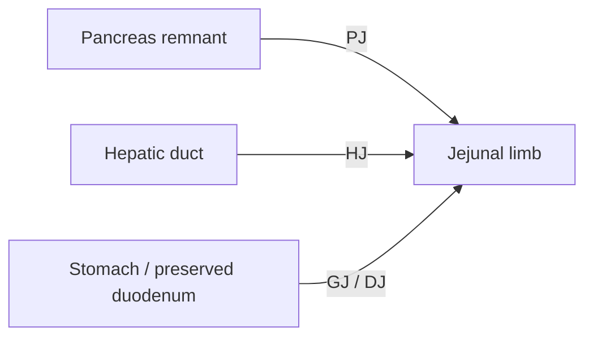
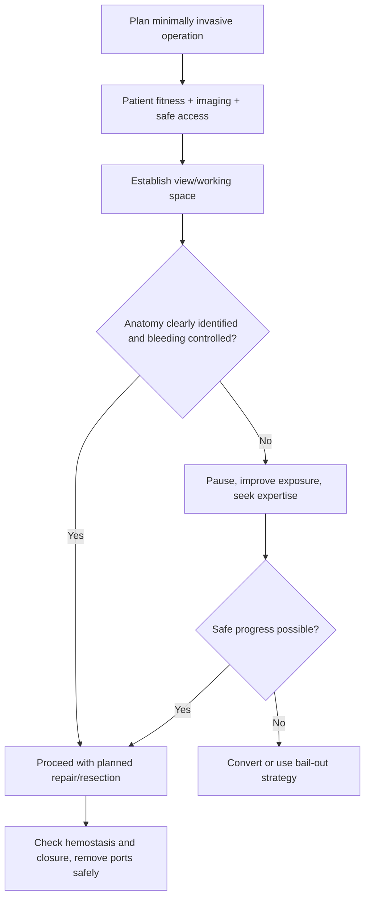
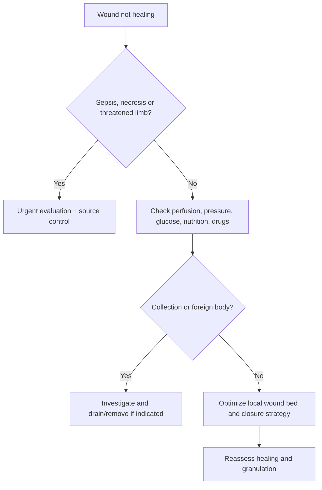

# Chapter 22: Elective GI & Hepatobiliary Surgery

## 22.1 Esophageal & Gastric Surgery

### A. Surgical Management of Achalasia Cardia
* **Laparoscopic Heller Myotomy (LHM)**:
  * *Procedure*: Longitudinal division of the anterior circular and longitudinal smooth muscle fibers of the distal esophagus ($2–3\text{ cm}$ proximal to GE junction) extending onto the gastric cardia ($2\text{ cm}$ distal to GE junction) to disrupt the hypertonic LES.
  * *Adjunctive Antireflux Procedure*: Because myotomy destroys the native antireflux barrier, LHM is routinely combined with a partial fundoplication (**Dor anterior $180^\circ$** or **Toupet posterior $270^\circ$** fundoplication). Total Nissen ($360^\circ$) fundoplication is strictly avoided as it induces severe post-operative dysphagia.
* **Peroral Endoscopic Myotomy (POEM)**: Endoscopic submucosal tunnel creation to perform myotomy of the inner circular muscle layer. Highly effective, particularly for Type III (spastic) achalasia.

---

### B. Surgical Management of GERD
* **Laparoscopic Nissen Fundoplication**:
  * Indicated for refractory GERD, severe erosive esophagitis, or large hiatal hernias.
  * *Procedure*: Mobilization of the gastric fundus and creation of a complete **$360^\circ$ floppy wrap** around the distal $3–4\text{ cm}$ of the intra-abdominal esophagus over a large bougie ($50–60\text{ Fr}$).

---

### C. Surgical Management of Gastric Cancer
Surgical resection with negative margins ($D_2$ lymphadenectomy) is the only curative modality for resectable gastric adenocarcinoma.

**GASTRIC CANCER RESECTION STRATEGY**
- DISTAL ANTRAL TUMORS PROXIMAL / DIFFUSE TUMORS
- Subtotal Gastrectomy - Total Gastrectomy
- 5 cm proximal margin - Resection from esophagus to duodenum
- Roux-en-Y Gastrojejunostomy - Roux-en-Y Esophagojejunostomy
- D2 LYMPHADENECTOMY
- (Resection of perigastric nodes [D1] PLUS
- celiac, left gastric, hepatic, splenic nodes [D2])

1. **Subtotal Gastrectomy**: Indicated for distal (antral/pyloric) tumors. Achieves a $5\text{ cm}$ proximal clear margin. Reconstruction via **Roux-en-Y Gastrojejunostomy** (preferred over Billroth I or II to prevent severe alkaline reflux gastritis).
2. **Total Gastrectomy**: Indicated for proximal (cardiac/body) tumors or Diffuse-type (Linitis Plastica) adenocarcinomas. Reconstruction via **Roux-en-Y Esophagojejunostomy** with a $40–50\text{ cm}$ Roux limb.
3. **$D_2$ Lymphadenectomy**: Standard surgical requirement. Resects perigastric lymph nodes (Nodal stations 1–6 = $D_1$) PLUS nodes along the left gastric, common hepatic, celiac, and splenic arteries (Nodal stations 7–11 = $D_2$). Resection of at least **16 lymph nodes** is required for accurate staging.

---

<!-- SURGERY_GI_ZIP_CONTENT_START:22-22-1 -->

### Additional surgical details integrated from the Surgery notes

> [!info] Provenance and scope
> Content below was transferred from the supplied Surgery ZIP, placed under this pre-existing GIT topic, and reformatted only at heading level. Existing canonical text remains intact. Source caveats should be interpreted as presented in those notes.

#### 12.6 Gastroesophageal Reflux Disease (GERD)

> **Source:** Surgery ZIP — 12_Esophageal_Surgery.md

##### Pathophysiology
GERD reflects failure of the antireflux barrier and/or impaired esophageal clearance.

Main mechanisms:
1. Transient LES relaxations.
2. Reduced resting LES pressure.
3. Shortened intra-abdominal esophagus.
4. Hiatal hernia with separation of LES and diaphragmatic crura.
5. Impaired clearance and delayed gastric emptying.

##### Antireflux barrier
- Intrinsic LES.
- Intra-abdominal esophageal segment.
- Right diaphragmatic crus.
- Angle of His.
- Gastric mucosal folds.

##### Clinical features
**Typical:** heartburn, sour regurgitation, water brash.

**Extraesophageal:** chronic cough, laryngitis, hoarseness, asthma-like symptoms and dental erosions.

##### Investigations
| Investigation | Role |
|---|---|
| Upper GI endoscopy | Detects esophagitis, stricture, Barrett changes |
| Ambulatory esophageal pH monitoring | Objective measurement of pathological acid exposure |
| Impedance-pH monitoring | Evaluates acid and non-acid reflux |
| Esophageal manometry | Assesses motility, especially before antireflux surgery |
| Barium swallow | Evaluates structural anatomy and selected hiatal hernias |

##### Surgical indications
- Objectively confirmed GERD with persistent symptoms despite appropriate therapy.
- Relevant complications.
- Significant reflux with a surgically relevant hiatal hernia.
- Selected patients preferring a definitive procedural approach after appropriate evaluation.

##### Fundoplication
**Principle:** wrap the gastric fundus around the distal esophagus to reinforce the antireflux barrier.

| Procedure | Wrap |
|---|---|
| Nissen | 360° complete |
| Dor | Anterior partial wrap, approximately 180° |
| Toupet | Posterior partial wrap, approximately 270° |
| Belsey Mark IV | Partial transthoracic fundoplication |

###### Nissen fundoplication
- Most commonly discussed complete fundoplication.
- A floppy wrap aims to prevent excessive postoperative obstruction.
- Potential complications:
  - Gas-bloat syndrome.
  - Dysphagia.
  - Inability to belch or vomit normally.
  - Wrap migration or disruption.
  - Recurrent reflux.

###### Other procedures
- **Collis gastroplasty:** lengthening procedure for selected shortened esophagus cases.
- **Magnetic sphincter augmentation (LINX):** selected patients with appropriate anatomy and confirmed reflux.

---

#### 12.8 Achalasia Cardia

> **Source:** Surgery ZIP — 12_Esophageal_Surgery.md

##### Definition
Esophageal motility disorder characterized by:
1. Failure of LES relaxation.
2. Absent normal esophageal peristalsis.
3. Functional obstruction at the gastroesophageal junction.

##### Pathophysiology
Destruction of inhibitory ganglion cells in the **myenteric plexus**.

Reduced NO/VIP-mediated inhibition leads to persistent LES tone and failure of relaxation.

##### Etiology
- Primary idiopathic achalasia.
- Chagas disease.
- Pseudoachalasia due to malignant GE-junction infiltration.
- Triple-A/Allgrove syndrome:
  - Alacrimia.
  - Achalasia.
  - ACTH-resistant adrenal insufficiency.

##### Clinical features
- Dysphagia to solids and liquids.
- Regurgitation of retained, undigested food.
- Weight loss.
- Retrosternal pain.
- Nocturnal aspiration or cough.

##### Investigations
- **High-resolution manometry:** reference diagnostic test.
- Barium swallow: **bird-beak tapering** with proximal dilation.
- Endoscopy: excludes pseudoachalasia and other mechanical obstruction.

##### Chicago classification
| Type | Key manometric feature |
|---|---|
| I — Classic | Failed peristalsis without significant panesophageal pressurization |
| II | Failed peristalsis with panesophageal pressurization |
| III — Spastic | Failed normal peristalsis with spastic/premature contractions |

##### Eckardt score
Assesses:
- Dysphagia.
- Regurgitation.
- Chest pain.
- Weight loss.

Used to quantify symptom burden and treatment response.

##### Treatment
| Procedure | Mechanism | Important feature |
|---|---|---|
| Pneumatic dilation | Balloon-mediated disruption of LES muscle | Particularly effective in selected type I/II cases |
| Laparoscopic Heller myotomy | Division of LES muscle | Frequently combined with partial fundoplication |
| POEM | Endoscopic submucosal tunnel and myotomy | Particularly useful in type III/spastic disease |
| Botulinum toxin | Temporarily blocks cholinergic stimulation | Higher recurrence; useful when definitive procedures unsuitable |

**Heller myotomy:** extends across the distal esophagus and onto the gastric cardia.

**Why add Dor/Toupet fundoplication?** Myotomy relieves the obstruction but weakens the reflux barrier.

**Important:** GERD is a major complication following myotomy, particularly POEM without an antireflux wrap.

---

#### 12.10 Esophageal Diverticula

> **Source:** Surgery ZIP — 12_Esophageal_Surgery.md

##### Zenker diverticulum
- Pharyngoesophageal pulsion diverticulum.
- Originates through **Killian dehiscence** between the thyropharyngeus and cricopharyngeus.
- False diverticulum.
- Characteristic features:
  - Regurgitation of undigested food.
  - Halitosis.
  - Dysphagia.
  - Aspiration pneumonia.
- Investigation: barium swallow.
- Management: endoscopic septotomy/diverticulotomy or surgical diverticulectomy with cricopharyngeal myotomy.

##### Traction diverticulum
- Typically mid-esophageal.
- Often associated with mediastinal inflammatory fibrosis.
- True diverticulum containing the full wall.

##### Epiphrenic diverticulum
- Distal esophageal pulsion diverticulum.
- Frequently associated with an underlying motility disorder.
- Treatment must address the underlying functional obstruction.

---

#### 12.11 Hiatal Hernia

> **Source:** Surgery ZIP — 12_Esophageal_Surgery.md

| Type | Anatomy | Key issue |
|---|---|---|
| I — Sliding | GE junction migrates into thorax | GERD |
| II — Paraesophageal | Fundus herniates; GE junction remains near normal | Volvulus/obstruction risk |
| III — Mixed | Sliding and paraesophageal components | Reflux and mechanical risk |
| IV | Additional abdominal organs may herniate | Complex mechanical complications |

- Type I is the most common.
- Type II–IV have greater relevance for mechanical obstruction, volvulus and ischemia.
- Fundoplication and hiatal repair may be combined in selected patients.

---

#### 12.14 Esophageal Carcinoma

> **Source:** Surgery ZIP — 12_Esophageal_Surgery.md

##### Squamous cell carcinoma versus adenocarcinoma
| Feature | SCC | Adenocarcinoma |
|---|---|---|
| Typical location | Middle esophagus | Distal esophagus/GE junction |
| Associations | Tobacco, alcohol, achalasia, corrosive strictures, tylosis | Chronic GERD, Barrett esophagus, obesity |
| Histology | Squamous differentiation, keratinization | Gland formation/mucin |
| Epidemiology | Prominent globally | Common in Western populations |

##### Presentation
- Progressive dysphagia, usually solids before liquids.
- Weight loss and anorexia.
- Odynophagia.
- Hoarseness from recurrent laryngeal nerve involvement.
- Cough with swallowing from tracheoesophageal fistula.

##### Investigation and staging
1. **Upper GI endoscopy with biopsy:** establishes tissue diagnosis.
2. CT chest and abdomen: assesses local extension and distant spread.
3. EUS: assesses depth of invasion and regional nodes where appropriate.
4. PET-CT: detects occult metastatic disease in selected staging situations.

##### Selected T-stage anatomy
| Stage | Invasion |
|---|---|
| T1a | Lamina propria or muscularis mucosae |
| T1b | Submucosa |
| T2 | Muscularis propria |
| T3 | Adventitia |
| T4a | Selected potentially resectable adjacent structures |
| T4b | Unresectable adjacent structures such as aorta or trachea |

##### Siewert classification of GE-junction tumors
- Type I: distal esophageal adenocarcinoma.
- Type II: true junctional tumor.
- Type III: subcardial gastric tumor.

This helps determine the anatomical approach and extent of resection.

##### Esophagectomy procedures
| Operation | Basic approach |
|---|---|
| Ivor Lewis | Abdominal and right thoracic approach; intrathoracic anastomosis |
| McKeown | Abdominal, thoracic and cervical approach; cervical anastomosis |
| Transhiatal esophagectomy | Abdominal and cervical approach without formal thoracotomy |

##### Reconstruction
- **Gastric conduit:** most common replacement.
- Main vascular supply: right gastroepiploic artery, with contribution from preserved vessels.
- Colon or jejunum may be used when gastric replacement is unsuitable.
- Posterior mediastinal route is anatomically shortest.

##### Important postoperative complications
- Anastomotic leak.
- Conduit ischemia or necrosis.
- Pulmonary complications.
- Recurrent laryngeal nerve injury.
- Anastomotic stricture.
- Chylothorax.
- Delayed gastric emptying.

##### Palliation
- Self-expanding metal stents (SEMS) for selected malignant dysphagia or fistulas.
- Nutritional support.
- Oncological treatment according to stage and clinical suitability.

---

#### 12.15 High-Yield Revision Table

> **Source:** Surgery ZIP — 12_Esophageal_Surgery.md

| Clue | Diagnosis |
|---|---|
| Bird-beak esophagus | Achalasia |
| Corkscrew esophagus | Distal esophageal spasm |
| Killian dehiscence | Zenker diverticulum |
| Regurgitation with halitosis | Zenker diverticulum |
| Forceful vomiting followed by severe chest pain | Boerhaave syndrome |
| Hematemesis after retching | Mallory–Weiss tear |
| Intermittent solid-food dysphagia | Schatzki ring |
| Esophageal rings with food impaction | Eosinophilic esophagitis |
| Barrett with dysplasia | Risk of adenocarcinoma |
| Post-fundoplication inability to belch | Gas-bloat syndrome |
| Endoscopic myotomy, especially for spastic achalasia | POEM |
| Two-incision esophagectomy | Ivor Lewis |
| Three-incision esophagectomy | McKeown |

**Source basis:** *World of Revision*, GI Surgery Part 1; Doctut esophageal surgery and esophagectomy material; Robbins gastrointestinal pathology; First Aid GI pathology; Canonical GIT Chapters 09, 19, 22 and 25.

> [!note] Study-source caveat
> This chapter reproduces the educational synthesis from this chat. See [[28 GI Surgical Source Concordance and Exam Cautions|source concordance]] for older or simplified source rules that require careful interpretation.

#### 13.5 Surgical Treatment of Peptic Ulcer Disease

> **Source:** Surgery ZIP — 13_Stomach_Duodenum_Bariatric_Surgery.md

Surgical acid-reduction operations are historically important and remain exam-relevant.

##### Types of vagotomy
| Operation | Nerves divided | Consequences |
|---|---|---|
| Truncal vagotomy | Main vagal trunks | Extensive acid reduction; alters gastric motility and other vagal functions |
| Selective vagotomy | Gastric branches while preserving major extragastric branches | Reduces acid with less extragastric denervation |
| Highly selective vagotomy | Parietal-cell branches with preservation of antral/pyloric innervation | No routine drainage procedure required |

##### Why a drainage procedure after truncal vagotomy?
Denervation can impair pyloric relaxation and gastric emptying.

Possible accompanying procedures:
- Pyloroplasty.
- Gastrojejunostomy.

##### Heineke–Mikulicz pyloroplasty
- Longitudinal pyloric incision.
- Transverse closure.
- Widens the pyloric outlet.

##### Complications of vagotomy
- Delayed gastric emptying/pylorospasm.
- Postvagotomy diarrhea.
- Gallstones after truncal denervation.
- Recurrent ulceration after incomplete denervation.
- Postoperative nutritional and motility disturbances.

---

#### 13.6 Gastric Reconstruction

> **Source:** Surgery ZIP — 13_Stomach_Duodenum_Bariatric_Surgery.md

##### Comparison
| Procedure | Anastomosis |
|---|---|
| Billroth I | Gastroduodenostomy |
| Billroth II | Gastrojejunostomy |
| Roux-en-Y gastrojejunostomy | Gastric remnant joined to Roux limb with downstream jejunojejunostomy |
| Roux-en-Y esophagojejunostomy | Esophagus joined to Roux limb after total gastrectomy |

##### Post-gastrectomy syndromes
###### A. Early dumping syndrome
- Occurs soon after meals.
- Hyperosmolar chyme rapidly enters small bowel.
- Fluid shifts into bowel lumen.
- Symptoms: abdominal cramps, diarrhea, palpitations, sweating, dizziness.

###### B. Late dumping syndrome
- Postprandial exaggerated insulin response.
- Reactive hypoglycemia.
- Symptoms: sweating, tremor, weakness, palpitations and hunger.

| Feature | Early dumping | Late dumping |
|---|---|---|
| Main mechanism | Osmotic fluid shift | Reactive hypoglycemia |
| Dominant symptoms | GI and vasomotor | Hypoglycemic |
| Dietary approach | Small meals, reduced rapidly absorbed carbohydrate | Similar preventive dietary strategy |

Management:
- Small, frequent meals.
- Reduce concentrated/simple sugars.
- Adjust fluid timing around meals.
- Selected resistant cases: octreotide.

###### C. Afferent loop syndrome
- Obstruction of the afferent biliopancreatic limb after reconstruction.
- Causes abdominal pain, distension and bilious vomiting.
- Severe obstruction risks pancreatitis, cholangitis or perforation.
- Requires assessment for endoscopic or surgical correction.

###### D. Efferent loop obstruction
- Impedes gastric emptying.
- Vomiting may contain food and bile.
- Management depends on cause and severity.

###### E. Internal hernia
- **Petersen hernia:** through mesenteric space posterior to the Roux limb.
- Mesocolic defects may cause herniation in retrocolic reconstructions.
- Can produce closed-loop obstruction and ischemia.

###### F. Nutritional consequences
- Iron deficiency.
- Vitamin B12 deficiency.
- Calcium/vitamin D deficiency.
- Protein-energy malnutrition in selected patients.

---

#### 13.7 Gastric Adenocarcinoma

> **Source:** Surgery ZIP — 13_Stomach_Duodenum_Bariatric_Surgery.md

##### Risk factors
- *H. pylori*-associated chronic gastritis.
- Intestinal metaplasia.
- Dietary salt/preserved foods.
- Tobacco exposure.
- Certain gastric polyps and premalignant conditions.
- Prior gastric surgery.
- Familial/genetic predisposition.

##### Lauren classification
| Feature | Intestinal type | Diffuse type |
|---|---|---|
| Histology | Gland-forming malignant epithelium | Discohesive cells, often signet-ring |
| Molecular association | Multistep intestinal-type pathway | E-cadherin/CDH1 alterations |
| Background | Atrophic gastritis and metaplasia | May occur without classic metaplastic sequence |
| Morphology | Mass or ulcerating lesion | Diffuse infiltrative thickening |
| Classical appearance | Gland-forming tumor | Linitis plastica |

##### Linitis plastica
- Diffuse infiltration of the gastric wall.
- Fibrotic, rigid, poorly distensible stomach.
- Described as **leather-bottle stomach**.

##### Early versus advanced gastric cancer
- **Early gastric cancer:** limited to mucosa or submucosa, regardless of lymph node involvement.
- **Advanced gastric cancer:** invades muscularis propria or deeper.
- Early lesions can be assessed with endoscopic classifications and selected lesions treated by endoscopic resection.

##### Borrmann classification: advanced gastric carcinoma
- I: Polypoid/fungating mass.
- II: Ulcerated with raised, well-defined margins.
- III: Ulceroinfiltrative.
- IV: Diffusely infiltrative.

##### Classical metastatic manifestations
| Sign | Description |
|---|---|
| Virchow node / Troisier sign | Left supraclavicular metastatic lymphadenopathy |
| Sister Mary Joseph nodule | Umbilical metastasis |
| Krukenberg tumor | Ovarian metastasis, classically signet-ring adenocarcinoma |
| Blumer shelf | Metastatic deposits in rectovesical/rectouterine pouch |
| Irish node | Left axillary metastatic node |
| Leser–Trélat sign | Sudden eruption of multiple seborrheic keratoses associated with malignancy |
| Tripe palms | Velvety hyperkeratosis of palms associated with internal malignancy |

##### Investigations
1. Upper GI endoscopy with multiple biopsies.
2. Contrast-enhanced CT for staging.
3. EUS for selected local staging.
4. PET-CT in selected cases rather than as a universal replacement for CT.
5. Staging laparoscopy in appropriate potentially resectable advanced disease to identify occult peritoneal spread.

##### Surgical treatment
**Distal gastric cancer**
- Subtotal/distal gastrectomy when adequate clearance achievable.
- Reconstruction according to surgical anatomy.

**Proximal/diffuse gastric cancer**
- Total gastrectomy may be required.
- Roux-en-Y esophagojejunostomy.

##### Lymphadenectomy
- **D1:** perigastric lymphatic dissection.
- **D2:** extended regional lymphadenectomy along major gastric arterial drainage territories.
- At least **16 examined lymph nodes** is a commonly taught minimum for adequate pathological staging.

Modern multimodal treatment also incorporates systemic therapy according to resectability and oncological stage.

##### Surgical complications
- Anastomotic leak.
- Hemorrhage.
- Intra-abdominal abscess.
- Pancreatic injury.
- Delayed gastric emptying.
- Dumping syndrome.
- Malnutrition.
- Vitamin B12 deficiency after total gastrectomy.

---

#### 13.11 Bariatric and Metabolic Surgery

> **Source:** Surgery ZIP — 13_Stomach_Duodenum_Bariatric_Surgery.md

##### Indications in revision sources
- BMI at least 40 kg/m².
- BMI at least 35 kg/m² with obesity-associated complications.
- Lower BMI thresholds may be used in appropriate Asian populations and metabolic surgery pathways.

These are classical revision thresholds; eligibility criteria vary with the guideline and patient characteristics.

##### Preoperative evaluation
- Obesity history and previous treatment.
- Metabolic comorbidities.
- Nutritional status and deficiencies.
- Psychiatric/behavioral evaluation.
- Eating patterns and adherence capacity.
- Anesthetic and thromboembolic risk.
- Evaluation for reflux and relevant upper GI pathology.

##### OS-MRS risk factors
Obesity Surgery Mortality Risk Score includes:
- Hypertension.
- Age older than 45 years.
- Male sex.
- BMI greater than 50 kg/m².
- Pulmonary embolism risk factors.

##### Procedures
| Procedure | Mechanism/features |
|---|---|
| Sleeve gastrectomy | Resection along greater curvature; restrictive and hormonal effects |
| Roux-en-Y gastric bypass | Restriction, altered nutrient flow and hormonal effects |
| Adjustable gastric band | Adjustable restrictive device |
| Intragastric balloon | Endoscopic space-occupying device |
| Biliopancreatic diversion/duodenal switch | Major intestinal rearrangement with greater malabsorptive effect |
| SADI-S | Single-anastomosis duodeno-ileal bypass with sleeve |

##### Sleeve gastrectomy
- Greater curvature stomach resected.
- Narrow gastric tube remains.
- Potential problems:
  - Staple-line bleeding.
  - Leak near gastroesophageal junction.
  - Gastroesophageal reflux.
  - Stenosis or twisting.
  - Nutritional deficiencies.
  - Weight regain.

##### Roux-en-Y gastric bypass
- Small gastric pouch.
- Gastrojejunostomy to Roux limb.
- Jejunojejunostomy reconstructs bowel continuity.

Complications:
- Anastomotic leak.
- Marginal ulcers.
- Internal hernia.
- Dumping syndrome.
- Micronutrient deficiency.
- Small-bowel obstruction.

##### Duodenal switch / biliopancreatic diversion
- Greater nutrient malabsorption.
- Extensive weight reduction potential.
- Significant risk of protein and micronutrient deficiency.
- Demands structured long-term nutritional follow-up.

##### Deficiencies after bariatric surgery
- Iron.
- Vitamin B12.
- Folate.
- Calcium and vitamin D.
- Thiamine.
- Fat-soluble vitamins in malabsorptive procedures.
- Protein deficiency in severe cases.

---

#### 13.13 Rapid Revision

> **Source:** Surgery ZIP — 13_Stomach_Duodenum_Bariatric_Surgery.md

| Exam clue | Diagnosis/procedure |
|---|---|
| Projectile nonbilious vomiting in young infant | Hypertrophic pyloric stenosis |
| Olive-shaped mass | CHPS |
| Pyloric muscle splitting | Ramstedt operation |
| Posterior duodenal ulcer | Gastroduodenal artery hemorrhage |
| Anterior duodenal ulcer | Perforation |
| Perforated ulcer with omental reinforcement | Graham patch |
| Gastric ulcer with malignancy concern | Endoscopic biopsy |
| Longitudinal pyloric incision, transverse closure | Heineke–Mikulicz pyloroplasty |
| Gastroduodenostomy | Billroth I |
| Gastrojejunostomy | Billroth II |
| Reactive hypoglycemia after gastrectomy | Late dumping |
| Leather-bottle stomach | Diffuse gastric adenocarcinoma |
| Signet-ring gastric malignancy | Diffuse Lauren type |
| Left supraclavicular node | Virchow/Troisier |
| KIT/CD117, DOG1 | GIST |
| Pulmonary chondroma + gastric GIST + paraganglioma | Carney triad |
| Unproductive retching + failed NG passage | Gastric volvulus |
| Greater-curvature resection | Sleeve gastrectomy |

**Source basis:** *World of Revision* GI Surgery Parts 1–2; Doctut material on PUD, vagotomy and gastric surgery; Robbins gastric pathology; First Aid gastrointestinal disease; Canonical GIT Chapters 10, 19, 21, 22 and 25.

> [!note] Study-source caveat
> This chapter reproduces the educational synthesis from this chat. See [[28 GI Surgical Source Concordance and Exam Cautions|source concordance]] for older or simplified source rules that require careful interpretation.

<!-- SURGERY_GI_ZIP_CONTENT_END:22-22-1 -->
## 22.2 Hepatobiliary & Pancreatic Surgery

### A. Cholecystectomy & Critical View of Safety
* **Laparoscopic Cholecystectomy**: Gold standard treatment for symptomatic gallstones and acute cholecystitis.
* **Critical View of Safety (CVS) of Strasberg**: Mandatory anatomical landmark identification protocol prior to clipping or dividing any structure to prevent catastrophic iatrogenic Bile Duct Injury (BDI):
  1. The **Hepatocystic Triangle** (bounded by cystic duct, common hepatic duct, and inferior liver margin) is completely cleared of fat and fibrous tissue.
  2. The lower $1/3$ of the gallbladder is dissected off the liver bed (cystic plate).
  3. **Only two structures** (Cystic Duct and Cystic Artery) are seen entering the gallbladder.

**CRITICAL VIEW OF SAFETY (STRASBERG)**
1. Hepatocystic triangle clear
2. Cystic plate exposed
3. ONLY TWO structures enter
- gallbladder (Duct & Artery)

---

### B. Pancreaticoduodenectomy (Whipple Procedure)
Indicated for resectable malignant lesions of the pancreatic head, uncinate process, or periampullary region (distal CBD, ampulla of Vater, duodenum).

**WHIPPLE PROCEDURE (RESECTION)**
- PANCREATIC HEAD DUODENUM (1st-4th) GALLBLADDER & DISTAL CBD ANTRUM / PYLORUS
- (And uncinate process) And proximal jejunum (Resected at CHD level) (Classic Whipple; spared
- in Pylorus-Preserving)
- WHIPPLE PROCEDURE (RECONSTRUCTION)
- PANCREATICOJEJUNOSTOMY HEPATICOJEJUNOSTOMY GASTROJEJUNOSTOMY
- (Proximal anastomosis; (Middle anastomosis; (Distal anastomosis;
- prevents pancreatic fistula) prevents biliary leak) restores GI continuity)

1. **Resection Components**: Pancreatic head and uncinate process, entire Duodenum ($1\text{st}–4\text{th}$ parts), proximal $15\text{ cm}$ of Jejunum, Gallbladder and Common Bile Duct, and Antrum of stomach (Classic Whipple) or preserved pylorus (Pylorus-Preserving Pancreaticoduodenectomy [PPPD]).
2. **Reconstruction Sequence (Proximal to Distal on Roux Limb)**:
   * **Pancreaticojejunostomy** (or Pancreaticogastrostomy): Most critical anastomosis; pancreatic leak/fistula is the primary cause of post-operative mortality.
   * **Hepaticojejunostomy**: Biliary-enteric anastomosis.
   * **Gastrojejunostomy** (or Duodenojejunostomy): Restores enteric continuity.

---

<!-- SURGERY_GI_ZIP_CONTENT_START:22-22-2 -->

### Additional surgical details integrated from the Surgery notes

> [!info] Provenance and scope
> Content below was transferred from the supplied Surgery ZIP, placed under this pre-existing GIT topic, and reformatted only at heading level. Existing canonical text remains intact. Source caveats should be interpreted as presented in those notes.

#### 7. Hepatocellular carcinoma (HCC)

> **Source:** Surgery ZIP — 16_Liver_and_Portal_Hypertension.md

##### Why it occurs- **Most common primary malignant liver tumor**; metastatic tumors are overall more common in the liver.
- **Risk:** HBV, HCV, cirrhosis from any cause, alcohol, metabolic steatohepatitis, aflatoxin exposure, hemochromatosis, α1-antitrypsin deficiency and other chronic liver injuries. **HBV-related HCC may occur without established cirrhosis** (Robbins).
- Continuous injury/regeneration with inflammation and mutations in **β-catenin, p53** and other pathways promotes carcinogenesis.
- **Clinical presentation:** often silent until liver function worsens; new RUQ discomfort, hepatomegaly, mass, weight loss, ascites or unexpected decompensation in known cirrhosis.
- **Paraneoplastic:** hypoglycemia, hypercholesterolemia/hyperlipidemia, polycythemia and hypercalcemia are named in the sources; which is “most common” differs by book and measurement.

##### Evaluation and imaging- **Multiphase liver CT/MRI:** in at-risk patients, arterial-phase hyperenhancement and portal/delayed washout may establish imaging diagnosis in classic scenarios; **LI-RADS** provides standardized description.
- **AFP** is supportive and can be normal in HCC or increased in other hepatic diseases; **not an absolute diagnostic rule**.
- Need to characterize **tumor burden, portal vein invasion, extrahepatic spread and hepatic reserve** before choosing therapy.
- **Fibrolamellar HCC:** often younger patients without cirrhosis; characteristic fibrous stroma, **AFP often not raised**, and distinct clinical behavior; Doctut/WOR include **neurotensin** as a historical tumor-marker association.

##### Barcelona Clinic Liver Cancer (BCLC) teaching stages
| Stage | Typical source description | Main treatment direction discussed |
|---|---|---|
| **0: very early** | Solitary **≤2 cm**, preserved function/performance | Resection or local ablation depending on context |
| **A: early** | Solitary lesion or limited small nodules, preserved function | Resection, local ablation, or transplant selection |
| **B: intermediate** | Multinodular without major vascular invasion/extrahepatic disease | **TACE** (transarterial chemoembolization), selected approaches |
| **C: advanced** | Vascular invasion or extrahepatic spread with suitable performance | Systemic treatments; WOR specifically lists **sorafenib** as an older example |
| **D: terminal** | Poor performance/liver reserve | Symptom-directed supportive care |

> [!warning] Stage ≠ fixed prescription
> The source BCLC chart is an exam-era simplification. It should not be interpreted as an exhaustive contemporary oncology algorithm or as an instruction to give sorafenib to every stage-C patient.

##### Resection vs transplant vs local therapy- **Anatomic resection:** localized tumor, acceptable future remnant and **adequate liver reserve**, especially without prohibitive portal hypertension.
- **Liver transplantation:** treats both the tumor and the failing cirrhotic organ in selected candidates.
- **Milan criteria (WOR):** **single HCC ≤5 cm OR up to three lesions each ≤3 cm**, with **no macrovascular invasion or extrahepatic spread**.
- **Ablation:** radiofrequency/microwave or selected chemical methods for suitable small lesions.
- **TACE/TARE:** liver-directed treatment when surgery/ablation unsuitable in selected intermediate or bridge-to-transplant situations.
- **Locoregional and systemic treatments** depend on disease stage, vascular invasion, hepatic reserve and availability.

##### Hepatic metastases- Overall, metastases are commoner than primary malignant liver tumors. **Colorectal carcinoma** is a key source of potentially resectable hepatic secondaries; neuroendocrine tumors may also be considered in select contexts.
- **Hypovascular metastases** (e.g., many colorectal lesions) often show best in **portal venous phase**; **hypervascular metastases** (e.g., RCC/NET/thyroid in source lists) often show in **arterial phase**.
- **Fong clinical risk score** in Doctut considers primary nodal status, disease-free interval, number of lesions, largest size and CEA; **a prognostic score, not a stand-alone operation rule**.
- Surgery considers complete clearance, distribution, vascular anatomy and safe **future liver remnant**; selected disease may require systemic and/or liver-directed therapy.

#### 13. Liver surgery: high-yield exam table

> **Source:** Surgery ZIP — 16_Liver_and_Portal_Hypertension.md

| Clue | Likely diagnosis / significance |
|---|---|
| Segment I hypertrophy + hepatic venous outflow obstruction | **Budd–Chiari** |
| Segment IVb + V involved in operation | **Radical GB cancer surgery** liver-bed resection |
| RUQ pain, right VII solitary abscess, “anchovy-sauce” | **Amoebic liver abscess** |
| Fever/rigors + multiple rim-enhancing abscesses with bile-duct disease | **Pyogenic liver abscess** |
| Water-lily membrane in liver cyst | **Hydatid CE3a** |
| Enhancing central stellate scar, sulfur-colloid uptake | **FNH** |
| OCP exposure, painful/bleeding lesion; β-catenin subtype | **Hepatic adenoma** |
| Arterial enhancement → delayed washout in high-risk liver | **HCC imaging signature** |
| ≤5-cm solitary HCC or ≤3 nodules each ≤3 cm | **Milan criteria** |
| HVPG ≥10 mmHg | **Clinically significant sinusoidal portal HTN** |
| Isolated gastric varices + splenic vein thrombosis | **Sinistral portal HTN** |
| Varices + splenomegaly with relatively preserved liver | **EHPVO/NCPF** differential |
| Hypoxemia + platypnea with cirrhosis | **Hepatopulmonary syndrome** |
| Portal-to-hepatic vein stent | **TIPS** |
| Left gastric/splenic vein to renal/IVC named shunts | Portal decompression anatomy |

##### Source notes for Chapter 16- **WOR Surgery:** *Surgical Anatomy of Liver, Liver Abscess, Hydatid Disease, Benign Liver Tumours, HCC*; *GI Surgery Part 2—Portal Hypertension*; *Specialty Surgery—Liver Transplant*; *Trauma—Liver and Splenic Injury*.
- **Doctut Merged:** *Couinaud’s Segments; Infections in Liver; Liver Tumors; Portal Hypertension; Budd–Chiari*.
- **Robbins Pocket Companion 9e:** Chapter 18 *Liver and Gallbladder*, printed pp. 821–875, particularly cirrhosis/portal HTN pp. 827–830 and liver tumors pp. 867–874.
- **First Aid 2025:** Gastrointestinal pathology/physiology, liver and portal hypertension material. See concordance appendix for places where older source choices differ.

#### 5. When is cholecystectomy indicated?

> **Source:** Surgery ZIP — 17_Gallbladder_and_Biliary_Surgery.md

- **Symptomatic stones** and gallstone complications are major indications.
- **Asymptomatic** gallstones: source lists mention some selected high-risk contexts (large stone, porcelain GB, suspicious **polyp >1 cm**, particular hemolytic/immune/typhoid-carrier circumstances), but routine prophylactic cholecystectomy is **not automatic** for all asymptomatic stones.
- **Older review conflict:** WOR/Doctut sometimes list **diabetes alone** as prophylactic indication; both also list stone-size thresholds (2 cm vs 2.5 cm) and differing absolute risk values. These require modern individualized decision-making; do not memorize them as universal current surgical orders.
- **GB polyps:** consider malignancy risk when **≥10 mm**, enlarging, associated with other imaging/risk features; most small cholesterol polyps are benign.
- **Porcelain GB:** wall calcification is a risk marker, but source statements about a fixed 10% cancer risk should not be generalized to all calcification patterns.

##### Laparoscopic cholecystectomy (LC): operative principles1. Safe access and creation of **CO₂ pneumoperitoneum**.
2. Expose GB neck/cystic plate and identify stable landmarks.
3. Obtain **Critical View of Safety (CVS)** before dividing structures.
4. Control **cystic duct and cystic artery**; remove gallbladder from liver bed.
5. Inspect for bleeding and bile leak; recover specimen.

##### Critical View of Safety (Strasberg)All three are required:
- Clear **hepatocystic triangle** of fat/fibrous tissue.
- Separate **lower third of GB** from liver so cystic plate is visible.
- Demonstrate **only two structures** entering gallbladder: cystic duct and cystic artery.

> [!warning] Bile duct safety
> If anatomy remains uncertain, **do not clip or divide an unidentified “duct.”** Bailout options in WOR include **subtotal cholecystectomy, fundus-first dissection, conversion, cholecystostomy or abort/refer** depending on circumstances. Conversion does not by itself guarantee safety without anatomic clarity.

##### Complications of LC- Hemorrhage (cystic/right hepatic artery, liver bed), **bile duct injury/leak**, retained CBD stone, infection/biloma, bowel/vascular entry injury, postoperative pain and thromboembolic complications.
- **Fundus-first** and **subtotal** approaches are potential bailout techniques in severely inflamed Calot anatomy.
- During pregnancy, older WOR trimester-by-trimester blanket prohibitions reflect simplified source teaching; operative timing is a specialist risk-benefit decision.

#### 8. Bile duct injury (BDI) after cholecystectomy

> **Source:** Surgery ZIP — 17_Gallbladder_and_Biliary_Surgery.md

##### Mechanisms and recognition- **Misidentification** of CBD/CHD as cystic duct, anomalous right hepatic duct, thermal injury, excessive traction or deep dissection below safe plane.
- **Early:** bile in operative field/drain, bilious collection, abdominal pain, fever, peritonitis and sepsis.
- **Late:** duct stricture → obstructive jaundice, recurrent cholangitis and secondary biliary cirrhosis.
- **Investigations:** US/CT for biloma, **MRCP** for duct mapping, **ERCP** for selected communicating leaks/stenting, and percutaneous cholangiography for proximally disconnected ducts when indicated.

##### Strasberg and Bismuth classifications| Strasberg | Typical injury | Bismuth relationship |
|---|---|---|
| **A** | Leak from **cystic duct stump** or small gallbladder-bed duct | Not primarily a major CHD transection |
| **B** | Occluded anomalous/aberrant right sectoral duct | — |
| **C** | Transection/leak of aberrant right sectoral duct | — |
| **D** | **Lateral** injury to major bile duct | — |
| **E1** | Main duct stricture/injury >2 cm below confluence | **Bismuth I** |
| **E2** | Main duct injury ≤2 cm below confluence | **Bismuth II** |
| **E3** | Hilar injury, confluence preserved | **Bismuth III** |
| **E4** | Hilar confluence disrupted | **Bismuth IV** |
| **E5** | Main duct injury plus aberrant right sectoral duct | **Bismuth V** |

**Hannover classification** (WOR) can incorporate concomitant vascular injury.

##### Management principles- **Recognized intraoperatively:** stop further injurious dissection; determine ductal/vascular anatomy; involve **experienced HPB surgeon**; appropriate controlled repair/reconstruction when feasible.
- **Postoperative stable leak:** drain biloma, treat infection; **ERCP sphincterotomy/stenting** for many type-A or communicating leaks where indicated.
- **Major duct injury/transection:** specialist reconstruction, commonly **Roux-en-Y hepaticojejunostomy**, after stabilization, source control and full delineation. Timing is individualized, not a universal “24–48 h vs after 48 h” rule.
- **Doctut caution:** inexperienced teams should **drain and refer** rather than attempt uncertain complex repair.

#### 13. Rapid-revision grid

> **Source:** Surgery ZIP — 17_Gallbladder_and_Biliary_Surgery.md

| Classic clue | Answer |
|---|---|
| Tortuous right hepatic artery near Calot region | **Moynihan hump** |
| GB fundus folded on itself | **Phrygian cap** |
| Only two structures into GB after clearing triangle and lower GB | **Critical View of Safety** |
| RUQ pain + fever + Murphy sign | **Acute cholecystitis** |
| RUQ pain + fever + jaundice | **Charcot triad / cholangitis** |
| Add hypotension and confusion | **Reynolds pentad** |
| Hyperresonant? No—ductal stone on ultrasound | **Echogenic mobile focus with posterior shadow** |
| Hard black stones + hemolysis | **Black pigment stones** |
| Brown duct stones + infection | **Brown pigment stones** |
| Hartmann pouch stone compressing CHD/CBD | **Mirizzi** |
| Obstruction + pneumobilia + ectopic stone | **Rigler triad** |
| Gallstone at duodenum causing GOO | **Bouveret syndrome** |
| Post-LC cystic stump leak | **Strasberg A** |
| CHD injury just below confluence | **Bismuth II / Strasberg E2** |
| Neonatal conjugated jaundice + acholic stool | **Biliary atresia → Kasai/transplant assessment** |
| Intrahepatic bile duct dilatation + central dot | **Caroli disease, Todani V** |
| Pruned-tree/beaded cholangiogram, UC | **PSC** |
| T1a gallbladder carcinoma | **Usually simple cholecystectomy** |
| Gallbladder T1b/T2 operative source pattern | **Extended/radical resection** |
| Perihilar tumor at right-left duct confluence | **Klatskin tumor** |

##### Source notes for Chapter 17- **World of Revision, Surgery**: *Surgical Anatomy of Gall Bladder, Gall Stones, LC, Bile Duct Injury, Gall Stones in Pregnancy, EHBA, Choledochal Cysts, Gall Bladder Cancer*.
- **Doctut Merged**: *Gall Bladder and Bile Duct, ERCP, Stones, Bile Duct Injury, Choledochal Cyst, EHBA, Biliary Malignancy*.
- **Robbins Pocket Companion 9e**, printed pp. 875–882, gallstone pathogenesis, cholecystitis and gallbladder carcinoma.
- **First Aid 2025**, GI anatomy and pathology. Consult cross-source caution table before interpreting any one absolute numerical threshold.

#### 11. Pancreatic operations and postoperative complications

> **Source:** Surgery ZIP — 18_Pancreatic_and_Splenic_Surgery.md

##### Whipple pancreaticoduodenectomy**Main indications from WOR/Doctut:** selected resectable **pancreatic head, periampullary, distal CBD and duodenal tumors**; occasionally complex nonmalignant head disease.

**Classical structures removed:** pancreatic **head + duodenum + distal stomach** (with pylorus-preserving modification where appropriate), **distal bile duct + gallbladder** and regional lymphatic tissue.

**Main reconstruction:**
1. **Pancreaticojejunostomy (PJ)** for pancreatic secretions.
2. **Hepaticojejunostomy (HJ)** for bile drainage.
3. **Gastrojejunostomy (GJ)** or **duodenojejunostomy** in pylorus-preserving operation.

**Complications:**
- **Postoperative pancreatic fistula / PJ anastomotic leak**—leakage of enzyme-rich juice, sepsis, hemorrhage; major concern in WOR.
- **Delayed gastric emptying**—very common functional complication emphasized in Doctut.
- Intra-abdominal abscess, hemorrhage, wound infection, biliary leak/stricture and endocrine/exocrine insufficiency.

**Head vs tail operation:** head → pancreaticoduodenectomy; body/tail → **distal pancreatectomy**, often with splenectomy when cancer/vascular anatomy requires, but spleen-preserving approaches may be considered in selected benign disease.

##### Palliative treatment for unresectable obstructing PDAC- **Biliary SEMS** by ERCP or percutaneous intervention for jaundice/cholangitis.
- **Duodenal stent/gastrojejunostomy** for gastric outlet obstruction.
- **Pain management** including selected celiac plexus procedures.
- **Systemic chemotherapy:** WOR mentions **FOLFIRINOX**; regimen depends on fitness, tumor extent and oncology assessment.
- Historical “triple bypass” includes biliary and gastric bypass procedures when endoscopic management unsuitable; not default for every patient.

#### 15. Elective splenectomy — indications and selection

> **Source:** Surgery ZIP — 18_Pancreatic_and_Splenic_Surgery.md

##### Major conditions from Doctut/Robbins| Indication | Rationale | Critical distinction |
|---|---|---|
| **Immune thrombocytopenia (ITP)** | Splenic macrophages remove antibody-coated platelets; spleen contributes to autoantibody production | Surgery usually considered in **selected refractory/chronic** disease, not at first diagnosis |
| **Hereditary spherocytosis** | Deformed RBCs are destroyed in spleen | Improves anemia/hemolysis; consider age, disease severity, coexisting gallstones |
| **Thalassemia / selected hemolytic anemia** | Severe hypersplenism or transfusion requirement | Risk-benefit individualized; not all anemia requires splenectomy |
| **Hypersplenism** | Sequestration/destruction of blood cells | Treat underlying disorder; portal hypertension changes risk |
| **Splenic tumor/cyst/abscess** | Lesion removal when partial or medical/drainage strategy unsuitable | Preserve spleen when feasible |
| **Splenic trauma** | Uncontrolled bleeding, shattered spleen | Emergency rather than elective indication |
| **Some hematologic malignancies** | Diagnosis/treatment of selected complications/hypersplenism | Doctut notes reduced use with effective systemic therapies |

##### ITP specifics- Immune-mediated platelet destruction, often **IgG-coated platelets** removed by splenic macrophages; clinical **petechiae, purpura, mucosal bleeding**.
- Source treatments include **corticosteroids**, IVIG, rituximab and thrombopoietin receptor agonists; splenectomy is **second-line in selected patients** with persistent/refractory disease.
- **Assess accessory spleen if relapse** after surgery, since functional splenic tissue can sustain platelet sequestration.
- Very low platelet counts and medication thresholds in the OCR'd Doctut pages are inconsistent; do not import them directly into a treatment order.

##### Hereditary spherocytosis- Membrane defects, especially **spectrin/ankyrin/band-3-related** instability → spherical RBCs cannot deform through splenic cords → **extravascular hemolysis**.
- Features: anemia, jaundice, splenomegaly, reticulocytosis, indirect hyperbilirubinemia and **black pigment gallstones**; **Coombs test negative**.
- Splenectomy reduces hemolysis but carries permanent infection risk. Doctut emphasizes combining **cholecystectomy** when indicated for gallstones in affected patients and timing in childhood.

##### Operations- **Laparoscopic splenectomy** for selected elective disease; **hand-assisted/open** approaches in massive splenomegaly, complex adhesions or hemorrhage.
- Identify **accessory spleens**; protect **pancreatic tail**; control hilar and short gastric vessels.
- The source's claims that portal hypertension or a precise spleen weight are universal laparoscopic contraindications are older shorthand: operative approach depends on surgical expertise, anatomy and risk.

#### 5. Multiple endocrine neoplasia (MEN) syndromes

> **Source:** Surgery ZIP — 10_Adrenal_and_Neuroendocrine_Surgery.md

| Syndrome | Gene | Classic triad or components | Exam point |
|---|---|---|---|
| **MEN1 / Wermer** | **MEN1 / menin**, chromosome 11 | **Parathyroid, Pancreatic endocrine, Pituitary** (3 Ps) | Hyperparathyroidism often first/most frequent |
| **MEN2A / Sipple** | **RET** | Medullary thyroid carcinoma, pheochromocytoma, parathyroid disease | Screen for **pheo before thyroidectomy** |
| **MEN2B** | **RET** (often M918T) | Aggressive early MTC, pheochromocytoma, mucosal neuromas, marfanoid habitus, intestinal ganglioneuromatosis | Early prophylactic thyroid surgery in genetically defined high-risk patients |
| **MEN4** | **CDKN1B** | Pituitary/parathyroid and other endocrine tumors | MEN1-like but different gene |

**Important RET nuance:** genotype determines timing of prophylactic thyroidectomy and surveillance; "by age one" does not apply universally to all RET variants.

<!-- SURGERY_GI_ZIP_CONTENT_END:22-22-2 -->
## 22.3 Colorectal & Anorectal Surgery

### A. Colorectal Cancer Surgical Principles

**COLORECTAL RESECTION SELECTION**
- RIGHT HEMICOLECTOMY LEFT HEMICOLECTOMY LOW ANTERIOR RESECTION ABDOMINOPERINEAL
- Cecum / Ascending - Descending colon (LAR + TME) RESECTION (APR)
- Resects ileocolic, - Resects left colic - Rectal cancer > 5 cm - Low Rectal cancer
- right colic, branch artery from anal verge < 5 cm / sphincter inv
- of middle colic - Sphincter-sparing - Permanent end colostomy

1. **Right Hemicolectomy**: Indicated for cecal and ascending colon carcinomas. Resects terminal $10–15\text{ cm}$ of ileum, cecum, ascending colon, and hepatic flexure. Vascular ligation: Ileocolic, Right Colic, and right branch of Middle Colic arteries.
2. **Low Anterior Resection (LAR)**: Indicated for rectal cancers located in the middle and upper rectum ($>5\text{ cm}$ from the anal verge). Performed with **Total Mesorectal Excision (TME)** (sharp dissection along the mesorectal fascia plane to resect the entire mesorectal fatty envelope containing regional lymph nodes). Restores bowel continuity via a stapled coloanal or colorectal anastomosis (**Sphincter-Sparing**).
3. **Abdominoperineal Resection (APR)**: Indicated for low rectal cancers ($<5\text{ cm}$ from anal verge) that invade the levator ani or anal sphincter complex. Resects the distal sigmoid, rectum, anal canal, and sphincter apparatus. Leaves the patient with a **permanent left lower quadrant end colostomy**.

---

### B. Surgical Management of Anorectal Disorders

#### 1. Hemorrhoids
* **Grade I–II**: Conservative medical management (high-fiber diet, stool softeners, flavonoids) or office-based **Rubber Band Ligation (RBL)** (applied above the dentate line in insensate mucosa).
* **Grade III–IV / Mixed Hemorrhoids**: **Excisional Hemorrhoidectomy** (**Milligan-Morgan** open technique or **Ferguson** closed technique) or **Stapled Hemorrhoidopexy** (PPH procedure).

#### 2. Chronic Anal Fissure
* Fissures refractory to medical therapy (topical $0.2\%$ Glyceryl Trinitrate [GTN], $2\%$ Diltiazem, or Botox injections).
* **Gold Standard Surgery**: **Lateral Internal Sphincterotomy (LIS)**. Partial division of the lower $1/3$ of the internal anal sphincter muscle to reduce resting anal canal hypertonia, relieve sphincter spasm, restore mucosal perfusion, and promote permanent fissure healing ($>95\%$ cure rate).

#### 3. Fistula-in-Ano & Goodsall's Rule
Anatomy and track direction are predicted by **Goodsall's Rule**:

**GOODSALL'S RULE**
- Transverse Line Across Midpoint of Anal Verge
- ANTERIOR FISTULA TRACKS POSTERIOR FISTULA TRACKS
- Open anteriorly - Open posteriorly
- Follow a STRAIGHT RADIAL track - Follow a CURVED track opening
- directly into the anal canal into the POSTERIOR MIDLINE
- (6 o'clock position)

* **Low Fistulae (Inter-sphincteric or Low Trans-sphincteric)**: **Fistulotomy** (laying open the fistula tract) or **Fistulectomy**.
* **High / Complex Fistulae (High Trans-sphincteric or Suprasphincteric)**: Fistulotomy is strictly contraindicated due to high risk of fecal incontinence. Managed using **Seton placement** (cutting seton for gradual division or non-cutting seton for chronic drainage) or **Ligation of Intersphincteric Fistula Tract (LIFT)**.

---

<!-- SURGERY_GI_ZIP_NEW_SECTION_START:newsection-22-22-4 -->
<!-- SURGERY_GI_ZIP_CONTENT_START:22-22-3 -->

### Additional surgical details integrated from the Surgery notes

> [!info] Provenance and scope
> Content below was transferred from the supplied Surgery ZIP, placed under this pre-existing GIT topic, and reformatted only at heading level. Existing canonical text remains intact. Source caveats should be interpreted as presented in those notes.

#### 15.4 Inflammatory Bowel Disease

> **Source:** Surgery ZIP — 15_Colorectal_Anorectal_Surgery.md

##### Crohn disease versus ulcerative colitis
| Feature | Crohn disease | Ulcerative colitis |
|---|---|---|
| Extent | Mouth to anus | Colon and rectum |
| Distribution | Skip lesions | Continuous |
| Rectum | May be spared | Usually involved |
| Wall involvement | Transmural | Predominantly mucosal |
| Strictures | Common | Less characteristic |
| Fistulas | Common | Uncommon |
| Granulomas | Noncaseating granulomas may occur | Not a defining feature |
| Creeping fat | Characteristic | Absent |
| Pseudopolyps | Possible | Common |
| Crypt abscesses | Possible | Characteristic histological finding |
| Surgery | Not curative | Proctocolectomy removes diseased organ |

##### Crohn disease: surgical complications
- Fibrotic stricture.
- Intestinal obstruction.
- Intra-abdominal abscess.
- Enterocutaneous fistula.
- Perianal fistula.
- Perforation.
- Malignancy in chronic disease.

##### Surgical principles in Crohn disease
- Bowel preservation is essential.
- Limited resection of irreversibly affected bowel.
- Drain abscesses where appropriate.
- Stricturoplasty in suitable fibrotic strictures.
- Avoid excessive repeated resections because of short bowel syndrome.

##### Stricturoplasty procedures
- **Heineke–Mikulicz:** short stricture; longitudinal opening, transverse closure.
- **Finney:** longer segment with side-to-side configuration.
- Other techniques are available for extensive multifocal disease.

##### Ulcerative colitis: complications
- Severe hemorrhage.
- Toxic megacolon.
- Perforation.
- Chronic refractory colitis.
- Colorectal dysplasia/carcinoma.

##### Truelove and Witts severity concept
Severe UC classically involves:
- At least six bloody stools/day.
- Systemic toxicity such as fever, tachycardia, anemia or increased ESR.

##### Toxic megacolon
- Nonobstructive colonic dilatation, often exceeding 6 cm.
- Severe colitis with systemic toxicity.
- Risk of perforation and sepsis.

##### Indications for surgery in UC
- Perforation.
- Severe hemorrhage.
- Toxic megacolon failing treatment.
- Acute severe colitis unresponsive to medical therapy.
- Dysplasia/cancer.
- Chronic medically refractory disease.

##### Operations
**Emergency**
- Subtotal colectomy with end ileostomy and retained rectal stump may be used.

**Elective definitive**
- Total proctocolectomy.
- Ileal pouch–anal anastomosis (IPAA).

##### IPAA
- Colon and rectum removed.
- Ileal reservoir (often J-pouch) constructed.
- Pouch joined to anal canal.
- Anal sphincters preserved.

##### IPAA complications
- Pouchitis.
- Anastomotic leak.
- Pelvic sepsis.
- Pouch dysfunction.
- Reduced fertility in selected patients.

##### Extraintestinal manifestations
- Erythema nodosum.
- Pyoderma gangrenosum.
- Uveitis/episcleritis.
- Primary sclerosing cholangitis.
- Peripheral and axial arthritis.
- Kidney stones.
- Gallstones.

Not all extraintestinal manifestations resolve following bowel surgery.

---

#### 15.7 Colorectal Cancer

> **Source:** Surgery ZIP — 15_Colorectal_Anorectal_Surgery.md

##### Risk factors
- Age.
- Adenomatous and serrated precursor lesions.
- Family history.
- Hereditary syndromes.
- Longstanding inflammatory bowel disease.
- Environmental and lifestyle risk factors.

##### Right-sided versus left-sided colorectal cancer
| Feature | Right-sided | Left-sided |
|---|---|---|
| Growth | Often exophytic | Often annular/constrictive |
| Typical presentation | Occult bleeding, iron-deficiency anemia | Altered bowel habits, obstructive symptoms |
| Stool caliber change | Less prominent | More prominent |
| Obstruction | Less common initially | More common |
| Classic contrast sign | Filling defect | Apple-core/napkin-ring lesion |

##### Screening
Relevant methods:
- Colonoscopy.
- FIT.
- Fecal occult blood testing.
- FIT-DNA.
- CT colonography.
- Flexible sigmoidoscopy.

The 2025 *First Aid* source states an **average-risk screening starting age of 45 years**; older revision notes state 50 years. Local recommendations and individual risk affect actual screening schedules.

##### Investigations
**Diagnosis**
- Colonoscopy and biopsy.

**Staging**
- CT chest/abdomen/pelvis.
- Dedicated pelvic MRI for rectal cancer.
- EUS in selected early rectal tumors.
- PET-CT in selected situations.

**Tumor marker**
- CEA supports postoperative monitoring; not suitable as a standalone screening test.

##### Dukes staging
| Stage | Basic description |
|---|---|
| A | Tumor limited to bowel wall superficial layers |
| B | Greater depth of bowel-wall invasion without regional nodal spread |
| C | Regional lymph-node involvement |
| D | Distant metastasis |

Current oncological staging is based on TNM; Dukes remains exam-relevant.

##### Pathways of spread
- Direct extension.
- Regional lymphatics.
- Hematogenous spread, especially liver via portal circulation.
- Peritoneal dissemination.

##### Surgical oncological principles
- Resect involved bowel with adequate margins.
- Remove appropriate draining mesentery/lymph nodes.
- Preserve perfusion and bowel function.
- Achieve an R0 resection where possible.
- Adequate nodal assessment is essential for staging.

##### Colectomy procedures
| Operation | Principal tumor location |
|---|---|
| Right hemicolectomy | Cecum/ascending colon |
| Extended right hemicolectomy | Hepatic flexure/proximal transverse colon, selected lesions |
| Left hemicolectomy | Descending colon/splenic flexure, depending on extent |
| Sigmoid colectomy | Sigmoid colon |
| Anterior resection | Rectosigmoid/rectal lesions |
| Abdominoperineal resection | Selected low rectal lesions requiring sphincter removal |

##### Right hemicolectomy
Resects:
- Terminal ileum segment.
- Cecum.
- Ascending colon.
- Appropriate transverse colon segment.

Vascular pedicles may include:
- Ileocolic.
- Right colic when present.
- Appropriate middle colic branch.

##### Rectal cancer surgery
###### Low anterior resection (LAR)
- Removes rectal tumor with appropriate mesorectal dissection.
- Preserves sphincter apparatus when feasible.
- Restores bowel continuity via colorectal or coloanal anastomosis.

###### Abdominoperineal resection (APR)
- Removes distal rectum and anal sphincter complex.
- Permanent end colostomy required.

###### Total mesorectal excision (TME)
- En bloc excision of rectum and mesorectum within fascial plane.
- Removes lymphovascular tissue surrounding rectum.
- Important for local oncological control.

##### LAR versus APR
Decision is based on:
- Tumor relationship to anal sphincters/levator complex.
- Ability to achieve negative margins.
- Baseline sphincter function.
- Pelvic anatomy and oncological factors.

A rigid 5-cm distance-only rule is an oversimplification of the revision material.

##### Nerve injuries during rectal surgery
| Structure | Possible complication |
|---|---|
| Superior hypogastric plexus | Ejaculatory dysfunction |
| Pelvic autonomic plexus | Bladder and erectile dysfunction |
| Periprostatic autonomic nerves | Sexual/urinary dysfunction |

##### Complications of colorectal resection
- Anastomotic leak.
- Pelvic sepsis.
- Bleeding.
- Ileus.
- Wound infection.
- Urinary and sexual dysfunction.
- Stoma-related complications.

---

#### 15.8 Ileostomy and Colostomy

> **Source:** Surgery ZIP — 15_Colorectal_Anorectal_Surgery.md

##### Comparison
| Feature | Ileostomy | Colostomy |
|---|---|---|
| Typical output | Liquid/semi-liquid | More formed |
| Electrolyte losses | Often greater | Usually lower |
| Skin excoriation | Greater risk | Lower risk |
| Configuration | Usually spouted | May be flush or raised |

##### Types
- End stoma.
- Loop stoma.
- Double-barrel stoma.

##### Common indications
- Diversion from distal anastomosis.
- Obstructing or perforated colorectal pathology.
- Emergency colectomy.
- Definitive end stoma after APR.
- Temporary protection of low pelvic anastomosis.

##### Early complications
- Ischemia/necrosis.
- Retraction.
- Edema.
- High output.
- Skin irritation.
- Obstruction.

##### Late complications
- Parastomal hernia.
- Prolapse.
- Stenosis.
- Retraction.
- Persistent skin complications.

##### High-output ileostomy
Risks:
- Dehydration.
- Sodium depletion.
- Kidney injury.
- Electrolyte imbalance.

Management prioritizes fluid/electrolyte assessment, suitable oral rehydration strategies, dietary evaluation and medications when appropriate.

---

#### 15.9 Hemorrhoids

> **Source:** Surgery ZIP — 15_Colorectal_Anorectal_Surgery.md

##### Pathophysiology
Enlargement and distal displacement of normal anal vascular cushions.

##### Types
- Internal: above dentate line.
- External: below dentate line.
- Mixed.

##### Classical primary cushion positions
- 3 o'clock.
- 7 o'clock.
- 11 o'clock.

##### Grading of internal hemorrhoids
| Grade | Prolapse |
|---|---|
| I | No prolapse |
| II | Prolapses but reduces spontaneously |
| III | Requires manual reduction |
| IV | Irreducible prolapse |

##### Clinical features
- Painless bright-red bleeding from internal hemorrhoids.
- Prolapse.
- Mucus discharge.
- Pruritus or hygiene difficulty.
- Acute thrombosis can cause severe pain.

##### Treatment
**Conservative**
- Fiber.
- Hydration.
- Avoid prolonged straining.
- Treat constipation.

**Office procedures**
- Rubber-band ligation.
- Sclerotherapy.
- Other selected procedures.

**Surgery**
- Milligan–Morgan open hemorrhoidectomy.
- Ferguson closed hemorrhoidectomy.
- Stapled hemorrhoidopexy in selected patients.
- Doppler-guided hemorrhoidal artery ligation in appropriate cases.

##### Operative complications
- Urinary retention.
- Bleeding.
- Severe pain.
- Anal stenosis.
- Incontinence.
- Recurrence.

##### Thrombosed external hemorrhoid
- Acute painful perianal lump.
- Treatment depends on symptom duration/severity and patient preference.
- Selected cases benefit from early excision.

---

#### 15.10 Anal Fissure

> **Source:** Surgery ZIP — 15_Colorectal_Anorectal_Surgery.md

##### Definition
Linear tear in anoderm, usually distal to dentate line.

##### Classical location
Posterior midline is most common.

##### Pathophysiology
Hard stool/trauma → anodermal tear → internal sphincter spasm → reduced perfusion → delayed healing.

##### Clinical features
- Severe pain during and after defecation.
- Bright-red bleeding.
- Constipation and avoidance of defecation.
- Chronic fissure may show:
  - Sentinel skin tag.
  - Hypertrophied anal papilla.
  - Exposed internal sphincter fibers.

##### Examination
- Gentle external inspection.
- Painful digital examination may be deferred in acute fissure.

##### Treatment
1. Fiber and adequate fluids.
2. Stool-softening measures.
3. Sitz baths.
4. Topical sphincter-relaxing therapy:
   - Diltiazem.
   - Nifedipine.
   - Glyceryl trinitrate.
5. Botulinum toxin in selected cases.
6. Lateral internal sphincterotomy for refractory chronic fissure.

##### Lateral internal sphincterotomy
- Partial division of internal sphincter.
- Reduces resting pressure.
- Improves anodermal blood flow.
- Principal risk: disturbance of continence.

---

#### 15.11 Anorectal Abscess

> **Source:** Surgery ZIP — 15_Colorectal_Anorectal_Surgery.md

##### Pathogenesis
Commonly originates from infection of anal glands (cryptoglandular infection).

##### Classification
- Perianal.
- Intersphincteric.
- Ischioanal.
- Supralevator.

##### Clinical features
- Severe anal pain.
- Swelling and tenderness.
- Fever.
- Deep abscesses may have minimal external findings.

##### Management
- Adequate incision and drainage.
- Antibiotics in selected cases with systemic infection or relevant risk factors.
- Assess for fistula-in-ano.

##### Complication
Persistent fistulous communication between anal gland region and perianal skin.

---

#### 15.12 Fistula-in-Ano

> **Source:** Surgery ZIP — 15_Colorectal_Anorectal_Surgery.md

##### Definition
Abnormal tract connecting anal canal/rectum to external perianal skin.

##### Clinical features
- Recurrent purulent discharge.
- Intermittent perianal swelling or abscess.
- External opening near anal verge.
- Sometimes pain.

##### Goodsall rule
| External opening | Expected tract |
|---|---|
| Anterior to transverse anal line | Usually radial/straight |
| Posterior to line | Usually curves toward posterior midline |

Goodsall rule is a predictive clinical rule, not a substitute for anatomical evaluation.

##### Parks classification
| Type | Tract relation |
|---|---|
| Intersphincteric | Between internal and external sphincters |
| Transsphincteric | Crosses external sphincter |
| Suprasphincteric | Ascends above puborectalis then descends |
| Extrasphincteric | Passes outside sphincter complex from higher origin |

##### Investigations
- Careful examination.
- MRI fistula protocol for complex/recurrent disease.
- Examination under anesthesia when necessary.
- Endoanal ultrasound in selected patients.

##### Surgical treatment
**Simple/low fistula**
- Fistulotomy in carefully selected cases.

**Complex/high fistula**
- Draining seton.
- LIFT (ligation of intersphincteric fistula tract).
- Advancement flap.
- Other sphincter-preserving procedures.

##### Surgical principle
**Eradicate the fistula while preserving anal continence.**

##### Important differential
Crohn-associated perianal fistulas require assessment and management of underlying inflammatory bowel disease.

---

#### 15.13 Pilonidal Sinus

> **Source:** Surgery ZIP — 15_Colorectal_Anorectal_Surgery.md

##### Pathophysiology
Hair penetration and chronic foreign-body inflammation, most commonly in the natal cleft.

##### Clinical features
- Midline pits.
- Hair-containing sinus.
- Recurrent discharge.
- Abscess.
- Pain in sacrococcygeal region.

##### Management
- Acute abscess: incision and drainage.
- Chronic disease: hair control and suitable surgery.
- Procedures include:
  - Karydakis flap.
  - Bascom cleft-lift.
  - Limberg/rhomboid flap.
  - Other off-midline closure methods.

---

#### 15.14 Rectal Prolapse

> **Source:** Surgery ZIP — 15_Colorectal_Anorectal_Surgery.md

##### Classification
**Partial thickness**
- Mucosal prolapse.

**Full thickness**
- Entire rectal wall prolapses.

##### Clinical features
- Protruding rectal mass.
- Mucus discharge.
- Bleeding.
- Constipation.
- Fecal incontinence.
- Pelvic-floor dysfunction.

##### Procedures
| Procedure | Description |
|---|---|
| Thiersch | Anal encirclement |
| Delorme | Mucosal sleeve resection and muscular plication |
| Altemeier | Perineal rectosigmoidectomy |
| Rectopexy | Abdominal fixation of rectum |
| Resection rectopexy | Resection plus fixation |

##### Perineal versus abdominal approaches
- Perineal operations: often suitable for selected frail patients; recurrence may be higher.
- Abdominal operations: lower recurrence in selected groups; greater physiological burden.
- Choice depends on age, comorbidities, constipation, continence and anatomy.

---

#### 15.15 Anal Carcinoma

> **Source:** Surgery ZIP — 15_Colorectal_Anorectal_Surgery.md

##### Histology
Most commonly squamous cell carcinoma.

##### Risk associations
- HPV infection.
- Immunosuppression.
- Other risk factors for anogenital HPV-related disease.

##### Presentation
- Anal bleeding.
- Pain.
- Mass or ulcer.
- Inguinal lymphadenopathy.

##### Treatment
- **Nigro-type combined chemoradiation** is central to management of many anal squamous cell carcinomas.
- APR is considered for selected persistent or recurrent disease after definitive treatment.

---

#### 15.17 Rapid Revision

> **Source:** Surgery ZIP — 15_Colorectal_Anorectal_Surgery.md

| Exam clue | Diagnosis |
|---|---|
| Left iliac fossa pain with fever | Sigmoid diverticulitis |
| Pneumaturia with recurrent urinary infection | Colovesical fistula |
| Aortic stenosis + intestinal angiodysplasia | Heyde syndrome |
| Skip lesions + transmural inflammation | Crohn disease |
| Continuous inflammation from rectum | Ulcerative colitis |
| String sign of Kantor | Crohn terminal ileitis |
| Lead-pipe colon | Chronic UC |
| Toxic megacolon | Severe colitis with colonic dilation |
| Perioral pigmentation + hamartomatous polyps | Peutz–Jeghers |
| Numerous adenomatous polyps + APC | FAP |
| Mismatch repair deficiency | Lynch syndrome |
| Right colon cancer | Occult bleeding/iron-deficiency anemia |
| Left colon cancer | Obstruction/apple-core |
| Complete mesorectal excision | Rectal cancer surgery |
| Permanent colostomy after sphincter removal | APR |
| Irreducible internal hemorrhoids | Grade IV |
| Posterior midline painful tear | Anal fissure |
| Sentinel pile | Chronic anal fissure |
| Goodsall rule | Fistula tract direction |
| Intersphincteric/transsphincteric/suprasphincteric/extrasphincteric | Parks classification |
| Natal cleft sinus containing hair | Pilonidal sinus |
| Mucosal plication for prolapse | Delorme procedure |
| Perineal rectosigmoidectomy | Altemeier procedure |
| HPV-associated anal SCC | Chemoradiation/Nigro approach |

**Source basis:** *World of Revision* GI Surgery Part 3; Doctut colorectal, diverticular and anorectal surgery; Robbins GI pathology; First Aid GI polyposis and CRC; Canonical GIT Chapters 11, 19, 21, 22 and 25.

> [!note] Study-source caveat
> This chapter reproduces the educational synthesis from this chat. See [[28 GI Surgical Source Concordance and Exam Cautions|source concordance]] for older or simplified source rules that require careful interpretation.

<!-- SURGERY_GI_ZIP_CONTENT_END:22-22-3 -->
## 22.4 Minimally Invasive GI Surgical Principles

<!-- SURGERY_GI_ZIP_NEW_SECTION_END:newsection-22-22-4 -->
<!-- SURGERY_GI_ZIP_NEW_SECTION_START:newsection-22-22-5 -->
<!-- SURGERY_GI_ZIP_CONTENT_START:22-22-4 -->

### Additional surgical details integrated from the Surgery notes

> [!info] Provenance and scope
> Content below was transferred from the supplied Surgery ZIP, placed under this pre-existing GIT topic, and reformatted only at heading level. Existing canonical text remains intact. Source caveats should be interpreted as presented in those notes.

#### 1. General concept

> **Source:** Surgery ZIP — 29_Minimally_Invasive_Surgery.md

- **Minimally invasive surgery (MIS)** performs operative tasks through small ports, natural orifices or endoscopic access while preserving the essential goals of open surgery: anatomic dissection, complete disease treatment, safe hemostasis and closure.
- Includes **laparoscopy, thoracoscopy/VATS, endoluminal endoscopy, endovascular interventions, robotic-assisted surgery** and hybrid procedures.
- Advantages may include smaller incisions, reduced postoperative pain, shorter admission, less wound infection and earlier mobility for appropriately chosen operations.
- Disadvantages: entry-related injury, limited tactile feedback, equipment dependence, altered depth perception, higher learning curve, pneumoperitoneum-related physiology, cost and possible conversion to open.
- **Conversion to open is a safety decision**, not a failure, when bleeding, poor visualization, adhesions, anatomy or malignancy risk demand it.

#### 2. Components of a laparoscopic stack

> **Source:** Surgery ZIP — 29_Minimally_Invasive_Surgery.md

| Device | Purpose | Exam/source details |
|---|---|---|
| **Monitor/display** | Displays operative view | Ergonomic placement determines operator posture |
| **Laparoscope/camera head** | Transmits image from abdomen | Common **0° or 30°** angled optics; 5- or 10-mm examples in Doctut |
| **Light source/light cable** | Illumination | Thermal risk from disconnected illuminated cable |
| **Insufflator** | Delivers CO₂ to reach pressure/flow target | Avoid excessive intraperitoneal pressure |
| **CO₂ source** | Gas supply | CO₂ readily soluble/nonflammable relative to some alternatives |
| **Trocar/cannula with valve** | Port access while preserving gas | Common 5, 10/12-mm sizes; site and closure matter |
| **Veress needle** | Closed abdominal entry for insufflation | Spring-loaded blunt protective stylet, but **injury can still occur** |
| **Open Hasson cannula** | Open entry under direct vision | Alternative where scar/adhesions or access strategy favor it |
| **Graspers/dissectors** | Manipulate tissue | Maryland dissector, atraumatic and toothed graspers |
| **Clip appliers/energy devices** | Clip/cauterize/divide structures | Misidentification/thermal spread remain risks |
| **Needle holders/staplers** | Suture and staple internally | Endoscopic knotting, extracorporeal knots, endostaplers |
| **Suction–irrigation** | Clear operative field and control bleeding | Must be used without masking active bleeding |

##### Entry: Veress vs open (Hasson) approach- **Closed:** Veress needle entry followed by CO₂ insufflation and trocar placement.
- **Open:** dissection to fascia/peritoneum then blunt trocar under direct vision.
- Risks of either approach: **bowel injury, vascular injury, omental injury, gas misplacement, failed entry**; no technique eliminates risk.
- Prior laparotomy/adhesions and pregnancy/obesity alter the safest entry plan.

#### 3. Pneumoperitoneum physiology

> **Source:** Surgery ZIP — 29_Minimally_Invasive_Surgery.md

##### Why CO₂?- Rapid absorption, effective laparoscopic working space, comparatively low combustibility; end-tidal CO₂ can increase due to absorption.
- **Intraperitoneal pressure** is usually titrated to the minimum that permits safe visualization (common adult values ~12–15 mmHg in standard teaching; variable by patient/procedure).

##### Systemic effects
| System | Main effect of rising abdominal pressure / CO₂ | Anesthesia concern |
|---|---|---|
| Respiratory | Diaphragm pushed up, compliance decreases, airway pressures increase | Ventilation support, higher EtCO₂, hypercapnia |
| Cardiovascular | Inferior vena cava compression and altered venous return; SVR response | Reduced cardiac output in vulnerable patients; hemodynamic change |
| Renal | Renal perfusion and urine output may decline with pressure | Avoid interpreting every transient low UOP as a kidney lesion |
| Cerebral/eye | Higher CO₂ and Trendelenburg can elevate ICP/IOP | Relevant to intracranial disease and ocular surgery history |
| Thromboembolic | Venous stasis, altered position and operative duration | VTE prophylaxis according to risk |

##### Common gas-related complications- **Subcutaneous emphysema:** CO₂ tracks into tissue; may elevate EtCO₂.
- **Capnothorax/pneumothorax:** gas enters thorax in selected operations/injury.
- **Gas embolism:** sudden cardiovascular collapse, abrupt change in end-tidal CO₂ and oxygenation; rare but severe.
- **Hypercapnia and respiratory acidosis** in susceptible patients.
- **Excessive pressure** reduces perfusion and increases cardiopulmonary compromise.

> [!warning] Source-specific pressure
> Doctut states a **maximum laparoscopic insufflation pressure of 15 mmHg** (OCR sometimes renders “Z5”). This is useful as a conventional adult operating value, **not** a universal maximum for every patient/procedure. Surgical/anaesthetic strategy governs the actual pressure.

#### 4. Positioning: the patient as an anatomic retractor

> **Source:** Surgery ZIP — 29_Minimally_Invasive_Surgery.md

| Position | Common use | Key mechanical effect / risk |
|---|---|---|
| **Trendelenburg** | Pelvic/colorectal operations | Bowel shifts cephalad; worsens ventilation and may raise ocular/cranial pressure |
| **Reverse Trendelenburg** | Upper GI, lap cholecystectomy | Bowel shifts caudad; hypotension from venous pooling possible |
| **Right-side-up tilt** | Gallbladder exposure | Moves intestines/omentum away from right upper quadrant |
| **Lloyd–Davies modified lithotomy** | Pelvic/lower GI | Facilitates perineal access; pressure/nerve injury possible |
| **Lateral decubitus** | Thoracoscopy/renal procedures | Improves access but requires padding and lung management |
| **Prone** | Selected spinal/posterior minimally invasive procedures | Airway/eye/pressure risks |

- Doctut notes position can be the **“best retractor”** in lap cholecystectomy.
- Nerve injury risk: **common peroneal nerve** in lithotomy; brachial plexus if upper limb overextended; skin pressure injuries in long cases.

#### 5. Optical and surgical technique principles

> **Source:** Surgery ZIP — 29_Minimally_Invasive_Surgery.md

- **Camera orientation:** horizon, center of target, maintain clean optics and adequate light; instrument movements are amplified by fulcrum effect.
- **Triangulation:** ports chosen to allow instruments to approach target from useful directions without sword-fighting.
- **Tissue handling:** traction–countertraction, blunt and sharp dissection, anatomic planes, early recognition of bleeding.
- **Bimanual operation:** one instrument exposes tissue, other dissects/controls energy; minimize unintended torque on tissues.
- **Specimen retrieval:** bag extraction where appropriate and oncologic handling per procedure; avoid tumor spillage.
- **Port closure:** larger fascial defects may require closure to reduce port-site hernia, depending on size/location/type of port.

#### 6. Electrosurgery and advanced energy

> **Source:** Surgery ZIP — 29_Minimally_Invasive_Surgery.md

| Device | Mechanism | Advantage | Major hazard |
|---|---|---|---|
| **Monopolar cautery/electrosurgery** | Current runs from active electrode through body to dispersive return electrode | Versatile cutting/coagulation | Thermal injury, return-pad burn, capacitive coupling |
| **Bipolar** | Current flows between two poles of forceps | More localized energy | Lateral thermal spread still possible |
| **Ultrasonic (“harmonic”)** | High-frequency mechanical vibration produces cutting/coagulation | Seals/dissects without monopolar current pathway | **Still creates heat**; residual-hot tip burn |
| **Advanced bipolar vessel-sealer** | Feedback-controlled tissue compression/electrothermal sealing | Vessel sealing, cutting in certain devices | Size/tissue restrictions and collateral heat |
| **Laser** | Focused optical energy | Select endoscopic/urological procedures | Eye/skin fire hazards and plume |

- WOR/Doctut sometimes frame “harmonic = no heat” or “bipolar = no burns”; **these are inaccurate absolutes**. Device-specific thermal injury still occurs.
- Surgical smoke and energy near bowel/bile duct demand safe activation and direct visualization.

#### 7. Common procedures and operative landmarks

> **Source:** Surgery ZIP — 29_Minimally_Invasive_Surgery.md

##### Laparoscopic cholecystectomy- Patient often reverse Trendelenburg with left tilt/right side up; careful dissection in hepatocystic region.
- **Critical view of safety (CVS)** before dividing duct/artery: clear hepatocystic triangle of fat/fibrous tissue, separate lower gallbladder from cystic plate, and see **only two structures entering gallbladder**.
- Failure to obtain safe anatomy → alternative approach (**subtotal cholecystectomy**, conversion, senior expertise), not blindly clipping.
- Complications: bile-duct injury, hemorrhage, bile leak, retained stones.

##### Laparoscopic appendectomy- Establish anatomy of appendix/mesoappendix, secure appendiceal artery/base and retrieve contaminated appendix safely.
- Benefits vary by severity/setting; avoid uncontrolled abdominal contamination.

##### TEP vs TAPP inguinal hernia repair- **TEP (totally extraperitoneal):** preperitoneal dissection without deliberate entry into peritoneal cavity.
- **TAPP (transabdominal preperitoneal):** enter peritoneal cavity then place mesh in preperitoneal plane and close peritoneal flap.
- Both repair the **myopectineal orifice**; injury risks include major vessels, nerves and bladder.
- Cross-link: Surgery Part IV hernia notes for full anatomical boundaries.

##### Bariatric surgery- Source mentions sleeve gastrectomy and Roux-en-Y gastric bypass elsewhere in Surgery/GIT.
- Key differences: **sleeve** reduces stomach reservoir; **Roux-en-Y bypass** changes gastric capacity and intestinal nutrient path. Operative choice also depends on GERD/metabolic and nutritional risks.

#### 9. Robotic-assisted surgery

> **Source:** Surgery ZIP — 29_Minimally_Invasive_Surgery.md

##### Principle- Surgeon operates instruments from console/controls with robotic arms at patient; **robot does not autonomously make medical decisions** in conventional robotic surgery.
- Potential advantages: wristed instrument articulation, tremor filtering, three-dimensional operative view and ergonomics.
- Limitations: cost, setup time, training, port collision/space and variable availability; not automatically better for every operation.
- Common applications include urological, colorectal, gynecological and selected thoracic operations.

> [!info] Source limitation
> The uploaded WOR/Doctut corpus contains only limited standalone robotic surgery detail. The concise overview above is **general explanatory scaffolding** rather than a faithfully extracted chapter on robotics; source coverage is **insufficient** for exact robotic platform comparisons, outcome statistics or cost data. Those are intentionally not invented.

#### 11. Safety, checklist and conversion logic

> **Source:** Surgery ZIP — 29_Minimally_Invasive_Surgery.md

##### Complications to recognize- Entry injury → bleeding/bowel perforation, peritonitis/sepsis; pneumoperitoneum-related cardiopulmonary changes; port-site infection/hernia; thermal injury, gas embolism; bile-duct/ureter/vessel injury in region-specific surgery.
- **Delayed thermal bowel injury** may present days after procedure with pain, fever and sepsis; avoid assuming early postoperative stability excludes it.

#### 12. Exam-grade comparisons

> **Source:** Surgery ZIP — 29_Minimally_Invasive_Surgery.md

| Pair | Fundamental difference |
|---|---|
| **Open vs laparoscopy** | Wide direct exposure vs camera/ports, changed access/physiological conditions |
| **TAPP vs TEP** | Enters peritoneum vs remains extraperitoneal |
| **Monopolar vs bipolar** | Patient current path/return pad vs localized forceps circuit |
| **Veress vs Hasson** | Needle closed entry vs controlled open entry |
| **Laparoscopic vs robotic-assisted** | Manual laparoscopic instruments vs console-mediated articulated instruments |
| **Laparoscopy vs VATS** | Abdominal cavity vs chest/pleural space |
| **ERCP vs EUS** | Papillary duct intervention vs intraluminal ultrasound imaging/guided sampling |

##### Rapid revision- **CO₂** is typical gas for laparoscopic insufflation.
- **Reverse Trendelenburg + right-side-up** aids gallbladder exposure.
- **Veress** is closed insufflation; **Hasson** is open access.
- **Critical view of safety** is essential before clipping suspected cystic structures.
- **TEP ≠ TAPP** (peritoneal entry).
- **Conversion to open** is often a positive safety decision.
- Energy devices may cause **thermal injury even when not monopolar**.

**Sources:** Doctut *Laparoscopy/OT instruments*; WOR *General Surgery, specialty-specific laparoscopic techniques*; WOR *Anaesthesia—positioning and monitoring*. **Source gap:** detailed modern robotics outcomes, equipment comparisons and advanced endoscopic technologies were not available comprehensively in the supplied corpus.

#### 5. ERAS — Enhanced Recovery After Surgery

> **Source:** Surgery ZIP — 01_Perioperative_Care.md

**Goal:** reduce the surgical stress response and complications and shorten recovery without sacrificing safety. It is a **multidisciplinary pathway**, not a single intervention.

| Preoperative | Intraoperative | Postoperative |
|---|---|---|
| Counsel and prehabilitate; assess nutrition; smoking cessation; avoid prolonged fasting; selective carbohydrate loading | Minimally invasive approach when feasible; goal-directed fluids; normothermia; multimodal opioid-sparing analgesia; appropriate PONV and SSI prophylaxis | Early oral/enteral intake; early mobilization; remove unnecessary tubes/lines; multimodal analgesia; restore bowel function; individualized VTE prophylaxis |

- Fasting revision values for otherwise eligible elective patients: **clear liquids up to 2 h**, **light meal/solids ~6 h** and longer for fatty meals; aspiration-risk patients need individualized instructions.
- Avoid routine nasogastric tubes, drains and mechanical bowel preparation **unless indicated for the actual procedure**.
- Consider local/regional anesthesia and long-acting local analgesia; prevent hypothermia.
- Early ambulation reduces atelectasis, deconditioning and venous thrombosis.

#### 6. Postoperative management

> **Source:** Surgery ZIP — 01_Perioperative_Care.md

##### Routine priorities- **Airway and breathing:** level of consciousness, respiratory rate, oxygenation, aspiration, pain-limited breaths.
- **Circulation:** pulse, blood pressure, perfusion, fluid balance, drain loss, occult hemorrhage.
- **Pain/PONV:** multimodal analgesia; antiemetics in those at risk; opioid adverse effects.
- **Kidneys and electrolytes:** monitor urine output when relevant; review IV fluids and electrolytes; treat abnormalities.
- **Wound:** assess bleeding, erythema, separation and expected drain output; record type/volume.
- **Mobilization/feeding:** as early as safe; prevent DVT and pulmonary complications.

##### Postoperative fever — diagnostic approach
| Timing clue | Important differential | Clinical response |
|---|---|---|
| **Within 24 h** | Inflammatory response, transfusion reaction, aspiration, infection present pre-op, malignant hyperthermia (peri-anesthetic) | Examine and assess vitals, respiratory status and operation details; do not assign a diagnosis by day alone |
| **Days 1–3** | Pneumonia/aspiration, UTI, line inflammation, thrombophlebitis | Examine lungs, urine and IV access when clinically indicated |
| **Days 3–7** | SSI, abscess, anastomotic leak, DVT, other infection | Inspect wound, assess abdomen and source of sepsis |
| **Later or persistent** | Deep/organ-space infection, abscess, drug fever, VTE, line infection | Targeted investigations and source control |

- The classic revision mnemonic **“5 Ws”** (Wind, Water, Wound, Walking, Wonder drugs) helps organize a differential, **not accurately diagnose fever by calendar day**.
- **Atelectasis** is associated with postoperative pulmonary complications, but should not automatically be declared the cause of fever.
- **Postoperative nausea/vomiting risks** in revision notes include prior PONV, female sex, nonsmoking status and perioperative opioids (Apfel factors); procedure and anesthesia characteristics also matter.

##### Burst abdomen / fascial dehiscence- Usually manifests during the first postoperative week; **serosanguineous (“salmon-pink”) discharge** may precede fascial separation.
- **Risk factors:** obesity, malnutrition, infection, coughing, raised intra-abdominal pressure, emergency operation, faulty fascial closure, hypoperfusion/steroids.
- **If evisceration:** protect bowel with sterile saline-moistened covering, urgent surgical assessment/resuscitation, operative fascial repair when possible; never attempt aggressive bedside reinsertion.
- Abdominal closure principles: small-bite fascial technique where appropriate, adequate suture:wound length ratio (commonly at least **4:1**), avoid tissue strangulation and excessive tension.

##### Postoperative complications to identify rapidly- Bleeding and shock; respiratory compromise/aspiration; venous thromboembolism; acute kidney injury; delirium; ileus; urinary retention; wound infection, anastomotic leak and intra-abdominal abscess; surgical-site dehiscence.

##### Chapter 01 — rapid revision- **ASA = systemic health status, not operative risk score.**
- **WHO checklist = sign in / time out / sign out.**
- **Lithotomy → common peroneal nerve. Sitting → venous air embolism.**
- **ERAS** = multimodal, organ-supportive, early feeding/mobilization and fewer unnecessary tubes.
- **Postoperative fever:** find the cause; avoid rigid “day = diagnosis” shortcuts.

**Sources:** [WOR—General Surgery pp. 1–5]; [WOR—Anaesthesia pp. 1–8]; [Doctut—Inside the OT; Operation Theatre Protocols].

#### 2. Surgical blades and incision planning

> **Source:** Surgery ZIP — 02_Instruments_Sutures_Procedures.md

| Blade | Shape / common use |
|---|---|
| **No. 10** | Curved belly; large skin incisions |
| **No. 11** | Triangular pointed stab; small opening, abscess puncture, arteriotomy |
| **No. 12** | Hooked edge; suture removal and specialized curved access |
| **No. 15** | Small curved belly; delicate incisions, face/hand, minor surgery |
| **No. 20–23** | Larger incisions with larger handles |

- **Langer lines / relaxed skin-tension lines:** incisions parallel to prevailing skin-tension lines tend to heal with less conspicuous scarring; distinguish them from strictly identical anatomical concepts.
- **Anatomic layers of abdominal wall:** skin → subcutaneous tissue (Camper/Scarpa where defined) → musculoaponeurotic layer → transversalis fascia → extraperitoneal fat → parietal peritoneum.
- **Incisions:** midline laparotomy (rapid, extensible, relatively less bleeding), paramedian (muscle-sparing variants), transverse, Pfannenstiel (suprapubic), subcostal/Kocher (upper abdomen), McBurney/gridiron and Lanz (appendix).
- **Incision choice:** urgency, access, previous scars, contamination, tension, cosmesis and risk of hernia.

#### 4. Sutures — structure and behavior

> **Source:** Surgery ZIP — 02_Instruments_Sutures_Procedures.md

##### Classification- **Absorbable vs nonabsorbable:** determined by whether the material loses strength and is eventually degraded/absorbed in the body.
- **Natural vs synthetic:** natural materials tend to cause more inflammatory reaction; synthetic polymer degradation is commonly hydrolysis.
- **Monofilament vs braided/multifilament:** monofilament has lower tissue drag/capillarity and infection risk but more memory and knot-security issues; braided is pliable with good handling but may harbor fluid/bacteria.
- **Tensile strength:** force required to break; suture size, material and time in tissue influence retention.
- **USP sizing:** more zeroes = **finer** (10-0 thinner than 5-0; 0 and 1 progressively thicker).

##### Important suture materials
| Material | Type | Key exam properties | Common use |
|---|---|---|---|
| Plain catgut | Natural absorbable | Enzymatic degradation; tissue reaction; short strength retention | Historical ligatures/subcutis; less favored today |
| Chromic catgut | Natural absorbable | Chromic treatment delays absorption vs plain | Historical mucosa/subcutaneous procedures |
| Polyglactin 910 (**Vicryl**) | Synthetic absorbable, braided | Hydrolysis; good handling; tissue reaction less than catgut | Bowel/mucosa, soft tissues; avoid infected field when alternative suitable |
| Poliglecaprone (**Monocryl**) | Synthetic absorbable, monofilament | Smooth passage, relatively short support | Subcuticular skin closure |
| Polydioxanone (**PDS**) | Synthetic absorbable, monofilament | Prolonged strength retention; slow absorption | Fascial closure, delayed-healing tissues |
| Polypropylene (**Prolene**) | Nonabsorbable monofilament | Chemically inert; high memory; needs secure knots | Vascular sutures, fascia, hernia mesh |
| Nylon | Nonabsorbable synthetic | Often monofilament; strong; less tissue reactivity | Skin, nerve repair and fixation |
| Silk | Natural nonabsorbable braided | Excellent handling; relatively high tissue reaction | Ties, ligatures; less suitable in infection |
| Polyester | Nonabsorbable braided | High strength | Tendon/fascial and cardiovascular uses |
| Stainless steel wire | Nonabsorbable metal | High strength, difficult handling | Sternum/bone fixation |

**Absorption is not the same as tensile-strength retention:** a material can remain physically present long after it has lost most of its holding strength. Numeric absorption times in the source vary by variant, so distinguish product specification from a generic material name.

##### Needle morphology- **Tip:** taper/round-bodied needles separate soft tissues with minimal cutting; **cutting/reverse-cutting** triangular needles penetrate tough skin/fascia; blunt tips for friable tissue.
- **Curvature:** straight, 1/4, 3/8, 1/2 and 5/8-circle. Curved needle is grasped about one-third of the distance from the swaged end, driven along its curvature.
- **Swaged/atraumatic needle:** suture attached directly to needle; minimizes tissue trauma relative to an eyed needle.
- **Round-body:** bowel, bladder, bile duct, blood vessel. **Cutting/reverse cutting:** skin, dense fascia.

##### Knots- **Square/reef knot:** opposite alternating throws; secure when correctly tied and sufficient throws placed.
- **Granny knot:** same-direction throws, less secure and prone to slipping.
- **Surgeon's knot:** first throw with additional wrap provides friction during approximation, then locking throws; useful under tension but not a substitute for correct technique.
- Monofilament needs **additional appropriate throws** because of memory and lower friction.

#### 6. Fascial closure and abdominal incisions

> **Source:** Surgery ZIP — 02_Instruments_Sutures_Procedures.md

- Most strength comes from **aponeurotic fascia**, not skin or peritoneum.
- Adequate bites and suture length: **suture:wound length ratio at least ~4:1** in continuous closure; many guidelines favor small-bite techniques for elective midline laparotomy when appropriate.
- Excessive tension, tissue ischemia, infection, raised intra-abdominal pressure and malnutrition predispose to fascial separation.
- **Burst abdomen** and **incisional hernia** are early and delayed failures of abdominal-wall integrity, respectively.

#### 7. Bowel anastomosis

> **Source:** Surgery ZIP — 02_Instruments_Sutures_Procedures.md

##### Key anatomical principle- **Submucosa = tensile-strength-bearing layer** because of its collagen content.
- Goals: adequate vascular supply, **no tension**, viable edges, aligned segments, no distal obstruction, secure luminal continuity and controlled contamination.
- Configuration: **end-to-end, end-to-side, side-to-side**; sutured single-layer extramucosal or two-layer techniques; handsewn vs stapled.
- **Inverting seromuscular stitches** (e.g., Lembert) oppose serosa and reduce exposed mucosa; too much inversion narrows lumen.
- Anastomotic leak risks: hypoperfusion, severe sepsis, corticosteroids, malnutrition, tissue edema, tension, technical failure and distal obstruction.

##### Staplers
| Device | Mechanism and typical use |
|---|---|
| **Linear stapler** | Creates parallel staple lines; bowel division, some side-to-side anastomoses, sleeve gastrectomy |
| **Circular stapler** | Circular anastomosis; low colorectal anastomoses and selected GI reconstructions |
| **Linear cutter** | Stapling and cutting in one action |
| **Skin stapler** | External skin closure; separate from intraluminal staplers |

**Exam trap:** a stapler does not eliminate the need to check vascularity, tissue thickness, hemostasis, donut completeness (where applicable) and leak integrity.

#### 8. Surgical drains and tubes

> **Source:** Surgery ZIP — 02_Instruments_Sutures_Procedures.md

| Drain | Open/closed | Mechanism | Common role |
|---|---|---|---|
| Corrugated rubber | Open | Passive | Historical drainage of contaminated cavities; risk of ascending infection |
| **Romovac / mini-vac** | Closed | Negative pressure | Breast/neck surgery, selected closed surgical beds |
| **Jackson–Pratt** | Closed | Bulb suction | Postoperative collections |
| **Closed abdominal drain** | Closed/passive or suction | Gravity/negative pressure | Selected operations where leak/collection detection is useful |
| **Intercostal drain** | Closed | Underwater seal ± suction | Pneumothorax, hemothorax, empyema (see Ch. 06) |
| Nasogastric tube | Gastrointestinal tube | Suction/decompression or feeding | Decompression for obstruction/ileus or gastric feeding |
| Foley catheter | Urinary | Continuous drainage | Output measurement, urinary retention and selected operations |

- **Drain selection:** clearly identify indication and specific endpoint; prophylactic drains are **not automatically beneficial** in every operation.
- **Risks:** foreign-body infection, blockage, hemorrhage, erosion, discomfort, loss/dislodgement and rarely bowel injury.
- **Record:** quantity, color, character, and trend (serous, blood, bile, pancreatic, feculent, purulent); investigate unexpected change.
- **Removal:** once the clinical indication is resolved, following procedure-specific criteria rather than universal output threshold.

#### 5. Surgical-site infection (SSI)

> **Source:** Surgery ZIP — 03_Wounds_Healing_Infection.md

##### Clinical classification1. **Superficial incisional SSI:** skin and subcutaneous tissue.
2. **Deep incisional SSI:** deep fascia and muscle.
3. **Organ/space SSI:** manipulated organ/cavity (e.g., intra-abdominal abscess).

- **Symptoms/signs:** increasing pain, warmth, erythema, purulent discharge, fever, local tenderness, dehiscence or systemic dysfunction.
- **Source organisms:** skin flora (notably *S. aureus* and coagulase-negative staphylococci) in clean surgery; enteric Gram-negative bacilli and anaerobes after colorectal/contaminated abdominal surgery.
- **Risk factors:** prolonged operation, contamination, diabetes/hyperglycemia, obesity, poor nutrition, smoking, hypothermia, impaired perfusion and improper sterile technique.
- **Time window:** source notes teach 30 days after surgery and a longer window with implants. **Do not use a blanket “one-year implant rule” as a current surveillance definition**; definitions vary by system and procedure.

##### Southampton wound grading (as presented in revision sources)
| Grade | Finding |
|---|---|
| **0** | Normal healing |
| **I** | Normal healing with mild bruising/erythema |
| **II** | Erythema and other signs of inflammation |
| **III** | Clear/serous discharge |
| **IV** | Purulent discharge |
| **V** | Severe/deep infection ± tissue breakdown |

**ASEPSIS** mnemonic: **A**dditional treatment, **S**erous discharge, **E**rythema, **P**urulent exudate, **S**eparation of deep tissues, **I**solation of bacteria, prolonged **S**tay (>14 days in source score).

##### Prevention bundle- Adequate preoperative washing, infection screening and glycemic control.
- Appropriate **skin antisepsis**, clipping instead of shaving, sterile instruments and field discipline.
- **Antimicrobial prophylaxis** chosen for the wound/procedure, usually timed so effective tissue concentration is present at incision (often within 60 min, with exceptions for longer infusions); repeat intraoperatively when indicated by long duration or major blood loss.
- Maintain **normothermia, perfusion and oxygenation**, minimize dead space/hematoma, close tissue without ischemic tension.
- Stop prophylactic antibiotics at the appropriate protocol point; **dirty/infected wounds require actual treatment**, not prolonged “prophylaxis.”

##### If SSI develops1. Assess **systemic illness**, source and depth; identify organ-space infection or necrotizing infection.
2. Open/drain a purulent superficial collection when appropriate; remove infected/devitalized tissue.
3. Obtain culture if it will guide management; assess need for blood cultures if systemic toxicity.
4. Source control for deep collections (percutaneous or operative) plus antimicrobial therapy when indicated.
5. Treat underlying factors (glucose, perfusion, nutrition, foreign body).

#### 9. Exam algorithm: nonhealing surgical wound

> **Source:** Surgery ZIP — 03_Wounds_Healing_Infection.md

##### Chapter 03 — rapid revision- **Day 3 macrophages; day 5 peak angiogenesis; type III collagen early → type I during remodeling.**
- **TGF-β** drives collagen/scarring; **VEGF** drives angiogenesis; **MMPs require zinc**; lysyl oxidase requires **copper**.
- **Wound strength ~10% at 1 week, ~70–80% at 3 months.**
- **Keloid extends outside original injury; hypertrophic scar stays within.**
- **Class I clean → IV dirty/infected**; antibiotics cannot substitute for drainage/debridement.
- **Pain out of proportion + rapid progression** → consider necrotizing fasciitis.

**Sources:** [Robbins—Inflammation and Repair pp. 100–109]; [First Aid 2025—Pathology, wound repair]; [Combined Bootcamp—Collagen/Wound Healing]; [WOR—Wounds, Wound Healing]; [Doctut—SSI]; [05-Pathology—Cell Death/Necrosis].

<!-- SURGERY_GI_ZIP_CONTENT_END:22-22-4 -->
## 22.5 Liver Transplantation and GI Transplant Principles

<!-- SURGERY_GI_ZIP_NEW_SECTION_END:newsection-22-22-5 -->
<!-- SURGERY_GI_ZIP_CONTENT_START:22-22-5 -->

### Additional surgical details integrated from the Surgery notes

> [!info] Provenance and scope
> Content below was transferred from the supplied Surgery ZIP, placed under this pre-existing GIT topic, and reformatted only at heading level. Existing canonical text remains intact. Source caveats should be interpreted as presented in those notes.

#### 11. Liver transplantation

> **Source:** Surgery ZIP — 16_Liver_and_Portal_Hypertension.md

##### Indications and graft choices- **Adults:** advanced decompensated cirrhosis, acute liver failure and selected HCC; **children:** **biliary atresia** is a leading cause (WOR).
- **Deceased donor liver transplant (DDLT)**; **living donor liver transplant (LDLT)**; **split liver**; **auxiliary graft** without removal of all native liver; **domino transplant** in selected settings.
- Source graft mapping: **segments II–III** commonly supply a pediatric left lateral graft; a **right liver graft** may be used for a larger recipient.
- **Milan criteria** define classic transplant selection in HCC (above).
- Unlike kidney transplantation, **strict HLA matching is not routinely required** for liver transplantation in WOR.

##### Key complications- **Hepatic artery thrombosis:** critical early vascular event; threatens graft and biliary tree.
- **Biliary leak and anastomotic/ischemic stricture**; portal/hepatic vein problems; graft dysfunction.
- **Acute or chronic rejection**; chronic **vanishing bile duct syndrome**.
- **Infections**, treatment-related toxicity and **post-transplant lymphoproliferative disorder** (EBV-associated) or malignancy.
- Graft surveillance uses liver tests and Doppler/imaging when indicated.

#### 1. Fundamental transplant terminology

> **Source:** Surgery ZIP — 27_Transplant_Surgery.md

| Graft | Donor and recipient | Example |
|---|---|---|
| **Autograft** | Same person | Autologous skin graft |
| **Isograft / syngeneic graft** | Genetically identical individuals | Identical twins |
| **Allograft / homograft** | Different individuals of same species | Deceased donor kidney |
| **Xenograft / heterograft** | Different species | Selected bioprosthetic tissue or experimental organ transplantation |

- **Orthotopic:** transplant placed in its normal anatomical position (typically liver/heart).
- **Heterotopic:** placed in a different anatomical site (**renal allograft in iliac fossa**).
- **Living donor** vs **deceased donor**; deceased donation may occur after neurologic determination of death or following circulatory death depending on protocol.
- Risks must be evaluated for **both donor and recipient**; living donor surgery has independent ethical, medical and surgical considerations.

#### 2. Organ donation, donor selection and matching

> **Source:** Surgery ZIP — 27_Transplant_Surgery.md

##### Donor assessment- Determine donor eligibility, consent/authorization, infection and malignancy screening, anatomical/vascular suitability, organ perfusion and function.
- Recipient assessment: indication, transplant benefit, surgical fitness, active infection/malignancy evaluation, psychosocial support and lifelong follow-up capacity.
- **ABO compatibility** is important for solid-organ transplantation; certain specialized ABO-incompatible protocols exist.
- **HLA matching** reduces alloimmune incompatibility risk and is particularly important for kidneys; **crossmatching** identifies clinically relevant recipient anti-donor antibodies.

##### HLA and immunobiology- **HLA class I** (A/B/C) on most nucleated cells presents antigen to CD8 cells.
- **HLA class II** (DR/DQ/DP) on antigen-presenting cells activates CD4 cells.
- **Direct allorecognition:** donor APC presents donor HLA to recipient T cells.
- **Indirect allorecognition:** recipient APC processes donor proteins and presents via recipient HLA.
- T-cell activation → interleukin signaling, proliferation, cytotoxicity; B cells produce **donor-specific antibodies (DSA)** activating complement/endothelium.

#### 3. Deceased donation and Maastricht categories

> **Source:** Surgery ZIP — 27_Transplant_Surgery.md

**Source-specific Maastricht categories (WOR):**

| Category | Description from uploaded revision source | Core distinction |
|---|---|---|
| **I** | Dead on arrival | Uncontrolled DCD |
| **II** | Failed resuscitation | Uncontrolled DCD |
| **III** | Expected circulatory arrest after planned withdrawal | Controlled DCD |
| **IV** | Circulatory arrest in an already brain-dead donor | Controlled setting in source table |
| **V** | Unexpected in-hospital cardiac arrest | Additional category used in some versions |

- DCD = **donation after circulatory death**; DBD = donation after neurologic determination of death.
- **Regional and chronological variants of Maastricht classification exist**; do not assume category V is included in every modern reference.
- Preservation quality depends on donor physiology, **warm ischemia**, cold ischemia, reperfusion and organ-specific tolerance.

#### 4. Organ preservation and ischemia–reperfusion injury

> **Source:** Surgery ZIP — 27_Transplant_Surgery.md

##### Static cold storage- Cooling (~4°C) limits ATP consumption, but residual ischemic injury continues.
- **University of Wisconsin (UW) solution** contains substances intended to limit edema, oxidative injury and metabolic damage.
- WOR gives **kidney up to ~36 hours** and **heart <3 hours** as historical exam estimates; these **are not universal safe limits**, especially with modern preservation and donor selection.

##### Machine perfusion- **Hypothermic machine perfusion:** oxygenated/nonoxygenated flow under reduced temperature to assess/preserve kidneys and other organs.
- **Normothermic perfusion:** near-physiologic flow and temperature may allow functional assessment and improve utilization of marginal grafts.

##### Ischemia–reperfusion injury mechanism

- Avoid an oversimplification that restoring flow is invariably harmless; reperfusion itself activates inflammation.

#### 5. Transplant rejection: mechanisms and timeline

> **Source:** Surgery ZIP — 27_Transplant_Surgery.md

| Type | Characteristic timing | Mechanism | Histology/clinical clue |
|---|---|---|---|
| **Hyperacute** | Minutes to hours after vascularization | **Preformed donor-reactive antibodies**, complement and endothelial activation | Diffuse vascular thrombosis, immediate poorly perfused graft |
| **Acute cellular (T-cell mediated)** | Days–months; can occur later | Recipient T cells recognize alloantigen | Interstitial inflammation/tubulitis in kidney; specific organ lesion patterns |
| **Acute antibody-mediated** | Variable after transplant | De novo/preexisting donor-specific antibodies | Microvascular injury, C4d in appropriate settings, DSA and graft dysfunction |
| **Chronic rejection / chronic allograft injury** | Months–years | Chronic alloimmune and nonimmune injury | Vascular intimal thickening, fibrosis, organ-specific epithelial loss |

##### Important immunology nuance- **Hyperacute** is historically classified as **type II antibody-mediated hypersensitivity**.
- The source states **acute rejection = type IV hypersensitivity**. This applies best to **acute T-cell-mediated** rejection; antibody-mediated acute rejection also exists.
- **Chronic rejection** is not solely intravascular thrombosis: progressive obliterative vasculopathy, fibrogenesis and organ-specific injury are key.

##### Clinical presentation depends on organ- **Kidney:** rising creatinine, oliguria (may be asymptomatic initially).
- **Liver:** cholestasis/transaminase rise, biopsy for diagnosis.
- **Heart:** ventricular dysfunction, arrhythmias, graft vasculopathy.
- **Lung:** reduced FEV1, infection-like symptoms, chronic lung allograft dysfunction.
- **Diagnosis:** graft-function assessment, imaging to exclude obstruction/vascular complication, **biopsy when indicated**, immunological testing and DSA.

#### 6. Immunosuppression

> **Source:** Surgery ZIP — 27_Transplant_Surgery.md

##### Three periods1. **Induction:** potent peri-transplant agents (e.g., anti-IL-2 receptor antibodies, antithymocyte globulin depending on risk).
2. **Maintenance:** commonly calcineurin inhibitor + antimetabolite ± glucocorticoid, individualized.
3. **Rejection treatment:** depends on histology/severity—steroids for many cellular episodes, other T-cell-directed and antibody-directed therapies when appropriate.

| Drug group | Examples | Mechanism | Main toxicities/associations |
|---|---|---|---|
| **Calcineurin inhibitors** | **Tacrolimus**, cyclosporine | Impair NFAT/IL-2 signaling and T-cell activation | **Nephrotoxicity**, hypertension, neurotoxicity; tacrolimus causes diabetes risk; cyclosporine gingival hyperplasia/hirsutism |
| **Antimetabolites** | **Mycophenolate**, azathioprine | Inhibit lymphocyte nucleic-acid synthesis | Cytopenia, GI toxicity, infection; teratogenic risk with mycophenolate |
| **mTOR inhibitors** | **Sirolimus, everolimus** | Block downstream IL-2 cell-cycle response | Poor wound healing, hyperlipidemia, cytopenia, pneumonitis |
| **Glucocorticoids** | Prednisone, methylprednisolone | Broad cytokine/immune suppression | Infection, diabetes, osteoporosis, weight gain, hypertension |
| **Costimulation blocker** | Belatacept | CTLA4-Ig blocks CD28–B7 signaling | Infection/PTLD risk in selected patients |
| **Anti-IL-2 receptor** | Basiliximab | CD25 blockade | Induction immunosuppression |
| **T-cell depletion** | Antithymocyte globulin | Depletes T lymphocytes | Infusion reactions, cytopenias and infection |

- **Drug levels:** monitor calcineurin inhibitors due to narrow therapeutic windows and drug interactions.
- **Never infer the same regimen or dose for all organ recipients** from a table.

#### 8. Liver transplantation

> **Source:** Surgery ZIP — 27_Transplant_Surgery.md

##### Indications and transplant types- **Adults:** decompensated cirrhosis/selected acute liver failure; **children:** biliary atresia is an important indication.
- **Deceased donor whole-liver**, **living donor partial-liver**, **split-liver**, **reduced-size**, **auxiliary** and **domino** procedures appear in WOR.
- **Auxiliary transplant:** native liver preserved, graft placed alongside in selected conditions.
- **Domino:** explanted organ from one transplant recipient used for another where appropriate; the phrase “donor and recipient both have same systemic disease” in WOR is not a universal definition.

##### Hepatocellular carcinoma (HCC)- **Milan criteria:** single HCC **≤5 cm**, or up to **3 nodules each ≤3 cm**, without macrovascular invasion/extrahepatic spread; used to select appropriate candidates in classic teaching.
- Transplant can treat HCC and underlying diseased liver simultaneously; eligibility also depends on staging/list criteria and organ availability.

##### Key postoperative problems- **Hepatic artery thrombosis:** early major vascular complication; can cause bile duct ischemia.
- Portal vein thrombosis, hepatic venous outflow obstruction, bile leak/stricture, graft dysfunction, infection.
- **Chronic ductopenic rejection** → loss of small bile ducts (classical **vanishing bile duct syndrome**).
- Immunosuppression toxicity, recurrent original liver disease and graft-related malignancy.

##### Acute liver failure- **King’s College criteria** are an exam framework for transplant selection and are divided into acetaminophen vs non-acetaminophen causes.
- Uploads reference them without consistently giving complete parameter sets. **No detailed numeric King’s College table is fabricated here**; use a dedicated source to learn exact criteria.

#### 9. Infection and malignancy after transplant

> **Source:** Surgery ZIP — 27_Transplant_Surgery.md

- **Early:** surgical/wound, catheter, hospital-acquired and donor-derived infection possibilities.
- **Intermediate (weeks–months):** viral reactivation/opportunistic infection, notably CMV/BK/EBV depending on organ and risk.
- **Later:** community infection with residual opportunistic risk during high-dose immune suppression.
- **Post-transplant lymphoproliferative disorder (PTLD):** commonly driven by **EBV-related B-cell proliferation**; spectrum from polyclonal proliferation to lymphoma.
- Skin malignancies, particularly cutaneous SCC, increase with chronic immunosuppression.
- Balance immunosuppression vs infection/rejection; prophylaxis and monitoring individualized.

#### 10. Graft-versus-host disease (GVHD) vs solid-organ rejection

> **Source:** Surgery ZIP — 27_Transplant_Surgery.md

| Feature | Graft rejection | GVHD |
|---|---|---|
| Direction | **Recipient immune cells attack donor graft** | **Donor immunocompetent cells attack recipient tissues** |
| Setting | Solid organ transplant | Particularly hematopoietic stem-cell transplant; rare after some solid organs |
| Principal target | Graft endothelium/parenchyma | Skin, liver, gut |
| Clinical clue | Organ dysfunction | Rash, diarrhea, cholestasis |

##### High-yield revision- **Allograft**: same species, genetically nonidentical; **isograft**: genetically identical.
- **Renal transplant**: iliac fossa with iliac vessel and ureter–bladder anastomoses.
- **Hyperacute**: preformed antibodies + thrombotic graft ischemia.
- **Acute cellular**: T cells; **acute antibody-mediated** also exists.
- **Tacrolimus/cyclosporine**: calcineurin inhibitors with nephrotoxicity.
- **Sirolimus**: mTOR inhibitor, problematic wound healing.
- **Milan criteria**: one ≤5 cm or ≤3 each ≤3 cm.
- **Chronic liver rejection**: duct loss/vanishing duct syndrome.
- **PTLD**: often EBV B-cell proliferations.

**Sources:** WOR *Transplant Surgery/Renal Transplant/Liver Transplant*; Robbins *Transplant Rejection*; First Aid 2025 *Immunology/Transplantation*; Doctut *Transplantation*. See source-conflicts appendix for out-of-date classification, timing, HLA and organ preservation claims.

<!-- SURGERY_GI_ZIP_CONTENT_END:22-22-5 -->
## Index Coverage Checklist
- [x] 22.1 Esophageal & Gastric Surgery (Achalasia Heller myotomy + partial fundoplication, GERD Nissen, Gastric cancer subtotal/total gastrectomy, D2 lymphadenectomy)
- [x] 22.2 Hepatobiliary & Pancreatic Surgery (Laparoscopic cholecystectomy, Strasberg Critical View of Safety, Pancreaticoduodenectomy Whipple procedure resection & reconstruction)
- [x] 22.3 Colorectal & Anorectal Surgery (Right hemicolectomy, LAR + TME, APR, Hemorrhoidectomy, LIS for fissure, Goodsall's rule & fistulotomy/LIFT)

## Index Corrections Made
* Clarified that total Nissen ($360^\circ$) fundoplication is strictly contraindicated following Heller myotomy for achalasia due to severe post-operative dysphagia; partial fundoplication (Dor or Toupet) is the correct standard of care.
* Confirmed that a minimum of 16 resected lymph nodes is required for accurate staging in $D_2$ gastrectomy.

## Unaddressed Topics
* None; all subsections specified for Chapter 22 were fully addressed using standard evidence-based surgical literature.
