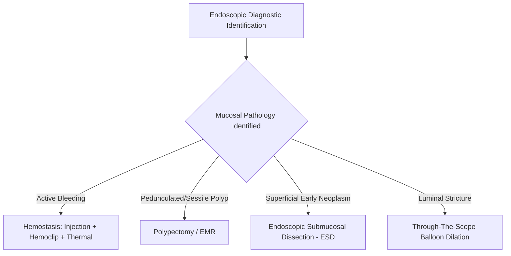
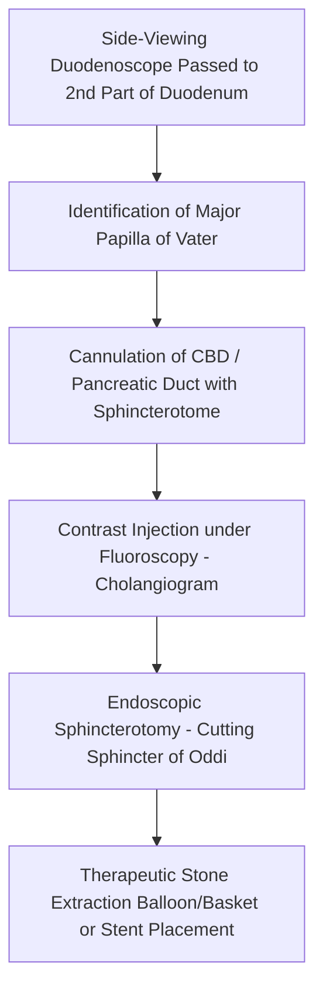
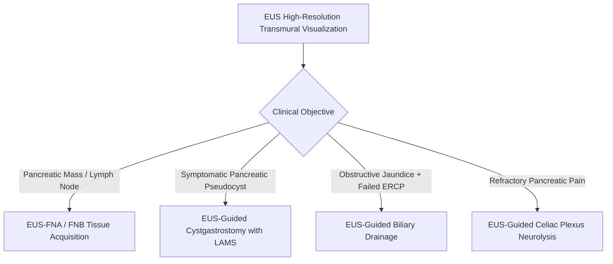

# Chapter 25: Gastrointestinal Endoscopy & Interventions

## 25.1 Diagnostic & Therapeutic Upper/Lower Endoscopy

### Diagnostic Endoscopy Principles
Gastrointestinal endoscopy utilizes flexible fiberoptic or video-endoscopes equipped with high-definition charge-coupled devices (CCD), light sources, water/air channels, and working instruments to visualize mucosal surfaces, obtain targeted biopsies, and perform minimally invasive interventions.

* **Esophagogastroduodenoscopy (EGD / Upper GI Endoscopy)**:
  * Visualizes the mucosal lining of the esophagus, stomach, and $1^{\text{st}}–2^{\text{nd}}$ parts of the duodenum.
  * Major Indications: Unexplained dyspepsia in patients $\ge 55$ years, evaluation of alarm symptoms (dysphagia, odynophagia, persistent vomiting, weight loss, anemia), upper GI bleeding, surveillance of Barrett’s esophagus, biopsy for Celiac disease or *H. pylori*.
  * Diagnostic Modalities: Chromoendoscopy (topical dye spray e.g., Lugol's iodine for squamous lesions, Methylene blue for intestinal metaplasia) and Narrow-Band Imaging (NBI—filters light to blue/green spectrum to accentuate mucosal microvascular patterns).
* **Colonoscopy (Lower GI Endoscopy)**:
  * Visualizes the entire mucosa of the rectum, colon, and terminal ileum.
  * Major Indications: Colorectal cancer screening ($\ge 45$ years in average-risk individuals), evaluation of lower GI bleeding, chronic diarrhea, inflammatory bowel disease (IBD) diagnosis/surveillance, polyp identification/excision.
  * Key Quality Indicators: Adequate bowel preparation (Boston Bowel Preparation Scale $\ge 6$), Cecal Intubation Rate ($\ge 95\%$), and **Adenoma Detection Rate (ADR)** ($\ge 25\%$ in screening exams).

### Therapeutic Endoscopic Interventions
1. **Endoscopic Hemostasis (Upper/Lower GI Bleeding)**:
   * *Injection Therapy*: Submucosal epinephrine ($1:10,000$ dilution) induces local vasoconstriction and initial mechanical tamponade; must always be combined with a second modality.
   * *Thermal Coagulation*: Contact (Bipolar electrocautery, Heater probe) or Non-contact (Argon Plasma Coagulation [APC]) thermal coagulation for angiodysplasias, GAVE (watermelon stomach), or bleeding ulcers.
   * *Mechanical Hemostasis*: **Endoscopic Hemoclips** (over-the-scope or through-the-scope clips) directly compress bleeding vessels (Forrest Ia/Ib/IIa peptic ulcers).
   * *Topical Hemostatic Powders*: Hemospray creates an immediate mechanical barrier over diffuse oozing lesions.
   * *Endoscopic Variceal Ligation (EVL)*: Rubber bands applied over esophageal varices; first-line therapy for active variceal bleeding.
2. **Polypectomy, EMR, and ESD**:
   * *Cold/Hot Snare Polypectomy*: Used for small to medium pedunculated or sessile polyps ($<10–20\text{ mm}$).
   * **Endoscopic Mucosal Resection (EMR)**: Submucosal injection of saline/indigo carmine creates a fluid cushion elevating the lesion away from the muscularis propria, followed by snare electrocautery excision for superficial mucosal neoplasms ($<20\text{ mm}$).
   * **Endoscopic Submucosal Dissection (ESD)**: Utilizes specialized electrosurgical knives to dissect directly through the submucosal plane beneath mucosal lesions, enabling $en-bloc$ resection of large ($>20\text{ mm}$) early neoplastic lesions regardless of size.

---

## 25.2 Endoscopic Retrograde Cholangiopancreatography (ERCP)

### Indications & Technique
ERCP combines side-viewing flexible duodenoscopy with real-time fluoroscopic imaging to diagnose and treat diseases of the biliary and pancreatic ductal systems.

* **Primary Therapeutic Indications**:
  * Choledocholithiasis (bile duct stone extraction).
  * Malignant or benign biliary strictures (tissue acquisition, balloon dilation, and plastic/metal stent placement).
  * Acute cholangitis requiring emergency biliary decompression.
  * Bile duct leaks post-cholecystectomy.
  * Pancreatic ductal strictures, stone clearance, or pseudocyst management.

### Key Procedural Steps
1. The side-viewing scope is advanced to the $2^{\text{nd}}$ part of the duodenum to align with the **Major Papilla of Vater**.
2. A guidewire-loaded sphincterotome selectively cannulates the common bile duct (or main pancreatic duct).
3. Fluoroscopic image acquisition following radiopaque contrast medium injection (**Cholangiogram** or **Pancreatogram**).
4. **Endoscopic Sphincterotomy (Papillotomy)**: Using high-frequency electrosurgical current, the biliary sphincter of Oddi and roof of the papilla are cut in the 11 o'clock to 1 o'clock direction.
5. **Therapeutic Interventions**: Stone extraction using Fogarty-type balloons or Dormia wire baskets; mechanical lithotripsy for large stones ($>15\text{ mm}$); deployment of self-expanding metal stents (SEMS) or plastic stents across strictures.

### Major Complications & Prevention
* **Post-ERCP Pancreatitis (PEP - Most Common Complication, Incidence 5–10%)**:
  * Caused by mechanical trauma, thermal injury, or hydrostatic contrast hyper-pressure at the pancreatic orifice.
  * Diagnostic Criteria: New-onset upper abdominal pain accompanied by serum lipase/amylase $>3\times$ ULN occurring within 24 hours post-procedure, requiring $\ge 2$ days of hospitalization.
  * **Evidence-Based PEP Prevention Protocols**:
    1. Mandatory administration of **100 mg rectal Indomethacin or Diclofenac** immediately before or after the procedure in all eligible patients (inhibits phospholipase $\text{A}_2$ and inflammatory cascades).
    2. Placement of a temporary $3\text{ Fr}$ or $5\text{ Fr}$ prophylactic **pancreatic duct stent** in high-risk patients.
    3. Aggressive goal-directed IV hydration with Ringer's Lactate ($3\text{ L}$ over 24 hours).
* Other Complications: Duodenal/biliary perforation (Retroperitoneal Type I–IV), post-sphincterotomy bleeding, and ascending cholangitis.

---

## 25.3 Endoscopic Ultrasound (EUS)

### Principles & Indications
Endoscopic Ultrasound (EUS) incorporates a high-frequency ultrasound transducer (5–12 MHz) onto the distal tip of a flexible endoscope, providing high-resolution transmural cross-sectional imaging of the GI tract wall layers and adjacent extra-luminal structures (pancreas, biliary tree, lymph nodes, left liver lobe).

* **Anatomical Resolution**: Distinguishes the **5 distinct histological layers** of the GI tract wall:
  1. Layer 1 (Hyperechoic): Superficial mucosa
  2. Layer 2 (Hypoechoic): Deep mucosa & Muscularis mucosae
  3. Layer 3 (Hyperechoic): Submucosa
  4. Layer 4 (Hypoechoic): Muscularis propria
  5. Layer 5 (Hyperechoic): Serosa / Adventitia

| Layer | Echogenicity | Histological Correlate |
| --- | --- | --- |
| Layer 1 | Hyperechoic (White) | Superficial Mucosa / Interface |
| Layer 2 | Hypoechoic (Dark) | Deep Mucosa & Muscularis Mucosae |
| Layer 3 | Hyperechoic (White) | Submucosa (Origin of lipomas) |
| Layer 4 | Hypoechoic (Dark) | Muscularis Propria (Origin of GISTs/Leiomyomas) |
| Layer 5 | Hyperechoic (White) | Serosa / Adventitia |

### Key Clinical Applications
1. **Locoregional Staging of GI Malignancies**:
   * Precise T-staging (depth of wall invasion) and N-staging (regional lymph node involvement) for esophageal, gastric, pancreatic, and rectal cancers.
   * Superior to CT/MRI for detecting small regional lymph node metastases ($<10\text{ mm}$) and localized vascular invasion (portal vein/SMA involvement).
2. **Evaluation of Pancreatobiliary Pathology**:
   * Highest sensitivity for detecting occult choledocholithiasis ($<4\text{ mm}$ stones), pancreatic micro-lesions ($<1\text{ cm}$), chronic pancreatitis changes (Rosemont criteria), and characterizing pancreatic cystic neoplasms (MCN, IPMN, serous cystadenoma).
3. **Subepithelial Lesion Characterization**:
   * Differentiates intramural tumors by layer of origin (e.g., GISTs arise from Layer 4 hypoechoic muscularis propria; Lipomas arise from Layer 3 hyperechoic submucosa).

### Interventional EUS Procedures
* **EUS-Guided Fine-Needle Aspiration / Biopsy (EUS-FNA / FNB)**:
  * Real-time needle advancement across the GI wall into solid pancreatic masses, retroperitoneal lymph nodes, or mediastinal lesions under Doppler vascular guidance.
  * Allows cytological and histological diagnosis without risk of cutaneous needle tract seeding.
* **EUS-Guided Pancreatic Pseudocyst / Walled-Off Necrosis Drainage**:
  * Transgastric placement of lumen-apposing metal stents (LAMS) or double-pigtail plastic stents, establishing a cystgastrostomy route for fluid evacuation and direct endoscopic necrosectomy.
* **EUS-Guided Celiac Plexus Neurolysis (CPN)**:
  * Injection of absolute alcohol and bupivacaine into the celiac ganglion to achieve severe intractable pain relief in advanced unresectable pancreatic cancer.

---

## Index Coverage Checklist & Quality Self-Assessment

### Checklist of Index Subsections
- [x] **25.1 Diagnostic & Therapeutic Upper/Lower Endoscopy**: EGD and Colonoscopy indications, ADR quality metric, Chromoendoscopy/NBI, injection, thermal APC, hemoclip mechanical, EVL banding, Polypectomy, EMR submucosal cushion, ESD *en-bloc* submucosal dissection.
- [x] **25.2 Endoscopic Retrograde Cholangiopancreatography**: Side-viewing duodenoscope, cannulation of Papilla of Vater, fluoroscopic cholangiogram, endoscopic sphincterotomy, stone balloon/basket clearance, stent deployment, Post-ERCP Pancreatitis (PEP) diagnostic criteria, rectal Indomethacin PEP prevention, pancreatic duct stenting.
- [x] **25.3 Endoscopic Ultrasound**: Principles, 5-layer GI wall resolution (Layer 4 hypoechoic GIST origin), T and N locoregional cancer staging, EUS-FNA/FNB tissue sampling, pseudocyst LAMS cystgastrostomy drainage, EUS-guided Celiac Plexus Neurolysis.

### Index Corrections & Clarifications Made
1. *Clarification on PEP Prevention*: Emphasized mandatory pre/post-procedural $100\text{ mg}$ rectal indomethacin as the premier evidence-based guideline for preventing Post-ERCP Pancreatitis.
2. *Clarification on Layer Origin*: Highlighted that GISTs specifically arise from EUS Layer 4 (muscularis propria), distinguishing them from superficial mucosal lesions.

### Unaddressed Topics / Source Limitations
- None. All diagnostic and therapeutic GI endoscopic procedures were fully addressed.

---
