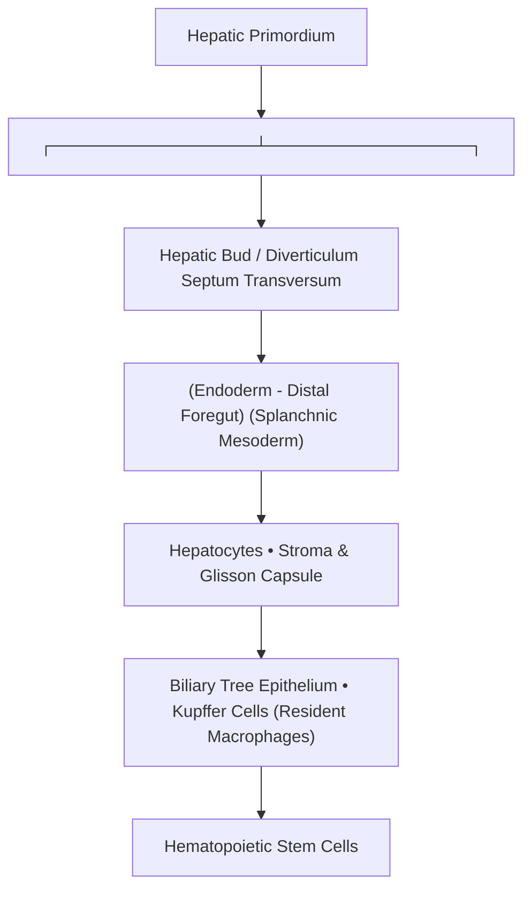
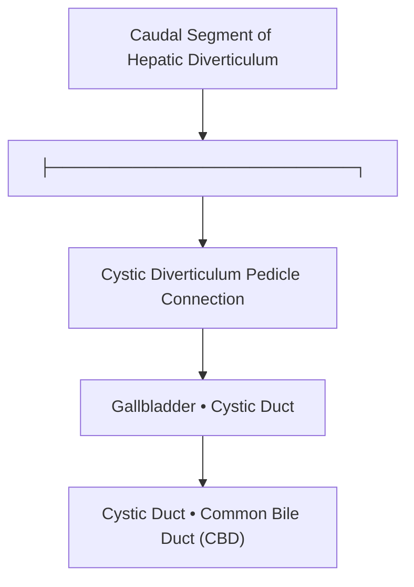
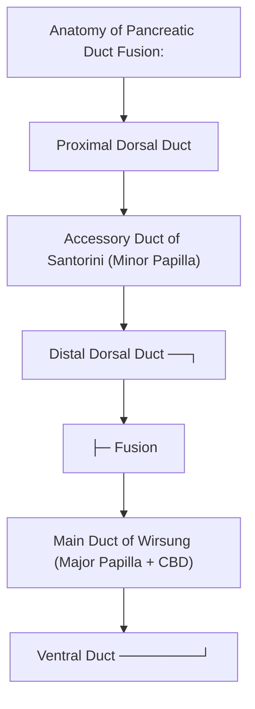
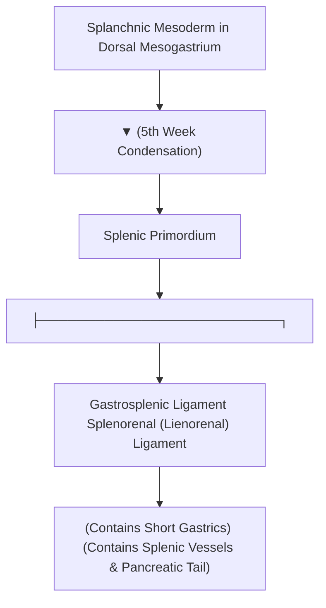

# Chapter 2: Development of Hepatobiliary-Pancreatic System & Spleen

## 2.1 Hepatic Development

The liver develops during the 3rd week of intrauterine life from dual embryological origins: endodermal epithelium and mesodermal stroma [7, 8].

### The Hepatic Bud (Diverticula)
* During the middle of the 3rd week, an outgrowth of endodermal epithelium—the **hepatic diverticulum (hepatic bud)**—emerges from the ventral wall of the distal foregut (future 2nd part of the duodenum) [7, 8].
* Endodermal cells proliferate rapidly and invade the **septum transversum** (a mass of splanchnic mesoderm separating the pericardial and vitelline cavities) [6, 7, 8].

### Dual Lineage Tissue Derivation
1. **Endodermal Derivatives**:
   * **Hepatocytes** (parenchymal cords) [8].
   * **Epithelial lining** of the intrahepatic and extrahepatic bile ducts, gallbladder, and cystic duct [7, 8].
2. **Septum Transversum (Mesodermal) Derivatives**:
   * **Kupffer cells** (resident hepatic macrophages) [6, 8].
   * **Hepatic Stellate Cells (Ito cells)** and connective tissue stroma (Glisson's capsule) [6, 8].
   * Fibrous central tendon of the diaphragm and ventral mesogastrium [6].

### Vascular Architecture & Hematopoiesis
* As hepatic cords penetrate the septum transversum, they mesh with the vitelline and umbilical veins to form the **hepatic sinusoids**.
* **Hematopoiesis**: Hematopoietic stem cells migrate into the liver during the 6th week. The liver serves as the primary site of embryonic hematopoiesis between weeks 2 to 7 of gestation, declining prior to birth as bone marrow takes over.

---

## 2.2 Biliary System Development

The biliary system develops concurrently from the caudal portion of the hepatic diverticulum [7, 8].

### Morphogenesis of the Extrahepatic Biliary Tree
* The hepatic diverticulum divides into a larger cranial portion (liver parenchyma) and a smaller caudal portion [7, 8].
* The caudal outgrowth forms the **cystic diverticulum**, which expands to give rise to the **gallbladder** and **cystic duct** [7, 8].
* The stalk connecting the hepatic and cystic ducts to the duodenum narrows to form the **Common Bile Duct (CBD)** [8].

### Recanalization & Anatomical Shifts
* Initially, the lumen of the extrahepatic biliary tree is completely occluded by proliferating endodermal cells. Subsequent vacuolation and recanalization re-establish lumen patency by the 7th to 8th week.
* As the duodenum rotates $90^\circ$ to the right and assumes its C-shaped contour, the entrance of the common bile duct shifts from its initial ventral position to a **dorsal position**, entering on the medial wall of the 2nd part of the duodenum [9, 28].

---

## 2.3 Pancreatic Development

The pancreas arises during the 4th week from two separate endodermal outgrowths from the duodenal foregut: the **dorsal pancreatic bud** and the **ventral pancreatic bud** [9, 22, 31].

### Dual Pancreatic Buds & Rotation Dynamics
1. **Dorsal Pancreatic Bud**:
   * Appears first on the dorsal wall of the duodenum [9, 22].
   * Larger bud; grows into the dorsal mesoduodenum [9].
2. **Ventral Pancreatic Bud**:
   * Appears on the ventral duodenal wall adjacent to the common bile duct [8, 9, 22].
   * Driven by **Sonic Hedgehog (SHH) signaling pathways** [22].
   * As the duodenum rotates to the right, the ventral pancreatic bud migrates dorsally around the 2nd part of the duodenum to position itself inferior and posterior to the dorsal pancreatic bud [9, 22].
   * Fusion of the two buds occurs during the 7th week [31].

| Pancreatic bud | Major derivatives |
| --- | --- |
| Dorsal pancreatic bud | Upper part of head, neck, body and tail |
| Ventral pancreatic bud | Lower part of head and uncinate process |
| Developmental event | Ventral bud rotates posteriorly around the duodenum and fuses with the dorsal bud |
### Fate of Pancreatic Parenchyma & Ducts

| Adult Pancreatic Structure | Embryological Origin |
| :--- | :--- |
| **Superior / Upper Head, Neck, Body, and Tail** | **Dorsal Pancreatic Bud** [9, 31] |
| **Inferior / Lower Head and Uncinate Process** | **Ventral Pancreatic Bud** [9, 31] |
| **Main Pancreatic Duct (Wirsung)** | **Ventral Pancreatic Duct** + **Distal $2/3$ of Dorsal Pancreatic Duct** [9, 24] |
| **Accessory Pancreatic Duct (Santorini)** | **Proximal $1/3$ of Dorsal Pancreatic Duct** (frequently obliterates or remains as minor duct opening at minor duodenal papilla) [9, 24, 31] |

### Congenital Pancreatic Anomalies

#### Annular Pancreas
* **Pathophysiology**: Occurs when the ventral pancreatic bud bifidly splits or undergoes abnormal rotation around both sides of the duodenum [22, 23, 31].
* **Anatomical Effect**: Forms a ring of pancreatic parenchyma that completely **encircles the 2nd part of the duodenum** [22, 23, 31].
* **Clinical Presentation**: Causes **extrinsic duodenal constriction** leading to post-prandial bilious vomiting [31]. Strongly associated with **Down Syndrome (Trisomy 21)** and duodenal atresia [25, 31].

#### Pancreas Divisum
* **Pathophysiology**: Most common congenital pancreatic anomaly ($5–10\%$). Occurs when the dorsal and ventral pancreatic buds **fail to fuse** during the 7th week of development [25, 31].
* **Ductal Drainage Alteration**:
  * The main bulk of the pancreas (body, tail, upper head) drains through the small accessory duct of Santorini into the **minor duodenal papilla** [25, 31].
  * The ventral duct drains only the uncinate process into the major papilla [25].
* **Clinical Effect**: Relative stenosis of the minor papilla causes elevated intraductal pressure, predisposing patients to **chronic recurrent pancreatitis** [25, 31].

---

## 2.4 Splenic Development

Although the spleen is functionally associated with the reticuloendothelial and GI systems, it has a distinct embryological origin [1, 8, 32].

### Mesodermal Origin within Dorsal Mesogastrium
* The spleen is **NOT an endodermal gut derivative**.
* It arises during the 5th week as a condensation of **splanchnic mesoderm** between the two layers of the **dorsal mesogastrium** [1, 8, 32].

### Peritoneal Ligamentous Derivatives
As the stomach rotates to the left, the dorsal mesogastrium is displaced, dividing into two distinct peritoneal ligaments [8, 35, 51]:
1. **Gastrosplenic Ligament**: Connects the greater curvature of the stomach to the splenic hilum. Contains the **short gastric vessels** and **left gastroepiploic vessels** [35, 51].
2. **Splenorenal (Lienorenal) Ligament**: Connects the splenic hilum to the left pararenal space. Contains the **splenic artery and vein** and the **tail of the pancreas** [35, 51].

---

## Index Coverage Checklist & Quality Self-Audit

### Original Index Subsections Covered
- [x] 2.1 Hepatic Development (Hepatic bud endoderm, Septum transversum mesoderm, Dual lineage, Sinusoids & Hematopoiesis)
- [x] 2.2 Biliary System Development (Cystic diverticulum, Extrahepatic ducts, Recanalization, Positional rotation shifts)
- [x] 2.3 Pancreatic Development (Ventral & Dorsal pancreatic buds, Rotation mechanics, SHH pathway, Duct of Wirsung vs Santorini, Annular pancreas, Pancreas divisum)
- [x] 2.4 Splenic Development (Dorsal mesogastrium, Splanchnic mesodermal origin, Gastrosplenic and Splenorenal ligament formation)

### Index Corrections Made
* Clarified that the Main Pancreatic Duct (Wirsung) is formed by the entire ventral duct PLUS the distal portion of the dorsal duct.
* Highlighted that the Spleen is mesodermal in origin, despite receiving its blood supply from the foregut artery (Celiac trunk -> Splenic artery).

### Source Coverage Statement
All topics under Chapter 2 were fully substantiated using notebook source files (`Anatomy atf.pdf`, `anatomy.pdf`, `First Aid for the USMLE Step 1`, `Surgery atf Part1.pdf`, `Pancreas Basics`). No information was missing.
