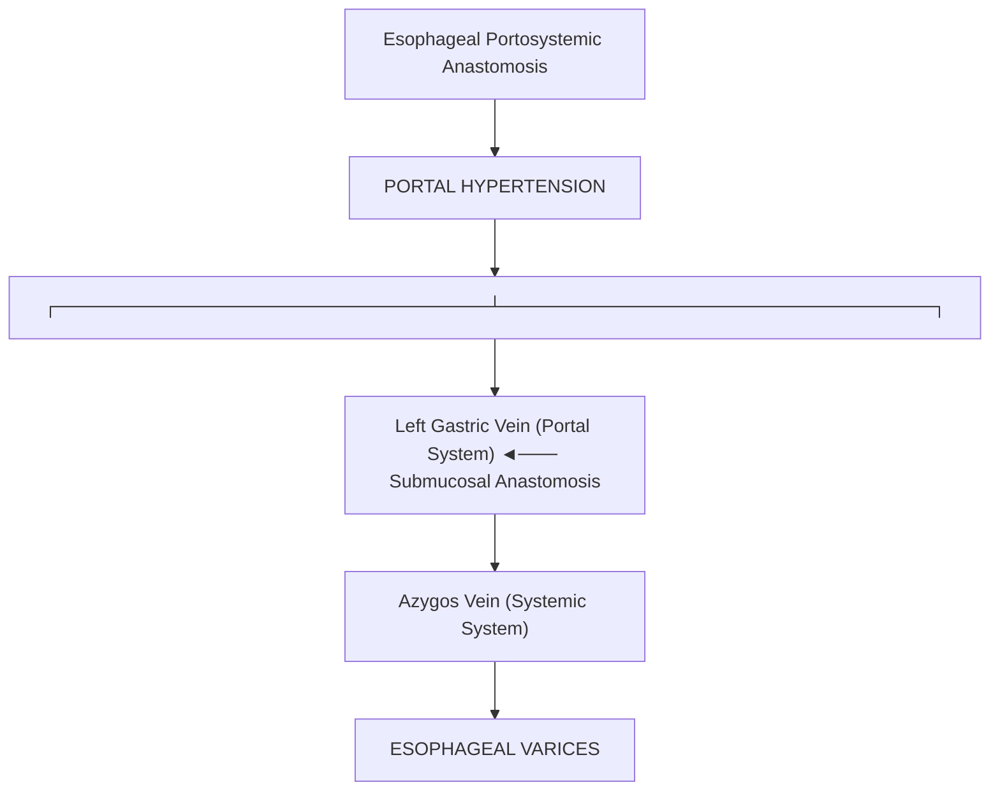

# Chapter 3: Gross Anatomy of the Alimentary Canal

## 3.1 Oral Cavity, Pharynx, & Salivary Glands

### Oral Cavity Anatomy
The oral cavity is divided into the **oral vestibule** (space between cheeks/lips and teeth) and the **oral cavity proper** (bounded anteriorly/laterally by dental arches, superiorly by hard/soft palate, inferiorly by tongue/mylohyoid muscle).

### Anatomy of the Tongue
The tongue is a muscular organ divided into an anterior $2/3$ (oral part) and posterior $1/3$ (pharyngeal part) by the V-shaped **sulcus terminalis**, at the apex of which lies the **foramen cecum** (site of embryological thyroid invagination).

#### Tongue Musculature & Action
* **Intrinsic Muscles** (Superior/Inferior longitudinal, Transverse, Vertical): Alter tongue shape. Innervated by **CN XII** (Hypoglossal nerve).
* **Extrinsic Muscles**: Alter tongue position.
  * **Genioglossus**: **Protrudes tongue** ("The genie comes out of the lamp") [28]. Innervated by **CN XII** [28]. Unilateral lesion causes tongue deviation *toward the side of the lesion*.
  * **Hyoglossus**: **Depresses and retracts** tongue [28]. Innervated by **CN XII** [28].
  * **Styloglossus**: **Draws sides of tongue upward** to form a trough during swallowing ("in style") [28]. Innervated by **CN XII** [28].
  * **Palatoglossus**: **Elevates posterior tongue** during swallowing [28]. Derived from 4th pharyngeal arch; innervated by **CN X (Vagus nerve)** via the pharyngeal plexus [28].

| Region / modality | Innervation |
| --- | --- |
| Anterior two-thirds — general sensation | Lingual nerve, mandibular division of trigeminal nerve (CN V3) |
| Anterior two-thirds — taste | Chorda tympani, facial nerve (CN VII), travelling with the lingual nerve |
| Posterior one-third — general sensation and taste | Glossopharyngeal nerve (CN IX) |
| Epiglottic/base region — taste and sensation | Internal laryngeal branch of vagus nerve (CN X) |
### Major Salivary Glands

| Salivary Gland | Secretion Type | Duct Name & Terminal Opening | Secretomotor Parasympathetic Pathway |
| :--- | :--- | :--- | :--- |
| **Parotid Gland** | Purely Serous | **Stensen's Duct** (opens opposite 2nd upper molar tooth) | Glossopharyngeal (CN IX) $\rightarrow$ Lesser Petrosal $\rightarrow$ **Otic Ganglion** $\rightarrow$ Auriculotemporal nerve ($V_3$) |
| **Submandibular Gland** | Mixed (Mucoserous) | **Wharton's Duct** (opens on papilla lateral to lingual frenulum) | Facial (CN VII) $\rightarrow$ Chorda Tympani $\rightarrow$ **Submandibular Ganglion** $\rightarrow$ Glandular branches |
| **Sublingual Gland** | Predominantly Mucous | Ducts of Rivinus / **Bartholin's Duct** (opens into sublingual fold) | Facial (CN VII) $\rightarrow$ Chorda Tympani $\rightarrow$ **Submandibular Ganglion** $\rightarrow$ Sublingual branches |

---

## 3.2 Esophagus

The esophagus is a muscular tube (~25 cm long) extending from the cricoid cartilage ($C_6$ level) to the cardiac orifice of the stomach ($T_{11}$ level).

### Anatomical Subdivisions
1. **Cervical Esophagus**: Extends from $C_6$ to $T_1$ (thoracic inlet).
2. **Thoracic Esophagus**: Extends from $T_1$ to $T_{10}$ (passes through esophageal hiatus of diaphragm).
3. **Abdominal Esophagus**: Short segment (~1.25 cm) extending from $T_{10}$ to $T_{11}$ (cardia).

### Four Anatomical Constrictions
Constrictions are critical clinical sites where swallowed foreign bodies lodge or caustic injuries concentrate [27]:

| Constriction Site | Anatomical Landmark | Distance from Incisor Teeth |
| :--- | :--- | :--- |
| **1st Constriction** | Pharyngoesophageal junction (Cricopharyngeus muscle) [27] | **15 cm** (6 inches) [27] |
| **2nd Constriction** | Crossing of the **Aortic Arch** [27] | **22.5 cm** (9 inches) [27] |
| **3rd Constriction** | Crossing of the **Left Main Bronchus** | **27.5 cm** (11 inches) [27] |
| **4th Constriction** | Diaphragmatic hiatus ($T_{10}$ level) | **40 cm** (15 inches) [27] |

### Neurovascular Supply & Portosystemic Anastomosis
* **Arterial Supply**: Upper $1/3$ (Inferior thyroid artery); Middle $1/3$ (Thoracic aortic esophageal branches); Lower $1/3$ (Left gastric artery branch) [3, 27].
* **Venous Drainage & Portosystemic Anastomosis**:
  * Distal esophageal submucosal veins form an important **portosystemic anastomosis** between the **Left Gastric Vein** (Portal system) and the **Azygos / Hemiazygos Veins** (Systemic circulation) [1, 38].
  * Portal hypertension causes these veins to engorge, forming **esophageal varices**, susceptible to lethal rupture [1, 38].

---

## 3.3 Stomach

The stomach is a J-shaped muscular organ occupying the epigastric, umbilical, and left hypochondriac regions.

### External Anatomy & Regions
* **Cardia**: Surrounds the gastroesophageal orifice ($T_{11}$).
* **Fundus**: Dome-shaped region above the horizontal line through the cardiac notch.
* **Body**: Main region between fundus and incisura angularis.
* **Pyloric Antrum & Canal**: Extends from incisura angularis to the pylorus ($L_1$ level / Transpyloric plane of Addison).

### Stomach Bed Relations
The posterior surface of the stomach rests upon structures forming the **stomach bed** (separated by the lesser sac) [3, 4]:
1. Diaphragm (left crus) [3].
2. Spleen [3].
3. Left kidney and left suprarenal gland [3, 4].
4. Splenic artery (tortuous course along upper border of pancreas) [3, 4].
5. Pancreas (body and tail) [4].
6. Transverse mesocolon and splenic flexure of colon [3, 4].

| Stomach bed structure | Adjacent organ / structure |
| --- | --- |
| Superior and posterior | Diaphragm |
| Posterior | Pancreas (body and tail) and splenic artery |
| Posterior | Left kidney and left suprarenal gland |
| Posterolateral | Spleen |
| Inferior | Transverse mesocolon and transverse colon |
### Arterial Blood Supply
The stomach has an abundant arterial anastomotic network derived entirely from the **Celiac Trunk** [3, 27, 37]:
* **Lesser Curvature**: **Left Gastric Artery** (direct branch of celiac trunk) [3] and **Right Gastric Artery** (branch of proper hepatic artery) [3].
* **Greater Curvature**: **Left Gastroepiploic Artery** (branch of splenic artery) [3] and **Right Gastroepiploic Artery** (branch of gastroduodenal artery) [3, 27].
* **Fundus**: **Short Gastric Arteries** (5 to 7 small branches from splenic artery passing through gastrosplenic ligament) [3, 35].

---

## 3.4 Small Intestine

Extends from the pylorus to the ileocecal junction (~6 meters long).

### Duodenum (Parts & Vascular Relations)
C-shaped loop (~25 cm long) wrapping around the head of the pancreas [22, 32].
1. **1st Part (Superior - 5 cm)**: Initial $2.5\text{ cm}$ is intraperitoneal (duodenal cap); posterior relations include gastroduodenal artery, bile duct, and portal vein.
2. **2nd Part (Descending - 7.5 cm)**: Contains the **Major Duodenal Papilla** (Ampulla of Vater insertion for CBD and main pancreatic duct) and Minor Duodenal Papilla [24, 28, 31].
3. **3rd Part (Horizontal - 10 cm)**: Crosses anterior to IVC and aorta at $L_3$ level [4, 7].
   * **Superior Mesenteric Artery (SMA) Syndrome**: Compression of the 3rd part of the duodenum in the acute angle between the Abdominal Aorta and SMA, resulting in post-prandial bilious vomiting.
4. **4th Part (Ascending - 2.5 cm)**: Terminates at the duodenojejunal (DJ) flexure, suspended by the **Ligament of Treitz** (suspensory muscle of duodenum).

### Jejunum vs. Ileum Comparison

| Feature | Jejunum (Proximal $2/5$) | Ileum (Distal $3/5$) |
| :--- | :--- | :--- |
| **Location** | Upper left abdomen | Lower right abdomen and pelvis |
| **Wall & Diameter** | Thick, heavy wall; larger lumen | Thin, light wall; smaller lumen |
| **Vascularity** | High vascularity (deep red) | Less vascularity (pale pink) |
| **Mesenteric Vessels** | 1–2 simple arterial arcades; **long vasa recta** | 3–5 complex arterial arcades; **short vasa recta** |
| **Mesenteric Fat** | Minimal fat near intestinal border ("fat windows") | Abundant fat extending onto intestinal wall |
| **Plicae Circulares** | Large, tall, closely packed (feathered on barium) [36] | Sparse, low in proximal ileum; **absent in distal ileum** [36] |
| **Lymphoid Tissue** | Solitary lymphatic follicles | **Peyer's Patches** (aggregated lymphoid follicles in lamina propria) [36] |

| Feature | Jejunum | Ileum |
| --- | --- | --- |
| Arterial arcades | Few (usually 1–2) and simple | Numerous (often 3–5) and complex |
| Vasa recta | Long | Short |
| Mesenteric fat | Less; clear windows | More; approaches the intestinal border |
### Root of the Mesentery
The root of the small intestinal mesentery (~15 cm long) attaches diagonally across the posterior abdominal wall from the **duodenojejunal flexure** (left side of $L_2$) to the **right sacroiliac joint** [4].
* **Structures Crossed by Root of Mesentery**:
  1. 3rd part of duodenum [4].
  2. Abdominal Aorta [4].
  3. Inferior Vena Cava (IVC) [4].
  4. Right ureter [4].
  5. Right psoas major muscle [4].
  6. Right gonadal vessels [4].

---

## 3.5 Large Intestine & Anorectal Region

Extends from the ileocecal valve to the anus (~1.5 meters long). Distinguished externally by **Teniae Coli** (3 longitudinal muscle bands), **Haustra** (sacculations), and **Epiploic Appendages** (fat-filled peritoneal pouches).

### Appendix & Cecum
* **Cecum**: Blind pouch in right iliac fossa below ileocecal valve opening.
* **Appendix**: Worm-like diverticulum arising from posteromedial cecal wall ~2 cm below ileocecal valve, where teniae coli converge.
  * **McBurney's Point**: Junction of the lateral $1/3$ and medial $2/3$ of the line connecting the Right Anterior Superior Iliac Spine (ASIS) to the umbilicus (site of maximal tenderness in appendicitis).
  * **Positions**: Retrocecal ($65\%$, most common), Pelvic ($30\%$), Subcecal, Pre-ileal, Post-ileal.

### Pectinate (Dentate) Line & Anal Canal Architecture
The pectinate line marks the boundary between the embryonic hindgut (endoderm) and proctodeum (ectoderm) [29, 39, 40].

| Feature | Above pectinate line | Below pectinate line |
| --- | --- | --- |
| Embryological origin | Hindgut endoderm | Proctodeum ectoderm |
| Epithelium | Columnar | Stratified squamous |
| Innervation / pain | Visceral; relatively insensitive to cutting | Somatic; pain-sensitive |
| Hemorrhoidal plexus | Internal | External |
| Venous drainage | Predominantly portal | Predominantly systemic |
### Comparative Anatomy of Upper vs. Lower Anal Canal

| Feature | Upper Anal Canal (Above Pectinate Line) | Lower Anal Canal (Below Pectinate Line) |
| :--- | :--- | :--- |
| **Embryological Origin** | Hindgut Endoderm [39, 40] | Proctodeum (Anal Pit) Ectoderm [39, 40] |
| **Epithelial Lining** | Simple Columnar / Transitional Epithelium [40] | Stratified Squamous Non-keratinized Epithelium [40] |
| **Arterial Supply** | **Superior Rectal Artery** (terminal branch of IMA) [5, 40] | **Inferior Rectal Artery** (branch of internal pudendal) [40] |
| **Venous Drainage** | **Superior Rectal Vein** $\rightarrow$ IMV $\rightarrow$ Portal System [38, 40] | **Inferior Rectal Vein** $\rightarrow$ Internal Iliac Vein $\rightarrow$ IVC [40] |
| **Innervation** | Visceral (Inferior Hypogastric Plexus); **Insensitive to pain** [39, 40] | Somatic (Inferior Rectal Nerve from Pudendal $S_2–S_4$); **Exquisitely sensitive to pain** [39, 40] |
| **Lymphatic Drainage** | Internal Iliac Lymph Nodes [40] | **Superficial Inguinal Lymph Nodes** [40] |
| **Pathology** | **Internal Hemorrhoids** (painless) [39, 40], Adenocarcinoma [40] | **External Hemorrhoids** (painful) [39, 40], Anal Fissures [39, 40], Squamous Cell Carcinoma [40] |

---

## Index Coverage Checklist & Quality Self-Audit

### Original Index Subsections Covered
- [x] 3.1 Oral Cavity, Pharynx, & Salivary Glands (Tongue extrinsic muscles & innervation [genie out of lamp], Salivary ducts Stensen/Wharton/Bartholin & parasympathetic pathways)
- [x] 3.2 Esophagus (Subdivisions, 4 Constrictions [15, 22.5, 27.5, 40 cm], Neurovascular supply, Portosystemic anastomosis & varices)
- [x] 3.3 Stomach (Regions, Stomach bed relations, Blood supply from celiac branches)
- [x] 3.4 Small Intestine (Duodenal 1st–4th parts, SMA syndrome, Jejunum vs Ileum comparative table, Root of mesentery structures crossed)
- [x] 3.5 Large Intestine & Anorectal Region (Appendix McBurney's point, Pectinate line architecture, Comparative upper vs lower anal canal table)

### Index Corrections Made
* Verified distances of esophageal constrictions from incisors: $15\text{ cm}$, $22.5\text{ cm}$, $27.5\text{ cm}$, $40\text{ cm}$.
* Highlighted that internal hemorrhoids receive visceral innervation and are painless, whereas external hemorrhoids receive somatic pudendal innervation and are painful.

### Source Coverage Statement
All topics under Chapter 3 were fully substantiated using notebook source files (`Anatomy atf.pdf`, `anatomy.pdf`, `First Aid for the USMLE Step 1`, `Surgery atf Part 2.pdf`, `Surgery atf Part1.pdf`). No information was missing.
