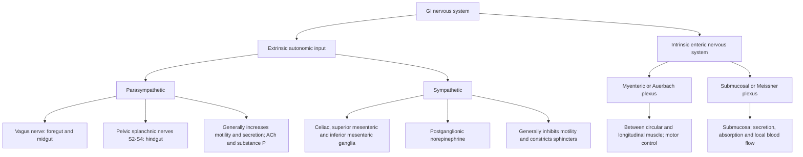
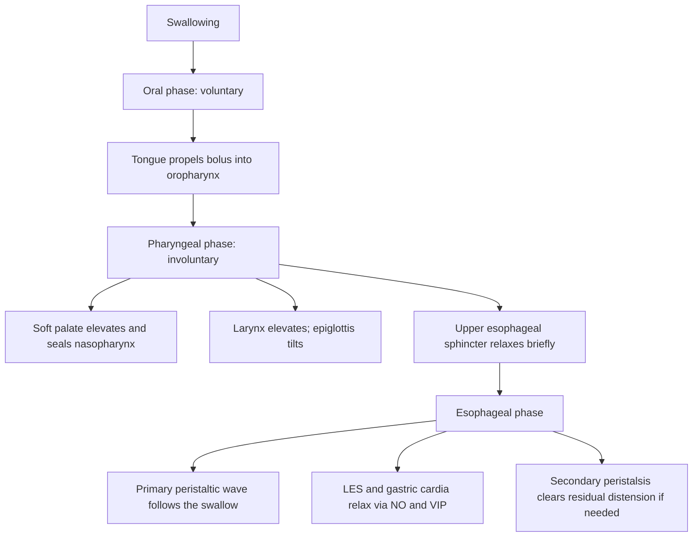

# Chapter 6: Enteric Nervous System & GI Motility

## 6.1 Innervation of the GI Tract

The gastrointestinal tract possesses an extensive, semi-autonomous intrinsic neuronal network—the **Enteric Nervous System (ENS)**—comprising over 100 million neurons (often termed the "second brain"), modulated by extrinsic sympathetic and parasympathetic inputs.

### 1. Intrinsic Nervous System: Enteric Nervous System (ENS)
Organized into two major ganglionated plexuses extending continuously from the esophagus to the internal anal sphincter:

1. **Myenteric (Auerbach) Plexus**:
   * *Location*: Intermuscular connective tissue plane between the inner circular and outer longitudinal smooth muscle layers of the muscularis externa.
   * *Primary Function*: Linear motor control along the gut length. Regulates overall tone, rhythmic contraction frequency, and propagation velocity of peristaltic waves.
   * *Neurotransmitters*:
     * *Excitatory (Motor)*: **Acetylcholine (ACh)** and **Substance P** (induce smooth muscle contraction above the bolus).
     * *Inhibitory (Motor)*: **Nitric Oxide (NO)**, **Vasoactive Intestinal Peptide (VIP)**, and **ATP** (induce smooth muscle relaxation below the bolus).
2. **Submucosal (Meissner) Plexus**:
   * *Location*: Submucosal connective tissue layer.
   * *Primary Function*: Secretomotor and local sensory integration. Regulates glandular secretion, intestinal fluid transport, local mucosal blood flow, and muscularis mucosae contraction.

### 2. Extrinsic Nervous System Modulators

#### Parasympathetic Nervous System (Excitatory)
* **Anatomical Origin**:
  * *Vagus Nerve (CN X)*: Provides preganglionic innervation to the esophagus, stomach, small intestine, ascending colon, and proximal two-thirds of the transverse colon (foregut and midgut).
  * *Pelvic Splanchnic Nerves (S2, S3, S4)*: Provide preganglionic innervation to the distal one-third of the transverse colon, descending colon, sigmoid colon, and rectum (hindgut).
* **Synaptic Organization**: Preganglionic parasympathetic fibers synapse directly onto postganglionic enteric neurons within the Auerbach and Meissner plexuses.
* **Action**: Generally **excitatory**—increases smooth muscle motility, increases glandular secretions, relaxes GI sphincters, and enhances digestive throughput.

#### Sympathetic Nervous System (Inhibitory)
* **Anatomical Origin**: Preganglionic fibers originate from thoracolumbar spinal segments (T5–L2) and synapse in prevertebral ganglia (Celiac, Superior Mesenteric, and Inferior Mesenteric Ganglia). Postganglionic noradrenergic fibers innervate the GI tract.
* **Mechanism of Action**:
  * Direct inhibition of enteric secretomotor and motor neurons via $\alpha_2$-adrenergic receptors.
  * Direct constriction of GI blood vessels via $\alpha_1$-adrenergic receptors, shunting blood toward skeletal muscle and heart.
  * Direct constriction of GI anatomical sphincters via $\alpha_1$-adrenergic receptors.
* **Overall Effect**: **Inhibitory**—decreases intestinal motility and secretion, increases sphincter tone.

---

## 6.2 Electrophysiology of GI Smooth Muscle

Gastrointestinal smooth muscle displays continuous, intrinsic electrical activity characterized by slow membrane potential oscillations punctuated by action potentials.

**Schematic interpretation:** GI smooth muscle exhibits rhythmic slow-wave oscillations in membrane potential. Slow waves alone do not necessarily produce contraction. When the depolarising peak reaches threshold (approximately −40 mV in the schematic), spike potentials occur; these are associated with calcium entry and a stronger contractile response. The tracing is conceptual, not a calibrated electrophysiology graph.
### 1. Basal Electrical Rhythm (BER) / Slow Waves
* **Definition**: Spontaneous, rhythmic oscillations of the resting membrane potential (ranging between -65 mV and -45 mV) that propagate along gastrointestinal smooth muscle sheets.
* **Origin**: Initiated by specialized pacemaker cells embedded within the muscle layers called **Interstitial Cells of Cajal (ICCs)**. ICCs form an extensive syncytial network connected to smooth muscle cells via gap junctions.
* **Nature**: Slow waves **do not directly cause muscle contraction** on their own (except in the stomach). Instead, they set the maximal rhythmic frequency at which contractions can occur when threshold is crossed.
* **Organ-Specific BER Frequencies**:
  * **Stomach**: ~3 cycles/min
  * **Duodenum**: ~12 cycles/min (highest frequency in GI tract)
  * **Ileum**: ~8–9 cycles/min
  * **Cecum/Colon**: ~6 cycles/min

### 2. Spike Potentials & Contraction Mechanics
* **Spike Potentials**: True action potentials generated when the depolarizing peak of a slow wave exceeds the threshold of approximately **-40 mV**.
* **Ion Channels Involved**: Unlike cardiac/skeletal action potentials (Na+-driven), GI spike potentials are mediated primarily by the influx of calcium ions via **voltage-gated L-type $\text{Ca}^{2+}$ channels** (slow calcium-sodium channels).
* **Excitation-Contraction Coupling**: Intracellular $\text{Ca}^{2+}$ elevation binds to **Calmodulin**, activating **Myosin Light Chain Kinase (MLCK)**, which phosphorylates myosin light chains, enabling cross-bridge cycling and smooth muscle tension development.
* **Modulation**:
  * *Depolarizers (Increase Spikes/Tone)*: Acetylcholine, parasympathetic stimulation, physical distension, gastrin, motilin.
  * *Hyperpolarizers (Decrease Spikes/Relax)*: Norepinephrine, epinephrine, sympathetic stimulation, VIP, Nitric Oxide.

---

## 6.3 Motility Patterns Along the Gastrointestinal Tract

### 1. Deglutition (Swallowing) & Esophageal Motility
Deglutition is a complex reflex organized by the medullary **swallowing center** in the brainstem.

* **Pharyngeal Phase**: Involuntary reflex. UES relaxes briefly while respiration is transiently inhibited (deglutition apnea).
* **Primary Esophageal Peristalsis**: Progressive wave of ring-like contraction initiated by swallowing. Propagates down the esophagus at 3–5 cm/sec, reaching the stomach in 8–10 seconds.
* **Secondary Esophageal Peristalsis**: Initiated locally by sensory stretch receptors if the primary wave fails to clear residual food or in response to refluxed gastric contents. Independent of medullary center; mediated via intrinsic ENS reflexes.
* **Lower Esophageal Sphincter (LES) Function**:
  * High-pressure tonic zone (15–25 mmHg resting pressure) maintained by myogenic tone and cholinergic input.
  * Receptively relaxes 1–2 seconds after swallow initiation via enteric non-adrenergic non-cholinergic (NANC) neurons releasing **Nitric Oxide (NO)** and **VIP**.
  * **Achalasia**: Pathology resulting from loss of inhibitory NANC myenteric neurons in distal esophagus $\rightarrow$ Failure of LES relaxation + absent peristalsis.

### 2. Gastric Motility
1. **Receptive Relaxation**: Swallowing reflex triggers anticipatory relaxation of the stomach fundus and body before food arrives (mediated by vagal NANC fibers releasing NO/VIP).
2. **Gastric Accommodation**: Visceral relaxation accommodating up to 1.5 L of food with minimal increase in intragastric pressure (vago-vagal reflex).
3. **Antral Trituration & Retropulsion**: Pacemaker BER (3/min) initiates peristaltic waves in the mid-stomach moving toward the closed pylorus. Strong terminal antral contraction against the tight pyloric sphincter forces solid food backward (**retropulsion**), shearing particles down to $< 1–2\text{ mm}$ (chyme).
4. **Gastric Emptying**: Regulated by duodenal feedback. Inhibited by duodenal acidity (Secretin), hyperosmolality, luminal lipid content (CCK), and duodenal distension (enterogastric reflex).

### 3. Small Intestinal Motility
* **Segmentation**:
  * Concentric ring-like contractions appearing at spaced intervals along a bowel segment, followed by relaxation and appearance of new contractions in intermediate sites.
  * Primary **mixing movement** of the small intestine. Sloshes chyme back and forth, exposing it to digestive enzymes and absorptive enterocytes without net forward propulsion.
* **Peristalsis**:
  * Progressive contraction above a bolus (mediated by ACh/Substance P) combined with receptive relaxation below the bolus (mediated by NO/VIP)—the **Law of the Gut**.
  * Primary **propulsive movement** (~1–2 cm/sec velocity).

### 4. Interdigestive Motility: The Migrating Motor Complex (MMC)
In the fasting state (between meals), segmentation and peristalsis cease and are replaced by the MMC.

| MMC phase | Approximate duration | Electrical / motor activity |
| --- | --- | --- |
| Phase I | 45–60 min | Quiescent period; slow waves without spike bursts or significant contractions |
| Phase II | 30–45 min | Irregular spike potentials and contractions |
| Phase III | 5–15 min | Regular, high-amplitude contractions at maximal frequency; the migrating “housekeeping” phase |
| Phase IV | 0–5 min | Transition back to Phase I |
* **Physiological Role**: Acts as an intestinal "housekeeping" mechanism. Sweeps undigested particulate residue, desquamated cells, and luminal debris from the stomach and small intestine into the colon, preventing bacterial overgrowth in the small bowel.
* **Hormonal Control**: Mediated by the cyclic release of **Motilin** from duodenal M cells. Feeding immediately abolishes the MMC, restoring digestive segmentation.

### 5. Colonic Motility & Defecation
* **Haustral Shuffling**: Local segmental mixing movements churning colonic contents to maximize water and electrolyte reabsorption.
* **Mass Movements**: High-amplitude propagating contractions occurring 1–3 times per day (typically triggered after meals via the **Gastrocolic Reflex**, mediated by CCK and gastrin). Forces fecal material into the empty rectum.
* **Defecation Reflex**:
  1. Distension of the rectal wall fires pelvic visceral afferents to the sacral spinal cord.
  2. Parasympathetic efferents via pelvic splanchnic nerves induce involuntary contraction of the rectum and sigmoid colon + relaxation of the **Internal Anal Sphincter** (smooth muscle).
  3. Voluntary relaxation of the **External Anal Sphincter** (striated muscle, pudendal nerve) combined with increased intra-abdominal pressure (Valsalva maneuver) leads to expulsion of feces.

---

## Quality Checklist

- [x] **6.1 Innervation of the GI Tract**
- [x] **6.2 Electrophysiology of GI Smooth Muscle**
- [x] **6.3 Motility Patterns Along the Gastrointestinal Tract**

### Index Corrections Made
* Verified BER organ frequencies (Duodenum 12/min, Stomach 3/min, Colon 6/min).
* Explicitly defined the molecular mechanism of Achalasia (loss of NO/VIP myenteric neurons).

### Topics Pending Source Expansion
* None.
