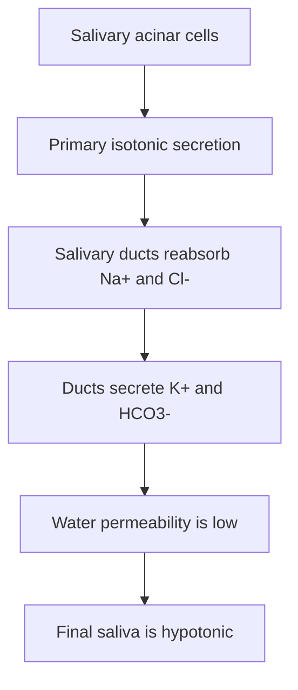
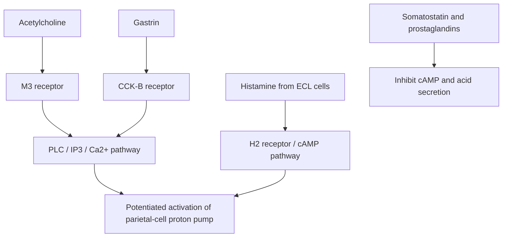
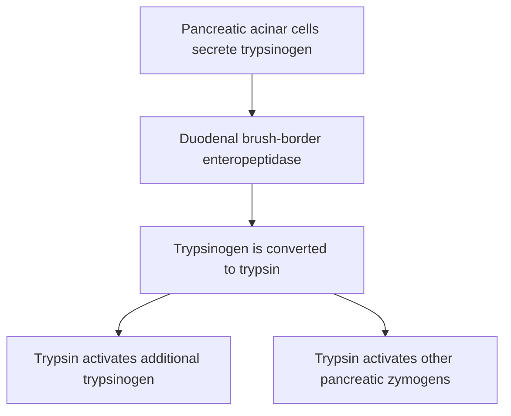
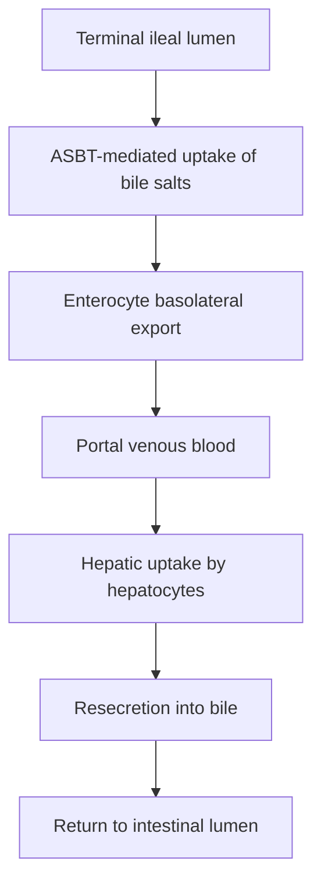

# Chapter 7: Gastrointestinal Secretions & Regulation

## 7.1 Salivary Secretion

Saliva is a hypotonic fluid secreted by three pairs of major salivary glands (Parotid, Submandibular, Sublingual) and numerous minor buccal glands. Total daily volume is 1.0–1.5 Liters.

### 1. Two-Stage Model of Salivary Secretion

1. **Primary Acinar Secretion**: Acinar cells produce an **isotonic primary fluid** possessing electrolyte concentrations nearly identical to plasma ($[\text{Na}^+] \approx 145$, $[\text{Cl}^-] \approx 100$, $[\text{K}^+] \approx 4$, $[\text{HCO}_3^-] \approx 24\text{ mEq/L}$).
2. **Ductal Modification**: As primary saliva flows through intercalated and striated ducts, ductal epithelial cells actively reabsorb $\text{Na}^+$ and $\text{Cl}^-$ while secreting $\text{K}^+$ and $\text{HCO}_3^-$. Because ductal cell tight junctions are **impermeable to water**, solute reabsorption exceeds water reabsorption, making the final saliva **hypotonic**.

### 2. Flow Rate Dynamics
* **Unstimulated / Low Flow Rate**: Saliva spends prolonged time in contact with ductal cells $\rightarrow$ Maximum $\text{Na}^+$ and $\text{Cl}^-$ reabsorption $\rightarrow$ Extreme **hypotonicity** (lowest $[\text{Na}^+]$ and $[\text{Cl}^-]$, elevated $[\text{K}^+]$).
* **Stimulated / High Flow Rate**: Rapid transit minimizes ductal contact time $\rightarrow$ Final saliva composition approaches primary acinar fluid (elevated $[\text{Na}^+]$ and $[\text{Cl}^-]$; elevated $[\text{HCO}_3^-]$ due to direct secretagogue ductal stimulation). $[\text{K}^+]$ remains higher than plasma.

### 3. Autonomic Regulation
Salivary glands are unique in being **stimulated by both parasympathetic and sympathetic divisions** (parasympathetic is quantitatively dominant):
* **Parasympathetic (CN VII & IX)**: Triggered by taste, smell, or chewing via solitary nucleus. Cholinergic postganglionic activation of $M_3$ receptors increases intracellular $\text{IP}_3/\text{Ca}^{2+}$, inducing **copious, watery saliva** rich in enzymes, accompanied by intense kallikrein-mediated vasodilation.
* **Sympathetic (T1–T3)**: Superior cervical ganglion postganglionic noradrenergic activation of $\beta$-adrenergic receptors increases intracellular cAMP, inducing a **small volume of thick, viscid, mucin-rich saliva**.

---

## 7.2 Gastric Secretion & Acid-Base Physiology

### 1. Cellular Mechanism of Gastric Acid ($\text{HCl}$) Secretion

**Parietal-cell hydrochloric acid secretion**

1. Carbonic anhydrase II catalyses formation of intracellular $H^+$ and $HCO_3^-$ from $CO_2$ and water.
2. The apical $H^+/K^+$-ATPase secretes $H^+$ into the canaliculus in exchange for $K^+$; potassium is recycled through apical channels.
3. Chloride exits across the apical membrane and combines with luminal hydrogen ions to form hydrochloric acid.
4. Bicarbonate exits basolaterally in exchange for chloride, producing the post-prandial **alkaline tide** in gastric venous blood.

1. **Intracellular $\text{H}^+$ Generation**: Cytosolic **Carbonic Anhydrase II** catalyzes $\text{CO}_2 + \text{H}_2\text{O} \rightleftharpoons \text{H}_2\text{CO}_3 \rightleftharpoons \text{H}^+ + \text{HCO}_3^-$.
2. **Apical Proton Pumping**: The primary active **$\text{H}^+/\text{K}^+$-ATPase (Proton Pump)** pumps $\text{H}^+$ out across the apical canalicular membrane into the lumen against a $1:1,000,000$ concentration gradient in exchange for $\text{K}^+$.
3. **Apical Chloride Efflux**: $\text{Cl}^-$ flows passively down its electrochemical gradient into the lumen through apical chloride channels, pairing with $\text{H}^+$ to form $\text{HCl}$.
4. **Basolateral Bicarbonate Exit**: $\text{HCO}_3^-$ generated inside the cell exits across the basolateral membrane into systemic capillaries via a $\text{HCO}_3^-/\text{Cl}^-$ anion exchanger. This influx of bicarbonate into gastric venous blood following a meal creates the **Post-Prandial Alkaline Tide**.

### 2. Neurohormonal Regulation of Parietal Cells

* **Direct Stimulants**:
  1. **Histamine**: Released by ECL cells. Binds parietal $\text{H}_2$ receptors $\rightarrow$ Activates $G_{\alpha s}$ $\rightarrow$ Stimulates Adenylyl Cyclase $\rightarrow \uparrow\text{cAMP} \rightarrow$ Activates Protein Kinase A (PKA). **Strongest physiological stimulus for acid secretion**.
  2. **Acetylcholine (ACh)**: Released by postganglionic vagal fibers. Binds parietal $M_3$ receptors $\rightarrow$ Activates $G_{\alpha q}$ $\rightarrow \uparrow\text{IP}_3/\text{Ca}^{2+}$.
  3. **Gastrin**: Released by G cells. Binds parietal $\text{CCK}_B$ receptors $\rightarrow$ Activates $G_{\alpha q}$ $\rightarrow \uparrow\text{IP}_3/\text{Ca}^{2+}$.
* **Potentiation Effect**: Simultaneous activation of cAMP and $\text{Ca}^{2+}$ pathways yields an acid output greater than the sum of individual stimuli. This is why blocking one pathway (e.g., $\text{H}_2$ blocker) markedly reduces overall response to ACh and Gastrin.
* **Direct Inhibitors**:
  1. **Somatostatin**: Binds SST-2 receptors $\rightarrow$ Activates $G_{\alpha i}$ $\rightarrow$ Inhibits Adenylyl Cyclase, lowering cAMP. Also directly suppresses ECL histamine release and G-cell gastrin release.
  2. **Prostaglandins ($\text{PGE}_2/\text{PGI}_2$)**: Bind $\text{EP}_3$ receptors on parietal cells, lowering cAMP. Simultaneously stimulate surface mucous/bicarbonate secretion and mucosal blood flow.

### 3. Phases of Gastric Secretion
1. **Cephalic Phase (30%)**: Initiated by sight, smell, taste, or thought of food. Mediated entirely by the **Vagus nerve**. Vagal fibers directly stimulate parietal cells (ACh) and G cells (releasing Gastrin-Releasing Peptide [GRP]).
2. **Gastric Phase (60%)**: Initiated by distension of the stomach (vago-vagal and local enteric reflexes) and presence of digested amino acids/peptides in the antrum directly stimulating G cells to release Gastrin.
3. **Intestinal Phase (10%)**: Initiated by presence of amino acids in the proximal duodenum (transient gastrin release). Followed by powerful inhibitory feedback as chyme acidity ($\text{pH} < 2.0$), lipids, and hyperosmolality trigger **Secretin**, **CCK**, **GIP**, and the enterogastric reflex to halt gastric acid production.

---

## 7.3 Pancreatic Secretion & Zymogen Activation

The exocrine pancreas secretes 1.5–2.0 Liters/day of an alkaline, enzyme-rich fluid.

### 1. Ductal Bicarbonate Secretion

**Pancreatic ductal bicarbonate secretion**

- Ductal cells generate intracellular bicarbonate from carbon dioxide and water via carbonic anhydrase.
- Bicarbonate is secreted apically through chloride/bicarbonate exchange; CFTR recycles luminal chloride to support this exchange.
- Basolateral transporters maintain intracellular ion gradients and move acid equivalents toward the blood.
- **Secretin** increases cAMP and stimulates ductal bicarbonate-rich fluid secretion.

* **Mechanism**: Ductal cells express high levels of Carbonic Anhydrase. Intracellular $\text{HCO}_3^-$ is actively transported across the apical membrane into the ductal lumen via a $\text{Cl}^-/\text{HCO}_3^-$ exchanger (SLC26A6).
* **CFTR Role**: The **Cystic Fibrosis Transmembrane Conductance Regulator (CFTR)** is an apical $\text{Cl}^-$ channel that recycles $\text{Cl}^-$ back into the lumen to maintain luminal $\text{Cl}^-$ levels required for the $\text{Cl}^-/\text{HCO}_3^-$ exchanger to operate.
  * *Clinical Correlation (Cystic Fibrosis)*: Defective CFTR impairs $\text{Cl}^-$ recycling $\rightarrow$ Loss of ductal $\text{HCO}_3^-$ and water secretion $\rightarrow$ Hyperviscid proteinaceous secretions plug pancreatic ducts $\rightarrow$ Ductal ectasia, acinar atrophy, fibrosis, and pancreatic exocrine insufficiency.
* **Control**: **Secretin** (released from duodenal S cells in response to luminal $\text{pH} < 4.5$) binds ductal receptors, raising cAMP, opening CFTR channels, and driving maximum $\text{HCO}_3^-$ output.

### 2. Acinar Enzyme Secretion & The Zymogen Cascade
* **Pancreatic Enzymes**:
  * *Proteolytic Zymogens*: Trypsinogen, Chymotrypsinogen, Procarboxypeptidases A/B, Proelastase.
  * *Active Enzymes*: Pancreatic Amylase, Lipase, Colipase, Phospholipase $\text{A}_2$, Cholesterol Ester Hydrolase, Ribonuclease, Deoxyribonuclease.
* **Regulation**: **Cholecystokinin (CCK)** (released by duodenal I cells in response to fatty acids and peptides) acts via $\text{CCK}_1$ receptors ($G_{\alpha q}/\text{IP}_3/\text{Ca}^{2+}$) to induce acinar exocytosis of zymogen granules.

* **Preventing Autodigestion in the Pancreas**:
  1. Synthesis of proteolytic enzymes as inactive **zymogens**.
  2. Packaging of zymogens in membrane-bound vesicles separated from the cytosol.
  3. Co-packaging of **Pancreatic Secretory Trypsin Inhibitor (PSTI / SPINK1)**, which inactivates up to 20% of prematurely formed trypsin inside acinar granules.
  4. Condensation of zymogens at an acidic internal pH.

---

## 7.4 Bile Secretion & Enterohepatic Circulation

Bile is an isotonic aqueous fluid synthesized continuously by hepatocytes (~500–1000 mL/day), modified by cholangiocytes, and concentrated in the gallbladder.

### 1. Composition of Hepatic Bile
* **Bile Salts (67%)**: Primary detergent molecules essential for lipid emulsification.
* **Phospholipids (22%)**: Predominantly **Lecithin** (phosphatidylcholine); solubilizes cholesterol inside mixed micelles.
* **Cholesterol (4%)**: Unesterified cholesterol; primary route for total body cholesterol elimination.
* **Bile Pigments (0.3%)**: Predominantly **Conjugated Bilirubin** (bilirubin diglucuronide).
* **Electrolytes and Water**.

### 2. Synthesis & Conjugation of Bile Acids
* **Primary Bile Acids**: **Cholic Acid** and **Chenodeoxycholic Acid** synthesized from cholesterol in hepatocytes. The rate-limiting enzyme is **Cholesterol $7\alpha$-hydroxylase (CYP7A1)** (inhibited by returning bile acids via FXR signaling).
* **Conjugation**: Before excretion, primary bile acids are conjugated with **Glycine** or **Taurine** (3:1 ratio) to lower their $\text{p}K_a$ from ~6 to ~2, making them fully ionized at intestinal pH (**Bile Salts**), preventing passive absorption in the proximal intestine.
* **Secondary Bile Acids**: Intestinal anaerobic bacteria in the distal ileum and colon deconjugate bile salts and perform $7\alpha$-dehydroxylation:
  * Cholic Acid $\rightarrow$ **Deoxycholic Acid**.
  * Chenodeoxycholic Acid $\rightarrow$ **Lithocholic Acid** (toxic, largely excreted in feces).

### 3. Enterohepatic Circulation

* **Ileal Reabsorption**: Over **95%** of the bile salt pool (~2.5 grams, recycled 4–12 times/day) is reabsorbed in the **terminal ileum** via the **Apical Sodium-Dependent Bile Acid Transporter (ASBT)**.
* **Hepatic Uptake**: Reabsorbed bile salts pass through portal circulation bound to albumin and are avidly cleared by hepatocytes via the basolateral **$\text{Na}^+$-Taurocholate Cotransporting Polypeptide (NTCP)**.
* **Fecal Excretion**: Only ~5% (~0.5 g/day) escapes ileal reabsorption and is excreted in feces. This fecal loss equals daily hepatic synthesis from cholesterol.
* *Clinical Correlation (Ileal Resection in Crohn Disease)*: Disease or surgical resection of $>50\text{ cm}$ of terminal ileum depletes the bile salt pool $\rightarrow$ Hepatic synthesis cannot compensate $\rightarrow$ Unabsorbed bile salts pass into colon causing secretory **choleretic diarrhea**; impaired fat digestion leads to **steatorrhea** and fat-soluble vitamin deficiencies.

---

## 7.5 Summary Matrix of Major GI Hormones

| Hormone | Primary Source | Stimulus for Secretion | Major Actions | Clinical Applications / Pathophysiology |
| :--- | :--- | :--- | :--- | :--- |
| **Gastrin** | G cells (Antrum, Duodenum) | Oligopeptides, amino acids, antral distension, vagal (GRP) | $\uparrow \text{HCl}$ secretion from parietal cells; $\uparrow$ gastric mucosal growth | Excess in **Zollinger-Ellison Syndrome** (Gastrinoma) $\rightarrow$ severe recurrent PUD |
| **Cholecystokinin (CCK)** | I cells (Duodenum, Jejunum) | Fatty acids, monoglycerides, small peptides | $\uparrow$ Gallbladder contraction, $\uparrow$ pancreatic acinar secretion, delays gastric emptying, relaxes Sphincter of Oddi | Diagnostic gallbladder ejection fraction assessment (CCK-cholescintigraphy) |
| **Secretin** | S cells (Duodenum) | Luminal acid ($\text{pH} < 4.5$), fatty acids | $\uparrow$ Pancreatic & biliary $\text{HCO}_3^-$ secretion, $\downarrow \text{HCl}$ secretion | Secretin stimulation test for ZES and chronic pancreatic insufficiency |
| **GIP** | K cells (Duodenum, Jejunum) | Luminal glucose, amino acids, fatty acids | $\uparrow$ Glucose-dependent insulin release (Incretin), $\downarrow \text{HCl}$ secretion | Basis for incretin-based diabetes therapeutics |
| **GLP-1** | L cells (Ileum, Colon) | Luminal nutrients | $\uparrow$ Glucose-dependent insulin, $\downarrow$ glucagon, delays gastric emptying, promotes satiety | **GLP-1 Receptor Agonists** (Semaglutide, Liraglutide) used for T2DM and obesity |
| **Somatostatin** | D cells (Stomach, Pancreas) | Luminal acid | Universal inhibitor of GI secretions, motility, and blood flow | **Octreotide** (synthetic analog) treats acute variceal bleeds, VIPomas, carcinoid syndrome |
| **Motilin** | M cells (Duodenum, Jejunum) | Fasting / Interdigestive state | Initiates Migrating Motor Complexes (Phase III MMCs) | **Erythromycin** acts as motilin receptor agonist to treat gastroparesis |
| **Ghrelin** | P/D1 cells (Stomach fundus) | Hypoglycemia, fasting | Orexigenic (stimulates hunger via hypothalamic NPY/AgRP) | Levels drop post-sleeve gastrectomy, contributing to sustained weight loss |

---

## Quality Checklist

- [x] **7.1 Salivary Secretion**
- [x] **7.2 Gastric Secretion & Acid-Base Physiology**
- [x] **7.3 Pancreatic Secretion & Zymogen Activation**
- [x] **7.4 Bile Secretion & Enterohepatic Circulation**
- [x] **7.5 Summary Matrix of Major GI Hormones**

### Index Corrections Made
* Verified ductal electrolyte transport dynamics in saliva and pancreatic juice.
* Added explicit CFTR molecular mechanisms in pancreatic ductal $\text{HCO}_3^-$ transport.

### Topics Pending Source Expansion
* None.
