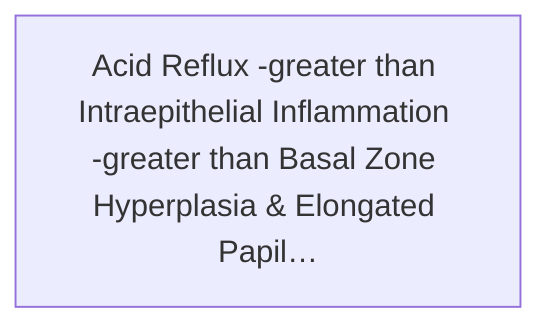
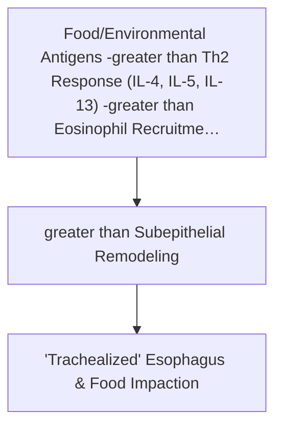
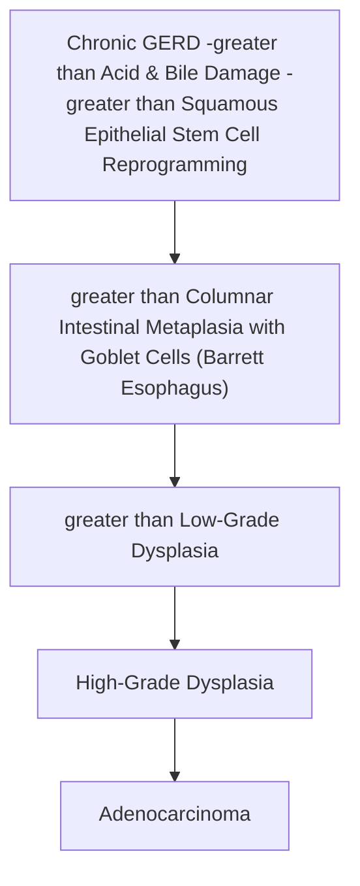

# Chapter 9: Pathology of the Esophagus

## 9.1 Esophageal Motility Disorders

Esophageal motility disorders result from impaired neuromuscular coordination of the esophageal body, lower esophageal sphincter (LES), or both. They present primarily with **dysphagia** (difficulty swallowing) to both solids and liquids, non-cardiac chest pain, and regurgitation.

| Disorder | Core mechanism / manometric pattern | Typical clue |
| --- | --- | --- |
| Achalasia | Impaired LES relaxation with absent or abnormal peristalsis; loss of inhibitory myenteric neurons | Bird’s-beak narrowing; dysphagia to solids and liquids |
| Diffuse esophageal spasm | Premature, uncoordinated contractions | Corkscrew appearance; intermittent chest pain/dysphagia |
| Hypercontractile (jackhammer) esophagus | Excessively vigorous peristaltic contractions | High distal contractile integral on high-resolution manometry |
| Scleroderma esophagus | Smooth-muscle atrophy/fibrosis with hypotensive LES and weak or absent distal peristalsis | Severe reflux due to an incompetent LES |
### A. Achalasia
* **Definition**: A primary neurodegenerative motility disorder characterized by a triad of:
  1. **Incomplete relaxation of the lower esophageal sphincter (LES)** upon swallowing.
  2. **Elevated resting LES tone** ($>30\text{ mmHg}$).
  3. **Aperistalsis** of the distal two-thirds (smooth muscle portion) of the esophageal body.

* **Pathophysiology & Etiology**:
  * **Primary Achalasia** (Idiopathic): Driven by cytotoxic T-cell-mediated autoimmune destruction or viral-induced inflammation of the **inhibitory postganglionic neurons** in the myenteric (Auerbach) plexus. Loss of neuronal nitric oxide synthase (nNOS) and vasoactive intestinal peptide (VIP) leads to uninhibited cholinergic (acetylcholine, Substance P) excitatory tone $\rightarrow$ failure of LES relaxation and loss of coordinated peristalsis.
  * **Secondary Achalasia (Pseudoachalasia)**: Caused by external neural invasion or degeneration:
    * **Chagas Disease**: Infection by *Trypanosoma cruzi* destroys myenteric plexuses throughout the GI tract, causing megaesophagus, megacolon, and dilated cardiomyopathy.
    * **Malignancy-associated Pseudoachalasia**: Infiltration of the GE junction myenteric plexus by adenocarcinoma of the stomach or small cell lung carcinoma.

* **Clinical Manifestations**:
  * Progressive **dysphagia to BOTH solids and liquids** simultaneously from onset (unlike mechanical obstruction where solid dysphagia precedes liquid dysphagia).
  * Regurgitation of undigested food (especially at night / recumbent), nocturnal coughing, and aspiration pneumonia.
  * Difficulty belching, substernal chest pain, and weight loss.

* **Diagnostic Investigations**:
  1. **High-Resolution Esophageal Manometry (HREM)** (*Gold Standard*): Demonstrates aperistalsis and an elevated Integrated Relaxation Pressure (IRP $>15\text{ mmHg}$). Classified into 3 Chicago types:
     * *Type I (Classic)*: 100% failed peristalsis, no esophageal pressurization.
     * *Type II (Pan-esophageal Pressurization)*: 100% failed peristalsis with pan-esophageal pressurization in $\ge 20\%$ of swallows (most responsive to therapy).
     * *Type III (Spastic)*: Spastic contractions in $\ge 20\%$ of swallows.
  2. **Barium Swallow Radiography**: Shows smooth, symmetric, conical tapering of the distal esophagus terminating at the GE junction (**"Bird's Beak" or "Pencil Tip" sign**) with proximal esophageal dilation and loss of gastric air bubble.
  3. **Upper GI Endoscopy (EGD)**: Mandatory to exclude pseudoachalasia/malignancy. Shows dilated esophagus with retained food/fluid and a tight LES that opens with gentle instrument pressure ("pop" sensation).

- **High-resolution manometry:** Elevated integrated relaxation pressure (IRP) with absent peristalsis supports achalasia; interpret using the current Chicago Classification and laboratory-specific reference limits.
- **Barium esophagram:** Smooth distal tapering (“bird’s beak”) with proximal dilatation.
- **Upper endoscopy:** Exclude a mechanical obstruction or pseudoachalasia, including malignancy at the gastroesophageal junction.
* **Management Options**:
  * *Endoscopic / Surgical*:
    * **Peroral Endoscopic Myotomy (POEM)**: Endoscopic dissection of circular muscle fibers of distal esophagus and LES.
    * **Laparoscopic Heller Myotomy**: Surgical division of LES muscle fibers, typically combined with a partial fundoplication (Dor or Toupet) to prevent severe post-operative GERD.
    * **Pneumatic Balloon Dilation**: Disruption of LES muscle fibers via high-pressure air balloon.
  * *Pharmacological / Temporary*:
    * **Botulinum Toxin Injection**: Injected endoscopically into the LES to block presynaptic acetylcholine release (used in elderly/frail patients; high recurrence rate within 6–12 months).
    * **Oral Smooth Muscle Relaxants**: Calcium channel blockers (Nifedipine) or Nitrates (Isosorbide dinitrate) taken sublingually before meals.

---

### B. Diffuse Esophageal Spasm (DES) & Hypercontractile Disorders
* **Diffuse Esophageal Spasm (DES) / Distal Esophageal Spasm**:
  * *Pathophysiology*: Uncoordinated, repetitive, high-amplitude tertiary contractions caused by transient loss of inhibitory nitric oxide signaling in the distal esophagus.
  * *Clinical Features*: Intermittent non-cardiac chest pain (mimicking angina pectoris) and dysphagia precipitated by stress, hot, or cold liquids.
  * *Barium Swallow*: Classic **"Corkscrew Esophagus"** or **"Rosary Bead Esophagus"** pattern due to multiple simultaneous non-peristaltic contractions.
  * *Manometry*: Premature contractions (distal latency $<4.5\text{ seconds}$) in $>20\%$ of swallows with normal LES relaxation.
  * *Treatment*: CCBs, nitrates, tricyclic antidepressants (low-dose for visceral hypersensitivity), and sildenafil.

* **Nutcracker / Jackhammer Esophagus (Hypercontractile Esophagus)**:
  * *Pathophysiology*: Excessive cholinergic drive producing coordinated peristaltic waves with ultra-high amplitudes ($>180\text{ mmHg}$ in Nutcracker; distal contractile integral [DCI] $>8000\text{ mmHg}\cdot\text{s}\cdot\text{cm}$ in Jackhammer).
  * *Treatment*: Smooth muscle relaxants, POEM in refractory cases.

* **Scleroderma Esophagus (Systemic Sclerosis)**:
  * *Pathophysiology*: Atrophy of smooth muscle layer in the distal two-thirds of the esophagus accompanied by collagenous fibrosis and microvascular obliterative vasculitis.
  * *Triad*: **Severe hypotensive LES** (resting pressure $<10\text{ mmHg}$), **aperistalsis of distal smooth muscle**, and **severe intractable GERD** leading to peptic strictures.

---

## 9.2 Inflammatory & Vascular Conditions

### A. Gastroesophageal Reflux Disease (GERD) & Erosive Esophagitis
* **Definition**: Chronic mucosal damage caused by retrograde flow of acidic gastric content (and occasionally bile/pancreatic enzymes) into the esophagus.

* **Pathophysiologic Mechanisms**:
  1. **Transient Lower Esophageal Sphincter Relaxations (TLESRs)**: Spontaneous vasovagal reflexes uncoupled from swallowing; the primary mechanism in patients with normal resting LES tone.
  2. **Hypotensive LES**: Resting tone $<10\text{ mmHg}$ (precipitated by chocolate, caffeine, alcohol, nicotine, anticholinergics, progesterone).
  3. **Anatomic Disruption**: Hiatal hernia (sliding Type I) spatial separation of the intrinsic LES from the extrinsic diaphragmatic crura pinch, impinging clear clearance.
  4. **Delayed Gastric Emptying** and **Impaired Esophageal Clearance**.

* **Histopathology**:
  * Basal zone hyperplasia (exceeding $>20\%$ of total epithelial thickness).
  * Elongation of lamina propria papillae extending into the upper third of the epithelium.
  * Intraepithelial infiltration of eosinophils, neutrophils, and lymphocytes.
  * Dilated intercellular spaces ("spongiosis").

* **Clinical Features**:
  * *Typical*: Pyrosis (heartburn - substernal burning sensation), regurgitation, dysphagia, water brash (reflex hypersalivation).
  * *Atypical / Extraesophageal*: Chronic cough, asthma-like bronchospasm, laryngitis, hoarseness, dental enamel erosion.

* **Complications**: Peptic stricture formation (fibrotic luminal narrowing at GE junction), esophageal ulceration, hemorrhage, and **Barrett Esophagus**.

---

### B. Eosinophilic Esophagitis (EoE)
* **Definition**: Chronic, immune/antigen-mediated allergic inflammatory disorder of the esophagus.

* **Pathophysiology**: Th2-mediated allergic response driven by food or environmental antigens. Interleukins (IL-4, IL-5, IL-13) trigger eotaxin-3 secretion, causing selective eosinophilic recruitment and subepithelial remodeling/fibrosis.

* **Clinical Presentation**:
  * Children: Feeding refusal, failure to thrive, vomiting, abdominal pain.
  * Adults: Recurrent **solid food dysphagia** and sudden **food impaction** requiring emergency endoscopic removal. Strongly associated with other atopic conditions (asthma, allergic rhinitis, eczema).

* **Diagnostic Criteria**:
  1. Symptoms of esophageal dysfunction.
  2. Esophageal biopsy showing **$\ge 15$ eosinophils per high-power field (HPF)** in the most involved area.
  3. Endoscopic findings: Stacked circular mucosal rings (**"Trachealized Esophagus"** or **"Feline Esophagus"**), linear furrows, white mucosal exudates (eosinophilic microabscesses), and strictures.
  4. Exclusion of other causes of esophageal eosinophilia (e.g., GERD).

* **Management**:
  * *6-Food Elimination Diet* (milk, wheat, egg, soy, nuts, seafood/shellfish).
  * *Topical Swallowed Corticosteroids*: Swallowed Fluticasone propionate or oral viscous Budesonide slurry.
  * *Proton Pump Inhibitors* (PPI-responsive esophageal eosinophilia).
  * *Biologics*: Dupilumab (Anti-IL-4R$\alpha$ monoclonal antibody).
  * *Endoscopic Balloon Dilation* for persistent fibrotic strictures.

---

### C. Infectious Esophagitis
Occurs almost exclusively in immunocompromised hosts (HIV/AIDS with CD4 count $<100/\mu\text{L}$, organ transplant recipients, chemotherapy, chronic immunosuppression).

| Pathogen | Endoscopic Appearance | Microscopic / Histopathological Findings | First-Line Treatment |
| :--- | :--- | :--- | :--- |
| ***Candida albicans*** | Friable, adherent, yellowish-white pseudomembranous plaques on erythematous mucosa | Budding yeast cells and **pseudohyphae** invading superficial squamous epithelium (PAS / Grocott silver stain +) | Oral Fluconazole |
| **Herpes Simplex Virus (HSV-1)** | Multiple small, volcano-like, **punched-out shallow ulcers** with raised edges | Multinucleated giant cells, **nuclear molding, chromatin marginalization, and Cowdry A inclusions** at ulcer margins | IV/Oral Acyclovir |
| **Cytomegalovirus (CMV)** | Linear, deep, elongated, **shallow geographic ulcers** in mid-to-distal esophagus | Intranuclear **"Owl's eye" inclusions** and intracytoplasmic inclusions within **endothelial and stromal cells** at ulcer base | IV Ganciclovir / Valganciclovir |

---

### D. Vascular & Traumatic Conditions

#### 1. Mallory-Weiss Syndrome vs. Boerhaave Syndrome
* **Mallory-Weiss Syndrome**:
  * *Pathology*: Non-transmural, mucosal/submucosal longitudinal laceration at the gastroesophageal junction or gastric cardia.
  * *Etiology*: Sudden, massive increase in intra-abdominal/intragastric pressure caused by severe, forceful retching, vomiting, or coughing (frequently associated with **acute alcohol intoxication**).
  * *Presentation*: Painless **hematemesis** following repeated bouts of non-bloody emesis.
  * *Course*: $80–90\%$ resolve spontaneously; endotherapy (hemoclips, epinephrine injection) required for active bleeding.

* **Boerhaave Syndrome**:
  * *Pathology*: **Transmural, full-thickness rupture** of the distal esophagus (most commonly the left posterolateral wall $2–3\text{ cm}$ proximal to GE junction).
  * *Presentation*: Severe, sudden-onset retrosternal/epigastric pain following violent vomiting.
  * *Physical Signs*: **Mackler's Triad** (Vomiting, chest pain, subcutaneous emphysema). Subcutaneous crepitus, mediastinal crunch sound on auscultation synchronized with heartbeat (**Hamman's Crunch**).
  * *Complications*: Rapid leakage of gastric contents into mediastinum $\rightarrow$ severe chemical and bacterial **mediastinitis**, pleural effusion (high amylase, low pH), sepsis, and high mortality.
  * *Diagnosis*: CT chest with oral water-soluble contrast (Gastrografin - avoid barium due to mediastinal fibrosis). Emergency surgical/endoscopic repair.

#### 2. Esophageal Varices
* **Pathophysiology**: Dilated submucosal veins in the distal esophagus formed as a collateral pathway to bypass hepatic resistance in **Portal Hypertension** (portal venous pressure gradient $>10–12\text{ mmHg}$).
* **Anastomotic Circuit**: Left Gastric (Coronary) Vein (Portal System) $\leftrightarrow$ Azygos and Hemiazygos Veins (Systemic Circuit).
* **Clinical Features**: Asymptomatic until rupture, which produces catastrophic, painless, massive hematemesis, melena, and hypovolemic shock.
* **Prophylaxis & Management**:
  * *Primary Prophylaxis*: Non-selective $\beta$-blockers (Propranolol, Nadolol) to reduce portal inflow via $\beta_1$ cardiac output drop and $\beta_2$ splanchnic vasoconstriction, or Endoscopic Variceal Ligation (EVL).
  * *Acute Bleeding Management*:
    1. Hemodynamic resuscitation (restrictive blood transfusion targeting $\text{Hb } 7–8\text{ g/dL}$).
    2. Vasoactive therapy: **Terlipressin** or **Octreotide** (somatostatin analog causing selective splanchnic vasoconstriction).
    3. Emergency EGD within 12 hours: **Endoscopic Variceal Ligation (EVL)** (banding).
    4. Antibiotic prophylaxis (Ceftriaxone) to prevent SBP and sepsis.
    5. Refractory bleeding: **TIPS** (Transjugular Intrahepatic Portosystemic Shunt) or Sengstaken-Blakemore balloon tamponade.

---

## 9.3 Esophageal Neoplasms

### A. Barrett Esophagus
* **Definition**: A chronic complication of GERD characterized by the **metaplastic replacement** of the normal distal esophageal stratified squamous epithelium by **columnar epithelium containing goblet cells** (intestinal metaplasia).

* **Gross & Endoscopic Findings**: Salmon-pink, velvety mucosal tongues extending proximally from the gastroesophageal junction above the Z-line.
* **Microscopic Histology**: Simple columnar epithelium with intestinal-type **Goblet Cells** (contain acidic mucins that stain positive with **Alcian Blue** at pH 2.5).

* **Malignant Risk & Surveillance Protocol**:
  * Barrett esophagus is a premalignant lesion increasing the risk of **Esophageal Adenocarcinoma** by 30–40 fold ($0.2–0.5\%$ per year).
  * **Seattle Surveillance Biopsy Protocol** (4-quadrant biopsies every $1–2\text{ cm}$):
    * *No Dysplasia*: Endoscopy every 3–5 years.
    * *Low-Grade Dysplasia (LGD)*: Endoscopic radiofrequency ablation (RFA) or surveillance EGD every 6–12 months.
    * *High-Grade Dysplasia (HGD)*: Endoscopic Eradication Therapy (Endoscopic Mucosal Resection [EMR] + RFA) or surgical esophagectomy.

---

### B. Esophageal Malignancies: Squamous Cell Carcinoma vs. Adenocarcinoma

| Feature | Squamous Cell Carcinoma (SCC) | Adenocarcinoma |
| :--- | :--- | :--- |
| **Primary Epidemiology** | Most common esophageal cancer *worldwide*; higher in Asia, Africa, Eastern Europe | Most common esophageal cancer in *Western nations*; rapidly rising incidence |
| **Anatomical Location** | **Upper and Middle 1/3** of esophagus ($90\%$) | **Distal 1/3** of esophagus and GE junction |
| **Major Risk Factors** | **Alcohol consumption** and **Tobacco smoking** (synergistic), achalasia, caustic injury, Plummer-Vinson syndrome, hot beverage ingestion, tylosis (*RHBDF2* mutation) | **Long-standing GERD**, **Barrett Esophagus**, obesity (BMI $>30$), tobacco smoking (alcohol is NOT a risk factor) |
| **Precursor Lesion** | Squamous dysplasia | Barrett Esophagus (Intestinal Metaplasia $\rightarrow$ Dysplasia) |
| **Histopathology** | Nest of malignant squamous cells with **keratin pearls**, intercellular bridges, and eosinophilic cytoplasm | Glandular architecture forming tubules/acinocytes with mucin production, invading muscularis |
| **Clinical Presentation** | Progressive dysphagia (solids $\rightarrow$ liquids), rapid weight loss, odynophagia, hoarseness (recurrent laryngeal nerve involvement), cough (tracheoesophageal fistula) | Progressive dysphagia, weight loss, retrosternal pain, early satiety |
| **Lymphatic Spread** | Upper 1/3: Cervical nodes; Middle 1/3: Mediastinal/Paratracheal nodes | Distal 1/3: **Celiac and Gastric nodes** |

---

## Index Coverage Checklist

- [x] 9.1 Esophageal Motility Disorders
  - [x] Achalasia
  - [x] Diffuse Esophageal Spasm
  - [x] Nutcracker / Jackhammer Esophagus
  - [x] Scleroderma Esophagus
- [x] 9.2 Inflammatory & Vascular Conditions
  - [x] GERD & Erosive Esophagitis
  - [x] Eosinophilic Esophagitis
  - [x] Infectious Esophagitis
  - [x] Mallory-Weiss vs. Boerhaave Syndrome
  - [x] Esophageal Varices
- [x] 9.3 Esophageal Neoplasms
  - [x] Barrett Esophagus
  - [x] Squamous Cell Carcinoma
  - [x] Adenocarcinoma

## Index Corrections Made
* None required. All subheadings align with modern clinical gastroenterology standards.

## Topics Needing Additional Source Material
* None. All pathophysiologic mechanisms, diagnostic algorithms, and therapeutic guidelines are fully elaborated.
