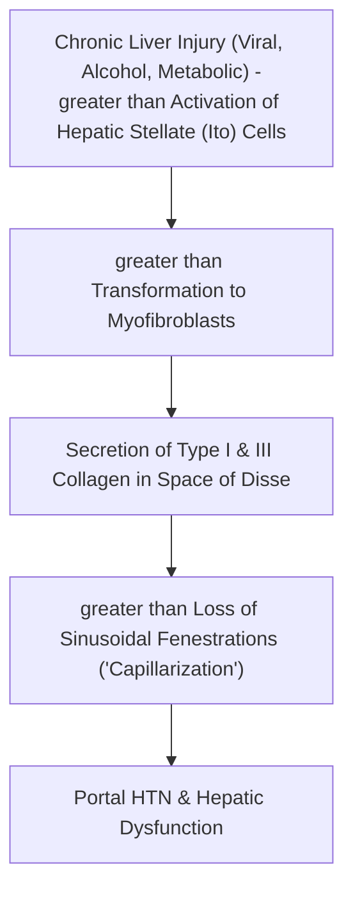
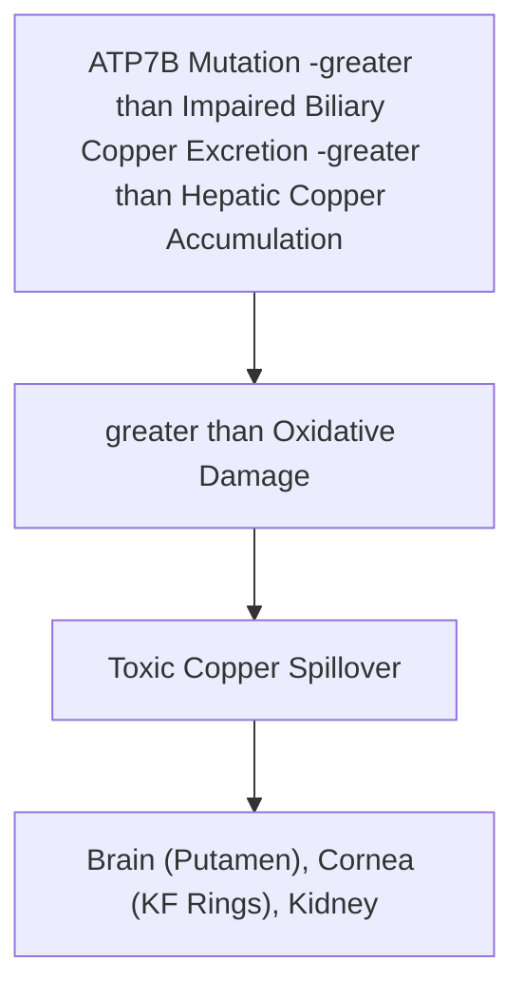
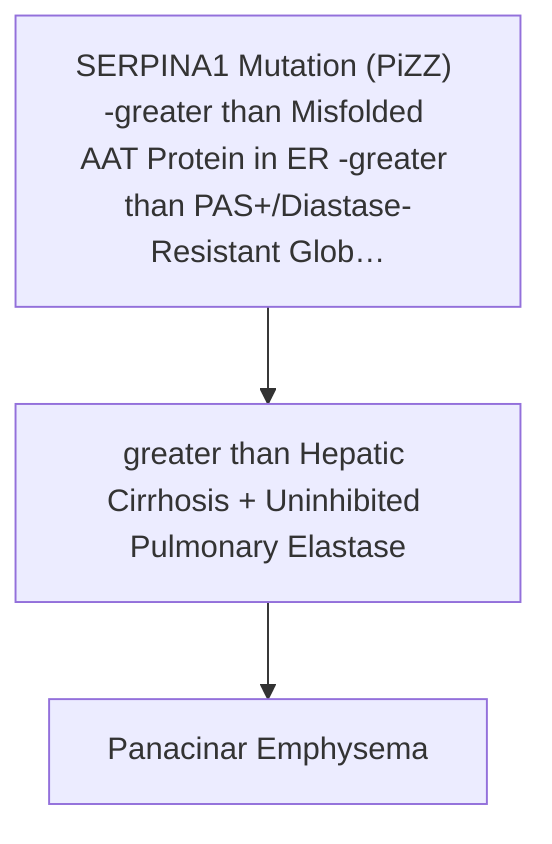

# Chapter 12A: Hepatic Injury, Cirrhosis & Metabolic/Inherited Liver Diseases

## 12.1 Patterns of Hepatic Injury & Cirrhosis

### A. Patterns of Hepatic Cellular Injury
1. **Reversible Injury**:
   * *Hepatocyte Swelling (Ballooning Degeneration)*: Hydropic swelling due to ionic pump failure.
   * *Steatosis (Fatty Change)*: Microvesicular (small lipid droplets without nuclear displacement; acute fatty liver of pregnancy, Reye syndrome, tetracycline toxicity) vs. Macrovesicular (single large lipid droplet pushing nucleus to periphery; alcohol, NAFLD, hepatitis C).
2. **Irreversible Injury (Apoptosis & Necrosis)**:
   * *Councilman Bodies (Acidophilic Bodies)*: Apoptotic, intensely eosinophilic shrunken hepatocytes with pyknotic nuclei.
   * *Interface Hepatitis (Piecemeal Necrosis)*: Apoptosis and inflammation crossing the limiting plate at the portal-parenchymal interface.
   * *Bridging Necrosis*: Confluent necrosis forming bridges between adjacent portal tracts (portal-portal) or portal tracts and central veins (portal-central).

---

### B. Cirrhosis: Pathophysiology & Structural Remodeling

* **Definition**: An end-stage chronic liver disease characterized by the **triad** of:
  1. **Bridging Fibrous Septa**: Collagenous scar bands connecting portal tracts to one another and to central veins.
  2. **Parenchymal Regenerative Nodules**: Spherical islands of proliferating hepatocytes completely encircled by fibrotic bands.
  3. **Disruption of Architecture** throughout the entire liver.

* **Cellular & Molecular Mechanics of Fibrosis**:
  * The central cell driving fibrogenesis is the **Hepatic Stellate Cell (Ito Cell)** located in the **Space of Disse**.
  * Chronic inflammatory cytokines (predominantly **Transforming Growth Factor-beta [TGF-$\beta$]**, PDGF, TNF-$\alpha$) activate quiescent vitamin A-storing Ito cells, transforming them into proliferative, contractile **myofibroblasts**.
  * Activated Ito cells secrete excessive extracellular matrix, replacing normal delicate Type IV collagen in the Space of Disse with dense **Type I and Type III fibrillar collagen**.
  * Loss of endothelial fenestrations (**"Capillarization of Sinusoids"**) impairs solute exchange between plasma and hepatocytes.

* **Pathophysiology of Portal Hypertension**:
  * Defined as an elevation of the hepatic venous pressure gradient (HVPG) $>5\text{ mmHg}$ (clinically significant at $>10\text{ mmHg}$).
  * Driven by two mechanisms:
    1. *Increased Intrahepatic Resistance*: Fixed structural blockage (fibrosis and regenerative nodules) + dynamic vasoconstriction (decreased local Nitric Oxide).
    2. *Increased Splanchnic Blood Flow*: Secondary to systemic arterial vasodilation driven by excess circulating nitric oxide and splanchnic angiogenesis.

---

## 12.2 Metabolic & Inherited Liver Diseases

### A. Alcoholic Liver Disease (ALD) vs. Non-Alcoholic Fatty Liver Disease (NAFLD)
Alcoholic liver disease encompasses three overlapping stages: **Steatosis** ($90\%$), **Alcoholic Hepatitis** ($10–35\%$), and **Alcoholic Cirrhosis** ($8–20\%$).

| Feature | Alcoholic Liver Disease (ALD) | Non-Alcoholic Fatty Liver Disease (NAFLD / MASH) |
| :--- | :--- | :--- |
| **Primary Etiology** | Chronic heavy alcohol ingestion ($>20\text{g/day}$ in females, $>30\text{g/day}$ in males) | Metabolic Syndrome (Insulin resistance, obesity, T2DM, dyslipidemia) |
| **Key Histopathology** | Macrovesicular steatosis, neutrophilic infiltrate, **Mallory-Denk Bodies**, chicken-wire fibrosis | Identical histology to ALD: steatosis, ballooning, neutrophilic inflammation |
| **Mallory-Denk Bodies** | Intracellular eosinophilic inclusions of **tangled cytokeratin intermediate filaments** (CK8/18) | Present in Metabolic Dysfunction-Associated Steatohepatitis (MASH) |
| **Fibrosis Pattern** | **Perisinusoidal / Pericentral "Chicken-wire" Fibrosis** starting in Zone 3 | Zone 3 pericentral and perisinusoidal fibrosis |
| **AST : ALT Ratio** | **AST : ALT $> 2:1$** (AST is localized in mitochondria; alcohol is a mitochondrial toxin; pyridoxal phosphate deficiency suppresses ALT) | **AST : ALT $< 1$** (ALT higher than AST in early stages; ratio flips if cirrhosis develops) |

---

### B. Wilson Disease (Hepatolenticular Degeneration)
* **Genetics**: Autosomal recessive loss-of-function mutation in the **$ATP7B$ gene** on chromosome 13q14, encoding a transmembrane copper-transporting P-type ATPase in hepatocytes.

* **Pathophysiology**:
  * Impaired incorporation of copper into **ceruloplasmin**.
  * Failure of biliary copper excretion (primary route of copper elimination).
  * Unbound toxic free copper accumulates in hepatocytes, causing oxidative membrane damage via Fenton reactions.
  * Copper spills into circulation and deposits in extrahepatic tissues: **Brain (Basal ganglia / Putamen)**, **Cornea**, and **Kidney**.

* **Clinical Triad & Features**:
  1. *Hepatic*: Acute hepatitis, chronic active hepatitis, micronodular cirrhosis, or fulminant hepatic failure with Coombs-negative hemolytic anemia.
  2. *Neurological*: Parkinsonian extrapyramidal symptoms (resting tremor, rigidity, bradykinesia), dysarthria, dystonia, and **"Wing-beating" tremor**.
  3. *Psychiatric*: Personality changes, psychosis, depression.
  4. *Ocular*: **Kayser-Fleischer (KF) Rings** (golden-brown copper deposition in **Descemet's membrane** of the cornea; detected on slit-lamp exam).
  5. *Renal*: Fanconi syndrome (proximal tubular damage).

* **Diagnostic Workup**:
  * **Decreased Serum Ceruloplasmin** ($<20\text{ mg/dL}$) (*Key screening test*).
  * **Increased 24-Hour Urinary Copper Excretion** ($>100\mu\text{g/day}$).
  * **Increased Hepatic Copper Content** on liver biopsy ($>250\mu\text{g/g}$ dry weight) (*Gold standard*).
  * Slit-lamp corneal examination.

* **Treatment**:
  * *Copper Chelators*: **D-Penicillamine** or **Trientine** (promotes urinary excretion).
  * *Zinc Administration*: Competes with copper for enterocyte intestinal absorption by inducing metallothionein.

---

### C. Hereditary Hemochromatosis
* **Genetics**: Autosomal recessive mutation in the **$HFE$ gene** on chromosome 6p21 (most commonly **C282Y** or **H63D** mutations).

* **Pathophysiology**:
  * $HFE$ gene mutation impairs the synthesis/sensing of **Hepcidin**, the master iron-regulatory hormone produced by hepatocytes.
  * In the absence of hepcidin, **Ferroportin** on the basolateral enterocyte membrane remains uninhibited and hyperactive.
  * Uncontrolled, massive intestinal absorption of dietary iron ($0.5–1.0\text{g/year}$ vs. normal $1\text{mg/day}$).
  * Total body iron overload ($>20–40\text{g}$) deposits as **hemosiderin** in parenchymal cells of the liver, pancreas, heart, skin, joints, and pituitary.

* **Clinical "Classic Triad"**:
  1. **Cirrhosis** (micronodular; high risk of Hepatocellular Carcinoma).
  2. **Diabetes Mellitus** (due to pancreatic islet cell iron destruction; **"Bronze Diabetes"**).
  3. **Skin Hyperpigmentation** (bronze coloration from combined melanin and iron deposition).
  * *Additional Findings*: Dilated cardiomyopathy/arrhythmias, hypogonadism (pituitary gonadotroph damage), pseudogout (calcium pyrophosphate dihydrate deposition in 2nd/3rd MCP joints).

* **Diagnosis**:
  * **Elevated Serum Transferrin Saturation** ($>45–50\%$) (*Most sensitive early test*).
  * Elevated Serum Ferritin ($>1000\mu\text{g/L}$).
  * **Prussian Blue Stain** on liver biopsy showing intense blue hemosiderin granules within hepatocytes.
  * MRI Liver showing hepatic iron overload.

* **Treatment**: Therapeutic **Phlebotomy** (weekly removal of $500\text{ mL}$ blood until ferritin $<50\mu\text{g/L}$) or iron chelators (Deferasirox, Deferoxamine).

---

### D. Alpha-1 Antitrypsin ($\alpha_1$-AT) Deficiency
* **Genetics**: Autosomal codominant mutation in the **$SERPINA1$ gene** on chromosome 14. Normal allele is **PiM**; pathogenic mutant allele is **PiZ** (homozygous **PiZZ** phenotype results in severe deficiency).

* **Pathophysiology**:
  * Single amino acid substitution (glutamic acid $\rightarrow$ lysine) causes **misfolding of $\alpha_1$-AT protein** within the endoplasmic reticulum of hepatocytes.
  * Misfolded protein cannot be secreted and accumulates intracellularly, producing direct hepatocyte toxicity, apoptosis, and cirrhosis.
  * Absence of circulating $\alpha_1$-AT (a neutrophil elastase inhibitor) leads to uninhibited elastase destruction of lung parenchyma, causing **Panacinar Emphysema**.

* **Histopathology**:
  * Hepatocytes contain intra-cytoplasmic, round-to-oval **eosinophilic globules**.
  * Globules are pathognomonic **PAS-positive and Diastase-resistant** (Periodic Acid-Schiff stain remains positive after diastase digestion).

---

## Index Coverage Checklist

- [x] 12.1 Patterns of Hepatic Injury & Cirrhosis
  - [x] Reversible vs. Irreversible Injury (Councilman bodies, interface/bridging necrosis)
  - [x] Cirrhosis Pathophysiology (Stellate/Ito cell activation, Space of Disse collagen deposition, TGF-$\beta$)
  - [x] Portal Hypertension Mechanics
- [x] 12.2 Metabolic & Inherited Liver Diseases
  - [x] Alcoholic Liver Disease vs. NAFLD/MASH (Mallory-Denk, AST:ALT ratio)
  - [x] Wilson Disease (ATP7B, ceruloplasmin, KF rings, penicillamine)
  - [x] Hereditary Hemochromatosis (HFE, Hepcidin, Bronze Diabetes, Prussian Blue)
  - [x] Alpha-1 Antitrypsin Deficiency (PiZZ, PAS-positive diastase-resistant globules)

## Index Corrections Made
* None.

## Topics Needing Additional Source Material
* None.
