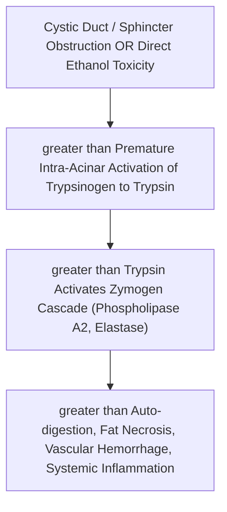
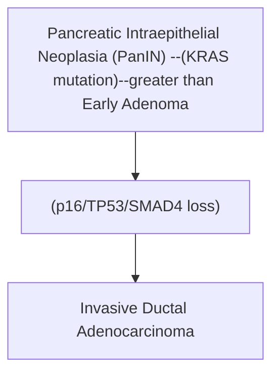

# Chapter 12C: Gallbladder, Biliary & Pancreatic Pathology

## 12.5 Gallbladder & Biliary Pathology

### A. Cholelithiasis (Gallstones)

Gallstones affect $10–20\%$ of adults in developed nations. Divided into **Cholesterol Stones** ($80\%$) and **Pigment Stones** ($20\%$).

| Feature | Cholesterol stones | Black pigment stones | Brown pigment stones |
| --- | --- | --- | --- |
| Composition / mechanism | Cholesterol supersaturation and gallbladder hypomotility | Calcium bilirubinate precipitation; associated with chronic hemolysis and cirrhosis | Biliary infection and stasis; bacterial/parasitic enzymes deconjugate bilirubin |
| Radiographic appearance | Usually radiolucent | Often radiopaque due to calcium content | Usually radiolucent or faintly opaque |
| Typical location | Gallbladder | Gallbladder | Bile ducts |
| Associations | Estrogen exposure, obesity, rapid weight loss, ileal disease and other risk factors | Hemolytic disorders, cirrhosis and age | Biliary infection, strictures and parasites in endemic settings |
| Feature | Cholesterol Gallstones | Black Pigment Stones | Brown Pigment Stones |
| :--- | :--- | :--- | :--- |
| **Pathophysiology** | Supersaturation of bile with cholesterol exceeding solubilizing capacity of bile salts/lecithin + gallbladder hypomotility | Chronic **intravascular hemolysis** or cirrhosis $\rightarrow$ excessive unconjugated bilirubin in bile $\rightarrow$ calcium bilirubinate precipitation | Biliary tract **bacterial or parasitic infection** (*E. coli*, *Clonorchis sinensis*) producing bacterial **$\beta$-glucuronidase** $\rightarrow$ hydrolyzes bilirubin glucuronides |
| **Radiodensity** | **Radiolucent** ($80–85\%$, unless secondarily calcified) | **Radiopaque** ($50–75\%$, high calcium content) | **Radiolucent** / Soft |
| **Location** | Gallbladder strictly | Gallbladder strictly | **Bile Ducts** (intra- and extra-hepatic) |
| **Risk Factors** | The **"4 Fs"**: Female, Fat, Fertile, Forty; Estrogen/OCP, fibrates, rapid weight loss, terminal ileal disease | Chronic hemolysis (Sickle Cell, Hereditary Spherocytosis, Thalassemia), Liver Cirrhosis, advanced age | Chronic biliary infection, cholangitis, biliary strictures, choledochal cysts |

---

### B. Inflammatory & Neoplastic Biliary Conditions
* **Acute Calculous Cholecystitis**:
  * *Pathophysiology*: Impacted gallstone in the **Cystic Duct** $\rightarrow$ luminal obstruction $\rightarrow$ mucus buildup, mucosal ischemia, and chemical inflammation mediated by lysolecithin $\rightarrow$ secondary bacterial superinfection (*E. coli, Klebsiella, Enterococcus*).
  * *Clinical Features*: RUQ pain radiating to the **right scapula/shoulder** (phrenic nerve irritation), fever, leukocytosis, **Murphy's Sign** (involuntary inspiratory arrest on deep RUQ palpation).

* **Acute Acalculous Cholecystitis** ($10\%$):
  * Severe cholecystitis occurring in critically ill ICU patients (major trauma, severe burns, sepsis, TPN) without gallstones. Driven by gallbladder ischemia and stasis. High risk of gangrene and perforation.

* **Chronic Cholecystitis**:
  * Result of recurrent acute/subacute cholecystitis or chronic gallstone mechanical irritation.
  * *Histology*: **Rokitansky-Aschoff Sinuses** (deep herniations of gallbladder mucosal epithelium into and through the hypertrophied muscularis layer).
  * *Complication*: **Porcelain Gallbladder**: Diffuse dystrophic calcification within the fibrotic gallbladder wall; high incidence of associated **Gallbladder Adenocarcinoma** ($10–20\%$; warrants prophylactic cholecystectomy).

* **Acute Cholangitis**:
  * *Pathophysiology*: Life-threatening bacterial infection of the biliary tree secondary to biliary outflow obstruction (most commonly **Choledocholithiasis**).
  * *Clinical Features*:
    * **Charcot's Triad**: Fever + RUQ Pain + Jaundice.
    * **Reynolds' Pentad** (indicates suppurative cholangitis/septic shock): Charcot's Triad + **Hypotension** + **Altered Mental Status**.
  * *Management*: Emergency biliary decompression via **ERCP** + broad-spectrum IV antibiotics.

---

## 12.6 Pancreatic Pathology

### A. Acute Pancreatitis
* **Definition**: Reversible inflammatory disorder of the exocrine pancreas ranging from localized edema to severe hemorrhagic parenchymal necrosis.

* **Etiology** (*I GET SMASHED* Mnemonic):
  * **I**: Idiopathic
  * **G**: **Gallstones** ($40\%$, most common cause overall)
  * **E**: **Ethanol / Alcohol** ($35\%$, second most common)
  * **T**: Trauma (abdominal blunt trauma in children)
  * **S**: Steroids
  * **M**: Mumps / Viral infections (Coxsackie B)
  * **A**: Autoimmune
  * **S**: **Scorpion sting** (*Tityus trinitatis*)
  * **H**: **Hypertriglyceridemia** ($>1000\text{ mg/dL}$) / Hypercalcemia
  * **E**: **ERCP** (post-procedural $5–10\%$)
  * **D**: Drugs (Thiazides, Azathioprine, Valproic acid, Didanosine)

* **Pathophysiologic Cascade**:
  1. Trigger induces **premature intra-acinar activation of Trypsinogen to Trypsin**.
  2. Active Trypsin cleaves and activates downstream pro-enzymes:
     * *Phospholipase $A_2$*: Digests cell membranes, producing toxic lysolecithin.
     * *Elastase*: Digests blood vessel walls, causing **hemorrhagic pancreatitis**.
     * *Kallikrein-Kinin System*: Induces vasodilation and vascular permeability $\rightarrow$ shock.
  3. **Enzymatic Fat Necrosis**: Pancreatic Lipase breaks down retroperitoneal and omental adipocytes into free fatty acids, which combine with calcium to form insoluble soaps (**Saponification**).

* **Clinical & Laboratory Diagnostic Triad** (Requires 2 of 3):
  1. Severe, sharp **epigastric abdominal pain radiating straight to the back** ($90\%$), relieved by leaning forward.
  2. **Serum Amylase or Lipase $>3\times$ Upper Limit of Normal** (**Lipase** is more specific and remains elevated longer [8–14 days] than Amylase).
  3. Characteristic abdominal imaging findings (Contrast-Enhanced CT).

* **Physical Signs in Severe Hemorrhagic Pancreatitis**:
  * **Cullen's Sign**: Periumbilical ecchymosis (hemoperitoneum tracking along falciform ligament).
  * **Grey Turner's Sign**: Flank ecchymosis (hemorrhage tracking along retroperitoneum).

* **Complications**:
  * **Pancreatic Pseudocyst** ($10–15\%$): Collection of tissue, fluid, and debris that arises $4–6$ weeks post-acute pancreatitis. **Lacks an epithelial lining** (walled off by fibrous/granulation tissue; distinguishing it from true cysts). High amylase content.
  * **Systemic Complications**: **ARDS** (circulating phospholipase $A_2$ damages pulmonary surfactant), DIC, Hypocalcemia (calcium precipitation in fat saponification), Acute Kidney Injury.

---

### B. Chronic Pancreatitis
* **Definition**: Long-standing, progressive irreversible destruction of pancreatic exocrine parenchyma and fibrosis, culminating in endocrine insufficiency.

* **Etiology**: **Chronic Alcohol Abuse** ($70\%$, leads to hyper-concentrated protein plugs obstructing pancreatic ducts) and **Cystic Fibrosis** (in children, $CFTR$ gene mutation causing thick inspissated secretions).

* **Classic Clinical Triad**:
  1. **Steatorrhea** (foul-smelling bulky stools due to $>90\%$ loss of lipase exocrine function).
  2. **Secondary Diabetes Mellitus** (destruction of pancreatic $\beta$-cells).
  3. **Pancreatic Calcifications** (visible on plain X-ray / CT).

* **Morphology**: Hard, fibrotic pancreas with ductal dilation, protein plugs, and diffuse parenchymal atrophy. Radiographs show a **"Chain-of-Lakes"** ductal dilation pattern.

---

### C. Pancreatic Ductal Adenocarcinoma
Fourth leading cause of cancer death. Highly lethal adenocarcinoma with a 5-year survival rate $<10\%$.

* **Anatomical Distribution**: **Head of Pancreas** ($60\%$), Body ($15\%$), Tail ($5\%$).
* **Molecular Driver Mutations**:
  * **$KRAS$ Oncogene** (12p) point mutation present in $>95\%$ of cases (*earliest event*).
  * Inactivation of **$CDKN2A / p16$** ($95\%$), **$TP53$** ($75\%$), and **$SMAD4 / DPC4$** ($55\%$).

* **Clinical Presentation by Location**:
  * **Head of Pancreas**: Presents early with **Painless Obstructive Jaundice** (dark urine, pale stools, pruritus) due to common bile duct compression.
  * **Courvoisier's Law / Sign**: A palpable, enlarged, **non-tender gallbladder** accompanied by mild jaundice is unlikely to be gallstones and strongly suggests **pancreatic head malignancy** or lower CBD obstruction.
  * **Body and Tail**: Silent growth; presents late with severe back pain and weight loss.

* **Paraneoplastic Sign**: **Trousseau's Sign of Malignancy (Migratory Thrombophlebitis)**: Recurrent venous thrombosis in dynamic locations driven by tumor-derived pro-coagulant mucins and tissue factor.

* **Tumor Marker**: **CA 19-9** (used for monitoring response to therapy, not screening).

* **Surgical Treatment**: **Pancreaticoduodenectomy (Whipple Procedure)** for resectable head tumors.

---

## Index Coverage Checklist

- [x] 12.5 Gallbladder & Biliary Pathology
  - [x] Cholelithiasis (Cholesterol vs. Black vs. Brown Pigment Stones)
  - [x] Acute Calculous vs. Acalculous Cholecystitis (Murphy sign)
  - [x] Chronic Cholecystitis (Rokitansky-Aschoff sinuses, Porcelain gallbladder)
  - [x] Acute Cholangitis (Charcot triad, Reynolds pentad)
- [x] 12.6 Pancreatic Pathology
  - [x] Acute Pancreatitis (Etiology I GET SMASHED, Trypsinogen cascade, Fat necrosis saponification, Amylase/Lipase, Cullen/Grey Turner signs, Pseudocysts)
  - [x] Chronic Pancreatitis (Alcohol, CF, Triad: Steatorrhea, Diabetes, Calcifications, Chain-of-Lakes)
  - [x] Pancreatic Ductal Adenocarcinoma (KRAS, p16, TP53, SMAD4, Head vs. Body/Tail, Courvoisier sign, Trousseau sign, CA 19-9, Whipple procedure)

## Index Corrections Made
* None.

## Topics Needing Additional Source Material
* None.
