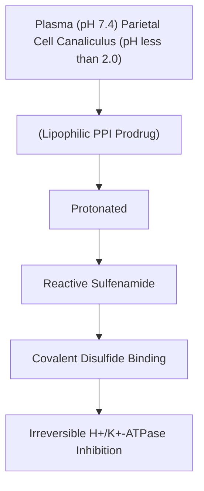

# Chapter 15: Drugs Used in Acid-Peptic Diseases & GERD

## 15.1 Proton Pump Inhibitors (PPIs)

### Pharmacological Agents
Omeprazole, Esomeprazole (S-enantiomer), Pantoprazole, Rabeprazole, Lansoprazole, Dexlansoprazole.

### Mechanism of Action
* **Prodrug Activation**: PPIs are lipophilic weak bases that circulate in plasma and passively diffuse into the acidic secretory canaliculi of parietal cells ($\text{pH} < 2.0$).
* **Irreversible Inhibition**: In the acidic canalicular space, the prodrug is protonated and converted into reactive tetracyclic **sulfenamide** intermediates. The sulfenamide forms a covalent **disulfide bond** ($-\text{S}-\text{S}-$) with cysteine residues (specifically Cys-813) on the extracellular domain of the luminal $\text{H}^+/\text{K}^+$-ATPase (proton pump).
* **Efficacy**: Suppresses both basal and stimulated gastric acid secretion by **$>90\%$**. Because inhibition is irreversible, acid secretion is restored only after new proton pumps are synthesized (half-life of pump synthesis $\sim 24\text{ hours}$), granting a duration of clinical action of 24–48 hours despite a short plasma elimination half-life (1–2 hours).
* **Administration Timing**: Must be administered **30–60 minutes before the first meal** of the day so that peak drug concentrations coincide with maximal meal-stimulated proton pump insertion into canalicular membranes.

### Adverse Effects & Long-Term Safety Profile
1. **Malabsorption Complications**:
   * **Hypomagnesemia**: Impaired active intestinal absorption of magnesium via TRPM6 channels (presents with tremors, tetany, arrhythmias).
   * **Vitamin $\text{B}_{12}$ Deficiency**: Reduced acid-peptic cleavage of cobalamin from dietary protein.
   * **Decreased Calcium & Iron Absorption**: Hypochlorhydria impairs insoluble calcium carbonate dissolution and ferric-to-ferrous iron reduction, modestly increasing **osteoporotic hip/spine fracture risk**.
2. **Infectious Susceptibility**: Loss of the gastric acid barrier increases risk of ***Clostridioides difficile* colitis** and Community-Acquired Pneumonia (CAP).
3. **Hypergastrinemia & Rebound Hyperacidity**: Sustained loss of acid removes somatostatin-mediated tonic inhibition of G cells, causing secondary hypergastrinemia, enterochromaffin-like (ECL) cell hyperplasia, and transient rebound acid hypersecretion upon abrupt drug cessation.
4. **Acute Interstitial Nephritis (AIN)**: Rare idiosyncratic cell-mediated hypersensitivity reaction.
5. **Drug Interactions**: Omeprazole inhibits CYP2C19, reducing activation of the antiplatelet prodrug **Clopidogrel** (Pantoprazole has minimal CYP2C19 inhibition and is preferred in patients on clopidogrel).

---

## 15.2 $\text{H}_2$-Receptor Antagonists ($\text{H}_2$RAs)

### Pharmacological Agents
Famotidine, Ranitidine (withdrawn in many regions due to NDMA impurity), Cimetidine, Nizatidine.

### Mechanism of Action
* **Competitive Inhibition**: Highly selective competitive antagonists of histamine $\text{H}_2$ receptors located on the basolateral membrane of parietal cells.
* **Physiological Effect**: Block histamine-induced intracellular cAMP elevation. Suppresses basal and **nocturnal gastric acid secretion** by $60–70\%$. Less effective against meal-stimulated (gastrin/ACh) acid secretion.

### Limitations & Toxicity Profile
* **Tachyphylaxis (Tolerance)**: Rapid attenuation of antisecretory efficacy occurs within 3–7 days of continuous administration due to compensatory upregulation of G-cell gastrin release and neural ACh signaling.
* **Cimetidine Specific Toxicity**:
  1. **Potent CYP450 Inhibition**: Inhibits CYP1A2, CYP2C9, CYP2D6, CYP3A4, increasing levels of Warfarin, Theophylline, Phenytoin, and Diazepam.
  2. **Anti-Androgenic Effects**: Binds androgen receptors and inhibits dihydrotestosterone (DHT) binding, causing **gynecomastia**, galactorrhea, and erectile dysfunction in males.
  3. Crosses blood-brain barrier causing confusion/hallucinations in elderly ICU patients.

---

## 15.3 Other Anti-Ulcer Agents & Cytoprotectives

### 1. Potassium-Competitive Acid Blockers (P-CABs) - Vonoprazan
* **Mechanism**: Competitively and reversibly binds to the $\text{K}^+$-binding site of active and inactive parietal cell $\text{H}^+/\text{K}^+$-ATPases.
* **Advantages over PPIs**: Does not require acidic activation (active at neutral pH), faster onset of action (peak acid inhibition on Day 1), longer elimination half-life, and non-CYP2C19 dependent metabolism.

### 2. Sucralfate
* **Structure**: Complex salt of sucrose octasulfate and polyaluminum hydroxide.
* **Mechanism**: In an acidic environment ($\text{pH} < 4.0$), sucralfate undergoes extensive cross-linking to form a viscous, sticky negatively charged paste. This paste selectively binds to positively charged proteins in the exposed base of ulcer beds, creating a physical barrier against acid, pepsin, and bile salts. Also stimulates local prostaglandin synthesis.
* **Clinical Utility**: Stress ulcer prophylaxis; duodenal ulcer therapy in pregnancy.
* **Limitations**: Requires acidic environment (do not co-administer with antacids, PPIs, or $\text{H}_2$RAs). Binds and impairs absorption of Fluoroquinolones, Digoxin, and Phenytoin. Causes constipation.

### 3. Misoprostol
* **Mechanism**: Synthetic analog of **Prostaglandin $\text{E}_1$ ($\text{PGE}_1$)**. Binds $\text{EP}_3$ receptors on parietal cells, activating $G_i \rightarrow \downarrow \text{cAMP} \rightarrow$ decreased acid secretion. Concurrently binds epithelial $\text{EP}$ receptors, stimulating mucus and bicarbonate secretion and mucosal blood flow.
* **Indication**: Prevention of NSAID-induced gastric mucosal injury.
* **ABSOLUTE CONTRAINDICATION**: **Pregnancy**. Stimulates uterine contractions ($\text{EP}_1/\text{EP}_3$ smooth muscle receptors), causing abortion or premature labor. Frequently causes dose-limiting cramping abdominal pain and diarrhea.

### 4. Bismuth Subsalicylate
* **Mechanism**: Coagulates proteins in ulcer beds; exerts direct antimicrobial activity against *H. pylori* cell walls; coats mucosal surfaces and binds enterotoxins.
* **Side Effects**: Harmless **blackening of the tongue and stool** (bismuth sulfide formation); risk of salicylate toxicity.

---

## 15.4 Anti-*H. pylori* Eradication Regimens

Due to rising global resistance rates to Clarithromycin, first-line treatment selection is dictated by local resistance patterns.

| Clinical context | Regimen described in the source notes |
| --- | --- |
| Higher local clarithromycin resistance or prior macrolide exposure | Bismuth quadruple therapy: PPI + bismuth + metronidazole + tetracycline; typically 14 days, subject to current local guidelines. |
| Lower resistance and no prior macrolide exposure | Clarithromycin-based triple therapy: PPI + amoxicillin + clarithromycin; use only when local susceptibility guidance supports it. |
| Penicillin allergy | Alternative regimen must be selected according to allergy history, resistance and current guideline recommendations. |
### Regimen Specifications (14-Day Duration Required)
1. **Bismuth Quadruple Therapy (First-Line Standard)**:
   * PPI (e.g., Omeprazole $20\text{ mg}$ or Pantoprazole $40\text{ mg}$ BID)
   * Bismuth Subsalicylate ($524\text{ mg}$ QID)
   * Metronidazole ($500\text{ mg}$ TID-QID)
   * Tetracycline ($500\text{ mg}$ QID)
2. **Concomitant Non-Bismuth Quadruple Therapy**:
   * PPI (standard dose BID) + Amoxicillin ($1000\text{ mg}$ BID) + Clarithromycin ($500\text{ mg}$ BID) + Metronidazole ($500\text{ mg}$ BID).
3. **Clarithromycin Triple Therapy**:
   * Restricted ONLY to regions where local *H. pylori* clarithromycin resistance is documented to be $<15\%$.
4. **Confirmation of Eradication**: Must be performed at least **4 weeks after completing antibiotic therapy** and at least **2 weeks after stopping PPI therapy**, using Urea Breath Test or Stool Antigen Test.

---

### Coverage & Verification Checklist
1. **Subsection Checklist**:
   - [x] 15.1 Proton Pump Inhibitors (Prodrug mechanism, sulfenamide binding, safety profile, C. diff, hypomagnesemia, clopidogrel interaction)
   - [x] 15.2 $\text{H}_2$-Receptor Antagonists (Mechanism, nocturnal acid suppression, tachyphylaxis, cimetidine toxicity/anti-androgenic)
   - [x] 15.3 Other Anti-Ulcer Agents (Vonoprazan P-CAB, Sucralfate paste, Misoprostol PGE1 pregnancy contraindication, Bismuth subsalicylate)
   - [x] 15.4 Anti-*H. pylori* Regimens (Bismuth Quadruple vs Clarithromycin Triple, 14-day duration, eradication verification)
2. **Corrections Made**: Replaced outdated 7-day triple therapy guidance with current ACG/AGA guidelines mandating 14-day Bismuth Quadruple therapy as first-line due to widespread macrolide resistance.
3. **Source Limitations**: None; comprehensive GI pharmacology content provided.
