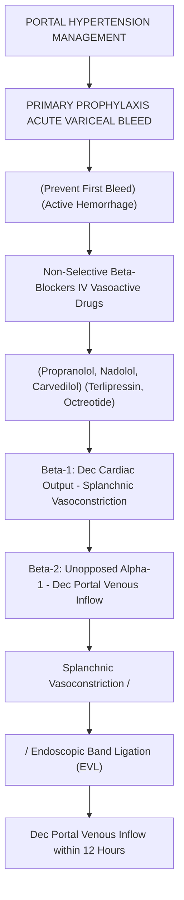

# Chapter 17: Drugs Used in IBD & Hepatobiliary Disorders

## 17.1 Inflammatory Bowel Disease (IBD) Pharmacology

The therapeutic pyramid in IBD ranges from topical anti-inflammatory agents to systemic immunosuppressants and targeted biologics.

| Treatment group | Examples | Role described in the notes |
| --- | --- | --- |
| 5-aminosalicylates | Mesalamine, sulfasalazine | Mild-to-moderate ulcerative colitis; efficacy depends on disease extent and formulation. |
| Corticosteroids | Budesonide, prednisone | Induction of remission during active flares; not maintenance therapy. |
| Immunomodulators | Azathioprine, 6-mercaptopurine | Steroid-sparing / maintenance role in selected patients; delayed onset and monitoring required. |
| Biologics / targeted agents | Infliximab, vedolizumab, ustekinumab | Moderate-to-severe or refractory disease; choice depends on phenotype, risk and prior therapy. |
---

### 1. 5-Aminosalicylates (5-ASA / Mesalamine Derivatives)
* **Agents**: Mesalamine (5-ASA), Sulfasalazine, Olsalazine, Balsalazide.
* **Mechanism of Action**: Topical mucosal anti-inflammatory effect. Inhibits cyclooxygenase (COX) and lipoxygenase (5-LOX) pathways, suppressing leukotriene ($\text{LTB}_4$) and prostaglandin synthesis. Scavenges reactive oxygen species and inhibits NF-$\kappa$B activation in intestinal epithelial cells.
* **Formulations & Drug Delivery Mechanisms**: Unformulated 5-ASA is rapidly absorbed in the proximal small intestine. Targeted delivery formulations are required to deliver drug to distal ileum and colon:
  * **Sulfasalazine**: 5-ASA linked to a sulfapyridine carrier molecule by an azo bond. Unabsorbed in small intestine; **bacterial azoreductase enzymes** in the colon cleave the azo bond, releasing active 5-ASA locally.
  * **Mesalamine Formulations**: pH-dependent enteric coatings (Asacol [pH 7.0], Lialda [pH 7.0 multi-matrix]), ethylcellulose microgranules (Pentasa [duodenum to colon]), and rectal enemas/suppositories (Rowasa / Canasa [distal left-sided UC]).
* **Clinical Indications**: First-line agents for **induction and maintenance of remission in mild-to-moderate Ulcerative Colitis**. Unproven efficacy in Crohn Disease.
* **Adverse Effects**:
  * Sulfasalazine toxicity is primarily mediated by the **sulfapyridine moiety**: Nausea, headache, hemolytic anemia (in G6PD deficiency), agranulocytosis, reversible oligospermia, and hypersensitivity reactions.
  * Mesalamine is better tolerated; rare risk of interstitial nephritis (monitor renal function).

---

### 2. Corticosteroids
* **Agents**: Prednisone, Methylprednisolone, Hydrocortisone, **Budesonide**.
* **Mechanism**: Binds intracellular glucocorticoid receptors, modulating gene transcription $\rightarrow$ inhibits NF-$\kappa$B, decreases pro-inflammatory cytokines (IL-1, IL-6, TNF-$\alpha$), and suppresses phospholipase $\text{A}_2$.
* **Budesonide**: Synthetic potent corticosteroid engineered for high local topical activity. Formulated as **controlled-ileal release** (Entocort EC) delivering drug to terminal ileum and ascending colon. Undergoes **$>90\%$ first-pass hepatic metabolism** via CYP3A4, markedly reducing systemic corticosteroid adverse effects.
* **Role in IBD**: Indicated **ONLY for induction of remission during acute moderate-to-severe disease flares**. **CONTRAINDICATED for maintenance therapy** due to lack of long-term mucosal healing efficacy and severe systemic toxicities (osteoporosis, cushingoid state, hypertension, infection risk).

---

### 3. Immunomodulators / Thiopurine Antimetabolites
* **Agents**: Azathioprine (AZA), 6-Mercaptopurine (6-MP).
* **Mechanism of Action**: Azathioprine is a prodrug converted non-enzymatically into 6-Mercaptopurine (6-MP). 6-MP is subsequently converted by hypoxanthine-guanine phosphoribosyltransferase (HGPRT) into intracellular **6-thioguanine nucleotides (6-TGN)**. 6-TGN incorporates into DNA/RNA, inhibiting purine de novo synthesis and inducing T-lymphocyte apoptosis.
* **Enzymatic Metabolism & Drug Interactions**:
  ```
                          Azathioprine
                               | (Non-enzymatic)
                               v
                       6-Mercaptopurine (6-MP)
                               |
         +---------------------+---------------------+
         |                     |                     |
         v (Xanthine Oxidase)  v (TPMT)              v (HGPRT)
  6-Thiouric Acid       6-Methyl-MP           6-Thioguanine (6-TGN)
  (Inactive)            (Hepatotoxic)         (Active Cytotoxic)
  ```
  * **Xanthine Oxidase (XO)**: Inactivates 6-MP to 6-thiouric acid.
  * **Thiopurine S-methyltransferase (TPMT)** & **NUDT15**: Metabolize 6-MP into inactive/hepatotoxic metabolites. Patients with inherited TPMT or NUDT15 deficiency build up lethal 6-TGN concentrations, causing severe **bone marrow suppression**. (TPMT/NUDT15 testing mandated prior to drug initiation).
  * **CRITICAL DRUG INTERACTION**: Co-administration of **Allopurinol** or Febuxostat (potent Xanthine Oxidase inhibitors) blocks 6-MP breakdown, surging 6-TGN levels $\rightarrow$ life-threatening **pancytopenia**. If combined, AZA/6-MP dose must be reduced by $75\%$.
* **Indications**: Maintenance of remission in steroid-dependent or steroid-refractory UC and Crohn Disease. Delayed onset of action (3 to 6 months).

---

### 4. Biologic & Targeted Small-Molecule Therapies

| Agent Class | Representative Drugs | Mechanism of Action | Clinical Indications & Special Considerations |
| :--- | :--- | :--- | :--- |
| **Anti-TNF-$\alpha$ Antibodies** | **Infliximab** (chimeric), **Adalimumab** (fully human), Certolizumab, Golimumab | Monoclonal antibodies that bind soluble and transmembrane TNF-$\alpha$, neutralizing pro-inflammatory signaling and inducing apoptosis of activated T cells. | Moderate-to-severe UC and Crohn Disease; fistulizing Crohn Disease. **Pre-screening required**: PPD/IGRA for **latent TB reactivation** and HBV screening. |
| **Anti-Integrin (Gut-Selective)** | **Vedolizumab** | Monoclonal antibody against **$\alpha_4\beta_7$ integrin** on circulating memory T-lymphocytes. Blocks interaction with MAdCAM-1 on intestinal vascular endothelial cells, preventing gut-homing. | Moderate-to-severe UC and CD. Gut-selective mechanism minimizes systemic immunosuppression and PML risk. |
| **Anti-IL-12/23** | **Ustekinumab** | Monoclonal antibody targeting shared **p40 subunit** of Interleukins 12 and 23. Suppresses Th1 and Th17 pathways. | Moderate-to-severe CD and UC refractory to Anti-TNF agents. |
| **JAK Inhibitors** | **Tofacitinib**, Upadacitinib | Oral small-molecule Janus Kinase (JAK1/JAK3) inhibitors blocking downstream cytokine signaling. | Moderate-to-severe UC. Rapid onset; risk of zoster reactivation and thromboembolism. |

---

## 17.2 Hepatobiliary Therapeutics

### 1. Ursodeoxycholic Acid (UDCA / Ursodiol)
* **Physiological Nature**: Naturally occurring hydrophilic, non-cytotoxic secondary bile acid comprising $<5\%$ of normal human bile acid pool.
* **Mechanism of Action**:
  1. Expansion of the hydrophilic bile acid pool, displacing toxic hydrophobic bile salts (chenodeoxycholic acid) from the enterohepatic circulation.
  2. Cytoprotection of cholangiocyte membranes against bile salt-induced injury.
  3. Choleretic effect: Stimulates exocytosis and transporter expression (AE2, MRP2) in cholangiocytes.
  4. Inhibits intestinal cholesterol absorption and reduces hepatic cholesterol secretion into bile.
* **Indications**:
  * **Primary Biliary Cholangitis (PBC)**: First-line disease-modifying agent (slows histological progression and delays need for liver transplantation).
  * **Dissolution of Radiolucent Cholesterol Gallstones**: In non-calcified gallstones ($<15\text{ mm}$) in patients unfit for cholecystectomy with a functioning gallbladder.
  * Intrahepatic Cholestasis of Pregnancy (ICP).

---

### 2. Pharmacological Management of Portal Hypertension & Variceal Bleeding


#### A. Primary Prophylaxis of Variceal Hemorrhage
* **Non-Selective $\beta$-Blockers (NSBBs)**: Propranolol, Nadolol, Carvedilol.
* **Dual Hemodynamic Mechanism**:
  1. **$\beta_1$-Blockade**: Decreases cardiac output.
  2. **$\beta_2$-Blockade**: Blocks splanchnic $\beta_2$-vasodilatory receptors, allowing unopposed $\alpha_1$-adrenergic vasoconstriction of mesenteric arterioles $\rightarrow$ decreases splanchnic blood flow and reduces portal venous inflow.
* **Goal**: Reduce Hepatic Venous Pressure Gradient (HVPG) to $<12\text{ mmHg}$ or by $>20\%$ from baseline.

#### B. Acute Variceal Hemorrhage Management
* **Vasoactive Agents (Initiated immediately upon suspicion)**:
  * **Terlipressin**: Long-acting synthetic analog of Vasopressin. Selective $\text{V}_1$ receptor agonist on vascular smooth muscle of splanchnic bed $\rightarrow$ potent splanchnic vasoconstriction $\rightarrow$ rapid reduction in portal pressure. (Side effects: hyponatremia, peripheral ischemia).
  * **Octreotide**: Synthetic Somatostatin analog. Causes selective splanchnic vasoconstriction via inhibition of vasodilatory peptides (glucagon, VIP).
* **Definitive Hemostasis**: Emergency Endoscopic Variceal Ligation (EVL) performed within 12 hours. Prophylactic Ceftriaxone (prevents SBP and bacteremia).

---

### Coverage & Verification Checklist
1. **Subsection Checklist**:
   - [x] 17.1 IBD Pharmacology (5-ASA formulations/azo cleavage, Corticosteroids/Budesonide local delivery, Thiopurines AZA/6-MP/TPMT/Allopurinol interaction, Biologics Anti-TNF/Vedolizumab/Ustekinumab/Tofacitinib)
   - [x] 17.2 Hepatobiliary Therapeutics (UDCA mechanisms/PBC, Non-selective beta-blockers dual mechanism, Terlipressin/Octreotide splanchnic vasoconstriction in acute variceal bleed)
2. **Corrections Made**: Verified Allopurinol 75% dose reduction requirement with Azathioprine; reinforced prohibition of steroids as long-term IBD maintenance.
3. **Source Limitations**: None; comprehensive GI clinical pharmacology content provided.
