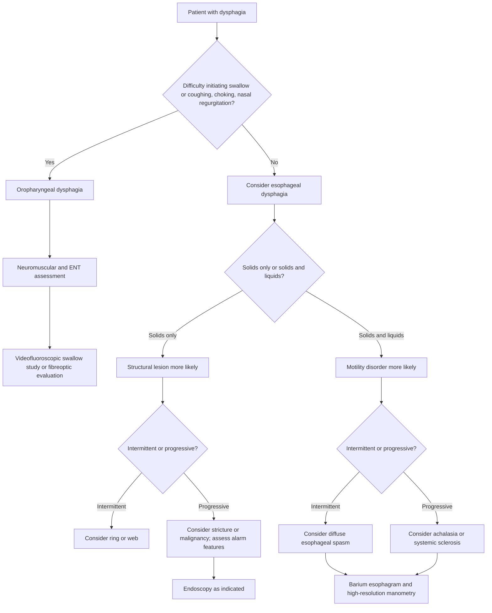
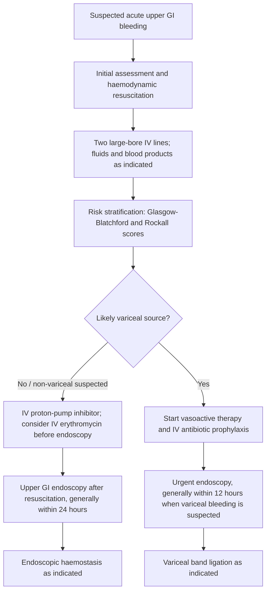
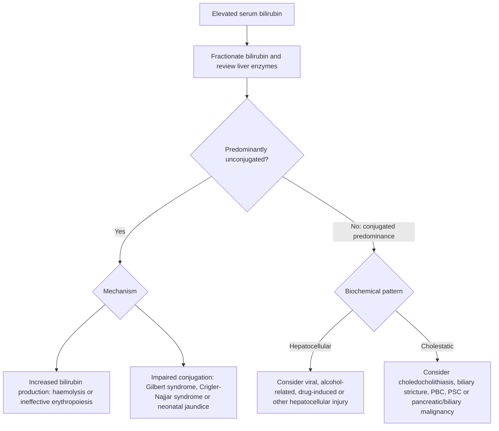

# Chapter 18: Clinical Evaluation & Approach to GI Symptoms

## 18.1 Dysphagia

Dysphagia is defined as the subjective sensation of difficulty or impairment in the passage of swallowed solids or liquids from the oral cavity to the stomach. It must be strictly distinguished from **odynophagia** (painful swallowing, typically indicating mucosal ulceration or severe inflammation) and **globus pharyngeus** (the constant sensation of a lump or fullness in the throat that is unrelated to deglutition and not accompanied by mechanical transit obstruction).

### A. Anatomical & Pathophysiologic Classification
Dysphagia is fundamentally categorized based on the anatomical site of impairment into **Oropharyngeal (Transfer) Dysphagia** and **Esophageal Dysphagia**.

#### 1. Oropharyngeal (Transfer) Dysphagia
Impairment in the transfer of a food bolus from the oral cavity into the upper esophagus, driven by dysfunction of the tongue, pharyngeal musculature, or upper esophageal sphincter (UES).
* **Pathophysiology**: Disruption of the voluntary oral phase or involuntary pharyngeal phase of deglutition leads to bolus misdirection into the nasopharynx or tracheobronchial tree.
* **Etiologies**:
  * *Neurological*: Stroke (most common cause), Parkinson disease, Amyotrophic Lateral Sclerosis (ALS), Multiple Sclerosis, Pseudobulbar palsy.
  * *Myogenic*: Myasthenia Gravis, Polymyositis/Dermatomyositis, Oculopharyngeal Muscular Dystrophy.
  * *Structural/Mechanical*: Zenker diverticulum, head and neck malignancies, cervical osteophytes, radiation strictures.
* **Clinical Manifestations**: Coughing, choking, or throat clearing immediately upon swallowing; nasal regurgitation; dysarthria; wet/hoarse voice post-deglutition; recurrent aspiration pneumonia.

#### 2. Esophageal Dysphagia
Impairment in the transport of the food bolus down the tubular esophagus into the stomach.
* **Pathophysiology**: Caused either by mechanical obstruction (luminal narrowing) or neuromuscular motility disorders (disrupted peristalsis or non-relaxing Lower Esophageal Sphincter [LES]).
* **Diagnostic Stratification**:
  * **Solids Only (Mechanical / Structural Obstruction)**:
    * *Intermittent*: Esophageal mucosal ring (Schatzki ring) or esophageal web (Plummer-Vinson syndrome).
    * *Progressive*:
      * With long-standing heartburn history: Peptic stricture.
      * With rapid weight loss and age >50 years: Esophageal Carcinoma (Squamous Cell Carcinoma or Adenocarcinoma).
  * **Solids and Liquids Simultaneously (Neuromuscular / Motility Disorders)**:
    * *Intermittent with chest pain*: Diffuse Esophageal Spasm (DES) or hypercontractile (Jackhammer) esophagus.
    * *Progressive*:
      * With nocturnal regurgitation and weight loss: Achalasia.
      * With severe acid reflux and sclerodactyly: Systemic Sclerosis (Scleroderma esophagus).

---

### B. Diagnostic Evaluation Protocol
1. **Detailed History**: Distinguish oropharyngeal from esophageal dysphagia; ascertain if symptom is for solids vs. liquids; evaluate progression rate, heartburn history, and weight loss.
2. **Videofluoroscopic Swallow Study (VFSS) / Modified Barium Swallow**: Investigation of choice for suspected **oropharyngeal dysphagia** to map bolus dynamics and silent aspiration risk.
3. **Upper Gastrointestinal Endoscopy (EGD)**: Initial investigation of choice for suspected **esophageal dysphagia** to directly visualize mucosa, rule out malignancy, and perform biopsy or dilation.
4. **Barium Swallow (Esophagogram)**: Indicated prior to endoscopy if structural proximal lesion or Zenker diverticulum is suspected to avoid iatrogenic perforation.
5. **High-Resolution Esophageal Manometry (HRM)**: Diagnostic gold standard for **esophageal motility disorders** (Achalasia, DES, Hypercontractile esophagus) performed after EGD excludes structural obstruction.

---

## 18.2 Gastrointestinal Bleeding

Gastrointestinal (GI) bleeding is a major medical emergency categorized by anatomical location relative to the **Ligament of Treitz** (suspensory muscle of the duodenum at the duodenojejunal flexure).

### A. Upper vs. Lower GI Bleeding Classification

| Parameter | Upper GI Bleed (UGIB) | Lower GI Bleed (LGIB) |
| :--- | :--- | :--- |
| **Anatomical Boundary** | Proximal to the Ligament of Treitz | Distal to the Ligament of Treitz |
| **Primary Presentations** | **Hematemesis** (bright red blood or "coffee-ground" material), **Melena** (black, tarry, foul-smelling stool) | **Hematochezia** (bright red or maroon blood per rectum), rarely melena (if slow right-sided transit) |
| **Common Etiologies** | Peptic Ulcer Disease (40–50%), Esophagogastric Varices (15–20%), Erosive Gastritis, Mallory-Weiss Tears, Dieulafoy Lesions, Gastric Antral Vascular Ectasia (GAVE) | Diverticulosis (30–40%), Angiodysplasia, Ischemic Colitis, Inflammatory Bowel Disease, Colorectal Polyps/Malignancy, Anorectal Lesions (Hemorrhoids, Fissures) |
| **BUN : Serum Creatinine** | **Elevated (>20:1)** due to luminal digestion and absorption of blood proteins + prerenal azotemia | **Normal (<15:1)** |
| **Bowel Sounds** | Hyperactive (blood acts as luminal cathartic) | Variable / Normal |

*Note*: Massive, hemodynamically unstable UGIB can present with hematochezia due to rapid intestinal transit time; any patient presenting with hematochezia and hemodynamic shock requires immediate EGD to rule out a severe UGIB source before colonoscopy.

---

### B. Risk Stratification & Clinical Scoring Systems

#### 1. Glasgow-Blatchford Score (GBS)
Pre-endoscopic risk assessment score based entirely on clinical and laboratory variables (BUN, Hemoglobin, Systolic BP, Pulse, Melena, Syncope, Hepatic Disease, Cardiac Failure).
* **Score = 0**: Exceptionally low risk; patient can be safely managed in an outpatient setting without acute hospital admission.
* **Score $\ge$ 1**: High risk requiring inpatient admission, urgent resuscitation, and endoscopy.

#### 2. Rockall Score
Integrates pre-endoscopic clinical variables (age, shock, comorbidity) with post-endoscopic findings (diagnosis, stigmata of recent hemorrhage) to predict mortality and rebleeding risk.

---

### C. Comprehensive Resuscitation & Treatment Protocol

#### 1. Hemodynamic Resuscitation
* **Airway**: Elective endotracheal intubation in patients with massive hematemesis, altered mental status, or severe agitation to prevent fatal aspiration.
* **Vascular Access**: Two 16-gauge peripheral IV lines or rapid infusion central line.
* **Fluid Resuscitation**: Isotonic crystalloids (Normal Saline or Ringer's Lactate) to restore intravascular volume; avoid over-resuscitation in variceal bleeding to prevent rebound portal pressure surges.
* **Restrictive Transfusion Strategy**: **Target Hemoglobin threshold = 7.0 g/dL** (maintain post-transfusion Hb between **7.0–9.0 g/dL**). Transfusing to higher targets (>9.0 g/dL) increases mortality and rebleeding rates in both variceal and non-variceal bleeding. *Exception*: Active, unstable Coronary Artery Disease where target Hb is $\ge 8.0\text{--}9.0\text{ g/dL}$.

#### 2. Pharmacotherapy
* **Intravenous Proton Pump Inhibitors (PPIs)**:
  * High-dose IV PPI (e.g., Omeprazole or Pantoprazole 80 mg IV bolus followed by 8 mg/hour continuous infusion for 72 hours, or 40 mg IV BID) stabilizes blood clots over ulcer bases by maintaining intragastric $\text{pH} > 6.0$ (pepsin is irreversibly inactivated at $\text{pH} > 6.0$).
* **Vasoactive Agents (Suspected Variceal Bleeding)**:
  * **Octreotide**: Somatostatin analog (50 mcg IV bolus followed by 50 mcg/hour continuous infusion for 2–5 days). Induces selective splanchnic vasoconstriction, reducing portal venous inflow and pressure.
  * **Terlipressin**: Vasopressin $V_1$ receptor agonist (2 mg IV Q4H); lowers portal pressure and improves systemic vascular resistance.
* **Prophylactic Antibiotics (Cirrhotic Variceal Bleeding)**:
  * **IV Ceftriaxone 1 g/day** for 7 days. Reduces bacterial translocation, prevents spontaneous bacterial peritonitis (SBP), decreases rebleeding rates, and significantly reduces mortality.
* **Prokinetic Agents**:
  * **IV Erythromycin 250 mg** administered 30–60 minutes prior to endoscopy promotes gastric motility and clears blood clots, dramatically enhancing mucosal visualization.

#### 3. Endoscopic Hemostasis (EGD / Colonoscopy)
* **Timing**: Within **24 hours** for acute UGIB; within **12 hours** for hemodynamically unstable suspected variceal hemorrhage.
* **Non-Variceal Endotherapeutic Modalities**:
  * Dual therapy is superior to monotherapy: Combination of **Epinephrine injection** (induces local vasospasm and tamponade) PLUS a second mechanical or thermal modality (**Hemoclips**, **Bipolar electrocautery**, or **Hemospray** powder).
* **Variceal Endotherapeutic Modalities**:
  * **Endoscopic Variceal Ligation (EVL)**: Treatment of choice for esophageal varices.
  * **Cyanoacrylate Tissue Adhesive Injection**: Treatment of choice for gastric fundal varices (isolated gastric varices type 1 [IGV1]).
* **Refractory / Rescue Therapies**:
  * Transjugular Intrahepatic Portosystemic Shunt (**TIPS**) for refractory variceal bleeding.
  * Transcatheter Arterial Embolization (**TAE**) or surgery for refractory peptic ulcer bleeding.

---

## 18.3 Jaundice & Liver Function Tests (LFTs)

Jaundice (icterus) is the yellow discoloration of the sclerae, skin, and mucous membranes caused by tissue deposition of bilirubin when total serum bilirubin levels exceed **2.0–2.5 mg/dL** (normal total bilirubin: **0.2–1.2 mg/dL**). Scleral icterus is detected earliest under natural light due to the high elastin content of the sclera, which has a high binding affinity for bilirubin.

### A. Bilirubin Metabolism Architecture
1. **Production**: $80–85\%$ derived from the breakdown of senescent red blood cell hemoglobin in reticuloendothelial macrophages (spleen/bone marrow); $15–20\%$ derived from turnover of heme proteins (myoglobin, cytochromes).
2. **Transport**: Unconjugated (indirect) bilirubin is water-insoluble and circulates tightly bound to serum albumin.
3. **Hepatic Uptake & Conjugation**: Organic Anion Transporting Polypeptide (OATP1B1/B3) transports bilirubin into hepatocytes $\rightarrow$ Conjugated with glucuronic acid by **Uridine Diphosphate-Glucuronosyltransferase 1A1 (UGT1A1)** in the smooth endoplasmic reticulum to form water-soluble **Bilirubin Diglucuronide** (direct bilirubin).
4. **Excretion**: Active secretion across the canalicular membrane via Multidrug Resistance-Associated Protein 2 (**MRP2** - rate-limiting step).
5. **Intestinal Metabolism**: Conjugated bilirubin entering the gut is converted by colonic bacterial enzymes to **Urobilinogen**. $80\%$ oxidized to **Stercobilin** (gives stool its brown color); $20\%$ reabsorbed via enterohepatic circulation ($15\%$ recycled to liver, $5\%$ excreted by kidneys as **Urobilin**).

---

### B. Differential Diagnosis & LFT Pattern Recognition

#### 1. Unconjugated (Indirect) Hyperbilirubinemia ($>85\%$ Indirect Bilirubin)
* **Bilirubin Profile**: Direct bilirubin $<15\%$; absent urinary bilirubin (unconjugated bilirubin is albumin-bound and cannot cross the glomerular filtration barrier).
* **Etiologies**:
  * **Hemolysis / Ineffective Erythropoiesis**: Sickle cell disease, G6PD deficiency, autoimmune hemolytic anemia.
  * **Gilbert Syndrome**: Autosomal recessive mutation in the promoter region of the *UGT1A1* gene ($A(TA)_7TAA$ insertion / $UGT1A1*28$), resulting in a **$60–70\%$ reduction in UGT1A1 enzyme activity**. Asymptomatic, mild unconjugated hyperbilirubinemia ($<3\text{--}4\text{ mg/dL}$) provoked by fasting, stress, intercurrent illness, or exertion. Normal liver histology and normal transaminases.
  * **Crigler-Najjar Syndrome Type I**: Autosomal recessive complete **absence ($0\%$) of UGT1A1 activity**. Severe, life-threatening kernicterus in neonates; requires liver transplantation.
  * **Crigler-Najjar Syndrome Type II**: Autosomal dominant/recessive **marked reduction ($<10\%$) of UGT1A1 activity**. Less severe (bilirubin $10–20\text{ mg/dL}$); responds to **Phenobarbital** (induces $UGT1A1$ transcription).

#### 2. Conjugated (Direct) Hyperbilirubinemia ($>30–50\%$ Direct Bilirubin)
Water-soluble direct bilirubin is filtered by the glomerulus, producing **dark, tea-colored urine** (bilirubinuria).

##### a. Inherited Isolated Conjugated Hyperbilirubinemia (Normal LFTs)
* **Dubin-Johnson Syndrome**: Autosomal recessive mutation in **MRP2 ($ABCC2$) gene**, impairing canalicular secretion of conjugated bilirubin. Gross pathognomonic feature: **Dark, black liver** due to lysosomal accumulation of epinephrine metabolite pigments. Normal total urinary coproporphyrin levels, but **Coproporphyrin I accounts for $>80\%$** (normally $<25\%$).
* **Rotor Syndrome**: Autosomal recessive defect in **OATP1B1 and OATP1B3** hepatic reuptake transporters. Liver appearance is normal (not black). Elevated total urinary coproporphyrin excretion.

##### b. Hepatocellular Pattern (Transaminases elevated out of proportion to ALP)
* **Serum ALT & AST**: Primary markers of hepatocyte necrosis/membrane permeability rupture. ALT is cytosol-specific to hepatocytes; AST is present in liver, cardiac muscle, skeletal muscle, and kidneys.
* **Diagnostic Clues**:
  * **AST : ALT Ratio $> 2:1$**: Highly suggestive of **Alcoholic Liver Disease** (AST is localized in mitochondria; alcohol is a direct mitochondrial toxin; pyridoxal-5'-phosphate / Vitamin $B_6$ deficiency suppresses cytosolic ALT synthesis).
  * **ALT > AST**: Typical of **NAFLD/MASH**, chronic viral hepatitis (HBV/HCV), and acute autoimmune hepatitis.
  * **Massive Transaminase Elevation ($>1000\text{ IU/L}$)**: Caused by **Ischemic Hepatitis ("Shock Liver")**, **Paracetamol (Acetaminophen) Toxicity**, or **Acute Viral Hepatitis (HAV, HBV, HEV)**.

##### c. Cholestatic / Obstructive Pattern (ALP and GGT elevated out of proportion to ALT/AST)
* **Alkaline Phosphatase (ALP)**: Synthesized by biliary canalicular and ductal epithelial cells; elevated in response to cholestasis or biliary pressure.
* **Confirmation of Biliary Origin**: ALP is also present in bone, placenta, and intestine. **Gamma-Glutamyl Transferase (GGT)** or 5'-Nucleotidase elevation confirms that an elevated ALP is of hepatobiliary origin.
* **Etiologies**:
  * **Extrahepatic Cholestasis (Biliary Obstruction)**: Choledocholithiasis, Pancreatic head carcinoma, Cholangiocarcinoma, Biliary strictures. Accompanied by **acholic (clay-colored) stools** and severe pruritus due to bile salt retention.
  * **Intrahepatic Cholestasis**: Primary Biliary Cholangitis (PBC), Primary Sclerosing Cholangitis (PSC), Drug-Induced Liver Injury (Anabolic steroids, Chlorpromazine), Infiltrative diseases (Amyloidosis, Sarcoidosis).

---

### C. True Synthetic Function Markers
Transaminases and ALP reflect tissue injury, **not** operational synthetic capacity. True hepatic synthetic function is measured by:
1. **Serum Albumin**: Half-life of 20 days; excellent marker of **chronic** liver dysfunction (e.g., Cirrhosis), but insensitive to acute injury.
2. **Prothrombin Time (PT) / International Normalized Ratio (INR)**: Measures factors I, II, V, VII, and X (Factor VII has the shortest half-life: 6 hours). **Most sensitive marker of acute liver failure and short-term prognosis**. Failure of elevated PT/INR to correct following IV Vitamin K administration confirms primary hepatocellular failure rather than cholestatic malabsorption of fat-soluble Vitamin K.

---

## Index Coverage Checklist
- [x] 18.1 Dysphagia (Oropharyngeal vs. Esophageal, structural vs. motility, diagnostic algorithms)
- [x] 18.2 Gastrointestinal Bleeding (Upper vs. Lower GI bleed, risk stratification scores, resuscitation, PPIs, vasoactive drugs, endoscopy)
- [x] 18.3 Jaundice & Liver Function Tests (Unconjugated vs. Conjugated hyperbilirubinemia, Gilbert/Crigler-Najjar/Dubin-Johnson/Rotor, LFT patterns, synthetic function)

## Index Corrections Made
* Clarified that Glasgow-Blatchford Score (GBS) is a *pre-endoscopic* risk stratification tool, whereas Rockall incorporates post-endoscopic findings.
* Updated standard restrictive transfusion trigger to Hb $<7.0\text{ g/dL}$ (target $7.0\text{--}9.0\text{ g/dL}$) based on current clinical trials (TRICC/TRIGGER guidelines), overriding older targets of $10\text{ g/dL}$.

## Unaddressed Topics
* None; all subsections specified for Chapter 18 were fully addressed using standard evidence-based medical literature.
