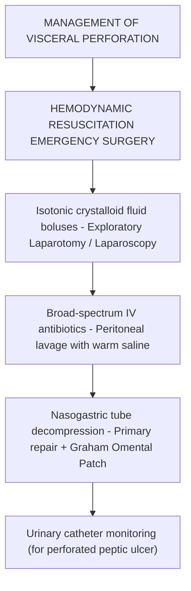

# Chapter 21: The Acute Abdomen & Emergency GI Surgery

## 21.1 Perforated Viscus & Acute Peritonitis

An acute perforated viscus represents a catastrophic surgical emergency resulting in the spillage of acidic, bilious, or fecal luminal contents into the peritoneal cavity, triggering acute septic or chemical **peritonitis**.

### A. Etiology & Clinical Presentation
* **Etiologies**: Perforated peptic ulcer (duodenal anterior wall #1), perforated acute diverticulitis, perforated acute appendicitis, typhoid ileal perforation, stercoral ulcer perforation, traumatic hollow viscus rupture.
* **Clinical Presentation**: Sudden, explosive onset of severe, generalized abdominal pain. Patients lie motionless because any abdominal movement exacerbates peritoneal irritation.
* **Physical Exam Landmarks**:
  * **"Board-like" abdominal rigidity**: Involuntary reflex spasm of abdominal wall musculature.
  * Generalized tenderness and **Rebound tenderness** (Blumberg sign).
  * Absence of bowel sounds (paralytic ileus).
  * Loss of liver dullness on percussion (**Jobert sign**) due to free air collecting anterior to the liver.

---

### B. Diagnostic & Surgical Management
* **Radiographic Landmark**: **Erect Chest X-ray** demonstrating **pneumoperitoneum** (free gas under the diaphragm) in $>75–80\%$ of visceral perforations. On supine abdominal films, free air manifests as **Rigler sign** (visualization of both inner and outer margins of the bowel wall).
* **Non-Contrast / Contrast CT Abdomen**: Gold standard when chest X-ray is negative but clinical suspicion remains high; localizes the exact site of perforation and identifies fluid collections.

* **Surgical Protocol**:
  1. Immediate aggressive fluid resuscitation and broad-spectrum IV antibiotics covering Gram-negative bacilli and anaerobes (e.g., Ceftriaxone + Metronidazole or Piperacillin-Tazobactam).
  2. Emergency Laparotomy or Laparoscopy.
  3. Thorough peritoneal debridement and copious warm saline lavage ($>6–10\text{ Liters}$).
  4. **Perforated Peptic Ulcer Repair**: Primary suture closure reinforced with a vascularized pedicled omental flap (**Cellan-Jones or Graham Omental Patch**).
  5. **Perforated Colonic / Diverticular Repair**: Primary resection with anastomosis or **Hartmann Procedure** (resection of diseased sigmoid colon, creation of a proximal end colostomy, and closure of the distal rectal stump).

---

## 21.2 Acute Appendicitis

Acute appendicitis is the single most common cause of an acute surgical abdomen worldwide.

### A. Pathophysiology
Luminal obstruction (by a **fecalith / appendicolith** in adults, or lymphoid hyperplasia post-viral infection in children) $\rightarrow$ Continued mucosal fluid secretion behind the obstruction $\rightarrow \uparrow$ Intraluminal pressure $\rightarrow$ Venous and lymphatic congestion $\rightarrow$ Ischemic mucosal injury $\rightarrow$ Bacterial invasion of appendiceal wall $\rightarrow$ Gangrene and **transmural perforation** leading to localized peritonitis or generalized sepsis.

---

### B. Clinical Features & Exam Signs
* **Pain Migration**: Classic visceral periumbilical pain (referred along $T_{10}$ dermatome) migrating over $4–12\text{ hours}$ to the Right Lower Quadrant (RLQ) as local parietal peritoneal inflammation develops.
* **Associated Symptoms**: Anorexia ("hamburger sign"), nausea, vomiting, low-grade fever.
* **Pathognomonic Physical Exam Signs**:
  * **McBurney Point Tenderness**: Maximal tenderness at one-third the distance from the Right Anterior Superior Iliac Spine (ASIS) to the umbilicus.
  * **Rovsing Sign**: RLQ pain elicited upon deep palpation of the Left Lower Quadrant (indicates peritoneal irritation).
  * **Psoas Sign**: RLQ pain elicited by passive extension of the right hip (indicates a retrocecal appendix irritating the psoas muscle).
  * **Obturator Sign**: RLQ pain elicited by passive internal rotation of the flexed right hip (indicates a pelvic appendix irritating the internal obturator muscle).

---

### C. Risk Scoring & Diagnostic Workup

#### 1. Alvarado Score (MANTRELS)

| Parameter | Clinical Feature | Score |
| :--- | :--- | :--- |
| **M** | Migration of pain to RLQ | 1 |
| **A** | Anorexia | 1 |
| **N** | Nausea / Vomiting | 1 |
| **T** | **Tenderness in RLQ** | **2** |
| **R** | Rebound tenderness | 1 |
| **E** | Elevated temperature ($\ge 37.3^\circ\text{C}$) | 1 |
| **L** | **Leukocytosis ($>10,000/\mu\text{L}$)** | **2** |
| **S** | Shift of PMN leucocytes to the left ($>75\%$) | 1 |
| **Total** | | **10** |

* **Score $\le 4$**: Appendicitis unlikely; consider alternative diagnosis.
* **Score $5–6$**: Possible appendicitis; CT scan or USG evaluation recommended.
* **Score $\ge 7$**: High probability; surgical consultation for appendectomy.

#### 2. Diagnostic Imaging
* **Ultrasound Abdomen**: First-line choice in children and pregnant females. Positive findings: Non-compressible, blind-ending tubular structure in RLQ with outer diameter **$>6\text{ mm}$**, wall hyperemia (target sign), and appendicolith.
* **Contrast CT Abdomen**: Investigation of choice in non-pregnant adults ($>95\%$ sensitivity/specificity). Shows dilated appendix ($>6\text{ mm}$), periappendiceal fat stranding, appendicolith, and wall enhancement.

---

### D. Surgical Management
* **Laparoscopic Appendectomy**: Gold standard treatment. Associated with less post-operative pain, lower wound infection rates, shorter hospital stay, and faster recovery compared to open appendectomy.
* **Complicated Appendicitis (Phlegmon / Abscess)**: Non-operative management with IV antibiotics and ultrasound/CT-guided percutaneous drain placement is preferred initially, followed by interval appendectomy if symptoms recur.

---

## 21.3 Acute Mechanical Intestinal Obstruction

Intestinal obstruction occurs when the normal flow of luminal contents is mechanically impaired.

### A. Small Bowel Obstruction (SBO) vs. Large Bowel Obstruction (LBO)

| Feature | Small Bowel Obstruction (SBO) | Large Bowel Obstruction (LBO) |
| :--- | :--- | :--- |
| **Primary Etiologies** | 1. **Post-operative Adhesions (60–70%)** 2. Incarcerated Hernias (15–20%) 3. Crohn Disease / Tumors / Intussusception | 1. **Colorectal Carcinoma (60%)** 2. Volvulus (Sigmoid / Cecal) (15–20%) 3. Diverticulitis strictures |
| **Pain Pattern** | Rapidly onset, frequent, sharp colicky pain | Insidious onset, deep dull colicky pain |
| **Vomiting** | Early, prominent, bilious (high SBO) or feculent (low SBO) | Late or absent |
| **Abdominal Distension** | Minimal (proximal SBO) to moderate | **Severe, marked peripheral distension** |
| **Radiographic Appearance** | Dilated central loops ($>3\text{ cm}$), **valvulae conniventes** crossing full lumen width, multiple air-fluid levels | Dilated peripheral loops ($>6\text{ cm}$; cecum $>9\text{ cm}$), **haustra** partially crossing lumen |

| Feature | Small-bowel obstruction | Large-bowel obstruction |
| --- | --- | --- |
| Typical location on plain film | More central loops | More peripheral colonic frame |
| Mucosal folds | Valvulae conniventes cross the full lumen | Haustra cross only part of the lumen |
| Typical pattern | Multiple central dilated loops; step-ladder arrangement may be seen | Peripheral colonic dilatation; haustral markings |
---

### B. Management Protocol
1. **Conservative Initial Therapy ("Drip and Suck")**:
   * Indicated in partial or uncomplicated non-strangulated SBO secondary to adhesions.
   * **NPO (Nil Per Os)** + Aggressive IV fluid resuscitation (isotonic crystalloids).
   * **Nasogastric Tube (NGT) Decompression** to relieve proximal luminal distension and prevent aspiration.
2. **Indications for Emergency Surgery**:
   * **Signs of Strangulation / Bowel Ischemia**: Unrelenting continuous pain, fever, tachycardia, leukocytosis, metabolic acidosis, localized peritonitis, or gas in bowel wall (**pneumatosis intestinalis**) on CT.
   * Irreducible incarcerated hernia.
   * Complete closed-loop obstruction (e.g., volvulus or competence of ileocecal valve preventing decompression).
   * Failure of conservative trial after 48–72 hours.

---

## 21.4 Acute Mesenteric Ischemia

Acute Mesenteric Ischemia (AMI) is a life-threatening vascular emergency caused by sudden inadequacy of mesenteric blood flow, leading to bowel ischemia, transmural gangrene, and septic shock. Mortality remains $>60–80\%$.

### A. Classification & Pathophysiology

| Mechanism | Typical cause / feature listed |
| --- | --- |
| SMA embolism | Often cardiac source; embolus may lodge distal to the SMA origin |
| SMA thrombosis | Underlying atherosclerosis with acute thrombosis near the SMA origin |
| Non-occlusive mesenteric ischaemia (NOMI) | Low-flow state or vasoconstriction, often in shock or severe illness |
| Mesenteric venous thrombosis (MVT) | Mesenteric vein thrombosis associated with hypercoagulability |
1. **Superior Mesenteric Artery (SMA) Embolism (50%)**: Cardiac embolus (atrial fibrillation, post-MI mural thrombus, infective endocarditis) lodging in the SMA, usually distal to the origin of the middle colic artery, sparing the proximal jejunum.
2. **SMA Thrombosis (25%)**: Acute thrombosis overlying chronic atherosclerotic plaque at the SMA origin (patients often give prior history of "intestinal angina").
3. **Non-Occlusive Mesenteric Ischemia (NOMI) (20%)**: Splanchnic vasoconstriction secondary to low cardiac output, septic shock, or vasopressor therapy without physical arterial occlusion.
4. **Mesenteric Venous Thrombosis (MVT) (5%)**: Venous outflow obstruction linked to hypercoagulable states (Prothrombin/Factor V Leiden mutations, malignancies, portal hypertension).

---

### B. Clinical Features & Diagnosis
* **Landmark Symptom**: **Severe, excruciating abdominal pain OUT OF PROPORTION to physical examination findings** in the early stage (abdomen remains soft and non-tender despite agonizing pain).
* **Late Signs**: Peritoneal signs (rigidity, guarding), hematochezia ("currant-jelly" stool), septic shock (indicates transmural bowel necrosis).
* **Diagnostic Investigation of Choice**: **CT Angiography (CTA) of the Abdomen**. Diagnostic features: Lack of arterial enhancement, SMA occlusion, bowel wall thickening, arterial/venous thrombus, pneumatosis intestinalis, or portal venous gas.

---

### C. Emergency Management
1. Immediate fluid resuscitation, broad-spectrum IV antibiotics, and IV unfractionated heparin infusion (to prevent clot propagation).
2. **Surgical Emergency Revascularization**:
   * SMA Embolism: Laparotomy + Open **SMA Embolectomy**.
   * SMA Thrombosis: Retrograde Open Mesenteric Stenting (ROMS) or Antegrade Bypass.
3. **Assessment of Bowel Viability**: Inspect color, peristalsis, and Doppler arterial signals.
4. Resection of non-viable, gangrenous bowel.
5. Mandatory **"Second-Look" Laparotomy** scheduled 24 hours later to re-evaluate questionable bowel segments.

---

## Index Coverage Checklist
- [x] 21.1 Perforated Viscus & Acute Peritonitis (Etiologies, pneumoperitoneum, Rigler sign, Graham omental patch, Hartmann procedure)
- [x] 21.2 Acute Appendicitis (Pathophysiology, pain migration, exam signs, Alvarado score, USG/CT findings, appendectomy)
- [x] 21.3 Acute Mechanical Intestinal Obstruction (SBO vs. LBO comparison, valvulae conniventes vs haustra, conservative management, surgical indications)
- [x] 21.4 Acute Mesenteric Ischemia (Subtypes, pain out of proportion, CT angiography, SMA embolectomy, second-look laparotomy)

## Index Corrections Made
* Emphasized that CT Angiography (CTA) is the primary non-invasive diagnostic modality of choice for Acute Mesenteric Ischemia, replacing invasive digital subtraction angiography as the initial test.

## Unaddressed Topics
* None; all subsections specified for Chapter 21 were fully addressed using standard evidence-based medical literature.
