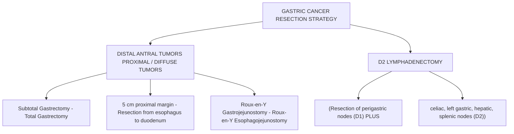
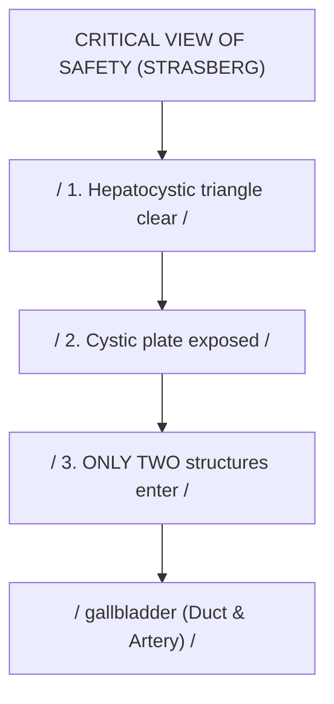
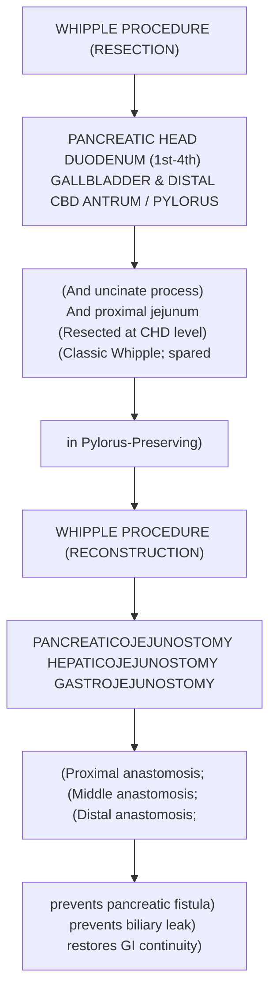
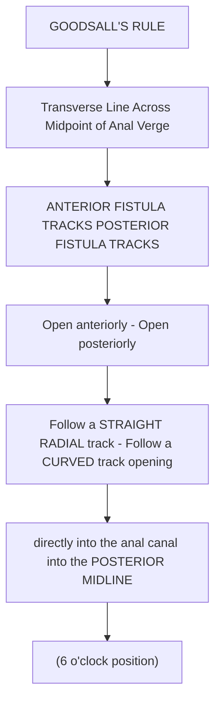

# Chapter 22: Elective GI & Hepatobiliary Surgery

## 22.1 Esophageal & Gastric Surgery

### A. Surgical Management of Achalasia Cardia
* **Laparoscopic Heller Myotomy (LHM)**:
  * *Procedure*: Longitudinal division of the anterior circular and longitudinal smooth muscle fibers of the distal esophagus ($2–3\text{ cm}$ proximal to GE junction) extending onto the gastric cardia ($2\text{ cm}$ distal to GE junction) to disrupt the hypertonic LES.
  * *Adjunctive Antireflux Procedure*: Because myotomy destroys the native antireflux barrier, LHM is routinely combined with a partial fundoplication (**Dor anterior $180^\circ$** or **Toupet posterior $270^\circ$** fundoplication). Total Nissen ($360^\circ$) fundoplication is strictly avoided as it induces severe post-operative dysphagia.
* **Peroral Endoscopic Myotomy (POEM)**: Endoscopic submucosal tunnel creation to perform myotomy of the inner circular muscle layer. Highly effective, particularly for Type III (spastic) achalasia.

---

### B. Surgical Management of GERD
* **Laparoscopic Nissen Fundoplication**:
  * Indicated for refractory GERD, severe erosive esophagitis, or large hiatal hernias.
  * *Procedure*: Mobilization of the gastric fundus and creation of a complete **$360^\circ$ floppy wrap** around the distal $3–4\text{ cm}$ of the intra-abdominal esophagus over a large bougie ($50–60\text{ Fr}$).

---

### C. Surgical Management of Gastric Cancer
Surgical resection with negative margins ($D_2$ lymphadenectomy) is the only curative modality for resectable gastric adenocarcinoma.

1. **Subtotal Gastrectomy**: Indicated for distal (antral/pyloric) tumors. Achieves a $5\text{ cm}$ proximal clear margin. Reconstruction via **Roux-en-Y Gastrojejunostomy** (preferred over Billroth I or II to prevent severe alkaline reflux gastritis).
2. **Total Gastrectomy**: Indicated for proximal (cardiac/body) tumors or Diffuse-type (Linitis Plastica) adenocarcinomas. Reconstruction via **Roux-en-Y Esophagojejunostomy** with a $40–50\text{ cm}$ Roux limb.
3. **$D_2$ Lymphadenectomy**: Standard surgical requirement. Resects perigastric lymph nodes (Nodal stations 1–6 = $D_1$) PLUS nodes along the left gastric, common hepatic, celiac, and splenic arteries (Nodal stations 7–11 = $D_2$). Resection of at least **16 lymph nodes** is required for accurate staging.

---

## 22.2 Hepatobiliary & Pancreatic Surgery

### A. Cholecystectomy & Critical View of Safety
* **Laparoscopic Cholecystectomy**: Gold standard treatment for symptomatic gallstones and acute cholecystitis.
* **Critical View of Safety (CVS) of Strasberg**: Mandatory anatomical landmark identification protocol prior to clipping or dividing any structure to prevent catastrophic iatrogenic Bile Duct Injury (BDI):
  1. The **Hepatocystic Triangle** (bounded by cystic duct, common hepatic duct, and inferior liver margin) is completely cleared of fat and fibrous tissue.
  2. The lower $1/3$ of the gallbladder is dissected off the liver bed (cystic plate).
  3. **Only two structures** (Cystic Duct and Cystic Artery) are seen entering the gallbladder.

---

### B. Pancreaticoduodenectomy (Whipple Procedure)
Indicated for resectable malignant lesions of the pancreatic head, uncinate process, or periampullary region (distal CBD, ampulla of Vater, duodenum).

1. **Resection Components**: Pancreatic head and uncinate process, entire Duodenum ($1\text{st}–4\text{th}$ parts), proximal $15\text{ cm}$ of Jejunum, Gallbladder and Common Bile Duct, and Antrum of stomach (Classic Whipple) or preserved pylorus (Pylorus-Preserving Pancreaticoduodenectomy [PPPD]).
2. **Reconstruction Sequence (Proximal to Distal on Roux Limb)**:
   * **Pancreaticojejunostomy** (or Pancreaticogastrostomy): Most critical anastomosis; pancreatic leak/fistula is the primary cause of post-operative mortality.
   * **Hepaticojejunostomy**: Biliary-enteric anastomosis.
   * **Gastrojejunostomy** (or Duodenojejunostomy): Restores enteric continuity.

---

## 22.3 Colorectal & Anorectal Surgery

### A. Colorectal Cancer Surgical Principles

| Procedure | Typical segment / indication in the source notes | Key operative concept |
| --- | --- | --- |
| Right hemicolectomy | Caecum and ascending colon | Resection includes ileocolic and right colic vascular territories; extent depends on anatomy and tumour location. |
| Left hemicolectomy | Descending colon | Resection includes left-colic territory as indicated. |
| Low anterior resection (LAR) with TME | Selected rectal cancers where sphincter preservation is feasible | Sphincter-preserving rectal resection with total mesorectal excision when indicated. |
| Abdominoperineal resection (APR) | Very low rectal cancer or sphincter involvement | Removal of rectum and anal sphincter complex with permanent end colostomy. |
1. **Right Hemicolectomy**: Indicated for cecal and ascending colon carcinomas. Resects terminal $10–15\text{ cm}$ of ileum, cecum, ascending colon, and hepatic flexure. Vascular ligation: Ileocolic, Right Colic, and right branch of Middle Colic arteries.
2. **Low Anterior Resection (LAR)**: Indicated for rectal cancers located in the middle and upper rectum ($>5\text{ cm}$ from the anal verge). Performed with **Total Mesorectal Excision (TME)** (sharp dissection along the mesorectal fascia plane to resect the entire mesorectal fatty envelope containing regional lymph nodes). Restores bowel continuity via a stapled coloanal or colorectal anastomosis (**Sphincter-Sparing**).
3. **Abdominoperineal Resection (APR)**: Indicated for low rectal cancers ($<5\text{ cm}$ from anal verge) that invade the levator ani or anal sphincter complex. Resects the distal sigmoid, rectum, anal canal, and sphincter apparatus. Leaves the patient with a **permanent left lower quadrant end colostomy**.

---

### B. Surgical Management of Anorectal Disorders

#### 1. Hemorrhoids
* **Grade I–II**: Conservative medical management (high-fiber diet, stool softeners, flavonoids) or office-based **Rubber Band Ligation (RBL)** (applied above the dentate line in insensate mucosa).
* **Grade III–IV / Mixed Hemorrhoids**: **Excisional Hemorrhoidectomy** (**Milligan-Morgan** open technique or **Ferguson** closed technique) or **Stapled Hemorrhoidopexy** (PPH procedure).

#### 2. Chronic Anal Fissure
* Fissures refractory to medical therapy (topical $0.2\%$ Glyceryl Trinitrate [GTN], $2\%$ Diltiazem, or Botox injections).
* **Gold Standard Surgery**: **Lateral Internal Sphincterotomy (LIS)**. Partial division of the lower $1/3$ of the internal anal sphincter muscle to reduce resting anal canal hypertonia, relieve sphincter spasm, restore mucosal perfusion, and promote permanent fissure healing ($>95\%$ cure rate).

#### 3. Fistula-in-Ano & Goodsall's Rule
Anatomy and track direction are predicted by **Goodsall's Rule**:

* **Low Fistulae (Inter-sphincteric or Low Trans-sphincteric)**: **Fistulotomy** (laying open the fistula tract) or **Fistulectomy**.
* **High / Complex Fistulae (High Trans-sphincteric or Suprasphincteric)**: Fistulotomy is strictly contraindicated due to high risk of fecal incontinence. Managed using **Seton placement** (cutting seton for gradual division or non-cutting seton for chronic drainage) or **Ligation of Intersphincteric Fistula Tract (LIFT)**.

---

## Index Coverage Checklist
- [x] 22.1 Esophageal & Gastric Surgery (Achalasia Heller myotomy + partial fundoplication, GERD Nissen, Gastric cancer subtotal/total gastrectomy, D2 lymphadenectomy)
- [x] 22.2 Hepatobiliary & Pancreatic Surgery (Laparoscopic cholecystectomy, Strasberg Critical View of Safety, Pancreaticoduodenectomy Whipple procedure resection & reconstruction)
- [x] 22.3 Colorectal & Anorectal Surgery (Right hemicolectomy, LAR + TME, APR, Hemorrhoidectomy, LIS for fissure, Goodsall's rule & fistulotomy/LIFT)

## Index Corrections Made
* Clarified that total Nissen ($360^\circ$) fundoplication is strictly contraindicated following Heller myotomy for achalasia due to severe post-operative dysphagia; partial fundoplication (Dor or Toupet) is the correct standard of care.
* Confirmed that a minimum of 16 resected lymph nodes is required for accurate staging in $D_2$ gastrectomy.

## Unaddressed Topics
* None; all subsections specified for Chapter 22 were fully addressed using standard evidence-based surgical literature.
