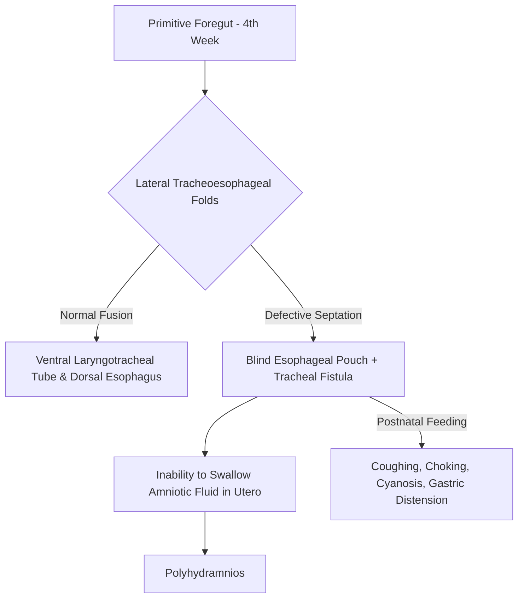
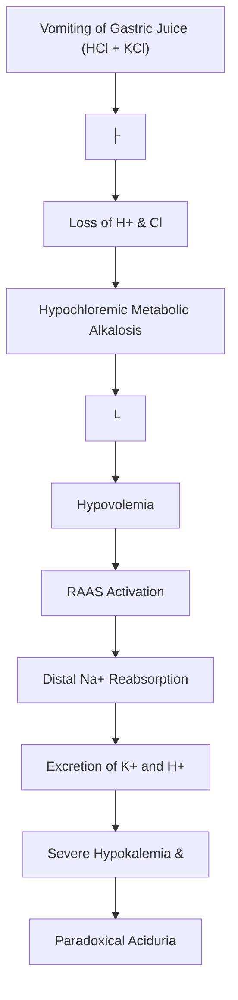
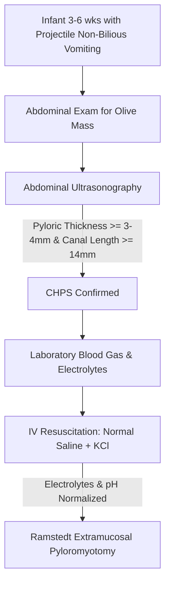
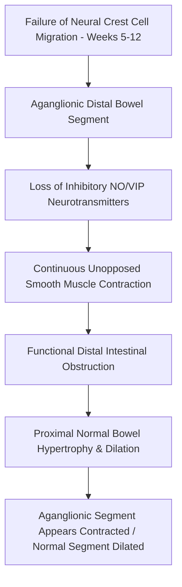

# Chapter 23: Congenital & Structural Anomalies in Pediatrics

## 23.1 Tracheoesophageal Fistula (TEF) & Esophageal Atresia (EA)

### Embryology & Pathophysiology
Tracheoesophageal fistula (TEF) and esophageal atresia (EA) result from incomplete septation and lateral ingrowth of the tracheoesophageal folds in the primitive foregut during the $4^{\text{th}}$ to $5^{\text{th}}$ week of embryonic development. Normally, the tracheoesophageal septum divides the foregut into a ventral respiratory tract (laryngotracheal tube) and a dorsal digestive tract (esophagus). Interruption of this mechanical partitioning or vascular insufficiency during rapid foregut elongation leads to blind esophageal pouches and abnormal fistulous communications with the trachea.

### Anatomical Classification (Vogt & Gross Classification)
* **Gross Type C / Vogt IIIb (85% - Most Common)**: Blind proximal esophageal atresia with a fistulous connection between the distal esophageal segment and the posterior wall of the lower trachea or carina.
* **Gross Type A / Vogt II (8%)**: Isolated Esophageal Atresia without TEF ("Pure Atresia"). Characterized by a wide gap between blind proximal and distal pouches and a completely gasless abdomen on X-ray.
* **Gross Type E / Vogt N/A (4%)**: Isolated Tracheoesophageal Fistula without EA ("H-type" or "N-type" Fistula). Patent esophagus allowing normal passage of tubes, presenting later in infancy with recurrent aspiration pneumonia during feeds and paroxysmal coughing.
* **Gross Type B (1%)**: Proximal TEF with distal EA.
* **Gross Type D (1%)**: Double TEF (both proximal and distal esophageal segments communicate with the trachea).

### Associated Congenital Anomalies
Over 50% of infants with TEF/EA have associated congenital malformations, most notably the **VACTERL** association:
* **V**: Vertebral anomalies (hemivertebrae, sacral dysgenesis)
* **A**: Anorectal malformations (imperforate anus)
* **C**: Cardiac defects (Ventricular Septal Defect [VSD], Tetralogy of Fallot, Patent Ductus Arteriosus [PDA])
* **TE**: Tracheo-Esophageal fistula / Esophageal atresia
* **R**: Renal anomalies (renal agenesis, dysplastic kidney, vesicoureteral reflux)
* **L**: Limb abnormalities (radial ray aplasia/hypoplasia, polydactyly)

### Clinical Presentation & Diagnostics
* **Antenatal Clues**: Maternal polyhydramnios (due to inability of the fetus to swallow and absorb amniotic fluid) and a small or absent fetal stomach bubble on level II ultrasound.
* **Neonatal Presentation**: Excessive salivation, continuous frothing and drooling at the mouth and nares shortly after birth. The classic diagnostic triad on the first feed attempt consists of **Coughing, Choking, and Cyanosis**.
* **Distal Fistula Signs**: In Type C TEF, air passes freely from the trachea into the distal stomach during crying/respiration, leading to marked gastric distension, diaphragmatic elevation, and an increased risk of chemical pneumonitis secondary to reflux of gastric juice into the tracheobronchial tree.
* **Bedside Confirmation**: Inability to pass a stiff $8\text{ Fr}$ or $10\text{ Fr}$ radiopaque nasogastric (NG) or orogastric (OG) tube into the stomach. The tube encounters resistance and coils in the blind upper esophageal pouch (typically $10–12\text{ cm}$ from the gums).
* **Radiography**: Plain upright X-ray of the chest and abdomen with the radiopaque catheter in situ demonstrates the coiled tube in the dilated upper pouch at the level of $T_2–T_4$. 
  * Presence of bowel gas in the abdomen confirms a distal fistula (Type C or D).
  * A completely gasless, scaphoid abdomen confirms isolated esophageal atresia (Type A) or proximal fistula only (Type B).
  * *Contraindication*: Barium swallow is strictly contraindicated due to the extreme risk of massive barium aspiration pneumonitis.

### Management & Surgical Repair
1. **Preoperative Stabilization**:
   * Continuous suctioning of the proximal blind pouch using a double-lumen Replogle tube placed on low intermittent suction ($30–40\text{ mmHg}$) to prevent overflow aspiration.
   * Head-of-bed elevation ($30^\circ–45^\circ$) to minimize reflux of gastric contents up the distal fistula into the lungs.
   * Prophylactic broad-spectrum IV antibiotics and parenteral fluid resuscitation.
   * Echocardiogram and spinal/renal ultrasonography to rule out VACTERL components prior to anesthesia.
2. **Surgical Repair**:
   * Surgical approach via a right extrapleural muscle-sparing thoracotomy (or thoracoscopy) through the $4^{\text{th}}$ intercostal space.
   * Identification and ligation/division of the tracheoesophageal fistula close to the trachea, followed by primary end-to-end anastomosis of the proximal and distal esophageal segments.
   * *Long-Gap Esophageal Atresia ($>3\text{ cm}$ gap)*: Managed with temporary gastrostomy tube placement, delayed primary repair after esophageal growth ($8–12$ weeks), or gastric pull-up / colonic interposition.
3. **Postoperative Complications**: Anastomotic leak, anastomotic stricture (most common late complication, managed with balloon dilation), recurrent TEF, tracheomalacia (causing characteristic "barking" cough and severe expiratory stridor), and severe GERD.

---

## 23.2 Congenital Hypertrophic Pyloric Stenosis (CHPS)

### Pathophysiology & Etiology
Congenital Hypertrophic Pyloric Stenosis (CHPS) is characterized by progressive hypertrophy and hyperplasia of both the circular and longitudinal smooth muscle layers of the pyloric sphincter. This leads to marked elongation and narrowing of the pyloric canal, creating a dynamic mechanical gastric outlet obstruction.

* **Etiology**: Multifactorial etiology involving genetic predisposition and environmental triggers. Strongly linked to impaired neuronal nitric oxide synthase (nNOS) expression and deficient non-adrenergic, non-cholinergic (NANC) inhibitory ganglion cell signaling in the pyloric muscle.
* **Risk Factors**: First-born male infants (Male-to-Female ratio $4:1–5:1$), maternal smoking, and exposure to oral macrolide antibiotics (**Erythromycin or Azithromycin**) within the first 2 weeks of life (either directly or via breast milk).

### Clinical Manifestations
* **Age of Onset**: Classic presentation occurs between **3 and 6 weeks of age** (rarely present at birth and almost never presents after 12 weeks).
* **Vomiting Pattern**: Progressive, non-bilious, forceful **projectile vomiting** occurring immediately after infant feedings. The infant remains insatiably hungry ("hungry vomiter") and eagerly re-feeds immediately after emesis.
* **Physical Examination**:
  * Visible peristaltic waves progressing from left to right across the epigastrium prior to emesis.
  * Pathognomonic Physical Sign: Palpation of an **"olive-shaped" mass** (pyloric tumor)—a firm, mobile, non-tender olive-sized nodule—in the right upper quadrant or epigastrium, best felt immediately after the infant has vomited and the abdominal wall is relaxed.

### Metabolic & Laboratory Derangements
Persistent loss of gastric juice (rich in $\text{HCl}$, $\text{NaCl}$, and $\text{KCl}$) via vomiting induces a classic metabolic sequence:

$$\text{Loss of Gastric } \text{HCl} \longrightarrow \text{Hypochloremic, Hypokalemic Metabolic Alkalosis with Paradoxical Aciduria}$$

1. **Initial Phase**: Loss of $\text{H}^+$ and $\text{Cl}^-$ leads to metabolic alkalosis and hypochloremia.
2. **Renal Compensation**: To retain $\text{H}^+$, the kidney excretes $\text{HCO}_3^-$ paired with $\text{Na}^+$. As hypovolemia develops, aldosterone surges to preserve intravascular volume by expanding $\text{Na}^+$ reabsorption in exchange for $\text{K}^+$ and $\text{H}^+$ in the distal nephron.
3. **Decompensated Phase**: Severe hypokalemia forces the renal cortical collecting tubule $\text{H}^+/\text{K}^+$-ATPase to reabsorb $\text{K}^+$ and excrete $\text{H}^+$ into the urine, resulting in **paradoxical aciduria** (acidic urine in the setting of severe systemic alkalosis).

### Diagnostic Evaluation
* **Ultrasonography (Diagnostic Investigation of Choice)**:
  * Pyloric muscle thickness $\ge 3.0–4.0\text{ mm}$ (most specific single measure).
  * Pyloric canal length $\ge 14–15\text{ mm}$.
  * Pyloric diameter $\ge 10–14\text{ mm}$.
  * Dynamic finding: Complete failure of the pyloric channel to open during $15\text{ minutes}$ of real-time examination.
* **Barium Upper GI Series (Indicated if USG is equivocal)**:
  * **"String Sign"**: Severe elongation and narrowing of the radiolucent pyloric canal.
  * **"Double-Track Sign"**: Barium trapped between compressed folds of hypertrophied pyloric mucosa.
  * **"Beak Sign" / "Mushroom Sign"**: Indentation of the hypertrophied pylorus into the antrum and duodenal bulb.

### Management Protocol
* **Resuscitation First (Crucial Surgical Rule)**: CHPS is a **medical emergency, NOT an immediate surgical emergency**. Operation must never be performed until dehydration, electrolyte imbalances, and metabolic alkalosis are fully corrected.
  * Fluid resuscitation with $0.9\%\text{ Normal Saline}$ boluses ($10–20\text{ mL/kg}$), followed by maintenance $D_5 0.45\%\text{ NS}$ with $20–30\text{ mEq/L KCl}$ once urinary output is established.
  * Surgical readiness criteria: Serum chloride $>100\text{ mEq/L}$, serum potassium $>3.5\text{ mEq/L}$, serum bicarbonate $<26–28\text{ mEq/L}$, and urine $\text{pH} > 6.0$.
* **Definitive Surgical Treatment**: **Ramstedt Extramucosal Pyloromyotomy** (performed open via RUQ transverse incision or laparoscopically). The hypertrophied pyloric muscle is split longitudinally along its anterior surface from the prepyloric vein of Mayo to the antrum down to, but not through, the underlying submucosa, allowing the mucosa to bulge freely.

---

## 23.3 Intestinal Atresia & Hirschsprung Disease

### Intestinal Atresia
Intestinal atresia refers to congenital complete occlusion of the intestinal lumen, classified anatomically into duodenal, jejunoileal, and colonic variants.

#### 1. Duodenal Atresia
* **Pathophysiology**: Results from **failure of recanalization** of the solid duodenal lumen during the $8^{\text{th}}$ to $10^{\text{th}}$ week of gestation.
* **Genetic Association**: Strongly associated with **Down Syndrome (Trisomy 21)** (seen in 30% of duodenal atresia cases).
* **Clinical Presentation**: Antenatal polyhydramnios; **bilious vomiting** within the first 24 hours of life (since 85% of atresias occur distal to the ampulla of Vater in the $2^{\text{nd}}$ or $3^{\text{rd}}$ part of the duodenum); epigastric distension with a scaphoid lower abdomen.
* **Radiography**: Abdominal X-ray demonstrates the pathognomonic **"Double-Bubble Sign"**—representing air trapping in the dilated stomach and proximal duodenal bulb, with an complete absence of gas in the distal distal small and large intestine.
* **Management**: Nasogastric decompression, IV hydration, and surgical bypass via **Duodenoduodenostomy** (side-to-side or diamond-shaped).

| Feature | Duodenal atresia | Jejunoileal atresia |
| --- | --- | --- |
| Pathogenesis | Failure of recanalisation | In-utero vascular disruption |
| Associated conditions | Down syndrome and other congenital anomalies | May be associated with gastroschisis or cystic fibrosis |
| Radiograph | Double-bubble sign; distal gas may be absent | Multiple dilated bowel loops / air-fluid levels |
| Surgery | Duodenoduodenostomy is commonly used | Resection of atretic segment with primary anastomosis when feasible |
#### 2. Jejunoileal Atresia
* **Pathophysiology**: Caused by an **in utero vascular accident** (e.g., volvulus, intussusception, internal hernia, or thromboembolism involving branches of the superior mesenteric artery), leading to ischemic necrosis, resorption of the sterile fetal bowel, and a blind-ending proximal and distal bowel loop.
* **Morphological Types**:
  * *Type I*: Intraluminal mucosal diaphragm with intact bowel wall and mesentery.
  * *Type II*: Blind ends connected by a fibrous cord.
  * *Type IIIa*: Blind ends separated by a V-shaped mesenteric defect.
  * *Type IIIb ("Apple-Peel" / "Christmas Tree" Deformity)*: Proximal jejunal atresia near the ligament of Treitz; distal small intestine coils around a single remaining collateral nutrient vessel (right colic or ileocolic artery) like an apple peel. High mortality.
  * *Type IV*: Multiple segmental intestinal atresias ("string of sausages").
* **Clinical Presentation & Management**: Bilious vomiting, marked abdominal distension, failure to pass meconium, and multiple air-fluid levels on upright X-ray. Treated with resection of the dilated dysmotile proximal bulb and primary end-to-end anastomosis.

---

### Hirschsprung Disease (Congenital Aganglionic Megacolon)

#### Etiology & Pathophysiology
Hirschsprung disease is characterized by the **absence of intramural ganglion cells** (Meissner submucosal and Auerbach myenteric plexuses) in the distal gastrointestinal tract.

* **Embryology**: Results from an arrest of the craniocaudal migration of neural crest cells along the alimentary tract between the $5^{\text{th}}$ and $12^{\text{th}}$ weeks of gestation. Aganglionosis always starts at the anus and extends proximally for a variable distance.
* **Genetics**: Strongly linked to loss-of-function mutations in the **RET proto-oncogene** (chromosome 10q11.2) in 50% of familial and 15–20% of sporadic cases. Associated with Trisomy 21 and MEN 2A/2B.
* **Anatomical Subtypes**:
  * *Short-Segment Disease (80%)*: Aganglionosis restricted to the rectosigmoid colon.
  * *Long-Segment Disease (15%)*: Extends proximal to the sigmoid colon.
  * *Total Colonic Aganglionosis (5%)*: Involves the entire colon and variable distal ileum.

#### Clinical Manifestations
* **Neonatal Presentation**:
  * Failure to pass meconium within the first 24–48 hours of life in a full-term infant.
  * Progressive abdominal distension, feeding intolerance, and bilious vomiting.
  * **"Blast Sign" / "Squirt Sign"**: Digital rectal examination reveals a tight sphincter and an empty rectal ampulla; withdrawal of the finger triggers an explosive release of trapped foul-smelling gas and liquid meconium.
* **Infant/Child Presentation**: Chronic refractory constipation requiring continuous enemas, failure to thrive, visible peristalsis, and ribbon-like stools.
* **Lethal Complication**: **Hirschsprung-Associated Enterocolitis (HAEC)**—characterized by sudden explosive fever, foul bloody diarrhea, massive abdominal distension, and septic shock driven by bacterial translocation across ischemic megacolonic mucosa. Requires urgent aggressive resuscitation, broad-spectrum antibiotics, and rectal washouts.

#### Diagnostic Evaluation
1. **Unstained Contrast Enema (Barium/Gastrografin)**:
   * Demonstrates a pathognomonic **Transition Zone**—a narrow, contracted aganglionic distal segment communicating via a cone-shaped funnel with a markedly dilated, hypertrophied proximal normal bowel segment.
   * Delayed evacuation of contrast material ($>24\text{ hours}$ post-procedure).
   * *Precaution*: Rectal examination or washouts should not be performed immediately prior to contrast enema as they artificially dilate the aganglionic segment, obscuring the transition zone.
2. **Anorectal Manometry**: Demonstrates **absence of the Rectoanal Inhibitory Reflex (RAIR)**. In normal individuals, balloon distension of the rectum induces reflex relaxation of the internal anal sphincter. In Hirschsprung disease, the internal anal sphincter fails to relax or exhibits paradoxical contraction.
3. **Full-Thickness Rectal Suction Biopsy (Gold Standard Confirmation)**:
   * Performed at least $2\text{ cm}$ above the dentate line (to avoid the physiological hypoganglionic zone of the distal anal canal).
   * Histopathological Findings:
     * Complete **absence of ganglion cells** in both the submucosal (Meissner) and myenteric (Auerbach) plexuses.
     * Presence of **hypertrophied, thick, wavy non-myelinated cholinergic nerve trunks**.
     * **Acetylcholinesterase (AChE) Histochemistry**: Demonstrates intense dark staining due to prominent AChE-positive nerve fiber proliferation in the lamina propria and submucosa.

| Diagnostic modality | Characteristic finding |
| --- | --- |
| Contrast enema | Transition zone with narrow distal aganglionic bowel and dilated proximal bowel; may be absent in neonates |
| Anorectal manometry | Absent rectoanal inhibitory reflex (RAIR); supportive, not definitive alone |
| Rectal suction biopsy | Absence of ganglion cells with hypertrophied nerve trunks; diagnostic histology |
| Acetylcholinesterase staining | Increased acetylcholinesterase-positive nerve fibres in the lamina propria/mucosa |
#### Surgical Management
* **Stage 1 (If HAEC or severe obstruction present)**: Emergency decompression with levelling colostomy in the ganglionic bowel segment.
* **Definitive Single-Stage / Two-Stage Surgery**: Resection of the entire aganglionic segment and pull-through of healthy ganglionic bowel down to the distal rectum ($1\text{ cm}$ above dentate line):
  * **Swenson Procedure**: Extra-abdominal end-to-end anastomosis after full excision of the aganglionic rectosigmoid.
  * **Duhamel Procedure**: Retrorectal pull-through, creating a composite pouch with posterior aganglionic rectum and anterior ganglionic colon.
  * **Soave Procedure**: Endorectal pull-through, dissecting mucosal lining of the aganglionic rectum and pulling ganglionic bowel through the remaining aganglionic muscular sleeve.

---

## Index Coverage Checklist & Quality Self-Assessment

### Checklist of Index Subsections
- [x] **23.1 Tracheoesophageal Fistula & Esophageal Atresia**: Embryology, Gross classification (Types A-E), VACTERL association, clinical triad, NG tube coiling diagnostic, barium contraindication, surgical management.
- [x] **23.2 Congenital Hypertrophic Pyloric Stenosis**: Pathophysiology, nNOS deficiency, erythromycin risk, projectile non-bilious vomiting, olive mass, hypochloremic hypokalemic metabolic alkalosis with paradoxical aciduria, USG criteria, preoperative resuscitation rules, Ramstedt pyloromyotomy.
- [x] **23.3 Intestinal Atresia & Hirschsprung Disease**: Duodenal atresia (recanalization failure, Trisomy 21, double-bubble sign) vs. Jejunoileal atresia (vascular accident, apple-peel deformity); Hirschsprung disease (RET proto-oncogene, neural crest arrest, blast sign, HAEC emergency, transition zone on barium, absence of RAIR, rectal suction biopsy gold standard, AChE staining, definitive pull-through procedures).

### Index Corrections & Clarifications Made
1. *Correction on Pyloric Stenosis Timing*: Clarified that CHPS is rarely present at birth; peak onset occurs strictly between 3 and 6 weeks of age.
2. *Clarification on CHPS Surgical Urgency*: Re-emphasized that CHPS is a metabolic emergency requiring fluid normalization before operation, not an immediate surgical emergency.
3. *Correction on Hirschsprung Transition Zone*: Noted that the dilated portion on X-ray is the *normal* ganglionic bowel, whereas the narrow/contracted segment is the *pathological aganglionic* segment.

### Unaddressed Topics / Source Limitations
- None. All requested congenital pediatric GI topics were fully elaborated using evidence-based anatomical, biochemical, and surgical principles.

---
