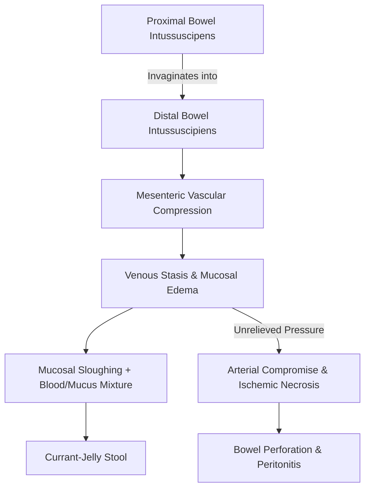
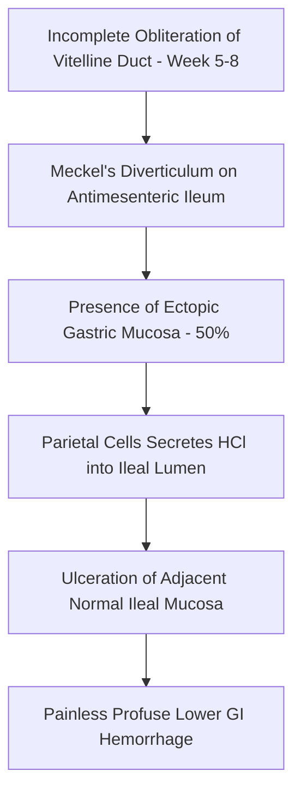
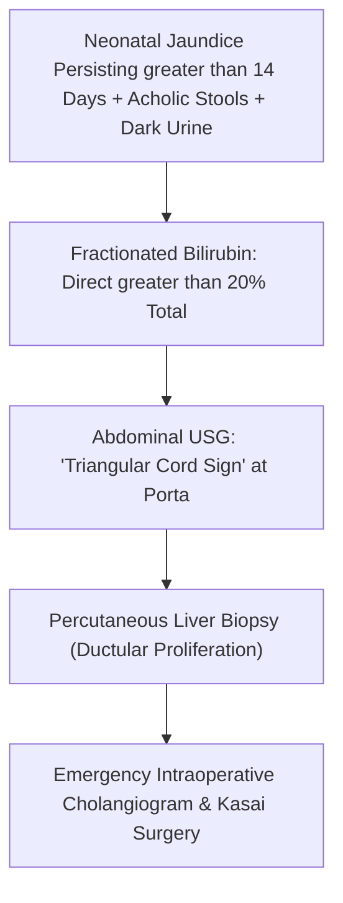
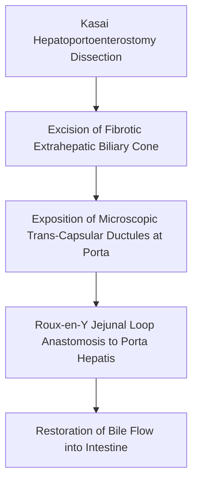

# Chapter 24: Common Pediatric GI Disorders & Emergencies

## 24.1 Intussusception

### Definition & Epidemiology
Intussusception is defined as the invagination or "telescoping" of a proximal segment of the gastrointestinal tract (**intussuscipens**) into an adjacent distal bowel lumen (**intussuscipiens**). It represents the most common cause of intestinal obstruction in infants and young children aged **6 months to 36 months** (peak incidence: $6–12\text{ months}$), with a male predominance ($3:2$).

### Etiology & Pathogenesis
* **Idiopathic Intussusception (90% of cases)**: Occurs predominantly in infants $<2$ years without a anatomical lead point. Strongly associated with preceding viral gastroenteritis or upper respiratory tract infections (especially **Adenovirus**, **Rotavirus**, or Human Herpesvirus 6). Viral infection causes reactive **hyperplasia of Peyer's patches** in the lymphoid-rich terminal ileum, which acts as a dynamic physiological lead point gripped by peristaltic waves.
* **Pathological Lead Points (10% of cases)**: More common in children $>2$ years or $<3$ months. Specific structural abnormalities include:
  * **Meckel’s Diverticulum** (most common pathological lead point overall)
  * Intestinal Polyps (Peutz-Jeghers syndrome, juvenile polyps)
  * Henoch-Schönlein Purpura (IgA Vasculitis—causes intramural intestinal hematomas)
  * Duplication Cysts, Lymphoma (Burkitt lymphoma), or Celiac Disease
* **Anatomical Locations**:
  * **Ileocolic (85–90% - Most Common)**: Terminal ileum invaginates through the ileocecal valve into the colon.
  * *Ileo-ileo-colic*, *Ileo-ileal*, and *Colo-colic*.

### Pathophysiologic Sequence
As the intussuscipens invaginates, it drags its attached mesentery into the receiving distal segment.
1. Compression of low-pressure mesenteric veins leads to venous engorgement and severe intestinal wall edema.
2. Progressive mucosal ischemia causes sloughing of the necrotic mucosa mixed with mucus and microscopic blood, manifesting as **"currant-jelly" stools**.
3. If uncorrected, arterial inflow is compromised, leading to full-thickness transmural gangrene, bowel perforation, peritonitis, and fatal septic shock.

### Clinical Manifestations
* **Classic Clinical Triad (Present in $<50\%$ of cases)**:
  1. Severe, sudden-onset, episodic colicky abdominal pain (infant screams, draws knees up to chest, and appears pale during paroxysms lasting 15–20 minutes, alternating with quiescent lethargic intervals).
  2. Palpable sausage-shaped abdominal mass.
  3. "Currant-jelly" stool (dark red blood mixed with mucus per rectum).
* **Physical Examination**:
  * **"Sausage-Shaped" Mass**: Palpable firm, tubular mass in the right upper quadrant or epigastrium, with an emptiness or concavity in the right lower quadrant (**Dance Sign**—due to displacement of the cecum out of the right iliac fossa).
  * Late Signs: Progressive bilious vomiting, abdominal distension, lethargy (often misdiagnosed as sepsis or CNS disease), and shock.

### Diagnostic Evaluation & Imaging
* **Abdominal Ultrasonography (Gold Standard Diagnostic Test - Sensitivity/Specificity $>98\%$)**:
  * Transverse View: Pathognomonic **"Target Sign"** or **"Doughnut Sign"**—concentric hyperechoic and hypoechoic rings formed by alternating layers of mucosal and muscularis walls of the folded bowel loops.
  * Longitudinal View: **"Pseudokidney Sign"** or **"Sandwich Sign"**—elongated soft tissue mass resembling a kidney created by central hyperechoic mesentery surrounded by hypoechoic bowel wall.
* **Plain Abdominal Radiography**: May show a dense soft-tissue mass in the RUQ, absence of cecal gas, or signs of mechanical small bowel obstruction (dilated loops with air-fluid levels).

| Modality / decision | Key finding or point |
| --- | --- |
| Transverse ultrasound | Target / doughnut sign |
| Longitudinal ultrasound | Pseudokidney / sandwich appearance |
| Non-operative reduction | Air (pneumatic) or saline/other hydrostatic enema under imaging guidance in suitable patients |
| Do not attempt enema reduction when | Peritonitis, perforation or haemodynamic instability is present; urgent surgical assessment is required |
| Surgical indications | Peritonitis, perforation, failed reduction or a concerning pathological lead point |
### Management Protocol
1. **Initial Resuscitation**: Fluid resuscitation with Normal Saline boluses, nasogastric tube decompression, and IV broad-spectrum antibiotics.
2. **Non-Surgical Reduction (First-Line Treatment in Hemodynamically Stable Patients)**:
  * **Pneumatic (Air) Reduction** under fluoroscopic guidance (or **Hydrostatic Saline/Barium Reduction** under ultrasound guidance). Air reduction is preferred due to higher success rates ($>90\%$), lower radiation dose, and cleaner management if perforation occurs.
  * **Safety Rules for Air Reduction**:
    * Maximum safe pressure limit = **$120\text{ mmHg}$** (or $100\text{ mmHg}$ in neonates) to prevent iatrogenic bowel rupture.
    * Contrast/air must be observed refluxing freely into the terminal ileum to confirm complete reduction.
3. **Absolute Contraindications to Non-Surgical Reduction**:
  * Signs of peritonitis or abdominal rigidity.
  * Radiographic evidence of pneumoperitoneum (bowel perforation).
  * Systemic hemodynamic collapse or uncorrected septic shock.
4. **Surgical Management (Laparotomy / Laparoscopy)**:
  * Indicated for non-surgical reduction failure (after 2–3 attempts), peritonitis/perforation, or confirmed structural lead points.
  * Operative Procedure: Manual reduction via gentle retrograde compression ("milking" the intussuscipiens backward, NEVER pulling the intussuscipens out). Resection and primary end-to-end anastomosis if bowel is non-viable, gangrenous, or contains a pathological lead point.

---

## 24.2 Meckel’s Diverticulum

### Embryology & Pathophysiology
Meckel’s diverticulum is the most common congenital anomaly of the gastrointestinal tract, affecting approximately **2% of the general population**.

* **Embryological Origin**: Results from the incomplete obliteration of the **omphalomesenteric duct (vitelline duct)** during the $5^{\text{th}}$ to $8^{\text{th}}$ week of gestation. Normally, the vitelline duct connects the primitive midgut lumen to the yolk sac and undergoes complete atrophy.
* **Anatomical Structure**: A **true diverticulum** containing all three layers of the intestinal wall (mucosa, submucosa, muscularis propria). It arises from the antimesenteric border of the ileum, typically located within $2\text{ feet}$ ($60\text{ cm}$) of the ileocecal valve.

### The Classic "Rule of 2s"
* **2%** prevalence in the global population.
* **2:1** male-to-female predominance in symptomatic cases.
* Located **2 feet** ($60\text{ cm}$) proximal to the ileocecal valve on the antimesenteric border.
* Typically **2 inches** ($5\text{ cm}$) in length.
* **2 types** of common ectopic tissue: **Gastric mucosa** (50%—most common) and **Pancreatic tissue** (5%).
* Most symptomatic patients present before **2 years** of age.

### Clinical Manifestations
The vast majority of individuals with Meckel’s diverticulum remain completely asymptomatic throughout life. When symptomatic, presentations differ markedly by age:

1. **Painless Lower GI Hemorrhage (Most Common Presentation in Children $<2$ Years)**:
   * Driven by ectopic parietal cells in the diverticulum secreting hydrochloric acid ($\text{HCl}$). The acid flows downstream and causes peptic ulceration of the adjacent *normal ileal mucosa* (which lacks protective mucus-bicarbonate barriers).
   * Manifests as recurrent, painless, dark brick-red or **maroon-colored blood per rectum** ("currant-jelly" or plum-colored stools), leading to severe iron deficiency anemia.
2. **Intestinal Obstruction (Most Common Presentation in Older Children & Adults)**:
   * Secondary to intussusception (with the diverticulum acting as the lead point), volvulus around a persistent fibrous umbilical cord attachment, or internal herniation through a mesodiverticular band.
3. **Meckel’s Diverticulitis (10–20%)**:
   * Stagnation of intraluminal contents or a peptic ulcer causes inflammation indistinguishable clinically from **acute appendicitis** (periumbilical pain migrating to the RLQ, fever, leukocytosis, and rebound tenderness). Often discovered incidentally during laparotomy for presumed appendicitis.

### Diagnostic Evaluation
* **Technetium-99m Pertechnetate Scintigraphy ("Meckel’s Scan" - Gold Standard in Pediatrics)**:
  * Mechanism: $^{99m}\text{Tc-pertechnetate}$ is selectively taken up and concentrated by $\text{Na}^+/\text{I}^-$ symporters in **ectopic gastric parietal cells**.
  * Positive Finding: Simultaneous focal uptake of radiotracer in the right lower quadrant occurring at the exact same time as normal gastric uptake.
  * Sensitivity enhancement: Pre-treatment with $\text{H}_2$-receptor antagonists (cimetidine—inhibits tracer secretion into lumen), proton pump inhibitors, or glucagon (decreases peristalsis).
  * False Negatives: Absence of ectopic gastric tissue in the diverticulum, active severe bleeding flushing out tracer, or rapid intestinal transit.
* **Wireless Capsule Endoscopy / Enteroscopy**: Useful in adults with obscure GI bleeding when scintigraphy is negative.

### Surgical Management
* **Symptomatic Meckel’s Diverticulum**: Definitive treatment is surgical resection. Options include segmental small bowel resection with end-to-end anastomosis (preferred if ulcerated bleeding site in adjacent ileum is present) or laparoscopic diverticulectomy (wedge resection of the diverticulum).
* **Incidental Meckel’s Diverticulum (Discovered during surgery for other reasons)**: Resection is recommended if the diverticulum is narrow-necked, thick-walled (palpable ectopic tissue), $>2\text{ cm}$ long, attached to the umbilicus by a fibrous band, or in patients $<50$ years.

---

## 24.3 Biliary Atresia

### Etiology & Pathophysiology
Biliary atresia is a progressive, idiopathic fibro-inflammatory disease of infancy characterized by complete obliteration or disappearance of part or all of the extrahepatic biliary tree, leading to severe obstructive jaundice and secondary biliary cirrhosis.

* **Incidence**: Most common cause of neonatal cholestasis and the **single most common indication for pediatric liver transplantation** worldwide ($1$ in $10,000–15,000$ live births).
* **Pathogenesis**: Result of an acquired perinatal inflammatory insult (possibly triggered by viral infections such as Reovirus Type 3, Rotavirus, or CMV in genetically susceptible infants) driving autoimmune T-lymphocyte-mediated bile duct destruction, dense periductal fibrosis, and luminal obliteration.
* **Anatomical Subtypes (Kasai Classification)**:
  * *Type I (5%)*: Obliteration restricted to the common bile duct; proximal ducts patent.
  * *Type II (2%)*: Obliteration of the common hepatic duct.
  * *Type III (93% - Most Common)*: Complete obliteration of the entire extrahepatic biliary tree at or above the porta hepatis.

### Clinical Features
* **Normal Birth**: Infants are typically born at full term with normal birth weights and initially appear healthy.
* **Persistent Neonatal Jaundice**: Conjugated hyperbilirubinemia persisting **beyond 14 days of life** (normal physiological jaundice resolves by $10–14$ days).
* **Acholic Stools**: Progressive lightening of stool color to pale yellow, slate-grey, or **clay-colored (acholic)** due to complete absence of fecal stercobilin.
* **Dark Urine**: Conjugated (direct) bilirubin is water-soluble and excreted in urine, staining diapers dark brown/tea-colored.
* **Physical Exam**: Progressive hepatomegaly, splenomegaly (developing secondary to portal hypertension), failure to thrive, and fat-soluble vitamin deficiencies (Vitamins A, D, E, K).

### Diagnostic Evaluation
1. **Fractionated Serum Bilirubin**: Confirms **conjugated (direct) hyperbilirubinemia** (Direct bilirubin $>1.0\text{ mg/dL}$ if total $<5\text{ mg/dL}$, or direct $>20\%$ of total bilirubin). Elevated ALP and GGT.
2. **Abdominal Ultrasonography (Fastes Patient)**:
   * **"Triangular Cord Sign"**: A fibrous cone-shaped hyperechoic mass $>3–4\text{ mm}$ located anterior to the portal vein at the porta hepatis (pathognomonic remnant of the ductal cone).
   * Absent or small, dysmorphic, non-contractile gallbladder ($<1.5\text{ cm}$) after $4\text{ hours}$ of fasting.
3. **Hepatobiliary Scintigraphy ($^{99m}\text{Tc-IDA}$ / HIDA Scan)**:
   * Pre-treatment with oral Phenobarbital ($5\text{ mg/kg/day}$ for 5 days) to stimulate hepatic enzyme induction and bile secretion.
   * Key Finding: Excellent hepatic extraction of radiotracer, but **complete failure of tracer excretion into the duodenum** at 24 hours (confirms extrahepatic biliary obstruction).
4. **Percutaneous Liver Biopsy (Most Accurate Non-Invasive Test)**:
   * Demonstrates portal tract expansion with **bile ductular proliferation**, prominent portal stromal edema, cellular infiltration, and intracellular/canalicular **bile plugs**.
5. **Intraoperative Cholangiogram (Gold Standard Confirmation)**:
   * Cannulation of the gallbladder during surgery. Inability to visualize the extrahepatic and intrahepatic biliary tree confirms biliary atresia.

### Surgical Management: The Kasai Procedure
* **Kasai Hepatoportoenterostomy**: The definitive initial palliative operation. The fibrotic extrahepatic biliary tissue at the porta hepatis is dissected and excised down to the liver capsule, exposing microscopic patent ductules. A $40–50\text{ cm}$ Roux-en-Y jejunal loop is created and anastomosed directly to the fibrous transected surface of the porta hepatis to restore bile drainage.

* **The Critical "60-Day" Rule**: Prognosis is strictly dependent on **age at surgery**.
  * Surgery performed at **$<60\text{ days}$ of life**: Bile flow restored in $>70–80\%$ of infants.
  * Surgery performed at **$>90\text{ days}$ of life**: Success drops to $<20\%$ due to irreversible intrahepatic biliary cirrhosis and portal hypertension.
* **Adjunctive Therapy**: Postoperative high-dose corticosteroids (reduces porta edema and inflammation), prophylactic oral antibiotics (trimethoprim-sulfamethoxazole or neomycin to prevent ascending cholangitis), Ursodeoxycholic acid (UDCA), and fat-soluble vitamin supplementation.
* **Liver Transplantation**: Over 70–80% of children undergoing Kasai procedure will eventually require liver transplantation before adulthood due to progressive chronic biliary cirrhosis or recurrent ascending cholangitis.

---

## Index Coverage Checklist & Quality Self-Assessment

### Checklist of Index Subsections
- [x] **24.1 Intussusception**: Definition, epidemiology, idiopathic Peyer's patch pathogenesis vs. pathological lead points (Meckel's, polyps, HSP), ileocolic anatomical predominance, currant-jelly stool, Dance sign, USG Target/Pseudokidney signs, air/hydrostatic reduction rules ($120\text{ mmHg}$ limit), contraindications, manual operative reduction.
- [x] **24.2 Meckel’s Diverticulum**: Embryology (vitelline duct incomplete obliteration), true diverticulum, antimesenteric border, "Rule of 2s", ectopic gastric/pancreatic tissue, pediatric painless lower GI bleed vs. adult obstruction/diverticulitis, Technetium-99m pertechnetate scan, surgical resection indications.
- [x] **24.3 Biliary Atresia**: Definition, incidence, acquired fibro-inflammatory obliteration, Kasai classification, conjugated hyperbilirubinemia, acholic stools, dark urine, USG "Triangular Cord Sign", HIDA scan, percutaneous liver biopsy, Kasai hepatoportoenterostomy, Critical 60-Day Rule, liver transplantation destination.

### Index Corrections & Clarifications Made
1. *Correction on Air Reduction Safety*: Stated the explicit maximum pressure ceiling of $120\text{ mmHg}$ during pneumatic reduction to prevent bowel rupture.
2. *Clarification on Meckel Bleeding Mechanism*: Clarified that the bleeding occurs in the adjacent *normal ileal mucosa* due to acid produced by ectopic parietal cells in the diverticulum, not from the diverticulum mucosa itself.
3. *Correction on Kasai Age Threshold*: Emphasized the critical 60-day surgical window for optimal bile drainage restoration.

### Unaddressed Topics / Source Limitations
- None. All requested pediatric emergency gastroenterology topics were systematically developed.

---
