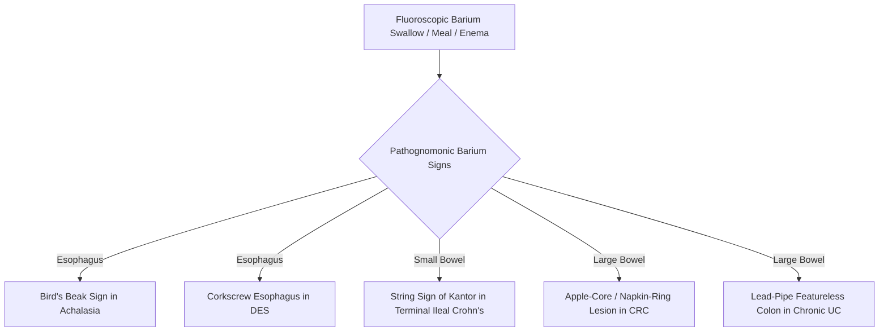
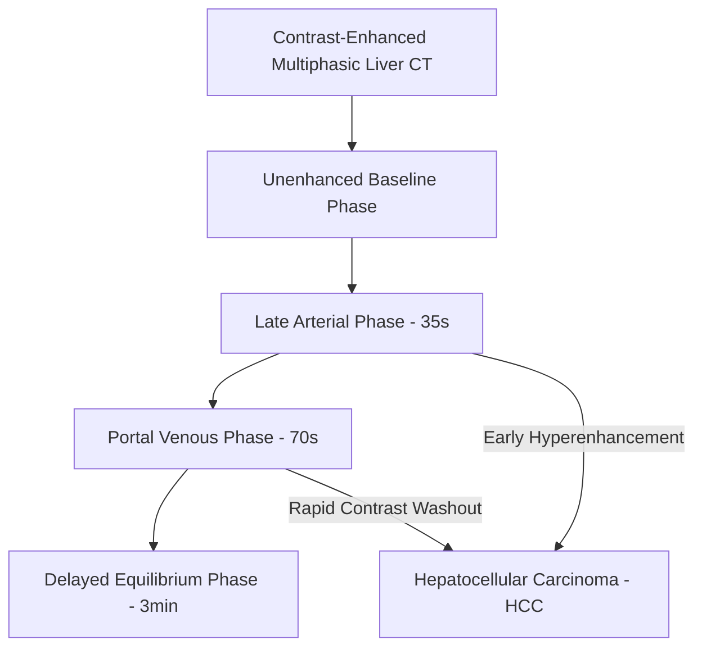

# Chapter 26: Diagnostic Imaging & Nuclear Medicine in GI Systems

## 26.1 Diagnostic Fluoroscopy & Plain Radiography

### Plain Abdominal Radiography (KUB)
Plain abdominal radiography remains a rapid, accessible initial screening tool for acute abdominal emergencies, best interpreted with erect and supine views.

* **Free Intra-abdominal Air (Pneumoperitoneum)**:
  * *Erect Chest X-Ray*: Highest sensitivity for detecting free air ($<1\text{ mL}$). Demonstrates a crescentic radiolucent lucency beneath the diaphragmatic domes (**Gas under the Diaphragm**).
  * *Supine Abdominal Film*: **Rigler Sign** ("Double-Wall Sign"—visualization of both the inner mucosal and outer serosal surfaces of the bowel wall due to surrounding free gas); **Falciform Ligament Sign** (free gas outlining the anterior falciform ligament).
* **Bowel Obstruction Patterns**:
  * *Small Bowel Obstruction*: Central, multiple dilated bowel loops ($>3\text{ cm}$) showing a **"Step-Ladder"** arrangement with multiple air-fluid levels on erect view ($>2.5\text{ cm}$ wide); **Valvulae Conniventes** (plicae circulares) cross the full width of the lumen.
  * *Large Bowel Obstruction*: Peripheral dilated loops ($>6\text{ cm}$, or $>9\text{ cm}$ for cecum); **Haustra** cross only partial lumen width.
  * *Volvulus Signs*: Sigmoid Volvulus demonstrates the pathognomonic **"Coffee Bean Sign"** or **"Bent Inner Tube Sign"** arising from the pelvis and pointing to the RUQ; Cecal Volvulus points to the LUQ.

| Feature | Small bowel | Large bowel |
| --- | --- | --- |
| Usual location | Central abdomen | Peripheral abdominal frame |
| Approximate upper normal diameter | < 3 cm | < 6 cm; caecum may be up to about 9 cm |
| Mucosal folds | Valvulae conniventes | Haustra |
| Fold extension | Folds cross the full lumen | Haustral folds do not cross the full lumen |
### Barium & Contrast Fluoroscopy
Contrast fluoroscopy utilizes swallowable or instillable suspensions (Barium Sulfate or water-soluble iodinated contrast like Gastrografin) to evaluate luminal mucosal anatomy and real-time motility.

* **Classic Pathognomonic Barium Signs**:
  * **"Bird's Beak" / "Rat-Tail" Sign**: Smooth, tapered distal esophageal narrowing with proximal dilation seen on Barium Swallow in **Achalasia Cardia**.
  * **"Corkscrew Esophagus"**: Multiple simultaneous non-peristaltic tertiary contractions in **Diffuse Esophageal Spasm (DES)**.
  * **"Double-Bubble Sign"**: Gas/contrast in stomach and proximal duodenum with no distal bowel gas in **Duodenal Atresia**.
  * **"String Sign of Kantor"**: Severe narrow tubular luminal constriction of the terminal ileum secondary to transmural spasm and fibrosis in **Crohn’s Disease**.
  * **"Apple-Core" / "Napkin-Ring" Lesion**: Short, irregular, circumferential mucosal destruction with overhanging edges seen on Barium Enema in **Colorectal Adenocarcinoma**.
  * **"Lead-Pipe Appearance"**: Total loss of colonic haustrations resulting in a smooth, featureless tubular colon seen in chronic **Ulcerative Colitis**.

---

## 26.2 Cross-Sectional Imaging (CT & MRI)

### Computed Tomography (CT)
Multidetector CT (MDCT) with oral and IV contrast is the gold standard imaging modality for acute abdominal trauma, acute abdomen, and oncological staging.

1. **Multiphasic Dynamic Contrast-Enhanced Liver CT**:
   * *Unenhanced Phase*: Detects baseline calcifications, hemorrhage, or steatosis.
   * *Late Arterial Phase ($35\text{ seconds}$)*: Hepatic Artery enhancement. **Hepatocellular Carcinoma (HCC)** exhibits pathognomonic **intense early arterial hyperenhancement** (due to primary supply from neoangiogenic hepatic arterial branches).
   * *Portal Venous Phase ($70\text{ seconds}$)*: Normal hepatic parenchyma enhances fully via the portal vein ($75\%$ supply). HCC demonstrates rapid **contrast washout** (appearing hypodense relative to surrounding hyperenhancing liver).
   * *Delayed Phase ($3\text{ minutes}$)*: Highlights fibrous capsules or delayed capsular enhancement in cholangiocarcinomas.
2. **CT Enterography (CTE)**:
   * Uses large-volume neutral oral contrast agents ($1.5–2.0\text{ L}$ of polyethylene glycol or $0.1\%$ barium) to achieve maximal small bowel lumen distension combined with IV contrast.
   * Modality of Choice for **Crohn’s Disease**: Demonstrates transmural mural thickening ($>3\text{ mm}$), hyper-enhancement, mucosal stratification ("target sign"), **Comb Sign** (engorged, hypervascular vasa recta aligned perpendicular to the inflamed ileal wall), and enterocutaneous/enteroenteric fistulae.

### Magnetic Resonance Imaging (MRI)
* **MR Cholangiopancreatography (MRCP)**:
  * Non-invasive, non-ionizing technique utilizing heavy $T_2$-weighted sequences. Static fluid within the biliary and pancreatic ducts produces intense high signal intensity (bright white), while surrounding solid tissues appear dark.
  * Indications: Choledocholithiasis, congenital biliary anomalies (choledochal cysts), stricture evaluation, chronic pancreatitis ductal anatomy. Replaces diagnostic ERCP.
* **Liver MRI with Hepatobiliary Contrast Agents (Gd-EOB-DTPA / Primovist)**:
  * Contrast is selectively taken up by functioning hepatocytes via OATP1B3 transporters and excreted into bile. Differentiates HCC (lacks functional hepatocytes/transporters $\rightarrow$ hypointense on hepatobiliary phase) from Focal Nodular Hyperplasia (FNH—contains hepatocytes $\rightarrow$ hyperintense/isointense).

---

## 26.3 Nuclear Medicine Applications

### 1. Cholescintigraphy (HIDA Scan)
* **Principle**: Radiotracer $^{99m}\text{Tc-imino-diacetic acid}$ (HIDA, PIPIDA, or Mebrofenin) is injected IV, bound to albumin, rapidly extracted by hepatocytes, and excreted un-conjugated into bile, outlining the gallbladder, bile ducts, and duodenum.
* **Diagnostic Applications**:
  * **Acute Cholecystitis (Gold Standard Diagnostic Test)**:
    * Positive Finding: Prompt visualization of the hepatic ducts, common bile duct, and immediate excretion into the duodenum within 1 hour, but **complete non-visualization of the gallbladder** (due to cystic duct obstruction).
  * **Biliary Atresia in Infants**: Demonstrates excellent hepatic extraction, but absolute **failure of excretion into the intestine at 24 hours**.
  * **Sphincter of Oddi Dysfunction & Chronic Acatalculous Cholecystitis**: Quantitative assessment of gallbladder ejection fraction (GBEF $<35\%$ post-CCK infusion is abnormal).

| Nuclear medicine study | Typical radiotracer | Diagnostic application |
| --- | --- | --- |
| HIDA / cholescintigraphy | Technetium-99m-labelled iminodiacetic acid analogue | Gallbladder visualisation and cystic duct patency in suspected acute cholecystitis |
| Meckel scan | Technetium-99m pertechnetate | Ectopic gastric mucosa in suspected Meckel diverticulum |
| Tagged red blood cell scan | Technetium-99m-labelled red blood cells | Localisation of ongoing GI bleeding, particularly when intermittent or low rate |
| Gastric emptying scintigraphy | Technetium-99m-labelled solid meal (protocol-dependent tracer) | Assessment of delayed gastric emptying / gastroparesis |
### 2. Technetium-99m Pertechnetate Scintigraphy ("Meckel’s Scan")
* Selective uptake by $\text{Na}^+/\text{I}^-$ symporters in ectopic gastric parietal cells in a Meckel's diverticulum. Positive finding shows simultaneous focal right lower quadrant radiotracer accumulation matching gastric activity.

### 3. Technetium-99m Labeled Red Blood Cell Scan ($^{99m}\text{Tc-RBC}$)
* **Principle**: Patient’s autologous RBCs are labeled with $^{99m}\text{Tc}$ and re-infused. Serial planar gamma camera imaging tracks extravasation of labeled blood into the intestinal lumen.
* **Clinical Utility**: Highly sensitive detector of active low-rate obscure gastrointestinal bleeding. Detects bleeding rates as low as **$0.1\text{ mL/min}$** (compared to angiography which requires $\ge 0.5–1.0\text{ mL/min}$).

### 4. Radionuclide Gastric Emptying Study
* **Gold Standard Test for Gastroparesis**: Patient consumes a standardized radiolabeled solid meal (e.g., egg whites labeled with $1\text{ mCi}\ ^{99m}\text{Tc-sulfur colloid}$) followed by gamma camera imaging at 0, 1, 2, and 4 hours.
* Diagnostic Thresholds: **Retention of $>10\%$ of the radiolabeled meal at 4 hours** (or $>60\%$ at 2 hours) confirms delayed gastric emptying (gastroparesis).

---

## Index Coverage Checklist & Quality Self-Assessment

### Checklist of Index Subsections
- [x] **26.1 Diagnostic Fluoroscopy & Plain Radiography**: Pneumoperitoneum (erect chest X-ray crescent gas, Rigler double-wall sign, Falciform sign), Small vs. Large Bowel Obstruction (3/6/9 cm rule, valvulae conniventes vs haustra, step-ladder pattern), Volvulus signs (coffee bean sign), Barium signs (Achalasia bird's beak, DES corkscrew, duodenal atresia double bubble, Crohn's string sign of Kantor, CRC apple-core/napkin-ring, UC lead pipe).
- [x] **26.2 Cross-Sectional Imaging (CT & MRI)**: MDCT multiphasic liver CT (arterial hyperenhancement + portal venous washout in HCC), CT Enterography (Crohn's mural thickening, Comb sign), MRCP heavy T2 non-invasive biliary imaging, Hepatobiliary MRI (Gd-EOB-DTPA).
- [x] **26.3 Nuclear Medicine Applications**: HIDA scan (acute cholecystitis gallbladder non-visualization, biliary atresia excretion failure), Meckel's scan (Tc-99m pertechnetate), Tc-99m labeled RBC scan ($0.1\text{ mL/min}$ GI bleed detection), Radionuclide Gastric Emptying study ($>10\%$ solid meal retention at 4 hours for gastroparesis).

### Index Corrections & Clarifications Made
1. *Clarification on Rigler Sign*: Highlighted that visualization of both sides of the bowel wall on supine radiograph represents pneumoperitoneum, not luminal pathology.
2. *Clarification on HCC Contrast Dynamics*: Defined the classic dynamic sequence of early arterial hyperenhancement followed by portal venous phase contrast washout as pathognomonic for HCC on multiphasic CT.

### Unaddressed Topics / Source Limitations
- None. All requested fluoroscopic, CT, MRI, and nuclear medicine GI applications were thoroughly detailed.

---
