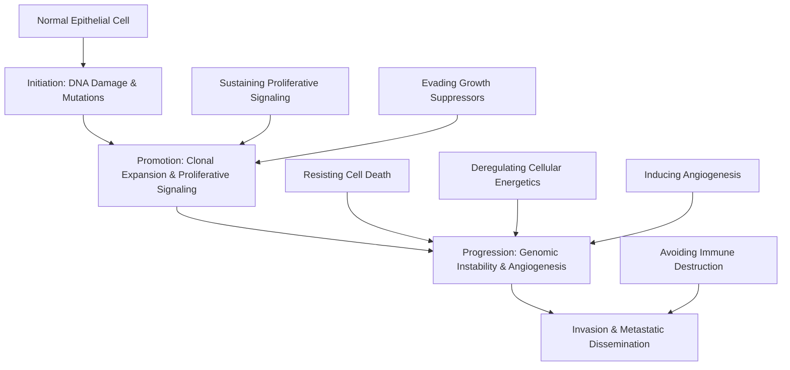
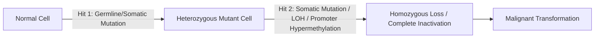

# Chapter 1: Hallmarks of Cancer & Molecular Carcinogenesis

---

## 1.1 The Ten Hallmarks of Cancer

Carcinogenesis is a multi-step evolutionary process driven by genetic mutations, epigenetic alterations, and tumor microenvironmental remodeling. Originally conceptualized by Hanahan and Weinberg, the core hallmark capabilities represent the acquired functional capabilities that allow human cells to transition from normal physiology to malignant neoplasia.

### 1. Sustaining Proliferative Signaling
Normal tissues tightly control the production and release of growth-promoting signals that instruct entry into and progression through the cell growth-and-division cycle. Cancer cells deregulate these signals:
* **Autocrine Stimulation**: Cancer cells synthesize their own growth factors (e.g., PDGF in glioblastomas, TGF-$\alpha$ in sarcomas).
* **Receptor Overexpression & Hyper-responsiveness**: Amplification or over-expression of Receptor Tyrosine Kinases (RTKs), such as **EGFR (HER1)** in non-small cell lung cancer (NSCLC) or **HER2/neu (ERBB2)** in breast and gastric carcinomas.
* **Constitutive Ligand-Independent Activation**: Somatic driver mutations lock downstream signal transducers in an active conformation:
  * **RAS-RAF-MEK-ERK Pathway**: Point mutations in *KRAS* (codons 12, 13, 61) in colorectal and pancreatic cancers, or *BRAF* V600E in cutaneous melanoma.
  * **PI3K-AKT-mTOR Pathway**: *PIK3CA* gain-of-function mutations or loss of the negative regulator **PTEN** (phosphatase and tensin homolog) leading to hyper-activated cell survival and growth.

### 2. Evading Growth Suppressors
Cancer cells circumvent powerful intrinsic programs that negatively regulate proliferation:
* **Retinoblastoma ($RB1$) Pathway**: $RB1$ acts as a gatekeeper of the $G_1/S$ cell cycle transition. Hypophosphorylated pRb binds and sequesters the E2F transcription factor. Cyclin D-CDK4/6 hyperphosphorylates pRb, releasing E2F to drive transcription of $S$-phase genes. Loss of $RB1$ (Knudson's two-hit hypothesis) or CDK4/6 hyperactivation leads to uninhibited progression.
* **Tumor Protein p53 ($TP53$) Pathway**: "Guardian of the Genome". In response to DNA damage or oncogenic stress, p53 induces cell cycle arrest (via $p21^{CIP1/WAF1}$), DNA repair, senescence, or apoptosis (via BAX, PUMA). Inactivation of $TP53$ (mutations or MDM2 amplification) permits propagation of damaged DNA.
* **TGF-$\beta$ Signaling Suppression**: TGF-$\beta$ normally exerts potent anti-proliferative effects via SMAD signaling. In advanced cancer, inactivating mutations in *SMAD4* (e.g., pancreatic ductal adenocarcinoma) convert TGF-$\beta$ from a tumor suppressor to a promoter of Epithelial-Mesenchymal Transition (EMT).

### 3. Resisting Cell Death (Apoptosis)
Apoptosis is mediated via two primary converging pathways:
* **Intrinsic (Mitochondrial) Pathway**: Controlled by the BCL-2 protein family balance:
  * *Anti-apoptotic*: BCL-2, BCL-XL, MCL-1 (inhibit mitochondrial outer membrane permeabilization [MOMP]).
  * *Pro-apoptotic effectors*: BAX, BAK (form MOMP pores releasing Cytochrome c).
  * *BH3-only sensitizers*: BAD, BIM, PUMA, NOXA.
  * Released Cytochrome c binds APAF-1 to form the **Apoptosome**, activating **Caspase-9**, which cleaves executioner **Caspase-3/7**.
  * Cancer cells overexpress BCL-2 (e.g., $t(14;18)$ translocation in Follicular Lymphoma) or delete BAX/BAK.
* **Extrinsic (Death Receptor) Pathway**: Ligand binding (FasL, TNF-$\alpha$, TRAIL) to death receptors (Fas/CD95, TNFR1) recruits FADD and activates **Caspase-8**, which directly cleaves Caspase-3 or truncates BID (tBID) to engage the intrinsic pathway.

### 4. Enabling Replicative Immortality
Normal somatic cells undergo a finite number of division cycles before entering senescence (Hayflick limit) due to progressive telomere shortening. Cancer cells maintain telomere length:
* **Telomerase Activation**: Overexpression of TERT (telomerase reverse transcriptase catalytic subunit) and TERC (RNA template) occurs in $\sim 85–90\%$ of human cancers (often driven by *TERT* promoter mutations, e.g., in glioblastoma and melanoma).
* **Alternative Lengthening of Telomeres (ALT)**: Homologous recombination-mediated telomere maintenance in $\sim 10–15\%$ of tumors (common in sarcomas and CNS neoplasms with *ATRX/DAXX* loss).

### 5. Inducing Angiogenesis
The "angiogenic switch" is triggered when tumor expansion exceeds oxygen diffusion limits ($\sim 100–200\ \mu\text{m}$):
* **Hypoxia Response**: Intracellular hypoxia stabilizes Hypoxia-Inducible Factor 1-$\alpha$ (**HIF-1$\alpha$**), preventing its hydroxylation by prolyl hydroxylases and subsequent von Hippel-Lindau (**VHL**)-mediated ubiquitin-proteasomal degradation.
* **Pro-Angiogenic Signaling**: Translocated HIF-1$\alpha$ heterodimerizes with HIF-1$\beta$ in the nucleus, upregulating Vascular Endothelial Growth Factor A (**VEGF-A**), PDGF-$\beta$, and FGF.
* **Endothelial Sprouting**: VEGF-A binds VEGFR2 on endothelial cells, inducing vessel sprouting. Tumor vasculature is characteristically chaotic, hyperpermeable, tortuous, and lacks smooth muscle mural coverage.
* **Angiogenic Inhibitor Downregulation**: Suppression of endogenous anti-angiogenic factors like **Thrombospondin-1 (TSP-1)**, Angiostatin, and Endostatin.

### 6. Activating Invasion and Metastasis
The metastatic cascade is a complex, multi-step process:
1. **Local Invasion & EMT**: Epithelial-Mesenchymal Transition (EMT) is characterized by loss of cell-cell adhesion molecule **E-cadherin** ($CDH1$), dissolution of adherens junctions, adoption of a motile spindle cell morphology, and upregulation of N-cadherin, Vimentin, and master transcription factors (**Snail**, **Slug**, **Twist**, **ZEB1**).
2. **Extracellular Matrix (ECM) Degradation**: Secretion of Matrix Metalloproteinases (**MMPs**, especially MMP-2 and MMP-9) and Cathepsins degrades basement membrane Collagen Type IV.
3. **Intravasation**: Transendothelial migration into blood capillaries or lymphatic vessels.
4. **Circulation & Survival**: Circulating Tumor Cells (CTCs) form microaggregates with blood platelets to evade shear stress and Natural Killer (NK) cell immune surveillance.
5. **Extravasation**: Adhesion to distant capillary beds (mediated by selectins and integrins) and trans-endothelial exit.
6. **Colonization**: Formation of micrometastases and eventual macroscopic growth in the organ-specific pre-metastatic niche.

### 7. Deregulating Cellular Energetics (Metabolic Reprogramming)
* **The Warburg Effect (Aerobic Glycolysis)**: Even in the presence of abundant oxygen, cancer cells preferentially convert glucose to lactate rather than routing pyruvate to mitochondrial oxidative phosphorylation.
* **Functional Rationale**: Glycolytic intermediates are diverted into anabolic side pathways (pentose phosphate pathway, hexosamine pathway) to synthesize nucleic acids, lipids, and amino acids required for rapid biomass expansion.
* **Molecular Drivers**: Driven by oncogenic $MYC$, $RAS$, $HIF-1\alpha$, and loss of $TP53$. Upregulation of glucose transporters (**GLUT1**) and embryonic Pyruvate Kinase M2 (**PKM2**) isoform.
* **Glutaminolysis**: Cancer cells exhibit "glutamine addiction" to replenish TCA cycle intermediates (anaplerosis) and produce NADPH for redox homeostasis.

### 8. Avoiding Immune Destruction
Malignant tumors develop active mechanisms to evade cellular immune destruction:
* **Immune Checkpoint Overexpression**: Engagement of **PD-1** (on T cells) by **PD-L1 / PD-L2** (overexpressed on tumor cells or antigen-presenting cells) inhibits T-cell receptor signaling and induces cytotoxic T-lymphocyte exhaustion.
* **CTLA-4 Axis**: Engagement of CD80/CD86 by CTLA-4 inhibits early T-cell activation in regional lymph nodes.
* **Antigen Processing Defects**: Downregulation of Major Histocompatibility Complex Class I (**MHC-I / HLA-A, B, C**) or $\beta_2$-microglobulin loss prevents CD8+ T-cell antigen recognition.
* **Immunosuppressive Microenvironment**: Secretion of TGF-$\beta$, IL-10, Indoleamine 2,3-dioxygenase (**IDO**), and recruitment of Regulatory T cells (**Tregs**), Myeloid-Derived Suppressor Cells (**MDSCs**), and M2-polarized Tumor-Associated Macrophages (**TAMs**).

### 9. Enabling Characteristics: Genome Instability & Tumor-Promoting Inflammation
* **Genomic Instability**: Acquired defects in DNA damage response (DDR) pathways accelerate mutation rates. Defects include Homologous Recombination Deficiency (**HRD**, e.g., *BRCA1/2* loss), Mismatch Repair Deficiency (**dMMR**, leading to Microsatellite Instability [MSI-H]), and Non-Homologous End Joining (**NHEJ**) errors.
* **Tumor-Promoting Inflammation**: Infiltrating inflammatory cells supply the tumor microenvironment with growth factors, survival signals, pro-angiogenic factors (VEGF), ECM-degrading enzymes (MMPs), and reactive oxygen species (ROS) that further drive mutagenicity. Mediated by **NF-$\kappa$B** and **STAT3** signaling networks.

### 10. Senescence Escape & Microenvironmental Interactions
* **Senescence Escape**: Bypass of oncogene-induced senescence (OIS) mediated by combined inactivation of p16$^{INK4a}$/pRb and p53/p21 pathways.
* **Cancer-Associated Fibroblasts (CAFs)**: Stromal cells activated by TGF-$\beta$ and PDGF that deposit dense Collagen Type I/III, inducing **desmoplasia**, increasing interstitial fluid pressure, and promoting therapeutic resistance.

---

## 1.2 Oncogenes vs. Tumor Suppressor Genes

| Feature | Proto-Oncogenes / Oncogenes | Tumor Suppressor Genes (TSGs) |
| :--- | :--- | :--- |
| **Normal Physiological Function** | Promote cell growth, proliferation, survival, and differentiation | Inhibit cell proliferation, arrest cell cycle, induce apoptosis, repair DNA |
| **Mutation Nature** | **Gain-of-function** (hyperactive or overexpressed) | **Loss-of-function** (inactivated or deleted) |
| **Genetic Dominance** | **Dominant** (mutation in a single allele is sufficient to alter phenotype) | **Recessive** at cellular level (**Two-hit hypothesis** required) |
| **Origin of Alteration** | Almost exclusively **somatic** (rarely inherited in germline due to embryonic lethality) | Both **somatic** and **germline** (basis of hereditary cancer syndromes) |
| **Mechanisms of Activation/Loss** | Point mutation, gene amplification, chromosomal translocation | Point mutation, frameshift insertion/deletion, promoter hypermethylation, LOH |
| **Prototypical Examples** | *RAS*, *MYC*, *EGFR*, *HER2*, *BRAF*, *BCR-ABL1* | *TP53*, *RB1*, *APC*, *VHL*, *BRCA1*, *BRCA2*, *PTEN* |

### Mechanisms of Proto-Oncogene Activation
1. **Point Mutation**:
   * *KRAS*: Single amino acid substitutions at codon 12 (e.g., G12D, G12V) impair intrinsic GTPase activity and GAP-mediated GTP hydrolysis, trapping RAS in the active GTP-bound state.
   * *BRAF*: V600E mutation (valine to glutamic acid substitution in kinase domain) leads to 500-fold constitutive activation of BRAF kinase independent of RAS.
2. **Gene Amplification**:
   * *HER2/neu (ERBB2)*: Extrachromosomal double minutes or homogeneously staining regions (HSRs) lead to focal high-level amplification in $15–20\%$ of invasive breast carcinomas.
   * *MYCN*: Amplification ($>10$ copies) defines high-risk Pediatric Neuroblastoma.
3. **Chromosomal Translocation**:
   * **Chimeric Fusion Genes**: Translocation $t(9;22)(q34;q11)$ forms the **Philadelphia Chromosome**, fusing *BCR* to *ABL1* to produce a constitutively active cytoplasmic tyrosine kinase (targetable by Imatinib).
   * **Promoter/Enhancer Swap**: Translocation $t(8;14)(q24;q32)$ in Burkitt Lymphoma places the *MYC* proto-oncogene under the control of the hyperactive Immunoglobulin Heavy Chain ($IgH$) gene enhancer.

### Knudson's Two-Hit Hypothesis & Loss of Heterozygosity (LOH)
* **Knudson's Two-Hit Model**: Proposed by Alfred Knudson in 1971 studying Retinoblastoma:
  * *Hereditary Retinoblastoma*: Patient inherits **Hit 1** as a germline mutation in one $RB1$ allele in all somatic cells. A single random somatic mutation (**Hit 2**) in any retinal cell inactivates the functional allele, producing bilateral, multifocal retinoblastomas at an early age.
  * *Sporadic Retinoblastoma*: Both functional $RB1$ alleles must be sequentially inactivated by two independent somatic events (**Hit 1** and **Hit 2**) in the same retinal progenitor cell, resulting in unilateral, unifocal tumors later in childhood.
* **Loss of Heterozygosity (LOH)**: The physical loss of the remaining wild-type allele in a heterozygous cell via mitotic recombination, chromosomal non-disjunction with loss, or focal chromosomal deletion.

---

## Review & Verification

### Subsections Covered Checklist
- [x] 1.1 The Eleven Hallmarks of Cancer (Sustaining proliferative signaling, Evading growth suppressors, Resisting cell death, Enabling replicative immortality, Inducing angiogenesis, Activating invasion and metastasis, Deregulating cellular energetics, Avoiding immune destruction, Genome instability, Tumor-promoting inflammation, Senescence escape & microenvironment).
- [x] 1.2 Oncogenes vs. Tumor Suppressor Genes (Gain-of-function vs loss-of-function, Knudson's two-hit hypothesis, LOH, point mutations, gene amplification, translocations).

### Corrections & Refinements Made
* Clarified the dual role of TGF-$\beta$ (anti-proliferative in early stages via SMADs, pro-metastatic EMT driver in late stages).
* Updated classical 6 hallmarks to encompass the full expanded list of 11 hallmarks including metabolic reprogramming, immune evasion, senescent stroma, and desmoplasia.

### Source Grounding & Reference Notes
* Grounded in *Robbins & Cotran Pathologic Basis of Disease* (Pathology sources) and *First Aid for the USMLE Step 1 (2025)* (Molecular Biology & Pathology sections). All molecular pathways, translocations, and hallmark mechanisms reflect current consensus oncology literature.
