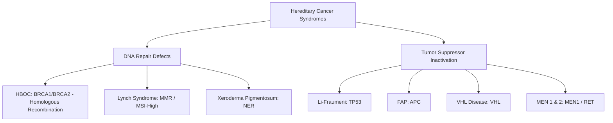

# Chapter 2: Tumor Genetics, Hereditary Cancer Syndromes & Biomarkers

---

## 2.1 Hereditary Cancer Syndromes

Hereditary cancer syndromes account for approximately $5–10\%$ of all human malignancies. They are predominantly inherited in an autosomal dominant pattern with incomplete penetrance, caused by germline inactivating mutations in tumor suppressor genes or DNA repair genes.

### 1. Hereditary Breast and Ovarian Cancer Syndrome (HBOC)
* **Genetics**: Autosomal dominant germline mutations in **$BRCA1$** (chromosome 17q21) or **$BRCA2$** (chromosome 13q12).
* **Function**: $BRCA1$ and $BRCA2$ proteins are essential for **Homologous Recombination (HR)** repair of DNA double-strand breaks (DSBs).
* **Clinical Spectrum**:
  * *$BRCA1$ Mutation Carriers*: Lifetime risk of female breast cancer up to $70–80\%$, ovarian cancer $40–50\%$ (typically high-grade serous carcinoma arising from fallopian tube fimbriae). High prevalence of Triple-Negative Breast Cancer (TNBC). Increased risk of prostate cancer.
  * *$BRCA2$ Mutation Carriers*: Lifetime risk of female breast cancer up to $70\%$, ovarian cancer $10–20\%$. Significantly increased risk of **Male Breast Cancer**, Pancreatic Carcinoma, Prostate Cancer, and Cutaneous Melanoma.
* **Synthetic Lethality & Therapeutic Targeting**: Tumor cells with $BRCA1/2$ deficiency (Homologous Recombination Deficiency [HRD]) rely on Poly(ADP-ribose) Polymerase (**PARP1**) to repair single-strand DNA breaks via base excision repair. **PARP Inhibitors** (e.g., **Olaparib**, **Niraparib**, **Rucaparib**) inhibit PARP, causing accumulation of single-strand breaks that convert to double-strand breaks during replication. Without functional HR repair, the cancer cell undergoes catastrophic collapse and apoptosis (**Synthetic Lethality**).

### 2. Hereditary Non-Polyposis Colorectal Cancer (Lynch Syndrome)
* **Genetics**: Autosomal dominant mutations in DNA Mismatch Repair (**MMR**) genes: **$MSH2$** ($40\%$), **$MLH1$** ($40\%$), **$MSH6$** ($15\%$), **$PMS2$** ($5\%$), or germline deletion of $EPCAM$ (causing epigenetic silencing of $MSH2$).
* **Pathophysiology**: Loss of MMR proteins leads to inability to repair single-base mismatches and small insertion/deletion loops during DNA replication. Unrepaired errors accumulate in short tandem repetitive DNA sequences (**Microsatellites**), resulting in **Microsatellite Instability-High (MSI-H)**.
* **Clinical Features**:
  * Colorectal Cancer (CRC): Lifetime risk $50–80\%$. Predominantly **right-sided / ascending colon** involvement; presentation at early age (mean $\sim 44–50$ years); mucinous, signet-ring, or medullary histology with prominent tumor-infiltrating lymphocytes (TILs).
  * Extracolonic Malignancies: **Endometrial Carcinoma** (#1 extracolonic cancer in females, lifetime risk up to $40–60\%$), Ovarian, Gastric, Small Bowel, Urothelial (renal pelvis/ureter), Biliary tract, and Glioblastoma (Turcot syndrome variant).
* **Diagnostic Screening Protocols**:
  * **Amsterdam II Criteria** ("3-2-1 Rule"): $\ge 3$ relatives with Lynch-associated cancers, across $\ge 2$ successive generations, $\ge 1$ diagnosed before age 50.
  * **Universal Screening**: IHC for MMR proteins (MLH1, MSH2, MSH6, PMS2) and/or PCR-based MSI testing on ALL newly diagnosed colorectal and endometrial carcinomas.
  * *BRAF* V600E mutation and *MLH1* promoter hypermethylation testing: Distinguishes sporadic MSI-H CRC (which frequently harbors *BRAF* V600E and *MLH1* hypermethylation) from germline Lynch syndrome (which lacks *BRAF* mutations).
* **Immune Checkpoint Responsiveness**: MSI-H/dMMR tumors generate thousands of neoantigens, rendering them densely infiltrated by CD8+ T cells and exquisitely sensitive to **Anti-PD-1 Immunotherapy** (e.g., **Pembrolizumab**), regardless of tissue origin.

### 3. Familial Adenomatous Polyposis (FAP) & Variants
* **Genetics**: Autosomal dominant mutation in the **$APC$ (Adenomatous Polyposis Coli)** tumor suppressor gene on chromosome **5q21**.
* **Pathophysiology**: APC protein forms a destruction complex with Axin and GSK-3$\beta$ to phosphorylate and degrade $\beta$-catenin. Loss of APC causes cytosolic accumulation and nuclear translocation of $\beta$-catenin, driving transcription of *MYC* and *Cyclin D1*.
* **Clinical Phenotype**: Hundreds to thousands ($>100$) of adenomatous colonic polyps emerging during adolescence. **100% risk of Colorectal Cancer by age 40** if prophylactic colectomy is not performed.
* **FAP Syndromic Variants**:
  * **Gardner Syndrome**: FAP + Extraintestinal manifestations: Osteomas of skull/mandible, Epidermoid cysts, Desmoid tumors (retroperitoneal/abdominal wall fibromatosis), Dental anomalies (impacted/supernumerary teeth), Congenital Hypertrophy of Retinal Pigment Epithelium (CHRPE).
  * **Turcot Syndrome Type 2**: FAP + Central Nervous System tumors (typically **Medulloblastoma**). *(Note: Turcot Type 1 is associated with Lynch syndrome and Glioblastoma).*

### 4. Li-Fraumeni Syndrome
* **Genetics**: Autosomal dominant germline mutation in the **$TP53$** tumor suppressor gene on chromosome 17p13.1.
* **Core Tumor Spectrum (SBLA Mnemonic)**:
  * **S**: Sarcomas (Osteosarcoma, Soft tissue sarcomas).
  * **B**: Breast Cancer (early-onset, often HER2+ or TNBC).
  * **L**: Leukemia (AML, ALL) and Lymphoma.
  * **A**: Adrenocortical Carcinoma (pathognomonic childhood tumor) and Brain tumors (gliomas, medulloblastomas).
* **Diagnostic Criteria**: Proband with sarcoma diagnosed $<45$ years, with a first-degree relative with any cancer $<45$ years, and another first- or second-degree relative with any cancer $<45$ years or sarcoma at any age.

### 5. Von Hippel-Lindau (VHL) Disease
* **Genetics**: Autosomal dominant mutation in the **$VHL$** gene on chromosome **3p25**.
* **Pathophysiology**: VHL protein is an E3 ubiquitin ligase subunit that targets Hypoxia-Inducible Factors (HIF-1$\alpha$ and HIF-2$\alpha$) for degradation under normoxic conditions. Loss of VHL results in constitutive pseudohypoxic stabilization of HIFs, driving high expression of **VEGF**, **PDGF-$\beta$**, and **TGF-$\alpha$**.
* **Clinical Spectrum**:
  * **Clear Cell Renal Cell Carcinoma (ccRCC)**: Bilateral, multifocal, early-onset.
  * **CNS Hemangioblastomas**: Cerebellar and spinal cord vascular tumors (rich in stromal cells containing lipid vacuoles).
  * **Retinal Angiomas / Hemangioblastomas**: Can lead to detachment/blindness.
  * **Pheochromocytomas** and Paragangliomas.
  * Pancreatic Neuroendocrine Tumors (pNETs) and Pancreatic Cysts.

### 6. Multiple Endocrine Neoplasia (MEN) Syndromes

| Feature | MEN Type 1 (Wermer) | MEN Type 2A (Sipple) | MEN Type 2B |
| :--- | :--- | :--- | :--- |
| **Gene / Inheritance** | **$MEN1$** (11q13) / Autosomal Dominant | **$RET$** proto-oncogene / AD | **$RET$** proto-oncogene / AD |
| **Gene Function** | Menin (tumor suppressor, chromatin regulator) | Receptor Tyrosine Kinase (gain-of-function) | Receptor Tyrosine Kinase (M918T mutation) |
| **Core Phenotype (3 Ps)** | 1. **Parathyroid** hyperplasia ($95\%$, hypercalcemia) 2. **Pancreatic** NETs (Gastrinoma, Insulinoma) 3. **Pituitary** adenomas (Prolactinoma) | 1. **Medullary Thyroid Carcinoma** ($100\%$) 2. **Pheochromocytoma** ($50\%$) 3. **Parathyroid** hyperplasia ($20\%$) | 1. **Medullary Thyroid Carcinoma** ($100\%$, aggressive) 2. **Pheochromocytoma** ($50\%$) 3. **Mucosal Neuromas** & **Marfanoid Habitus** |
| **Management Note** | Medical/surgical per organ | Prophylactic thyroidectomy in childhood | Total thyroidectomy in **infancy** ($<1$ year) |

---

## 2.2 Tumor Markers & Molecular Diagnostics

### Serum Tumor Markers in Clinical Practice

| Biomarker | Primary Associated Malignancy | Primary Clinical Application |
| :--- | :--- | :--- |
| **Carcinoembryonic Antigen (CEA)** | Colorectal Carcinoma; also Elevated in Pancreatic, Gastric, Breast, Lung cancers | Post-treatment monitoring of CRC recurrence; NOT for screening |
| **Alpha-Fetoprotein (AFP)** | Hepatocellular Carcinoma (HCC); Non-Seminomatous Testicular Germ Cell Tumors (Yolk Sac) | HCC screening in cirrhotics; Testicular cancer staging/monitoring |
| **Beta-hCG ($\beta$-hCG)** | Choriocarcinoma, Gestational Trophoblastic Neoplasia; Testicular Non-Seminomatous (and $15\%$ Seminomas) | Diagnosis, staging, and monitoring response to therapy |
| **CA 125** | Epithelial Ovarian Carcinoma (especially High-Grade Serous) | Monitoring response and recurrence; evaluating pelvic mass in postmenopausal females |
| **CA 19-9** | Pancreatic Ductal Adenocarcinoma; Cholangiocarcinoma | Monitoring disease burden; requires functional **Lewis antigen** expression ($Le^{a-b-}$ individuals cannot synthesize CA 19-9) |
| **CA 15-3 / CA 27.29** | Invasive Breast Carcinoma | Monitoring metastatic disease burden |
| **Prostate-Specific Antigen (PSA)** | Prostate Adenocarcinoma | Screening (shared decision making), monitoring response to ADT, detecting biochemical recurrence |
| **Calcitonin** | Medullary Thyroid Carcinoma (MTC) | Diagnostic, staging, post-surgical recurrence monitoring |
| **Chromogranin A / Synaptophysin** | Neuroendocrine Tumors (Carcinoid, Pheochromocytoma, SCLC) | Diagnostic serum marker for neuroendocrine lineage |

### Molecular Pathology Technologies
* **Immunohistochemistry (IHC)**: Uses monoclonal antibodies against specific protein epitopes. Essential for determining tissue lineage in Undifferentiated Malignancies:
  * *Cytokeratins (AE1/AE3, CK7, CK20)*: Carcinomas.
  * *Vimentin*: Sarcomas.
  * *CD45 (Leukocyte Common Antigen - LCA)*: Hematolymphoid neoplasms.
  * *S100, SOX10, HMB-45, Melan-A*: Cutaneous and mucosal Melanoma.
  * *Chromogranin, Synaptophysin, INSM1*: Neuroendocrine differentiation.
* **Fluorescence In-Situ Hybridization (FISH)**: Uses fluorescently labeled DNA probes to detect structural chromosomal alterations:
  * *Translocations*: Dual-color break-apart probes for *ALK* rearrangement in NSCLC, *EWSR1* in Ewing Sarcoma, or *BCR-ABL1* fusion in CML.
  * *Gene Amplifications*: *HER2/neu* ratio relative to Chromosome 17 centromere ($CEP17$) in breast cancer ($HER2/CEP17 \ge 2.0$).
* **Next-Generation Sequencing (NGS)**: High-throughput parallel sequencing of targeted gene panels, Whole Exome Sequencing (WES), or Whole Genome Sequencing (WGS). Identifies actionable driver mutations (*EGFR*, *BRAF*, *KRAS*, *ALK*, *ROS1*, *RET*, *NTRK* fusions) and complex genomic signatures (Tumor Mutational Burden [TMB], Homologous Recombination Deficiency [HRD]).
* **Liquid Biopsy**: Analysis of **circulating tumor DNA (ctDNA)** shed into peripheral blood:
  * Detects Minimal Residual Disease (MRD) post-operatively prior to radiological recurrence.
  * Identifies acquired resistance mutations (e.g., *EGFR* T790M mutation in lung cancer patients on first-generation TKIs) non-invasively.

---

## Review & Verification

### Subsections Covered Checklist
- [x] 2.1 Hereditary Cancer Syndromes (HBOC BRCA1/2, Lynch Syndrome MMR/MSI-H, FAP & Gardner/Turcot, Li-Fraumeni TP53, VHL Disease, MEN 1 & 2A/2B).
- [x] 2.2 Tumor Markers & Molecular Diagnostics (Serum markers CEA, AFP, hCG, CA125, CA19-9, PSA; IHC lineage panels, FISH, NGS, liquid biopsy ctDNA).

### Corrections & Refinements Made
* Clarified that *BRAF* V600E testing is used to exclude Lynch syndrome in MSI-H colorectal tumors (since *BRAF* mutations indicate sporadic hypermethylation).
* Noted the requirement of Lewis blood group antigen expression for valid CA 19-9 synthesis.

### Source Grounding & Reference Notes
* Grounded in *Robbins & Cotran Pathologic Basis of Disease* and *First Aid for the USMLE Step 1 (2025)* (Genetics and Pathology sections). All genetic loci, diagnostic criteria, and syndromic associations match current clinical guidelines.
