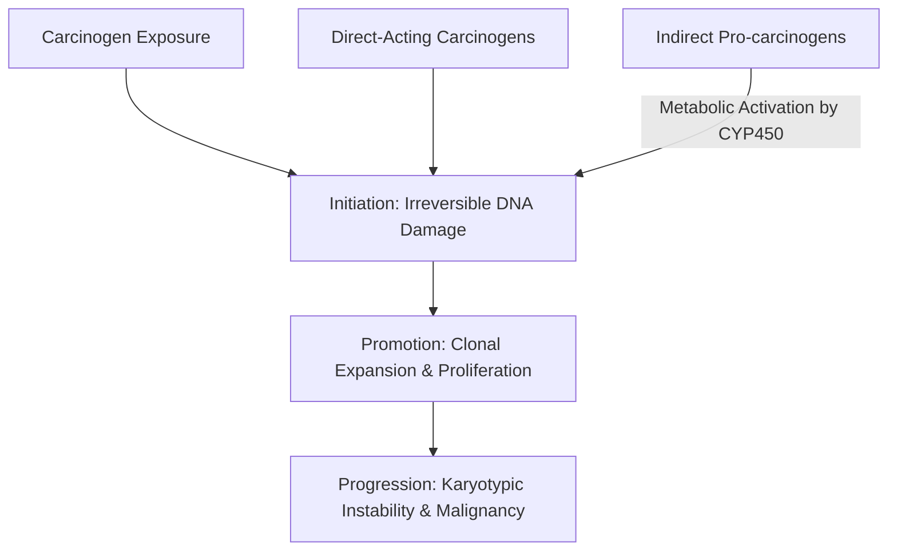

# Chapter 3: Cancer Epidemiology, Environmental Etiology & Prevention

---

## 3.1 Environmental & Chemical Carcinogenesis

Carcinogens are physical, chemical, or biological agents capable of causing genomic damage that leads to neoplastic transformation. Chemical carcinogenesis typically involves two distinct phases: **Initiation** (irreversible DNA damage caused by an initiator) followed by **Promotion** (stimulation of clonal expansion of initiated cells by promoters such as phorbol esters or chronic inflammation).



### Major Occupational & Environmental Carcinogens

| Agent | Exposure Source / Industry | Primary Associated Malignancy | Key Pathophysiological Mechanism |
| :--- | :--- | :--- | :--- |
| **Asbestos** | Insulative materials, shipbuilding, roofing, brake linings | **Malignant Pleural/Peritoneal Mesothelioma**; **Bronchogenic Carcinoma** (smoking synergism) | Amphibole thin fibers penetrate distal alveoli $\rightarrow$ chronic pleural inflammation, ROS generation, frustrated phagocytosis |
| **Benzene** | Petroleum industry, rubber, chemical solvents, shoe manufacturing | **Acute Myeloid Leukemia (AML)**; Myelodysplastic Syndromes (MDS) | Hydroquinones metabolite $\rightarrow$ bone marrow stem cell chromosomal aberrations ($t(8;21)$, del(5q), del(7q)) |
| **Arsenic** | Contaminated well water, pesticides, mining | **Cutaneous Squamous/Basal Cell Carcinoma**; **Lung Cancer**; **Hepatic Angiosarcoma** | Induces chromosomal instability, reactive oxygen species, and global DNA hypomethylation |
| **Aflatoxin $\text{B}_1$** | *Aspergillus flavus* contamination of stored grains, corn, peanuts | **Hepatocellular Carcinoma (HCC)** | Cytochrome P450 activation to epoxide $\rightarrow$ induces specific transversion mutation in **$TP53$ codon 249** (G:C to T:A) |
| **Polycyclic Aromatic Hydrocarbons (PAHs)** | Tobacco smoke, soot, coal tar (Pott's chimney sweep scrotal cancer) | **Lung**, **Head & Neck**, **Esophageal**, and **Bladder** Carcinomas | Metabolized to reactive diol-epoxides that form covalent DNA adducts with guanine residues |
| **Industrial Amines / Aniline Dyes** | Dye, rubber, leather, and printing industries ($\beta$-naphthylamine) | **Urothelial (Transitional Cell) Carcinoma of Bladder** | Excreted in urine after glucuronidation; hydrolyzed in acidic urine to reactive electrophiles |
| **Vinyl Chloride Monomer** | Plastic and PVC pipe manufacturing | **Hepatic Angiosarcoma** (rare malignant vascular tumor) | Metabolized by CYP2E1 to chloroethylene oxide $\rightarrow$ forms DNA adducts in hepatic sinusoidal endothelial cells |
| **Beryllium** | Aerospace, electronics, defense manufacturing | **Bronchogenic Carcinoma**; Chronic Beryllium Disease (granulomatous) | Cell-mediated immune activation and inhibition of DNA repair enzymes |

### Physical & Radiation Carcinogenesis
* **Ultraviolet (UV) Radiation**:
  * *UVA ($320–400\text{ nm}$)*: Induces indirect oxidative DNA damage via reactive oxygen species.
  * *UVB ($290–320\text{ nm}$)*: Directly absorbed by DNA. Induces covalent cross-linking between adjacent pyrimidine bases, forming **Cyclobutane Pyrimidine Dimers (CPDs)** (specifically Thymine-Thymine dimers).
  * *Nucleotide Excision Repair (NER)* normally excises CPDs. Genetic deficiency in NER results in **Xeroderma Pigmentosum**, characterized by a $>1000$-fold increased risk of Cutaneous Melanoma, Basal Cell Carcinoma, and Squamous Cell Carcinoma.
* **Ionizing Radiation** (X-rays, Gamma rays, Alpha/Beta particles):
  * Induces double-strand DNA breaks (DSBs) directly or indirectly via radiolysis of water producing hydroxyl radicals ($\text{OH}^\bullet$).
  * Malignancies linked to ionizing radiation exposure (e.g., atomic bomb survivors, medical radiation): **Acute and Chronic Myeloid Leukemias** (short latency 5–10 years), **Papillary Thyroid Carcinoma** (especially in children exposed post-Chernobyl), Osteosarcoma, Breast, and Lung cancers.

---

## 3.2 Oncogenic Infectious Agents

Approximately $12–15\%$ of human cancers worldwide are attributable to infectious etiologies, primarily oncogenic viruses.

```mermaid
graph LR
    A[Oncogenic Pathogens] --> B[Viruses]
    A --> C[Bacteria & Parasites]
    
    B --> B1[HPV 16/18: E6/E7 -> p53/Rb degradation]
    B --> B2[EBV: LMP1 -> NF-kB / t(8;14) Burkitt]
    B --> B3[HBV/HCV: HBx / Cirrhosis -> HCC]
    B --> B4[HHV-8: Kaposi Sarcoma / PEL]
    
    C --> C1[H. pylori: CagA/VacA -> Gastric CA & MALT]
    C --> C2[S. haematobium: Chronic inflammation -> Bladder SCC]
```

### 1. Human Papillomavirus (HPV)
* **High-Risk Genotypes**: **HPV-16** (responsible for $\sim 50–60\%$ of cervical cancers and $>80\%$ of HPV-positive oropharyngeal cancers) and **HPV-18** (responsible for $\sim 15–20\%$ of cervical adenocarcinomas).
* **Oncogenic Proteins**:
  * **E6 Oncoprotein**: Binds to tumor suppressor **p53** and targets it for ubiquitin-mediated proteasomal degradation via E6-Associated Protein (E6AP). Also upregulates TERT.
  * **E7 Oncoprotein**: Binds to **pRb** and forces dissociation of E2F transcription factors, leading to constitutive entry into S-phase. Promotes proteasomal degradation of pRb and inhibits $p21^{CIP1}$ and $p27^{KIP1}$.
  * *p16$^{INK4a}$ Immunohistochemistry*: Functional inactivation of pRb by E7 removes negative feedback on p16, causing marked **p16 overexpression** (used as a clinical surrogate IHC biomarker for high-risk HPV infection).

### 2. Epstein-Barr Virus (EBV / HHV-4)
* **Associated Malignancies**:
  1. **Burkitt Lymphoma**: Endemic African variant ($100\%$ EBV associated); drives translocation $t(8;14)$ bringing $c-MYC$ under $IgH$ enhancer control.
  2. **Nasopharyngeal Carcinoma**: Non-keratinizing type (undifferentiated), endemic in Southern China and Southeast Asia.
  3. **Hodgkin Lymphoma**: Mixed Cellularity and Lymphocyte Depleted subtypes ($\sim 40–50\%$ EBV positive).
  4. **Primary CNS Lymphoma**: Seen almost exclusively in severely immunocompromised AIDS patients ($\text{CD4} < 50/\mu\text{L}$).
* **Key Viral Oncoproteins**: **LMP-1** (Latent Membrane Protein 1) mimics active CD40 signaling, engaging NF-$\kappa$B and JAK/STAT pathways to drive B-cell proliferation and inhibit apoptosis (upregulates BCL-2).

### 3. Hepatitis B Virus (HBV) & Hepatitis C Virus (HCV)
* **Hepatocellular Carcinoma (HCC) Pathogenesis**:
  * *HBV (Hepadnavirus - dsDNA with RT)*: Integrates into the host genome. Encodes the **HBx Oncoprotein**, which disrupts p53, activates NF-$\kappa$B, and promotes transcription of growth factors. HBV can induce HCC in non-cirrhotic livers.
  * *HCV (Flavivirus - +ssRNA)*: Does NOT integrate into host DNA. Drives HCC indirectly via chronic necroinflammation, oxidative stress, hepatic steatosis, and secondary cirrhosis.

### 4. Other Infectious Carcinogens
* **Human T-Cell Lymphotropic Virus 1 (HTLV-1)**: Enveloping retrovirus; encodes **Tax protein**, which activates NF-$\kappa$B and inactivates p53; causes **Adult T-Cell Leukemia/Lymphoma (ATLL)** (characterized by hypercalcemia, lytic bone lesions, skin lesions, and "flower cells" in blood).
* **Human Herpesvirus 8 (HHV-8 / KSHV)**: Encodes viral cyclin D and vGPCR; causes **Kaposi Sarcoma** (vascular tumor of endothelial cells in HIV/AIDS) and **Primary Effusion Lymphoma**.
* ***Helicobacter pylori***: Microaerophilic bacterium; injects **CagA** (Cytotoxin-Associated Gene A) via Type IV secretion system, inducing SHP-2 phosphatase activation, and secretes **VacA** toxin; causes **Gastric Adenocarcinoma** and **Marginal Zone Gastric MALT Lymphoma** (early MALToma regresses completely with antibiotic eradication).
* ***Schistosoma haematobium***: Trematode/fluke endemic in Nile river valley; ova deposit in urinary bladder venous plexus, driving chronic inflammation $\rightarrow$ **Squamous Cell Carcinoma of the Bladder**.
* ***Opisthorchis viverrini* / *Clonorchis sinensis***: Liver flukes ingested from undercooked freshwater fish; colonize biliary tract driving chronic cholangitis $\rightarrow$ **Cholangiocarcinoma**.

---

## 3.3 Cancer Prevention & Screening

### Primary Cancer Prevention
* **Tobacco Cessation**: Single most effective intervention; reduces risk for lung, head & neck, esophageal, bladder, pancreatic, and renal cancers.
* **Prophylactic Vaccination**:
  * **HPV Vaccine (Gardasil 9)**: Non-infectious recombinant L1 capsid protein virus-like particles (VLPs); protects against HPV 6, 11 (condyloma acuminata) and high-risk oncogenic types 16, 18, 31, 33, 45, 52, 58. Recommended at ages 9–12 years.
  * **HBV Vaccine**: Recombinant HBsAg vaccine; prevents chronic hepatitis B infection and secondary HCC.
* **Chemoprevention**:
  * *Breast Cancer*: Selective Estrogen Receptor Modulators (SERMs - **Tamoxifen**, **Raloxifene**) or Aromatase Inhibitors in high-risk women (Gail Model 5-year risk $\ge 1.7\%$).
  * *Colorectal Cancer*: Daily low-dose Aspirin in select adults with high cardiovascular/colorectal risk or Lynch syndrome.

### Evidence-Based Cancer Screening Guidelines (USPSTF / ACS)

| Malignancy | Target Population | Screening Modality & Frequency | Key Clinical / Diagnostic Milestone |
| :--- | :--- | :--- | :--- |
| **Breast Cancer** | Average-risk females aged 40–74 years | **Biennial Screening Mammography** (digital 2D or 3D tomosynthesis) | BIRADS System classification (BIRADS 1–2 benign, 4–5 biopsy indicated) |
| **Cervical Cancer** | Females aged 21–65 years | Ages 21–29: Pap cytology every 3 years.<br>Ages 30–65: **High-Risk HPV co-testing every 5 years** (or Pap alone q3y) | Cytology: LSIL vs HSIL; Abnormal results mandate **Colposcopy** & biopsy |
| **Colorectal Cancer** | Average-risk adults aged **45–75 years** | **Colonoscopy every 10 years** (Gold Standard); OR Stool FIT annually; OR Cologuard (sDNA-FIT) q3y | Adenomatous polyp identification and complete snare polypectomy prevents CRC |
| **Lung Cancer** | Adults aged 50–80 years with **$\ge 20$ pack-year smoking history** (current or quit $<15$ yrs) | **Annual Low-Dose CT (LDCT) of Chest** | Lung-RADS classification; reduces lung cancer-specific mortality by $\sim 20\%$ |
| **Prostate Cancer** | Males aged 55–69 years | **Shared decision-making Serum PSA testing** $\pm$ DRE | Elevated PSA ($>4.0\text{ ng/mL}$) or abnormal velocity $\rightarrow$ multiparametric MRI / biopsy |

---

## Review & Verification

### Subsections Covered Checklist
- [x] 3.1 Environmental & Chemical Carcinogenesis (Occupational chemicals Asbestos, Benzene, Arsenic, Aflatoxin B1, PAHs, Aniline dyes, Vinyl chloride; UV pyrimidine dimers & NER/XP; Ionizing radiation).
- [x] 3.2 Oncogenic Infectious Agents (HPV 16/18 E6/E7, EBV LMP1/t(8;14), HBV/HCV HBx & cirrhosis, HTLV-1 Tax, HHV-8, H. pylori CagA/MALToma, S. haematobium bladder SCC, Liver flukes).
- [x] 3.3 Cancer Prevention & Screening (Primary prevention, Gardasil 9, HBV vaccine, chemoprevention; screening matrix for Breast, Cervix, Colorectal, Lung LDCT, Prostate).

### Corrections & Refinements Made
* Clarified that *Schistosoma haematobium* causes *Squamous Cell Carcinoma* of the bladder rather than the more common urothelial (transitional cell) carcinoma.
* Updated colorectal cancer screening initiation age to 45 years in alignment with updated USPSTF/ACS guidelines.

### Source Grounding & Reference Notes
* Grounded in *First Aid for the USMLE Step 1 (2025)* (Microbiology & Pathology sections) and standard USPSTF oncology screening guidelines. All mechanisms of viral oncogenesis and environmental exposures represent established consensus.
