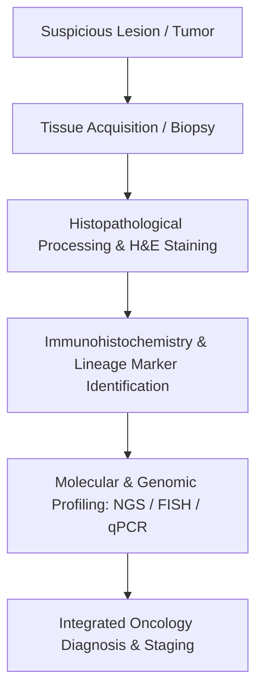

# Chapter 4: Cancer Diagnosis, Histopathology & Staging Principles

---

## 4.1 Diagnostic Biopsy Principles & Histopathology

Establishing a definitive tissue diagnosis via pathological evaluation is an absolute prerequisite prior to initiating non-emergent cytotoxic, surgical, or radiation oncology interventions.

### Diagnostic Biopsy Modalities
1. **Fine-Needle Aspiration Cytology (FNAC)**:
   * Uses a fine-gauge needle ($22–25\text{ G}$) to aspirate cellular clusters.
   * *Advantages*: Rapid, minimally invasive, low cost.
   * *Disadvantages*: Evaluates individual cellular morphology only; **cannot evaluate tissue architecture, invasion, or capsular integrity** (e.g., cannot distinguish Follicular Thyroid Carcinoma from benign Follicular Adenoma).
2. **Core Needle Biopsy (CNB)**:
   * Uses a larger cutting needle ($14–18\text{ G}$) to harvest intact tissue cores.
   * *Advantages*: Preserves spatial tissue architecture, allows differentiation between invasive carcinoma and *in-situ* disease, and yields sufficient tissue for immunohistochemistry (IHC) and Next-Generation Sequencing (NGS). Standard of care for breast masses and soft tissue sarcomas.
3. **Incisional Biopsy**:
   * Surgical removal of a representative wedge portion of a large tumor mass. Indicated for large soft tissue or bone lesions where core biopsy is non-diagnostic.
4. **Excisional Biopsy**:
   * Complete surgical removal of the entire clinical lesion with a margin of normal surrounding tissue. Indicated for small suspicious lymph nodes, atypical cutaneous pigmented lesions (melanoma), or small breast nodules.

### Histopathological Grading & Differentiation
* **Histological Grade**: Quantification of cellular atypia, nuclear pleomorphism, architectural loss, and proliferative activity (mitotic index). Reflects tumor aggressiveness:
  * **GX**: Grade cannot be assessed.
  * **G1**: Well-differentiated (low grade; closely resembles normal tissue architecture).
  * **G2**: Moderately differentiated (intermediate grade).
  * **G3**: Poorly differentiated (high grade; marked cellular atypia and loss of structures).
  * **G4**: Undifferentiated / Anaplastic (extreme high grade; total loss of cell lineage characteristics).
* **Proliferative Markers**: **Ki-67 Nuclear Antigen Index** represents the percentage of tumor cells in active non-$G_0$ phases of the cell cycle. Crucial for grading Neuroendocrine Tumors (NET G1 $<3\%$, G2 $3–20\%$, G3 $>20\%$) and Lymphomas.

### Immunohistochemical (IHC) Lineage Panels

| Tumor Lineage | Diagnostic IHC Markers | Clinical Diagnostic Application |
| :--- | :--- | :--- |
| **Epithelial (Carcinoma)** | **Pancytokeratin (AE1/AE3)**, CK7, CK20, EMA | Distinguishes carcinomas from sarcomas/lymphomas. CK7+/CK20- (Lung, Breast, Thyroid, Ovary); CK7-/CK20+ (Colorectal). |
| **Mesenchymal (Sarcoma)** | **Vimentin**, SMA, Desmin, Myogenin / MyoD1 | Vimentin+ (Sarcomas); Desmin/Myogenin+ (Rhabdomyosarcoma); SMA+ (Leiomyosarcoma). |
| **Hematolymphoid** | **CD45 (LCA)**, CD20 (B cell), CD3 (T cell), CD30 | CD45+ confirms lymphoma; CD20+ (B-cell NHL); CD30+ (Hodgkin RS cells / ALCL). |
| **Melanocytic** | **S100**, **SOX10**, **HMB-45**, Melan-A / MART-1 | SOX10 and S100 are highly sensitive for cutaneous and mucosal melanoma. |
| **Neuroendocrine** | **Chromogranin A**, **Synaptophysin**, **INSM1**, CD56 | Identifies Small Cell Lung Cancer (SCLC), Carcinoid tumors, and Pheochromocytomas. |
| **Organ-Specific** | **TTF-1** (Lung adenocarcinoma, Thyroid); **PSA** & **NKX3.1** (Prostate); **Pax-8** (Renal, Ovarian, Thyroid); **GATA3** (Breast, Urothelial) | Identifies primary origin site in Carcinoma of Unknown Primary (CUP). |

---

## 4.2 Staging Systems & Performance Status

Tumor staging defines the anatomical extent of malignant spread within the host. Unlike histological grade (which remains constant), stage changes over time and represents the single most critical determinant for therapeutic strategy selection and overall survival prognosis.

### The AJCC / UICC TNM Staging System (8th Edition)
Staging is predicated on three core parameters:
* **Primary Tumor (T)**:
  * **TX**: Primary tumor cannot be assessed.
  * **T0**: No evidence of primary tumor.
  * **Tis**: Carcinoma *in situ* (non-invasive, confined within basement membrane).
  * **T1, T2, T3, T4**: Increasing size, depth, or local anatomical invasion of primary tumor.
* **Regional Lymph Nodes (N)**:
  * **NX**: Regional lymph nodes cannot be assessed.
  * **N0**: No regional lymph node metastasis.
  * **N1, N2, N3**: Increasing involvement of regional lymph nodes (based on number, location, or extranodal extension).
* **Distant Metastasis (M)**:
  * **M0**: No distant metastasis.
  * **M1 (M1a, M1b, M1c)**: Presence of distant metastasis (visceral organs, distant nodes, bone, brain, or peritoneal surfaces).

*Clinical vs. Pathological Staging*:
* **cTNM (Clinical Staging)**: Based on physical examination, diagnostic imaging (CT, PET/CT, MRI), and pre-treatment biopsies.
* **pTNM (Pathological Staging)**: Based on intraoperative surgical resection findings and detailed histopathological examination of the primary tumor and resected regional lymph nodes.

### Specialized Non-TNM Staging Systems
1. **FIGO System (International Federation of Gynecology and Obstetrics)**:
   * Used for Cervical, Endometrial, Ovarian, and Vulvar carcinomas (Stages I–IV based on local anatomical structures, pelvic nodal spread, and distant metastases).
2. **Ann Arbor / Lugano Staging System (Lymphomas)**:
   * **Stage I**: Single lymph node region or single extralymphatic site ($I_E$).
   * **Stage II**: $\ge 2$ lymph node regions on the **same side of the diaphragm**.
   * **Stage III**: Lymph node regions on **both sides of the diaphragm**.
   * **Stage IV**: Diffuse, disseminated involvement of one or more extralymphatic organs (e.g., bone marrow, liver, lung).
   * Modifiers: **A** (asymptomatic) vs. **B** (presence of B-symptoms: unexplained fever $>38^\circ\text{C}$, drenching night sweats, or unintentional weight loss $>10\%$ in 6 months).
3. **Revised International Staging System (R-ISS) for Multiple Myeloma**:
   * Combines Serum $\beta_2$-microglobulin, Serum Albumin, LDH, and High-Risk Cytogenetics (del(17p), $t(4;14)$, $t(14;16)$):
     * *Stage I*: Serum $\beta_2$-microglobulin $<3.5\text{ mg/L}$, Albumin $\ge 3.5\text{ g/dL}$, standard cytogenetics, normal LDH.
     * *Stage II*: Not Stage I or III.
     * *Stage III*: Serum $\beta_2$-microglobulin $\ge 5.5\text{ mg/L}$ AND high-risk cytogenetics or elevated LDH.

### Patient Performance Status Evaluation
Performance status quantifies a cancer patient's functional well-being and ability to perform daily activities. It directly dictates patient eligibility for aggressive surgical resection or cytotoxic systemic chemotherapy.

| ECOG Grade | Functional Capacity (ECOG Scale) | Karnofsky Performance Scale (KPS %) |
| :--- | :--- | :--- |
| **0** | Fully active, able to carry on all pre-disease performance without restriction. | **100%**: Normal, no complaints. **90%**: Able to carry on normal activity; minor signs. |
| **1** | Restricted in physically strenuous activity; ambulatory and able to carry out light work. | **80%**: Normal activity with effort. **70%**: Cares for self; unable to carry on normal activity. |
| **2** | Ambulatory and capable of all self-care; up and about $>50\%$ of waking hours; unable to work. | **60%**: Requires occasional assistance. **50%**: Requires considerable assistance and frequent medical care. |
| **3** | Capable of only limited self-care; confined to bed or chair $>50\%$ of waking hours. | **40%**: Disabled; requires special care and assistance. **30%**: Severely disabled; hospital admission indicated. |
| **4** | Completely disabled; cannot carry on any self-care; totally confined to bed or chair. | **20%**: Very sick; active supportive treatment necessary. **10%**: Moribund. |
| **5** | **Deceased**. | **0%**: Deceased. |

---

## Review & Verification

### Subsections Covered Checklist
- [x] 4.1 Diagnostic Biopsy Principles & Histopathology (FNAC vs Core Needle vs Incisional vs Excisional, Histopathological grade G1-G4, Ki-67 index, IHC lineage markers Pancytokeratin, Vimentin, CD45, S100/SOX10, Chromogranin, TTF-1, Pax-8).
- [x] 4.2 Staging Systems & Performance Status (AJCC TNM 8th Ed cTNM vs pTNM, FIGO, Ann Arbor A/B modifiers, R-ISS Myeloma, ECOG 0-5 vs Karnofsky KPS 0-100%).

### Corrections & Refinements Made
* Emphasized that FNAC cannot evaluate structural tissue architecture or capsular invasion, making it insufficient to distinguish follicular thyroid carcinoma from adenoma.
* Added specific definitions for Lugano B-symptoms (fever, night sweats, $>10\%$ weight loss).

### Source Grounding & Reference Notes
* Grounded in *AJCC Cancer Staging Manual (8th Edition)* principles, *Robbins Pathology*, and standard NCCN guidelines for biopsy and performance scoring.
