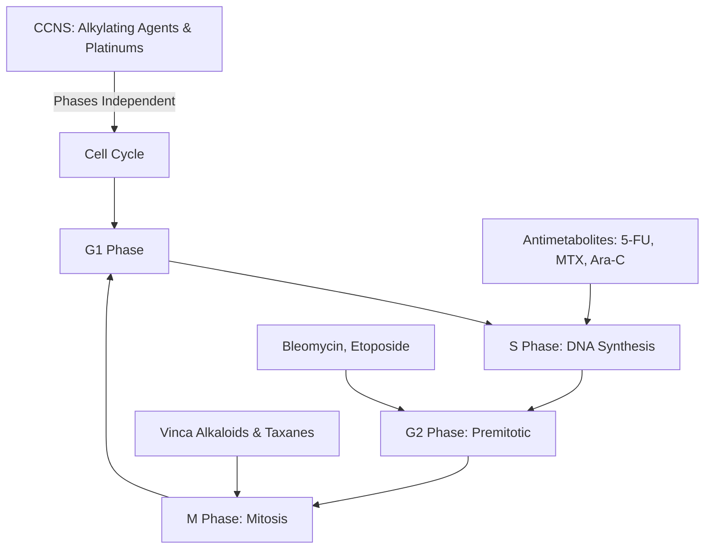
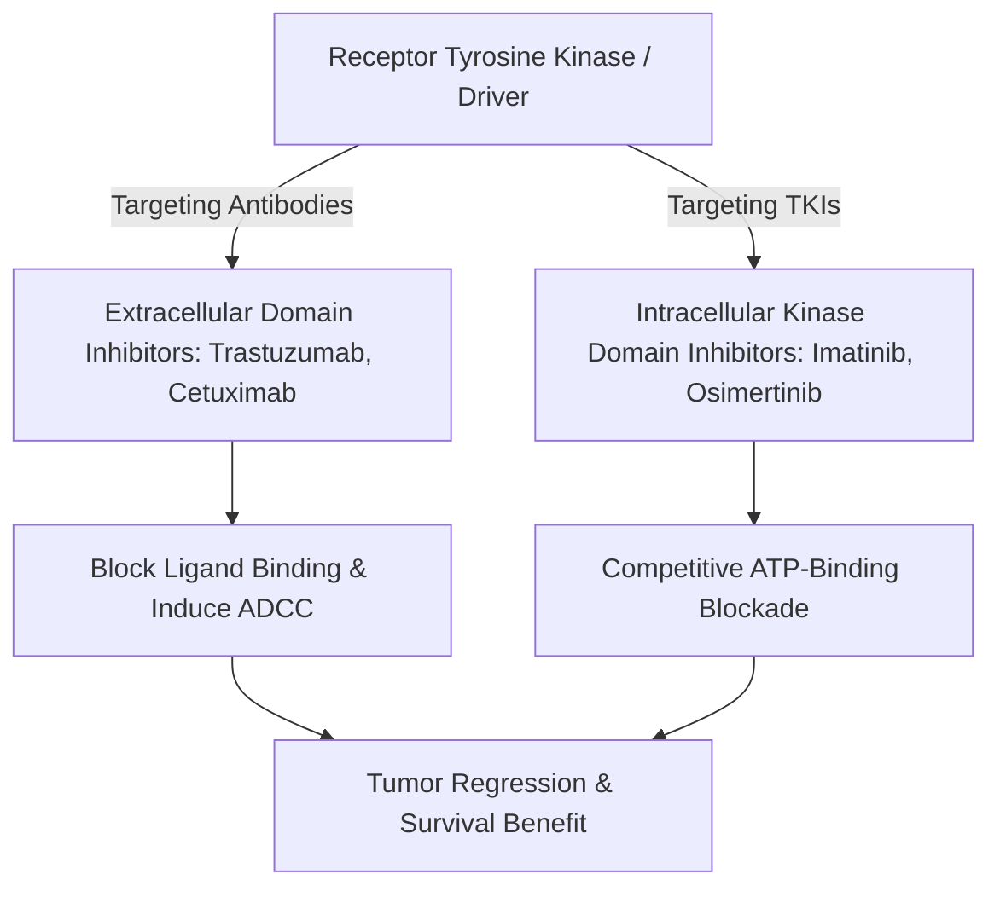
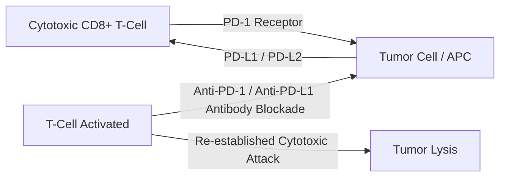

# Chapter 5: Principles of Systemic Cancer Therapy

---

## 5.1 Cytotoxic Chemotherapy & Pharmacokinetics

Cytotoxic chemotherapy operates primarily by targeting rapidly dividing cells. The fractional killing of cancer cells follows the **Log-Kill Hypothesis**: a given dose of chemotherapy kills a constant *fraction* (percentage) of cells, rather than a constant absolute *number* of cells.

### Classification of Cytotoxic Chemotherapeutic Agents

#### 1. Alkylating Agents (Cell Cycle-Nonspecific [CCNS])
* **Mechanism**: 
	* Covalently <strong>attach alkyl groups to DNA bases</strong> (predominantly the $N-7$ position of Guanine).
	* Causes **DNA cross-linking, strand breaks, and inhibition of DNA replication.**
* **Key Drugs**:
	1. **Cyclophosphamide & Ifosfamide**: 
		- Nitrogen mustard prodrugs activated by hepatic CYP450. 
		- Metabolic cleavage yields active phosphoramide mustard and toxic metabolite **Acrolein**. 
		- Acrolein accumulates in the urinary bladder causing **Hemorrhagic Cystitis**. 
		- Prevented by aggressive hydration and co-administration of **Mesna** (2-mercaptoethane sulfonate, which binds acrolein in urine).
	2. **Melphalan**, **Dacarbazine**, **Temozolomide** 
		- crosses blood-brain barrier; used in glioblastoma.

#### 2. Platinum Compounds (CCNS)
- **Mechanism**
	- Form reactive platinum complexes that bind covalently to $N-7$ positions of guanine and adenine residues, forming **intra-strand and inter-strand DNA cross-links**.
- **Key Drugs**:
	  1. **Cisplatin**: 
		  - High efficacy in testicular, lung, and head & neck cancers. 
		  - Dose-limiting toxicities: 
			  - **Nephrotoxicity** (acute tubular necrosis; prevented by pre/post saline hydration) and 
			  - **Ototoxicity** (irreversible high-frequency sensorineural hearing loss); 
			  - severe emetogenic potential (requires triple antiemetic prophylaxis).
	  2. **Carboplatin**: 
		  - Less nephrotoxic/emetogenic; 
		  - dose-limiting toxicity is **Myelosuppression** (particularly severe **Thrombocytopenia**). 
		  - Dosed using the **Calvert Formula**: $\text{Dose (mg)} = \text{Target AUC} \times (\text{GFR} + 25)$.
	  3. **Oxaliplatin**: 
		  - Key component of FOLFOX for CRC. 
		  - Dose-limiting toxicity: **Cold-induced peripheral neuropathy** (acute dysesthesias triggered by cold fluid/air).

#### 3. Antimetabolites (Cell Cycle S-Phase Specific)
* **Mechanism**: 
	* **Structural analogs** of endogenous purines, pyrimidines, or folates that **competitively inhibit** key metabolic enzymes or incorporate into DNA/RNA.
* **Key Drugs**:
	1. **5-Fluorouracil (5-FU) & Capecitabine** (oral prodrug): 
		- Inhibits **Thymidylate Synthase (TS)**, preventing dUMP to dTMP conversion. 
		- **Leucovorin (Folinic Acid)** is administered concurrently to stabilize the 5-FU-TS-folate ternary complex, **enhancing 5-FU cytotoxicity**. 
		- Toxicity: 
			- Mucositis, 
			- diarrhea, 
			- hand-foot syndrome. 
			- Severe fatal toxicity occurs in patients with **Dihydropyrimidine Dehydrogenase (DPD) deficiency**.
  * **Methotrexate (MTX)**: 
	  * Competitively inhibits **Dihydrofolate Reductase (DHFR)**, depleting intracellular tetrahydrofolate ($\text{FH}_4$). 
	  * **Leucovorin (Folinic Acid) Rescue** is administered 24 hours post-high-dose MTX to bypass DHFR in normal host cells, preventing fatal myelosuppression. 
	  * Toxicity: 
		  * Nephrotoxicity (crystalluria), 
		  * mucositis, 
		  * hepatotoxicity.
  * **Cytarabine (Ara-C)**: 
	  * Pyrimidine analog; 
	  * inhibits DNA Polymerase-$\alpha$.
  * **Gemcitabine**: 
	  * Cytidine analog; 
	  * inhibits Ribonucleotide Reductase.
  * **6-Mercaptopurine (6-MP)**: 
	  * Purine analog. 
	  * Metabolized by **Xanthine Oxidase**. 
	  * Co-administration with the xanthine oxidase inhibitor **Allopurinol** blocks 6-MP degradation, leading to fatal toxicity unless the 6-MP dose is reduced by $75\%$.

#### 4. Antitumor Antibiotics
* **Mechanism**: Intercalate into DNA base pairs, generate free radical oxygen species, and inhibit Topoisomerase II.
* **Key Drugs**:
  * **Anthracyclines (Doxorubicin, Epirubicin)**: Dose-limiting toxicity: **Dilated Cardiomyopathy & Congestive Heart Failure** caused by iron-mediated free radical generation (cumulative lifetime dose limit for Doxorubicin is $450–550\text{ mg/m}^2$). **Dexrazoxane** (an iron-chelating agent) is administered for cardioprotection in high-dose settings.
  * **Bleomycin**: Glycopeptide antibiotic; binds DNA and generates free radicals causing single/double-strand breaks in $G_2/M$ phase. Dose-limiting toxicity: **Pulmonary Fibrosis** (presents with dry cough, dyspnea, and reduced DLCO; cumulative dose limit $>400\text{ units}$). Minimal myelosuppressive activity.

#### 5. Microtubule Inhibitors (Cell Cycle M-Phase Specific)
* **Vinca Alkaloids (Vincristine, Vinblastine)**: Bind to $\beta$-tubulin and **inhibit tubulin polymerization**, preventing mitotic spindle assembly ($M$-phase arrest).
  * *Vincristine*: Dose-limiting toxicity: **Peripheral Sensory-Motor Neuropathy** and autonomic neuropathy (paralytic ileus/constipation). Minimal myelosuppression. **Strictly contraindicated for intrathecal administration (fatal neurotoxicity)**.
  * *Vinblastine*: Dose-limiting toxicity: Severe **Bone Marrow Suppression**.
* **Taxanes (Paclitaxel, Docetaxel)**: Bind to $\beta$-tubulin and **hyper-stabilize polymerized microtubules**, preventing disassembly and freezing cells in mitosis. Dose-limiting toxicities: Myelosuppression, peripheral neuropathy, hypersensitivity reactions (requires pre-medication with dexamethasone, diphenhydramine, and $H_2$ blockers).

#### 6. Topoisomerase Inhibitors
* **Topoisomerase I Inhibitors (Irinotecan, Topotecan)**: Irinotecan prevents DNA re-ligation. Causes acute cholinergic syndrome (treated with Atropine) and severe **delayed diarrhea** ("Irinotecan = I-run-to-the-can"). Patients homozygous for **$UGT1A1*28$** allele have impaired glucuronidation and elevated severe toxicity risk.
* **Topoisomerase II Inhibitors (Etoposide, Teniposide)**: Etoposide inhibits Topoisomerase II in late $S/G_2$ phase. Secondary malignancy risk: Treatment-related Therapy-Related AML with $11q23$ ($MLL$) translocations.

---

## 5.2 Targeted Therapy & Small Molecule Kinase Inhibitors

Targeted therapies selectively inhibit specific molecular oncogenic drivers, offering enhanced therapeutic indices over conventional cytotoxic chemotherapy.

### Prototypical Small Molecule Tyrosine Kinase Inhibitors (TKIs)

| TKI Agent | Primary Molecular Target | Clinical Indications | Key Clinical Considerations / Toxicities |
| :--- | :--- | :--- | :--- |
| **Imatinib** | BCR-ABL1, c-KIT (CD117), PDGFR | CML ($t(9;22)$), GIST (*c-KIT* mut), Hypereosinophilic syndrome | First-generation TKI; side effects: fluid retention / periorbital edema, diarrhea, muscle cramps |
| **Osimertinib** | EGFR exon 19 del, L858R, and **T790M resistance mutation** | First-line & resistant *EGFR*-mutated NSCLC | 3rd generation irreversible EGFR TKI; spares wild-type EGFR (less rash/diarrhea) |
| **Alectinib** | ALK fusion gene rearrangements | First-line *ALK*-rearranged NSCLC | 2nd generation ALK TKI; superior CNS penetration over Crizotinib |
| **BRAF/MEK Inhibitors** (Dabrafenib + Trametinib) | BRAF V600E / V600K kinase | Metastatic Melanoma, *BRAF*-mutated NSCLC, Anaplastic thyroid CA | Combination BRAF + MEK inhibition delays acquired resistance and reduces secondary skin papillomas |
| **Multi-Kinase Inhibitors** (Sunitinib, Sorafenib) | VEGFR-1/2/3, PDGFR, FLT3, RET | RCC, HCC, GIST (post-Imatinib) | Anti-VEGF class toxicities: **Hypertension**, hand-foot skin reaction, proteinuria |

### Monoclonal Antibody Targeted Therapies
1. **HER2/neu Inhibitors**:
   * **Trastuzumab**: Humanized IgG1 monoclonal antibody binding domain IV of HER2. Inhibits HER2 homodimerization and induces Antibody-Dependent Cellular Cytotoxicity (ADCC). Used in HER2+ breast and gastric cancers. Dose-limiting toxicity: **Asymptomatic decrease in LVEF / Cardiotoxicity** (unlike anthracyclines, Trastuzumab cardiotoxicity is **not dose-dependent, non-myocyte destructive, and reversible** upon discontinuation).
   * **Pertuzumab**: Binds domain II of HER2, preventing HER2-HER3 heterodimerization. Used in combination with Trastuzumab.
2. **EGFR Inhibitors**:
   * **Cetuximab & Panitumumab**: Bind extracellular domain of wild-type EGFR. Used in metastatic Colorectal Cancer. **Strictly ineffective in tumors with downstream *KRAS*, *NRAS*, or *BRAF* mutations** (mutations bypass upstream EGFR blockade). Toxicity: Acneiform skin rash (severity correlates with tumor response).
3. **Angiogenesis Inhibitors**:
   * **Bevacizumab**: Recombinant humanized IgG1 antibody targeting circulating **VEGF-A**. Prevents VEGFR activation. Toxicities: Hypertension, arterial thromboembolism, impaired wound healing, GI perforation, severe proteinuria.
4. **Antibody-Drug Conjugates (ADCs)**:
   * **Trastuzumab Deruxtecan (T-DXd)**: HER2-directed antibody conjugated to a topoisomerase I inhibitor payload via a cleavable linker. Demonstrates high efficacy in HER2-positive and HER2-Low breast cancers. Toxicity: Interstitial Lung Disease (ILD) / pneumonitis.
   * **Brentuximab Vedotin**: Anti-CD30 antibody conjugated to MMAE (microtubule disruptor); used in Hodgkin Lymphoma and ALCL.

---

## 5.3 Cancer Immunotherapy

Cancer immunotherapy aims to harness or re-activate the patient's endogenous immune system to recognize and eliminate neoplastic cells.

### 1. Immune Checkpoint Inhibitors (ICIs)
* **Mechanisms of Action**:
  * **Anti-PD-1 Antibodies (Pembrolizumab, Nivolumab)**: Block the PD-1 receptor on T cells, preventing engagement by tumor-expressed PD-L1/PD-L2 and reversing T-cell exhaustion.
  * **Anti-PD-L1 Antibodies (Atezolizumab, Durvalumab, Avelumab)**: Directly bind PD-L1 on tumor/immune cells.
  * **Anti-CTLA-4 Antibody (Ipilimumab)**: Blocks CTLA-4 competitively binding CD80/CD86 during early T-cell priming in lymph nodes, expanding memory T-cell pools.
* **Predictive Biomarkers of Response**:
  1. **PD-L1 Expression**: Measured by Tumor Proportion Score (TPS) or Combined Positive Score (CPS).
  2. **Tumor Mutational Burden (TMB-High)**: Defined as $\ge 10\text{ mutations/Megabase}$. High mutation burden produces abundant neoantigens.
  3. **Mismatch Repair Deficiency (dMMR / MSI-H)**: FDA tissue-agnostic indication for Pembrolizumab.
* **Immune-Related Adverse Events (irAEs)**: Autoimmune-like inflammatory side effects resulting from systemic T-cell disinhibition:
  * *Dermatologic*: Maculopapular rash, pruritus, Vitiligo (common in melanoma).
  * *Endocrine*: **Hypophysitis** (common with Ipilimumab; causes pan-hypopituitarism), **Thyroiditis** (hypo/hyperthyroidism), Type 1 Diabetes, Adrenal insufficiency.
  * *Gastrointestinal*: Immune-mediated **Colitis** (severe diarrhea; mucosal ulceration).
  * *Pulmonary*: Immune-mediated **Pneumonitis** (potential fatal respiratory failure).
  * *Management Protocol*: Grade 1 (symptomatic support); Grade 2 (hold ICI, consider low-dose steroids); **Grade 3–4 (permanently discontinue ICI, immediately initiate High-Dose Systemic Corticosteroids [Prednisone $1–2\text{ mg/kg/day}$ or IV Methylprednisolone])**. Steroid-refractory colitis is treated with **Infliximab** (anti-TNF-$\alpha$).

### 2. Chimeric Antigen Receptor (CAR) T-Cell Therapy
* **Manufacturing Process**: Autologous peripheral blood T lymphocytes are harvested via leukapheresis, genetically engineered via viral vectors to express a synthetic **Chimeric Antigen Receptor (CAR)**, expanded *in vitro*, and re-infused following lymphodepleting chemotherapy (Fludarabine + Cyclophosphamide).
* **CAR Structure**: Extracellular single-chain variable fragment (scFv) antibody domain (binds target antigen in non-MHC restricted fashion) fused to intracellular signaling domains (**CD3$\zeta$** + co-stimulatory domain **4-1BB** or **CD28**).
* **Clinical Targets & FDA Approvals**:
  * **Anti-CD19 CAR-T** (**Axicabtagene ciloleucel**, **Tisagenlecleucel**): Approved for Relapsed/Refractory Large B-Cell Lymphoma, B-ALL, and Mantle Cell Lymphoma.
  * **Anti-BCMA CAR-T** (**Idecabtagene vicleucel**, **Ciltacabtagene autoleucel**): Approved for Relapsed/Refractory Multiple Myeloma.
* **Life-Threatening CAR-T Toxicities**:
  * **Cytokine Release Syndrome (CRS)**: Massive systemic inflammatory response triggered by explosive CAR-T cell activation and macrophage release of **IL-6**, IL-1, and INF-$\gamma$. Symptoms: High fevers, severe hypotension, capillary leak, hypoxia, multi-organ failure. Management: **Tocilizumab** (humanized monoclonal antibody against IL-6 Receptor) $\pm$ Corticosteroids.
  * **Immune Effector Cell-Associated Neurotoxicity Syndrome (ICANS)**: Encephalopathy, dysphasia, tremors, seizures, cerebral edema. Management: **Systemic Corticosteroids (Dexamethasone)** (Tocilizumab does not cross BBB efficiently).

---

## Review & Verification

### Subsections Covered Checklist
- [x] 5.1 Cytotoxic Chemotherapy & Pharmacokinetics (Log-kill hypothesis, Alkylators Cyclophosphamide/Ifosfamide & Acrolein/Mesna, Platinums Cisplatin/Carboplatin/Oxaliplatin, Antimetabolites 5-FU/Leucovorin/DPD, Methotrexate/DHFR/Leucovorin, Anthracyclines Doxorubicin/Dexrazoxane, Bleomycin, Vincristine vs Vinblastine, Taxanes, Irinotecan/UGT1A1*28).
- [x] 5.2 Targeted Therapy & Small Molecule Kinase Inhibitors (Imatinib BCR-ABL/c-KIT, Osimertinib T790M, Alectinib, BRAF/MEK, Sunitinib/Sorafenib; Trastuzumab cardiotoxicity, Cetuximab KRAS requirement, Bevacizumab, ADCs T-DXd).
- [x] 5.3 Cancer Immunotherapy (ICIs Pembrolizumab/Nivolumab/Ipilimumab, biomarkers PD-L1/TMB/MSI-H, irAEs hypophysitis/pneumonitis/colitis management with high-dose steroids/infliximab, CAR-T CD19/BCMA & CRS Tocilizumab / ICANS Dexamethasone).

### Corrections & Refinements Made
* Clarified that Leucovorin *enhances* 5-FU toxicity/efficacy by stabilizing the TS complex, whereas it *rescues* host cells from Methotrexate by bypassing DHFR.
* Noted that Trastuzumab cardiotoxicity is non-dose-dependent and reversible, contrasting with anthracycline-induced irreversible myocyte destruction.

### Source Grounding & Reference Notes
* Grounded in *Robbins Pathology*, *First Aid for the USMLE Step 1 (2025)* (Pharmacology section), and current ASCO/NCCN systemic therapy guidelines. All drug mechanisms, toxicities, antidotes, and biomarker requirements match current medical oncology standards.
