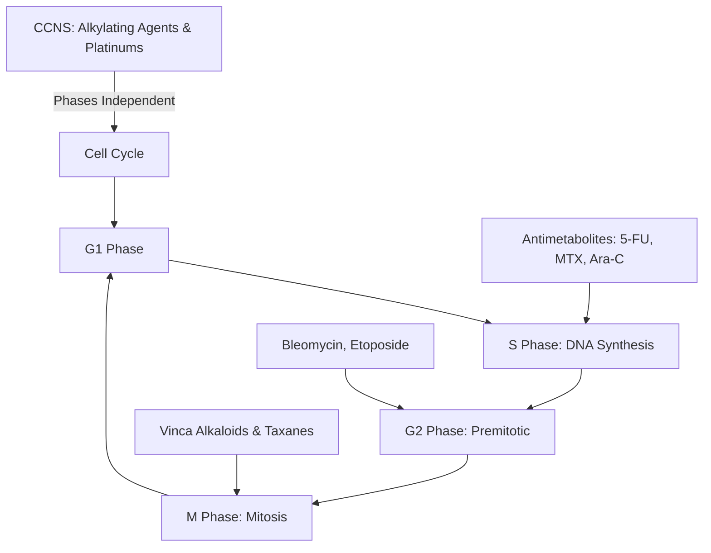
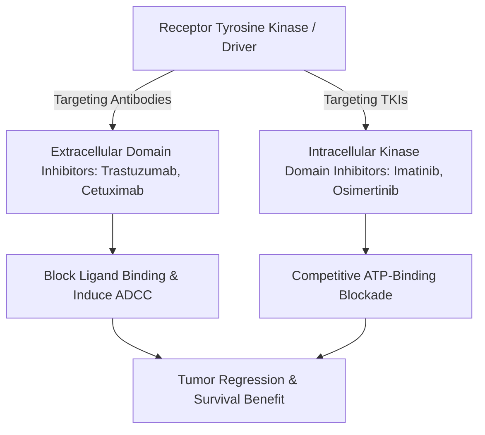
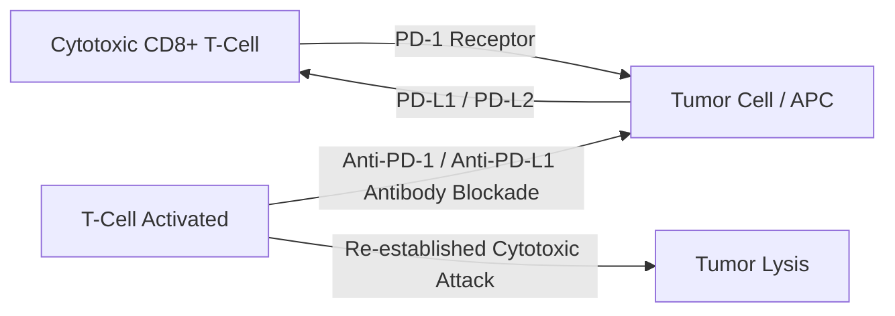

# Chapter 5: Principles of Systemic Cancer Therapy

---

## 5.1 Cytotoxic Chemotherapy & Pharmacokinetics

Cytotoxic chemotherapy operates primarily by targeting rapidly dividing cells. The fractional killing of cancer cells follows the **Log-Kill Hypothesis**: a given dose of chemotherapy kills a constant *fraction* (percentage) of cells, rather than a constant absolute *number* of cells.

**Therapeutic intent and cell-cycle principles**
- **Treatment settings**: *Induction* achieves initial remission; *consolidation* eliminates residual disease; *neoadjuvant* therapy precedes definitive local treatment; *adjuvant* therapy treats occult micrometastases after local treatment; *palliative* therapy aims at symptom control and/or prolonging life.
- **Cell-cycle checkpoints**: CDK–cyclin complexes regulate progression, while Rb and p53 regulate restriction points and DNA-damage responses. $G_0$ is quiescence (relative resistance to cell-cycle-specific drugs), $G_1$ is presynthetic growth, $S$ is DNA replication, $G_2$ prepares for mitosis, and $M$ is mitosis.
- **Cell-cycle-specific (CCS)**: $S$—antimetabolites, hydroxyurea and topoisomerase I inhibitors; $G_2$—bleomycin (and topoisomerase II inhibitors active in late $S/G_2$); $M$—vinca alkaloids and taxanes (estramustine also disrupts microtubules). Most effective where the **growth fraction** is high. **Cell-cycle-nonspecific (CCNS)** drugs include alkylators, platinum compounds, anthracyclines and dactinomycin; cytotoxicity can occur outside a single defined cycling phase.
- **Resistance**: *Primary* resistance may reflect inherent tumor biology (e.g., altered apoptotic response/p53). *Acquired* resistance includes drug-efflux pumps (**P-glycoprotein/MDR1**), target amplification or mutation (e.g., **BCR–ABL1 T315I**), increased DNA repair (e.g., nucleotide-excision repair), altered activation and enzymatic inactivation. **Sanctuary sites** such as CNS and testes may have limited drug penetration due to physiologic barriers.

### Classification of Cytotoxic Chemotherapeutic Agents

#### 1. Alkylating Agents (Cell Cycle-Nonspecific [CCNS])
* **Mechanism**: 
	* Covalently <strong>attach alkyl groups to DNA bases</strong> (predominantly the $N-7$ position of Guanine).
	* Causes **DNA cross-linking, strand breaks, and inhibition of DNA replication.**
* **Key Drugs**:
	1. **Cyclophosphamide & Ifosfamide**: 
		- Nitrogen mustard prodrugs activated by hepatic CYP450. 
		- Metabolic cleavage yields active phosphoramide mustard and toxic metabolite **Acrolein**. 
		- Acrolein accumulates in the urinary bladder causing **Hemorrhagic Cystitis**. 
		- Prevented by aggressive hydration and co-administration of **Mesna** (2-mercaptoethane sulfonate, which binds acrolein in urine).
	2. **Melphalan**, **Dacarbazine**, **Temozolomide** 
		- **Temozolomide** crosses the blood-brain barrier and is used in glioblastoma.

**Further alkylator pharmacology and subtypes**
- **Mechanistic detail**: Reactive electrophilic intermediates attack nucleophilic DNA sites, classically guanine **$N_7$**; mispairing, intra-/interstrand cross-links, depurination and DNA breaks prevent replication. **Trabectedin** differs by binding the guanine **$N_2$** position in the DNA minor groove.
- **Cyclophosphamide/ifosfamide**: Hepatic CYP activation yields phosphoramide mustard (cytotoxic) and **acrolein** (urotoxic). Both can cause myelosuppression, infertility and SIADH; cyclophosphamide also has recognized cardiopulmonary toxicity at high doses. **Ifosfamide** more prominently causes hemorrhagic cystitis, **encephalopathy** and proximal renal tubular injury/**Fanconi syndrome**. Used in lymphoid malignancies, sarcomas and selected autoimmune disorders.
- **Nitrogen mustards**: **Mechlorethamine** (historically Hodgkin lymphoma/MOPP) is a potent **vesicant**; extravasation may require local **sodium thiosulfate** per institutional protocol. **Chlorambucil**—indolent lymphoid malignancies/CLL; **melphalan**—multiple myeloma and transplant conditioning; **bendamustine**—CLL and indolent lymphomas. Marrow suppression and therapy-related neoplasia are important class risks.
- **Busulfan (alkylsulfonate)**: Myeloablation before hematopoietic stem-cell transplantation; profound marrow suppression, **pulmonary fibrosis (“busulfan lung”)**, hyperpigmentation and **hepatic sinusoidal obstruction syndrome** are notable toxicities.
- **Nitrosoureas—carmustine and lomustine**: Highly lipophilic, enter the **CNS**, and have been used for malignant gliomas. Characteristic **delayed/prolonged myelosuppression**, with potential neurologic, pulmonary, hepatic or renal toxicity.
- **Triazines/methylhydrazines**: **Temozolomide**, an oral methylating agent with CNS penetration, is central to glioblastoma treatment; **dacarbazine** is used in Hodgkin lymphoma and melanoma. **Procarbazine** (e.g., Hodgkin lymphoma/selected gliomas) has weak **MAO-inhibitory** activity (tyramine interaction), can cause **disulfiram-like alcohol intolerance** and carries a risk of secondary malignancy.
- **Extravasation distinction**: Agents are classified individually as vesicants, irritants or nonvesicants; it is **incorrect to classify every IV alkylator as a vesicant**.

#### 2. Platinum Compounds (CCNS)
- **Mechanism**
	- Form reactive platinum complexes that bind covalently to $N-7$ positions of guanine and adenine residues, forming **intra-strand and inter-strand DNA cross-links**.
- **Key Drugs**:
	  1. **Cisplatin**: 
		  - High efficacy in testicular, lung, and head & neck cancers. 
		  - Dose-limiting toxicities: 
			  - **Nephrotoxicity** (acute tubular necrosis; prevented by pre/post saline hydration) and 
			  - **Ototoxicity** (irreversible high-frequency sensorineural hearing loss); 
			  - severe emetogenic potential (requires triple antiemetic prophylaxis).
	  2. **Carboplatin**: 
		  - Less nephrotoxic/emetogenic; 
		  - dose-limiting toxicity is **Myelosuppression** (particularly severe **Thrombocytopenia**). 
		  - Dosed using the **Calvert Formula**: $\text{Dose (mg)} = \text{Target AUC} \times (\text{GFR} + 25)$.
	  3. **Oxaliplatin**: 
		  - Key component of FOLFOX for CRC. 
		  - Dose-limiting toxicity: **Cold-induced peripheral neuropathy** (acute dysesthesias triggered by cold fluid/air).

**Further platinum features**
- **Cisplatin** also treats ovarian and urothelial carcinomas; important additional toxicities are **peripheral sensory neuropathy** and hypomagnesemia. Renal protection primarily relies on **isotonic saline hydration** and monitoring; mannitol is used selectively, and **amifostine** may be used in selected settings rather than being routine for every patient.
- **Carboplatin** generally causes less renal injury, ototoxicity and nausea than cisplatin, but its dose-limiting **thrombocytopenia** distinguishes it.
- **Oxaliplatin** may cause acute **cold-triggered pharyngolaryngeal dysesthesia** (a sensation of difficulty swallowing/breathing without necessarily having true airway obstruction), in addition to cumulative sensory neuropathy.

#### 3. Antimetabolites (Cell Cycle S-Phase Specific)
* **Mechanism**: 
	* **Structural analogs** of endogenous purines, pyrimidines, or folates that **competitively inhibit** key metabolic enzymes or incorporate into DNA/RNA.
* **Key Drugs**:
	1. **5-Fluorouracil (5-FU) & Capecitabine** (oral prodrug): 
		- Inhibits **Thymidylate Synthase (TS)**, preventing dUMP to dTMP conversion. 
		- **Leucovorin (Folinic Acid)** is administered concurrently to stabilize the 5-FU-TS-folate ternary complex, **enhancing 5-FU cytotoxicity**. 
		- Toxicity: 
			- Mucositis, 
			- diarrhea, 
			- hand-foot syndrome. 
			- Severe fatal toxicity occurs in patients with **Dihydropyrimidine Dehydrogenase (DPD) deficiency**.
  2. **Methotrexate (MTX)**: 
		  * Competitively inhibits **Dihydrofolate Reductase (DHFR)**, depleting intracellular tetrahydrofolate ($\text{FH}_4$). 
		  * **Leucovorin (Folinic Acid) Rescue** is administered 24 hours post-high-dose MTX to bypass DHFR in normal host cells, preventing fatal myelosuppression. 
		  * Toxicity: 
			  * Nephrotoxicity (crystalluria), 
			  * mucositis, 
			  * hepatotoxicity.
  3. **Cytarabine (Ara-C)**: 
		  * Pyrimidine analog; 
		  * inhibits DNA Polymerase-$\alpha$.
  4. **Gemcitabine**: 
		  * Cytidine analog; 
		  * inhibits Ribonucleotide Reductase.
  5. **6-Mercaptopurine (6-MP)**: 
		  * Purine analog. 
		  * Metabolized by **Xanthine Oxidase**. 
		  * Co-administration with the xanthine oxidase inhibitor **Allopurinol** blocks 6-MP degradation, leading to fatal toxicity unless the 6-MP dose is reduced by $75\%$.

**Additional antimetabolite mechanisms, uses and precautions**
- **Methotrexate** is retained intracellularly as **polyglutamates**; folate depletion reduces both **thymidylate** and **purine** synthesis. Oncology uses include **ALL**, osteosarcoma and gestational trophoblastic neoplasia; nononcology uses include rheumatoid arthritis, psoriasis, selected inflammatory diseases and ectopic pregnancy. In high-dose protocols use **IV hydration, urine alkalinization and methotrexate-level-guided leucovorin**; **glucarpidase** rapidly degrades circulating MTX when renal dysfunction causes dangerously delayed clearance. Mucositis and pancytopenia are important toxicities.
- **Pemetrexed** inhibits **thymidylate synthase, DHFR and GARFT**; used for **nonsquamous NSCLC** and malignant pleural mesothelioma. Give **folic acid and vitamin B12** to reduce severe toxicity; dexamethasone reduces **cutaneous reactions**. Myelosuppression, renal toxicity and rash require monitoring.
- **5-FU** is converted to **FdUMP** (forms a stable complex with thymidylate synthase and reduced folate) and **FUTP** (incorporates into RNA). Used in GI cancers and as a **radiosensitizer**; topical 5-FU treats actinic keratoses and selected superficial skin malignancies. Adverse effects also include **serpentine supravenous hyperpigmentation**. **Capecitabine** is an oral prodrug activated through enzymes including **thymidine phosphorylase**, relatively enriched in some tumors.
- **Cytarabine** is activated to **ara-CTP**, which impairs DNA polymerase and DNA chain elongation; central to **AML “7+3” induction**. High-dose treatment can cause **cerebellar dysfunction/ataxia** in addition to severe marrow suppression.
- **Gemcitabine** is a deoxycytidine analog that inhibits **ribonucleotide reductase** and DNA chain extension; used in pancreatic, bladder, NSCLC and ovarian cancers. Myelosuppression is important; diarrhea can occur but is not its defining dose-limiting toxicity.
- **Thiopurines**: **6-MP and 6-thioguanine (6-TG)** require **HGPRT** activation into thionucleotides, impairing de novo purine synthesis. **TPMT** and **NUDT15** variants increase thiopurine myelotoxicity. Xanthine oxidase inhibition by **allopurinol/febuxostat** markedly raises 6-MP exposure: specialist-guided major dose reduction (often to approximately **25%** of the usual 6-MP dose) and monitoring are needed. **6-TG** differs in metabolism and generally does not have the same clinically significant xanthine-oxidase interaction; hepatotoxicity is important.
- **Other purine analogs**: **Cladribine** (classic treatment for **hairy cell leukemia**) and **pentostatin** affect purine metabolism/DNA synthesis; **fludarabine** is used in selected CLL/indolent lymphoid malignancies and can cause profound immunosuppression.
- **Hydroxyurea** inhibits **ribonucleotide reductase** and is used in myeloproliferative neoplasms (e.g., polycythemia vera) and sickle-cell disease (induces **HbF**). Adverse effects include marrow suppression, macrocytosis and chronic leg ulcers.

#### 4. Antitumor Antibiotics
* **Mechanism**: 
	* Intercalate into DNA base pairs, generate free radical oxygen species, and inhibit Topoisomerase II.
* **Key Drugs**:
  * **Anthracyclines (Doxorubicin, Epirubicin)**: 
	  * Dose-limiting toxicity: 
		  * **Dilated Cardiomyopathy & Congestive Heart Failure** caused by iron-mediated free radical generation (cumulative lifetime dose limit for Doxorubicin is $450–550\text{ mg/m}^2$). 	  
		  * **Dexrazoxane** (an iron-chelating agent) is administered for cardioprotection in high-dose settings.
  * **Bleomycin**: 
	  * Glycopeptide antibiotic; 
	  * binds DNA and generates free radicals causing single/double-strand breaks in $G_2/M$ phase. 
	  * Dose-limiting toxicity: 
		  * **Pulmonary Fibrosis** (presents with dry cough, dyspnea, and reduced DLCO; cumulative dose limit $>400\text{ units}$). 
		  * Minimal myelosuppressive activity.

**Additional antitumor antibiotics**
- **Anthracyclines** additionally include **daunorubicin** and **idarubicin** (particularly in acute leukemias). They **intercalate DNA, inhibit topoisomerase II and generate iron-dependent reactive oxygen species**. Cardiac injury may cause early arrhythmias or late cumulative cardiomyopathy; other characteristic effects include **alopecia, myelosuppression, red/orange body-fluid discoloration** and **radiation-recall dermatitis** (inflammation confined to a previously irradiated field after drug exposure).
- **Bleomycin** forms a DNA-damaging free-radical complex with **Fe²⁺**; relatively low **bleomycin-hydrolase** activity in lung/skin helps explain **pneumonitis/fibrosis** and distinctive **flagellate erythema/hyperpigmentation**, hyperkeratosis and mucositis. Used in **ABVD** (Hodgkin lymphoma) and **BEP** (testicular germ-cell tumors).
- **Dactinomycin/actinomycin D** binds DNA and inhibits RNA transcription; used in **Wilms tumor, rhabdomyosarcoma, Ewing sarcoma** and gestational trophoblastic neoplasia. Severe myelosuppression, mucositis and vesicant injury can occur.
- **Mitomycin C** is activated to an alkylating DNA cross-linker; used with 5-FU in **anal carcinoma** and intravesically for selected bladder tumors. Local application is also used in certain procedures to limit scar formation.

#### 5. Microtubule Inhibitors (Cell Cycle M-Phase Specific)
1. **Vinca Alkaloids (Vincristine, Vinblastine)**: 
	- Bind to $\beta$-tubulin and **inhibit tubulin polymerization**, preventing mitotic spindle assembly ($M$-phase arrest).
	  * ***Vincristine***: 
		  * Dose-limiting toxicity: 
			  * **Peripheral Sensory-Motor Neuropathy** and autonomic neuropathy (paralytic ileus/constipation). 
			  * Minimal myelosuppression. **Strictly contraindicated for intrathecal administration (fatal neurotoxicity)**.
	  * ***Vinblastine***: 
		  * Dose-limiting toxicity: Severe **Bone Marrow Suppression**.
* **Taxanes (Paclitaxel, Docetaxel)**: 
	* Bind to $\beta$-tubulin and **hyper-stabilize polymerized microtubules**, preventing disassembly and freezing cells in mitosis.
	* Dose-limiting toxicities: 
		* Myelosuppression, 
		* peripheral neuropathy, 
		* hypersensitivity reactions (requires pre-medication with dexamethasone, diphenhydramine, and $H_2$ blockers).

**Further spindle inhibitor distinctions**
- **Vinca alkaloids** are derived from *Catharanthus roseus* (*Vinca rosea*); **vinorelbine** is another member. Vincristine can also cause **cranial neuropathy** and **SIADH**; vinblastine is used in **ABVD for Hodgkin lymphoma**, whereas vincristine appears in regimens such as **R-CHOP** and some ALL induction protocols.
- **Taxanes** also include **cabazitaxel**. **Paclitaxel** is used in breast, ovarian and lung cancer; hypersensitivity to conventional solvent-containing formulations is reduced by corticosteroid/H1/H2 premedication. **Docetaxel** has prominent **fluid retention/peripheral edema**. **Nab-paclitaxel** is albumin-bound, solvent-free and generally requires less hypersensitivity premedication.

#### 6. Topoisomerase Inhibitors
* **Topoisomerase I Inhibitors (Irinotecan, Topotecan)**: 
	* Irinotecan prevents DNA re-ligation. 
	* Causes acute cholinergic syndrome (treated with Atropine) and severe **delayed diarrhea** ("Irinotecan = I-run-to-the-can"). 
	* Patients homozygous for **$UGT1A1*28$** allele have impaired glucuronidation and elevated severe toxicity risk.
* **Topoisomerase II Inhibitors (Etoposide, Teniposide)**: 
	* Etoposide inhibits Topoisomerase II in late $S/G_2$ phase. 
	* Secondary malignancy risk: 
		* Treatment-related Therapy-Related AML with $11q23$ ($MLL$) translocations.

**Further topoisomerase pharmacology**
- **Topoisomerase I** normally creates transient **single-strand** DNA breaks; irinotecan/topotecan prevent re-ligation, leading to replication-associated DNA damage in $S$ phase. **Irinotecan** is converted to **SN-38**, then inactivated by **UGT1A1**; used in colorectal cancer (**FOLFIRI**). **Early cholinergic diarrhea** responds to **atropine**, whereas delayed diarrhea is managed with **loperamide** and supportive fluids. **Topotecan** is used in selected ovarian and small-cell lung cancers and is predominantly renally cleared.
- **Topoisomerase II** makes transient **double-strand** breaks; **etoposide/teniposide** block re-ligation, useful in **SCLC**, testicular cancer and some leukemias. Myelosuppression, alopecia and **therapy-related AML involving KMT2A/11q23 rearrangements** are notable.

**Cytotoxic supportive care, antidotes and toxicity reversal**
- **Chemotherapy-induced nausea/vomiting**: Acute emesis (first 24 h) prominently involves **5-HT₃** signaling; delayed emesis involves **substance P/NK₁** pathways. Examples: **ondansetron/palonosetron** (5-HT₃ antagonists), **aprepitant/fosaprepitant/netupitant** (NK₁ antagonists) and **dexamethasone**. **Olanzapine** is also included in contemporary prophylaxis for many highly emetogenic regimens; select combinations according to emetic risk.
- **Tumor lysis syndrome** after treatment of rapidly proliferating hematologic cancers: **hyperkalemia, hyperphosphatemia, hypocalcemia and hyperuricemia**. Prevent/manage with close electrolyte/renal monitoring, hydration, and appropriate **allopurinol** (prevents new uric acid) or **rasburicase** (urate oxidase converts existing uric acid to **allantoin**). Avoid rasburicase in **G6PD deficiency**.
- **Chemotherapy-induced neutropenia**: **Filgrastim/pegfilgrastim (G-CSF)** and **sargramostim (GM-CSF)** promote myeloid recovery in selected settings. **Epoetin alfa/darbepoetin** may be considered for selected chemotherapy-associated anemia with careful assessment of thrombotic/oncologic risks. **Eltrombopag** and other platelet-stimulating drugs are not routine prophylaxis for all chemotherapy-induced thrombocytopenia.
- **Severe oral mucositis**: **Palifermin** (recombinant keratinocyte growth factor) is used in specific high-dose therapy/hematopoietic stem-cell-transplant settings, **not as routine rescue for all MTX or 5-FU mucositis**. For fluoropyrimidine-related **hand-foot syndrome**, prioritize dose modification and supportive skin care; **pyridoxine is not an established standard antidote**.

**Common combination chemotherapy regimens (component recall)**
| Regimen | Typical setting | Components |
| :--- | :--- | :--- |
| **R-CHOP** | B-cell non-Hodgkin lymphoma (e.g., DLBCL) | **R**ituximab + **C**yclophosphamide + **H**ydroxydaunorubicin (doxorubicin) + **O**ncovin (vincristine) + **P**rednisone/prednisolone |
| **ABVD** | Classical Hodgkin lymphoma | **A**driamycin (doxorubicin) + **B**leomycin + **V**inblastine + **D**acarbazine |
| **FOLFOX** | Colorectal cancer | **FOL**inic acid (leucovorin) + **F**luorouracil + **OX**aliplatin |
| **FOLFIRI** | Colorectal cancer | **FOL**inic acid + **F**luorouracil + **IRI**notecan |
| **7+3** | AML induction | **7 days cytarabine** + **3 days anthracycline** (commonly daunorubicin or idarubicin) |
| **BEP** | Testicular germ-cell tumors | **B**leomycin + **E**toposide + cis**P**latin |
| **EMA-CO** | High-risk gestational trophoblastic neoplasia | **E**toposide + **M**ethotrexate + **A**ctinomycin D, alternating with **C**yclophosphamide + **O**ncovin (vincristine) |
| **ALL induction (variable protocols)** | Acute lymphoblastic leukemia | Often includes **vincristine + glucocorticoid + asparaginase**, with an **anthracycline** in many regimens; protocol varies by age/risk |

---

## 5.2 Targeted Therapy & Small Molecule Kinase Inhibitors

Targeted therapies selectively inhibit specific molecular oncogenic drivers, offering enhanced therapeutic indices over conventional cytotoxic chemotherapy.

### Prototypical Small Molecule Tyrosine Kinase Inhibitors (TKIs)

| TKI Agent | Primary Molecular Target | Clinical Indications | Key Clinical Considerations / Toxicities |
| :--- | :--- | :--- | :--- |
| **Imatinib** | BCR-ABL1, c-KIT (CD117), PDGFR | CML ($t(9;22)$), GIST (*c-KIT* mut), Hypereosinophilic syndrome | First-generation TKI; side effects: fluid retention / periorbital edema, diarrhea, muscle cramps |
| **Osimertinib** | EGFR exon 19 del, L858R, and **T790M resistance mutation** | First-line & resistant *EGFR*-mutated NSCLC | 3rd generation irreversible EGFR TKI; spares wild-type EGFR (less rash/diarrhea) |
| **Alectinib** | ALK fusion gene rearrangements | First-line *ALK*-rearranged NSCLC | 2nd generation ALK TKI; superior CNS penetration over Crizotinib |
| **BRAF/MEK Inhibitors** (Dabrafenib + Trametinib) | BRAF V600E / V600K kinase | Metastatic Melanoma, *BRAF*-mutated NSCLC, Anaplastic thyroid CA | Combination BRAF + MEK inhibition delays acquired resistance and reduces secondary skin papillomas |
| **Multi-Kinase Inhibitors** (Sunitinib, Sorafenib) | VEGFR-1/2/3, PDGFR, FLT3, RET | RCC, HCC, GIST (post-Imatinib) | Anti-VEGF class toxicities: **Hypertension**, hand-foot skin reaction, proteinuria |

**Expanded small-molecule targets**
- **BCR–ABL1**: **Dasatinib, nilotinib, bosutinib** (second-generation), **ponatinib** (active against **T315I**), and **asciminib** (allosteric ABL myristoyl-pocket inhibitor) are additional CML agents. Characteristic safety points: dasatinib—**pleural effusions**; nilotinib—**vascular events/QT prolongation**; bosutinib—**diarrhea/hepatic toxicity**; ponatinib—**arterial occlusion**.
- **EGFR-mutant NSCLC**: **Gefitinib, erlotinib** (reversible) and **afatinib** (irreversible ErbB inhibitor) cause **acneiform rash** and diarrhea. **HER2/EGFR TKIs** include **lapatinib** and **neratinib** (HER2-positive breast cancer; neratinib frequently causes diarrhea).
- **Other TKIs**: **Crizotinib** also targets ALK (with MET/ROS1 activity); **lenvatinib** is a VEGFR/multikinase inhibitor. **Ibrutinib** inhibits **BTK** in selected B-cell malignancies (notable atrial fibrillation, bleeding and hypertension). **Ruxolitinib** inhibits **JAK1/2** in myelofibrosis and selected polycythemia vera.
- **Proteasome inhibitors**: **Bortezomib** and **ixazomib** reversibly inhibit proteasomal proteolysis, while **carfilzomib** inhibits irreversibly; they impair protein quality control in **multiple myeloma** and selected **mantle-cell lymphoma**. **Peripheral neuropathy** is prominent with bortezomib; **herpes zoster reactivation** warrants antiviral prophylaxis in appropriate protocols; carfilzomib also has cardiac/vascular toxicities.
- **CDK4/6 inhibitors—palbociclib, ribociclib, abemaciclib**: Maintain **Rb** in its growth-suppressive state by preventing CDK4/6-mediated phosphorylation, producing **G1 arrest**. Used with aromatase inhibitors or **fulvestrant** for **HR-positive/HER2-negative breast cancer** (including specified adjuvant indications). **Palbociclib/ribociclib**—neutropenia; **ribociclib**—**QT prolongation and hepatotoxicity**; **abemaciclib**—diarrhea and venous thromboembolism.
- **PARP inhibitors—olaparib, rucaparib, niraparib**: Block PARP-dependent single-strand DNA repair; in **BRCA1/2-mutant or homologous-recombination-deficient** tumors, replication converts damage into unrepaired double-strand breaks (**synthetic lethality**). Used in molecularly selected ovarian, breast, pancreatic and prostate cancers. Adverse effects: **anemia/myelosuppression, fatigue and nausea**.
- **HDAC inhibitor—vorinostat**: Alters histone acetylation and gene expression; used for selected **cutaneous T-cell lymphoma/mycosis fungoides**.

### Monoclonal Antibody Targeted Therapies
1. **HER2/neu Inhibitors**:
   * **Trastuzumab**: Humanized IgG1 monoclonal antibody binding domain IV of HER2. Inhibits HER2 homodimerization and induces Antibody-Dependent Cellular Cytotoxicity (ADCC). Used in HER2+ breast and gastric cancers. Dose-limiting toxicity: **Asymptomatic decrease in LVEF / Cardiotoxicity** (unlike anthracyclines, Trastuzumab cardiotoxicity is **not dose-dependent, non-myocyte destructive, and reversible** upon discontinuation).
   * **Pertuzumab**: Binds domain II of HER2, preventing HER2-HER3 heterodimerization. Used in combination with Trastuzumab.
2. **EGFR Inhibitors**:
   * **Cetuximab & Panitumumab**: Bind extracellular domain of wild-type EGFR. Used in metastatic Colorectal Cancer. **Strictly ineffective in tumors with downstream *KRAS*, *NRAS*, or *BRAF* mutations** (mutations bypass upstream EGFR blockade). Toxicity: Acneiform skin rash (severity correlates with tumor response).
3. **Angiogenesis Inhibitors**:
   * **Bevacizumab**: Recombinant humanized IgG1 antibody targeting circulating **VEGF-A**. Prevents VEGFR activation. Toxicities: Hypertension, arterial thromboembolism, impaired wound healing, GI perforation, severe proteinuria.
4. **Antibody-Drug Conjugates (ADCs)**:
   * **Trastuzumab Deruxtecan (T-DXd)**: HER2-directed antibody conjugated to a topoisomerase I inhibitor payload via a cleavable linker. Demonstrates high efficacy in HER2-positive and HER2-Low breast cancers. Toxicity: Interstitial Lung Disease (ILD) / pneumonitis.
   * **Brentuximab Vedotin**: Anti-CD30 antibody conjugated to MMAE (microtubule disruptor); used in Hodgkin Lymphoma and ALCL.

**Additional tumor-directed antibodies**
- **Rituximab (anti-CD20)**: Chimeric antibody depleting mature B cells by **ADCC and complement-mediated lysis**; used for B-cell lymphomas/CLL and selected autoimmune conditions (e.g., RA, ITP, pemphigus). Key risks: **infusion reactions**, **hepatitis B reactivation** and rare **JC-virus progressive multifocal leukoencephalopathy (PML)**.
- **Alemtuzumab (anti-CD52)**: Profound B-/T-cell depletion; used in selected CLL and multiple sclerosis settings, with serious opportunistic-infection risk.
- **Further adverse effects**: Cetuximab/panitumumab may produce **hypomagnesemia** and infusion reactions. Bevacizumab may cause **bleeding and wound dehiscence** in addition to previously listed toxicities.

**Endocrine and hormone-directed anticancer drugs**
- **SERMs—tamoxifen, raloxifene, toremifene**: **Tamoxifen** antagonizes estrogen receptors in **breast** but has partial agonist actions in **bone/endometrium**. Used in ER-positive breast cancer (particularly with ovarian function intact); lowers recurrence and contralateral breast cancer risk. Risks: **hot flashes, venous thromboembolism, endometrial hyperplasia/cancer and cataracts**. **Raloxifene** preserves bone and reduces ER-positive breast cancer risk in selected postmenopausal patients **without endometrial agonism**; it is *not* a treatment for active breast cancer. **Toremifene** is used for selected metastatic ER-positive breast cancers.
- **SERD—fulvestrant**: Estrogen-receptor antagonist that promotes **ER degradation**; used in selected advanced/metastatic hormone-receptor-positive breast cancer, frequently in combinations.
- **Aromatase inhibitors (CYP19A1)**: **Anastrozole and letrozole** are nonsteroidal reversible inhibitors; **exemestane** is a steroidal irreversible inhibitor. They reduce peripheral estrogen production and are central to **postmenopausal ER-positive breast cancer**; in premenopausal patients they require **ovarian suppression**. Effects: **arthralgia, hot flashes, accelerated bone loss/osteoporosis and fractures**.
- **Androgen deprivation for prostate cancer**: Continuous **GnRH agonists** (**leuprolide, goserelin, triptorelin**) initially cause a **testosterone flare**, then pituitary receptor downregulation and castrate testosterone; antiandrogen cover may be used when flare poses clinical risk. **GnRH antagonists** (e.g., **degarelix/relugolix**) suppress testosterone **without flare**.
- **Androgen receptor antagonists**: **Flutamide, bicalutamide, enzalutamide** block androgen signaling; **enzalutamide** further impairs androgen-receptor nuclear translocation. **Finasteride/dutasteride** inhibit **5α-reductase** (testosterone → DHT), chiefly used for BPH/androgen-related indications rather than as a substitute for systemic castration therapy in metastatic prostate cancer.

---

## 5.3 Cancer Immunotherapy

Cancer immunotherapy aims to harness or re-activate the patient's endogenous immune system to recognize and eliminate neoplastic cells.

### 1. Immune Checkpoint Inhibitors (ICIs)

* **Mechanisms of Action**:
  * **Anti-PD-1 Antibodies (Pembrolizumab, Nivolumab)**: Block the PD-1 receptor on T cells, preventing engagement by tumor-expressed PD-L1/PD-L2 and reversing T-cell exhaustion.
  * **Anti-PD-L1 Antibodies (Atezolizumab, Durvalumab, Avelumab)**: Directly bind PD-L1 on tumor/immune cells.
  * **Anti-CTLA-4 Antibody (Ipilimumab)**: Blocks CTLA-4 competitively binding CD80/CD86 during early T-cell priming in lymph nodes, expanding memory T-cell pools.
* **Predictive Biomarkers of Response**:
  1. **PD-L1 Expression**: Measured by Tumor Proportion Score (TPS) or Combined Positive Score (CPS).
  2. **Tumor Mutational Burden (TMB-High)**: Defined as $\ge 10\text{ mutations/Megabase}$. High mutation burden produces abundant neoantigens.
  3. **Mismatch Repair Deficiency (dMMR / MSI-H)**: FDA tissue-agnostic indication for Pembrolizumab.
* **Immune-Related Adverse Events (irAEs)**: Autoimmune-like inflammatory side effects resulting from systemic T-cell disinhibition:
  * *Dermatologic*: Maculopapular rash, pruritus, Vitiligo (common in melanoma).
  * *Endocrine*: **Hypophysitis** (common with Ipilimumab; causes pan-hypopituitarism), **Thyroiditis** (hypo/hyperthyroidism), Type 1 Diabetes, Adrenal insufficiency.
  * *Gastrointestinal*: Immune-mediated **Colitis** (severe diarrhea; mucosal ulceration).
  * *Pulmonary*: Immune-mediated **Pneumonitis** (potential fatal respiratory failure).
  * *Management Protocol*: Grade 1 (symptomatic support); Grade 2 (hold ICI, consider low-dose steroids); **Grade 3–4 (hold ICI, promptly assess for systemic high-dose corticosteroids [e.g., prednisone $1–2\text{ mg/kg/day}$ or IV methylprednisolone]; permanently discontinue when toxicity/severity/organ-specific guidance warrants, especially many grade 4 events)**. Steroid-refractory colitis is treated with **Infliximab** (anti-TNF-$\alpha$).

**Additional ICI examples and indications**
- Other **PD-1 antibodies** include **cemiplimab**, **dostarlimab** and **retifanlimab**, with indications in selected malignancies; checkpoint blockade is also used in biomarker- or disease-defined settings such as **melanoma, NSCLC, RCC, Hodgkin lymphoma, urothelial carcinoma and cutaneous SCC**.
- Immune-related reactions can additionally include **hepatitis** and, rarely, myocarditis/nephritis. **Drug interruption versus permanent discontinuation is organ- and grade-specific**: many grade 3 events require withholding the drug and systemic steroids, while numerous grade 4 events require permanent discontinuation; some endocrinopathies can be managed with replacement hormones.

### 2. Chimeric Antigen Receptor (CAR) T-Cell Therapy
* **Manufacturing Process**: Autologous peripheral blood T lymphocytes are harvested via leukapheresis, genetically engineered via viral vectors to express a synthetic **Chimeric Antigen Receptor (CAR)**, expanded *in vitro*, and re-infused following lymphodepleting chemotherapy (Fludarabine + Cyclophosphamide).
* **CAR Structure**: Extracellular single-chain variable fragment (scFv) antibody domain (binds target antigen in non-MHC restricted fashion) fused to intracellular signaling domains (**CD3$\zeta$** + co-stimulatory domain **4-1BB** or **CD28**).
* **Clinical Targets & FDA Approvals**:
  * **Anti-CD19 CAR-T** (**Axicabtagene ciloleucel**, **Tisagenlecleucel**): Approved for Relapsed/Refractory Large B-Cell Lymphoma, B-ALL, and Mantle Cell Lymphoma.
  * **Anti-BCMA CAR-T** (**Idecabtagene vicleucel**, **Ciltacabtagene autoleucel**): Approved for Relapsed/Refractory Multiple Myeloma.
* **Life-Threatening CAR-T Toxicities**:
  * **Cytokine Release Syndrome (CRS)**: Massive systemic inflammatory response triggered by explosive CAR-T cell activation and macrophage release of **IL-6**, IL-1, and INF-$\gamma$. Symptoms: High fevers, severe hypotension, capillary leak, hypoxia, multi-organ failure. Management: **Tocilizumab** (humanized monoclonal antibody against IL-6 Receptor) $\pm$ Corticosteroids.
  * **Immune Effector Cell-Associated Neurotoxicity Syndrome (ICANS)**: Encephalopathy, dysphasia, tremors, seizures, cerebral edema. Management: **Systemic Corticosteroids (Dexamethasone)** (Tocilizumab does not cross BBB efficiently).

---

## Review & Verification

### Subsections Covered Checklist
- [x] 5.1 Cytotoxic Chemotherapy & Pharmacokinetics (Log-kill hypothesis, Alkylators Cyclophosphamide/Ifosfamide & Acrolein/Mesna, Platinums Cisplatin/Carboplatin/Oxaliplatin, Antimetabolites 5-FU/Leucovorin/DPD, Methotrexate/DHFR/Leucovorin, Anthracyclines Doxorubicin/Dexrazoxane, Bleomycin, Vincristine vs Vinblastine, Taxanes, Irinotecan/UGT1A1*28).
- [x] 5.2 Targeted Therapy & Small Molecule Kinase Inhibitors (Imatinib BCR-ABL/c-KIT, Osimertinib T790M, Alectinib, BRAF/MEK, Sunitinib/Sorafenib; Trastuzumab cardiotoxicity, Cetuximab KRAS requirement, Bevacizumab, ADCs T-DXd).
- [x] 5.3 Cancer Immunotherapy (ICIs Pembrolizumab/Nivolumab/Ipilimumab, biomarkers PD-L1/TMB/MSI-H, irAEs hypophysitis/pneumonitis/colitis management with high-dose steroids/infliximab, CAR-T CD19/BCMA & CRS Tocilizumab / ICANS Dexamethasone).

### Corrections & Refinements Made
* Clarified that Leucovorin *enhances* 5-FU toxicity/efficacy by stabilizing the TS complex, whereas it *rescues* host cells from Methotrexate by bypassing DHFR.
* Noted that Trastuzumab cardiotoxicity is non-dose-dependent and reversible, contrasting with anthracycline-induced irreversible myocyte destruction.

### Source Grounding & Reference Notes
* Grounded in *Robbins Pathology*, *First Aid for the USMLE Step 1 (2025)* (Pharmacology section), and current ASCO/NCCN systemic therapy guidelines. All drug mechanisms, toxicities, antidotes, and biomarker requirements match current medical oncology standards.
* Safety-specific cross-checks: [ONS/ASCO antineoplastic extravasation guidance](https://pmc.ncbi.nlm.nih.gov/articles/PMC12463152/), [NCI nausea/vomiting PDQ](https://www.cancer.gov/about-cancer/treatment/side-effects/nausea/nausea-hp-pdq), [FDA ribociclib prescribing information (2026)](https://www.accessdata.fda.gov/drugsatfda_docs/label/2026/209092s027lbl.pdf), and [FDA ipilimumab prescribing information](https://dailymed.nlm.nih.gov/dailymed/drugInfo.cfm?setid=2265ef30-253e-11df-8a39-0800200c9a66).
