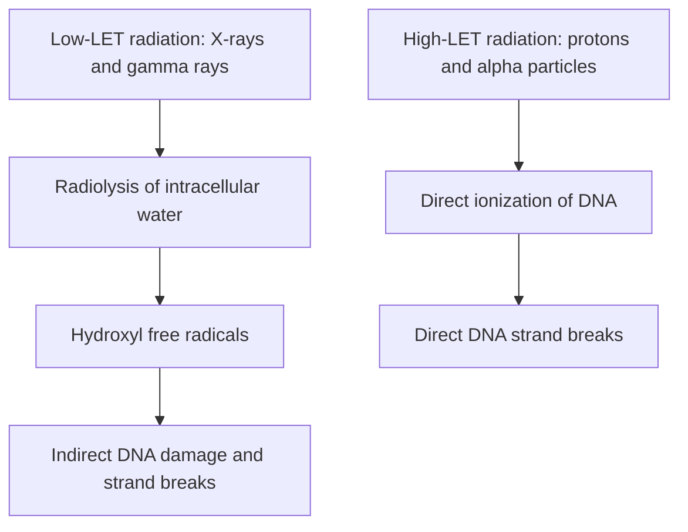

# Chapter 6: Principles of Radiation & Surgical Oncology

## 6.1 Radiobiology & Radiation Oncology

### Physical & Biological Principles of Radiation Therapy
Radiation therapy utilizes ionizing radiation to induce irreversible cellular damage, predominantly via DNA double-strand breaks (DSBs). Ionizing radiation operates through two primary physical pathways:
1. **Direct Action**: High-linear energy transfer (LET) radiation (e.g., alpha particles, protons, neutrons) directly ionizes critical biological macromolecules, specifically the phosphodiester backbone of DNA.
2. **Indirect Action**: Low-LET radiation (e.g., X-rays, gamma rays) ionizes ambient intracellular water molecules ($H_2O$), producing reactive oxygen species (ROS) such as hydroxyl free radicals ($\cdot OH$). These free radicals interact with DNA, causing single-strand and double-strand breaks. Indirect action accounts for approximately two-thirds of DNA damage caused by X-rays.

#### Key Radiobiological Parameters
* **Linear Energy Transfer (LET)**: The rate of energy deposition per unit distance traversed by ionizing radiation ($\text{keV}/\mu\text{m}$). High-LET radiation deposits high density energy along a short track length.
* **Relative Biological Effectiveness (RBE)**: The ratio of a dose of reference radiation (250 kVp X-rays) to the dose of a test radiation required to produce an identical biological endpoint. As LET increases up to $\sim 100\text{ keV}/\mu\text{m}$, RBE increases proportionally.
* **Oxygen Enhancement Ratio (OER)**: The ratio of radiation dose required to cause a specific biological effect under hypoxic conditions compared to normoxic conditions:
  $$\text{OER} = \frac{\text{Radiation Dose under Hypoxia}}{\text{Radiation Dose under Normoxia}}$$
  For low-LET radiation, the OER is approximately $2.5\text{--}3.0$. Oxygen acts as a radio-sensitizer by reacting with DNA free radicals to form stable, non-repairable organic peroxides ("Oxygen Fixation Hypothesis"). Hypoxic tumor core microenvironments (pO2 $<10\text{ mmHg}$) are substantially more radioresistant than well-oxygenated tissue.

### The 5 Rs of Radiobiology
Conventional fractionation schedules are founded on five fundamental principles:
1. **Repair**: Normal tissues repair sub-lethal radiation damage (SLDR) via non-homologous end joining (NHEJ) and homologous recombination (HR) pathways more efficiently than neoplastic cells within $6\text{--}8\text{ hours}$ between fractions.
2. **Reoxygenation**: As radiosensitive oxic tumor cells die following a fraction of radiation, previously hypoxic tumor cells recede closer to functional blood vessels, restoring oxygenation and increasing sensitivity to subsequent fractions.
3. **Redistribution (Re-sorting)**: Radiation selectively kills cells in sensitive phases of the cell cycle ($G_2/M$ phase). Surviving cells progress through the cell cycle and accumulate in subsequent sensitive phases before the next fraction.
4. **Repopulation**: Surviving tumor cells and normal stem cells proliferate during a protracted course of therapy. Accelerated repopulation in tumors after $3\text{--}4\text{ weeks}$ of treatment requires avoiding prolonged treatment interruptions.
5. **Radiosensitivity**: Intrinsic cellular vulnerability to ionizing radiation, governed by genetic factors, DNA repair efficiency, and cell line characteristics.

| Radiosensitivity Category | Typical Neoplasms | Clinical Implications |
| :--- | :--- | :--- |
| **Highly Radiosensitive** | Lymphomas (Hodgkin & Non-Hodgkin), Seminoma/Dysgerminoma, Ewing Sarcoma, Medulloblastoma, Wilms Tumor, Small Cell Lung Cancer (SCLC) | Eradicated by low-to-moderate doses ($20\text{--}40\text{ Gy}$); potential cure with RT alone or combined modalities. |
| **Moderately Radiosensitive** | Squamous Cell Carcinomas (Head & Neck, Cervix, Esophagus, Anal), Adenocarcinomas (Breast, Prostate, Rectum) | Standard radical doses ($50\text{--}78\text{ Gy}$); forms backbone of organ-preservation protocols. |
| **Radioresistant** | Melanoma, Renal Cell Carcinoma (RCC), Osteosarcoma, Soft Tissue Sarcoma, Glioblastoma | Resistant to standard fractionated EBRT; requires high-dose hypofractionation, SBRT, particle therapy (Protons/Carbon ions), or surgical resection. |

### Fractionation Schedules
Standard fractionation delivers $1.8\text{--}2.0\text{ Gy}$ per fraction once daily, 5 days per week, to a total dose of $50\text{--}78\text{ Gy}$ over $5\text{--}7\text{ weeks}$.
* **Hyperfractionation**: Smaller dose per fraction ($1.1\text{--}1.2\text{ Gy}$) given twice daily ($>6\text{ hours}$ apart) to a higher total dose over the same overall time. Minimizes late normal tissue toxicity while maintaining or enhancing tumor control (e.g., Head & Neck cancers).
* **Accelerated Fractionation**: Standard fraction dose ($1.8\text{--}2.0\text{ Gy}$) given twice daily to reduce overall treatment duration. Prevents tumor repopulation without reducing late toxicity.
* **Hypofractionation**: Larger dose per fraction ($>2.2\text{ Gy}$ up to $20\text{ Gy}$) delivered in fewer total fractions over a shorter timeframe (e.g., SBRT for early NSCLC/prostate cancer, palliative bone RT $8\text{ Gy}$ single fraction).

### Advanced Radiotherapy Modalities & Delivery Techniques
* **External Beam Radiotherapy (EBRT)**: Delivered via Medical Linear Accelerators (LINACs) producing high-energy megavoltage X-rays ($4\text{--}18\text{ MV}$) or electrons (for superficial skin lesions).
* **3D-Conformal Radiotherapy (3D-CRT)**: Uses CT-based target volume definition (GTV, CTV, PTV) and multileaf collimators (MLCs) to shape radiation fields.
* **Intensity-Modulated Radiotherapy (IMRT)**: Modulates beam intensity dynamically across each field using MLCs, delivering highly conformal dose distributions around complex concavities (e.g., sparing parotid glands in head & neck cancer).
* **Volumetric Modulated Arc Therapy (VMAT)**: Delivers IMRT continuously as the LINAC gantry rotates $360^\circ$ around the patient, drastically reducing treatment time.
* **Stereotactic Radiosurgery (SRS) & Stereotactic Body Radiotherapy (SBRT / SABR)**: Delivers extremely precise, high-dose hypofractionated radiation ($1\text{--}5\text{ sessions}$) with steep dose gradients. SRS uses Gamma Knife or LINAC for intracranial lesions (brain metastases, acoustic neuroma); SBRT targets extracranial tumors (early lung, liver, spine).
* **Proton Beam Therapy**: Utilizes heavy charged particles (protons) characterized by a low entry dose, a sharp peak of maximum dose deposition (**Bragg Peak**), and zero distal exit dose, preserving healthy tissue beyond the target (ideal for pediatric tumors, chordomas, ocular melanoma).

The proton dose profile is characterized by a **Bragg peak**: dose is deposited along the entry path, rises sharply near the end of the particle range, and falls rapidly beyond the target. The profile below is qualitative, not to scale.

| Region along the proton path | Relative dose deposition |
| :--- | :--- |
| Before the target (entry region) | Lower dose than at the target depth |
| At the target depth | Sharp maximum dose deposition (**Bragg peak**) |
| Beyond the target (distal region) | Rapid fall-off, with negligible exit dose |

### Brachytherapy (Internal Radiation)
Placement of sealed radioactive sources directly within or adjacent to the tumor volume.
* **Classification by Loading & Rate**: High-Dose-Rate (HDR, $>12\text{ Gy/hr}$) vs. Low-Dose-Rate (LDR, $0.4\text{--}2\text{ Gy/hr}$).
* **Isotopes & Applications**:
  * **Iridium-192 ($^{192}\text{Ir}$)**: Common HDR source for cervical, endobronchial, and breast brachytherapy (half-life $73.8\text{ days}$).
  * **Iodine-125 ($^{125}\text{I}$) & Palladium-103 ($^{103}\text{Pd}$)**: Permanent LDR seed implantation for localized prostate cancer.
  * **Cesium-137 ($^{137}\text{Cs}$)**: Historical LDR source for gynecologic cancers.
  * **Systemic Unsealed Isotopes**: Iodine-131 ($^{131}\text{I}$) for differentiated thyroid carcinoma; Lutetium-177 ($^{177}\text{Lu}$-DOTATATE for NETs, $^{177}\text{Lu}$-PSMA for metastatic castration-resistant prostate cancer); Radium-223 ($^{223}\text{Ra}$, alpha-emitter for bone metastases in mCRPC).

---

## 6.2 Principles of Surgical Oncology

### Surgical Intent & Categorization
Surgery remains the single most effective curative modality for localized solid tumors.
1. **Diagnostic Surgery**: Biopsy procedures (FNAC, core needle, incisional, excisional) to establish histological and molecular diagnoses.
2. **Staging Surgery**: Operative exploration and lymphadenectomy to define anatomical extent (e.g., staging laparotomy in Hodgkin lymphoma [historical], surgical staging in ovarian cancer).
3. **Curative / Extirpative Surgery**: Complete resection of the primary tumor with wide negative margins and regional lymph node basins.
4. **Cytoreductive / Debulking Surgery**: Resection of the maximal feasible tumor volume when complete resection is impossible, augmenting the efficacy of subsequent systemic or locoregional therapies (e.g., advanced epithelial ovarian cancer).
5. **Palliative Surgery**: Interventions aimed at symptom relief, restoring physiological continuity, or preventing impending catastrophe (e.g., bypass gastrojejunostomy for gastric outlet obstruction, colonic stenting/colostomy for bowel obstruction, stabilization of impending pathologic fractures).
6. **Prophylactic Surgery**: Resection of high-risk premalignant tissue or target organs in individuals harboring high-penetrance germline mutations (e.g., Bilateral Prophylactic Mastectomy and Salpingo-Oophorectomy in *BRCA1/2* carriers, Total Prophylactic Colectomy in FAP).

### Surgical Margins & Resection Standards
* **R Classification System**:
  * **R0 Resection**: Complete macroscopic and microscopic tumor resection with negative histological margins.
  * **R1 Resection**: Complete macroscopic resection, but microscopic tumor cells present at the surgical margin.
  * **R2 Resection**: Incomplete resection with gross macroscopic residual tumor remaining.
* **Surgical Rules**:
  * **En-Bloc Resection**: Removal of the primary tumor together with its surrounding envelope of normal tissue and regional lymphatic drainage pathways as a single intact specimen.
  * **No-Touch Isolation Technique**: Early ligation of venous and arterial blood supply prior to tumor manipulation to minimize hematogenous dissemination of circulating tumor cells.
  * **Wound Protection**: Suture line and port-site protection to prevent implantation of exfoliated tumor cells.

### Sentinel Lymph Node Biopsy (SLNB)
SLNB identifies and evaluates the first node(s) in a regional lymphatic basin receiving direct drainage from a primary tumor. If the sentinel node is negative for metastasis, completion lymph node dissection (ALND/CLND) can be safely omitted, reducing morbidity (lymphedema, nerve injury).
* **Mapping Agents**: Dual tracer technique combining radioactive technetium-99m ($\text{^{99m}Tc}$) sulfur colloid (detected via intraoperative gamma probe) and vital blue dye (Isosulfan blue or Patent blue V) or Indocyanine Green (ICG) fluorescence.
* **Standard Clinical Indications**: Clinical Stage I/II invasive Breast Cancer (c N0) and Cutaneous Melanoma (Breslow depth $>1.0\text{ mm}$, or $>0.8\text{ mm}$ with adverse features).

### Peritoneal Surface Malignancy Interventions
* **Cytoreductive Surgery (CRS) + Hyperthermic Intraperitoneal Chemotherapy (HIPEC)**: Combines maximal surgical peritonectomy and multivisceral resection to achieve complete macroscopic cytoreduction (CC-0 score), followed immediately by intraoperative intraperitoneal circulation of heated cytotoxic chemotherapy ($41\text{--}43^\circ\text{C}$) for $60\text{--}90\text{ minutes}$. Hyperthermia increases drug penetration depth into sub-millimeter nodules and potentiates platinum/mitomycin cytotoxicity. Indicated in pseudomyxoma peritonei, malignant peritoneal mesothelioma, and selected colorectal/ovarian peritoneal metastases.

---

## Subsections Covered & Verification Checklist
- [x] 6.1 Radiobiology & Radiation Oncology (DNA damage pathways, 5 Rs, radiosensitivity table, fractionation, 3D-CRT/IMRT/VMAT/SBRT/Protons, Brachytherapy).
- [x] 6.2 Principles of Surgical Oncology (Surgical intents, R classification, En-bloc principles, SLNB, CRS + HIPEC).

### Index Corrections & Source Notes
* *Clarification*: Radiosensitivity refers to cell death responsiveness to radiation, which does not strictly correlate with histological grade or cure rate (e.g., SCLC is highly radiosensitive but frequently recurs).
