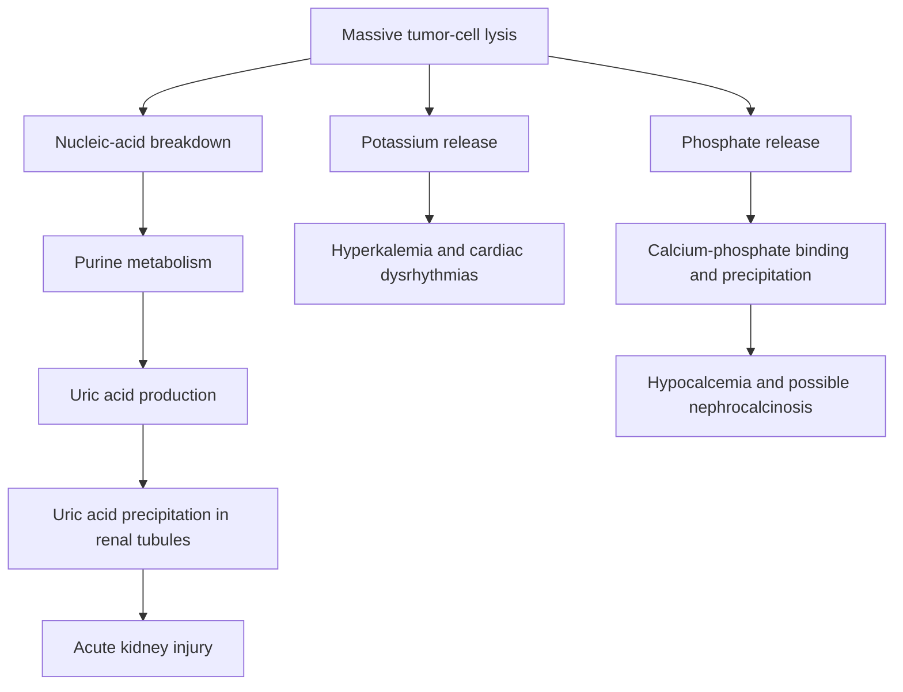
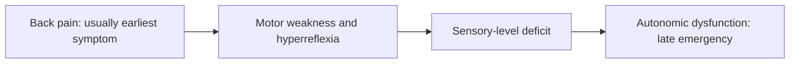

# Chapter 7: Oncologic Emergencies & Palliative Care

## 7.1 Metabolic & Hematologic Emergencies

### Tumor Lysis Syndrome (TLS)
Tumor Lysis Syndrome is a life-threatening metabolic emergency caused by massive, rapid destruction of neoplastic cells and sudden release of intracellular ions and nucleic acids into the systemic circulation.
* **Etiology & Risk Factors**: Most common in high-grade, highly proliferative hematologic malignancies following initiation of cytotoxic therapy (e.g., Burkitt Lymphoma, Acute Lymphoblastic Leukemia [ALL], Acute Myeloid Leukemia [AML] with high WBC count $>50,000/\mu\text{L}$, Bulky Diffuse Large B-Cell Lymphoma). Can occur spontaneously.

#### Laboratory & Clinical Manifestations (Cairo-Bishop Definition)
Laboratory TLS requires $\ge 2$ of the following metabolic abnormalities within 3 days before or 7 days after therapy initiation:
1. **Hyperuricemia**: Uric acid $\ge 8.0\text{ mg/dL}$ (or $25\%$ increase from baseline). Purine catabolism yields hypoxanthine and xanthine, converted by xanthine oxidase into uric acid. Precipitation of uric acid crystals in renal tubules causes acute uric acid nephropathy.
2. **Hyperkalemia**: Potassium $\ge 6.0\text{ mEq/L}$ (or $25\%$ increase). Lysis of intracellular potassium causes lethal cardiac dysrhythmias (peaked T waves, QRS widening, ventricular fibrillation) and muscle weakness.
3. **Hyperphosphatemia**: Phosphate $\ge 4.5\text{ mg/dL}$ for adults (or $25\%$ increase). Malignant lymphoblasts contain up to 4-fold higher intracellular phosphate than normal cells.
4. **Secondary Hypocalcemia**: Calcium $\le 7.0\text{ mg/dL}$ (or $25\%$ decrease). Rapid binding of excess phosphate to ionized calcium forms insoluble calcium phosphate ($\text{Ca}_3(\text{PO}_4)_2$) complexes, precipitating in renal parenchyma (nephrocalcinosis) and causing tetany, Chvostek/Trousseau signs, QT prolongation, and seizures.

#### Management & Prevention Protocol
* **Aggressive IV Hydration**: Isotonic saline ($0.9\%\text{ NaCl}$) targeted to maintain high urine output ($\ge 80\text{--}100\text{ mL/m}^2/\text{hr}$ or $2\text{--}3\text{ L/m}^2/\text{day}$). Urinary alkalinization (sodium bicarbonate) is **no longer routinely recommended** because high urinary pH promotes calcium phosphate precipitation.
* **Hypouricemic Agents**:
  * **Allopurinol**: Competitive xanthine oxidase inhibitor. Prevents *new* uric acid formation but does not break down existing uric acid. Indicated for low-to-intermediate risk TLS.
  * **Rasburicase**: Recombinant urate oxidase enzyme that catalyzes the oxidation of insoluble uric acid into highly soluble **allantoin**, excreted readily by kidneys. Rapidly lowers serum uric acid within $4\text{ hours}$. Indicated for high-risk TLS or established hyperuricemia. **Absolute Contraindication**: Glucose-6-Phosphate Dehydrogenase (G6PD) deficiency (causes severe intravascular hemolysis and methemoglobinemia).

### Hypercalcemia of Malignancy (HCM)
Hypercalcemia is the most common oncologic metabolic emergency, occurring in up to $30\%$ of cancer patients.
* **Pathophysiological Mechanisms**:
  1. **Humoral Hypercalcemia of Malignancy (HHM)** ($\sim 80\%$ of cases): Systemic secretion of **Parathyroid Hormone-related Protein (PTHrP)** by solid tumors (Squamous Cell Carcinomas of lung, head & neck, cervix; Renal Cell Carcinoma; Ovarian/Breast CA). PTHrP binds PTH-1 receptors in bone and kidney, stimulating osteoclast-mediated bone resorption and renal tubular calcium reabsorption. Intact PTH is suppressed; 1,25-$(\text{OH})_2\text{D}$ is low/normal.
  2. **Local Osteolytic Hypercalcemia** ($\sim 20\%$): Direct osteolytic destruction and cytokine release (IL-1, IL-6, TNF-$\alpha$, RANKL) by extensive skeletal metastases (Breast cancer, Multiple Myeloma, NSCLC).
  3. **Vitamin D-Mediated (Calcitriol)** ($<1\%$): Excess 1$\alpha$-hydroxylase expression by tumor-associated macrophages in Lymphomas (Hodgkin & Non-Hodgkin), producing elevated 1,25-$(\text{OH})_2\text{D}_3$.

#### Clinical Features & Treatment
* **Clinical Symptoms**: "Stones (nephrolithiasis), bones (bone pain), groans (abdominal pain, constipation, pancreatitis), psychiatric overtones (lethargy, confusion, coma)," short QT interval on ECG.
* **Emergency Management**:
  1. **Isotonic Saline Resuscitation**: Restores intravascular volume and promotes calciuresis ($0.9\%\text{ NaCl}$ at $200\text{--}500\text{ mL/hr}$). Loop diuretics (Furosemide) are administered **only after full volume repletion**.
  2. **IV Bisphosphonates**: **Zoledronic Acid** ($4\text{ mg}$ IV over $15\text{ mins}$) or Pamidronate ($90\text{ mg}$ IV). Inhibits osteoclast activity; peak effect occurs at $2\text{--}4\text{ days}$.
  3. **Denosumab**: Fully human monoclonal antibody targeting **RANKL**. Indicated for bisphosphonate-refractory hypercalcemia or severe renal impairment ($\text{CrCl} <30\text{ mL/min}$).
  4. **Calcitonin**: $4\text{--}8\text{ IU/kg}$ IM/SC Q12H. Rapid onset ($2\text{--}4\text{ hours}$), but limited by tachyphylaxis within $48\text{ hours}$.
  5. **Glucocorticoids**: Prednisone $40\text{--}60\text{ mg/day}$ orally. First-line for calcitriol-mediated hypercalcemia (lymphomas).

### Febrile Neutropenia (FN)
Febrile Neutropenia is an acute medical emergency resulting from cytotoxic chemotherapy-induced bone marrow suppression.
* **Diagnostic Criteria**:
  * **Fever**: Single oral temperature $\ge 38.3^\circ\text{C}$ ($101^\circ\text{F}$) OR temperature $\ge 38.0^\circ\text{C}$ ($100.4^\circ\text{F}$) sustained over a 1-hour period.
  * **Neutropenia**: Absolute Neutrophil Count (**ANC**) $<500/\mu\text{L}$ OR an ANC predicted to decline to $<500/\mu\text{L}$ within the next 48 hours.
    $$\text{ANC} = \text{WBC} \times \frac{\%\text{Segmented Neutrophils} + \%\text{Bands}}{100}$$

#### Emergency Management
* **Immediate Empiric Antibiotic Therapy**: Door-to-antibiotic time must be **$<60\text{ minutes}$**. Blood cultures (central line and peripheral) obtained immediately prior to antibiotics.
* **First-Line Monotherapy**: Empiric IV Anti-Pseudomonal $\beta$-lactam:
  * **Piperacillin-Tazobactam** ($4.5\text{ g}$ IV Q6H), OR **Cefepime** ($2\text{ g}$ IV Q8H), OR **Meropenem** ($1\text{ g}$ IV Q8H).
* **Indications for Adding Vancomycin**: Hemodynamic instability/septic shock, suspected catheter-related bloodstream infection, skin/soft tissue infection, MRSA colonization, or severe mucositis.

---

## 7.2 Structural & Mechanical Emergencies

### Superior Vena Cava Obstruction (SVCO)
Compression or thrombosis of the thin-walled superior vena cava, impeding venous return from the head, neck, and upper extremities to the right atrium.
* **Etiology**: Malignant causes account for $>90\%$ of cases: Small Cell Lung Cancer (SCLC, $\sim 40\%$), Non-Small Cell Lung Cancer (NSCLC, $\sim 40\%$), Non-Hodgkin Lymphoma, metastatic lesions.
* **Clinical Presentation**: Progressive dyspnea (most common), facial edema/plethora, upper extremity and neck swelling, dilated collateral venous networks over the anterior chest wall. **Pemberton Sign**: Facial flushing and inspiratory stridor upon elevating both arms above the head.
* **Emergency Management**: Contrast CT Chest is the diagnostic modality of choice.
  * **Endovascular Stenting**: Rapid relief of severe symptoms ($24\text{--}48\text{ hours}$); modality of choice for severe distress.
  * **Radiotherapy / Systemic Chemotherapy**: Chemotherapy for chemosensitive tumors (SCLC, Lymphoma); Radiation therapy for NSCLC or non-responsive histology.
  * **Adjunctive Therapy**: High-dose IV Dexamethasone ($10\text{--}20\text{ mg}$) to reduce peritumoral edema, head elevation, oxygen.

### Metastatic Spinal Cord Compression (MSCC)
Compression of the spinal cord or cauda equina by epidural tumor expansion or pathological vertebral collapse.
* **Etiology**: Most common primary sites: Prostate, Breast, Lung cancers, Multiple Myeloma, Renal Cell Carcinoma. Thoracic spine is affected in $70\%$, lumbar in $20\%$, cervical in $10\%$.
* **Clinical Presentation**:
  1. **Local/Radicular Back Pain**: Earliest and most consistent symptom ($>95\%$), exacerbated by lying flat, coughing, or Valsalva maneuver.
  2. **Motor Weakness**: Symmetrical lower extremity weakness, hyperreflexia, Babinski sign (upper motor neuron).
  3. **Sensory Level**: Ascending numbness/sensory deficit corresponding to 1–2 segments below the anatomical level of compression.
  4. **Autonomic Dysfunction**: Late, ominous sign; urinary retention/overflow incontinence, fecal incontinence, loss of anal sphincter tone.

* **Emergency Management**:
  * **Immediate Imaging**: **Emergency Whole-Spine MRI** is the gold standard (must be performed within 24 hours of clinical suspicion).
  * **Immediate High-Dose Corticosteroids**: IV Dexamethasone ($10\text{ mg}$ bolus followed by $4\text{ mg}$ IV Q6H) administered immediately upon clinical suspicion prior to MRI to reduce vasogenic edema.
  * **Definitive Treatment**: Emergency Surgical Decompression + Posterolateral Stabilization followed by post-operative RT (preferred for unstable spine, unknown histology, or single-level compression) OR Emergency Radiotherapy alone (for multiple levels, paraplegia $>48\text{ hours}$, or highly radiosensitive tumors like myeloma/lymphoma).

---

## 7.3 Palliative Medicine & Cancer Pain Management

### The WHO Analgesic Ladder
Systematic framework for managing cancer-related pain based on reported severity.

| WHO analgesic ladder step | Pain severity | Typical analgesic approach |
| :--- | :--- | :--- |
| **Step 1** | Mild (score 1–3) | Non-opioid analgesic, such as paracetamol or an NSAID, with or without an adjuvant |
| **Step 2** | Moderate (score 4–6) | Weak opioid, such as codeine or tramadol, with or without a non-opioid and/or adjuvant |
| **Step 3** | Severe (score 7–10) | Strong opioid, such as morphine, fentanyl, or oxycodone, with or without a non-opioid and/or adjuvant |

* **Step 1 (Mild Pain, Score 1–3)**: Non-opioid analgesics: Paracetamol (Acetaminophen) or NSAIDs (Ibuprofen, Naproxen, Celecoxib).
* **Step 2 (Moderate Pain, Score 4–6)**: Weak opioids: Codeine, Tramadol, Dihydrocodeine $\pm$ Step 1 agents. (*Current practice often bypasses Step 2, moving directly to low-dose strong opioids*).
* **Step 3 (Severe Pain, Score 7–10)**: Strong opioids: **Morphine**, **Fentanyl**, **Oxycodone**, **Hydromorphone**, **Methadone**.

### Opioid Pharmacology & Clinical Principles
* **Morphine**: Gold-standard strong opioid. Metabolized in the liver to Morphine-6-Glucuronide (M6G, active analgesic) and Morphine-3-Glucuronide (M3G, neurotoxic: myoclonus, hyperalgesia). **Caution in Renal Impairment**: Accumulation of M6G and M3G causes prolonged sedation, respiratory depression, and neurotoxicity.
* **Fentanyl**: Synthetic lipophilic opioid ($100\times$ more potent than oral morphine). Available as transdermal patch ($72\text{-hour}$ duration) or transmucosal/sublingual spray for breakthrough pain. **Preferred in Renal Failure** (no active metabolites).
* **Oxycodone**: Semi-synthetic opioid; useful alternative if morphine causes intolerable adverse effects.
* **Methadone**: $\mu$-opioid receptor agonist, NMDA receptor antagonist, and serotonin/norepinephrine reuptake inhibitor. Useful for complex neuropathic or opioid-tolerant pain; variable half-life ($15\text{--}120\text{ hours}$) requires specialist titration.

#### Key Rules of Opioid Prescribing
1. **By the Clock**: Administer around-the-clock (ATC) for continuous pain, not pro re nata (PRN).
2. **By the Mouth**: Oral route preferred whenever possible.
3. **Breakthrough Pain Dose**: Provide a PRN dose of immediate-release opioid equal to $10\text{--}16\%$ (1/6th) of the total 24-hour regular dose.
4. **Opioid Side-Effect Prophylaxis**:
  * **Constipation**: Occurs in $>90\%$ of patients; **no tolerance develops**. Mandatory co-prescription of a stimulant (Senna) + osmotic (Lactulose/Polyethylene glycol) laxative.
  * **Nausea/Vomiting**: Occurs in 30%; tolerance develops in 1–2 weeks. Treat with Metoclopramide or Haloperidol.
  * **Overdose Reversal**: IV **Naloxone** ($0.4\text{--}2\text{ mg}$ titrated carefully to restore respiration without precipitating severe pain crisis).

### Neuropathic Pain & Adjuvant Analgesics
Pain caused by direct tumor infiltration or treatment-induced damage to the somatosensory nervous system (burning, shooting, electric-shock sensation).
* **First-Line Adjuvants**:
  * **Gabapentinoids**: **Gabapentin** ($300\text{--}3600\text{ mg/day}$) or **Pregabalin** ($75\text{--}600\text{ mg/day}$). Binds $\alpha_2\delta$ subunit of voltage-gated calcium channels.
  * **SNRIs / TCAs**: **Duloxetine** ($30\text{--}60\text{ mg/day}$) or **Amitriptyline** ($10\text{--}75\text{ mg/day}$ at bedtime).
  * **Corticosteroids**: Dexamethasone ($4\text{--}8\text{ mg/day}$) reduces nerve sheath edema and capsule stretching.

---

## Subsections Covered & Verification Checklist
- [x] 7.1 Metabolic & Hematologic Emergencies (TLS Cairo-Bishop, Rasburicase, Hypercalcemia HHM/PTHrP, Febrile Neutropenia ANC formula & door-to-antibiotic $<60\text{ min}$).
- [x] 7.2 Structural & Mechanical Emergencies (SVCO, MSCC Dexamethasone & whole-spine MRI).
- [x] 7.3 Palliative Medicine & Cancer Pain Management (WHO Analgesic Ladder, Morphine M6G/M3G renal accumulation, Fentanyl, Laxative co-prescription, Neuropathic adjuvants).

### Index Corrections & Source Notes
* *Clinical Update*: Step 2 of the WHO ladder is increasingly bypassed in oncology guidelines ("two-step ladder approach"), starting low-dose strong opioids directly for moderate-to-severe pain.
