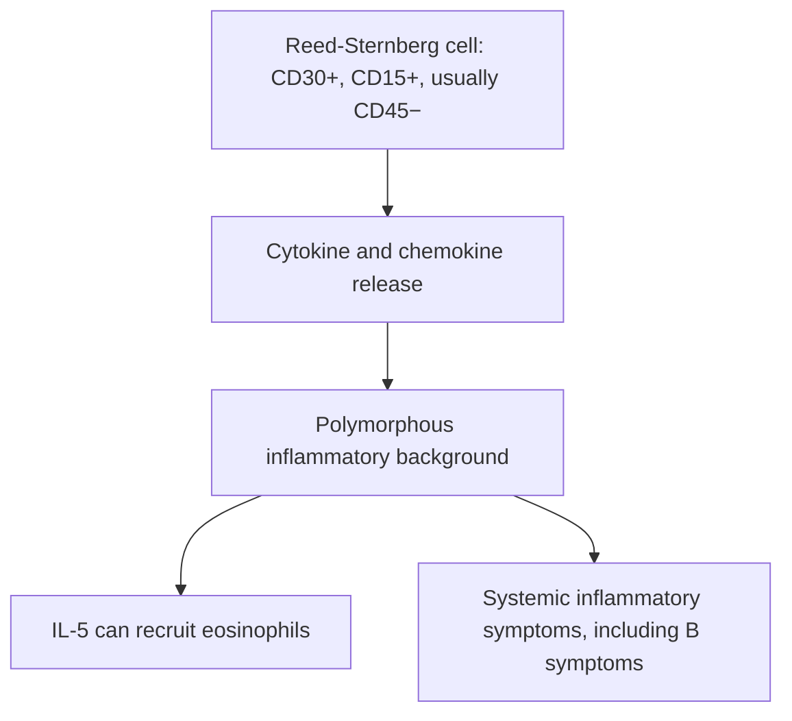

# Chapter 9: Lymphomas & Plasma Cell Neoplasms

## 9.1 Hodgkin Lymphoma (HL)

### Pathognomonic Cytology & Immunophenotype
Hodgkin Lymphoma is characterized by a minor population ($1\text{--}2\%$) of neoplastic giant cells residing within an abundant non-neoplastic inflammatory background (lymphocytes, eosinophils, plasma cells, histiocytes).
* **Reed-Sternberg (RS) Cell**: Large, binucleated or multinucleated cell with prominent, inclusion-like eosinophilic nucleoli surrounded by a clear halo ("owl-eye" appearance).
* **Immunophenotype of Classical HL**: Neoplastic RS cells express **CD30+** and **CD15+**, and are **CD45 negative** and **CD20 negative** (or weak/focal).

### WHO Histological Subtypes
1. **Classical Hodgkin Lymphoma (cHL)** ($95\%$ of cases):
   * **Nodular Sclerosis cHL** ($\sim 70\%$): Most common subtype. Predominantly affects **young adult females**. Characterized by fibrous collagen bands dividing lymph node architecture into nodules and presence of **Lacunar Variant RS cells**. Commonly presents with a mediastinal mass.
   * **Mixed Cellularity cHL** ($\sim 20\%$): Strongly associated with **Epstein-Barr Virus (EBV)** infection ($\sim 70\%$). Rich in eosinophils (driven by RS-derived IL-5). Common in older adults and immunocompromised patients.
   * **Lymphocyte-Rich cHL**: Excellent prognosis; classic RS cells in a mantle of small mature lymphocytes.
   * **Lymphocyte-Depleted cHL**: Rare, worst prognosis; abundant RS cells, scarce background lymphocytes; seen in HIV/advanced age.
2. **Nodular Lymphocyte-Predominant Hodgkin Lymphoma (NLPHL)** ($5\%$): Non-classical subtype. Neoplastic cells are **Popcorn Cells / Lymphocytic & Histiocytic (L&H) Variants**. Immunophenotype is distinct from cHL: **CD20+**, **CD45+**, **CD30 negative**, **CD15 negative**. Indolent course; treated similar to mature B-cell NHL.

### Staging & Clinical Management
* **Ann Arbor Staging System (with Cotswolds Modifiers)**:
  * **Stage I**: Single lymph node region or single extralymphatic site ($I_E$).
  * **Stage II**: $\ge 2$ lymph node regions on the **same side** of the diaphragm.
  * **Stage III**: Lymph node regions on **both sides** of the diaphragm.
  * **Stage IV**: Diffuse, disseminated involvement of $\ge 1$ extralymphatic organs (e.g., liver, bone marrow, lung).
  * **Sub-classification Modifiers**:
    * **A**: Absence of constitutional symptoms.
    * **B**: Presence of **B-Symptoms**: Unexplained fever ($>38^\circ\text{C}$ / Pel-Ebstein fever), drenching night sweats, or unexplained weight loss $>10\%$ over 6 months.
    * **X**: Bulky disease (mediastinal mass $>1/3$ thoracic diameter or node $>10\text{ cm}$).
* **Chemotherapy Regimen**: Standard first-line therapy for Classical HL is **ABVD**:
  * **A**: Doxorubicin (Adriamycin) — Cardiotoxicity.
  * **B**: Bleomycin — Pulmonary toxicity (fibrosis).
  * **V**: Vinblastine — Myelosuppression.
  * **D**: Dacarbazine — Emetogenic.
  *(Brentuximab vedotin + AVD [A+AVD] is preferred in advanced Stage III/IV cHL)*.

---

## 9.2 Non-Hodgkin Lymphomas (NHL)

### B-Cell Non-Hodgkin Lymphomas

#### 1. Diffuse Large B-Cell Lymphoma (DLBCL)
* **Features**: Most common NHL overall ($\sim 30\text{--}35\%$). Aggressive, rapidly growing nodal or extranodal mass. Immunophenotype: **CD10**, **CD19**, **CD20**, **CD22**, **CD79a**, **BCL6**.
* **Cell of Origin Subtypes**: Germinal Center B-cell-like (GCB, better survival) vs. Activated B-cell-like (ABC / Non-GCB).
* **Double-Hit / Triple-Hit Lymphomas**: High-grade B-cell lymphomas harboring rearrangements of *MYC* AND *BCL2* and/or *BCL6*; highly refractory to standard therapy.
* **Standard First-Line Regimen**: **R-CHOP** given Q3W for 6 cycles:
  * **R**: **Rituximab** (Chimeric anti-CD20 monoclonal antibody).
  * **C**: Cyclophosphamide.
  * **H**: Hydroxydaunorubicin (Doxorubicin).
  * **O**: Oncovin (Vincristine).
  * **P**: Prednisone.

#### 2. Follicular Lymphoma (FL)
* **Features**: Most common indolent (low-grade) NHL ($\sim 20\%$). Arises from germinal center B-cells. Nodal architecture shows back-to-back neoplastic follicles lacking normal tingible-body macrophages.
* **Cytogenetics**: Hallmarked by translocation **$t(14;18)(q32;q21)$**, fusing the **$BCL2$** gene (ch 18) to the **Immunoglobulin Heavy Chain ($IgH$)** locus (ch 14). This results in constitutive overexpression of the anti-apoptotic protein **BCL-2**, preventing normal B-cell apoptosis.
* **Immunophenotype**: **CD19+**, **CD20+**, **CD10+**, **BCL-2+**, **BCL-6+**.
* **Risk of Transformation**: Transforms into aggressive DLBCL (Histological Transformation) at a rate of $2\text{--}3\%$ per year.

#### 3. Burkitt Lymphoma (BL)
* **Features**: Extremely aggressive, rapidly doubling B-cell neoplasm. Histology displays a pathognomonic **"Starry Sky" Appearance**, composed of a dense sheet of dark basophilic lymphoblasts ("sky") interspersed with pale tingible-body macrophages ingesting apoptotic debris ("stars"). High proliferation index (**Ki-67 $\sim 100\%$**).

**Starry-sky appearance:** sheets of rapidly proliferating neoplastic B cells are interspersed with pale macrophages containing phagocytosed apoptotic debris. The pale macrophages stand out against the dark-blue tumor-cell background.
* **Cytogenetics**: Driven by translocation **$t(8;14)(q24;q32)$** (or variants $t(2;8)$ or $t(8;22)$), placing the **$c-MYC$** proto-oncogene under the control of the active $IgH$ promoter, leading to relentless transcriptional activation of cell growth.
* **Clinical Variants**:
  * **Endemic (African)**: Strongly linked to **EBV ($>95\%$)**; typically presents as a massive jaw or facial bone tumor in young children.
  * **Sporadic**: Occurs worldwide; presents as a bulky abdominal/ileocecal mass with ascites.
  * **Immunodeficiency-Associated**: Common in HIV-infected patients.
* **Treatment**: Intensive multi-agent regimens (CODOX-M/IVAC or Hyper-CVAD + Rituximab) with mandatory tumor lysis prophylaxis and CNS prophylaxis.

#### 4. Mantle Cell Lymphoma (MCL)
* **Features**: Aggressive mature B-cell neoplasm arising from the mantle zone of lymph nodes. Frequently presents at advanced stage with lymphadenopathy, splenomegaly, and gastrointestinal involvement (**Lymphomatoid Polyposis**).
* **Cytogenetics**: Hallmarked by translocation **$t(11;14)(q13;q32)$**, placing the **$CCND1$ (Cyclin D1)** gene under the $IgH$ promoter. Cyclin D1 overexpression accelerates $G_1/S$ cell cycle transition.
* **Immunophenotype**: **CD19+**, **CD20+**, **CD5+**, **CD23 negative** (distinguishes MCL from CLL/SLL), **Cyclin D1+**, **SOX11+**.

#### 5. Extranodal Marginal Zone Lymphoma of MALT (MALToma)
* **Features**: Indolent B-cell lymphoma arising in mucosal sites secondary to chronic immune or autoimmune stimulation.
* **Etiological Associations**: Gastric MALToma is strongly associated with chronic ***Helicobacter pylori*** infection. Other sites: Salivary gland (Sjögren syndrome), Thyroid (Hashimoto thyroiditis), Ocular adnexa (*Chlamydia psittaci*).
* **Pathogenesis & Therapy**: Early-stage Gastric MALToma harboring $t(11;18)(q21;q21)$ or driven by local antigen stimulation **regresses completely following *H. pylori* eradication antibiotics** (PPI + Clarithromycin + Amoxicillin/Metronidazole).

### T-Cell & NK-Cell Non-Hodgkin Lymphomas
* **Cutaneous T-Cell Lymphoma (CTCL) / Mycosis Fungoides**: Indolent skin-homing CD4+ T-cell lymphoma. Skin lesions progress from patches to plaques to tumors. Histology displays **Pautrier Microabscesses** (aggregates of neoplastic T-cells in the epidermis).
* **Sézary Syndrome**: Leukemic variant of CTCL characterized by the triad of erythroderma, generalized lymphadenopathy, and circulating neoplastic T-cells with cerebriform, folded nuclei (**Sézary Cells**).
* **Adult T-Cell Leukemia/Lymphoma (ATLL)**: Caused by **HTLV-1** infection. Endemic in Japan and the Caribbean. Characterized by "flower cells" (multilobated lymphocytes), osteolytic bone lesions, and severe hypercalcemia.
* **Anaplastic Large Cell Lymphoma (ALCL)**: Expresses **CD30+** and hallmark **Hallmark Cells** (horseshoe-shaped nuclei). Often harbors $t(2;5)(p23;q35)$ fusing *NPM1-ALK*. ALK-positive variants have a favorable prognosis.

---

## 9.3 Plasma Cell Disorders (Plasma Cell Dyscrasias)

### Multiple Myeloma (MM)
Multiple Myeloma is a neoplastic proliferation of terminally differentiated B-lineage plasma cells in the bone marrow, accompanied by monoclonal immunoglobulin (M-protein) production and end-organ damage.

#### Diagnostic Criteria (International Myeloma Working Group - IMWG)
Requires $\ge 10\%$ clonal bone marrow plasma cells OR biopsy-proven bony or extramedullary plasmacytoma, PLUS $\ge 1$ **CRAB** feature or **SLiM** biomarker of malignancy:

**Core diagnostic framework:** demonstrate a clonal plasma-cell population (typically at least 10% clonal marrow plasma cells or a biopsy-proven plasmacytoma) **and** at least one myeloma-defining event. Myeloma-defining events include **CRAB** end-organ damage or a **SLiM** biomarker criterion.
* **CRAB Criteria (End-Organ Damage)**:
  1. **C - Hypercalcemia**: Serum Calcium $>11.0\text{ mg/dL}$ ($>2.75\text{ mmol/L}$).
  2. **R - Renal Insufficiency**: Serum Creatinine $>2.0\text{ mg/dL}$ ($>177\mu\text{mol/L}$) or $\text{CrCl} <40\text{ mL/min}$. Caused primarily by **Bence-Jones Light-Chain Cast Nephropathy** (excess free light chains precipitate with Tamm-Horsfall mucoprotein in distal tubules, inducing tubular necrosis and giant cell reaction).
  3. **A - Anemia**: Hemoglobin $<10.0\text{ g/dL}$ (or $>2.0\text{ g/dL}$ below baseline). Due to marrow replacement and suppressed erythropoietin.
  4. **B - Bone Lesions**: $\ge 1$ osteolytic bone lesions on plain radiography, CT, or MRI. Caused by neoplastic plasma cell activation of RANKL (osteoclast stimulation) and inhibition of DKK-1 (osteoblast suppression), producing classic **"punched-out" lytic lesions** without surrounding osteosclerotic reaction (predominantly in skull, spine, ribs, pelvis).
* **SLiM Biomarkers of Malignancy**:
  * **S**: Sixty percent ($\ge 60\%$) clonal plasma cells in bone marrow.
  * **Li**: Light chain ratio (involved-to-uninvolved serum free light chain ratio $\ge 100$).
  * **M**: MRI demonstrating $>1$ focal bone lesion ($\ge 5\text{ mm}$).

#### Diagnostic Workup & Laboratory Findings
* **Serum & Urine Protein Electrophoresis (SPEP / UPEP)**: Demonstrates a narrow, dense **M-Spike (Monoclonal Paraprotein)** in the gamma-globulin region. Monoclonal Isotypes: **IgG** ($\sim 50\%$), **IgA** ($\sim 20\%$), Light-Chain only ($\sim 15\%$), IgD/IgE ($<2\%$), Non-secretory ($<1\%$).
* **Peripheral Blood Smear**: **Rouleaux Formation** (alignment of RBCs like stacks of coins due to high serum M-protein reducing zeta potential).
* **Urinalysis**: Free monoclonal light chains (**Bence-Jones Proteins**) detected via urine immunofixation. *Standard dipstick fails to detect light chains* (only detects albumin).
* **Staging System (Revised ISS - R-ISS)**:
  * **Stage I**: Serum $\beta_2$-microglobulin $<3.5\text{ mg/L}$, serum albumin $\ge 3.5\text{ g/dL}$, normal LDH, standard-risk cytogenetics.
  * **Stage III**: Serum $\beta_2$-microglobulin $\ge 5.5\text{ mg/L}$ AND high-risk cytogenetics [del(17p), $t(4;14)$, $t(14;16)$] or elevated LDH.

#### Therapeutic Principles
* **Transplant-Eligible Patients**: Induction triplet regimen (Bortezomib [proteasome inhibitor] + Lenalidomide [immunomodulatory drug] + Dexamethasone = **VRd**) for $3\text{--}4\text{ cycles}$, followed by High-Dose Melphalan conditioning and **Autologous Stem Cell Transplantation (ASCT)**, followed by Lenalidomide maintenance.
* **Transplant-Ineligible Patients**: VRd or Daratumumab (anti-CD38 mAb) + Lenalidomide + Dexamethasone (Dara-Rd).

---

## Subsections Covered & Verification Checklist
- [x] 9.1 Hodgkin Lymphoma (RS cell morphology, CD30+/CD15+/CD45-, Nodular Sclerosis/Mixed Cellularity/NLPHL popcorn cells, Ann Arbor A/B, ABVD).
- [x] 9.2 Non-Hodgkin Lymphomas (DLBCL R-CHOP; Follicular t(14;18) BCL2-IgH; Burkitt t(8;14) c-MYC, starry sky, endemic/sporadic; Mantle Cell t(11;14) Cyclin D1, CD5+ CD23-; MALToma H. pylori; CTCL/Sezary, ATLL, ALCL).
- [x] 9.3 Plasma Cell Disorders (Multiple Myeloma diagnostic IMWG criteria, CRAB & SLiM, Bence-Jones cast nephropathy, punched-out lytic lesions, SPEP M-spike, Rouleaux, VRd + ASCT).

### Index Corrections & Source Notes
* *Diagnostic Standard*: Standard dipstick urinalysis measures albumin and misses Bence-Jones light chains; evaluation of light-chain myeloma requires urine immunofixation and serum free light chain (SFLC) assay.
