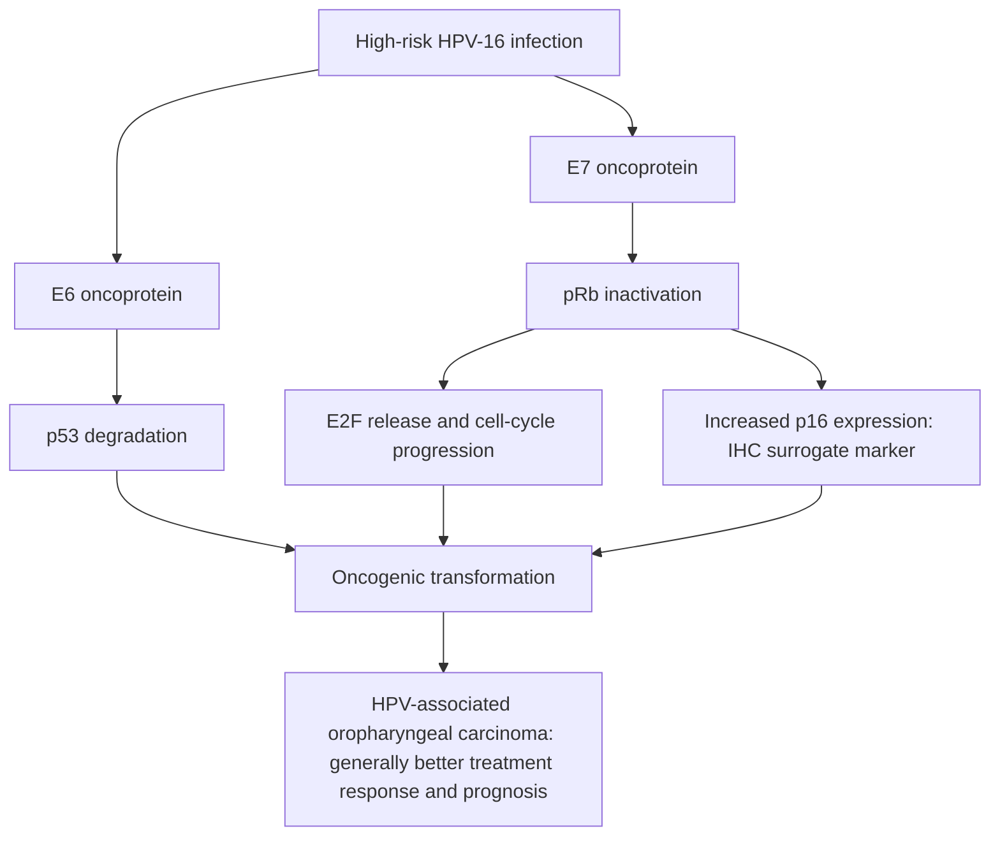

# Chapter 10: Head & Neck Cancers & Thyroid Malignancies

## 10.1 Head & Neck Squamous Cell Carcinoma (HNSCC)

### Etiology & Risk Stratification
HNSCC encompasses malignant epithelial neoplasms arising from the mucosal lining of the oral cavity, pharynx, larynx, nasal cavity, and paranasal sinuses. Over $90\%$ of head and neck cancers are histologically Squamous Cell Carcinomas.
* **Classic Environmental Carcinogenesis**: Chronic exposure to **Tobacco smoke** and **Alcohol consumption** act synergistically to induce field cancerization across the upper aerodigestive tract mucosa via mutational inactivation of $TP53$ and $CDKN2A$ ($p16^{INK4a}$). Betel quid and areca nut chewing are major etiologic factors for oral cavity cancer in South and Southeast Asia.
* **Viral Oncogenesis (HPV-Driven HNSCC)**: High-risk **Human Papillomavirus Type 16 (HPV-16)** is the primary driver of a rapidly increasing subset of **Oropharyngeal Carcinomas** (tonsillar fossa and base of tongue).
  * **Pathogenesis**: Viral oncoprotein **E6** promotes ubiquitin-mediated degradation of p53; viral **E7** binds and inactivates the retinoblastoma protein (pRb). Inactivation of pRb leads to compensatory, marked reciprocal overexpression of **$p16^{INK4a}$**, which serves as an established surrogate immunohistochemical biomarker.
  * **Prognostic Distinction**: HPV-positive/p16-positive oropharyngeal carcinomas occur in younger, non-smoking individuals and carry a **significantly superior response rate and overall survival** compared to HPV-negative/tobacco-related HNSCC. This distinct biology is recognized by a dedicated HPV-positive TNM staging classification in the AJCC 8th Edition.

### Anatomical Sub-sites & Clinical Features
1. **Oral Cavity** (Lip, anterior $2/3$ of tongue, floor of mouth, buccal mucosa, hard palate, retromolar trigone): Anterior tongue and floor of mouth are most common. High propensity for early occult metastasis to Level I–III cervical lymph nodes. Evaluated via bimanual palpation and biopsy.
2. **Oropharynx** (Base of tongue, palatine tonsils, soft palate, posterior pharyngeal wall): Often presents with an asymptomatic cystic neck mass (cervical node metastasis) before the primary mucosal lesion becomes evident.
3. **Larynx**:
  * **Glottic (Vocal Cords)** ($\sim 60\%$): Presents **early with persistent hoarseness of voice**. Vocal cords possess sparse lymphatic drainage; hence, early glottic cancer (T1-T2) rarely metastasizes to neck nodes and has an excellent cure rate with RT or transoral laser microsurgery alone.
  * **Supraglottic** ($\sim 35\%$): Presents late with throat fullness, odynophagia, or referred otalgia (via Arnold's nerve branch of CN X). Rich lymphatic drainage leads to early bilateral neck node metastases.
  * **Subglottic** ($<5\%$): Rare, often presents with stridor.
4. **Nasopharynx**: Strongly associated with **Epstein-Barr Virus (EBV)** infection (specifically non-keratinizing WHO Type 2/3 variants). Arises in the **Fossa of Rosenmüller**. Presents with the classic triad of: painless upper neck mass (Level II node #1), unilateral conductive hearing loss (Eustachian tube obstruction), and nasal obstruction/epistaxis $\pm$ cranial nerve palsies (CN VI diplopia). Highly radiosensitive.

### Multimodal Management Principles
* **Early Stage (Stage I–II)**: Single-modality therapy: Primary Surgical Resection OR Definitive Radiotherapy, achieving equivalent local control.
* **Locally Advanced (Stage III–IVB)**: Multimodal therapy:
  * **Organ Preservation Chemoradiotherapy**: Definitive High-Dose **Cisplatin** ($100\text{ mg/m}^2$ Q3W for 3 doses) concurrent with IMRT ($70\text{ Gy}$ over 7 weeks) for advanced larynx/oropharynx to avoid total laryngectomy.
  * **Surgical Resection + Post-Operative Chemoradiotherapy**: Composite resection (e.g., Commando operation for oral cancer) with microvascular free flap reconstruction + Neck Dissection. Indications for post-operative concurrent chemoradiotherapy: Microscopic positive surgical margins ($R1$) or Extranodal Extension (ENE) of tumor in lymph nodes.
* **Neck Dissection Categories**:
  * **Radical Neck Dissection (RND)**: Resection of cervical nodal Levels I–V along with 3 non-lymphatic structures: Sternocleidomastoid muscle (SCM), Internal Jugular Vein (IJV), and Spinal Accessory Nerve (CN XI).
  * **Modified Radical Neck Dissection (MRND)**: Resection of nodal Levels I–V with preservation of $\ge 1$ non-lymphatic structure (Type I: preserves CN XI; Type II: preserves CN XI & IJV; Type III/Functional: preserves CN XI, IJV, & SCM).
  * **Selective Neck Dissection (SND)**: Preservation of $\ge 1$ lymph node level routinely removed in RND (e.g., Supraomohyoid SND [Levels I–III] for oral cavity cancer).

---

## 10.2 Thyroid Malignancies

### Epithelial & Non-Epithelial Subtypes Summary

| Feature | Papillary Thyroid CA (PTC) | Follicular Thyroid CA (FTC) | Medullary Thyroid CA (MTC) | Anaplastic Thyroid CA (ATC) |
| :--- | :--- | :--- | :--- | :--- |
| **Frequency** | $80\text{--}85\%$ (#1 most common) | $10\text{--}15\%$ | $3\text{--}5\%$ | $1\text{--}2\%$ |
| **Cell of Origin** | Follicular epithelium | Follicular epithelium | Parafollicular C-cells (Neural crest) | Follicular epithelium (Undifferentiated) |
| **Main Risk Factor** | Ionizing radiation exposure | Iodine deficiency | $25\%$ Familial (*RET* germline) | Pre-existing differentiated thyroid CA |
| **Metastatic Spread** | **Lymphatic** to regional neck nodes | **Hematogenous** to bone & lungs | Lymphatic & Hematogenous | Rapid direct invasion & distant metastases |
| **FNAC Utility** | **Diagnostic** | **Cannot distinguish** from adenoma | **Diagnostic** (Calcitonin/IHC) | Diagnostic |
| **Serum Biomarker** | Thyroglobulin (post-op) | Thyroglobulin (post-op) | **Calcitonin** & CEA | None |

### 1. Papillary Thyroid Carcinoma (PTC)
* **Pathogenesis**: Associated with radiation exposure. Driver mutations: **$BRAF\text{ V600E}$** ($\sim 45\text{--}50\%$, associated with aggressive features), **$RET/PTC$ rearrangements** (10–20%), and $RAS$ mutations.
* **Microscopic Features (Pathognomonic)**:
  1. **Orphan Annie Eye Nuclei**: Large, optically clear, overlapping nuclei with central chromatin clearing.
  2. **Intranuclear Cytoplasmic Pseudoinclusions & Nuclear Grooves**.
  3. **Psammoma Bodies**: Concentrically laminated calcified structures found within tumor stroma.
  4. Papillary architecture with fibrovascular cores.

**Classic papillary thyroid carcinoma association:** optically clear “Orphan Annie eye” nuclei, intranuclear grooves/pseudoinclusions, and concentrically laminated **psammoma bodies**.
* **Clinical Management**: Total Thyroidectomy (or Lobectomy for low-risk unilocular $<1\text{ cm}$ tumors) $\pm$ Central Neck Dissection (Level VI). Followed by **Radioactive Iodine ($\text{^{131}I}$) Ablation** for high-risk features and lifetime TSH suppression therapy (Levothyroxine). Surveillance using serum **Thyroglobulin (Tg)** and Tg antibodies.

### 2. Follicular Thyroid Carcinoma (FTC)
* **Pathogenesis**: More common in iodine-deficient regions. Driver mutations: $RAS$ point mutations or **$PAX8-PPARG$ fusion gene**.
* **Critical Diagnostic Rule**: **FNAC CANNOT distinguish Follicular Adenoma from Follicular Carcinoma**. Both present as uniform follicular proliferations. The definitive diagnosis of Follicular Carcinoma strictly requires histological demonstration of **Transcapsular Invasion** (tumor cells penetrating through the fibrous capsule) or **Vascular Invasion** (tumor cells invading blood vessels within or outside the capsule).
* **Clinical Management**: Total Thyroidectomy followed by radioactive $\text{^{131}I}$ ablation (FTC takes up radioiodine efficiently) and TSH suppression.

### 3. Medullary Thyroid Carcinoma (MTC)
* **Pathogenesis**: Neuroendocrine neoplasm originating from calcitonin-secreting **Parafollicular C-cells**.
  * **Sporadic ($75\%$)**: Somatic $RET$ mutations ($M918T$).
  * **Familial ($25\%$)**: Germline gain-of-function **$RET$ proto-oncogene mutations** causing **MEN 2A** ($RET$ codon 634; MTC, Pheochromocytoma, Primary Hyperparathyroidism), **MEN 2B** ($RET$ codon 918; MTC, Pheochromocytoma, Marfanoid habitus, Mucosal neuromas), or Familial MTC (FMTC).
* **Histology**: Nests of polygonal cells separated by a vascular stroma containing **Amyloid Deposits** (derived from altered calcitonin filaments, staining positive with **Congo Red** displaying apple-green birefringence under polarized light).
* **Clinical Management**: MTC **does NOT concentrate radioiodine** (C-cells do not process iodine); $\text{^{131}I}$ and TSH suppression are ineffective.
  * Primary Treatment: Total Thyroidectomy + Routine Central Compartment Lymph Node Dissection (Level VI) $\pm$ Ipsilateral Lateral Neck Dissection.
  * Screening: All newly diagnosed MTC patients must undergo **germline $RET$ genetic testing** and screening for pheochromocytoma (plasma free metanephrines) prior to surgery. Prophylactic total thyroidectomy is performed in pediatric $RET$ mutation carriers.
  * Systemic Therapy for Advanced MTC: Small molecule RET inhibitors (**Selpercatinib**, **Pralsetinib**) or multi-kinase inhibitors (Vandetanib, Cabozantinib).

### 4. Anaplastic Thyroid Carcinoma (ATC)
* **Features**: Undifferentiated, highly malignant tumor representing one of the most lethal human cancers ($1\text{-year}$ survival $<20\%$). Arises in elderly patients, often by dedifferentiation of a pre-existing papillary or follicular carcinoma through acquisition of **$TP53$** and $TERT$ promoter mutations.
* **Clinical Presentation**: Rapidly expanding, painful, hard neck mass causing compression symptoms: dysphagia, dyspnea, stridor, and vocal cord paralysis.
* **Management**: All cases are categorized as **Stage IV** (IVA, IVB, IVC) upon diagnosis. Treatment is largely palliative (airway protection via tracheostomy, palliative RT $\pm$ chemotherapy). Targetable mutations (e.g., $BRAF\text{ V600E}$ treated with Dabrafenib + Trametinib) show emerging response.

---

## Subsections Covered & Verification Checklist
- [x] 10.1 Head & Neck Squamous Cell Carcinoma (Field cancerization vs HPV-16 p16+ oropharyngeal CA, sub-site characteristics, larynx glottic vs supraglottic, nasopharynx EBV triad, organ preservation chemo-RT, RND vs MRND vs SND).
- [x] 10.2 Thyroid Malignancies (PTC Orphan Annie/Psammoma/BRAF, FTC capsular/vascular invasion rule, MTC C-cell/Calcitonin/RET/MEN2/amyloid Congo red, Anaplastic TP53/Stage IV).

### Index Corrections & Source Notes
* *Diagnostic Standard*: FNAC is insufficient to diagnose Follicular Carcinoma because capsule/vascular invasion cannot be assessed on cytological aspirates alone; total surgical excision and histological evaluation are required.
