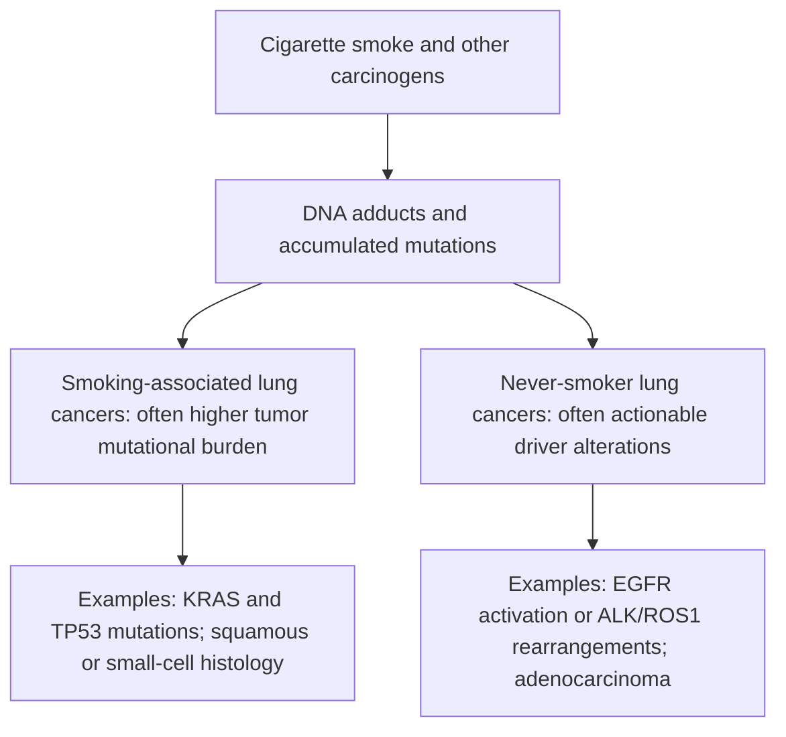
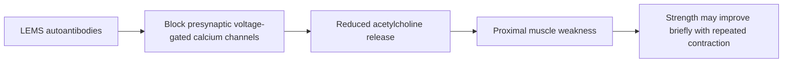

# Chapter 11: Thoracic & Pulmonary Malignancies

## 11.1 Non-Small Cell Lung Cancer (NSCLC)

### Epidemiology & Etiology
Non-Small Cell Lung Cancer (NSCLC) accounts for approximately 85% of all primary lung malignancies. Cigarette smoking is the predominant etiology (responsible for >85% of cases), driven by polycyclic aromatic hydrocarbons and nitrosamines (e.g., NNK) inducing DNA adducts and mutations in $KRAS$ and $TP53$. However, NSCLC in never-smokers represents a distinct biological entity, predominantly presenting as adenocarcinoma harboring actionable oncogenic driver mutations (e.g., $EGFR$, $ALK$, $ROS1$).

### Histological Subtypes & Immunohistochemistry (IHC)
1. **Adenocarcinoma (40–45% of lung cancers)**:
   - **Anatomical Location**: Typically peripheral.
   - **Histopathology**: Glandular differentiation, mucin production, acinar, papillary, micropapillary, or solid patterns. *Adenocarcinoma in situ* (formerly bronchioalveolar carcinoma) displays lepidic growth along intact alveolar septa without stromal invasion.
   - **Immunohistochemistry**: Positive for **TTF-1** (Thyroid Transcription Factor-1) and **Napsin A**; negative for p40/p63.
   - **Molecular Drivers**: $EGFR$ exon 19 deletions / L858R point mutation, $ALK$ fusions (EML4-ALK), $ROS1$ fusions, $KRAS$ G12C, $BRAF$ V600E, $MET$ exon 14 skipping, $RET$ fusions, $NTRK$ fusions.

2. **Squamous Cell Carcinoma (25–30% of lung cancers)**:
   - **Anatomical Location**: Predominantly central/hilar, originating from segmental or subsegmental bronchial epithelium.
   - **Histopathology**: Intercellular bridges, keratin pearls, individual cell keratinization. High propensity for central cavitation/necrosis.
   - **Immunohistochemistry**: Positive for **p40**, **p63**, and **Cytokeratin 5/6**; negative for TTF-1 and Napsin A.
   - **Paraneoplastic Association**: Ectopic secretion of **PTHrP** (Parathyroid Hormone-related Protein) leading to hypercalcemia of malignancy.

3. **Large Cell Carcinoma (5–10%)**:
   - Diagnosis of exclusion; undifferentiated malignant epithelial tumor lacking cytological features of squamous, glandular, or neuroendocrine differentiation.

### Clinical Staging & Diagnostic Evaluation
- **Staging**: AJCC TNM 8th Edition. 
  - $T_1$ ($\le 3\text{ cm}$), $T_2$ ($>3\text{ to } \le 5\text{ cm}$), $T_3$ ($>5\text{ to } \le 7\text{ cm}$ or separate nodule in same lobe), $T_4$ ($>7\text{ cm}$ or invasion of mediastinum/heart/great vessels).
  - $N_1$ (Ipsilateral peribronchial/hilar), $N_2$ (Ipsilateral mediastinal/subcarinal), $N_3$ (Contralateral mediastinal/hilar or supraclavicular).
- **Diagnostic Workup**: Contrast-enhanced CT Chest/Upper Abdomen, PET/CT ($F^{18}$-FDG), Brain MRI (mandatory for Stage II–IV), and tissue acquisition via Endobronchial Ultrasound (EBUS-TBNA) or CT-guided core needle biopsy.

### Multimodal Management Framework
- **Stage I & II (Early Resectable)**:
  - **Surgery**: Anatomic **Lobectomy** with systemic mediastinal lymph node dissection (gold standard). Sublobar resection (segmentectomy) is non-inferior for peripheral tumors $\le 2\text{ cm}$.
  - **Adjuvant Therapy**: Cisplatin-based doublet chemotherapy for Stage II–IIIA. For $EGFR$-mutated tumors (Exon 19 del / L858R), adjuvant **Osimertinib** for 3 years improves overall survival (ADAURA trial). Adjuvant Atezolizumab/Pembrolizumab for PD-L1 $\ge 1\%$.
- **Stage III (Locally Advanced)**:
  - **Stage IIIA (Resectable)**: Neoadjuvant chemo-immunotherapy (e.g., Nivolumab + Platinum doublet) followed by surgery.
  - **Stage IIIB/C (Unresectable)**: Concurrent Chemoradiotherapy (Definitive RT 60–66 Gy + Cisplatin/Etoposide or Paclitaxel/Carboplatin) followed by **Durvalumab** (anti-PD-L1) consolidation immunotherapy for 12 months (PACIFIC trial).
- **Stage IV (Metastatic)**:
  - **Driver-Positive**: First-line targeted TKIs:
    - $EGFR$: **Osimertinib** (3rd generation TKI; crosses blood-brain barrier).
    - $ALK$: **Alectinib**, Brigatinib, or Lorlatinib.
    - $ROS1$: Crizotinib or Entrectinib.
    - $KRAS\text{ G12C}$: Sotorasib or Adagrasib.
  - **Driver-Negative**: 
    - High PD-L1 (TPS $\ge 50\%$): First-line **Pembrolizumab** monotherapy.
    - Low/Negative PD-L1 (TPS $<50\%$): First-line Pembrolizumab + Platinum-doublet chemotherapy.

---

## 11.2 Small Cell Lung Cancer (SCLC)

### Pathophysiology & Features
Small Cell Lung Cancer (SCLC) is a high-grade neuroendocrine carcinoma characterized by rapid doubling time, high growth fraction, and early ubiquitous hematogenous metastasis. It is nearly exclusively seen in heavy smokers. Genetically characterized by universal inactivation of **$TP53$** and **$RB1$**.

### Histopathology & Neuroendocrine Markers
- **Microscopic Appearance**: Small round-to-oval cells with scant cytoplasm, ill-defined cell borders, finely stippled "salt-and-pepper" chromatin, absent nucleoli, nuclear molding, and high mitotic rate ($>10/10\text{ HPF}$). **Azzopardi effect** (basophilic staining of vascular walls by DNA sloughed from necrotic tumor cells).
- **Immunohistochemistry**: Positive for neuroendocrine markers: **Synaptophysin**, **Chromogranin A**, **CD56 (NCAM)**, and **INSM1**.

### Paraneoplastic Syndromes in SCLC
1. **SIADH (Syndrome of Inappropriate Antidiuretic Hormone)**: Ectopic ADH secretion leading to dilutional hyponatremia, low serum osmolality, and high urine osmolality. Treated with fluid restriction and Demeclocycline or Tolvaptan.
2. **Ectopic ACTH Secretion**: Leads to rapid-onset Cushing syndrome with severe hypokalemia, hypertension, and hyperpigmentation.
3. **Lambert-Eaton Myasthenic Syndrome (LEMS)**: Autoantibodies against **presynaptic voltage-gated calcium channels (VGCC)** at the neuromuscular junction. Causes proximal muscle weakness that **improves with repeated muscle contraction** (unlike Myasthenia Gravis). Associated with autonomic dysfunction (dry mouth, erectile dysfunction).

### Staging & Clinical Protocols
- **Limited Stage (LS-SCLC)**: Tumor confined to one hemithorax and regional lymph nodes that can be encompassed within a single tolerable radiation portal (~30% of patients).
  - **Treatment**: Concurrent **Chemoradiotherapy** (Etoposide + Cisplatin/Carboplatin + Thoracic RT 45 Gy hyperfractionated BID or 60 Gy QD) followed by **Prophylactic Cranial Irradiation (PCI)** in complete/partial responders.
- **Extensive Stage (ES-SCLC)**: Disease beyond a single radiation field (distant metastases, malignant pleural/pericardial effusion) (~70% of patients).
  - **Treatment**: First-line **Chemo-Immunotherapy**: Platinum (Cisplatin/Carboplatin) + Etoposide + Anti-PD-L1 antibody (**Atezolizumab** or **Durvalumab**) for 4 cycles followed by anti-PD-L1 maintenance.

---

## 11.3 Thymoma & Malignant Pleural Mesothelioma

### Thymoma & Thymic Carcinoma
- **Anatomy & Pathology**: Arise from thymic epithelial cells in the anterior mediastinum. Classified by WHO into Types A, AB, B1, B2, B3 (Thymoma) and Type C (Thymic Carcinoma).
- **Paraneoplastic Autoimmune Associations**:
  - **Myasthenia Gravis**: Present in 30–50% of thymoma patients; autoantibodies against acetylcholine receptors (anti-AChR).
  - **Pure Red Cell Aplasia (PRCA)**: Autoimmune suppression of erythroid precursors (present in 5%).
  - **Good Syndrome**: Hypogammaglobulinemia with thymoma.
- **Management**: Complete surgical resection (Thymectomy) via median sternotomy. Adjuvant RT for invasive stages (Masaoka-Koga Stage II–IV).

### Malignant Pleural Mesothelioma
- **Etiology**: Strongly associated with occupational **Asbestos exposure** (crocidolite blue asbestos highest risk), with a long latency period of **20 to 50 years**. Not linked to smoking, though smoking synergistically increases lung adenocarcinoma risk in asbestos workers.
- **Clinical Presentation**: Progressive exertional dyspnea, non-pleuritic chest wall pain, recurrent pleural effusions, pleural thickening, and chest wall constriction.
- **Histopathology**: Epitheloid (most common, best prognosis), Sarcomatoid (worst prognosis), or Biphasic.
  - **Diagnostic IHC**: Positive for **Calretinin**, **WT-1**, **Cytokeratin 5/6**, and **D2-40**; negative for CEA and TTF-1.
- **Treatment**: Multimodal approach. Platinum + Pemetrexed chemotherapy + Anti-VEGF (Bevacizumab) or Dual Immunotherapy (**Nivolumab + Ipilimumab**). Extrapleural pneumonectomy (EPP) or Pleurectomy/Decortication (P/D) in selected surgical candidates.

---

### Section Checklist & Source Verification
- [x] 11.1 Non-Small Cell Lung Cancer (Adenocarcinoma vs Squamous IHC, Driver TKIs, PACIFIC/ADAURA protocols)
- [x] 11.2 Small Cell Lung Cancer (Neuroendocrine IHC, LEMS vs SIADH vs Ectopic ACTH, PCI, Immunotherapy)
- [x] 11.3 Thymoma & Mesothelioma (Myasthenia Gravis, PRCA, Asbestos latency, Calretinin/WT-1 IHC)

### Corrections & Notes
- *Note*: Osimertinib is now established first-line adjuvant standard for $EGFR$-mutated resected NSCLC (ADAURA trial), replacing older-generation TKIs.
