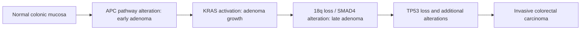
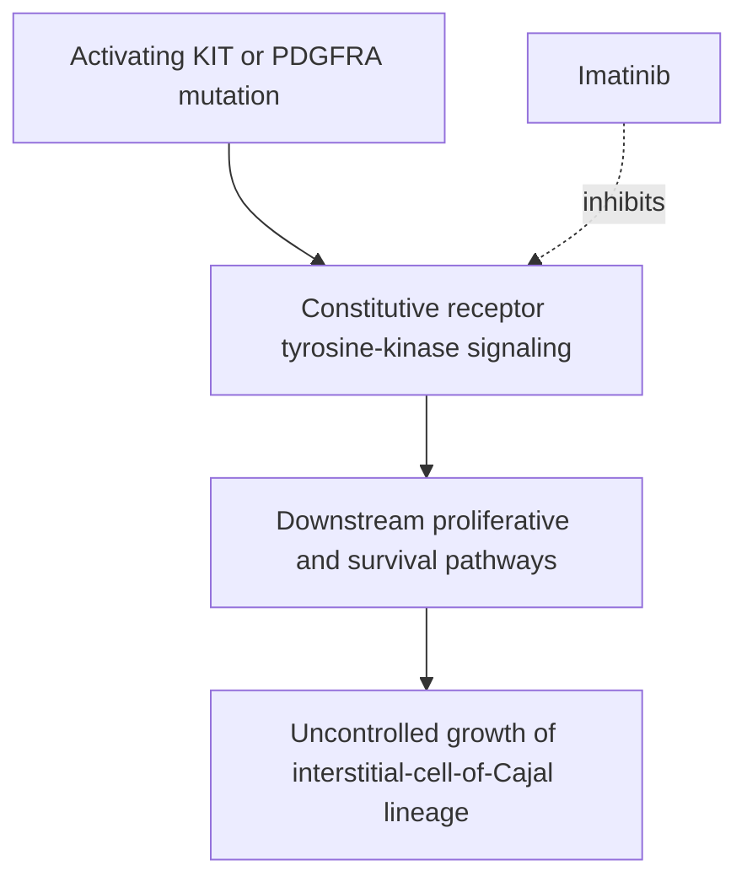

# Chapter 13: Lower Gastrointestinal & Neuroendocrine Malignancies

## 13.1 Colorectal Carcinoma (CRC)

### Carcinogenesis Pathways
Colorectal cancer arises through two major distinct molecular pathways:

1. **Chromosomal Instability (CIN) Pathway (80–85% of sporadic CRCs)**:
   - **Sequence**: Adenoma-to-Carcinoma Sequence (**Vogelstein Model**).
   - **Stepwise Mutations**: Initial loss of **$APC$** gatekeeper gene ($5q21$) $\rightarrow$ $KRAS$ activating mutation ($12p$) $\rightarrow$ Loss of $18q$ (DCC/SMAD4) $\rightarrow$ Late **$TP53$** mutation ($17p$).
   - Features: Aneuploidy, chromosomal translocations, precursor tubulovillous adenomas.

2. **Microsatellite Instability (MSI) / Mismatch Repair (MMR) Pathway (15%)**:
   - Driven by defective DNA Mismatch Repair proteins (**MLH1, MSH2, MSH6, PMS2**).
   - **Sporadic MSI-H**: Epigenetic promoter hypermethylation of $MLH1$ (CIMP-high; linked to **$BRAF\text{ V600E}$** mutation and sessile serrated adenomas/polyps).
   - **Hereditary MSI-H**: **Lynch Syndrome** (germline MMR mutation; $BRAF$ wild-type).
   - Features: Hypermutated state, diploid genome, heavy tumor-infiltrating lymphocytes (TILs), right-sided colonic predominance, high sensitivity to **Immune Checkpoint Inhibitors**.

### Clinical Presentation: Right vs. Left Colon
| Feature | Right-Sided (Ascending Colon / Cecum) | Left-Sided (Descending / Sigmoid / Rectum) |
| :--- | :--- | :--- |
| **Morphology** | Exophytic, fungating, polypoid mass | Annular, encircling "apple-core" / napkin-ring lesion |
| **Primary Symptoms** | Occult blood loss, severe microcytic iron deficiency anemia, fatigue, weight loss | Altered bowel habits, colicky abdominal pain, overt hematochezia, bowel obstruction |
| **Predominant Pathway** | MSI-H / Hypermutated / Serrated | CIN / Chromosomal Instability |

### Surgical Principles
- **Colonic Resection**: En-bloc removal of tumor segment with $\ge 5\text{ cm}$ clear mucosal margins and regional mesocolic lymphadenectomy (minimum **12 lymph nodes** required for accurate staging).
  - **Right Hemicolectomy**: Ligation of ileocolic, right colic, and right branch of middle colic vessels.
  - **Left Hemicolectomy**: Ligation of inferior mesenteric artery (IMA) at origin.
- **Rectal Cancer Surgery**:
  - **Total Mesorectal Excision (TME)**: Sharp dissection within the avascular holy plane preserving the visceral mesorectal fascia to prevent local recurrence.
  - **Low Anterior Resection (LAR)**: Sphincter-sparing operation for tumors in mid-to-upper rectum ($>5\text{ cm}$ from anal verge).
  - **Abdominoperineal Resection (APR)**: For low rectal tumors ($<5\text{ cm}$ or invading external anal sphincter); involves complete excision of rectum, anus, and levator ani muscles, leaving a permanent end sigmoid colostomy.
  - **Total Neoadjuvant Therapy (TNT)**: Induction/Consolidation Chemotherapy + Neoadjuvant Chemoradiotherapy prior to surgery for locally advanced rectal cancer (Stage II/III).

---

## 13.2 Gastrointestinal Stromal Tumors (GIST) & Neuroendocrine Tumors (NETs)

### Gastrointestinal Stromal Tumors (GIST)
- **Cell of Origin**: Mesenchymal tumor arising from the **Interstitial Cells of Cajal (ICCA)** (pacemaker cells of the GI tract wall). Most common site: Stomach (60%), Small intestine (30%).
- **Molecular Pathogenesis**:
  - **$c\text{-KIT}$ ($CD117$) Mutations (85%)**: Gain-of-function mutation in receptor tyrosine kinase KIT (Exon 11 or Exon 9).
  - **$PDGFR\alpha$ Mutations (5–10%)**: (Exon 18 D842V mutation confers primary resistance to imatinib).
- **Diagnostic IHC**: Positive for **c-KIT (CD117)** and **DOG-1** (Discovered on GIST-1).
- **Targeted Pharmacotherapy**:
  - **Imatinib Mesylate**: Selective tyrosine kinase inhibitor targeting KIT/PDGFR. Used as adjuvant therapy for high-risk resected GIST (3 years) or first-line for unresectable/metastatic GIST.

### Neuroendocrine Tumors (NETs)
- **Origin & Histopathology**: Derived from enterochromaffin (Kulchitsky) cells. Microscopic organoid/nesting architecture with uniform salt-and-pepper chromatin. Express **Synaptophysin** and **Chromogranin A**.
- **Carcinoid Syndrome**:
  - Occurs when NETs (predominantly distal ileal) metastasize to the **liver**, bypassing first-pass portal hepatic metabolism, releasing vasoactive substances (**Serotonin / 5-HT**, Bradykinin, Histamine) directly into systemic circulation.
  - **Clinical Triad**: 
    1. Cutaneous flushing (episodic red-cyanotic facial flushing).
    2. Secretory diarrhea (watery, abdominal cramping).
    3. **Carcinoid Heart Disease**: Endocardial fibrosis affecting **right-sided heart valves** (Tricuspid Insufficiency and Pulmonary Stenosis; left heart spared due to pulmonary endothelial monoamine oxidase breakdown of serotonin).
- **Diagnostics**:
  - **24-Hour Urinary 5-HIAA (5-Hydroxyindoleacetic acid)**: Metabolite of serotonin.
  - **Imaging**: **$^{68}\text{Ga}$-DOTATATE PET/CT** (binds Somatostatin Receptor Subtype 2 [SSTR2] with high affinity).
- **Medical & Targeted Management**:
  - **Somatostatin Analogs**: **Octreotide** or **Lanreotide** (controls secretory symptoms and inhibits tumor growth by binding SSTR2).
  - **PRRT (Peptide Receptor Radionuclide Therapy)**: **$^{177}\text{Lu}$-DOTATATE** (Lutetium-177 labeled somatostatin analog delivering targeted beta-radiation to SSTR2+ tumor cells).

---

### Section Checklist & Source Verification
- [x] 13.1 Colorectal Carcinoma (Vogelstein CIN pathway, MSI/Lynch, Right vs Left presentation, TME, LAR vs APR, TNT)
- [x] 13.2 GIST & Neuroendocrine Tumors (Interstitial cells of Cajal, c-KIT/CD117, DOG-1, Imatinib, Carcinoid triad, 5-HIAA, Ga-68 DOTATATE, Lu-177 PRRT)

### Corrections & Notes
- *Pathophysiological Detail*: Left heart valvular lesions in carcinoid syndrome are rare, but can occur in patients with a Patent Foramen Ovale (PFO) or primary bronchial carcinoid tumors that bypass pulmonary clearance.
