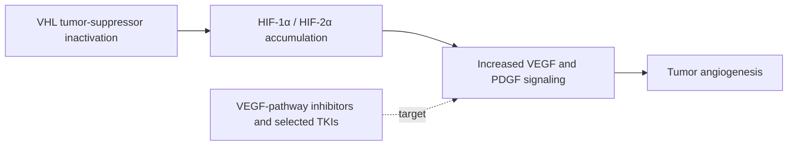

# Chapter 14: Genitourinary Malignancies

## 14.1 Renal Cell Carcinoma (RCC)

### Subtypes & Pathogenesis
Renal Cell Carcinoma originates from renal tubular epithelium and accounts for 85–90% of primary adult kidney tumors.

1. **Clear Cell RCC (75–80%)**:
   - **Cell of Origin**: Proximal convoluted tubule.
   - **Histopathology**: Abundant clear cytoplasm (filled with lipid and glycogen), delicate network of thin-walled branching microvasculature.
   - **Genetics**: Deletion of chromosome **$3p$** and inactivation of the **$VHL$** (Von Hippel-Lindau) tumor suppressor gene ($3p25$). Hypoxia-Inducible Factor ($\text{HIF-1}\alpha/\text{HIF-2}\alpha$) accumulates, driving overproduction of VEGF and PDGF.
2. **Papillary RCC (10–15%)**: Proximal tubule origin; papillary architecture with psammoma bodies; linked to $MET$ proto-oncogene mutations.
3. **Chromophobe RCC (5%)**: Intercalated cells of collecting duct; perinuclear halo; **Hale colloidal iron stain positive**.

### Clinical Presentation & Paraneoplastic Manifestations
- **Classic Clinical Triad (present in $<10\%$ of cases)**:
  1. Flank pain.
  2. Palpable abdominal mass.
  3. Gross hematuria.
- **Paraneoplastic Syndromes**:
  - **Erythrocytosis / Polycythemia**: Ectopic **Erythropoietin (EPO)** production.
  - **Hypercalcemia**: PTHrP secretion or osteolytic bone metastasis.
  - **Hypertension**: Ectopic **Renin** production.
  - **Stauffer Syndrome**: Non-metastatic hepatic dysfunction (elevated ALP, bilirubin, prolong PT) that resolves following nephrectomy.
  - Left-sided Varicocele: Tumor thrombus invading left renal vein blocking left gonadal vein drainage.

### Management Framework
- **Localized Disease**:
  - **Partial Nephrectomy**: Standard for $T_{1a}$ tumors ($\le 4\text{ cm}$) to preserve renal function.
  - **Radical Nephrectomy**: En-bloc removal of Gerota's fascia, kidney, adrenal gland (if invaded), and regional nodes for large ($>7\text{ cm}$) or centrally located tumors.
- **Metastatic Disease**:
  - Highly resistant to conventional cytotoxic chemotherapy.
  - **First-Line Standard**: Dual Immunotherapy (**Nivolumab + Ipilimumab**) or IO-TKI Combination (**Pembrolizumab + Axitinib** / **Cabozantinib**).

---

## 14.2 Bladder & Prostate Malignancies

### Urothelial Carcinoma of the Bladder
- **Etiology & Risk Factors**: Cigarette smoking (#1 cause; 50% of cases), occupational exposure to aniline dyes ($\beta$-naphthylamine), Cyclophosphamide (acrolein toxicity), Aristolochic acid. *Schistosoma haematobium* infection is specifically associated with **Squamous Cell Carcinoma** of the bladder (due to chronic mucosal irritation in the trigone).
- **Staging & Clinical Management**:
  - **Non-Muscle-Invasive Bladder Cancer (NMIBC - Ta, Tis, T1)**: Transurethral Resection of Bladder Tumor (TURBT) followed by intravesical **BCG (Bacillus Calmette-Guérin)** immunotherapy or chemotherapy (Mitomycin C).
  - **Muscle-Invasive Bladder Cancer (MIBC - $\ge T_2$ invading detrusor muscle)**:
    - **Neoadjuvant Cisplatin-based Chemotherapy** (ddMVAC or Gemcitabine/Cisplatin) followed by **Radical Cystectomy** with bilateral pelvic lymphadenectomy and urinary diversion (Ileal Conduit / Neobladder).

### Prostate Adenocarcinoma
- **Epidemiology & Anatomy**: Most common non-dermatologic cancer in males. 70% arise in the **Peripheral Zone** (posterior lobe), making them accessible on Digital Rectal Examination (DRE).
- **Diagnostic Workup**: Serum **Prostate-Specific Antigen (PSA)**, Multiparametric MRI (mpMRI using **PI-RADS** classification 1–5), and Transrectal/Transperineal USG-guided systematic biopsy.
- **Histopathology & Grading**:
  - **Gleason Grading System**: Based on architectural pattern of tumor glands (1 to 5).
  - **ISUP Grade Groups (1 to 5)**:
    - Grade Group 1: Gleason $3+3=6$ (indolent).
    - Grade Group 2: Gleason $3+4=7$.
    - Grade Group 3: Gleason $4+3=7$.
    - Grade Group 4: Gleason $4+4=8$.
    - Grade Group 5: Gleason $9-10$ (highly aggressive).

**Grading pathway:** the primary and secondary Gleason patterns are added to give the **Gleason score**, which is then grouped into **ISUP Grade Groups 1–5**. Grade group, together with PSA and clinical stage, informs risk stratification and management.
- **Treatment Protocols**:
  - **Low-Risk (Grade Group 1)**: **Active Surveillance** (serial PSA, DRE, mpMRI, repeat biopsies).
  - **Localized Intermediate/High-Risk**: **Radical Prostatectomy** (robotic-assisted) OR **Definitive External Beam Radiotherapy (EBRT) + Androgen Deprivation Therapy (ADT)**.
  - **Metastatic Castration-Sensitive / Resistant (mCRPC)**: ADT (LHRH agonists [Leuprolide] or antagonists [Relugolix]) combined with Novel Hormonal Agents (**Abiraterone** [CYP17 inhibitor], **Enzalutamide** [androgen receptor antagonist]), Docetaxel, or $^{177}\text{Lu}$-PSMA-617 radioligand therapy.

---

## 14.3 Testicular Germ Cell Tumors (TGCTs)

### Classification & Epidemiology
TGCTs affect young males aged 15–35 years. Cryptorchidism is the strongest risk factor (4–8x increased risk). Characterized by **Isochromosome 12p [$i(12p)$]** in $>90\%$ of cases.

| Testicular germ-cell tumor group | Typical examples | High-yield features / markers |
| :--- | :--- | :--- |
| **Seminoma** | Classic seminoma | “Fried-egg” cells; AFP remains normal; generally radiosensitive and chemosensitive |
| **Non-seminomatous tumors** | Embryonal carcinoma, yolk-sac tumor, choriocarcinoma, teratoma | Yolk-sac tumor: AFP elevation and Schiller–Duval bodies; choriocarcinoma: marked β-hCG elevation and early hematogenous spread |

### Major Subtypes & Tumor Markers
1. **Seminoma (50%)**:
   - **Histology**: Large uniform cells with clear glycogen-rich cytoplasm, distinct cell borders, prominent nucleoli, divided by fibrous septa with dense **lymphocytic infiltrate**.
   - **Biomarkers**: Positive for **OCT4**, **SALL4**, and **CD117** (c-KIT). **AFP IS ALWAYS NORMAL** (any AFP elevation indicates a non-seminomatous component!). $\beta$-hCG may be mildly elevated (10–15%). Highly radiosensitive.
2. **Non-Seminomatous Germ Cell Tumors (NSGCTs - 50%)**:
   - **Embryonal Carcinoma**: Aggressive, pleomorphic, primitive epithelial sheets, necrosis; positive for CD30.
   - **Yolk Sac Tumor**: Most common in boys $<3$ years. **Schiller-Duval Bodies** (endodermal sinus-like structures resembling glomeruli). Pathognomonic elevation of **$\mathbf{\alpha\text{-Fetoprotein (AFP)}}$**.
   - **Choriocarcinoma**: Highly malignant, syncytiotrophoblasts and cytotrophoblasts without villi. Early hematogenous spread to lungs/brain. Extremely high elevation of **$\mathbf{\beta\text{-hCG}}$** (can induce hyperthyroidism due to TSH receptor cross-reactivity and gynecomastia).
   - **Teratoma**: Contains elements from all three germ layers. Mature (benign in children, potential malignant transformation in adults) vs. Immature.

### Clinical Management Protocols
- **Initial Step**: **Radical Inguinal Orchiectomy** with high ligation of spermatic cord at the internal inguinal ring. **Transscrotal biopsy is strictly contraindicated** due to risk of tumor disruption and alteration of lymphatic drainage to inguinal nodes.
- **Staging & Therapy**:
  - Stage I Seminoma: Orchiectomy followed by surveillance or single-agent Carboplatin.
  - Advanced / NSGCT: **PEB Chemotherapy** (Cisplatin + Etoposide + Bleomycin).

---

### Section Checklist & Source Verification
- [x] 14.1 Renal Cell Carcinoma (Clear cell 3p/VHL, HIF-1a, EPO/PTHrP paraneoplastic, IO-IO & IO-TKI first-line)
- [x] 14.2 Bladder & Prostate Malignancies (Aniline dyes, Schistosoma squamous CA, NMIBC BCG vs MIBC cystectomy, Gleason/ISUP groups, ADT Abiraterone/Enzalutamide)
- [x] 14.3 Testicular Germ Cell Tumors (i(12p), Seminoma fried-egg histology, AFP normal rule, Yolk sac Schiller-Duval, Choriocarcinoma b-hCG, Radical Inguinal Orchiectomy)

### Corrections & Notes
- *Surgical Rule*: Transscrotal approach or biopsy of a testicular mass must never be performed; primary access is exclusively through an inguinal incision.
