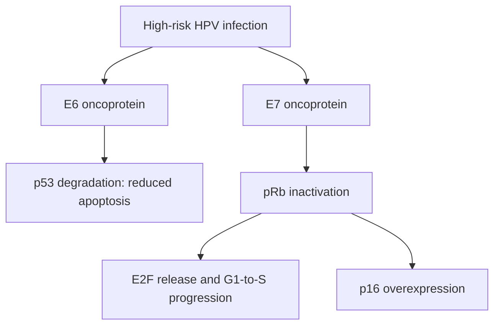
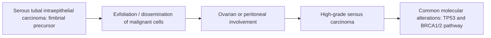

# Chapter 15: Gynecologic Malignancies

## 15.1 Cervical Carcinoma

### Etiology & Carcinogenesis
Persistent infection with **High-Risk Human Papillomavirus (HR-HPV)**—predominantly **HPV 16** (causes ~50% of SCC) and **HPV 18** (causes ~70% of Adenocarcinoma)—is the indispensable cause of cervical cancer.

- **Molecular Oncogenesis**:
  - **E6 Oncoprotein**: Binds **p53** tumor suppressor protein, targeting it for ubiquitin-mediated proteasomal degradation (blocking apoptosis).
  - **E7 Oncoprotein**: Binds and inactivates **pRb** (Retinoblastoma protein), displacing E2F transcription factor and driving uncontrolled $G_1/S$ cell cycle progression. Leads to compensatory overexpression of **$p16^{INK4a}$** (surrogate IHC biomarker).

### FIGO Staging & Management Matrix
Staging is clinical/pathological according to the FIGO 2018 classification.

| FIGO Stage | Anatomical Extent | Standard Management Protocol |
| :--- | :--- | :--- |
| **Stage IA1 / IA2** | Microinvasive (depth $<3\text{ mm}$ [IA1] or $3\text{--}5\text{ mm}$ [IA2]) | Cold knife conization (if fertility desired) or Simple Hysterectomy |
| **Stage IB1 / IB2 / IIA1** | Invasive lesions $\le 4\text{ cm}$ confined to cervix or upper 2/3 vagina | **Radical Hysterectomy (Wertheim Operation)** + Pelvic Lymphadenectomy |
| **Stage IB3 / IIA2 to IVA** | Locally advanced (lesions $>4\text{ cm}$, parametrial invasion [IIB], lower 1/3 vagina [IIIA], pelvic wall [IIIB], hydronephrosis, adjacent organ invasion) | **Definitive Concurrent Chemoradiotherapy (CCRT)**: Weekly Cisplatin + EBRT + Intracavitary Brachytherapy (High Dose Rate) |
| **Stage IVB** | Distant hematogenous metastasis | Systemic Chemotherapy (Paclitaxel + Carboplatin) + Bevacizumab + Pembrolizumab |

---

## 15.2 Endometrial & Ovarian Malignancies

### Endometrial Carcinoma
- **Dual Pathological Subtypes**:
  1. **Type I (Endometrioid Adenocarcinoma - 80%)**:
     - Estrogen-dependent; arises in background of **unopposed estrogen stimulation** and atypical endometrial hyperplasia.
     - Risk factors: Obesity, PCOS, nulliparity, late menopause, Tamoxifen therapy, Lynch syndrome.
     - Genetics: **$PTEN$** mutations (most common), $ARID1A$, $PIK3CA$, microsatellite instability (MSI-H). Favorable prognosis.
  2. **Type II (Non-Endometrioid / Serous Carcinoma - 15%)**:
     - Estrogen-independent; arises in atrophic endometrium of elderly women.
     - Histology: Papillary architecture, psammoma bodies, high nuclear grade. Driven by **$TP53$ mutations**. High recurrence risk.
- **Surgical Staging**: Total Abdominal Hysterectomy + Bilateral Salpingo-Oophorectomy (TAH-BSO) + Pelvic/Para-aortic lymph node assessment.

### Ovarian Epithelial Carcinoma
- **Origin & Histology**: Most high-grade serous carcinomas (HGSC - 70% of ovarian cancers) originate from the distal fimbrial epithelium of the Fallopian tube (**Serous Tubal Intraepithelial Carcinoma - STIC** precursor), not the ovary itself.
- **Risk & Protective Factors**:
  - Risk: Nulliparity, early menarche/late menopause, germline **$BRCA1$** (40% lifetime risk) or **$BRCA2$** (15–20% risk) mutations, Lynch syndrome.
  - Protective: **Oral Contraceptive Pills (OCPs)** (suppress ovulation; 50% risk reduction), multiparity, tubal ligation, breastfeeding.
- **Clinical & Biomarkers**: Present late with vague abdominal bloating, ascites, pelvic mass. Biomarker: **CA 125** (useful for monitoring treatment response and recurrence).

- **Surgical & Medical Management**:
  - **Primary Cytoreductive (Debulking) Surgery**: Goal is **R0 complete resection** (no macroscopic residual disease). TAH-BSO + Omentectomy + Peritoneal biopsies + Lymphadenectomy.
  - **Adjuvant Therapy**: IV Carboplatin + Paclitaxel + Bevacizumab.
  - **PARP Inhibitors (Olaparib, Niraparib)**: Maintenance therapy following response to platinum chemotherapy in $BRCA1/2$-mutated or Homologous Recombination Deficient (HRD) tumors.

---

## 15.3 Gestational Trophoblastic Neoplasia (GTN)

### Molar Pregnancy Spectrum
1. **Complete Hydatidiform Mole**:
   - **Karyotype**: $46,XX$ (90%) or $46,XY$ (10%), purely paternal origin (fertilization of an enucleated egg by one sperm with duplication or two sperms).
   - Features: No fetal tissue; diffuse hydropic chorionic villi with circumferential trophoblastic proliferation; **absent p57 expression** (maternally imprinted gene). Extremely high $\beta$-hCG ($>100,000\text{ mIU/mL}$). Snowstorm appearance on ultrasound.
2. **Partial Hydatidiform Mole**:
   - **Karyotype**: Triploid $69,XXX$, $69,XXY$, or $69,XYY$ (fertilization of a normal ovum by two sperms).
   - Features: Fetal tissue present; focal hydropic villi; positive p57 expression.

### Malignant GTN & Choriocarcinoma
- **Choriocarcinoma**: Highly malignant epithelial neoplasm consisting of dimorphic proliferation of cytotrophoblasts and syncytiotrophoblasts **without chorionic villi**. Early hematogenous spread to lungs (canonical "cannonball" pulmonary metastases), brain, liver.
- **Diagnostic Marker**: Serum **$\mathbf{\beta\text{-hCG}}$** (essential for diagnosis, staging via FIGO prognostic score, and monitoring response).
- **Treatment**: Exquisitely chemosensitive.
  - Low-Risk GTN (FIGO score $<7$): Single-agent **Methotrexate** or Dactinomycin.
  - High-Risk GTN (FIGO score $\ge 7$): Combination **EMA-CO** regimen (Etoposide, Methotrexate, Actinomycin D, Cyclophosphamide, Vincristine/Oncovin).

---

### Section Checklist & Source Verification
- [x] 15.1 Cervical Carcinoma (HPV 16/18, E6/p53, E7/pRb, p16 IHC, FIGO staging, CCRT Cisplatin + Brachytherapy)
- [x] 15.2 Endometrial & Ovarian Malignancies (Type I PTEN vs Type II p53 Endometrial, Fimbrial STIC origin of HGSC, BRCA1/2, CA 125, R0 debulking, PARP inhibitors)
- [x] 15.3 Gestational Trophoblastic Neoplasia (Complete 46,XX vs Partial 69,XXX, p57 staining, Choriocarcinoma cannonball metastases, b-hCG, Methotrexate / EMA-CO)

### Corrections & Notes
- *Pathological Update*: High-grade serous ovarian carcinoma is now recognized as originating primarily from the fallopian tube fimbria (STIC lesion) rather than the surface epithelium of the ovary.
