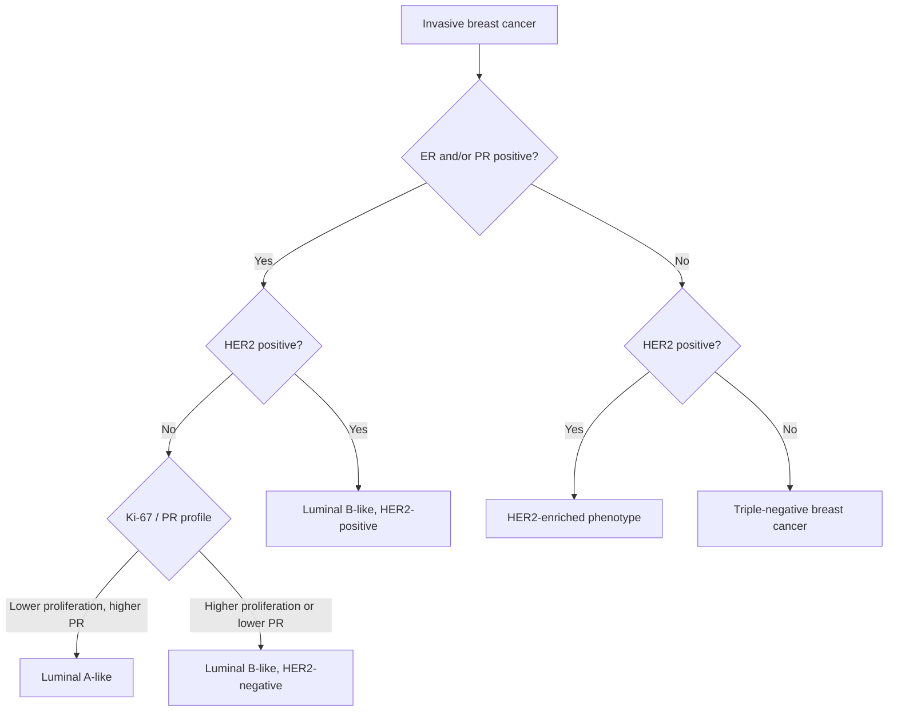
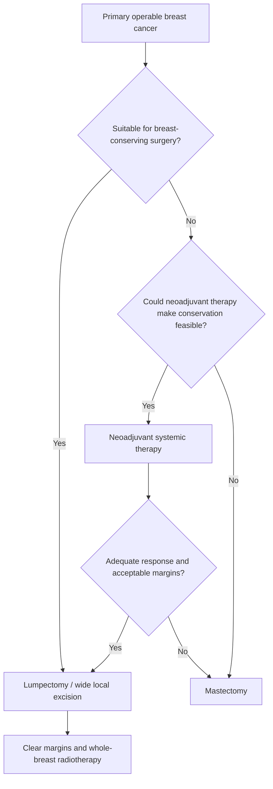

# Chapter 16: Breast Cancer

## 16.1 Risk Factors, Pathology & Molecular Subtyping

### 1. Epidemiology & Risk Factors
Breast cancer is the most common non-skin cancer in women worldwide and the leading cause of cancer-related mortality among females.

#### Major Risk Factors
* **Hereditary & Genetic Factors**:
  * Germline mutations in high-penetrance susceptibility genes: ***BRCA1*** (17q21) and ***BRCA2*** (13q12) account for 5–10% of all breast cancers and 15–20% of familial cases.
  * Other high/moderate-penetrance genes: ***PALB2***, ***TP53*** (Li-Fraumeni syndrome), ***PTEN*** (Cowden syndrome), ***STK11*** (Peutz-Jeghers), ***CHEK2***, and ***ATM***.
* **Reproductive & Hormonal Factors (Cumulative Estrogen Exposure)**:
  * Early menarche (<12 years) and late menopause (>55 years).
  * Nulliparity or delayed age at first full-term pregnancy (>30 years).
  * Exogenous hormone exposure: Combined Estrogen-Progestin Hormone Replacement Therapy (HRT); prolonged use of oral contraceptives (minor elevation).
  * Absence or short duration of breastfeeding.
* **Lifestyle & Environmental Factors**:
  * Post-menopausal obesity (adipose tissue aromatase converts adrenal androstenedione to estrone).
  * Alcohol consumption (linear dose-response relationship).
  * Mantle radiation exposure for Hodgkin lymphoma at a young age (10–30 years).
  * High mammographic breast density.

---

### 2. Preinvasive Lesions: DCIS vs. LCIS
Non-invasive carcinoma is restricted within the basement membrane without stromal or lymphovascular invasion.

| Feature | Ductal Carcinoma In Situ (DCIS) | Lobular Carcinoma In Situ (LCIS) |
| :--- | :--- | :--- |
| **Origin & Cell Type** | Ductal epithelial cells | Terminal duct lobular unit (TDLU) |
| **E-Cadherin Expression** | Preserved (Positive) | **Lost (Negative)** due to *CDH1* mutation |
| **Clinical Presentation** | Unilateral, non-palpable, microcalcifications on screening mammogram | Incidental biopsy finding; non-palpable, no calcifications |
| **Bilateral Risk** | Low (strictly unilateral precursor) | High (20–40% bilateral risk over lifetime) |
| **Precursor Nature** | **Direct obligate precursor** to invasive ductal carcinoma | **Risk indicator / marker** for invasive carcinoma (ductal or lobular) in *either* breast |
| **Management** | Surgical excision (BCS + RT or Mastectomy) to clear margins | Observation + Risk reduction (Tamoxifen / Raloxifene) or Bilateral prophylactic mastectomy |

---

### 3. Histological Subtypes of Invasive Breast Cancer
* **Invasive Ductal Carcinoma (Invasive Breast Carcinoma of No Special Type - NST)**:
  * Accounts for 75–80% of all invasive breast cancers.
  * Forms cords, nests, or tubules of malignant epithelial cells infiltrating fibrous stroma; frequent desmoplastic response.
  * Microscopic grading (Nottingham Histological Score): Evaluates **Tubule Formation (1–3)**, **Nuclear Pleomorphism (1–3)**, and **Mitotic Rate (1–3)** (Grade 1: 3–5 pts; Grade 2: 6–7 pts; Grade 3: 8–9 pts).
* **Invasive Lobular Carcinoma (ILC)**:
  * Accounts for 10–15% of cases.
  * Pathognomonic histology: Complete loss of cell-cell adhesion molecule **E-Cadherin**, resulting in small, uniform malignant cells infiltrating stroma in single-file arrays (**"Indian-file" pattern**) and concentric targetoid rings around normal ducts.
  * Clinical significance: Higher propensity for multi-focal, multi-centric, and bilateral involvement; atypical metastatic sites (peritoneum, retroperitoneum, leptomeninges, GI tract, ovaries).

---

### 4. Biomarker Profiling & Molecular Intrinsic Subtypes
Biomarker testing via Immunohistochemistry (IHC) and Fluorescence In-Situ Hybridization (FISH) for **Estrogen Receptor (ER)**, **Progesterone Receptor (PR)**, **HER2 (ERBB2)**, and **Ki-67 proliferation index** is mandatory for every primary invasive breast cancer.

#### Detailed Intrinsic Subtype Characteristics

| Subtype | Biomarker Profile | Clinical Behavior & Treatment Strategy |
| :--- | :--- | :--- |
| **Luminal A** | ER (+), PR $\ge 20\%$, HER2 (-), Ki-67 low ($<20\%$) | Most common (40–50%); low grade, indolent; highly endocrine-sensitive; low chemotherapy benefit; excellent overall prognosis. |
| **Luminal B (HER2-)** | ER (+), PR low ($<20\%$) or (-), HER2 (-), Ki-67 high ($\ge 20\%$) | Accounts for 15–20%; higher grade; endocrine-sensitive but derives substantial benefit from adjuvant chemotherapy. |
| **Luminal B (HER2+)** | ER (+), HER2 (+), Any PR / Ki-67 | Sensitive to both endocrine therapy and HER2-targeted therapy + chemotherapy. |
| **HER2-Enriched** | ER (-), PR (-), HER2 (+) | Accounts for 10–15%; highly aggressive; driven by *HER2/neu* gene amplification; non-sensitive to endocrine therapy; highly responsive to **Anti-HER2 Therapy (Trastuzumab + Pertuzumab)** combined with chemotherapy. |
| **Triple-Negative (TNBC)** | ER (-), PR (-), HER2 (-) | Accounts for 15–20%; highly aggressive; enriched in *BRCA1* mutation carriers; younger women; early relapse (visceral/brain metastases); un-responsive to endocrine/HER2 therapy; relies on **Platinum-based Chemotherapy + Anti-PD-1 Immunotherapy (Pembrolizumab)** and PARP inhibitors (*BRCA* mut). |

#### HER2 Diagnostics (ASCO/CAP Guidelines)
* **IHC Scoring**:
  * **0 or 1+**: Negative (no membrane staining or faint incomplete in <10% cells).
  * **2+**: Equivocal (weak to moderate complete membrane staining in >10% cells). **Requires reflex FISH testing**.
  * **3+**: Positive (intense complete membrane staining in >10% cells).
* **FISH Positive Criteria**: *HER2/CEP17* signal ratio $\ge 2.0$ OR average *HER2* copy number $\ge 6.0$ signals/cell.

---

## 16.2 Staging, Surgical Options & Multimodal Management

### 1. Staging Principles (AJCC 8th Edition)
AJCC 8th Edition incorporates both **Anatomical TNM** and **Clinical Prognostic Staging** (integrating Grade, ER, PR, HER2 status, and multigene assays such as Oncotype DX).

* **T (Primary Tumor)**:
  * **T1**: $\le 2\text{ cm}$ (T1a: $0.1\text{--}0.5\text{ cm}$; T1b: $0.5\text{--}1.0\text{ cm}$; T1c: $1.0\text{--}2.0\text{ cm}$).
  * **T2**: $>2\text{ cm}$ to $\le 5\text{ cm}$.
  * **T3**: $>5\text{ cm}$.
  * **T4**: Direct extension to chest wall (T4a), skin ulceration/satellites (T4b), both (T4c), or **Inflammatory Breast Cancer** (T4d - diffuse dermal lymphatic emboli, *peau d'orange* skin changes, erythema involving $\ge 1/3$ of breast).
* **N (Regional Lymph Nodes)**:
  * **N1**: Ipsilateral moveable level I/II axillary nodes.
  * **N2**: Fixed/matted level I/II axillary nodes or internal mammary nodes.
  * **N3**: Ipsilateral infraclavicular (level III) nodes (N3a), internal mammary + axillary (N3b), or supraclavicular nodes (N3c).

---

### 2. Surgical Management Principles
Modern breast surgical oncology emphasizes organ preservation and de-escalation of axillary intervention without compromising oncological safety.

#### Breast Primary Surgery: BCS vs. Mastectomy

Mastectomy may be preferred or required when breast conservation is not oncologically or technically suitable, including:
- Multicentric disease involving separate breast quadrants.
- Diffuse malignant microcalcifications.
- Persistently positive margins despite further excision.
- Previous breast or chest-wall radiotherapy that precludes safe additional irradiation.
- Informed patient preference or selected hereditary-risk situations.
- Pregnancy when timely postoperative breast irradiation cannot be safely delivered or deferred.

* **Breast-Conserving Surgery (BCS / Lumpectomy / Wide Local Excision)**:
  * Complete extirpation of the primary tumor with a clear macroscopic and microscopic margin (no tumor on ink for invasive cancer; $\ge 2\text{ mm}$ margin for DCIS) combined with **post-operative Whole Breast Irradiation (WBI)**.
  * **Level I Evidence**: BCS + Radiation yields **identical overall survival** compared to Total Mastectomy.
* **Mastectomy Variations**:
  * **Total (Simple) Mastectomy**: Removal of all breast tissue, nipple-areolar complex (NAC), and skin.
  * **Modified Radical Mastectomy (MRM)**: Total mastectomy + Axillary Lymph Node Dissection (Levels I and II).
  * **Skin-Sparing / Nipple-Sparing Mastectomy**: Preserves skin envelope $\pm$ NAC for immediate autologous or implant-based reconstruction.

#### Axillary Staging & Intervention
* **Sentinel Lymph Node Biopsy (SLNB)**:
  * Standard of care for clinically node-negative (cN0) axilla.
  * Dual-tracer technique using **Technetium-99m sulfur colloid** (gamma probe localization) and/or **Isosulfan blue / Indocyanine Green (ICG)** dye.
  * **ACOSOG Z0011 Trial Practice Change**: Axillary Lymph Node Dissection (ALND) can be safely **omitted** in cT1-T2 N0 patients undergoing BCS + whole breast RT who have **1 or 2 positive sentinel lymph nodes** without extranodal extension.
* **Axillary Lymph Node Dissection (ALND)**:
  * Indicated for clinically overt node-positive disease (cN+), positive SLNB in patients undergoing mastectomy without RT, or $\ge 3$ positive sentinel nodes.
  * En-bloc removal of Level I (lateral to pectoralis minor) and Level II (deep to pectoralis minor) axillary lymph nodes (minimum $\ge 10$ nodes resected).
  * Major complication: Permanent upper extremity **lymphedema** (15–20% incidence), intercostobrachial nerve injury (numbness of inner arm), long thoracic nerve palsy (winged scapula).

---

### 3. Systemic & Adjuvant / Neoadjuvant Therapies

#### Endocrine Therapy (For ER/PR Positive Cancers)
* **Premenopausal Women**:
  * **Tamoxifen** (Selective Estrogen Receptor Modulator - SERM): Competitive antagonist on breast tissue, agonist on endometrium and bone. Duration: 5–10 years. Adverse effects: Endometrial hyperplasia/carcinoma risk, venous thromboembolism (VTE), hot flashes.
  * **Ovarian Function Suppression (OFS)**: LHRH agonists (Goserelin, Leuprolide) combined with Tamoxifen or an Aromatase Inhibitor (TEXT/SOFT trials for high-risk patients).
* **Postmenopausal Women**:
  * **Aromatase Inhibitors (AIs)**: Non-steroidal (**Anastrozole**, **Letrozole**) or steroidal (**Exemestane**). Inhibit peripheral conversion of adrenal androgens to estrogens by aromatase. Duration: 5–10 years. Superior efficacy over Tamoxifen in postmenopausal females. Adverse effects: Osteoporosis/fracture risk, arthralgias, lipid elevation.
  * **CDK4/6 Inhibitors**: **Abemaciclib**, **Palbociclib**, **Ribociclib**. Inhibits Cyclin D-CDK4/6 complex, blocking Rb phosphorylation and $G_1/S$ cell cycle transition. Combined with AIs/Fulvestrant for high-risk early or metastatic HR+/HER2- disease.

#### HER2-Targeted Therapy (For HER2 Positive Cancers)
* **Trastuzumab (Herceptin)**: Humanized IgG1 monoclonal antibody binding domain IV of extracellular HER2. Standard duration: 1 year.
* **Pertuzumab**: Monoclonal antibody binding domain II (dimerization domain), preventing HER2-HER3 heterodimerization. Combined with Trastuzumab + Docetaxel (CLEOPATRA trial).
* **Adjuvant ADC**: **Trastuzumab Emtansine (T-DM1)** indicated for residual invasive disease post-neoadjuvant therapy (KATHERINE trial). **Trastuzumab Deruxtecan (T-DXd)** for metastatic HER2+ and HER2-Low disease.
* **Cardiotoxicity Warning**: Trastuzumab causes **Type II Cardiotoxicity** (non-dose-dependent, non-stealth, reversible drop in LVEF without structural damage). Baseline and 3-monthly Echocardiogram monitoring mandatory. (Contrasts with Type I irreversible Anthracycline cardiotoxicity).

#### Cytotoxic Chemotherapy & Neoadjuvant Protocols
* **Adjuvant Regimens**:
  * Anthracycline-Taxane combinations: **AC-T** (Doxorubicin + Cyclophosphamide followed by Paclitaxel/Docetaxel).
  * Non-anthracycline regimen: **TC** (Docetaxel + Cyclophosphamide).
* **Neoadjuvant Systemic Therapy (NST)**:
  * Indicated for locally advanced (Stage III), inflammatory breast cancer, or to downstage operable tumors to enable BCS.
  * **Mandatory for TNBC and HER2+ tumors** ($\ge T2$ or $N+$). Achieving **Pathological Complete Response (pCR - ypT0 ypN0)** serves as a robust surrogate endpoint for long-term overall survival.
  * TNBC Protocol: Carboplatin + Paclitaxel + Cyclophosphamide + Doxorubicin + **Pembrolizumab** (KEYNOTE-522 protocol).

---

## Summary Checklist & Index Verification
- [x] 16.1 Risk factors, hereditary syndromes (*BRCA1/2*), DCIS vs. LCIS, invasive ductal vs. lobular histology, biomarker profiling, intrinsic molecular subtypes.
- [x] 16.2 AJCC TNM staging, BCS vs. Mastectomy criteria, SLNB vs. ALND (Z0011 trial), Endocrine therapy (Tamoxifen vs. AIs), HER2 targeted therapy, Neoadjuvant NST protocols.
