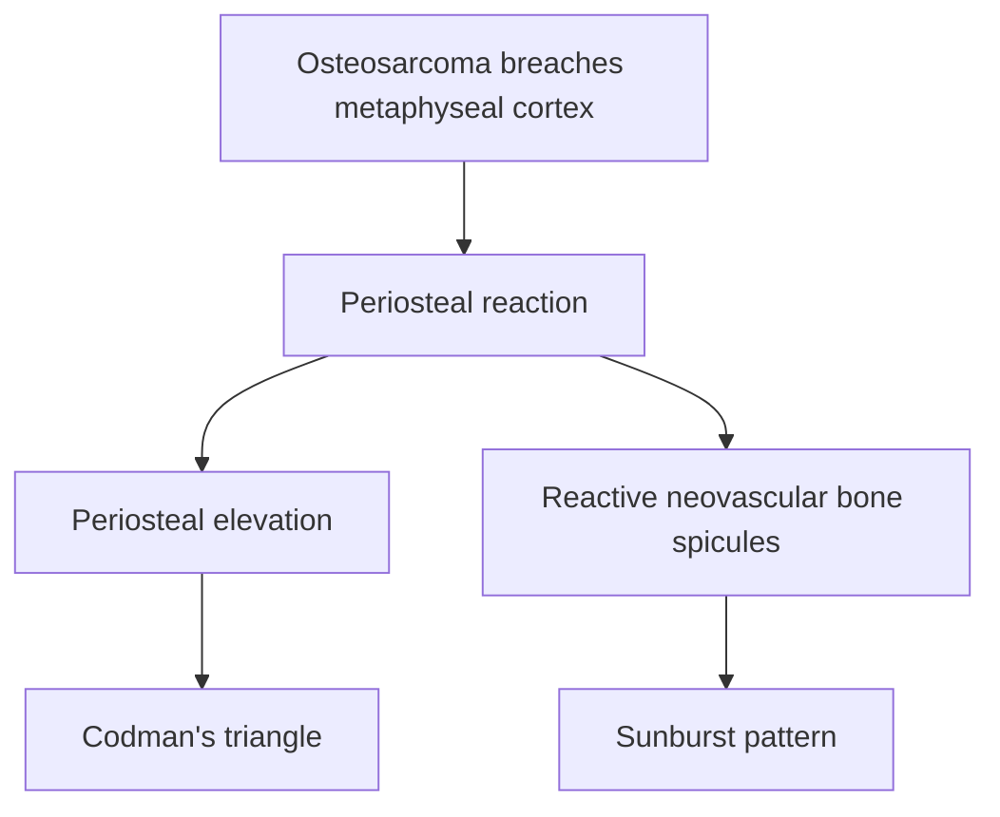
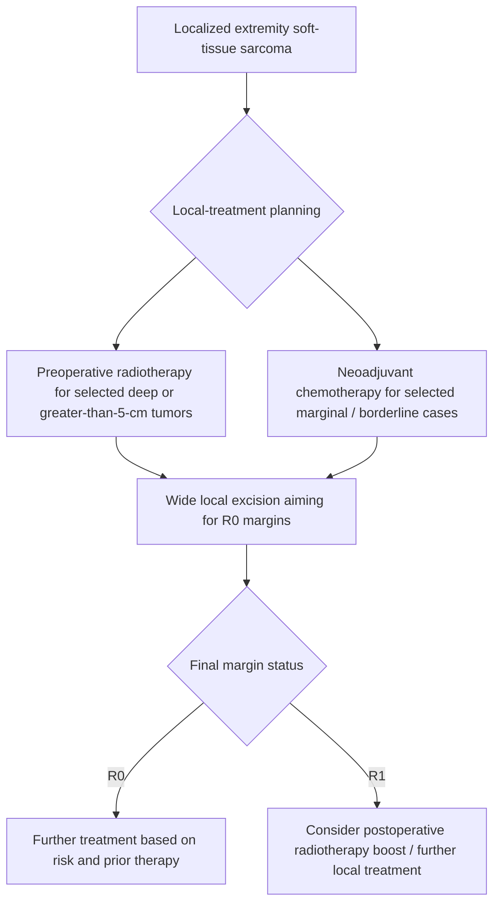

# Chapter 17: Bone & Soft Tissue Sarcomas

## 17.1 Primary Bone Sarcomas

### 1. General Principles & Diagnostic Evaluation
Primary malignant bone tumors are rare mesenchymal neoplasms representing <1% of all cancers, with a bimodal age distribution (adolescents/young adults and elderly >65 years).

#### Diagnostic & Biopsy Rules
* **Radiographic Triad**: Plain radiographs in 2 orthogonal planes remain the initial diagnostic cornerstone (assessing location, zone of transition, matrix mineralization, periosteal reaction, and cortical destruction).
* **Biopsy Golden Rule**: Biopsy MUST be performed at a tertiary sarcoma center by the operating surgeon. Needle tract must be oriented along the future surgical incision line so it can be resected *en-bloc* during definitive surgery. Transverse incisions or hematoma contamination strictly avoided.

---

### 2. Osteosarcoma
Osteosarcoma is the most common primary malignant bone tumor in children and young adults (peak age 10–20 years; secondary peak in elderly associated with Paget's disease or prior radiation).

#### Pathophysiology & Genetics
* Characterized by the production of **malignant osteoid** (unmineralized bone matrix) directly by malignant mesenchymal cells.
* Strong association with germline mutations in ***TP53*** (Li-Fraumeni syndrome) and ***RB1*** (Hereditary Retinoblastoma - 500-fold increased risk of osteosarcoma).

#### Clinical & Anatomical Features
* **Location**: Metaphysis of long tubular bones (50% occur around the knee: **distal femur > proximal tibia > proximal humerus**).
* **Presentation**: Progressive localized bone pain (often nocturnal), swelling, joint effusion, or pathological fracture.

#### Radiographic & Histological Findings
* Plain Radiograph: Mixed lytic and sclerotic lesion in metaphysis; cortical destruction; soft tissue mass.
* Classic Periosteal Reactions:
  * **Sunburst Pattern**: Radiating spicules of reactive bone along infiltrating tumor vessels.
  * **Codman's Triangle**: Elevation of periosteum away from the cortex at the tumor margins.
* Histology: Pleomorphic spindle cells laying down pink, lacelike osteoid matrix.

#### Multimodal Management & Prognosis
* Standard Care: **Neoadjuvant Chemotherapy (3 cycles) $\rightarrow$ Wide En-Bloc Resection / Limb-Salvage Surgery $\rightarrow$ Adjuvant Chemotherapy (6–9 cycles)**.
* Chemotherapy Backbone: MAP Regimen (**High-Dose Methotrexate + Doxorubicin + Cisplatin**).
* Prognostic Metric: **Rosen Huvos Grading of Histological Necrosis** post-neoadjuvant therapy:
  * Grade I: <50% necrosis.
  * Grade II: 50–90% necrosis.
  * Grade III: 91–99% necrosis.
  * **Grade IV: 100% complete necrosis** (good responder; 5-year OS >80%).
* Most common site of distant metastasis: **Lungs** (CT Chest mandatory at staging).

---

### 3. Ewing Sarcoma
Ewing Sarcoma is an aggressive, highly malignant small round cell sarcoma of bone and soft tissue primarily affecting children and adolescents (peak age 10–15 years).

#### Molecular Genetics
* Pathognomonic reciprocal translocation: **$t(11;22)(q24;q12)$** present in >85% of cases, fusing the *EWSR1* gene on chromosome 22 with the *FLI1* gene on chromosome 11, generating the oncogenic **EWSR1-FLI1 fusion transcription factor**.
* Variant translocations: $t(21;22)$ fusing *EWSR1-ERG*.

#### Clinical & Radiographic Findings
* **Location**: Diaphysis or metadiaphysis of long bones (femur, tibia) and pelvic flat bones.
* **Clinical Presentation**: Localized pain and swelling accompanied by **systemic B-symptoms** (fever, elevated ESR, leukocytosis, anemia), frequently mimicking acute osteomyelitis.
* Plain Radiograph: Permeative, destructive lytic lesion in diaphysis with broad zone of transition; pathognomonic **Multilayered "Onion-Skin" Periosteal Reaction** (concentric layers of reactive subperiosteal bone).

#### Histopathology & Biomarkers
* Small, uniform round blue cells with high nuclear-to-cytoplasmic ratio, clear cytoplasm containing abundant **glycogen (PAS positive, diastase sensitive)**.
* Form **Homer-Wright pseudorosettes** (cells surrounding central fibrillary space).
* Diffuse membranous reactivity for **CD99 (MIC2)**.

#### Management
* Ewing Sarcoma is a systemic disease; multi-agent chemotherapy is mandatory for all stages.
* Regimen: **VDC-IE** (Vincristine + Doxorubicin + Cyclophosphamide alternating with Ifosfamide + Etoposide).
* Local Control: Wide surgical resection or definitive Radiotherapy (Ewing is highly radiosensitive, unlike osteosarcoma).

---

### 4. Chondrosarcoma & Giant Cell Tumor of Bone

#### Chondrosarcoma
* Malignant cartilage-producing tumor affecting older adults (peak age 40–70 years).
* **Location**: Axial skeleton (pelvis, scapula, proximal femur/humerus).
* Radiography: Endosteal scalloping with characteristic **"Popcorn" or "Rings and Arcs" calcifications**.
* Treatment: **Primary Wide Surgical Resection**. Chondrosarcoma is **chemoresistant and radioresistant** due to abundant extracellular hyaline matrix and low growth fraction.

#### Giant Cell Tumor of Bone (GCTB / Osteoclastoma)
* Locally aggressive, benign tumor occurring in young adults (20–40 years) after physeal closure.
* **Location**: **Epiphysis** extending into metaphysis of long bones (distal femur, proximal tibia, distal radius).
* Radiography: Well-defined, eccentric, lytic lesion without sclerotic border, expanding the cortex (**"Soap-Bubble" appearance**).
* Pathophysiology: Neoplastic stromal cells overexpress **RANKL**, recruiting non-neoplastic multinucleated **Osteoclast-like Giant Cells** (>50 nuclei) causing massive bone resorption.
* Treatment: Intralesional curettage + chemical cauterization (phenol/liquid nitrogen) + bone grafting/PMMA cementation.
* Targeted Therapy: **Denosumab** (human monoclonal antibody against RANKL) inhibits giant cell recruitment and induces cortical recalcification in unresectable or recurrent lesions.

---

## 17.2 Soft Tissue Sarcomas (STS)

### 1. Classification & Pathological Spectrum
Soft tissue sarcomas comprise a heterogeneous group of malignant tumors originating from non-epithelial extraskeletal mesoderm (fat, muscle, blood vessels, fibrous tissue, peripheral nerves).

#### Major Histological Subtypes
* **Undifferentiated Pleomorphic Sarcoma (UPS / Malignant Fibrous Histiocytoma)**: Most common STS in adults >50 years; occurs in extremities and retroperitoneum.
* **Liposarcoma**: Second most common; origin from adipocytes. Subtypes: Well-differentiated / Atypical Lipomatous Tumor (driven by ***MDM2* amplification** on 12q13–15), Dedifferentiated, Myxoid (driven by **$t(12;16)$ *FUS-DDIT3***), and Pleomorphic.
* **Leiomyosarcoma**: Smooth muscle origin; common in retroperitoneum, IVC, and uterus.
* **Rhabdomyosarcoma (RMS)**: Most common pediatric soft tissue sarcoma (<15 years). Subtypes:
  * **Embryonal RMS**: Peak age <5 years; includes **Sarcoma Botryoides** (grape-like mucosal clusters in vagina/bladder). Favorable prognosis.
  * **Alveolar RMS**: Adolescents; driven by **$t(2;13)$ *PAX3-FOXO1*** or $t(1;13)$ *PAX7-FOXO1*. Unfavorable prognosis.
* **Synovial Sarcoma**: Affects young adults near large joints (popliteal fossa); driven by pathognomonic translocation **$t(X;18)(p11;q11)$** fusing *SS18-SSX1/2/4*. Biphasic histology (epithelial glands + spindle cells).

---

### 2. Clinical Evaluation & Staging
* **Presentation**: Painless, deep-seated, rapidly enlarging soft tissue mass (>5 cm, deep to fascia, fixed to surrounding structures).
* **Imaging IOC**: **Contrast-Enhanced MRI of the affected extremity/body site** (evaluates compartmental extension, neurovascular invasion, bone contact). CT Chest mandatory to assess pulmonary metastases.
* **FNAC Contraindicated**: Core needle biopsy (CNB) required for tissue architecture and IHC/molecular cytogenetics.

---

### 3. Multimodal Management Principles
Modern STS management centers on functional limb preservation combined with high local control rates.

#### Surgical Principles
* **Wide Local Excision**: En-bloc resection of tumor with a 1–2 cm margin of normal surrounding tissue, or an intact anatomical barrier (fascia, periosteum).
* Compartmental resection or amputation reserved for salvage of neurovascular invasion or massive local recurrence.

#### Radiotherapy Indications
* Indicated for all **High-Grade**, **Deep**, or **>5 cm** soft tissue sarcomas.
* **Pre-operative (Neoadjuvant) RT** (50 Gy): Preferred; smaller field, lower radiation volume, reduced long-term joint fibrosis/lymphedema; higher acute wound complication rate.
* **Post-operative (Adjuvant) RT** (60–66 Gy): Lower acute wound issues; higher late tissue toxicity.

#### Systemic Chemotherapy
* First-line regimen for high-risk, resectable or advanced/metastatic STS: **Doxorubicin + Ifosfamide**.
* Targeted agents: **Pazopanib** (multi-kinase anti-angiogenic TKI for non-liposarcoma STS); **Trabectedin** (myxoid liposarcoma); **Larotrectinib** (*NTRK* fusion positive).

---

## Summary Checklist & Index Verification
- [x] 17.1 Osteosarcoma (metaphysis, Codman's, sunburst, MAP chemo, Huvos grading), Ewing Sarcoma (t(11;22), onion-skin, CD99, small round blue cells), Chondrosarcoma (popcorn calcifications, surgical resection), GCT (epiphysis, soap-bubble, RANKL, Denosumab).
- [x] 17.2 Soft tissue sarcomas spectrum (UPS, Liposarcoma MDM2, RMS botryoides, Synovial sarcoma t(X;18)), MRI IOC, Wide local excision margins, Pre vs. Post-op RT protocols, Doxorubicin+Ifosfamide chemo.
