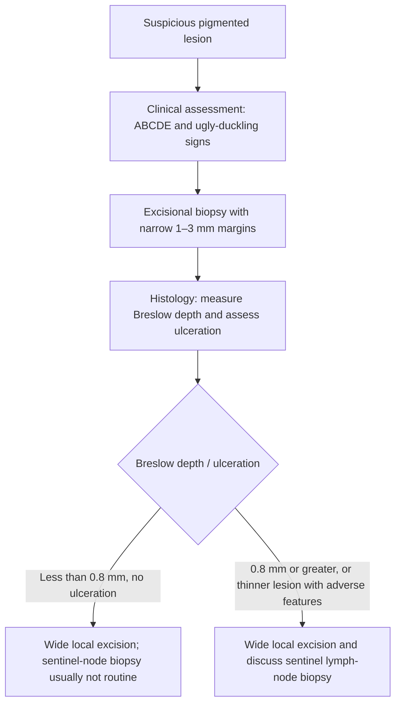
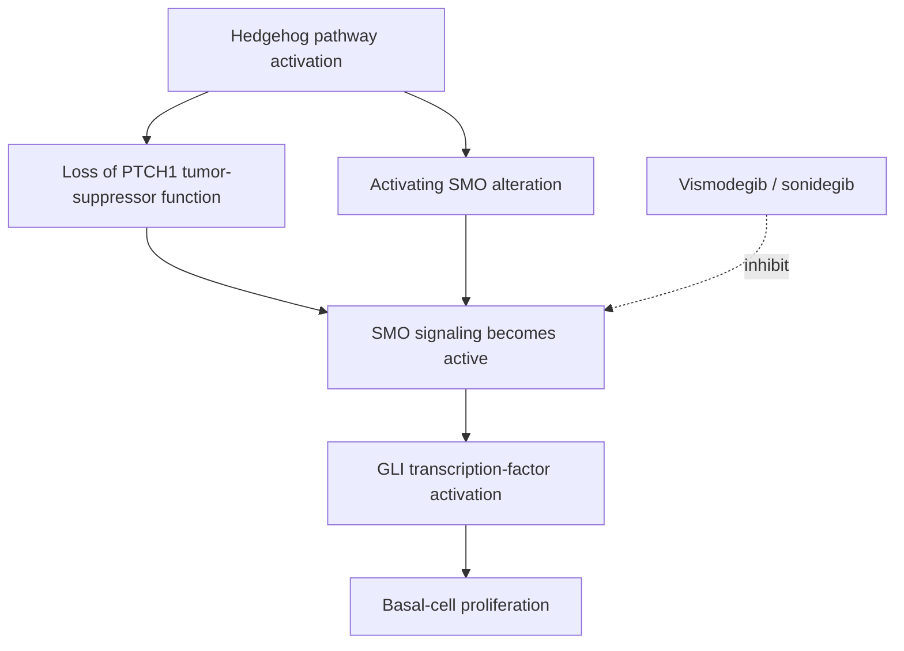

# Chapter 18: Dermatologic Malignancies

## 18.1 Cutaneous Melanoma

### 1. Epidemiology & Risk Factors
Melanoma is the most aggressive and lethal form of skin cancer, originating from malignant transformation of neural crest-derived melanocytes.

#### Major Risk Factors
* **Ultraviolet (UV) Radiation**: Intermittent, intense sun exposure causing severe blistering sunburns during childhood/adolescence (UVB spectrum $280\text{--}320\text{ nm}$ induces DNA damage and pyrimidine dimers).
* **Phenotypic Susceptibility**: Fair skin (Fitzpatrick type I/II), light hair, blue/green eyes, freckling tendency.
* **Nevus Count & Atypia**: $>50$ common nevi or presence of dysplastic/atypical nevi.
* **Familial Melanoma**: Germline mutations in ***CDKN2A*** (encoding $p16^{INK4a}$ and $p14^{ARF}$) or ***CDK4*** account for 20–40% of familial clusters.
* Personal or family history of melanoma; immunosuppression.

---

### 2. Clinical Features & Diagnosis: ABCDE Criteria
Early detection is paramount. Any suspicious pigmented lesion should be evaluated using the clinical **ABCDE** rule.

* **A - Asymmetry**: One half of the lesion does not match the other half.
* **B - Border**: Irregular, notched, scalloped, or poorly defined borders.
* **C - Color**: Variegated color within the same lesion (shades of brown, black, red, white, or blue).
* **D - Diameter**: $>6\text{ mm}$ (size of a pencil eraser; note: nodular melanomas can be smaller).
* **E - Evolving**: Change in size, shape, color, elevation, or new symptoms (bleeding, itching, crusting).
* **"Ugly Duckling" Sign**: A lesion that looks strikingly different from all other nevi on the patient's body.

#### Diagnostic Biopsy Rule
* **Gold Standard**: **Complete Excisional Biopsy with 1–3 mm narrow margins** taking the full thickness of skin into subcutaneous fat.
* Shave biopsy or partial incisional biopsy strictly contraindicated as it disrupts the lesion architecture and prevents accurate measurement of **Breslow depth**.

---

### 3. Major Histological Subtypes
* **Superficial Spreading Melanoma (SSM)**:
  * Most common subtype (70%). Occurs on trunk in men and lower extremities in women.
  * Prolonged **radial growth phase** (horizontal expansion within epidermis/papillary dermis) prior to vertical invasion. Pagetoid intraepidermal spread of atypical melanocytes.
* **Nodular Melanoma (NM)**:
  * Second most common (15–20%). Occurs anywhere; presents as a dark blue-black or amelanotic raised nodule.
  * **Lacks a radial growth phase**; enters **vertical growth phase** immediately, leading to early deep invasion and rapid metastasis.
* **Lentigo Maligna Melanoma (LMM)**:
  * Accounts for 5–10%. Occurs on chronically sun-damaged facial skin of elderly patients. Arises from precursor *Lentigo Maligna* (in situ). Indolent radial growth phase.
* **Acral Lentiginous Melanoma (ALM)**:
  * Accounts for 2–5% overall, but is the **most common melanoma in dark-skinned individuals** (African, Asian, Hispanic populations, representing 50–70% of cases).
  * Occurs on **palms, soles, and subungual sites** (Hutchinson's sign: pigment extension into proximal nail fold). **Not related to UV radiation**. Driven by *KIT* aberrations rather than *BRAF*.

---

### 4. Microscopic Staging: Breslow Depth vs. Clark Level
**Breslow Depth** is the single most critical histopathological prognostic factor for primary localized melanoma.

* **Breslow Depth**: Measured in millimeters using an ocular micrometer from the top of the epidermal granular layer (or base of ulcer) to the deepest point of tumor invasion.
* **Clark Level** (Historical / Anatomical layers): Level I (In situ), Level II (Papillary dermis), Level III (Papillary-reticular junction), Level IV (Reticular dermis), Level V (Subcutaneous fat). (Superseded by Breslow depth in AJCC 8th Edition staging).

---

### 5. Surgical Management & Axillary Staging

#### Wide Local Excision Margins (AJCC/NCCN Guidelines)

| Breslow Thickness | Recommended Surgical Margin |
| :--- | :--- |
| **Melanoma In-Situ** | 0.5 – 1.0 cm |
| **$\le 1.0\text{ mm}$** | **1.0 cm** |
| **1.01 – 2.0 mm** | **1.0 – 2.0 cm** |
| **2.01 – 4.0 mm** | **2.0 cm** |
| **$> 4.0\text{ mm}$** | **2.0 cm** |

#### Sentinel Lymph Node Biopsy (SLNB)
* **Indications**:
  * All patients with Breslow depth **$\ge 1.0\text{ mm}$** (Stage IB–II).
  * Patients with Breslow depth **0.8–1.0 mm** (or <0.8 mm with adverse features: ulceration, high mitotic rate $\ge 1/\text{mm}^2$, lymphovascular invasion).
* **MSLT-II Trial Practice Change**: Complete Lymph Node Dissection (CLND) post-positive SLNB does not improve overall survival compared to **nodal observation with serial ultrasonography**; CLND reserved for bulky palpable nodal disease.

---

### 6. Systemic & Targeted Therapies for Advanced / Metastatic Melanoma
Systemic therapy for melanoma has been revolutionized by targeted therapies and immune checkpoint blockade.

#### Molecular Testing
* All Stage III/IV melanomas must undergo molecular testing for **_BRAF_ V600 mutations** (present in 40–50% of cutaneous melanomas, predominantly **V600E** [>85%] and V600K). Secondarily test for *NRAS* and *KIT* (in acral/mucosal types).

#### Targeted Therapy Protocols
* Combined **BRAF Inhibitor + MEK Inhibitor** targeted therapy yields rapid tumor regression in *BRAF* V600-mutated melanoma:
  * **Dabrafenib + Trametinib**
  * **Vemurafenib + Cobimetinib**
  * **Encorafenib + Binimetinib**
* Dual inhibition prevents paradoxical MAPK reactivation through CRAF.

#### Immune Checkpoint Inhibitor Protocols
* Preferred first-line therapy for metastatic melanoma (effective regardless of *BRAF* status):
  * Dual Checkpoint Inhibition: **Nivolumab (anti-PD-1) + Ipilimumab (anti-CTLA-4)** (CheckMate 067 trial: 5-year OS >50%).
  * Monotherapy: Pembrolizumab or Nivolumab.

---

## 18.2 Non-Melanoma Skin Cancers (NMSC)

### 1. Basal Cell Carcinoma (BCC)
Basal Cell Carcinoma is the most common cancer in humans worldwide (>75% of skin cancers).

#### Pathophysiology & Genetics
* Arises from pluripotential basal cells of the interfollicular epidermis and hair follicles.
* Driven by dysregulation of the **Hedgehog Signaling Pathway**, predominantly loss-of-function mutations in ***PTCH1*** (Patched 1) or activating mutations in ***SMO*** (Smoothened).
* Associated with **Gorlin Syndrome** (Nevoid Basal Cell Carcinoma Syndrome: autosomal dominant, germline *PTCH1* mutation, multiple early BCCs, odontogenic keratocysts, palmar/plantar pits, falx cerebri calcification).

#### Clinical Types & Histology
* **Nodular BCC**: Most common (60%). Translucent, **pearly/pearly-white papule or nodule** with surface **telangiectasias** and rolled borders. May undergo central ulceration (**"Rodent Ulcer"**).
* **Superficial BCC**: Erythematous scaly plaque; mimics eczema or psoriasis.
* **Morpheaform / Sclerosing BCC**: Indurated, scar-like plaque; aggressive inward infiltration; poorly defined margins.
* **Histology**: Nests of atypical basaloid cells with dark elongated nuclei and minimal cytoplasm, displaying characteristic **Peripheral Palisading** of nuclei and retraction artifact (clefting) from fibrous stroma.

#### Management
* Standard Excision: 4–5 mm clear margins for low-risk non-facial lesions.
* **Mohs Micrographic Surgery (MMS)**:
  * Gold standard for high-risk BCC (facial "H-zone" [periorbital, nasolabial, periauricular], morpheaform histology, recurrent lesions, perineural invasion).
  * Sequential tangential excision with 100% intraoperative frozen section margin mapping, ensuring maximum tissue conservation and highest cure rate (>99%).
* Targeted Therapy for Advanced/Unresectable BCC: **Vismodegib** or **Sonidegib** (oral **Smoothened [SMO] Inhibitors**).

---

### 2. Cutaneous Squamous Cell Carcinoma (SCC)
Squamous Cell Carcinoma is the second most common skin cancer, possessing a distinct capacity for regional lymph node metastasis (2–5% overall risk).

#### Precursor Lesions & Risk Factors
* **Actinic Keratosis (AK)**: Premalignant hyperkeratotic, rough "sandpaper-like" erythematous lesion on sun-exposed skin. Histology: Dysplasia restricted to lower 1/3 of epidermis. Treatment: Cryotherapy, topical 5-Fluorouracil, Imiquimod.
* Risk factors: Cumulative lifelong sun exposure, immunosuppression (solid organ transplant recipients - **250-fold increased risk**), chronic non-healing wounds / burn scars (**Marjolin's Ulcer** - high metastatic potential), arsenic exposure.

#### Clinical & Histological Features
* Presentation: Indurated, hyperkeratotic, erythematous papule, plaque, or ulcerated nodule on sun-exposed sites (lower lip, ears, face, dorsum of hands).
* **Keratoacanthoma Variant**: Dome-shaped nodule with a central hyperkeratotic keratin plug; rapid growth followed by potential spontaneous regression.
* Histology: Infiltration of malignant squamous cells through basement membrane into dermis, forming **keratin pearls** and prominent **intercellular bridges** (desmosomes).

#### High-Risk Features & Management
* High-risk features for recurrence/metastasis: Size >2 cm, depth >6 mm (or invasion beyond sub-cutis), location on ear/lip, poorly differentiated histology, perineural invasion (PNI), immunosuppression.
* Surgical Treatment: Standard excision with 6–10 mm margins for high-risk lesions, or **Mohs Micrographic Surgery**.
* Systemic Therapy for Advanced/Metastatic Cutaneous SCC: **Cemiplimab** or **Pembrolizumab** (Anti-PD-1 Monoclonal Antibodies).

---

## Summary Checklist & Index Verification
- [x] 18.1 Cutaneous Melanoma (ABCDE rules, Superficial spreading vs. Nodular vs. Acral lentiginous, Breslow depth, WLE margins, SLNB indication, BRAF V600E Dabrafenib+Trametinib, Nivolumab+Ipilimumab).
- [x] 18.2 Basal Cell Carcinoma (Pearly telangiectatic nodule, peripheral palisading, Hedgehog pathway PTCH1/SMO, Vismodegib, Mohs surgery) & Cutaneous SCC (Actinic keratosis, Marjolin ulcer, keratin pearls, Cemiplimab).
