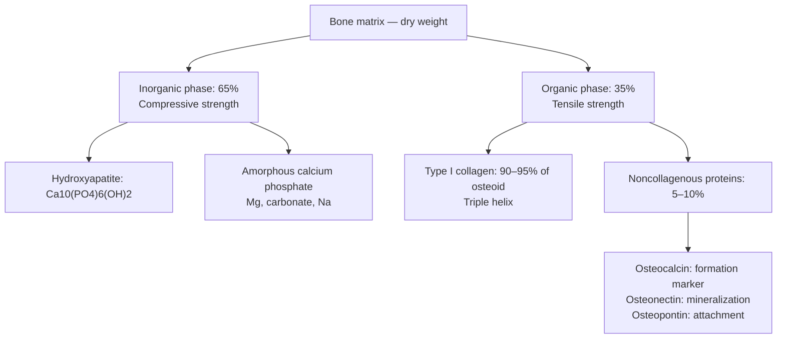
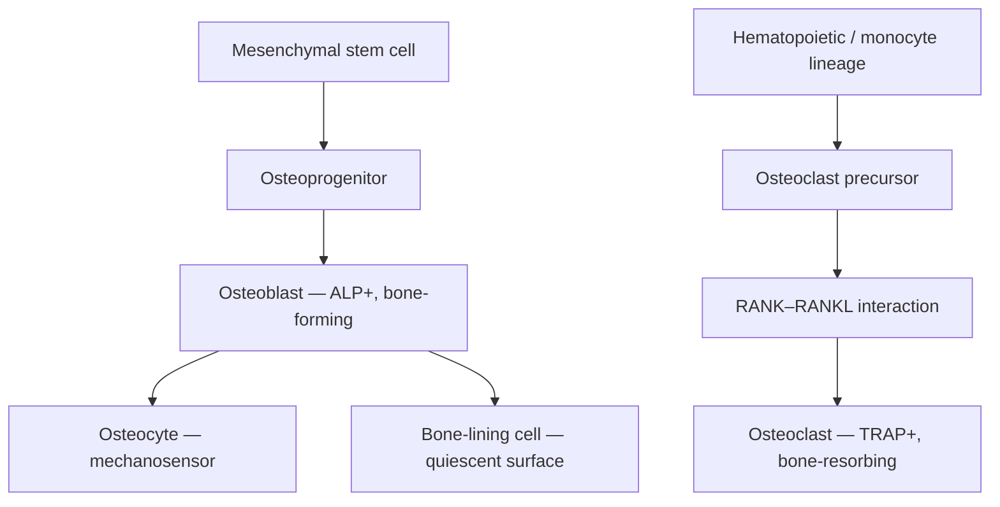
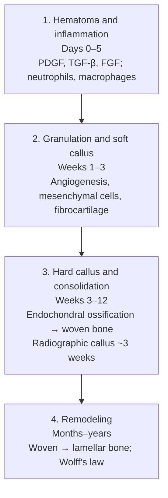
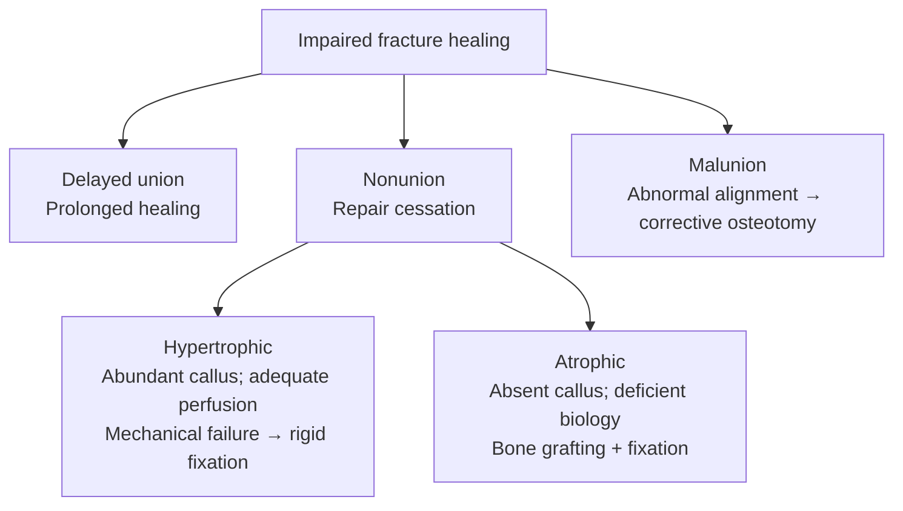
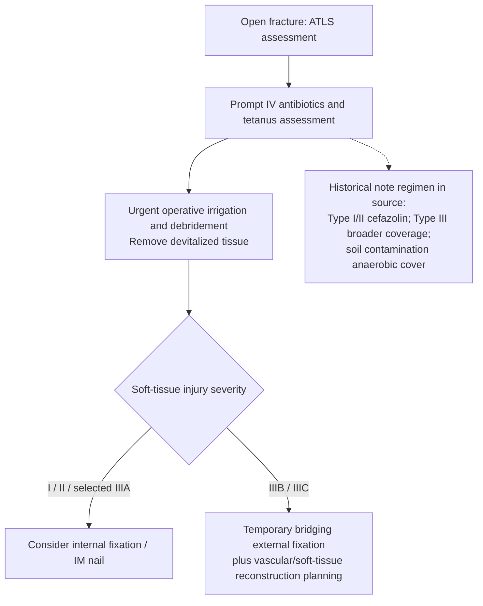

---
tags:
  - medicine/orthopaedics
  - exam-notes
chapter: 1
---

# Chapter 1: Basics of Orthopaedics, Bone Biology & Fracture Healing

## 1. Bone Microanatomy, Matrix Composition & Cellular Dynamics

- Bone iscomposed of an organic extracellular matrix (osteoid) mineralized by inorganic hydroxyapatite crystals.
- Bone serves dual biomechanical and metabolic functions: 
	1. providing structural rigidity and lever arms for movement, protecting vital thoracic and intracranial structures, 
	2. maintaining systemic calcium and phosphate homeostasis, 
	3. and harboring hematopoietic stem cells within the medullary cavity.

### Matrix Composition & Molecular Architecture
The dry weight of adult bone matrix is divided into an inorganic mineral phase (65%) and an organic osteoid matrix (35%), alongside cellular elements and bound water.

* **Inorganic Mineral Phase (65% Dry Weight)**:
  * **Calcium Hydroxyapatite** ($\text{Ca}_{10}(\text{PO}_4)_6(\text{OH})_2$): Formed as microscopic crystalline lattices deposited along collagen microfibrils. Provides compressive strength, rigidity, and acts as the body's primary reservoir for calcium (99%) and phosphorus (85%).
  * **Trace Minerals**: Amorphous calcium phosphate, citrate, carbonate, sodium, potassium, and magnesium.
* **Organic Matrix / Osteoid (35% Dry Weight)**:
  * **Type I Collagen (90–95% of Organic Matrix)**: Principal structural protein. Composed of a triple helix ($2\alpha_1$ and $1\alpha_2$ chains) cross-linked by lysyl oxidase to provide tensile strength and resistance to shear forces. *(Note: Hyaline articular cartilage is composed of Type II collagen; granulation tissue contains Type III collagen; basement membranes contain Type IV collagen).*
  * **Non-Collagenous Proteins (5–10%)**:
    * *Osteocalcin*: Bone-specific vitamin K-dependent protein synthesized by mature osteoblasts; binds hydroxyapatite and serves as a clinical biomarker of osteoblast activity and bone formation.
    * *Osteonectin*: Glycoprotein that binds both Type I collagen and hydroxyapatite, mediating matrix mineralization.
    * *Osteopontin & Bone Sialoprotein*: Cell-attachment proteins containing RGD (arginine-glycine-aspartate) sequences that mediate osteoclast attachment to the bone matrix during resorption.

### Cellular Constituents of Bone
Bone tissue is maintained by three distinct, highly specialized cell lines operating in a coordinated functional unit known as the **Basic Multicellular Unit (BMU)**.

1. **Osteoblasts**:
   * **Lineage**: Derived from pluripotent mesenchymal stem cells (MSCs) under the direction of Runx2 and Osterix transcription factors. Located along periosteal and endosteal surfaces as mononuclear cuboidal cells.
   * **Function**: Synthesize and deposit unmineralized organic matrix (osteoid) and catalyze mineralization. Rich in **Alkaline Phosphatase (ALP)**, which hydrolyzes inorganic pyrophosphate (a mineralization inhibitor) to release inorganic phosphate, facilitating hydroxyapatite precipitation.
   * **Bone Formation Markers**: Serum Bone-Specific Alkaline Phosphatase (BSAP), Osteocalcin, and Type I Procollagen N-Terminal Propeptide (P1NP).
2. **Osteocytes**:
   * **Lineage**: Terminally differentiated osteoblasts entrapped within mineralized lacunae. Represent 90–95% of all bone cells in adult skeleton, with a lifespan up to 25 years.
   * **Architecture**: Extend cytoplasmic dendritic processes through microscopic channels termed **canaluculi**, forming a syncytial communication network linked by gap junctions.
   * **Function**: Function as primary **mechanosensors**. In response to fluid shear stress from mechanical loading, osteocytes regulate bone remodeling by secreting signaling molecules, including **Sclerostin** (a potent inhibitor of the Wnt/$\beta$-catenin pathway that suppresses osteoblast bone formation).
3. **Osteoclasts**:
   * **Lineage**: Derived from hematopoietic monocyte/macrophage lineage precursors.
   * **Morphology**: Large, multinucleated giant cells containing 5 to 50 nuclei, characterized by a highly folded **ruffled border** membrane adjacent to the bone surface.
   * **Mechanism of Resorption**: Attachment to bone matrix via $\alpha_v\beta_3$ integrins creates an isolated subosteoclastic microenvironment (**Howship's Lacuna**). The cell pumps protons ($H^+$) via $H^+$-ATPase pumps and carbonic anhydrase II to acidify the compartment ($\text{pH} \approx 4.5$), dissolving hydroxyapatite. Cathepsin K and Matrix Metalloproteinases (MMPs) are then secreted to digest the organic collagen matrix.
   * **Enzymatic Marker**: **Tartrate-Resistant Acid Phosphatase (TRAP)**.
   * **Molecular Regulation**:
     * *RANKL (Receptor Activator of Nuclear Factor $\kappa$B Ligand)*: Expressed on osteoblast membrane; binds RANK receptors on osteoclast precursors to stimulate osteoclast differentiation, activation, and survival.
     * *Osteoprotegerin (OPG)*: Decoy receptor secreted by osteoblasts that binds RANKL, blocking RANK activation and inhibiting bone resorption. The **RANKL/OPG ratio** dictates net bone mass.

### Anatomic Structural Organization & Vascular Supply
* **Cortical (Compact) Bone**: Comprises 80% of total skeletal mass. Dense outer envelope composed of repeating cylindrical structural units called **Osteons (Haversian Systems)**.
  * *Haversian Canals*: Longitudinal central canals containing neurovascular bundles running parallel to the long axis of bone.
  * *Volkmann's Canals*: Transverse/oblique canals connecting adjacent Haversian canals and periosteal blood supply.
* **Cancellous (Trabecular / Spongy) Bone**: Comprises 20% of skeletal mass, located within epiphyses, metaphyses, and inner medullary cavities. Consists of a three-dimensional lattice of interlocking trabeculae aligned along lines of mechanical strain (Wolff's Law). Highly metabolic with 8 times greater surface area than cortical bone.
* **Parts of a Long Bone**:
  * *Epiphysis*: Articular end of long bone, developed from secondary ossification centers. Covered by articular hyaline cartilage.
  * *Physis (Growth Plate)*: Cartilaginous plate between epiphysis and metaphysis responsible for longitudinal bone growth.
  * *Metaphysis*: Flared transitional zone between physis and diaphysis. Composed of cancellous bone with hair-pin sinusoidal capillary loops. Highly vascular site susceptible to hematogenous osteomyelitis.
  * *Diaphysis*: Tubular shaft of compact cortical bone surrounding the central yellow marrow cavity.
* **Periosteum & Endosteum**:
  * *Periosteum*: Two-layered membrane covering outer bone surfaces (except articular cartilage). Outer layer is dense fibrous connective tissue; inner layer is the **cambium layer**, rich in vascularity, osteoprogenitor cells, and osteoblasts essential for appositional growth and callus formation. Anchored to underlying cortical bone via **Sharpey's fibers**.
  * *Endosteum*: Single-layer vascular membrane lining medullary cavities, Haversian canals, and trabecular surfaces.
* **Vascular Blood Supply**:
  1. *Nutrient Artery System*: High-pressure system penetrating diaphysis via nutrient foramina; supplies inner two-thirds of cortical bone and medullary canal (centrifugal blood flow).
  2. *Metaphyseal-Epiphyseal System*: Originates from periarticular vascular plexuses.
  3. *Periosteal System*: Low-pressure system supplying outer one-third of cortical bone.

---

## 2. Fracture Mechanics, Biomechanical Force Patterns & Pathological Fractures

![[images/Fracture_Patterns.png]]

*Common fracture-line patterns — schematic.*

A fracture is defined as a complete or incomplete disruption in the anatomical continuity of cortical or cancellous bone.

### Biomechanical Mechanisms & Fracture Geometry

| Fracture Pattern | Biomechanical Force & Failure Mode | Clinical Mechanism & Characteristics |
| :--- | :--- | :--- |
| **Transverse** | Pure bending stress | Force applied perpendicular to bone axis; fracture line angle $<30^\circ$ relative to horizontal. |
| **Oblique** | Combined bending and axial compression | Angled fracture line $>30^\circ$ to long axis; unstable under axial loading. |
| **Spiral** | Torsional / rotational torque force | Twisting force applied along long axis; spiraling helical fracture line. |
| **Comminuted** | High-energy direct impact / crush | Bone broken into 3 or more interconnected fragments; high soft tissue disruption. |
| **Segmental** | Dual-level direct impact | Two distinct complete fracture lines isolating a central free diaphyseal segment. |
| **Compression / Impacted** | Pure axial compression loading | Cancellous bone trabeculae driven into one another (e.g., vertebral body collapse, calcaneus). |
| **Avulsion** | Tensile traction at insertion site | Strong muscular/ligamentous contraction pulls off bony attachment (e.g., patella, olecranon, 5th metatarsal base). |

### Pathological Fractures & Stress Fractures
* **Pathological Fracture**: Structural failure occurring in bone weakened by pre-existing disease under low-energy trauma or normal physiological loading.
  * *Common Causes*: Primary bone tumors (Giant Cell Tumor, Osteosarcoma), metastatic carcinomas (breast, prostate, lung, kidney, thyroid), multiple myeloma, solitary bone cysts, fibrous dysplasia, osteomalacia, or severe osteoporosis.
  * **Mirels' Scoring System for Impending Pathological Fracture**: Predicts risk of pathological fracture in long bone metastases. Based on 4 parameters scored 1 to 3: Site (upper limb = 1, lower limb = 2, pertrochanteric = 3), Pain (mild = 1, moderate = 2, functional = 3), Lesion type (blastic = 1, mixed = 2, lytic = 3), and Size ($<1/3$ cortical width = 1, $1/3-2/3$ = 2, $>2/3$ = 3). **Score $\ge 8$ indicates high fracture risk requiring prophylactic internal fixation**.
* **Stress Fractures**: Microscopic bone failure resulting from repetitive, submaximal mechanical loading over time exceeding normal bone remodeling capacity.
  * *Fatigue Fracture*: Repetitive abnormal stress applied to normal bone (e.g., **March Fracture**—stress fracture of 2nd or 3rd metatarsal neck in military recruits/runners).
  * *Insufficiency Fracture*: Normal physiological stress applied to mineral-deficient or osteopenic bone (e.g., osteoporotic sacral or pubic ramus fractures).

---

## 3. Histology & Chronological Phases of Fracture Healing

Fracture healing is a unique biological process that restores bone to its original structural and biomechanical integrity without forming a permanent fibrous scar.

| Feature | Primary / direct | Secondary / indirect |
|---|---|---|
| Stability | Absolute; strain <2% | Relative; strain 2–10% |
| Fixation | Rigid DCP / lag screws | Cast / intramedullary nail |
| Micromotion | Minimal | Present |
| Callus | **Absent** | **Present** |
| Mechanism | Direct Haversian remodeling (cutting cones) | Endochondral ossification |

### Direct (Primary / Cortical) Fracture Healing
* **Conditions Required**: Rigid anatomical reduction and **absolute stability** (interfragmentary strain $<2\%$). Achieved surgically using Dynamic Compression Plates (DCP) or lag screws.
* **Biological Mechanism**: Absence of interfragmentary motion prevents external callus formation. Healing occurs directly across the fracture gap via **Cutting Cones**—osteoclasts at the leading edge bore longitudinal tunnels across the fracture line, followed by osteoblasts depositing concentric lamellar bone (direct Haversian remodeling).

### Indirect (Secondary / Endochondral) Fracture Healing

![[images/Fracture_Healing.png]]

*Stages of secondary fracture healing — schematic.*

* **Conditions Required**: **Relative stability** with physiological micromotion (interfragmentary strain $2-10\%$). Occurs naturally in non-operative cast immobilization, intramedullary interlocking nailing, external fixation, or bridging plates.
* **Perren's Interfragmentary Strain Theory**: Tissue formed in a fracture gap depends on local strain ($\text{Strain} = \Delta L / L$). Granulation tissue tolerates up to 100% strain, cartilage tolerates 10% strain, and bone tolerates $<2\%$ strain. Progressive stabilization lowers strain, permitting step-wise tissue differentiation from granulation to cartilage to bone.

#### Detailed Chronological Stages of Secondary Healing
1. **Stage 1: Hematoma & Inflammatory Phase (Days 0–5)**:
   * Vascular disruption causes bleeding from nutrient vessels and periosteum, forming a contained **fracture hematoma**.
   * Ischemia induces localized osteocyte necrosis at fracture ends.
   * Platelet degranulation releases pro-inflammatory cytokines (IL-1, IL-6, TNF-$\alpha$) and growth factors (**PDGF**, **TGF-$\beta$**, **BMPs**, **FGF**). Neutrophils and macrophages infiltrate to phagocytose necrotic tissue.
2. **Stage 2: Granulation Tissue & Soft Callus Phase (Weeks 1–3)**:
   * Macrophages stimulate intense angiogenesis. Pluripotent mesenchymal stem cells proliferate within the hematoma.
   * Chondrocytes deposit a fibrous and cartilaginous matrix, forming a **soft callus** (fibrocartilage) that bridges the fracture gap, providing initial mechanical elasticity.
3. **Stage 3: Hard Callus Formation & Consolidation (Weeks 3–12)**:
   * Soft fibrocartilage undergoes **endochondral ossification**. Mineralization of the cartilage matrix attracts osteoclasts and osteoblasts, converting soft callus into disorganized **woven bone** (hard callus).
   * **Radiological Landmark**: Hard callus is the **first stage of fracture healing visible on plain X-rays** (typically appearing 3 weeks post-fracture as cloud-like radio-opacity bridging the gap). Clinical union occurs when the fracture site is non-tender and motionless.
4. **Stage 4: Bone Remodeling Phase (Months to Years)**:
   * Coupled osteoclast-osteoblast action slowly replaces immature woven bone with organized **lamellar bone**.
   * Re-establishes the central medullary canal and original cortical contours.
   * **Wolff's Law**: Bone remodels dynamically according to mechanical load; bone is deposited along lines of compressive strain and resorbed in regions of low stress.

---

## 4. Impaired Fracture Healing & Avascular Necrosis (AVN) Dynamics

### Impaired Fracture Healing: Delayed Union, Non-Union & Malunion

#### Delayed Union
Failure of a fracture to consolidate within the expected biological timeframe for that specific bone and patient age, but where radiological progression and biological repair capacity remain active.

#### Non-Union
Complete permanent cessation of periosteal and endosteal repair mechanisms without radiological consolidation progression over a 3-month period, persisting for at least **6 months post-injury**.
* **Hypertrophic Non-Union ("Elephant's Foot" / "Horse's Hoof")**:
  * *Pathophysiology*: Hypervascular, biologically active bone ends with abundant callus formation. Represents a **mechanical failure** due to inadequate rigid immobilization/fixation in the presence of good blood supply.
  * *Radiology*: Flared, sclerotic bone ends with a persistent radiolucent fracture line.
  * *Treatment*: Rigid mechanical stabilization (e.g., reamed intramedullary nailing or compression plating). Bone grafting is **not** required.
* **Atrophic Non-Union**:
  * *Pathophysiology*: Biologically inert, avascular, and devitalized bone ends with absent callus formation. Represents a **biological failure** secondary to severe ischemia, extensive soft tissue loss, periosteal stripping, or infection.
  * *Radiology*: Rounded, osteopenic, tapered "pencil-like" bone ends without bridging callus.
  * *Treatment*: Excision of fibrous scar tissue, decortication, rigid internal fixation, and **autologous cancellous bone grafting** (gold standard site: anterior/posterior iliac crest).

#### Bone Grafting Dynamics
* **Osteogenesis**: Direct synthesis of new bone by viable progenitor cells within the graft (autologous iliac crest graft).
* **Osteoconduction**: Physical three-dimensional matrix acting as a structural scaffold for host capillary and cell ingrowth (allografts, synthetic ceramics, PMMA).
* **Osteoinduction**: Biochemical recruitment and differentiation of host stem cells into bone-forming osteoblasts, driven by growth factors (**Bone Morphogenetic Proteins [BMP-2, BMP-7]**).

#### Malunion
Healing of a fracture in an anatomically abnormal alignment (angular, rotational, or length discrepancy).
* *Most Common Sites*: Clavicle, supracondylar humerus fracture (leading to **Cubitus Varus / Gunstock Deformity**), distal radius Colles' fracture, and intertrochanteric femur fractures.
* *Treatment*: Corrective surgical **Osteotomy** (realignment and rigid fixation).

### Avascular Necrosis (AVN / Osteonecrosis) High-Risk Vulnerable Sites
AVN occurs when intraosseous blood supply is compromised, leading to osteocyte death, subchondral bone collapse, and secondary destructive osteoarthritis.

| Vulnerable site | Blood-supply feature |
|---|---|
| Femoral head | Retinacular arteries |
| Proximal pole of scaphoid | Retrograde branches of radial artery |
| Talar body | Artery of tarsal canal |
| Capitate pole | Terminal intraosseous supply |

1. **Femoral Head**: Secondary to intracapsular femoral neck fractures or traumatic posterior hip dislocations. Retinacular arteries (branches of **Medial Femoral Circumflex Artery**) running along the femoral neck are disrupted.
2. **Proximal Pole of Scaphoid**: Waist and proximal pole scaphoid fractures. Blood supply enters the distal pole via retrograde branches of the radial artery; proximal pole is left entirely ischemic.
3. **Body of Talus**: Neck of talus fractures (**Aviator's Fracture**). Retrograde blood flow via the artery of the tarsal canal, deltoid branch, and dorsalis pedis artery is disrupted. Evaluated by **Hawkins' Sign** (presence of subchondral osteopenia at 6–8 weeks on AP radiograph indicates preserved vascularity and rules out AVN).
4. **Proximal Pole of Capitate**.

---

## 5. Open Fractures & Acute Emergency Management (Gustilo-Anderson Protocol)

An open (compound) fracture is an emergency injury characterized by a breach in the overlying skin and soft tissue, establishing direct communication between the fracture hematoma, external environment, and bacterial flora.

### Gustilo-Anderson Classification & Management Matrix

| Type | Wound Character & Size | Soft Tissue & Periosteal Status | Contamination & Energy | Surgical Fixation & Coverage Strategy |
| :--- | :--- | :--- | :--- | :--- |
| **Type I** | Clean wound $<1\text{ cm}$ long | Minimal muscle damage; intact periosteal coverage | Low-energy trauma; clean | Urgent debridement + Primary internal fixation (IM Nailing / Plating) |
| **Type II** | Wound length $1\text{--}10\text{ cm}$ | Moderate soft tissue injury; periosteum intact | Moderate contamination / energy | Debridement + Internal fixation or temporary external fixator |
| **Type IIIA** | Wound $>10\text{ cm}$ or high energy | Extensive soft tissue laceration; **adequate periosteal bone coverage** | High contamination (farm, soil, gunshot) | Radical debridement + Internal or external fixation; direct soft tissue closure |
| **Type IIIB** | Extensive wound $>10\text{ cm}$ | **Extensive soft tissue loss with periosteal stripping & bone exposure** | Severe contamination; high energy | Radical debridement + **Bridging External Fixation**; requires plastic flap coverage (rotational/free) |
| **Type IIIC** | Open fracture of any size | Associated with **major arterial injury requiring surgical repair** | Variable high-energy impact | Immediate vascular repair + External fixation; high amputation risk |

*Note: All gunshot injuries, high-velocity missile wounds, farm/soil-contaminated injuries, and open fractures with segmental bone loss are automatically classified as **Type III** regardless of wound length.*

### Ilizarov External Fixation System & Distraction Osteogenesis
* **Ilizarov Ring Fixator**: Multiplanar external fixator utilizing tensioned transfixion Kirschner wires ($1.5-1.8\text{ mm}$) anchored to circular rings. Provides multiplanar stability while permitting axial micromotion to stimulate bone healing.
* **Distraction Osteogenesis (Callotaxis)**: Process of generating new bone by applying controlled mechanical tension across a low-energy corticotomy site.
  * *Latency Phase*: 7 to 10 days post-corticotomy for initial hematoma organization.
  * *Distraction Phase*: Bone segments distracted at a rate of **1 mm per day** (divided into 0.25 mm four times daily). Slower rates lead to premature consolidation; faster rates cause fibrous non-union.
  * *Consolidation Phase*: Distracted neo-osteoid tissue mineralizes into cortical bone (requires 2 months per cm lengthened).

---

## 6. Amputations, Orthopedic Instrumentation, Splints, Casts & Tractions

### Lower Extremity Amputation Levels
Amputation is considered a reconstructive surgical procedure designed to create an end-bearing, painless, functional residual limb capable of prosthetic fitting.

| Level | Anatomical location |
|---|---|
| Transmetatarsal | Forefoot |
| Lisfranc disarticulation | Tarsometatarsal joints |
| Chopart disarticulation | Midtarsal joints |
| Syme amputation | Ankle disarticulation |
| Transtibial (below-knee) | Leg; common major lower-limb level |

1. **Toe & Ray Amputation**: Resection of digital phalanx or digit with corresponding metatarsal.
2. **Transmetatarsal Amputation**: Forefoot amputation through mid-metatarsal shafts; preserves dorsiflexor and plantarflexor insertions.
3. **Lisfranc Amputation**: Disarticulation through tarsometatarsal joints.
4. **Chopart Amputation**: Disarticulation through midtarsal joints (talonavicular and calcaneocuboid joints). High risk of equinus deformity due to unopposed Achilles tendon pull.
5. **Syme's Amputation**: Ankle disarticulation with removal of medial/lateral malleoli and preservation of the durable heel pad anchored to the distal tibia, allowing direct weight-bearing.
6. **Transtibial Amputation (Below-Knee [B/K])**: Most common major lower limb amputation ($12-15\text{ cm}$ below knee joint line). Long posterior flap (gastrocnemius-soleus) provides durable soft tissue padding.
7. **Knee Disarticulation**: Disarticulation through knee joint space; excellent end-bearing capacity.
8. **Transfemoral Amputation (Above-Knee [A/K])**: Amputation through femoral shaft; requires adductor magnus myodesis to maintain femoral alignment.

### Orthopedic Instrumentation & Fixation Hardware
* **Kirschner Wires (K-wires)**: Smooth stainless steel pins used for temporary fixation, pediatric fractures, or percutaneous pinning.
* **Cortical vs. Cancellous Screws**:
  * *Cortical Screws*: Fine thread pitch along entire length with small core-to-thread ratio; grips dense cortical bone.
  * *Cancellous Screws*: Coarse thread pitch with deep threads and large core-to-thread ratio; compresses spongy cancellous bone.
* **Dynamic Compression Plate (DCP)**: Features oval screw holes with inclined ramped margins. Tightening an eccentric screw drives the plate horizontally, generating high interfragmentary compression across the fracture line (enables direct primary healing).
* **Locking Compression Plate (LCP)**: Screw heads thread directly into threaded plate holes, creating a rigid "fixed-angle construct". Functions as an internal fixator without compressing the plate against periosteum, preserving periosteal cortical blood supply.
* **Tension Band Wiring (TBW)**: Converts tensile pulling forces applied by muscle tendons into compressive stability across a joint surface during movement. Indications: Transverse Patella fractures, Olecranon fractures, and Greater Tuberosity/Malleolar avulsions.

### Splints, Braces, Tractions & Casts

| Immobilization type | Examples from source |
|---|---|
| Splints and braces | Cock-up, knuckle bender, aeroplane, Denis Browne |
| Traction | Thomas, Böhler–Braun, Gallows, Dunlop |
| Casts | U-slab / hanging, glass-holding, PTB, cylinder |
| Scoliosis braces | Milwaukee, Boston |

* **Splints & Braces**:
  * *Cock-up Splint*: Holds wrist in extension; used in **Radial Nerve Injury (Wrist Drop)**.
  * *Knuckle Bender Splint (Bunnell Splint)*: Flexes MCP joints; used in **Ulnar Nerve Injury (Claw Hand)**.
  * *Aeroplane Splint*: Holds shoulder in $90^\circ$ abduction and external rotation; used in **Brachial Plexus Injuries (Erb's Palsy)** and axillary burns.
  * *Toe-Raising / Ankle-Foot Orthosis (AFO)*: Maintains ankle dorsiflexion; used in **Common Peroneal Nerve Injury (Foot Drop)**.
  * *Denis Browne Splint*: Boots attached to an adjustable metal bar in external rotation; used for maintenance post-correction in **Congenital Talipes Equinovarus (CTEV / Clubfoot)**.
  * *Milwaukee & Boston Braces*: Spinal orthoses used in non-operative management of **Scoliosis** (Cobb's angle $20-40^\circ$).
* **Traction Systems**:
  * *Thomas Splint*: Fixed traction splint for femoral shaft fractures; ring rests against ischial tuberosity.
  * *Bohler-Braun Frame*: Metallic frame supporting lower leg for skin or skeletal traction in femoral and tibial fractures.
  * *Gallows Traction*: Skin traction suspending both lower limbs vertically in infants ($<2\text{ years of age}$ or weight $<12\text{ kg}$) with femoral shaft fractures, using body weight as counter-traction.
  * *Dunlop Traction*: Skin/skeletal traction applied to flexed upper limb for supracondylar humerus fractures.
* **Casts & Slabs**:
  * *U-Slab / Hanging Cast*: Applied for **Humeral Shaft Fractures** (gravitational traction maintains alignment).
  * *Glass Holding Cast (Thumb Spica)*: Applied for **Scaphoid Fractures** (immobilizes wrist and 1st CMF joint in glass-holding position).
  * *Patellar Tendon Bearing (PTB) Cast*: Molded cast transferring weight-bearing forces directly to patellar tendon; used for **Tibial Shaft Fractures**.
  * *Cylinder / Tube Cast*: Extends from groin to ankles; used for **Patellar Fractures** and extensor mechanism injuries.
