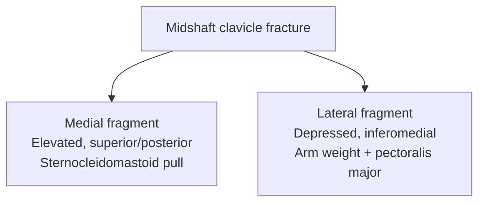
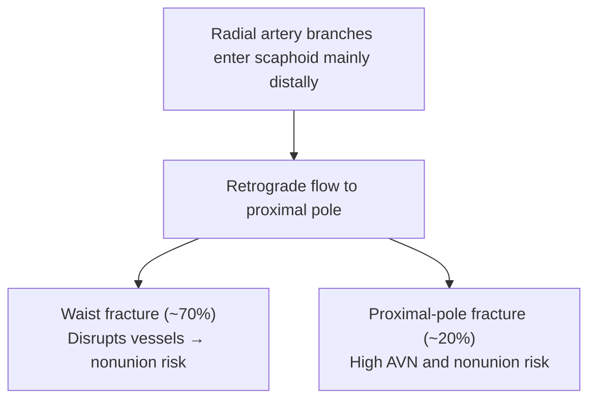

---
tags:
  - medicine/orthopaedics
  - exam-notes
chapter: 2
---

# Chapter 2: Upper Limb Trauma & Dislocation Mechanics

## 1. Clavicle Fractures & Sternoclavicular Joint Disruption

- The clavicle is a doubly curved S-shaped long bone acting as a strut connecting the upper extremity to the axial skeleton.
- **Ossification:** First bone to begin ossifying.
  - Begins in the **5th–6th intrauterine week** by **intramembranous ossification**.
  - **Last bone to complete fusion:** Medial (sternal) clavicular epiphysis at roughly **21–25 years**.

### Fracture Biomechanics & Deformity
- **Mechanism of injury:**
  - **Direct blow to the shoulder:** approximately 85%.
  - **Fall on an outstretched hand (FOOSH):** another mechanism.

* **Anatomical Distribution**:
  * **Middle third (diaphyseal):** Approximately **80%** of clavicle fractures.
    - Site: Junction of the outer convex and inner concave curves.
    - Reason: Thinnest zone; little direct muscular or ligamentous reinforcement.
  * **Lateral third (distal):** Approximately **15%** of fractures.
    - **Classification:** Neer classification, based on the relationship to the **coracoclavicular (CC) ligaments**.
    - CC ligaments: **Conoid and trapezoid**.
    - **Neer type II:** Disruption of the CC support to the proximal fragment → high **nonunion risk**.
  * *Medial-Third (Proximal)*: Account for 5%.
* **Classic Deformity & Muscle Displacement**:
  * **Proximal (Medial) Fragment**: Displaced **superiorly and posteriorly** by the un-opposed muscular traction of the **Sternocleidomastoid** muscle.
  * **Distal (lateral) fragment:**
    - Displaced **inferiorly and medially**.
    - Causes: Weight of the arm + pull of **pectoralis major**.

### Clinical Management & Surgical Indications
* **Conservative management:** Preferred for undisplaced/minimally displaced clavicular fractures.
  * **Immobilization:** Triangular sling (or figure-of-eight bandage).
  * **Typical duration:** **3–4 weeks in children**; **4–6 weeks in adults**.
  * **Next:** Gradual shoulder mobilization.
* **Operative Indications (ORIF with Plate and Screws)**:
  1. Open fractures or impending skin perforation (severe cortical tenting).
  2. Associated neurovascular compromise (subclavian artery/vein compression, brachial plexus injury).
  3. Severe displacement with marked shortening ($>2\text{ cm}$) or complete lack of cortical contact.
  4. Floating shoulder (concomitant ipsilateral scapular neck fracture).

---

## 2. Shoulder Dislocations & Proximal Humerus Trauma

- **Joint:** Multiaxial ball-and-socket glenohumeral articulation.
- **Stability:** Designed for maximal mobility at the expense of intrinsic bony stability.
- **Articular congruity:** The shallow glenoid contacts **less than one-third** of the much larger humeral-head surface.

### Anterior Glenohumeral Dislocation (95% of Shoulder Dislocations)

*Bankart versus Hill–Sachs lesions — schematic.*

- **Frequency:** Anterior shoulder dislocation is the most common joint dislocation in the body.
- **Mechanism:** Fall on an **abducted, externally rotated, extended arm**.

| Category | High-yield findings |
|---|---|
| Anatomic subtype | Subcoracoid (**most common**), subglenoid, infraclavicular |
| Associated lesions | Bankart, bony Bankart, Hill–Sachs |
| Nerve at risk | Axillary nerve |
| Physical signs | Dugas, Hamilton ruler, Callaway; squared-off shoulder |

#### Subtypes & Clinical Presentation
* **Anatomic Subtypes**: Subcoracoid (most common), Subglenoid, Infraclavicular, and Intrathoracic.
* **Clinical deformity:**
  * **Squared-off shoulder:** Flattened deltoid contour with prominent acromion.
  * **Palpation:** Glenoid fossa feels empty.
  * **Attitude:** Slight abduction and external rotation.
* **Pathognomonic Clinical Tests**:
  1. **Dugas Test**: Inability of the patient to touch the contralateral uninjured shoulder with the hand of the affected side while the elbow rests against the chest wall.
  2. **Hamilton's ruler test:**
     - Place a straight ruler along the lateral side of the arm.
     - Ruler touches **acromion and lateral epicondyle** simultaneously.
     - Normally blocked by the rounded humeral head.
  3. **Callaway's Test**: Increased vertical girth of the axillary fold measured around the acromion compared to the normal side.

#### Pathological Lesions & Nerve Complications

*Visual reference: Post-reduction shoulder radiograph showing a Hill–Sachs lesion. [Original image and attribution](https://commons.wikimedia.org/wiki/File:Hills-sachs-lesion-ap.jpg). Online image; internet required.*
* **Bankart lesion:**
  * **Location:** Avulsion of the **anteroinferior glenoid labrum**.
  * **Associated injury:** Inferior glenohumeral ligament complex (IGHL).
  * **Significance:** Predisposes to **recurrent anterior shoulder instability/dislocation**.
  * *Bony Bankart*: Concomitant avulsion fracture of the anteroinferior glenoid bone margin.
* **Hill–Sachs lesion:**
  * **Defect:** Compression/indentation fracture of the **posterolateral humeral head**.
  * **Mechanism:** Impact against the **anteroinferior glenoid rim** during anterior dislocation.
* **Nerve injury — axillary nerve** ($C_5,C_6$):
  * **Frequency:** Most commonly injured nerve (approximately **10–15%**).
  * **Motor deficit:** Weak **deltoid/teres minor** → impaired abduction from about **15–90°**.
  * **Sensory deficit:** **Regimental badge area** over the superolateral arm.
  * **Management:** Usually conservative; a **shoulder abduction splint** may be used where appropriate.

| Lesion | Site / mechanism | Significance |
|---|---|---|
| **Bankart** | Anteroinferior glenoid labral avulsion | Recurrent anterior instability |
| **Hill–Sachs** | Posterolateral humeral head impaction against anterior glenoid | Associated bony defect after dislocation |

#### Reduction Techniques
1. **Kocher's Method**: Traction $\rightarrow$ External Rotation $\rightarrow$ Adduction $\rightarrow$ Internal Rotation.
2. **Hippocratic Method**: Longitudinal traction on the arm with the examiner's unshoed foot placed in the axilla as a fulcrum.
3. **Stimson's Hanging Weight Technique**: Patient prone with affected arm hanging off the table with a 5–10 kg weight attached to the wrist.
4. **Milch Technique**: Abduction and external rotation with direct overhead elevation.

### Posterior Glenohumeral Dislocation
- **Frequency:** Approximately **2–4%** of shoulder dislocations.
- **Diagnostic pitfall:** Frequently missed on the initial AP radiograph.

* **Etiology / mechanism:**
  * **Electric shock**, generalized tonic–clonic seizures, or ECT → powerful muscle contractions.
  * Alternatively, a **direct blow to the anterior shoulder**.
* **Attitude of Limb**: Arm fixed in **adduction and internal rotation**; external rotation is completely blocked.
* **Radiological Signs**:
  * *AP View*: **"Light Bulb Sign" / "Electric Bulb Appearance"**—internal rotation of the humeral head causes it to appear symmetrical and rounded like a light bulb.
  * *Empty Glenoid Sign*: Widened radiolucent space ($>6\text{ mm}$) between anterior glenoid rim and humeral head.
  * *Axillary / Scapular Y View*: Demonstrates posterior displacement of humeral head relative to glenoid.
* **Pathological Lesion**: **Reverse Hill-Sachs Lesion** (impression fracture defect on the **anteromedial** aspect of the humeral head) and **Reverse Bankart Lesion**.

### Inferior Glenohumeral Dislocation (Luxatio Erecta)
* **Mechanism**: Severe forced hyper-abduction force.
* **Presentation:**
  * Humeral head displaced **inferiorly** beneath the glenoid.
  * Arm locked in **overhead hyperabduction**.
  * Hand often rests on or behind the head.
  * **Important:** High incidence of **brachial plexus** and **axillary artery injury**.

### Proximal Humerus Fractures & Neer Classification

*Neer proximal humeral fracture grouping — schematic.*

- **Classification:** **Neer's four-part system**.
- **Four anatomical segments:**
  1. Humeral head.
  2. Greater tuberosity.
  3. Lesser tuberosity.
  4. Humeral shaft.

* **Neer's Definition of Displacement**: A segment is considered a distinct "part" **only if displaced $>1\text{ cm}$** or **angled $>45^\circ$**.
* **Clinical Significance**:
  * *Anatomical Neck Fractures*: High risk of **Avascular Necrosis (AVN)** of the humeral head due to disruption of ascending branches of the anterior humeral circumflex artery.
  * **Surgical neck fracture:**
    - **Risks:** Malunion and **axillary nerve injury**.
    - **Conservative:** Hanging cast / U-slab when appropriate.
    - **Operative:** Locking plate (**PHILOS**) when indicated.

---

## 3. Humeral Shaft Fractures, Spiral Groove Mechanics & Radial Nerve Palsy

- **Anatomical boundaries:** From the **surgical neck** to the **supracondylar ridge**.
- **Frequency:** Approximately **3%** of all fractures.

### Radial Nerve Vulnerability & Fracture Geometry

*Humerus and vulnerable radial-nerve region — schematic.*

- **Nerve at risk:** **Radial nerve** ($C_5$–$T_1$).
- **Course:** Travels in the **posterior spiral (radial) groove** of the humerus.
- **Associated vessel:** **Profunda brachii artery**.

- **Spiral groove / distal-third junction:** the radial nerve passes through the lateral intermuscular septum; its relative fixation increases traction or entrapment vulnerability.
- **Holstein–Lewis fracture:** spiral distal-third humeral-shaft fracture; classically associated with radial-nerve palsy (source cites ~22%).

* **Anatomical mechanism:**
  * At the **middle-to-distal humeral-third junction**, the radial nerve pierces the **lateral intermuscular septum**.
  * It passes from the **posterior** to the **anterior** compartment.
  * At this relatively fixed point, fracture displacement may cause **traction, compression, or entrapment**.
* **Holstein–Lewis fracture:**
  * **Pattern:** Spiral fracture of the **distal third** of the humeral shaft.
  * **Displacement:** Classically radial displacement of the distal fragment.
  * **Association:** Radial nerve entrapment/laceration (reported incidence **up to ~22%**).

### Radial Nerve Injury Classification & Functional Deficits

| Injury Site | Motor Deficits | Sensory Deficits | Clinical Deformity & Management |
| :--- | :--- | :--- | :--- |
| **High Radial Nerve Injury** *(Axilla / Crutch Palsy)* | Loss of Triceps (elbow extension), Brachioradialis, Supinator, Wrist Extensors, Finger/Thumb Extensors | Sensory loss over posterior arm, posterior forearm, and 1st dorsal interosseous web space | **Wrist Drop** + Finger Drop + Loss of elbow extension; Rx: **Cock-Up Splint** |
| **High Radial Nerve Injury** *(Spiral Groove / Mid-Shaft)* | Triceps spared (branches arise in axilla); Loss of Wrist Extensors, Finger/Thumb Extensors | Sensory loss over 1st dorsal interosseous web space on dorsum of hand | **Wrist Drop** + Finger Drop; Elbow extension preserved |
| **Low Radial Nerve Injury** *(Elbow / PIN Syndrome)* | **Posterior Interosseous Nerve (PIN)** branch involved; Loss of Extensor Digitorum, ECU, EPL/EPB. ECRL preserved (wrist extension intact) | **No sensory loss** (PIN is a pure motor nerve) | **Finger Drop** & Thumb Drop; **NO Wrist Drop** |

| Finding | Radial nerve at spiral groove | Posterior interosseous nerve (near elbow) |
|---|---|---|
| Wrist extension | Weak / wrist drop | Generally preserved through ECRL |
| Finger extension | Weak / finger drop | Weak / finger drop |
| First dorsal web-space sensation | May be reduced | Preserved (PIN is motor) |

* **Management of associated radial nerve palsy:**
  * **Natural history:** Most primary palsies accompanying **closed** shaft fractures are neuropraxias and often recover spontaneously over weeks (commonly **8–12 weeks**, sometimes longer).
  * **Fracture support:** Functional bracing or coaptation splint where appropriate.
  * **Wrist support:** **Cock-up splint** to preserve wrist extension and prevent flexion contracture.
  * **Consider surgical exploration:** Open fractures, failed closed reduction / suspected entrapment, or new palsy following manipulation.

---

## 4. Elbow Fractures & Dislocations

- The elbow complex consists of three articulations: ulnohumeral, radiohumeral, and proximal radioulnar joints.
- **Three-point bony landmarks:** Medial epicondyle, lateral epicondyle, and olecranon tip.
  - At **90° flexion:** **Equilateral triangle**.
  - In **full extension:** **Straight horizontal line**.

### Supracondylar Fracture of the Humerus

*Visual reference: Marked radiograph illustrating a supracondylar humeral fracture. [Original image and attribution](https://commons.wikimedia.org/wiki/File:SupracondylarfracMark.png). Online image; internet required.*

- **Frequency:** Most common elbow fracture in children; particularly **5–8 years**.
- **Site:** Extra-articular fracture of the **distal humeral metaphysis**, proximal to the epicondyles and trochlea/capitellum.
- **Growth-plate analogy:** Sometimes described as a **Salter–Harris type I/II equivalent**.
- **Clinical importance:** Displaced fractures may cause **neurovascular injury** or **acute compartment syndrome**.

- **Three-point relationship in supracondylar fracture:**
  - **Maintained:** Isolated supracondylar fracture (fracture proximal to the landmarks).
  - **Altered:** Elbow dislocation; may also be disrupted in condylar, olecranon, or intercondylar injuries.

#### Classification & Mechanisms

| Feature | Extension type (~95%) | Flexion type (~5%) |
|---|---|---|
| Mechanism | **FOOSH** with elbow hyperextension | Direct blow/fall onto a **flexed elbow** |
| Distal fragment | Displaced **posteriorly** (often proximally) | Displaced **anteriorly** |
| Important anatomic risk | Sharp **anterior spike of the proximal fragment** projects into the cubital fossa, endangering the **brachial artery and median nerve/AIN** | **Ulnar nerve** injury is relatively characteristic |

* **Management**: 
	* Gartland Type I treated in an above-elbow plaster slab; 
	* Gartland Type II and III managed with urgent **Closed Reduction and Percutaneous K-Wire Fixation (CRPP)**. 
	* **[[01_Basics_and_Fracture_Healing#Splints, Braces, Tractions & Casts|Dunlop's Traction]]** is used when surgery is delayed.
##### Gartland Classification (Extension Type)

| Type | Displacement / stability | Important clue |
|---|---|---|
| **I** | Undisplaced; cortical continuity maintained | Fracture line can be subtle; **fat pad sign** may be the main radiographic clue |
| **II** | Angulated/displaced with **intact posterior cortical/periosteal hinge** | Stability and rotation guide fixation decisions |
| **III** | **Completely displaced**, with no cortical contact | Unstable; high risk of neurovascular injury or soft-tissue entrapment |

- **Important exception:** In a type III fracture, complete loss of cortical contact does **not** prove every periosteal attachment has torn.

#### Radiological Assessment

- **Views:** **AP and true lateral elbow radiographs**.
- **Interpretation:** Assess **alignment** as well as the fracture line.

- **Anterior humeral line (true lateral):**
  - **How to draw:** Extend the **anterior cortex** of the distal humeral shaft.
  - **Normal:** Intersects the **middle third of the capitellum**.
    - **Young children:** May lie more anteriorly.
  - **Extension supracondylar fracture:** Posterior capitellar displacement → line passes **anterior to the middle third** or misses it.
- **Baumann's angle (AP):**
  - **How to measure:** Between the **humeral shaft axis** and **lateral condylar/capitellar physeal line**.
  - **Usual value:** Approximately **70–75°** (age and technique dependent).
  - **Purpose:** Assess coronal alignment under **C-arm**, helping prevent **cubitus varus**.
  - **Pitfall:** Using a perpendicular to the shaft instead gives the **complementary angle**.
- **Anterior fat pad (“sail sign”):**
  - Anterior fat pad becomes **elevated/triangular**.
  - Indicates **joint effusion or hemarthrosis**.
  - May be the only sign of an **occult fracture**.
- **Posterior fat pad sign:**
  - Normally **not visible** on a correctly positioned lateral elbow film.
  - When visible, it is **abnormal** and suggests **joint effusion/hemarthrosis**.
  - Consider **occult fracture** even without a visible fracture line.

#### Neurovascular Examination & Complications

- **Vascular examination (before and after reduction):**
  - Radial pulse.
  - Capillary refill.
  - Colour and temperature of the hand.
- **Neurological examination (before and after reduction):**
  - Median nerve / anterior interosseous nerve (AIN).
  - Radial nerve.
  - Ulnar nerve.
- **Principal vessel at risk:** **Brachial artery**.
  - Mechanisms: Compression, vasospasm, entrapment, or laceration against the anterior bony spike.

| Structure | Typical deficit / clinical test |
|---|---|
| **Anterior interosseous nerve (AIN)** — most characteristic nerve injury in extension-type fractures | Purely **motor** branch of median nerve; weakness of **FPL** and **index FDP** prevents a round **“OK” sign** (pad-to-pad instead of tip-to-tip pinch); **no sensory loss** |
| **Median nerve (main trunk)** | Impaired median-innervated forearm flexors and thenar opposition (established palsy may cause an **ape-thumb posture**); sensory loss over **palmar radial 3½ digits** |
| **Radial nerve** | Weak wrist/finger extension (**wrist/finger drop**); sensory change at **first dorsal web space** |
| **Ulnar nerve** — especially flexion-type injuries or **iatrogenic medial K-wire** injury | Weak finger abduction/adduction; sensory loss over the **little finger and ulnar half of ring finger** |

| Complication | Mechanism, features, and management |
|---|---|
| **Pink pulseless hand** | The hand is **warm and pink with maintained perfusion** but lacks a palpable radial pulse. Requires **urgent orthopaedic reduction and stabilization**, then repeat vascular assessment. The pulse may return; **persistent absence despite good perfusion needs close specialist observation and individualized vascular assessment**, not automatic dismissal or automatic exploration. |
| **Pale/cold pulseless hand** | **Threatened limb perfusion**: urgent reduction/fixation and reassessment; **persistent ischemia after reduction warrants immediate vascular exploration**. |
| **Acute compartment syndrome** | Increasing pain, especially **pain with passive finger stretch**, disproportionate analgesic needs, and a tense forearm are warning signs; pulses may remain present. Compartment pressures (normally around **0–10 mmHg**; concerning values include **absolute >30 mmHg** or **delta pressure ≤30 mmHg**) can aid an uncertain diagnosis but do **not** replace clinical assessment. **Emergent fasciotomy** is required when suspected/confirmed; do not delay for an arbitrary time cutoff. |
| **Volkmann's ischemic contracture (VIC)** | Untreated ischemia/compartment syndrome causes **flexor muscle necrosis and fibrosis** (especially FPL/FDP), resulting in fixed wrist and finger flexion deformity. |
| **Cubitus varus (“gunstock deformity”)** | **Most common late mechanical complication**, from malunion with varus tilt/medial rotation. Carrying angle becomes abnormal; **elbow motion is often preserved**. Symptomatic or significant deformity may be corrected by **French/Modified King closing-wedge osteotomy**. |
| **Myositis ossificans / heterotopic ossification** | Can occur around the elbow, including the **brachialis**, after trauma or repeated forceful manipulation. Avoid **vigorous massage/passive stretching**; manage initially with rest/protection and appropriate analgesia (including NSAIDs when suitable), with specialist review for persistent functional limitation. |

#### Management

1. **Initial stabilization**
   - Record and repeat the **neurovascular examination**.
   - Give analgesia.
   - Immobilize in a **well-padded posterior above-elbow slab**, with the elbow in a safe position of comfort.
   - **Avoid excessive flexion** when swelling or vascular compromise is present.
   - **Dunlop's traction:** Historical/selected temporary option when surgery is delayed; **not routine first-line** care.
2. **Gartland I — undisplaced**
   - **Above-elbow posterior slab/cast** for approximately **3–4 weeks**.
   - Flexion usually **80–90°**, if swelling and vascular status permit.
   - Avoid forced flexion **beyond 90°**.
3. **Gartland II — displaced with intact posterior hinge**
   - **Reduce** the fracture.
   - **CRPP:** For unstable, rotated, or inadequately aligned fractures.
   - **Selected stable IIa fractures:** Cast with close orthopaedic/radiographic follow-up.
4. **Gartland III / unstable flexion-type fractures**
   - Usually require **closed reduction and percutaneous K-wire fixation (CRPP)** under **C-arm fluoroscopy**.
   - **Open reduction:** If closed reduction fails or neurovascular tissue is irreducibly entrapped.
5. **Pin placement**
   - **Two or more lateral-entry K-wires:** Commonly preferred to reduce **iatrogenic ulnar nerve injury**.
   - **Crossed pins:** An option when additional stability is required, with **ulnar nerve protection**.
   - **After fixation:** Recheck pulse, perfusion, and peripheral nerve function.

### Lateral Condyle Fracture of the Humerus
- **Frequency:** Second most common elbow fracture in children; typical age **6–10 years**.
- **Fracture pattern:** **Intra-articular Salter–Harris type IV**.
- **Mechanism:** Varus traction of extensor muscles or axial force transmitted by the radial head.

* **“Fracture of necessity”:**
  * **Why:** Intra-articular lateral condyle fracture needs **anatomical reduction**.
  * **Nonunion risk:** Synovial fluid contains fibrinolytic factors that interfere with healing.
  * **Treatment:** Internal fixation using **K-wires/screws** when indicated.
* **Complications**: Non-union (most common complication), **Cubitus Valgus Deformity**, leading years later to stretching and **Tardy Ulnar Nerve Palsy**.

### Olecranon Fracture
- **Site:** **Intra-articular fracture** of the proximal ulna (olecranon).
- **Biomechanics:** Disrupts the **triceps extensor mechanism**.
  - Displaced fragments are pulled apart proximally by the triceps.
- **Treatment of displaced fractures:** **Tension-band wiring (TBW)**.
  - Two parallel K-wires plus a **figure-of-eight wire**.
  - Converts tensile pull of the triceps into **compression at the fracture site**.

### Elbow Dislocation & The Terrible Triad
* **Elbow dislocation:**
  * **Frequency:** Most common joint dislocation in children; second most common in adults.
  * **Direction:** **Posterior**, approximately **90%**.
  * **Landmark change:** Disturbed **three-point bony triangle**.
  * **Associated nerve:** **Ulnar nerve** at risk.
* **Hotchkiss Terrible Triad of the Elbow**: Severe complex instability consisting of:
  1. Posterior Elbow Dislocation.
  2. Radial Head Fracture.
  3. Coronoid Process Fracture of Ulna.

### Pulled Elbow (Nursemaid's Elbow)
- **Typical patient:** Child aged **1–4 years**.
- **Injury:** Subluxation of the radial head / annular ligament complex.
* **Pathophysiology:**
  * **Trigger:** Sudden longitudinal pull on an **extended, pronated forearm** (e.g., lifting a child by the wrist).
  * **Mechanism:** Small immature **radial head slips beneath the annular ligament**.
  * The ligament may become **trapped** in the radiohumeral joint.
* **Clinical Presentation**: Child holds the arm extended and pronated against the body, crying upon any attempt at supination, with no focal swelling or deformity.
* **Reduction technique:**
  * Apply gentle pressure over the **radial head**.
  * **Supination + flexion** or **hyperpronation** maneuver.
  * A palpable **“pop”** may indicate reduction of the annular ligament.

---

## 5. Forearm Fractures & Eponymous Injuries

| Injury | Fracture | Dislocation | Classic association |
|---|---|---|---|
| **Monteggia** | Proximal-third ulna | Radial head (proximal radioulnar joint) | Posterior interosseous nerve injury |
| **Galeazzi** | Distal-third radius | Distal radioulnar joint (DRUJ) | Often requires operative stabilization ("fracture of necessity") |

### Monteggia Fracture-Dislocation
* **Definition — Monteggia:**
  * Fracture of the **proximal third of the ulnar shaft**.
  * Associated **radial head dislocation** at the **proximal radioulnar joint (PRUJ)**.
  * **Bado classification:** Type I (**anterior** radial-head dislocation) is the most common.
* **Nerve Injury**: **Posterior Interosseous Nerve (PIN)** injury, presenting with finger drop and thumb extension loss without sensory deficit.

### Galeazzi Fracture-Dislocation (Reverse Monteggia)
* **Definition — Galeazzi:**
  * Fracture of the **distal third of the radial shaft**.
  * Associated disruption/dislocation of the **distal radioulnar joint (DRUJ)** and **TFCC**.
* **Management — Galeazzi:**
  * **“Fracture of necessity”** in adults.
  * Usually requires **ORIF of the radius** with rigid plating.
  * Restoring radial alignment often reduces the **DRUJ**; assess its stability.

### Colles' Fracture

*Visual reference: Distal radius radiograph demonstrating a Colles fracture. [Original image and attribution](https://commons.wikimedia.org/wiki/File:Colles_fracture.JPG). Online image; internet required.*

*Colles versus Smith displacement — schematic.*

- **Site:** Extra-articular fracture of the **distal radius metaphysis**, approximately $2–3\text{ cm}$ proximal to the radiocarpal joint.
- **Typical patient:** Postmenopausal woman with osteoporosis.
- **Mechanism:** **FOOSH** with the wrist extended.
- **Hallmark:** Characteristic dorsal displacement and angulation of the distal fragment.

#### Classic Colles Displacement Components
- Dorsal displacement (translation)
- Dorsal tilt (angulation)
- Radial displacement (translation)
- Radial tilt (deviation)
- Supination (rotation)

* **Classic Deformity**: **"Dinner Fork Deformity"** (dorsal prominence created by backward displacement of distal fragment and palmar prominence of proximal radius shaft).
* **6 Classic Displacement Vectors**:
  1. *Dorsal Displacement* (backward shift).
  2. *Dorsal Tilt / Angulation* (distal articular surface tilts dorsally; normal palmar tilt $11^\circ$ is reversed).
  3. *Radial Displacement* (lateral shift).
  4. *Radial Tilt* (lateral inclination).
  5. *Supination* of distal fragment.
  6. *Impaction / Shortening* of radius.

| Feature | Colles | Smith |
|---|---|---|
| Mechanism | FOOSH, wrist extended | Fall onto flexed wrist |
| Distal radial fragment | **Dorsal** tilt and displacement | **Volar** tilt and displacement |
| Deformity | Dinner-fork | Garden-spade |
| Site | Distal radius metaphysis | Distal radius metaphysis |

* **Management — Colles fracture:**
  * **Closed reduction:** Longitudinal traction + manipulation (flexion, ulnar deviation, pronation).
  * **Cast:** Colles' / **“hand-shaking”** below-elbow cast.
    - Wrist typically in slight **flexion, ulnar deviation, and pronation**.
  * **Typical duration:** Approximately **6 weeks**.
* **Complications — Colles fracture:**
  * **Malunion:** Most common.
  * **Sudeck's osteodystrophy:** Complex regional pain syndrome (CRPS I).
  * **Carpal tunnel syndrome:** Median nerve compression.
  * **Delayed EPL tendon rupture:** Attrition/ischemia near **Lister's tubercle**.

### Smith's Fracture (Reverse Colles')
- **Site:** Extra-articular fracture of the distal radial metaphysis.
- **Mechanism:** Fall on a **flexed wrist**.
- **Displacement:** Distal fragment moves **volarly/anteriorly** with volar angulation.
- **Classic appearance:** **Garden-spade deformity**.

### Barton's Fracture
- **Nature:** **Intra-articular radiocarpal fracture-dislocation**.
- **Mechanism:** Subluxed carpus remains attached to the displaced distal radial articular fragment.
- **Variants:** **Dorsal Barton** and **volar Barton** (more common).
- **Treatment:** **ORIF**, typically with a volar buttress plate when indicated.

---

## 6. Hand & Carpal Trauma

- **Number:** **8 carpal bones**, in proximal and distal rows.
- **Proximal row:** Scaphoid, lunate, triquetrum, pisiform.
- **Distal row:** Trapezium, trapezoid, capitate, hamate.
- **Mnemonic:** *“So Long To Pinky, Here Comes The Thumb.”*

| Injury | Recall cue |
|---|---|
| Scaphoid fracture | FOOSH; anatomical snuffbox tenderness |
| Bennett fracture–dislocation | Intra-articular base of 1st metacarpal; APL pull |
| Rolando fracture | Comminuted Y/T-shaped intra-articular base of 1st metacarpal |
| Boxer's fracture | Neck of 5th metacarpal |
| Mallet finger | Terminal extensor avulsion at DIP |

### Scaphoid Fracture

*Visual reference: Published classification illustration of scaphoid fracture location. [Original image and attribution](https://commons.wikimedia.org/wiki/File:Scaphoid_fracture_classification.jpg). Online image; internet required.*
- **Frequency:** **Most commonly fractured carpal bone**, accounting for approximately **70–80%** of carpal fractures.
- **Mechanism:** **FOOSH**.
- **Typical patient:** Young adult.

* **Clinical diagnosis — scaphoid fracture:**
  * **Anatomical snuffbox tenderness**.
    - **Medial boundary:** Extensor pollicis longus (EPL).
    - **Lateral boundary:** Abductor pollicis longus (APL) + extensor pollicis brevis (EPB).
  * **Other signs:** Pain on axial thumb loading and **scaphoid tubercle tenderness**.
* **Blood Supply & Vulnerability**: Blood supply enters via the distal pole from retrograde branches of the **Radial Artery**.
  * *Waist Fractures*: Account for 70% of fractures.
  * *Proximal Pole Fractures*: High incidence of **Avascular Necrosis (AVN)** and non-union due to complete devascularization of the proximal fragment.

* **Management & Radiography**:
  * **Radiography:** AP, lateral, and dedicated **scaphoid view** with approximately **20° ulnar deviation**.
    - Early fractures may be **occult** on plain radiographs.
    - High suspicion despite negative X-rays → **thumb-spica immobilization**, repeat films after about **2 weeks**, or obtain **early MRI**.
    - **MRI:** Highly sensitive for an occult scaphoid fracture.
  * **Definitive treatment:**
    - **Undisplaced waist fracture:** Thumb-spica cast for approximately **8–12 weeks**.
    - **Displaced/proximal-pole fracture:** Internal fixation with a headless compression (**Herbert**) screw when indicated.
* **Scapholunate dissociation:**
  * Injury of the **scapholunate interosseous ligament**.
  * **AP X-ray:** Widened scapholunate gap **>3 mm**.
  * Classic eponym: **“Terry Thomas sign”** (resembling a prominent front-tooth gap).

### Bennett's Fracture-Dislocation
- **Site:** Base of the **first metacarpal** (thumb carpometacarpal joint).
- **Nature:** **Intra-articular fracture-dislocation**.

* **Mechanism and displacement — Bennett fracture:**
  * **Small volar-medial base fragment:** Remains anchored to the trapezium by the **anterior oblique ligament**.
  * **Main first-metacarpal shaft:** Pulled **dorsally, proximally, and radially**.
  * **Deforming force:** **Abductor pollicis longus (APL)** tendon.
* **Management**: Unstable fracture requiring Closed Reduction and Percutaneous K-wire Fixation or Open Reduction.

| Component | Attachment / displacement |
|---|---|
| Volar-ulnar base fragment | Retained against trapezium by anterior oblique ligament |
| Main 1st metacarpal shaft | Displaced dorsally and proximally by **abductor pollicis longus** |

### Rolando's Fracture
- **Site:** Intra-articular **base of the first metacarpal**.
- **Pattern:** Comminuted **T- or Y-shaped** fracture.
- **Prognosis:** Worse than Bennett fracture.
- **Management:** Usually requires operative reconstruction.

### Boxer's Fracture
- **Site:** Transverse fracture through the **neck of the fifth metacarpal**.
- **Mechanism:** Closed-fist punch against a hard object.
- **Displacement:** **Volar angulation** of the metacarpal head.
- **Appearance:** Loss of normal fifth-knuckle prominence.

### Gamekeeper's / Skier's Thumb
- **Mechanism:** Hyperabduction of the thumb MCP joint.
- **Injury:** Acute or chronic rupture of the **ulnar collateral ligament (UCL)**.
- **Stener lesion:** **Adductor aponeurosis** becomes interposed between the torn UCL and its insertion.
  - **Importance:** Prevents spontaneous ligament healing; generally requires operative repair.

### Mallet Finger (Baseball Finger)
- **Deformity:** Unopposed **flexion at the DIP joint**.
- **Functional deficit:** Inability to **actively extend the DIP**.

* **Pathophysiology — mallet finger:**
  * Sudden **forced flexion** of an **actively extended DIP** (e.g., ball strikes fingertip).
  * Causes avulsion/rupture of the terminal **extensor tendon (EDC)** insertion at the dorsal base of the distal phalanx.
* **Management**: Continuous immobilization of the DIP joint in slight hyperextension using a **Mallet / Stax Splint** for 6–8 weeks.

---

## 7. Comprehensive Upper Limb Eponymous Summary

| Eponymous Condition | Primary Anatomical Site & Pathological Feature | Key Clinical Deformity / Sign | Associated Nerve / Vessel Injury | Preferred Immobilization / Fixation |
| :--- | :--- | :--- | :--- | :--- |
| **Neer Classification** | Proximal Humerus (4-part classification system) | Varus/valgus displacement | Axillary nerve / Ascending humeral branch | PHILOS plate / Hanging cast |
| **Holstein-Lewis** | Distal 1/3 Spiral Fracture of Humeral Shaft | Wrist Drop & Finger Drop | **Radial Nerve** (Spiral groove entrapment) | Coaptation splint / Cock-up splint |
| **Gartland Classification**| Extension-type Supracondylar Humerus Fracture | **Gunstock Deformity** (Cubitus Varus) | **AIN** (loss of "OK" sign) / Brachial Artery | Percutaneous K-wire pinning (CRPP) |
| **Hotchkiss Triad** | Elbow Dislocation + Radial Head Fx + Coronoid Fx | Gross elbow instability | Ulnar Nerve | Surgical repair & ORIF |
| **Nursemaid's Elbow** | Radial Head subluxation under Annular Ligament | Arm held pronated & flexed | None | Supination + Flexion reduction |
| **Monteggia** | Proximal 1/3 Ulna Fx + Radial Head Dislocation | Forearm pain & elbow block | **PIN** (Finger drop, pure motor) | ORIF Ulna + Closed reduction Radial head |
| **Galeazzi** | Distal 1/3 Radius Fx + DRUJ Dislocation | Prominent ulnar head | Anterior Interosseous Nerve | ORIF Radius with rigid plate |
| **Colles' Fracture** | Extra-articular Distal Radius Metaphysis (Dorsal) | **Dinner Fork Deformity** | Median Nerve (Carpal tunnel) | Colles' Cast ("Hand-Shaking Cast") |
| **Smith's Fracture** | Extra-articular Distal Radius Metaphysis (Volar) | **Garden Spade Deformity** | Median Nerve | Volar buttress plate / Cast in extension |
| **Barton's Fracture** | Intra-articular Radiocarpal Fracture-Dislocation | Wrist subluxation | Median Nerve | Volar buttress plate |
| **Scaphoid Fracture** | Carpal Scaphoid Waist / Proximal Pole | **Anatomical Snuffbox** pain | Retrograde Radial Artery (AVN risk) | Thumb Spica / Herbert Screw |
| **Bennett's** | Intra-articular Base of 1st Metacarpal | Displaced thumb shaft | APL tendon pull | CRPP / ORIF |
| **Rolando's** | Comminuted Y/T Base of 1st Metacarpal | Loss of thumb contour | APL tendon pull | ORIF / External Fixator |
| **Boxer's Fracture** | Neck of 5th Metacarpal | Loss of 5th knuckle | None | Ulnar gutter splint |
| **Mallet Finger** | EDC Tendon Avulsion at Dorsal DIP Base | **DIP Flexion Deformity** | None | Stax / Mallet Splint in extension |
