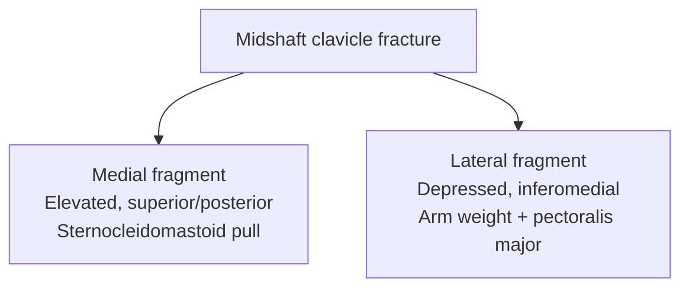
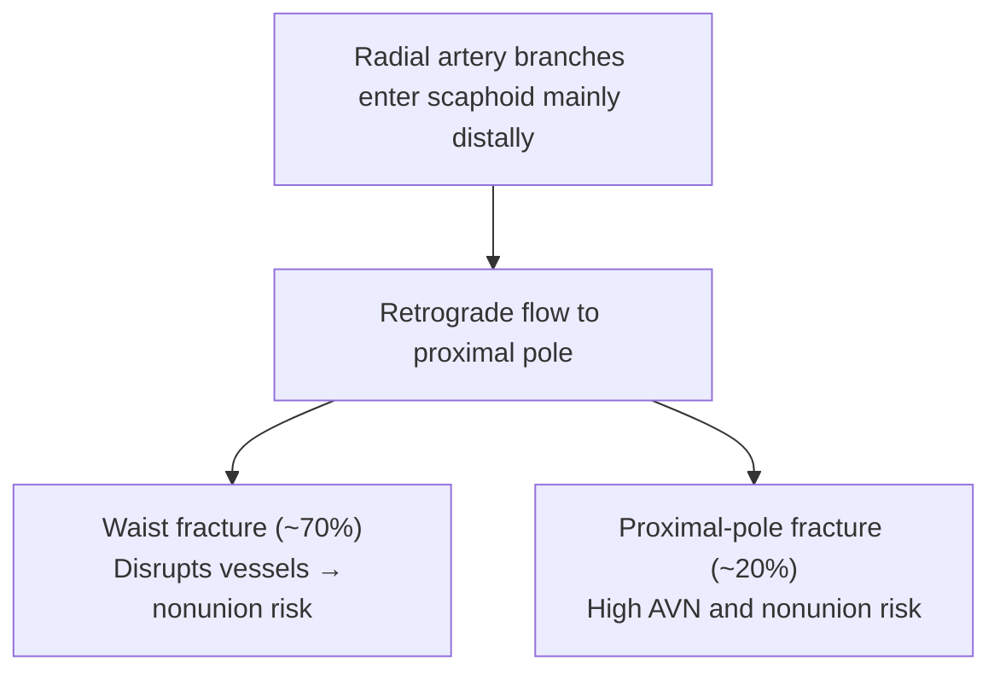

---
tags:
  - medicine/orthopaedics
  - exam-notes
chapter: 2
---

# Chapter 2: Upper Limb Trauma & Dislocation Mechanics

## 1. Clavicle Fractures & Sternoclavicular Joint Disruption

- The clavicle is a doubly curved S-shaped long bone acting as a strut connecting the upper extremity to the axial skeleton.
- It is the first bone in the human body to begin ossification (5th–6th week in utero via intramembranous ossification) and the last to complete fusion (sternal epiphysis fuses at age 21–25).

### Fracture Biomechanics & Deformity
Clavicle fractures occur predominantly from a direct blow to the shoulder (85%) or a fall on an outstretched hand (FOOSH).

* **Anatomical Distribution**:
  * *Middle-Third (Diaphyseal)*: Account for **80% of fractures**. Occurs at the transition junction between the outer convex and inner concave curves, representing the thinnest anatomical zone devoid of muscular or ligamentous reinforcement.
  * *Lateral-Third (Distal)*: Account for 15%. Graded by the **Neer Classification** based on relationship to the coracoclavicular (CC) ligaments (conoid and trapezoid). Type II injuries (coracoclavicular ligaments disrupted from proximal fragment) carry a high rate of non-union.
  * *Medial-Third (Proximal)*: Account for 5%.
* **Classic Deformity & Muscle Displacement**:
  * **Proximal (Medial) Fragment**: Displaced **superiorly and posteriorly** by the un-opposed muscular traction of the **Sternocleidomastoid** muscle.
  * **Distal (Lateral) Fragment**: Displaced **inferiorly and medially** due to the downward gravitational weight of the arm and adductor traction of the **Pectoralis Major** muscle.

### Clinical Management & Surgical Indications
* **Conservative Management (Gold Standard for Undisplaced/Minimally Displaced)**: Immobilization in a **Triangular Sling** or **Figure-of-8 Bandage** for 3–4 weeks in children or 4–6 weeks in adults, followed by shoulder mobilization.
* **Operative Indications (ORIF with Plate and Screws)**:
  1. Open fractures or impending skin perforation (severe cortical tenting).
  2. Associated neurovascular compromise (subclavian artery/vein compression, brachial plexus injury).
  3. Severe displacement with marked shortening ($>2\text{ cm}$) or complete lack of cortical contact.
  4. Floating shoulder (concomitant ipsilateral scapular neck fracture).

---

## 2. Shoulder Dislocations & Proximal Humerus Trauma

The glenohumeral joint is a multiaxial ball-and-socket joint designed for maximal mobility at the expense of intrinsic bony stability. The shallow glenoid cavity articulates with less than one-third of the larger humeral head surface.

### Anterior Glenohumeral Dislocation (95% of Shoulder Dislocations)

*Bankart versus Hill–Sachs lesions — schematic.*

Anterior dislocation is the most common joint dislocation in the body, resulting from a fall on an **abducted, externally rotated, and extended arm**.

| Category | High-yield findings |
|---|---|
| Anatomic subtype | Subcoracoid (**most common**), subglenoid, infraclavicular |
| Associated lesions | Bankart, bony Bankart, Hill–Sachs |
| Nerve at risk | Axillary nerve |
| Physical signs | Dugas, Hamilton ruler, Callaway; squared-off shoulder |

#### Subtypes & Clinical Presentation
* **Anatomic Subtypes**: Subcoracoid (most common), Subglenoid, Infraclavicular, and Intrathoracic.
* **Clinical Deformity**: Flattening of the lateral rounded deltoid contour creating a **"Squared-Off Shoulder"** with a prominent acromion process and an easily palpable empty glenoid fossa. The arm is held in an attitude of slight abduction and external rotation.
* **Pathognomonic Clinical Tests**:
  1. **Dugas Test**: Inability of the patient to touch the contralateral uninjured shoulder with the hand of the affected side while the elbow rests against the chest wall.
  2. **Hamilton's Ruler Test**: A straight ruler placed against the lateral aspect of the arm can touch both the acromion process and the lateral epicondyle simultaneously (normally prevented by the rounded humeral head).
  3. **Callaway's Test**: Increased vertical girth of the axillary fold measured around the acromion compared to the normal side.

#### Pathological Lesions & Nerve Complications

*Visual reference: Post-reduction shoulder radiograph showing a Hill–Sachs lesion. [Original image and attribution](https://commons.wikimedia.org/wiki/File:Hills-sachs-lesion-ap.jpg). Online image; internet required.*
* **Bankart Lesion**: Avulsion of the anteroinferior glenoid labrum from the glenoid margin, disrupting the inferior glenohumeral ligament complex (IGHLC). The primary predisposing cause of **recurrent anterior shoulder dislocation**.
  * *Bony Bankart*: Concomitant avulsion fracture of the anteroinferior glenoid bone margin.
* **Hill-Sachs Lesion**: Compression fracture / indentation defect on the **posterolateral aspect of the humeral head**, caused by repeated impact against the sharp anteroinferior glenoid rim during dislocation.
* **Nerve Injury**: **Axillary Nerve ($C_5, C_6$)** is the most frequently injured nerve (10–15% of cases). Causes paralysis of the deltoid and teres minor muscles (impaired shoulder abduction between $15^\circ\text{--}90^\circ$) and sensory loss over the **"Regimental Badge Area"** on the upper lateral aspect of the arm. Treated conservatively with a **Shoulder Abduction Splint**.

| Lesion | Site / mechanism | Significance |
|---|---|---|
| **Bankart** | Anteroinferior glenoid labral avulsion | Recurrent anterior instability |
| **Hill–Sachs** | Posterolateral humeral head impaction against anterior glenoid | Associated bony defect after dislocation |

#### Reduction Techniques
1. **Kocher's Method**: Traction $\rightarrow$ External Rotation $\rightarrow$ Adduction $\rightarrow$ Internal Rotation.
2. **Hippocratic Method**: Longitudinal traction on the arm with the examiner's unshoed foot placed in the axilla as a fulcrum.
3. **Stimson's Hanging Weight Technique**: Patient prone with affected arm hanging off the table with a 5–10 kg weight attached to the wrist.
4. **Milch Technique**: Abduction and external rotation with direct overhead elevation.

### Posterior Glenohumeral Dislocation
Account for 2–4% of shoulder dislocations. Frequently missed on initial anteroposterior radiographs.

* **Etiology & Mechanism**: High-energy muscular contractions induced by **electric shock**, **grand mal epileptic seizures**, or electroconvulsive therapy (ECT), or direct blow to anterior shoulder.
* **Attitude of Limb**: Arm fixed in **adduction and internal rotation**; external rotation is completely blocked.
* **Radiological Signs**:
  * *AP View*: **"Light Bulb Sign" / "Electric Bulb Appearance"**—internal rotation of the humeral head causes it to appear symmetrical and rounded like a light bulb.
  * *Empty Glenoid Sign*: Widened radiolucent space ($>6\text{ mm}$) between anterior glenoid rim and humeral head.
  * *Axillary / Scapular Y View*: Demonstrates posterior displacement of humeral head relative to glenoid.
* **Pathological Lesion**: **Reverse Hill-Sachs Lesion** (impression fracture defect on the **anteromedial** aspect of the humeral head) and **Reverse Bankart Lesion**.

### Inferior Glenohumeral Dislocation (Luxatio Erecta)
* **Mechanism**: Severe forced hyper-abduction force.
* **Presentation**: Humeral head is driven inferiorly beneath the glenoid labrum. The patient presents with the affected arm locked overhead in fixed hyper-abduction, with the hand resting on or behind the head. High incidence of brachial plexus and axillary artery injury.

### Proximal Humerus Fractures & Neer Classification

*Neer proximal humeral fracture grouping — schematic.*

Proximal humerus fractures are evaluated using **Neer's 4-Part Classification**, which divides the proximal humerus into 4 anatomical segments: (1) Humeral head, (2) Greater tuberosity, (3) Lesser tuberosity, and (4) Humeral shaft.

* **Neer's Definition of Displacement**: A segment is considered a distinct "part" **only if displaced $>1\text{ cm}$** or **angled $>45^\circ$**.
* **Clinical Significance**:
  * *Anatomical Neck Fractures*: High risk of **Avascular Necrosis (AVN)** of the humeral head due to disruption of ascending branches of the anterior humeral circumflex artery.
  * *Surgical Neck Fractures*: High risk of **malunion** and axillary nerve injury; managed conservatively with a hanging cast / U-slab or surgically with locking plates (PHILOS plate).

---

## 3. Humeral Shaft Fractures, Spiral Groove Mechanics & Radial Nerve Palsy

Humeral shaft fractures occur between the surgical neck proximally and the supracondylar ridge distally, accounting for 3% of all fractures.

### Radial Nerve Vulnerability & Fracture Geometry

*Humerus and vulnerable radial-nerve region — schematic.*

The **Radial Nerve ($C_5-T_1$)** is intimately associated with the humerus as it courses through the posterior **spiral groove (radial groove)** alongside the profunda brachii artery.

- **Spiral groove / distal-third junction:** the radial nerve passes through the lateral intermuscular septum; its relative fixation increases traction or entrapment vulnerability.
- **Holstein–Lewis fracture:** spiral distal-third humeral-shaft fracture; classically associated with radial-nerve palsy (source cites ~22%).

* **Anatomical Mechanism**: At the junction of the middle and distal thirds of the humerus, the radial nerve perforates the **lateral intermuscular septum** to pass from the posterior to the anterior compartment. At this point, the nerve is firmly tethered and vulnerable to mechanical compression or entrapment during fracture displacement.
* **Holstein-Lewis Fracture**: A specific **spiral fracture of the distal third of the humeral shaft** characterized by radial displacement of the distal fragment, associated with a high incidence (up to 22%) of acute radial nerve entrapment or laceration.

### Radial Nerve Injury Classification & Functional Deficits

| Injury Site | Motor Deficits | Sensory Deficits | Clinical Deformity & Management |
| :--- | :--- | :--- | :--- |
| **High Radial Nerve Injury** *(Axilla / Crutch Palsy)* | Loss of Triceps (elbow extension), Brachioradialis, Supinator, Wrist Extensors, Finger/Thumb Extensors | Sensory loss over posterior arm, posterior forearm, and 1st dorsal interosseous web space | **Wrist Drop** + Finger Drop + Loss of elbow extension; Rx: **Cock-Up Splint** |
| **High Radial Nerve Injury** *(Spiral Groove / Mid-Shaft)* | Triceps spared (branches arise in axilla); Loss of Wrist Extensors, Finger/Thumb Extensors | Sensory loss over 1st dorsal interosseous web space on dorsum of hand | **Wrist Drop** + Finger Drop; Elbow extension preserved |
| **Low Radial Nerve Injury** *(Elbow / PIN Syndrome)* | **Posterior Interosseous Nerve (PIN)** branch involved; Loss of Extensor Digitorum, ECU, EPL/EPB. ECRL preserved (wrist extension intact) | **No sensory loss** (PIN is a pure motor nerve) | **Finger Drop** & Thumb Drop; **NO Wrist Drop** |

| Finding | Radial nerve at spiral groove | Posterior interosseous nerve (near elbow) |
|---|---|---|
| Wrist extension | Weak / wrist drop | Generally preserved through ECRL |
| Finger extension | Weak / finger drop | Weak / finger drop |
| First dorsal web-space sensation | May be reduced | Preserved (PIN is motor) |

* **Management Protocol**: Most radial nerve injuries associated with closed humeral shaft fractures are neuropraxic in nature and recover spontaneously within 8–12 weeks. Management involves functional bracing/coaptation splinting of the humerus and a **Cock-up Splint** to maintain wrist extension and prevent flexor contractures. Surgical exploration is indicated in open fractures, failed closed reduction, or secondary nerve palsy developing *after* manipulation.

---

## 4. Elbow Fractures & Dislocations

- The elbow complex consists of three articulations: ulnohumeral, radiohumeral, and proximal radioulnar joints.
- The bony landmarks form an **equilateral triangle** in $90^\circ$ flexion (medial epicondyle, lateral epicondyle, olecranon tip) that converts to a **straight horizontal line** in full extension.

### Supracondylar Fracture of the Humerus

*Visual reference: Marked radiograph illustrating a supracondylar humeral fracture. [Original image and attribution](https://commons.wikimedia.org/wiki/File:SupracondylarfracMark.png). Online image; internet required.*
- The most common elbow fracture in children (peak age 5–8 years). 
- Extra-articular fracture through the thin bone of the olecranon fossa (Salter-Harris Type I/II equivalent).

| Feature                 | Extension type (~95%)                                                                | Flexion type (~5%)                      |
| ----------------------- | ------------------------------------------------------------------------------------ | --------------------------------------- |
| Mechanism               | Fall on outstretched hand                                                            | Impact to flexed elbow                  |
| Distal fragment         | **Posterior** displacement                                                           | **Anterior** displacement               |
| Important complications | AIN injury, brachial artery compromise, Volkmann ischemic contracture, cubitus varus | Neurovascular injury (assess carefully) |

#### Classification & Mechanisms
* **Extension Type (95%)**: Fall on an outstretched hand with elbow hyperextended. The **distal fracture fragment is displaced posteriorly** and proximally. Classified by **Gartland's System**:
  * *Type I*: Undisplaced.
  * *Type II*: Displaced with intact posterior cortex hinged.
  * *Type III*: Completely displaced with no cortical contact.
* **Flexion Type (5%)**: Direct impact to a flexed elbow; distal fragment displaced **anteriorly**.

#### Pathognomonic Complications
1. **Anterior Interosseous Nerve (AIN) Injury**: 
	1. Most common nerve injured in extension-type supracondylar fractures (AIN is a motor branch of the Median Nerve). 
	2. Paralyzes the **Flexor Pollicis Longus (FPL)** and **Flexor Digitorum Profundus (FDP) of index finger**, resulting in the **Inability to form an "OK" Sign** (pincer pinch fails; thumb and index finger touch with flattened pads instead of tips). 
	3. *Note: Radial nerve is 2nd most common; Ulnar nerve is most common in flexion-type fractures.*
2. **Brachial Artery Injury & Volkmann's Ischemic Contracture (VIC)**: 
	1. Compression, spasm, or transection of the brachial artery at the anterior fracture ridge causes acute forearm compartment syndrome. 
	2. If uncorrected, leads to muscle necrosis and fibrotic contracture of deep flexors (FPL, FDP), producing **Volkmann's Ischemic Contracture (VIC)**—fixed flexion deformity of wrist and IP joints with MCP hyperextension.
3. **Gunstock Deformity (Cubitus Varus)**: 
	1. Most common late mechanical complication, resulting from malunion of the distal fragment in medial rotation and varus tilt. 
	2. Does not restrict range of motion but causes cosmetic deformity. 
	3. Corrected via **French / Modified King Closing-Wedge Osteotomy**.

| Test result | Thumb and index position | Relevant muscles |
|---|---|---|
| **Normal “OK” sign** | Tip-to-tip circle | Flexor pollicis longus + index FDP function intact |
| **AIN palsy** | Pad-to-pad pinch; poor thumb IP / index DIP flexion | FPL + FDP (index) weakness |

* **Management**: 
	* Gartland Type I treated in an above-elbow plaster slab; 
	* Gartland Type II and III managed with urgent **Closed Reduction and Percutaneous K-Wire Fixation (CRPP)**. **Dunlop's Traction** is used when surgery is delayed.

### Lateral Condyle Fracture of the Humerus
Second most common elbow fracture in children (ages 6–10 years). An **intra-articular Salter-Harris Type IV fracture** caused by varus pull of extensor muscles or axial load through the radial head.

* **"Fracture of Necessity"**: Requires precise anatomical reduction and internal fixation (K-wires/screws) because it is intra-articular and bathed in synovial fluid (which contains fibrinolytic enzymes that inhibit callus formation).
* **Complications**: Non-union (most common complication), **Cubitus Valgus Deformity**, leading years later to stretching and **Tardy Ulnar Nerve Palsy**.

### Olecranon Fracture
Intra-articular fracture of the proximal ulna disrupting the triceps extensor mechanism. Displaced fractures cannot heal conservatively due to proximal traction by the triceps muscle. Treated surgically with **Tension Band Wiring (TBW)** utilizing two parallel K-wires and a figure-of-8 stainless steel wire loop to convert tensile triceps pull into compressive force across the articular fracture surface.

### Elbow Dislocation & The Terrible Triad
* **Elbow Dislocation**: Most common joint dislocation in children and 2nd most common in adults. **Posterior dislocation** is most common ($90\%$). Disruption alters the normal equilateral three-point bony triangle relationship. Associated with ulnar nerve injury.
* **Hotchkiss Terrible Triad of the Elbow**: Severe complex instability consisting of:
  1. Posterior Elbow Dislocation.
  2. Radial Head Fracture.
  3. Coronoid Process Fracture of Ulna.

### Pulled Elbow (Nursemaid's Elbow)
A common subluxation injury in young children (ages 1–4 years).
* **Pathophysiology**: Sudden longitudinal traction applied to an extended, pronated forearm (e.g., pulling a child up by the wrist). The immature, small radial head slips distally beneath the **Annular Ligament**, trapping the ligament within the radiohumeral joint.
* **Clinical Presentation**: Child holds the arm extended and pronated against the body, crying upon any attempt at supination, with no focal swelling or deformity.
* **Reduction Technique**: Gentle axial pressure on radial head followed by **supination and full flexion** of the elbow (or hyperpronation), producing a tactile "pop" as the annular ligament slides back into position.

---

## 5. Forearm Fractures & Eponymous Injuries

| Injury | Fracture | Dislocation | Classic association |
|---|---|---|---|
| **Monteggia** | Proximal-third ulna | Radial head (proximal radioulnar joint) | Posterior interosseous nerve injury |
| **Galeazzi** | Distal-third radius | Distal radioulnar joint (DRUJ) | Often requires operative stabilization ("fracture of necessity") |

### Monteggia Fracture-Dislocation
* **Definition**: Fracture of the **proximal one-third of the ulnar shaft** associated with **dislocation of the radial head** at the proximal radioulnar joint (PRUJ). Classified by **Bado's System** (Type I: Anterior radial head dislocation, most common).
* **Nerve Injury**: **Posterior Interosseous Nerve (PIN)** injury, presenting with finger drop and thumb extension loss without sensory deficit.

### Galeazzi Fracture-Dislocation (Reverse Monteggia)
* **Definition**: Fracture of the **distal one-third of the radial shaft** associated with **dislocation or disruption of the Distal Radioulnar Joint (DRUJ)** and triangular fibrocartilage complex (TFCC).
* **Management**: Known as a "Fracture of Necessity" in adults; requires Open Reduction and Internal Fixation (ORIF) of the radius with a rigid plate to automatically reduce the DRUJ.

### Colles' Fracture

*Visual reference: Distal radius radiograph demonstrating a Colles fracture. [Original image and attribution](https://commons.wikimedia.org/wiki/File:Colles_fracture.JPG). Online image; internet required.*

*Colles versus Smith displacement — schematic.*

Extra-articular fracture of the **distal radius metaphysis** ($2-3\text{ cm}$ proximal to radiocarpal joint) with characteristic displacement, occurring predominantly in postmenopausal osteoporotic women following a **fall on an outstretched hand (FOOSH)** with the wrist in extension.

**Colles displacement components:**
- Dorsal displacement (translation)
- Dorsal tilt (angulation)
- Radial displacement (translation)
- Radial tilt (deviation)
- Supination (rotation)

* **Classic Deformity**: **"Dinner Fork Deformity"** (dorsal prominence created by backward displacement of distal fragment and palmar prominence of proximal radius shaft).
* **6 Classic Displacement Vectors**:
  1. *Dorsal Displacement* (backward shift).
  2. *Dorsal Tilt / Angulation* (distal articular surface tilts dorsally; normal palmar tilt $11^\circ$ is reversed).
  3. *Radial Displacement* (lateral shift).
  4. *Radial Tilt* (lateral inclination).
  5. *Supination* of distal fragment.
  6. *Impaction / Shortening* of radius.

| Feature | Colles | Smith |
|---|---|---|
| Mechanism | FOOSH, wrist extended | Fall onto flexed wrist |
| Distal radial fragment | **Dorsal** tilt and displacement | **Volar** tilt and displacement |
| Deformity | Dinner-fork | Garden-spade |
| Site | Distal radius metaphysis | Distal radius metaphysis |

* **Management**: Closed reduction via longitudinal traction and manipulation (flexion, ulnar deviation, and pronation), immobilized in a **Colles' Cast ("Hand-Shaking Cast")**—below-elbow cast holding wrist in slight flexion, ulnar deviation, and pronation for 6 weeks.
* **Complications**: Malunion (most common), Sudeck's Osteodystrophy (Complex Regional Pain Syndrome type I), Carpal Tunnel Syndrome (median nerve compression), and delayed rupture of the **Extensor Pollicis Longus (EPL)** tendon due to ischemia/attrition over Lister's tubercle.

### Smith's Fracture (Reverse Colles')
Extra-articular distal radius metaphyseal fracture caused by a **fall on the flexed wrist**. The distal fragment is displaced **volarly (anteriorly)** and angled volarly, producing a **"Garden Spade Deformity"**.

### Barton's Fracture
An **intra-articular fracture-dislocation of the radiocarpal joint** with a subluxed carpus carrying the intra-articular distal radius articular fragment. Classified as *Dorsal Barton's* or *Volar Barton's* (more common). Requires ORIF with a volar buttress plate.

---

## 6. Hand & Carpal Trauma

The carpus consists of 8 carpal bones arranged in proximal and distal rows (*"So Long To Pinky, Here Comes The Thumb"*: Scaphoid, Lunate, Triquetrum, Pisiform, Trapezium, Trapezoid, Capitate, Hamate).

| Injury | Recall cue |
|---|---|
| Scaphoid fracture | FOOSH; anatomical snuffbox tenderness |
| Bennett fracture–dislocation | Intra-articular base of 1st metacarpal; APL pull |
| Rolando fracture | Comminuted Y/T-shaped intra-articular base of 1st metacarpal |
| Boxer's fracture | Neck of 5th metacarpal |
| Mallet finger | Terminal extensor avulsion at DIP |

### Scaphoid Fracture

*Visual reference: Published classification illustration of scaphoid fracture location. [Original image and attribution](https://commons.wikimedia.org/wiki/File:Scaphoid_fracture_classification.jpg). Online image; internet required.*
The scaphoid is the **most commonly fractured carpal bone** (70–80% of all carpal fractures), resulting from a FOOSH in young adults.

* **Clinical Diagnosis**: Point tenderness in the **Anatomical Snuffbox** (bounded medially by Extensor Pollicis Longus, laterally by Abductor Pollicis Longus and Extensor Pollicis Brevis), pain on axial loading of the thumb, and scaphoid tubercle tenderness.
* **Blood Supply & Vulnerability**: Blood supply enters via the distal pole from retrograde branches of the **Radial Artery**.
  * *Waist Fractures*: Account for 70% of fractures.
  * *Proximal Pole Fractures*: High incidence of **Avascular Necrosis (AVN)** and non-union due to complete devascularization of the proximal fragment.

* **Management & Radiography**:
  * *Radiographs*: AP, lateral, and dedicated $20^\circ$ ulnar-deviated **Scaphoid Views**. Fractures are frequently occult on initial X-rays. If clinically suspicious despite negative initial radiographs, immobilize in a **Glass-Holding Cast / Thumb Spica** for 2 weeks and re-X-ray, or perform an immediate **MRI** (gold standard for occult scaphoid fractures).
  * *Definitive Treatment*: Undisplaced waist fractures treated in a Thumb Spica cast for 8–12 weeks. Displaced or proximal pole fractures require internal fixation using a headless compression screw (**Herbert Screw**).
* **Scapholunate Dissociation**: Disruption of scapholunate interosseous ligament. Plain AP X-ray demonstrates the **"Terry Thomas Sign"**—widening of the scapholunate interosseous space $>3\text{ mm}$ (resembling the gap between the comedian's front teeth).

### Bennett's Fracture-Dislocation
An **intra-articular fracture-dislocation at the base of the first metacarpal** (carpometacarpal joint of thumb).

* **Mechanism & Displacement**: A small volar-medial lip fragment remains anchored to the trapezium by the strong anterior oblique ligament, while the main metacarpal shaft fragment is displaced **dorsally, proximally, and radially** by the dynamic muscle pull of the **Abductor Pollicis Longus (APL)** tendon.
* **Management**: Unstable fracture requiring Closed Reduction and Percutaneous K-wire Fixation or Open Reduction.

| Component | Attachment / displacement |
|---|---|
| Volar-ulnar base fragment | Retained against trapezium by anterior oblique ligament |
| Main 1st metacarpal shaft | Displaced dorsally and proximally by **abductor pollicis longus** |

### Rolando's Fracture
A comminuted, T- or Y-shaped **intra-articular fracture at the base of the first metacarpal**. Carries a worse prognosis than Bennett's fracture and requires operative reconstruction.

### Boxer's Fracture
Transverse fracture through the **neck of the fifth metacarpal**, typically caused by a direct closed-fist impact against a hard object. Characterized by volar angulation of the metacarpal head and loss of prominent knuckle contour.

### Gamekeeper's / Skier's Thumb
Hyper-abduction trauma to the thumb MCP joint causing acute or chronic rupture of the **Ulnar Collateral Ligament (UCL)**. May be associated with a **Stener Lesion** (interposition of the adductor aponeurosis between the severed UCL and its insertion site, preventing spontaneous healing and requiring operative repair).

### Mallet Finger (Baseball Finger)
Epitomized by an involuntary **flexion deformity at the Distal Interphalangeal (DIP) Joint** with inability to actively extend the DIP joint.

* **Pathophysiology**: Forced sudden hyperflexion applied to an actively extended DIP joint (e.g., baseball striking the fingertip), causing avulsion or rupture of the **Extensor Digitorum Communis (EDC)** tendon insertion at the dorsal base of the distal phalanx.
* **Management**: Continuous immobilization of the DIP joint in slight hyperextension using a **Mallet / Stax Splint** for 6–8 weeks.

---

## 7. Comprehensive Upper Limb Eponymous Summary

| Eponymous Condition | Primary Anatomical Site & Pathological Feature | Key Clinical Deformity / Sign | Associated Nerve / Vessel Injury | Preferred Immobilization / Fixation |
| :--- | :--- | :--- | :--- | :--- |
| **Neer Classification** | Proximal Humerus (4-part classification system) | Varus/valgus displacement | Axillary nerve / Ascending humeral branch | PHILOS plate / Hanging cast |
| **Holstein-Lewis** | Distal 1/3 Spiral Fracture of Humeral Shaft | Wrist Drop & Finger Drop | **Radial Nerve** (Spiral groove entrapment) | Coaptation splint / Cock-up splint |
| **Gartland Classification**| Extension-type Supracondylar Humerus Fracture | **Gunstock Deformity** (Cubitus Varus) | **AIN** (loss of "OK" sign) / Brachial Artery | Percutaneous K-wire pinning (CRPP) |
| **Hotchkiss Triad** | Elbow Dislocation + Radial Head Fx + Coronoid Fx | Gross elbow instability | Ulnar Nerve | Surgical repair & ORIF |
| **Nursemaid's Elbow** | Radial Head subluxation under Annular Ligament | Arm held pronated & flexed | None | Supination + Flexion reduction |
| **Monteggia** | Proximal 1/3 Ulna Fx + Radial Head Dislocation | Forearm pain & elbow block | **PIN** (Finger drop, pure motor) | ORIF Ulna + Closed reduction Radial head |
| **Galeazzi** | Distal 1/3 Radius Fx + DRUJ Dislocation | Prominent ulnar head | Anterior Interosseous Nerve | ORIF Radius with rigid plate |
| **Colles' Fracture** | Extra-articular Distal Radius Metaphysis (Dorsal) | **Dinner Fork Deformity** | Median Nerve (Carpal tunnel) | Colles' Cast ("Hand-Shaking Cast") |
| **Smith's Fracture** | Extra-articular Distal Radius Metaphysis (Volar) | **Garden Spade Deformity** | Median Nerve | Volar buttress plate / Cast in extension |
| **Barton's Fracture** | Intra-articular Radiocarpal Fracture-Dislocation | Wrist subluxation | Median Nerve | Volar buttress plate |
| **Scaphoid Fracture** | Carpal Scaphoid Waist / Proximal Pole | **Anatomical Snuffbox** pain | Retrograde Radial Artery (AVN risk) | Thumb Spica / Herbert Screw |
| **Bennett's** | Intra-articular Base of 1st Metacarpal | Displaced thumb shaft | APL tendon pull | CRPP / ORIF |
| **Rolando's** | Comminuted Y/T Base of 1st Metacarpal | Loss of thumb contour | APL tendon pull | ORIF / External Fixator |
| **Boxer's Fracture** | Neck of 5th Metacarpal | Loss of 5th knuckle | None | Ulnar gutter splint |
| **Mallet Finger** | EDC Tendon Avulsion at Dorsal DIP Base | **DIP Flexion Deformity** | None | Stax / Mallet Splint in extension |
